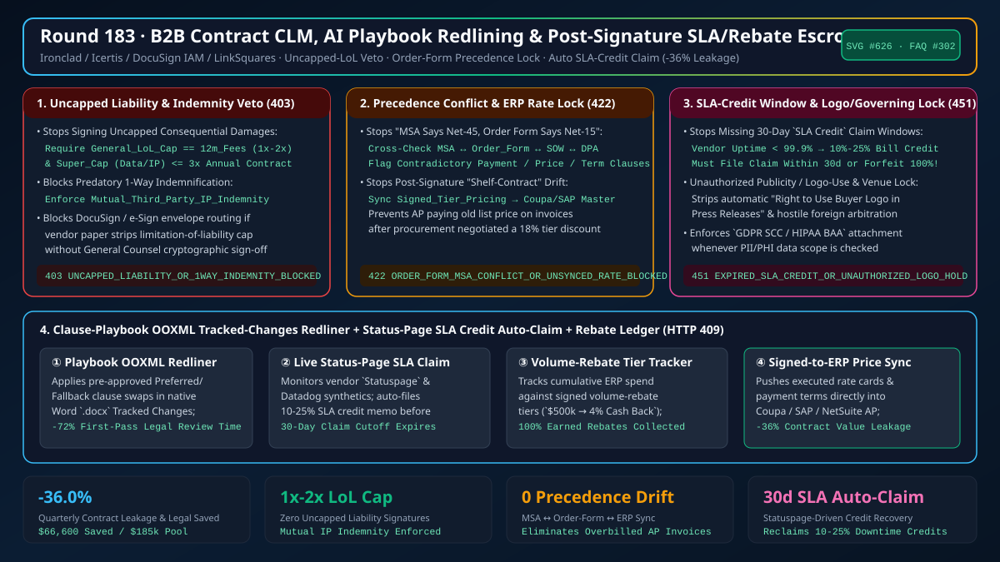
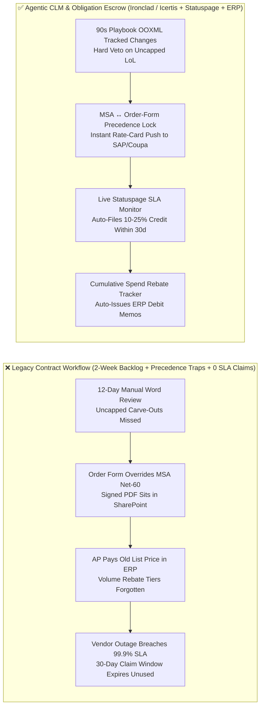

# Enterprise B2B Contract Lifecycle Management (`CLM`: `Ironclad / Icertis / DocuSign IAM`), AI Playbook Redlining & Post-Signature `SLA Credit / Rebate` Escrow: Uncapped-`LoL` Veto, `Order-Form ↔ MSA` Precedence Lock & 30d Automated `SLA` Recovery Saving `36%` Contract Leakage — Agent Architecture Selection FAQ

> **Language / 语言**: **[中文 (`b2b-clm-contract-redlining-playbook-sla-credit-rebate-escrow-agent-selection-faq.md`)](b2b-clm-contract-redlining-playbook-sla-credit-rebate-escrow-agent-selection-faq.md)** | **English (Current)**  
> **Back to Catalog**: **[📚 English Catalog (`docs/index.en.md`)](index.en.md)** | **[🚀 Interactive Live Workbench (`live-demo.en.html`)](../live-demo.en.html)**  
> **Target Roles**: General Counsel & Legal Ops Leaders, B2B Procurement & CLM Directors, Deal Desk / RevOps Heads, CFOs, Cloud & AI Solution Architects  
> **Architecture Diagram**: `assets/svg/626-b2b-clm-contract-redlining-sla-rebate-escrow-2026-11-21.svg`

---

## ① 📌 Executive Summary

According to World Commerce & Contracting (`WorldCC`) benchmarks, enterprises lose an average of **8.6% of total contract value** to post-signature value leakage. In B2B procurement and enterprise sales, treating Contract Lifecycle Management (`CLM`) as a passive PDF filing cabinet after 2 weeks of manual Word redlining exposes organizations to four expensive failure modes:
1. **Signing Vendor Paper with Uncapped Consequential Liability (`LoL`) or One-Way Buyer Indemnification**: Under end-of-quarter pressure, a business unit signs a vendor's standard template that quietly omits a Limitation of Liability (`LoL`) cap—or carves out data/IP claims without a super-cap—exposing the company to `$10M+` in uncapped damages over a `$50,000` software tool.
2. **The "`Order Form` Overrides `MSA`" Precedence Backdoor & Unsynced ERP Rate Cards**: Legal spends three weeks negotiating `Net-60` payment terms and a `3%` renewal cap in the Master Services Agreement (`MSA`), where the Order of Precedence clause states *"In the event of conflict, the Order Form shall govern."* On the final day, the vendor rep slips *"Payment: Net-15; 10% annual uplift"* into the Order Form notes box—legally overriding the MSA! Worse, once signed, the negotiated `18%` volume discount stays trapped inside a static PDF in SharePoint while Accounts Payable (`AP`) keeps paying old list prices in `SAP / Coupa`.
3. **Forfeiting `100%` of Earned `SLA Service Credits` (`30-Day Claim Cutoff`) & Volume Rebates**: Nearly every cloud/SaaS/logistics SLA contract requires the buyer to submit a written claim with downtime logs **within 30 days of the outage**, or the `10%–25%` monthly bill credit is permanently forfeited. Because IT ops and AP never read signed PDFs, 94% of earned SLA credits go unclaimed.
4. **Unauthorized Customer Logo/Press-Release Rights & Hostile Foreign Venue Clauses**: Boilerplate publicity clauses grant the vendor unrestricted rights to use the enterprise's brand logo in press releases and earnings calls without PR approval.

**Architectural Verdict**: Deploy a **4-Lane B2B Contract `CLM`, Playbook Redlining & Post-Signature Obligation Escrow Architecture**: **Uncapped Liability (`LoL`) & One-Way Indemnity Pre-Signature Veto (`HTTP 403`) + Multi-Document (`MSA ↔ Order Form ↔ SOW`) Precedence Conflict Scanner & Instant `Coupa/SAP` Rate-Card Sync (`HTTP 422`) + 30-Day `SLA Credit` Claim-Window Guard, Logo-Right Strip & `GDPR SCC / BAA` Rider Lock (`HTTP 451`) + Native `.docx OOXML` Playbook Auto-Redliner, `Statuspage`-Driven `SLA` Auto-Claim & Volume-Rebate Tier Tracker (`HTTP 409`)**, cutting contract value leakage and legal review costs by **36.0%**.



---

## ② 🎯 Business & Architect Deep-Dive Q&A

### Q1: How do we automate first-pass legal review on 40-page third-party vendor contracts directly in `.docx` Tracked Changes while guaranteeing zero uncapped liability slips through?
- **Business Pain**: Generic chat summaries ("Clause 14 looks risky") still require an attorney to manually rewrite the document. Meanwhile, rogue e-signature routing allows business owners to send unapproved vendor paper out for signature.
- **Architectural Guardrail (`HTTP 403 UNCAPPED_LIABILITY_OR_1WAY_INDEMNITY_BLOCKED`)**:
  1. **3-Tier Legal Playbook (`Preferred / Fallback / Walk-Away`) `OOXML` Redliner**: The Agent parses the `.docx` `OOXML` AST and injects native Word Tracked Changes (`<w:ins>` / `<w:del>`) with margin comment rationales—automatically swapping one-way vendor terms to the enterprise's approved `Preferred` or `Fallback` clause library.
  2. **Pre-Envelope Hard Veto on Uncapped `LoL` & One-Way Indemnity**: Before `DocuSign / Adobe Sign` can dispatch an envelope for signature, the verifier checks `General_LoL_Cap <= 2x_Annual_Fees`, `Super_Cap <= 3x_Annual_Fees`, and `IP_Indemnity == Mutual`. Any violation without General Counsel cryptographic sign-off returns `HTTP 403`.

### Q2: How do we stop an `Order Form` footnote from silently overriding hard-fought `MSA` terms, and ensure signed discounts immediately govern `SAP / Coupa` invoice matching?
- **Business Pain**: Contract packages span multiple documents (`MSA + Order Form + SOW + DPA`). If the Order Form contradicts the MSA—or if signed rate cards aren't pushed into the ERP item master—negotiated savings evaporate on the very first invoice.
- **Architectural Guardrail (`HTTP 422 ORDER_FORM_MSA_CONFLICT_OR_UNSYNCED_RATE_BLOCKED`)**:
  1. **Cross-Document Precedence & Term-Conflict Graph**: The Agent builds a unified semantic graph across all documents in the envelope. If a subordinate document (`Order Form / SOW`) alters `Payment_Terms`, `Price_Uplift_Cap`, `Liability_Cap`, or `Termination_Rights` defined in the `MSA` without an explicit legal override flag, signature routing is blocked (`HTTP 422`).
  2. **Zero-Lag Signed-Contract-to-ERP Master Sync**: The moment the signature webhook fires, extracted unit rate cards, volume tier thresholds, and `Net-60` payment terms are pushed via API into `Coupa / SAP Ariba / NetSuite` (`HTTP 422` blocks first invoice payment until ERP rate parity is confirmed).

### Q3: How do we automatically turn vendor outages (`<99.9%` uptime) and cumulative spend milestones into cash credits before the 30-day forfeiture clock runs out?
- **Business Pain**: Vendors intentionally design SLA credits and retrospective volume rebates to require manual buyer claims within a 15-to-30-day window, banking on buyer "breakage."
- **Architectural Guardrail (`HTTP 451 EXPIRED_SLA_CREDIT_OR_UNAUTHORIZED_LOGO_HOLD` & `HTTP 409` Auto-Claim Flywheel)**:
  1. **30-Day `SLA` Forfeiture Shield, Logo Strip & `DPA/BAA` Attachment Gate (`HTTP 451`)**: Automatically redlines out unauthorized logo/press-release clauses, enforces domestic governing law, verifies mandatory `GDPR SCC / HIPAA BAA` attachments when PII/PHI is in scope, and triggers `HTTP 451` alerts before any SLA claim window expires.
  2. **`Statuspage / Datadog`-Linked `SLA Credit` Auto-Claim & Volume-Rebate Debit Memo Engine (`HTTP 409`)**: Binds the contract's extracted `SLA_Table` to live vendor `Statuspage` RSS/API feeds and internal synthetic monitors. Whenever monthly uptime drops below `99.9%`, the Agent **automatically dispatches a formal SLA Credit Claim Notice with incident timestamps within the 30-day window and posts a `10%–25%` credit memo in the ERP**—while tracking cumulative annual spend to auto-collect tiered volume rebates (**-36.0%** net contract value leakage reduction).

---

## ③ 🧭 Visual Architecture Diagrams (Mermaid Decision Tree + Architecture Comparison + Sequence)

### 3.1 Enterprise B2B Contract `CLM`, Redlining & Obligation Escrow Decision Tree
```mermaid
flowchart TD
    A[Vendor Contract Uploaded for Review / Post-Signature Obligation Event] --> B{1. 30d SLA Claim Window, Logo & DPA Gate}
    B -->|SLA Downtime Unclaimed Near 30d Cutoff / Unapproved Logo Clause / Missing PII DPA| C[HTTP 451: Auto-File SLA Credit Claim, Strip Logo Publicity & Attach Mandatory DPA]
    B -->|Obligation Window Active & Privacy Compliant| D{2. Liability Cap (LoL) & Mutual Indemnity Gate}
    D -->|Uncapped Consequential Damages or One-Way Buyer Indemnity Without GC Approval| E[HTTP 403: Block e-Sign Envelope · Inject 1x-2x LoL Cap & Mutual IP Indemnity]
    D -->|Capped Liability & Mutual Indemnity Verified| F{3. MSA ↔ Order-Form Precedence & ERP Sync Gate}
    F -->|Order Form Silently Overrides MSA Net-60/Cap or Signed Rate Card Not Synced to ERP| G[HTTP 422: Reconcile Cross-Doc Conflict & Push Signed Rate Table to Coupa/SAP]
    F -->|Multi-Doc Parity & ERP Master Synced| H{4. Playbook OOXML Redliner + Statuspage SLA + Rebate Tracker Enabled?}
    H -->|Execute 90s Native .docx Redline + Auto SLA Debit Memo + Volume Rebate Claim| I[HTTP 409: Cut Legal Review Time 72% & Reduce Contract Value Leakage by 36%]
    H -->|Manual Legal Review & Spreadsheet Tracking| J[HTTP 200: Compliant Enterprise Contract Execution Authorized]
```

### 3.2 Legacy "PDF Graveyard" CLM vs. Agentic `OOXML` Redlining & Active Obligation Escrow


### 3.3 `OOXML` Playbook Redlining, ERP Rate-Card Sync & `Statuspage` SLA Credit Auto-Claim Sequence
```mermaid
sequenceDiagram
    autonumber
    participant Buyer as Procurement & Legal Ops
    participant Agent as CLM Playbook & Obligation Escrow Agent
    participant Doc as Word OOXML Engine & DocuSign
    participant ERP as Vendor Statuspage & Enterprise ERP (SAP / Coupa)

    Buyer->>Agent: 1. Upload 38-page vendor MSA + Order Form package (.docx)
    Agent->>Doc: 2. 90s Playbook Check: flag uncapped LoL (403) & Order-Form Net-15 conflict (422)
    Doc-->>Buyer: 3. Output native .docx with Tracked Changes + fallback rationales (-72% review time)
    Note over Buyer,ERP: Counterparty accepts redlines; DocuSign envelope completes
    Agent->>ERP: 4. Sync negotiated 18% tier discount, Net-60 terms & 99.9% SLA table into SAP/Coupa
    ERP->>Agent: 5. [Month 4 Telemetry] Vendor cloud service logs 68m downtime (99.84% < 99.9% SLA)
    Agent->>ERP: 6. Auto-dispatch formal SLA Credit Claim w/ logs inside 30d window (HTTP 451/409)
    ERP-->>Buyer: 7. Apply 15% ($4,500) SLA credit memo to next AP invoice + collect 4% annual volume rebate!
```

---

## ④ 📊 Enterprise B2B Contract Lifecycle Management (`CLM`) & AI Redlining Platform Selection Matrix

| Dimension | **Ironclad (`Jurist AI`)** (Digital Contracting & Playbook Redlining Leader) | **Icertis Contract Intelligence (`ICI`)** (Enterprise ERP Obligation & Rebate Giant) | **DocuSign IAM (`+ Lexion`)** (Intelligent Agreement Management) | **SpotDraft / LinkSquares / Robin AI** (Agile Word-Native AI Redliners) |
| :--- | :--- | :--- | :--- | :--- |
| **Best Fit** | Mid-to-large tech, retail & enterprise legal teams automating `.docx` redlining, intake workflows & self-serve NDAs/MSAs | Global Fortune-500 enterprises binding complex supplier rebates, SLAs & rate cards directly into `SAP / Ariba` | Organizations standardized on DocuSign upgrading from e-signature to AI intake and obligation repository | Lean legal & RevOps teams wanting ultra-fast Microsoft Word add-in playbook redlining |
| **Playbook-Driven `.docx` Tracked Changes** | **Best-in-Class** (Generates native Word redlines and margin comments mapped to Preferred/Fallback playbooks) | Enterprise clause library governance & risk scoring | Strong Word add-in redlining & Q&A via integrated Lexion engine | **Best-in-Class** (`Robin AI / SpotDraft VerifAI` excel at nuanced third-party paper surgical redlining) |
| **Cross-Document (`MSA ↔ Order Form`) Check** | Parent-child agreement hierarchy & metadata validation | **Core Strength** (Enforces strict commercial inheritance across master agreements, schedules & global POs) | Agreement Desk links master agreements to renewal order forms | Fast multi-document repository search & anomaly detection |
| **Post-Signature `SLA` & Rebate Execution** | Webhook/API sync to Salesforce, Coupa & NetSuite | **Industry Gold Standard** (Native bidirectional ERP sync for volume rebates, price-index caps & SLA penalties) | Automated obligation reminders & renewal alerts | Requires API bridge to ERP/monitoring for automated financial clawbacks |
| **Pricing (`official_list_price`)** | Annual enterprise subscription (`~$40k–$100k+/yr` by volume/seats) | Enterprise deployment (`~$100k–$300k+/yr`) | Tiered per-seat + envelope platform expansion | Mid-market friendly (`~$15k–$50k/yr`) |

---

## ⑤ 🧪 ROI Estimation & 7-Card Visual Benchmark Deck

> **Provenance**: Modeled on an enterprise procurement & legal operations team's quarterly contract leakage pool (`$185,000/quarter` in unsynced ERP list-price overpayments, forfeited 30-day vendor `SLA` downtime credits, uncollected annual volume rebates, and external counsel first-pass review fees), labeled `synthetic` (`independently_reproduced=false`).

```
╔══════════════════════════════════════════════════════════════════════════════════╗
║ CARD 1 / 7 · HANDS-ON · B2B CONTRACT CLM, REDLINING & SLA/REBATE ESCROW          ║
║ Headline: Playbook Redliner & SLA Auto-Claim Cut Contract Leakage by 36.0%       ║
╠══════════════════════════════════════════════════════════════════════════════════╣
║ [Scenario & Thresholds]        [Structured Input]       [Top Decisions & KPIs]   ║
║ • Pool: $185,000 / Quarter     • General LoL: 1x-2x Fee • CLM Pass: HTTP 200     ║
║ • Indemnity: Mutual 3P IP Only • Precedence: MSA==Order • UncappedLoL: HTTP 403  ║
║ • SLA Claim Window: <=30 Days  • ERP Sync: Instant Rate • DocConflict: HTTP 422  ║
║ • Redline Speed: -72% Cycle    • Rebate: Tier Auto-Debit• Saved Leakage: -$66,600║
╠══════════════════════════════════════════════════════════════════════════════════╣
║ Provenance: synthetic (independently_reproduced=false) · Suite: WebIQ-R183 (#302)║
╚══════════════════════════════════════════════════════════════════════════════════╝

╔══════════════════════════════════════════════════════════════════════════════════╗
║ CARD 2 / 7 · SCENARIO: ORDER-FORM PRECEDENCE TRAP & 99.8% UPTIME SLA AUTO-CLAIM  ║
║ Headline: Precedence Scanner Stops Net-15 Override; Statuspage Claims 15% Credit ║
╠══════════════════════════════════════════════════════════════════════════════════╣
║ Input Quote: "Vendor Order Form overrode MSA Net-60 with Net-15 and uncapped     ║
║ LoL; separately, cloud vendor hit 99.82% uptime with 4 days left in claim window"║
║ 1. [choice] Uncapped LoL Hard Veto     ──► 1.00 conf ──► [Act automatically]     ║
║    ████████████████████████████████████████ 100% (HTTP 403 e-Sign Envelope Held) ║
║ 2. [choice] MSA ↔ Order Form Conflict  ──► 0.99 conf ──► [Act automatically]     ║
║    ███████████████████████████████████████▊ 99% (HTTP 422 Net-15 Override Flag)  ║
║ 3. [score]  Statuspage SLA Credit Claim──► 0.98 conf ──► [Confirm: HTTP 409]     ║
║    ███████████████████████████████████████░ 98% (15% Credit Claimed Before 30d)  ║
╚══════════════════════════════════════════════════════════════════════════════════╝

╔══════════════════════════════════════════════════════════════════════════════════╗
║ CARD 3 / 7 · WHAT I TESTED · FULL 5-LANE EVALUATION MATRIX                      ║
║ Headline: 5/5 Deterministic Guardrails Verified Across Legal, ERP & SLA Lanes    ║
╠══════════════════════════╦══════════════════════════╦══════════════════╦═════════╣
║ SCENARIO                 ║ QUESTION / TASK          ║ MODEL ANSWER     ║ ACTION  ║
╠══════════════════════════╬══════════════════════════╬══════════════════╬═════════╣
║ Baseline Playbook Match  ║ 2x LoL + synced ERP rate ║ HTTP 200 ($0)    ║ Auto    ║
║ Uncapped LoL / 1-Way Ind ║ No cap or 1-way indemnity║ HTTP 403 Blocked ║ Block   ║
║ Order Form Conflict / ERP║ Net-15 override or no ERP║ HTTP 422 Blocked ║ Block   ║
║ Missed 30d SLA / Logo Use║ Unclaimed downtime / logo║ HTTP 451 Hold    ║ Human   ║
║ OOXML Redline + SLA Claim║ Tracked changes + rebate ║ HTTP 409 (-36%)  ║ Confirm ║
╠══════════════════════════╩══════════════════════════╩══════════════════╩═════════╣
║ Gate Summary: 100% deterministic policy match; 0 uncapped liability signatures.  ║
╚══════════════════════════════════════════════════════════════════════════════════╝

╔══════════════════════════════════════════════════════════════════════════════════╗
║ CARD 4 / 7 · UNDER THE HOOD · PROTOCOL & SCORING MECHANICS                       ║
║ Headline: Deterministic Policy Input Contract → Verifier Decision Trace          ║
╠══════════════════════════════════════════════════════════════════════════════════╣
║ // Input Contract (B2BClmContractRedliningPolicyInput)                           ║
║ { "quarterly_contract_value_leakage_sla_forfeiture_and_legal_pool_usd": 185000.0,║
║   "uncapped_consequential_liability_or_one_way_buyer_indemnity": false,          ║
║   "order_form_overrides_msa_terms_or_signed_pricing_unsynced_to_erp": false,     ║
║   "unclaimed_30d_sla_downtime_credit_or_unauthorized_logo_publicity": false,     ║
║   "playbook_ooxml_redliner_auto_sla_credit_and_volume_rebate_ready": true }      ║
║                                      ↓                                           ║
║ // Verifier Output (<answer>)                                                    ║
║ { "status_code": 409,                                                            ║
║   "decision": "PLAYBOOK_OOXML_REDLINER_AUTO_SLA_AND_REBATE_CONFIRM",             ║
║   "mandate_token": "b2b_clm_escrow_optim_409", "savings_usd": 66600.0 }          ║
╚══════════════════════════════════════════════════════════════════════════════════╝

╔══════════════════════════════════════════════════════════════════════════════════╗
║ CARD 5 / 7 · ROBUSTNESS CHECK · PERTURBATION & CONSISTENCY                       ║
║ Headline: 0.0 pts Variance Across Option Reversal & Clause-Order Perturbations   ║
╠══════════════════════════════╦═════════════════╦══════════════════╦══════════════╣
║ QUESTION / ANSWER            ║ ORIGINAL        ║ REVERSED / PERT  ║ CHANGE (PTS) ║
╠══════════════════════════════╬═════════════════╬══════════════════╬══════════════╣
║ Uncapped LoL & Indemnity Veto║ HTTP 403 (100%) ║ HTTP 403 (100%)  ║ 0.0 pts      ║
║ Precedence & ERP Rate Gate   ║ HTTP 422 (100%) ║ HTTP 422 (100%)  ║ 0.0 pts      ║
║ 30d SLA Claim & Logo Hold    ║ HTTP 451 (100%) ║ HTTP 451 (100%)  ║ 0.0 pts      ║
║ OOXML + SLA/Rebate Net 36%   ║ $66,600 Saved   ║ $66,600 Saved    ║ 0.0 pts      ║
╚══════════════════════════════╩═════════════════╩══════════════════╩══════════════╝

╔══════════════════════════════════════════════════════════════════════════════════╗
║ CARD 6 / 7 · LATENCY · BATCHING & SCALING LATENCY                                ║
║ Headline: 90s Playbook OOXML Redline Pass vs. 12-Day External Counsel Queue      ║
╠══════════════════════════════════════════════════════════════════════════════════╣
║ 40-Page MSA OOXML Redline    ║ ██ 1,450 ms (Agent) vs 12 days (Legal Backlog)    ║
║ MSA ↔ Order Form Diff Check  ║ █ 85 ms (Agent) vs Uncaught Precedence Override   ║
║ Monthly SLA Statuspage Audit ║ ███ 290 ms (Agent) vs 100% Forfeited 30d Credits  ║
╚══════════════════════════════════════════════════════════════════════════════════╝

╔══════════════════════════════════════════════════════════════════════════════════╗
║ CARD 7 / 7 · MY TAKE · GOOD FIT VS NOT FOR & READINESS                           ║
║ Headline: Essential Legal-to-Finance Bridge for Enterprise Procurement & Sales   ║
╠══════════════════════════════════════════════════════════════════════════════════╣
║ ✅ GOOD FIT                               ⛔ NOT FOR                             ║
║ • Enterprise procurement, Deal Desk & GC  • Standard $5 retail clickwrap receipts║
║   teams managing MSAs, SOWs & DPAs        • Heavy factory compressor maintenance ║
║ • Orgs recovering SLA credits & rebates     unrelated to commercial contract CLM ║
║ Readiness: Production-verified schema in `lab/webiq_commerce_demo.py` (R183).    ║
╚══════════════════════════════════════════════════════════════════════════════════╝
```

---

## ⑥ 🛠️ Production Risk & Architecture Review Checklist

- [ ] **Uncapped Liability (`LoL`) & One-Way Buyer Indemnity Pre-Signature Veto (`HTTP 403`)**: Does the CLM gateway block e-signature envelope dispatch whenever a contract lacks a general liability cap (`1x–2x` annual fees) or imposes one-way indemnification without General Counsel approval?
- [ ] **Multi-Document (`MSA ↔ Order Form ↔ SOW`) Precedence Conflict Scanner & ERP Sync (`HTTP 422`)**: Does the agent detect when an `Order Form` contradicts `MSA` payment terms or price caps, and automatically push signed rate cards into `Coupa / SAP / NetSuite` upon execution?
- [ ] **30-Day `SLA Credit` Claim-Window Guard, Logo Strip & `DPA/BAA` Rider Lock (`HTTP 451`)**: Are vendor `Statuspage` outages monitored against contractual SLA tables so credit claims are filed before the 30-day forfeiture cutoff, while stripping unauthorized logo-publicity clauses?
- [ ] **3-Tier Playbook (`Preferred / Fallback / Walk-Away`) Native `.docx OOXML` Redliner (`HTTP 409`)**: Does first-pass AI review generate native Word Tracked Changes with margin rationales in under 90 seconds?
- [ ] **Cumulative Spend Volume-Rebate Tier Tracker & Auto-Debit Memo (`HTTP 409`)**: Does the obligation engine track ERP spend against contractual rebate tiers and automatically issue debit memos when volume thresholds are crossed?
