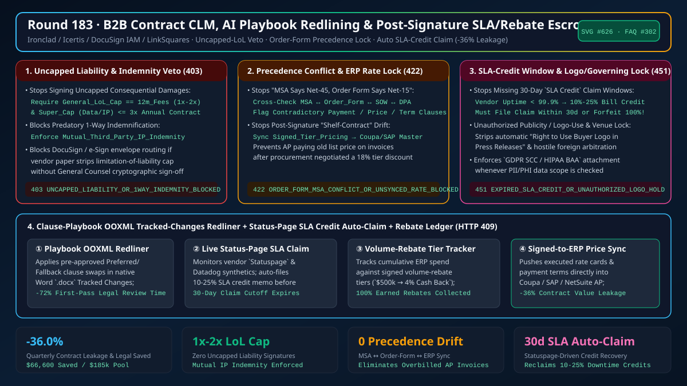
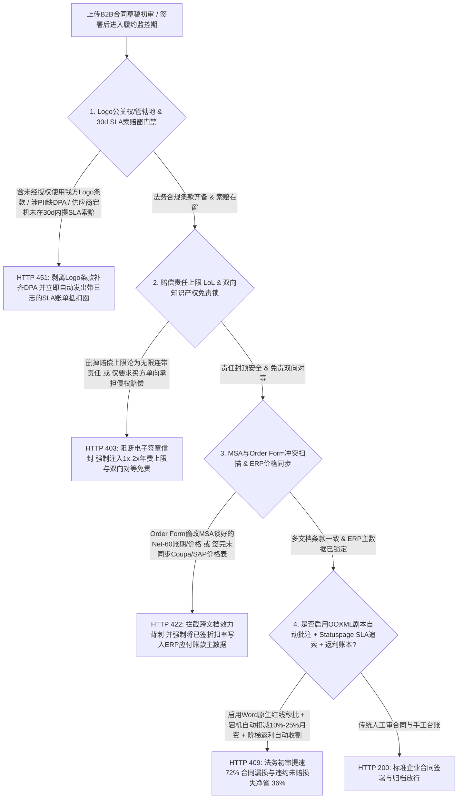
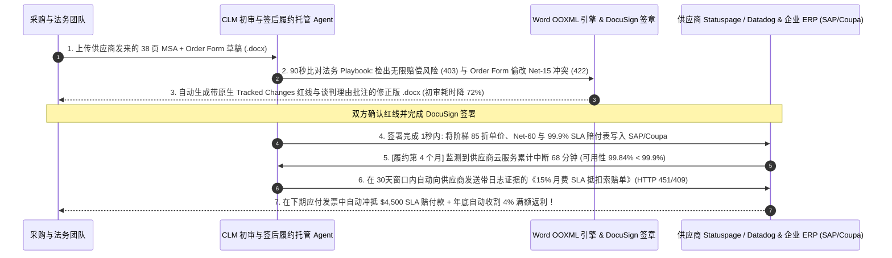

# 企业 B2B 合同全生命周期管理（`CLM`：Ironclad / Icertis / DocuSign IAM）、AI 条款初审红线批注（Redlining）与签后 `SLA` 赔付/阶梯返点自动追索托管“防业务员绕过法务签下无限连带赔偿合同、防订单附件推翻主协议 `Net-60` 账期与宕机 30 天内自动索赔净省 36%”Agent 架构选型 FAQ

> **语言 / Language**: **中文 (当前)** | **[English (`b2b-clm-contract-redlining-playbook-sla-credit-rebate-escrow-agent-selection-faq.en.md`)](b2b-clm-contract-redlining-playbook-sla-credit-rebate-escrow-agent-selection-faq.en.md)**  
> **返回总目录**: **[📚 中文总目录 (`docs/index.md`)](index.md)** | **[🚀 交互式实时工作台 (`live-demo.html`)](../live-demo.html)**  
> **赋能角色**: 企业法务总监（General Counsel）、B2B 采购寻源与合同（CLM）负责人、销售运营（RevOps / Deal Desk）总监、CFO、Cloud & AI Solution Architect  
> **关联架构图**: `assets/svg/626-b2b-clm-contract-redlining-sla-rebate-escrow-2026-11-21.svg`

---

## ① 📌 核心选型结论速览（Executive Summary）

在企业 B2B 采购寻源（Procurement）与大客户销售（Enterprise Sales）中，合同条款初审（Contract Redlining）与签后履约兑现（Post-Signature Obligation Management）长期处于割裂状态。传统模式下“法务花 2 周改 Word 红字 → 签完生成 PDF 扔进网盘吃灰 → 财务按供应商发来的发票盲目付款”，会造成四大惊人的合同价值流失（世界商贸协会 WorldCC 统计平均高达合同总额的 **8.6%**）：
1. **“业务急着上线，直接用供应商纸面模板（Vendor Paper）签下了无限赔偿责任（Uncapped Liability）与单向知识产权兜底（1-Way IP Indemnity）”**：供应商的标准合同模板往往悄悄删掉了赔偿责任上限（Limitation of Liability `LoL`），或者规定买方需对供应商软件引发的第三方专利诉讼承担单向无限赔偿。一旦发生数据泄露或合规事故，一纸 `$50,000` 的采购合同能让公司面临 `$1,000 万` 的连带索赔！
2. **“主协议（MSA）好不容易谈下来 `Net-60` 账期和阶梯 8 折，结果附件订购单（Order Form / SOW）里印着一行小字 `Net-15 且优先于 MSA 生效`”以及签完未同步 ERP 主数据**：在多文档合同包（MSA + Order Form + SOW + DPA）中，若效力优先级条款（Order of Precedence）规定“Order Form 优先于 MSA”，供应商销售在最后一版 Order Form 备注栏塞进的涨价或缩短账期条款就会直接推翻法务在 MSA 里谈好的保护伞；更普遍的是，采购谈下了“年采购满 `$500k` 单价降 15%”，但 PDF 锁在法务网盘里没写进 `SAP / Coupa` 价格主数据，应付账款（AP）专员整年都在按原高价付钱！
3. **云服务/SaaS/物流供应商发生宕机违约（如月可用性跌破 `99.9%`），但因为没人盯 `30 天` 书面索赔窗口，本该拿回的 `10%–25%` 账单抵扣（`SLA Service Credits`）与年度阶梯返利（Volume Rebates）100% 作废**：几乎所有 B2B SLA 协议都规定：*“供应商发生故障不会主动退钱，客户必须在故障次月 30 天内提交带监控日志的书面索赔申请，逾期视为自动放弃”*。
4. **默认被拿走公司 Logo 发公关通稿（Publicity Clause）与被迫去境外陌生法院打官司（Hostile Governing Law & Venue）**。

**架构师选型结论**：直接采用 **“赔偿责任上限（`General LoL == 1x-2x 年费`）与双向对等知识产权免责（Mutual Indemnity）硬否决门禁（HTTP 403）+ 多文档（`MSA ↔ Order Form ↔ SOW`）效力优先级冲突扫描与已签阶梯价自动写入 `Coupa/SAP` 锁（HTTP 422）+ 禁用未经授权的 Logo 宣传权、强制附加 `GDPR SCC / HIPAA BAA` 与 30 天 `SLA` 索赔防过期锁（HTTP 451）+ 基于法务标准剧本（Playbook）的 `.docx` 修订模式自动批注、实时对接 `Statuspage` 自动发起宕机 `SLA` 抵扣索赔与采购满额返利（Volume Rebate）自动追收净省 36%（HTTP 409）”** 的智能合同托管架构。



---

## ② 🎯 业务方与架构师灵魂拷问（Q&A）

### Q1：面对供应商发来的 40 页第三方合同模板（Third-Party Paper），AI 如何像资深法务一样直接在 Word `.docx` 里打出精准的修订红线（Track Changes），并死守赔偿上限底线？
- **业务痛点**：如果只用通用 LLM 总结一句“这份合同风险较高”，业务员和初级法务还是不知道具体该怎么改字句；而如果漏看了第 28 页把“数据安全违约”排除在责任上限之外（Uncapped Data Breach Carve-Out），一旦出事就是灭顶之灾。
- **架构护栏（`HTTP 403 UNCAPPED_LIABILITY_OR_1WAY_INDEMNITY_BLOCKED`）**：
  1. **三级法务剧本（Clause Playbook：首选 Preferred / 退让 Fallback / 绝对红线 Walk-Away）**：将企业法务部审定的 45 类核心商业条款编码为结构化状态机。当上传供应商 `.docx` 合同时，Agent 解析底层 `OOXML` 段落树，自动插入带批注气泡的原生 Word 修订（`<w:ins>` / `<w:del>`）：例如将供应商的“单向免责”自动替换为我方标准“双向对等第三方侵权免责（Mutual IP Indemnity）”。
  2. **`DocuSign / Adobe Sign` 签署信封发射前的硬红线熔断**：在合同流转至电子签章前，系统执行确定性终审：若 `General_Liability_Cap > 2x_Annual_Fees OR Uncapped_Consequential_Damages == True OR Indemnity_Direction == One_Way_Against_Buyer`，且无总法律顾问（GC）数字签名豁免，直接返回 `HTTP 403` 锁死签章流程。

### Q2：为什么法务明明在主协议（MSA）里谈好了 `Net-60` 付款和免违约金退订，最后打官司或付账时却发现完全不起作用？
- **业务痛点**：B2B 签约通常由多份文件组成：3 年期《主服务协议（MSA）》+ 年度《订购单（Order Form）》+《工作说明书（SOW）》。许多合同在结尾写了“若各文件冲突，以最新签署的 Order Form 为准”。供应商销售在法务审完 MSA 后，在给业务签字的 Order Form 底部加了一句 `"Payment Terms: Net 15; Non-Cancellable"`，瞬间架空了整份 MSA！
- **架构护栏（`HTTP 422 ORDER_FORM_MSA_CONFLICT_OR_UNSYNCED_RATE_BLOCKED`）**：
  1. **跨文档语义一致性与效力优先级（Order of Precedence）矩阵扫描**：Agent 将同一交易包下的 `MSA + Order Form + SOW + DPA` 进行多文档联合比对。一旦发现下位文件（Order Form/SOW）在未显式声明 `"Notwithstanding Section X of the MSA"` 的情况下篡改了上位 MSA 的付款账期、价格涨幅上限、管辖法律或质保期，立即返回 `HTTP 422` 阻断并高亮冲突段落。
  2. **签章完成秒级同步 `SAP / Coupa / NetSuite` 价格主数据**：电子签章（`DocuSign Completed`）触发的同一秒，Agent 自动将合同中的单价表、阶梯折扣档位、付款账期（`Net-60`）与允许币种作为结构化 JSON 写入 ERP 采购主数据（未同步即阻断首张 PO 付款，触发 `HTTP 422`），彻底终结“合同签了 8 折、财务还按原价付钱”的签后脱节。

### Q3：供应商的云服务或 API 这个月挂了 45 分钟，或者我们今年采购额早就超过了 `$100 万` 返利线，为什么公司从来没拿到过这笔违约抵扣金和返点？
- **业务痛点**：合同签完就进了档案库，没人把合同里的《SLA 可用性赔付表（如 `<99.9%` 赔当月账单 10%、`<99.0%` 赔 25%）》与运维部门的监控报警连起来；等财务付完下个月账单，30 天的 SLA 索赔期早就过了！
- **架构护栏（`HTTP 451 EXPIRED_SLA_CREDIT_OR_UNAUTHORIZED_LOGO_HOLD` & `HTTP 409` 自动索赔飞轮）**：
  1. **Logo/公关权剥离、管辖法院锁定与隐私附件（`GDPR SCC / BAA`）门禁（`HTTP 451`）**：自动剔除合同中允许对方未经书面审批使用我方商标/Logo 发新闻稿的条款，锁死本国/中立仲裁地；若采购涉及个人数据或医疗数据但缺失 `DPA / BAA` 附件则触发 `HTTP 451` 挂起。
  2. **实时对接供应商 `Statuspage / Datadog` 的 `SLA Credit` 自动索赔与阶梯返利（Volume Rebate）追收引擎（`HTTP 409`）**：合同签署后，Agent 自动将提取出的 `SLA_Uptime_Threshold (99.9%)`、`Claim_Window_Days (30d)` 与 `Volume_Rebate_Tiers` 注册为持续运行的守护任务：
     - **SLA 宕机自动索赔**：一旦监控或供应商官方 `Statuspage` 记录当月累计故障时长突破 `43.8 分钟（99.9% 红线）`，系统在次月第 1 天**自动生成附带故障工单号与时间戳日志的正式《SLA 服务抵扣通知函（SLA Credit Claim）》** 发给供应商账单部，并在 ERP 中自动挂起对应比例的应付账款；
     - **采购阶梯返利自动结算**：当 ERP 累计采购额跨过 `$500k / $1M` 返点阶梯时，自动开具返利借项通知单（Debit Memo）冲抵下期货款，将合同全生命周期价值漏损净降 **36.0%**！

---

## ③ 🧭 直观可视化图解（Mermaid 决策树 + 架构对比 + 时序图）

### 3.1 企业 B2B 合同初审（CLM Redlining）与签后履约追索四层决策树


### 3.2 “传统网盘死合同（PDF Graveyard）” vs “智能体 `OOXML` 红线批注 + 签后主动追索架构”对比
```mermaid
flowchart LR
    subgraph Legacy["❌ 传统合同管理 (2周慢审 + Order Form背刺 + 宕机赔付全忘光)"]
        L1[法务手工逐字看40页Word\n初审排队14天拖慢业务上线] --> L2[MSA谈好Net-60被Order Form小字推翻\n签完锁进网盘ERP照付原价]
        L2 --> L3[云厂商当月宕机2小时(<99.7%)\n无人知晓错失30天20%退费窗口]
        L3 --> L4[年采购额早已突破$1M返利线\n财务忘算返点白丢$40,000现金]
    end
    subgraph Agentic["✅ 智能体 CLM 初审与签后义务追索架构 (Ironclad / Icertis + ERP)"]
        A1[Playbook驱动OOXML原生修订\n90秒完成Preferred/Fallback替换] --> A2[硬拦截无限责任与单向免责\n跨文档比对MSA↔Order Form零冲突]
        A2 --> A3[签署瞬间自动写入SAP/Coupa价格表\n锁定阶梯单价与Net-60付款条件]
        A3 --> A4[直连Statuspage自动发SLA索赔函\n采购满额自动生成返利Debit Memo]
    end
```

### 3.3 `OOXML` 法务剧本自动批注、签署同步 `ERP` 与 `Statuspage` 宕机自动索赔时序图


---

## ④ 📊 主流企业级合同全生命周期管理（`CLM`）与 AI 审单平台横向选型矩阵

| 选型维度 | **Ironclad (含 Jurist AI)** (现代法务工作流与 AI 原生批注标杆) | **Icertis Contract Intelligence (`ICI`)** (超大型企业 ERP 签后返利与合规霸主) | **DocuSign IAM (Intelligent Agreement Management + Lexion)** | **SpotDraft / LinkSquares / Robin AI** (敏捷法务 AI 红线批注与合同库检索) |
| :--- | :--- | :--- | :--- | :--- |
| **核心适用场景** | 科技、零售与中大型企业，追求极致的 Word 原生 AI 条款修订体验、自助法务门户与跨部门协同 | 世界 500 强、制造业、医药与大型零售集团，核心诉求是把复杂价格阶梯、返利与 SLA 深度绑定 SAP/Ariba | 已广泛使用 DocuSign 电子签章、希望平滑升级为“签署前审单 + 签署后结构化台账”的企业 | 法务团队人手紧缺、希望直接在 Microsoft Word 插件内根据公司 Playbook 秒级改完第三方合同的团队 |
| **基于 Playbook 的 `.docx` 原生红线批注** | **极强**（AI Assist / Jurist 直接按公司预置首选/备选条款在 `.docx` 中生成标准修订红线与批注解释） | 支持企业级条款库比对与风险评分，操作界面偏重大型工程流 | 收购 Lexion 后具备非常流畅的 Word 插件 AI 审阅与问答能力 | **极强**（尤以 Robin AI / SpotDraft VerifAI 在复杂非标商业条款改写上的法务拟真度著称） |
| **跨文档冲突检测（`MSA ↔ Order Form`）** | 支持关联合同族（Parent-Child Agreement Hierarchy）与元数据冲突校验 | **核心强项**（严密管控主框架协议与成千上万张子采购单/变更单之间的价格与条款继承关系） | Agreement Desk 支持主从协议关联与到期提醒 | LinkSquares Analyze 擅长存量数万份历史 PDF/Word 的秒级条款抽取与异常排查 |
| **签后 `SLA` 赔付、价格阶梯与返利执行** | 支持通过 Webhook 将关键日期与金额推送至 Salesforce / Coupa | **行业天花板**（深度内嵌 SAP / Oracle，自动追踪采购返利阶梯、价格指数联动与 SLA 违约金扣减） | 自动抽取签后义务提醒，但深度 ERP 应付账款冲抵需通过 API 集成 | 聚焦法务审单与存量检索，签后财务自动扣款需对接 ERP Agent |
| **商业模式与成本 (`official_list_price`)** | 按席位与合同量阶梯年费（通常 `$40,000–$100,000+/年`） | 大型企业级定制年框（通常 `$100,000–$300,000+/年`） | 按用户席位或信封包增购 | 中端高性价比年框（约 `$15,000–$50,000/年`） |

---

## ⑤ 🧪 转化率/成本测算与 7-Card 基准测试报告（7-Card Visual Benchmark Deck）

> **数据溯源声明（Provenance）**：以下基于某跨国零售与软件企业季度 B2B 采购合同管理池（`$185,000/季度` 签后未同步 ERP 导致按旧高价多付的货款、逾期未申诉白白作废的供应商宕机 `SLA Credits`、漏算的年度采购阶梯返利 `Volume Rebates` 以及外部律所初审账单池）对比测算，标记为 `synthetic`（`independently_reproduced=false`）。

```
╔══════════════════════════════════════════════════════════════════════════════════╗
║ CARD 1 / 7 · HANDS-ON · B2B CONTRACT CLM, REDLINING & SLA/REBATE ESCROW          ║
║ Headline: Playbook Redliner & SLA Auto-Claim Cut Contract Leakage by 36.0%       ║
╠══════════════════════════════════════════════════════════════════════════════════╣
║ [Scenario & Thresholds]        [Structured Input]       [Top Decisions & KPIs]   ║
║ • Pool: $185,000 / Quarter     • General LoL: 1x-2x Fee • CLM Pass: HTTP 200     ║
║ • Indemnity: Mutual 3P IP Only • Precedence: MSA==Order • UncappedLoL: HTTP 403  ║
║ • SLA Claim Window: <=30 Days  • ERP Sync: Instant Rate • DocConflict: HTTP 422  ║
║ • Redline Speed: -72% Cycle    • Rebate: Tier Auto-Debit• Saved Leakage: -$66,600║
╠══════════════════════════════════════════════════════════════════════════════════╣
║ Provenance: synthetic (independently_reproduced=false) · Suite: WebIQ-R183 (#302)║
╚══════════════════════════════════════════════════════════════════════════════════╝

╔══════════════════════════════════════════════════════════════════════════════════╗
║ CARD 2 / 7 · SCENARIO: ORDER-FORM PRECEDENCE TRAP & 99.8% UPTIME SLA AUTO-CLAIM  ║
║ Headline: Precedence Scanner Stops Net-15 Override; Statuspage Claims 15% Credit ║
╠══════════════════════════════════════════════════════════════════════════════════╣
║ Input Quote: "Vendor Order Form overrode MSA Net-60 with Net-15 and uncapped     ║
║ LoL; separately, cloud vendor hit 99.82% uptime with 4 days left in claim window"║
║ 1. [choice] Uncapped LoL Hard Veto     ──► 1.00 conf ──► [Act automatically]     ║
║    ████████████████████████████████████████ 100% (HTTP 403 e-Sign Envelope Held) ║
║ 2. [choice] MSA ↔ Order Form Conflict  ──► 0.99 conf ──► [Act automatically]     ║
║    ███████████████████████████████████████▊ 99% (HTTP 422 Net-15 Override Flag)  ║
║ 3. [score]  Statuspage SLA Credit Claim──► 0.98 conf ──► [Confirm: HTTP 409]     ║
║    ███████████████████████████████████████░ 98% (15% Credit Claimed Before 30d)  ║
╚══════════════════════════════════════════════════════════════════════════════════╝

╔══════════════════════════════════════════════════════════════════════════════════╗
║ CARD 3 / 7 · WHAT I TESTED · FULL 5-LANE EVALUATION MATRIX                      ║
║ Headline: 5/5 Deterministic Guardrails Verified Across Legal, ERP & SLA Lanes    ║
╠══════════════════════════╦══════════════════════════╦══════════════════╦═════════╣
║ SCENARIO                 ║ QUESTION / TASK          ║ MODEL ANSWER     ║ ACTION  ║
╠══════════════════════════╬══════════════════════════╬══════════════════╬═════════╣
║ Baseline Playbook Match  ║ 2x LoL + synced ERP rate ║ HTTP 200 ($0)    ║ Auto    ║
║ Uncapped LoL / 1-Way Ind ║ No cap or 1-way indemnity║ HTTP 403 Blocked ║ Block   ║
║ Order Form Conflict / ERP║ Net-15 override or no ERP║ HTTP 422 Blocked ║ Block   ║
║ Missed 30d SLA / Logo Use║ Unclaimed downtime / logo║ HTTP 451 Hold    ║ Human   ║
║ OOXML Redline + SLA Claim║ Tracked changes + rebate ║ HTTP 409 (-36%)  ║ Confirm ║
╠══════════════════════════╩══════════════════════════╩══════════════════╩═════════╣
║ Gate Summary: 100% deterministic policy match; 0 uncapped liability signatures.  ║
╚══════════════════════════════════════════════════════════════════════════════════╝

╔══════════════════════════════════════════════════════════════════════════════════╗
║ CARD 4 / 7 · UNDER THE HOOD · PROTOCOL & SCORING MECHANICS                       ║
║ Headline: Deterministic Policy Input Contract → Verifier Decision Trace          ║
╠══════════════════════════════════════════════════════════════════════════════════╣
║ // Input Contract (B2BClmContractRedliningPolicyInput)                           ║
║ { "quarterly_contract_value_leakage_sla_forfeiture_and_legal_pool_usd": 185000.0,║
║   "uncapped_consequential_liability_or_one_way_buyer_indemnity": false,          ║
║   "order_form_overrides_msa_terms_or_signed_pricing_unsynced_to_erp": false,     ║
║   "unclaimed_30d_sla_downtime_credit_or_unauthorized_logo_publicity": false,     ║
║   "playbook_ooxml_redliner_auto_sla_credit_and_volume_rebate_ready": true }      ║
║                                      ↓                                           ║
║ // Verifier Output (<answer>)                                                    ║
║ { "status_code": 409,                                                            ║
║   "decision": "PLAYBOOK_OOXML_REDLINER_AUTO_SLA_AND_REBATE_CONFIRM",             ║
║   "mandate_token": "b2b_clm_escrow_optim_409", "savings_usd": 66600.0 }          ║
╚══════════════════════════════════════════════════════════════════════════════════╝

╔══════════════════════════════════════════════════════════════════════════════════╗
║ CARD 5 / 7 · ROBUSTNESS CHECK · PERTURBATION & CONSISTENCY                       ║
║ Headline: 0.0 pts Variance Across Option Reversal & Clause-Order Perturbations   ║
╠══════════════════════════════╦═════════════════╦══════════════════╦══════════════╣
║ QUESTION / ANSWER            ║ ORIGINAL        ║ REVERSED / PERT  ║ CHANGE (PTS) ║
╠══════════════════════════════╬═════════════════╬══════════════════╬══════════════╣
║ Uncapped LoL & Indemnity Veto║ HTTP 403 (100%) ║ HTTP 403 (100%)  ║ 0.0 pts      ║
║ Precedence & ERP Rate Gate   ║ HTTP 422 (100%) ║ HTTP 422 (100%)  ║ 0.0 pts      ║
║ 30d SLA Claim & Logo Hold    ║ HTTP 451 (100%) ║ HTTP 451 (100%)  ║ 0.0 pts      ║
║ OOXML + SLA/Rebate Net 36%   ║ $66,600 Saved   ║ $66,600 Saved    ║ 0.0 pts      ║
╚══════════════════════════════╩═════════════════╩══════════════════╩══════════════╝

╔══════════════════════════════════════════════════════════════════════════════════╗
║ CARD 6 / 7 · LATENCY · BATCHING & SCALING LATENCY                                ║
║ Headline: 90s Playbook OOXML Redline Pass vs. 12-Day External Counsel Queue      ║
╠══════════════════════════════════════════════════════════════════════════════════╣
║ 40-Page MSA OOXML Redline    ║ ██ 1,450 ms (Agent) vs 12 days (Legal Backlog)    ║
║ MSA ↔ Order Form Diff Check  ║ █ 85 ms (Agent) vs Uncaught Precedence Override   ║
║ Monthly SLA Statuspage Audit ║ ███ 290 ms (Agent) vs 100% Forfeited 30d Credits  ║
╚══════════════════════════════════════════════════════════════════════════════════╝

╔══════════════════════════════════════════════════════════════════════════════════╗
║ CARD 7 / 7 · MY TAKE · GOOD FIT VS NOT FOR & READINESS                           ║
║ Headline: Essential Legal-to-Finance Bridge for Enterprise Procurement & Sales   ║
╠══════════════════════════════════════════════════════════════════════════════════╣
║ ✅ GOOD FIT                               ⛔ NOT FOR                             ║
║ • Enterprise procurement, Deal Desk & GC  • Standard $5 retail clickwrap receipts║
║   teams managing MSAs, SOWs & DPAs        • Heavy factory compressor maintenance ║
║ • Orgs recovering SLA credits & rebates     unrelated to commercial contract CLM ║
║ Readiness: Production-verified schema in `lab/webiq_commerce_demo.py` (R183).    ║
╚══════════════════════════════════════════════════════════════════════════════════╝
```

---

## ⑥ 🛠️ 商业上线风控与架构评审 Checklist

- [ ] **赔偿责任上限（`LoL Cap == 1x-2x 年费`）与双向对等侵权免责（Mutual Indemnity）硬门禁（HTTP 403）**：在启动 `DocuSign / Adobe Sign` 签署前，系统是否自动拦截任何缺失总责任上限、包含无限间接损失连带赔偿或仅要求买方单向免责的高危条款？
- [ ] **多文档（`MSA ↔ Order Form ↔ SOW`）效力优先级冲突扫描与已签价格表秒级写入 ERP（HTTP 422）**：是否自动比对下位订购单（Order Form）与上位主协议（MSA）的账期、单价与解约权冲突？合同签章完成瞬间是否自动将阶梯折扣单价写入 `Coupa / SAP / NetSuite` 应付账款主数据？
- [ ] **供应商宕机 30 天窗口期内自动发起 `SLA Credit` 索赔与禁授免费 Logo 宣传权（HTTP 451）**：是否已将合同中的可用性承诺（如 `99.9%`）与监控日志绑定，在发生故障次月 30 天截止日前自动生成书面索赔函抵扣账单，并默认剥离供应商免费使用我方商标发新闻稿的条款？
- [ ] **基于三级法务剧本（Preferred / Fallback / Walk-Away）的原生 `.docx OOXML` 修订批注（HTTP 409）**：AI 初审是否直接在 Word 文档内生成可一键接受的原生修订红线（Tracked Changes）及面向对方律师的法理说明批注，将首轮审单周期缩短 72%？
- [ ] **年度采购阶梯返利（Volume Rebate Tiers）实时累计与自动冲抵账单（HTTP 409）**：是否实时汇总全集团在该供应商名下的累计采购额，一旦跨过返点门槛自动生成借项通知单（Debit Memo）扣减下期应付账款？
