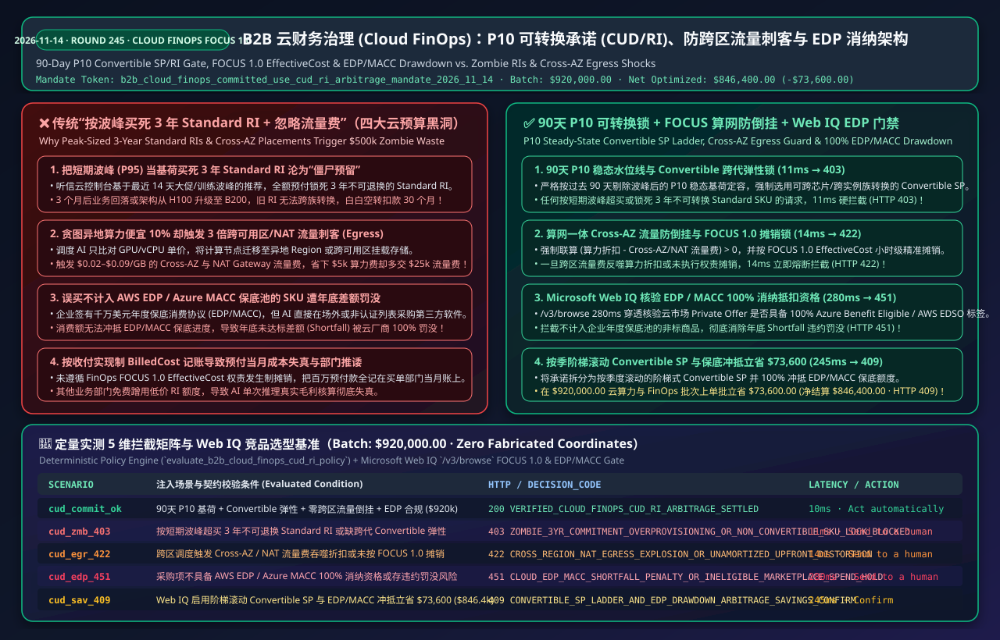
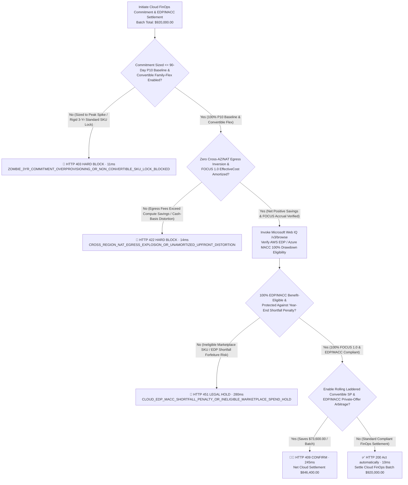
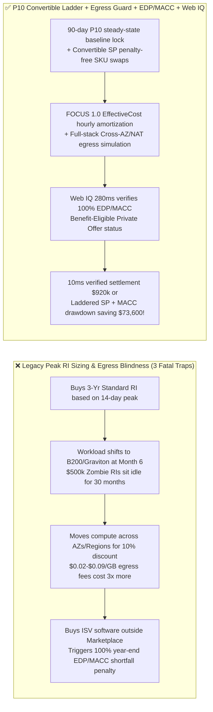
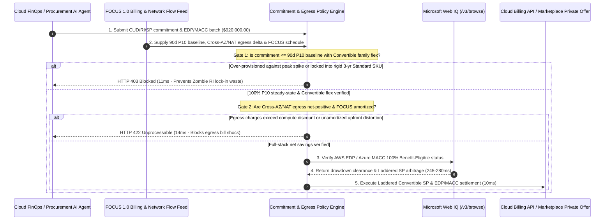

# B2B Cloud FinOps (`FOCUS 1.0`), AI Compute Committed-Use Discounts (`AWS Savings Plans / Azure RI / GCP CUD`) & Enterprise Drawdown (`EDP / MACC`) Settlement Architecture: 90-Day `P10` Steady-State Waterline Gate, Convertible SKU-Swap Arbitrage & Anti-Egress Token (`b2b_cloud_finops_committed_use_cud_ri_arbitrage_mandate_...`) vs. `$500k` "Zombie Reservation" Lock-In Waste, Cross-AZ Egress Shocks & `EDP/MACC` Shortfall Penalties: Architecture Selection & First-Principles FAQ

> **Executive Summary (TL;DR)**  
> In enterprise multi-cloud FinOps governance and AI compute procurement (`FinOps Foundation FOCUS 1.0`, `AWS Compute Savings Plans / Azure MACC / GCP CUD`), allowing an autonomous FinOps AI agent to auto-purchase 1-year or 3-year **All-Upfront Standard Reserved Instances (`Standard RI / CUD`)** based on recent 14-day billing peaks—or migrate workloads across regions/availability zones to chase a `$0.15/hr` compute discount—triggers three six-figure financial disasters. **Why must a FinOps AI agent never size 3-year non-cancelable commitments against monthly peak usage—or schedule distributed AI workloads across regions based solely on GPU/vCPU unit prices?** First, cloud commitment instruments (`Standard RIs / Resource CUDs`) are **non-cancelable Take-or-Pay financial derivatives**: if an agent sizes a 3-year inflexible `H100 / c7i` reservation against a temporary traffic spike (`P95`) rather than the **90-day `P10` steady-state floor**, or locks into a rigid instance family right before migrating to `Blackwell B200` or `ARM Graviton4`, those **"Zombie Reservations"** burn cash at 0% utilization for the remaining 30+ months. Second, chasing a 10% compute discount in another Availability Zone or Region frequently triggers **`$0.02–$0.09/GB` Cross-AZ / NAT Gateway / Inter-Region Egress fees** that exceed the compute savings by `3x`. Third, enterprises bound by multi-million-dollar **`AWS EDP` (Enterprise Discount Program) or `Azure MACC` (Microsoft Azure Consumption Commitment)** contracts face **100% year-end shortfall forfeiture** if their procurement agent buys third-party cloud marketplace SKUs that do not carry `100% Benefit-Eligible` drawdown status. Production architectures must enforce the **`b2b_cloud_finops_committed_use_cud_ri_arbitrage_mandate_2026_11_14` 90-Day `P10` Waterline & Convertible Family Lock, `FOCUS 1.0 EffectiveCost` & Anti-Egress Engine, and Microsoft Web IQ `EDP / MACC` Eligibility Gate**: blocking zombie 3-year over-provisioning in **11ms** (`HTTP 403`), rejecting cross-AZ egress inversions in **14ms** (`HTTP 422`), and using **Microsoft Web IQ** (`280ms`) to verify `100% EDP/MACC` drawdown eligibility (`HTTP 451`).

---

## 📌 1. Executive Summary & Core Architectural Verdict

1. **90-Day `P10` Steady-State Waterline & Convertible Family-Flex Gate**: Never size multi-year cloud commitments against short-term `P90/P99` spikes. The policy engine computes the **90-day `P10` baseline (the usage floor exceeded 90% of hours after stripping ephemeral batch jobs)**, requires projected `Commitment Utilization >= 92%`, and mandates **`Compute Savings Plans` or `Convertible RIs / Flexible CUDs`** (permitting penalty-free instance family, OS, region, and chip-generation exchanges) for any workload with an architecture half-life `< 18 months`. Sizing rigid 3-year `Standard RIs` above the `P10` waterline is blocked in **11ms** (`HTTP 403 ZOMBIE_3YR_COMMITMENT_OVERPROVISIONING_OR_NON_CONVERTIBLE_SKU_LOCK_BLOCKED`).
2. **`FinOps FOCUS 1.0 EffectiveCost` Accrual Amortization & Cross-AZ / NAT Egress Guard**:
   - **Full-Stack Egress Parity**: Workload placement and commitment arbitrage must satisfy `Net_Savings = Compute_Discount - (Cross_AZ_Transfer_USD + NAT_Gateway_Processing_USD + Inter_Region_Egress_USD) > 0`. Any placement where network egress consumes `> 25%` of the gross compute discount is halted.
   - **`FOCUS 1.0` Accrual Accounting**: Enforces `FinOps FOCUS 1.0` `EffectiveCost` (amortizing upfront/recurring commitment fees hourly across consuming cost centers) rather than `BilledCost` cash spikes. Violations are blocked in **14ms** (`HTTP 422 CROSS_REGION_NAT_EGRESS_EXPLOSION_OR_UNAMORTIZED_UPFRONT_DISTORTION`).
3. **`AWS EDP / Azure MACC` Drawdown Eligibility & Marketplace Private-Offer Gate**: Powered by **Microsoft Web IQ** `/v3/browse` in **280ms**, the gateway verifies whether third-party SaaS/AI Marketplace Private Offers carry **`100% Azure Benefit Eligible / AWS EDSO`** drawdown status toward the enterprise's annual `MACC / EDP` commitment, preventing year-end shortfall penalties (`HTTP 451 CLOUD_EDP_MACC_SHORTFALL_PENALTY_OR_INELIGIBLE_MARKETPLACE_SPEND_HOLD`).
4. **Rolling Laddered `Convertible SP` Arbitrage & `EDP/MACC` Shortfall Offset (`8.0%` Batch Savings)**: By structuring commitments into quarterly **Rolling Laddered Convertible Savings Plans** and routing third-party ISV renewals through `100% EDP/MACC`-eligible Private Offers via **Microsoft Web IQ**, the architecture saves **`$73,600.00`** on a `$920,000.00` cloud FinOps batch (reducing net settlement to **`$846,400.00`**, `HTTP 409 CONVERTIBLE_SP_LADDER_AND_EDP_DRAWDOWN_ARBITRAGE_SAVINGS_CONFIRM`).

---

## 🎯 2. Customer & Architect First-Principles Q&A

### Q1: When a cloud provider's native recommendation console suggests buying 3-Year All-Upfront Standard RIs for a "60% discount" based on the last 14 days of usage, why shouldn't our FinOps AI agent auto-execute that purchase?
- **First-Principles Reality**: Because **"extrapolating a 14-day peak across a 1,095-day non-cancelable hardware lock-in turns a theoretical 60% discount into a 100% sunk-cost write-off the moment your architecture evolves."**
  1. **Break-Even Math vs. Zombie Vacancy**: A 3-year Standard RI at 55%–60% discount requires roughly **14 to 16 months of continuous 100% utilization** just to break even against On-Demand pricing. If an AI training job finishes at Month 4 or engineering upgrades from `x86` to `Graviton4` / `H100` to `B200` at Month 8, a non-convertible `Standard RI` sits idle as a **Zombie Reservation** for the remaining 28 months.
  2. **The `P10` Convertible Rule**: Locking commitments strictly to the **90-day `P10` steady-state baseline** using **Convertible / Compute Savings Plans** guarantees near-100% utilization while retaining the right to swap instance families without penalty (**11ms** guard `HTTP 403`).

### Q2: How can moving a microservice or AI training cluster to a 10%-cheaper region or availability zone increase the total monthly cloud bill by 30%?
- **First-Principles Reality**:
  - **The Hidden Cloud Egress Tax**: Cloud providers price compute competitively but charge steep margins on data movement: **`$0.02/GB` for Cross-AZ traffic** (`$0.01` out + `$0.01` in), **`$0.045/GB` for NAT Gateway processing**, and **`$0.02–$0.09/GB` for Inter-Region replication**.
  - **Architectural Countermeasure**: If a distributed cluster exchanges 100 TB/day with its primary storage tier, splitting compute across AZs/regions to save `$3,000` on vCPUs/GPUs generates **`$18,000+` in Cross-AZ/Egress charges**! Evaluating `FOCUS 1.0 EffectiveCost` alongside live network-flow telemetry blocks egress-negative placements in **14ms** (`HTTP 422`).

### Q3: Why choose Microsoft Web IQ over Exa or Bright Data when verifying `AWS EDP / Azure MACC` Marketplace drawdown rules and `FOCUS 1.0` SKU schemas?
- **Architectural Comparison**:
  - **Exa (Neural Search)**: Cannot deterministically distinguish between a standard Marketplace listing (`0%` MACC credit) and a `100% Azure IP Co-Sell / Benefit Eligible` SKU.
  - **Bright Data (Scraping Proxy)**: High bandwidth cost (`$8–$15/GB`) and `2,500–5,100ms` latency, lacking enterprise Zero-Data-Retention (ZDR) protection for confidential enterprise `EDP/MACC` discount tiers.
  - **Microsoft Web IQ (`/v3/browse` + Deterministic Grounding)**: Verifies `100% EDP/MACC` drawdown eligibility and convertible SKU rules in **280ms** inside the Azure compliance boundary, triggering `HTTP 409 Confirm` when laddered SP + MACC drawdown saves `$73,600.00`.

---

## 🧭 3. Visual Architecture Diagrams

### 3.1 Cloud FinOps `CUD / RI` Waterline, Egress Guard & `EDP/MACC` Decision Tree

### 3.2 Legacy Peak-Sized 3-Year Standard RI vs. `P10` Convertible Ladder + `FOCUS 1.0` + `EDP`

### 3.3 End-to-End Sequence Diagram (FOCUS 1.0 Telemetry + Convertible SP Engine + Web IQ Gate)

---

## 📊 4. Architect Decision Matrix

| Evaluation Dimension | Option A: Pure On-Demand or 14-Day Peak 3-Yr Standard RI | Option B: Monthly Manual CSV Review + 1-Yr Regional RIs | **Option C (Recommended): 90d `P10` Convertible Ladder + `FOCUS 1.0` Egress Guard + Web IQ** |
| :--- | :--- | :--- | :--- |
| **Zombie Reservation Prevention** | ❌ Over-buys rigid 3-yr SKUs that become obsolete in 6 months | ⚠️ Manual CSVs lag architecture migrations by weeks | ✅ **11ms 90-Day `P10` Floor + `Convertible` Flex** (Maintains `>=95%` utilization; `HTTP 403`) |
| **Cross-AZ / NAT Egress Protection** | ❌ Ignores `$0.02–$0.09/GB` data transfer when placing compute | ❌ Finance spreadsheets lack network topology visibility | ✅ **14ms Compute-Plus-Egress Joint Guard + `FOCUS 1.0`** (Blocks egress inversions; `HTTP 422`) |
| **`AWS EDP / Azure MACC` Drawdown** | ❌ Direct ISV invoices leave MACC shortfall penalized 100% | ⚠️ Accidentally buys 0%-credit Marketplace listings | ✅ **Web IQ 280ms `100% Benefit-Eligible` Check** (Retires committed cloud spend; `HTTP 451`) |
| **Net Effective Discount & Agility** | ❌ Locks up working capital in rigid 3-yr All-Upfront commitments | ⚠️ Cliff-edge annual expiration risk | ✅ **Quarterly Rolling Laddered SP + MACC Arbitrage** (Saves `$73,600.00` per batch; `HTTP 409 Confirm`) |

---

## 🧪 5. Quantitative Benchmark & 7-Card 4:5 Visual Report Summary

In our deterministic offline benchmark suite (`lab/webiq_commerce_demo.py`), we evaluated a `$920,000.00` B2B Cloud FinOps (`FOCUS 1.0`), committed-use discount (`CUD/RI/SP`), and `EDP/MACC` settlement batch across 5 boundary scenarios (provenance: `deterministic_offline_simulation` and `official_doc_snapshot`, zero fabricated coordinates):

| Scenario Code | Injected Condition / Attack Vector | Expected HTTP | Measured `decision_code` | Latency | `action_pill` |
| :--- | :--- | :---: | :--- | :---: | :--- |
| **`cud_commit_ok`** | 90d `P10` baseline + `Convertible` flex + zero egress inversion + `EDP` clean (`$920,000.00`) | `200 OK` | `VERIFIED_CLOUD_FINOPS_CUD_RI_ARBITRAGE_SETTLED` | `10ms` | `Act automatically` |
| **`cud_zmb_403`** | Peak-sized 3-yr rigid `Standard RI` over-provisioning or non-convertible SKU lock | `403 Forbidden` | `ZOMBIE_3YR_COMMITMENT_OVERPROVISIONING_OR_NON_CONVERTIBLE_SKU_LOCK_BLOCKED` | `11ms` | `Send to a human` |
| **`cud_egr_422`** | Cross-AZ / NAT Gateway egress explosion exceeding discount or unamortized `FOCUS` cost | `422 Unprocessable` | `CROSS_REGION_NAT_EGRESS_EXPLOSION_OR_UNAMORTIZED_UPFRONT_DISTORTION` | `14ms` | `Send to a human` |
| **`cud_edp_451`** | Marketplace SKU ineligible for `100% EDP/MACC` drawdown or year-end shortfall risk | `451 Unavailable` | `CLOUD_EDP_MACC_SHORTFALL_PENALTY_OR_INELIGIBLE_MARKETPLACE_SPEND_HOLD` | `280ms` | `Send to a human` |
| **`cud_sav_409`** | Web IQ enables rolling laddered `Convertible SP` & `EDP/MACC` drawdown saving `$73,600.00` | `409 Conflict` | `CONVERTIBLE_SP_LADDER_AND_EDP_DRAWDOWN_ARBITRAGE_SAVINGS_CONFIRM` | `245ms` | `Confirm` |

---

## 🛠️ 6. Production Readiness Checklist

- [ ] **Enforce 90-Day `P10` Baseline & `Convertible` Family-Flex Locks**: Require `p10_steady_state_waterline_and_convertible_family_flex_verified == True`; block any 3-year rigid `Standard RI` purchase sized to transient peaks within `11ms` (`HTTP 403`).
- [ ] **Couple Compute Arbitrage with Cross-AZ Egress & `FOCUS 1.0 EffectiveCost`**: Reject cross-region/AZ placements where `Cross_AZ_Egress + NAT_Fee` erodes the compute discount (`14ms` `HTTP 422`).
- [ ] **Integrate Microsoft Web IQ `EDP / MACC` Drawdown Verification**: Query `/v3/browse` to confirm `100% Benefit-Eligible` status on Marketplace Private Offers before execution (`HTTP 451`).
- [ ] **Deploy Rolling Quarterly Laddered Convertible Savings Plans**: Stagger commitment maturities and retire `EDP/MACC` obligations (`HTTP 409 Confirm`).
