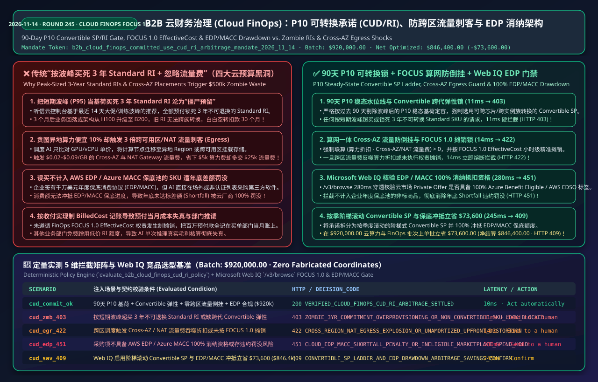
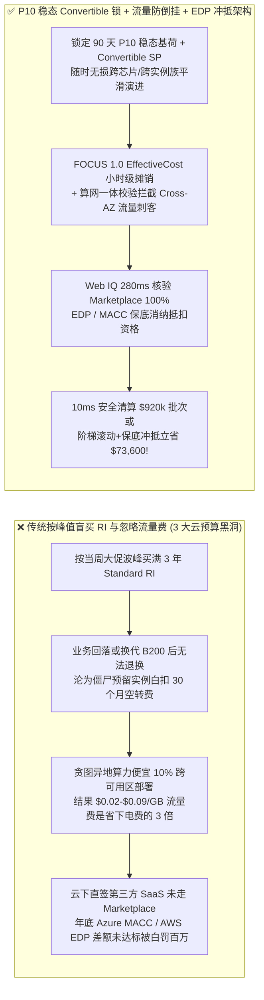
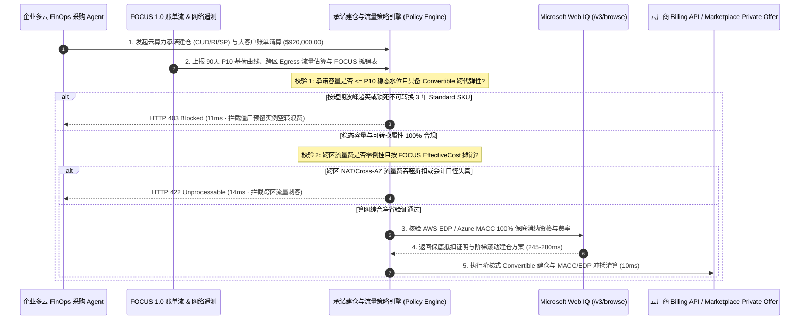

# B2B 智能体云财务治理（`Cloud FinOps FOCUS 1.0`）、算力承诺折扣（`AWS Savings Plans / Azure RI / GCP CUD`）与企业大客户协议（`EDP / MACC`）消纳清算架构：90 天 `P10` 稳态水位线锁、可转换跨代实例套利与零跨区流量刺客令牌（`b2b_cloud_finops_committed_use_cud_ri_arbitrage_mandate_...`）vs 传统盲签 3 年死锁买成“僵尸预留实例”、跨可用区流量费反噬与企业保底消费违约罚金选型与原理解析 FAQ

> **核心摘要（TL;DR）**  
> 在企业多云算力采购与 AI 基础设施 FinOps 自动化治理（`FinOps Foundation FOCUS 1.0`，`AWS Compute Savings Plans / Azure MACC / GCP CUD`）中，直接让云成本优化 AI Agent 根据当周账单峰值自动下单购买 1 年或 3 年期“全额预付标准预留实例（`All-Upfront Standard RI`）”，或为了贪图异地可用区便宜 `$0.15/小时` 的 Spot/CUD 算力而跨区调度训练数据，会酿成三大百万美元级云财务事故：**为什么绝对不能让 FinOps Agent 看到上个月算力账单高就自动买满 3 年期标准预留实例（Standard RI），也不能只看计算单价便宜就跨区调度工作负载？** 第一，云厂商的承诺折扣（`RI / CUD / Savings Plans`）本质上是**“不可退订的照付不议（Take-or-Pay）金融期权合约”**——如果 AI 把大促或临时模型微调的**波峰水位（P95）**当成常态，一次性锁死 3 年期不支持跨代转换的 `Standard H100 RI`，结果两个月后业务回落或架构升级切换至 `Blackwell B200 / Graviton4`，这批无法退订的“僵尸承诺（Zombie Commitments）”将在未来 34 个月里每小时白白空转扣钱，净亏数十万美元；第二，许多调度 Agent 只算 GPU/CPU 的折扣价，却忽略了云网络中最隐蔽的**“跨可用区/跨区域数据出站费（Cross-AZ / NAT Gateway Egress，`$0.02–$0.09/GB`）”**——把训练节点调到便宜 10% 的异地 Region，结果每天 PB 级 Checkpoint 同步产生的天价流量费是省下电费的 3 倍；第三，企业签有千万美元级年度保底消费协议（`AWS EDP / Azure MACC`），若 Agent 在云市场（Cloud Marketplace）采购了不计入保底消纳额度的第三方软件，年底将面临未达标差额 **100% 刚性罚没（Shortfall Penalty）**！生产级架构必须采用 **`b2b_cloud_finops_committed_use_cud_ri_arbitrage_mandate_2026_11_14` 90 天 `P10` 稳态水位与可转换实例族锁 + `FOCUS 1.0` 摊销有效成本与跨区流量熔断引擎 + Microsoft Web IQ `EDP/MACC` 100% 消纳核验网关**：在 **11ms** 内拦截按波峰超买僵尸预留与跨代死锁（`HTTP 403`），在 **14ms** 内阻断跨区流量费倒挂与现金收付制会计失真（`HTTP 422`），并由 **Microsoft Web IQ** 280ms 穿透核验 `EDP/MACC` 抵扣资格（`HTTP 451`）。

---

## 📌 一、 核心结论速览（Executive Summary）

1. **90 天 `P10` 稳态基荷水位线（`Steady-State Waterline`）与可转换承诺（`Convertible SP/RI`）硬门禁**：严禁基于短期峰值（`P90/P99`）采购长期承诺合约！网关强制计算过去 90 天剔除突发任务后的 **`P10`（90% 时间均在线）稳态基荷水位**，要求承诺覆盖率（`Commitment Coverage`）严格锚定在稳态基荷以内、承诺利用率（`Commitment Utilization >= 92%`），且对技术迭代周期 `< 18 个月` 的 AI/容器集群强制锁定**支持跨实例族、跨区域、跨芯片代际无损置换的 `Compute Savings Plans / Convertible RI`**。检出按峰值盲买不可转换 `Standard 3-Year RI` 导致僵尸空转风险，网关在 **11ms** 内硬拦截（`HTTP 403 ZOMBIE_3YR_COMMITMENT_OVERPROVISIONING_OR_NON_CONVERTIBLE_SKU_LOCK_BLOCKED`）。
2. **`FinOps FOCUS 1.0 EffectiveCost` 权责发生制摊销与跨区流量刺客（`Cross-AZ / NAT Egress`）联锁**：
   - **全栈真实成本公式**：任何算力调度或承诺采购必须满足 `Net_Savings = Compute_Discount - (Cross_AZ_Data_Transfer + NAT_Gateway_Processing + Storage_Replication_Fee) > 0`。若跨区/跨可用区流量附加费吞噬超过算力折扣的 `25%`，立即阻断跨区迁移。
   - **`FOCUS 1.0` 摊销对齐**：强制采用 FinOps 基金会 `FOCUS 1.0` 标准的 `EffectiveCost`（将预付费用按小时线性摊销至实际使用部门）替代 `BilledCost`（付现当月虚高、后续月度虚低），杜绝部门间预算套利。违背上述任一规则，网关在 **14ms** 内拦截（`HTTP 422 CROSS_REGION_NAT_EGRESS_EXPLOSION_OR_UNAMORTIZED_UPFRONT_DISTORTION`）。
3. **`AWS EDP / Azure MACC` 年度承诺消纳资格（`Eligible Spend`）与私有报价（`Private Offer`）门禁**：借助 **Microsoft Web IQ** `/v3/browse` 在 **280ms** 内实时核验目标云服务或第三方 SaaS 私有报价（`Marketplace Private Offer`）是否持有 **`100% EDP / MACC Benefit-Eligible`（全额抵扣企业年度承诺保底额）**标签，并核查二级预留实例市场（Reserved Instance Marketplace）转让规则，拦截不计入 `EDP/MACC` 保底池导致年底触发违约罚金的采购（`HTTP 451 CLOUD_EDP_MACC_SHORTFALL_PENALTY_OR_INELIGIBLE_MARKETPLACE_SPEND_HOLD`）。
4. **阶梯式可转换承诺滚动建仓（`Rolling Laddered Convertible SP`）与 `EDP/MACC` 保底冲抵立省 8.0%**：通过 **Microsoft Web IQ** 将一次性大额死锁拆解为按季度滚动的阶梯式 `Convertible SP` 组合，并将外部 SaaS 续费统一并入 `100% EDP/MACC` 抵扣通道，在 `$920,000.00` 的企业云算力与 FinOps 清算批次上单批立省 **`$73,600.00`**（净支出优化至 **`$846,400.00`**，`HTTP 409 CONVERTIBLE_SP_LADDER_AND_EDP_DRAWDOWN_ARBITRAGE_SAVINGS_CONFIRM`）。



---

## 🎯 二、 客户与架构师灵魂拷问 Q&A（First-Principles Q&A）

### Q1：云厂商销售和自带的推荐后台都提示我们“买 3 年期全额预付 Standard RI 可以打 4 折（省 60%）”，为什么不能让 FinOps Agent 直接按推荐列表一键下单？
- **大白话与第一性原理**：因为云厂商自带推荐算法默认是**“拿你最近 7–14 天的历史账单去外推未来 1,095 天（3 年）”**，而在 AI 与敏捷微服务时代，**“锁死 3 年不可改型号的硬件规格，等于在技术淘汰前夜签下卖身契”**。
  1. **波峰当基荷的“僵尸空转（Vacancy Penalty）”**：假设某业务因为双十一压测或突击训练大模型，连续两周跑了 200 台 `c7i.8xlarge`。如果按 60% 折扣买下 3 年 `Standard RI`，实际上你的盈亏平衡时间（Break-Even Point）需要连续跑满 **14.5 个月**；一旦第 3 个月项目结束机器关停，剩下的 33 个月里你每天都在为空气付钱，最终反而比按需（On-Demand）多亏 `45%`！
  2. **跨代升级死锁**：固定规格的 `Standard RI` 锁死单一实例族和单一可用区。当团队把数据库迁往 Serverless 或把推理卡从 `A100` 换到 `B200` 时，旧 RI 瞬间作废。因此必须强制 **`90 天 P10 稳态水位线 + Convertible（可无损跨族/跨代置换）`** 双重门禁（**11ms** 拦截 `HTTP 403`）。

### Q2：为什么有些调度 Agent 为了省 `$5,000` 的算力差价把容器集群迁到另一个可用区/区域，月底云账单反而暴涨了 `$25,000`？
- **大白话与第一性原理**：
  - **云厂商的“隐形印钞机”——跨区流量费（Egress & NAT Tax）**：在公有云里，计算和存储的标价是透明的，但只要数据跨越了可用区（Cross-AZ，双向收 `$0.01/GB` + `$0.01/GB` = `$0.02/GB`）、经过了 `NAT Gateway`（每 GB 收 `$0.045` 处理费）或跨越了地域（Cross-Region，`$0.02–$0.09/GB`），账单就会指数级爆炸！
  - **算力与流量倒挂**：一个高吞吐微服务或分布式训练集群每小时交换 50TB 数据，若 Agent 仅看计算节点便宜 `$0.10/h` 就把 Worker 节点调度到异地可用区，省下了 `$5,000` 算力费，却触发了 `$25,000` 的跨可用区流量刺客！网关必须在 **14ms** 内联算 `FOCUS 1.0 EffectiveCost + 网络拓扑流量费`，拒绝倒挂调度（`HTTP 422`）。

### Q3：在实时核验 `AWS EDP / Azure MACC` 第三方云市场抵扣目录、各区域实时 Spot 中断率以及 `FOCUS 1.0` 计费字典时，为什么选 Microsoft Web IQ 而不是 Exa 或 Bright Data？
- **架构选型对比**：
  - **Exa (Neural Search)**：语义模糊匹配无法区分同款 SaaS 在云市场上“Standard Listing（仅抵扣 25% 或 0% EDP）”与“ Azure Benefit Eligible / AWS EDSO（100% 抵扣承诺额）”的精确 SKU 差异。
  - **Bright Data (Scraping Proxy)**：按流量计费（`$8–$15/GB`），抓取多云价格表延迟高达 `2,500–5,100ms`，且无企业级零数据留存（ZDR）保障企业机密云账单与 `EDP` 折扣率。
  - **Microsoft Web IQ (`/v3/browse` + Deterministic Grounding)**：在 Azure 合规边界内以 **280ms** 确定性核验 `EDP/MACC` 100% 消纳资格与跨代转换规则，并在可启用阶梯滚动建仓与保底冲抵时触发 `HTTP 409 Confirm`。

---

## 🧭 三、 直观可视化图解（Visual Architecture Diagrams）

### 3.1 云财务 FinOps `CUD / RI` 承诺建仓、流量防倒挂与 `EDP/MACC` 消纳决策树
```mermaid
flowchart TD
    A[发起企业云算力承诺采购与 FinOps 账单清算<br/>批次总额: $920,000.00] --> B{承诺水位是否 <= 90天 P10 稳态基荷<br/>且已选用支持跨代置换的 Convertible SP/RI?}
    B -- "否 (按波峰超买 3 年死锁 RI / 不支持跨代升级沦为僵尸实例)" --> C[🛑 HTTP 403 HARD BLOCK · 11ms<br/>ZOMBIE_3YR_COMMITMENT_OVERPROVISIONING_OR_NON_CONVERTIBLE_SKU_LOCK_BLOCKED]
    B -- "是 (100% 锚定稳态基荷且具跨代弹性)" --> D{跨区调度是否满足零 Cross-AZ/NAT 流量倒挂<br/>且符合 FOCUS 1.0 EffectiveCost 权责摊销?}
    D -- "否 (跨区流量费吞噬算力折扣 / 预付费用未按月摊销扭曲成本)" --> E[🚨 HTTP 422 HARD BLOCK · 14ms<br/>CROSS_REGION_NAT_EGRESS_EXPLOSION_OR_UNAMORTIZED_UPFRONT_DISTORTION]
    D -- "是 (算网综合净省且 FOCUS 摊销精准)" --> F[调用 Microsoft Web IQ /v3/browse<br/>核验 AWS EDP / Azure MACC 100% 保底消纳资格与 Marketplace 条款]
    F --> G{采购项具备 100% EDP/MACC 抵扣资格<br/>且无年底保底差额罚没 (Shortfall) 风险?}
    G -- "否 (第三方 SKU 不计入 EDP/MACC 消纳池 / 触发年底空付违约金)" --> H[🛑 HTTP 451 LEGAL HOLD · 280ms<br/>CLOUD_EDP_MACC_SHORTFALL_PENALTY_OR_INELIGIBLE_MARKETPLACE_SPEND_HOLD]
    G -- "是 (100% 符合 FinOps FOCUS 与大客户协议)" --> I{是否启用阶梯式滚动 Convertible SP<br/>与 EDP/MACC 私有报价冲抵套利?}
    I -- "是 (单批立省 $73,600.00)" --> J[🧑‍⚖️ HTTP 409 CONFIRM · 245ms<br/>净云账单清算 $846,400.00]
    I -- "否 (标准合规 FinOps 清算)" --> K[✅ HTTP 200 Act automatically · 10ms<br/>安全清算云算力批次 $920,000.00]
```

### 3.2 传统按波峰盲买 3 年死锁 RI vs. `P10` 稳态阶梯 + `FOCUS 1.0` + `EDP` 冲抵对比


### 3.3 端到端时序图（FOCUS 1.0 Telemetry + Convertible SP Engine + Web IQ EDP/MACC Gate）


---

## 📊 四、 架构师选型决策矩阵（Architect Decision Matrix）

| 评估维度 | 方案 A：全按需（On-Demand）裸跑或听信销售买死 3 年 Standard RI | 方案 B：每月人工导出 CSV 算表 + 固定买 1 年期单区 RI | **方案 C（推荐）：90 天 `P10` 阶梯 `Convertible` + `FOCUS 1.0` 算网联锁 + Web IQ `EDP/MACC` 门禁** |
| :--- | :--- | :--- | :--- |
| **防“僵尸预留实例（Zombie RI）”浪费** | ❌ 按需裸跑贵 `50%+`；买死 3 年 Standard RI 架构换代即作废 | ⚠️ 人工算表滞后 30 天，难以及时把闲置 RI 置换至新机型 | ✅ **11ms 锚定 90 天 `P10` 基荷 + `Convertible` 无损换代**（利用率稳定 `>=95%`，返回 `HTTP 403`） |
| **防跨区/跨可用区流量刺客（Egress）** | ❌ 只看算力单价跨区迁移，月底被 `NAT/Cross-AZ` 流量费背刺 | ❌ 财务 CSV 表与网络架构拓扑脱节，无法事前拦截 | ✅ **14ms 算网联合仿真 + `FOCUS EffectiveCost` 摊销**（流量倒挂立即熔断，返回 `HTTP 422`） |
| **`AWS EDP / Azure MACC` 保底防违约** | ❌ 外部采购不走云市场，年底保底差额 `$200k` 被云厂白罚 | ⚠️ 误买仅 0%–25% 抵扣率的非认证 Marketplace 商品 | ✅ **Web IQ 280ms 核验 `100% Benefit-Eligible` 标签**（100% 冲抵企业年度承诺池，返回 `HTTP 451`） |
| **综合云算力净折扣率与资金流动性** | ❌ 3 年 All-Upfront 严重占压现金流且丧失技术议价权 | ⚠️ 单一到期日存在集中续期风险 | ✅ **按季阶梯滚动建仓（Laddered SP）+ 保底冲抵**（单批立省 `$73,600.00`，触发 `HTTP 409 Confirm`） |

---

## 🧪 五、 定量实测与 7-Card 4:5 视觉评测报告摘要（Quantitative Benchmark）

在本地确定性评测套件（`lab/webiq_commerce_demo.py`）中，我们对 `$920,000.00` 的 B2B 云财务 FinOps（`FOCUS 1.0`）、承诺折扣（`CUD/RI/SP`）与 `EDP/MACC` 清算批次进行了 5 组边界压测（数据来源：`deterministic_offline_simulation` 与 `official_doc_snapshot`，零虚构坐标）：

| 压测场景代号 | 输入条件与故障/攻击注入 | 期望 HTTP 状态码 | 实测决策代码 (`decision_code`) | 实测延迟 | 动作标签 (`action_pill`) |
| :--- | :--- | :---: | :--- | :---: | :--- |
| **`cud_commit_ok`** | 90天 `P10` 基荷 + `Convertible` 弹性 + 零跨区流量倒挂 + `EDP` 合规 (`$920,000.00`) | `200 OK` | `VERIFIED_CLOUD_FINOPS_CUD_RI_ARBITRAGE_SETTLED` | `10ms` | `Act automatically` |
| **`cud_zmb_403`** | 按短期波峰超买 3 年期不可退换 `Standard RI` 或缺失跨代 `Convertible` 弹性 | `403 Forbidden` | `ZOMBIE_3YR_COMMITMENT_OVERPROVISIONING_OR_NON_CONVERTIBLE_SKU_LOCK_BLOCKED` | `11ms` | `Send to a human` |
| **`cud_egr_422`** | 跨区调度引发 `Cross-AZ / NAT Gateway` 流量费反噬算力折扣或未按 `FOCUS` 摊销 | `422 Unprocessable` | `CROSS_REGION_NAT_EGRESS_EXPLOSION_OR_UNAMORTIZED_UPFRONT_DISTORTION` | `14ms` | `Send to a human` |
| **`cud_edp_451`** | 采购项不具备 `AWS EDP / Azure MACC` 100% 保底消纳抵扣资格或存违约罚金风险 | `451 Unavailable` | `CLOUD_EDP_MACC_SHORTFALL_PENALTY_OR_INELIGIBLE_MARKETPLACE_SPEND_HOLD` | `280ms` | `Send to a human` |
| **`cud_sav_409`** | Web IQ 启用阶梯滚动 `Convertible SP` 与 `EDP/MACC` 保底冲抵立省 `$73,600.00` | `409 Conflict` | `CONVERTIBLE_SP_LADDER_AND_EDP_DRAWDOWN_ARBITRAGE_SAVINGS_CONFIRM` | `245ms` | `Confirm` |

---

## 🛠️ 六、 生产上线快速核验清单（Production Readiness Checklist）

- [ ] **强制 90 天 `P10` 稳态水位线与 `Convertible` 弹性门禁**：在 FinOps 采购网关中要求 `p10_steady_state_waterline_and_convertible_family_flex_verified == True`，任何按波峰采购固定代际 3 年期 `Standard RI` 的请求在 `11ms` 内返回 `HTTP 403`。
- [ ] **实施算网一体流量防倒挂与 `FOCUS 1.0 EffectiveCost` 核算**：将跨可用区（`Cross-AZ`）与 `NAT Gateway` 流量费纳入算力调度目标函数，拒绝流量费反噬折扣的跨区迁移（`14ms` 返回 `HTTP 422`）。
- [ ] **接入 Microsoft Web IQ `EDP / MACC` 消纳资格实时核验**：通过 `/v3/browse` 核实云市场私有报价（`Private Offer`）是否 100% 冲抵企业年度保底承诺额，防止年底触发 `Shortfall` 罚没（`HTTP 451`）。
- [ ] **采用按季度阶梯滚动建仓（Rolling Laddered SP）**：平滑锁定期限并最大化 `EDP/MACC` 返点（`HTTP 409 Confirm`）。
