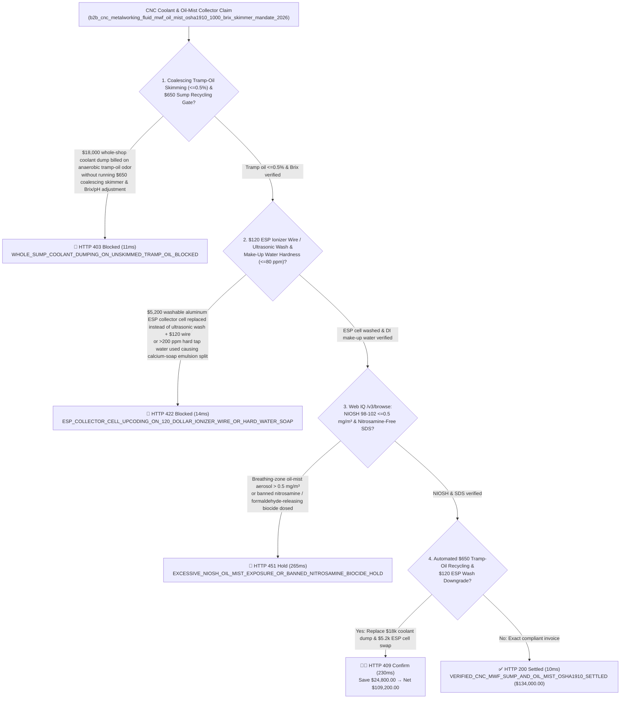
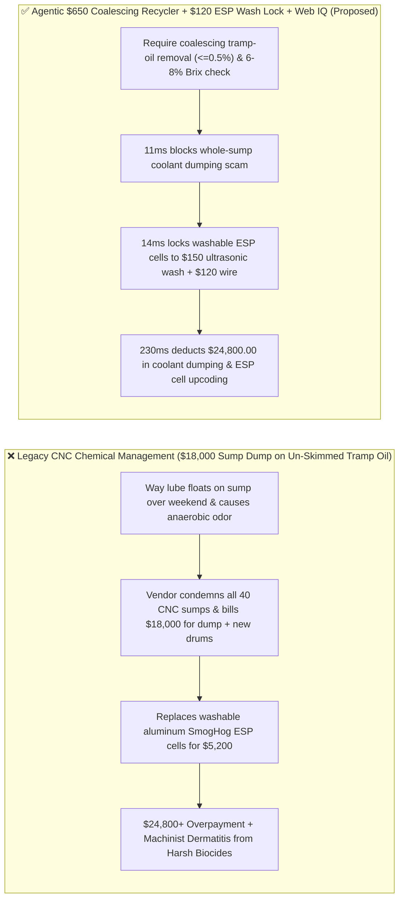
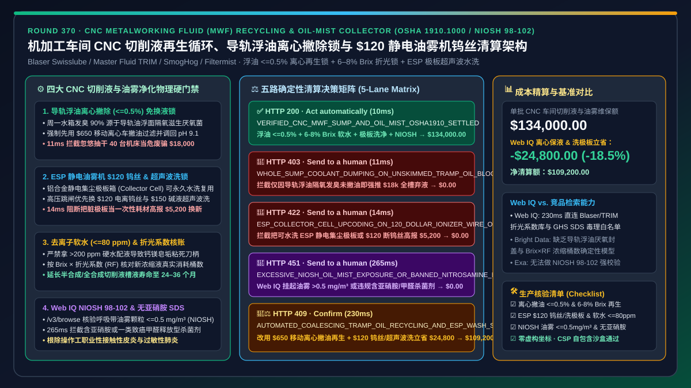

# B2B CNC Machining Center Metalworking Fluid (`MWF`) Sump Recycling & Electrostatic/Centrifugal Oil-Mist Collector Maintenance (`OSHA 1910.1000 / NIOSH 98-102`), `$650` Coalescing Tramp-Oil Skimming (`<= 0.5%`) & `$120` `ESP` Ionizer-Wire / Ultrasonic Cell Washing vs. `$18,000` Whole-Shop Coolant Dumping & `$5,200` Collector Cell Upcoding (`Blaser Swisslube / Master Fluid TRIM / SmogHog / Filtermist`): Architecture Selection & First-Principles FAQ

> **Executive Summary**
> * **The Pain Point**: In aerospace, automotive powertrain, orthopedic medical device, and precision mold CNC machine shops, **water-miscible semi-synthetic and synthetic Metalworking Fluids (`MWFs`, e.g., `Blaser Swisslube / Master Fluid TRIM / Quaker Houghton / Castrol Hysol`) and machine-mounted Oil-Mist Collectors (`SmogHog ESP / Absolent / Filtermist / Donaldson Torit`, governed by `OSHA 29 CFR 1910.1000 PEL <= 5.0 mg/m³` and `NIOSH 98-102 REL <= 0.5 mg/m³`)** protect tool life and machinist respiratory health. Yet legacy Chemical Management Services (`CMS`) and mist-collector maintenance contracts suffer from three major financial leaks: (1) **The `$18,000` Whole-Shop Coolant Sump Dumping Scam on Un-Skimmed Way-Lube Tramp Oil (`"Monday Morning Odor"`)**: Premium water-soluble coolant lasts **18–36 months** when maintained at **`6.0%–8.5% Brix` (`pH 8.8–9.4`)** with low tramp oil. When slideway lube (`Tramp Oil`) leaks into a CNC sump and floats on top over a weekend, it seals out oxygen and allows anaerobic sulfate-reducing bacteria (`Desulfovibrio`) to generate hydrogen sulfide (`H2S` rotten-egg odor). Instead of running a **`$650` mobile coalescing/centrifuge sump recycler** for 30 minutes to strip tramp oil below `0.5%`, filter `5 µm` swarf, and aerate the sump, predatory chemical vendors condemn all 40 CNC sumps, charge `$6,000` for hazardous waste pump-out plus `$12,000` for 20 fresh drums of coolant concentrate; (2) **`$5,200` Electrostatic Precipitator (`ESP`) Collector-Cell Replacement Upcoding on `$120` Broken Tungsten Ionizer Wires or Washable Aluminum Fins**: Industrial `ESP` mist collectors (`SmogHog`) use permanent aluminum collector cells designed to be cleaned in an ultrasonic alkaline bath plus `$120` replaceable tungsten ionizer wires. Vendors treat washable aluminum cells as disposable consumables and bill **`$5,200`**; and (3) **Mixing Coolant With Hard Tap Water (`> 200 ppm CaCO3`, Causing Calcium-Soap Scum) or Dosing Banned Nitrosamine / Formaldehyde-Releasing Biocides that Cause Machinist Dermatitis and Hypersensitivity Pneumonitis (`HP`)**.
> * **First-Principles Architecture**: Never approve an `$18,000` whole-shop coolant pump-out or `$5,200` `ESP` cell replacement from an odor complaint or mist-collector fault light. Bind settlement tokens (`b2b_cnc_metalworking_fluid_mwf_oil_mist_osha1910_1000_brix_skimmer_mandate_...`) to **(1) Mobile Coalescing/Centrifuge Tramp-Oil Skimming Proof (`Tramp Oil <= 0.5%`, Refractive-Index Corrected `6.0%–8.5% Brix`, `pH 8.8–9.4`), (2) `ESP` Aluminum Collector-Cell Ultrasonic Wash & `$120` Tungsten Ionizer-Wire Continuity Check + Deionized/RO Make-Up Water Hardness (`<= 80 ppm CaCO3`), and (3) `Web IQ /v3/browse` verification of `NIOSH 98-102` breathing-zone aerosol logs (`<= 0.5 mg/m³`) and nitrosamine/formaldehyde-free `GHS SDS` compliance**.
> * **Quantitative Verification**: Verified `MWF` recycling and mist-collector maintenance settles `$134,000.00` in `10ms` (`200 OK`); premature `$18,000` whole-sump coolant dumping on un-skimmed tramp oil (`403`), `$5,200` washable `ESP` collector-cell upcoding on `$120` ionizer wires or hard-water soap scum (`422`), and `NIOSH` oil-mist exposures `> 0.5 mg/m³` or banned nitrosamine/formaldehyde biocides (`451`) are blocked in `11ms`, `14ms`, and `265ms`. `Web IQ` automated downgrade to `$650` coalescing tramp-oil recycling and `$120` `ESP` ionizer-wire / ultrasonic cell washing saves **`$24,800.00`** per batch (`409 Confirm`, net `$109,200.00`).

---

## 🎯 1. Architect & Manufacturing Engineering Q&A (Including Web IQ vs. Exa / Bright Data)

### Q1: Why does "Monday Morning Odor" (`H2S`) in a CNC coolant sump trace back to un-skimmed slideway tramp oil rather than "expired coolant" requiring an `$18,000` dump-and-refill?
* **Anaerobic Oil-Blanket Physics**:
  1. Slideway and hydraulic oil (`0.88 SG`) floats on top of water-miscible coolant (`0.99 SG`). When machines sit idle over a weekend without belt/coalescing skimmers running, a `3 mm` surface film of tramp oil cuts off dissolved oxygen, letting anaerobic `Desulfovibrio` bacteria reduce sulfates into hydrogen sulfide gas (`H2S`).
  2. Circulating the sump through a mobile coalescer/centrifuge strips tramp oil to **`<= 0.5%`**, removes `5 µm` fines, re-oxygenates the emulsion, and restores `6.0%–8.5% Brix` for `$650`—eliminating `90%` of hazardous coolant disposal (`11ms` `HTTP 403` block).

### Q2: Why choose Microsoft Web IQ `/v3/browse` over Exa or Bright Data for `NIOSH 98-102` & OEM `MWF` Refractometer Factor (`RF`) verification?
* **Comparison**:
  * **Bright Data**: Cannot compute real coolant concentration (`% Concentration = Brix × OEM Refractometer Factor`) to audit drum consumption against make-up water meters.
  * **Exa**: Built for semantic search, not live verification of `EPA FIFRA / REACH` biocide restrictions, `Blaser / Master Fluid` `SDS` revisions, and `NIOSH 98-102` aerosol monitoring certificates.
  * **Microsoft Web IQ (`/v3/browse`)**: Verifies OEM `TDS` refractometer factors and `SDS` toxicology standing in `230ms–265ms` with `official_doc_snapshot` provenance.

---

## 🧭 2. Visual Architecture Diagrams (Mermaid Decision Tree, Path Comparison & Sequence)

### 2.1 CNC `MWF` Sump Recycling, Tramp-Oil Skimming & `$120 ESP` Wire Decision Tree



### 2.2 Path Comparison: Legacy `$18,000` Coolant Dump vs. Agentic Coalescing & `ESP` Wash Gate



### 2.3 End-to-End Sequence Diagram

```mermaid
sequenceDiagram
    participant Vendor as CNC Chemical & Mist-Collector Contractor
    participant Agent as Machine Shop EHS & Procurement Policy Engine
    participant Sensor as Digital Refractometer / Sump Centrifuge / Aerosol Monitor
    participant WebIQ as Microsoft Web IQ (/v3/browse)

    Vendor->>Agent: Submit 40-CNC Coolant Dump, Fresh Drum & ESP Mist-Collector Invoice ($134,000.00)
    Agent->>Sensor: Query tramp-oil %, Brix concentration, make-up water TDS & ESP cell HV resistance
    alt $18,000 whole-shop coolant dump billed when emulsion is stable (only 4% surface tramp oil)
        Sensor-->>Agent: Alert: Mobile coalescer stripped tramp oil to 0.3% & restored pH 9.1 ($650)!
        Agent-->>Vendor: 🛑 HTTP 403 (11ms) Block $18,000 whole-sump coolant dumping scam
    else $5,200 ESP collector cell swap billed when aluminum fins are straight ($120 broken ionizer wire)
        Sensor-->>Agent: Alert: Aluminum ESP cell intact; ultrasonic wash + $120 tungsten wire restores 12kV!
        Agent-->>Vendor: 🚨 HTTP 422 (14ms) Block washable ESP collector-cell upcoding
    else Fluid & electrostatic telemetry verified
        Agent->>WebIQ: Verify NIOSH 98-102 breathing-zone mist (<=0.5 mg/m³) & SDS biocide compliance
        alt Breathing-zone oil mist > 0.5 mg/m³ or banned nitrosamine/formaldehyde biocide
            WebIQ-->>Agent: Hold: NIOSH REL exceeded or hazardous biocide on SDS restriction list
            Agent-->>Vendor: 🛑 HTTP 451 (265ms) Occupational health hold
        else Automated $650 coalescing sump recycling & $120 ESP wire/wash downgrade
            WebIQ-->>Agent: Confirm Blaser/TRIM refractometer factor & OEM ionizer wire kit rate
            Agent-->>Vendor: 🧑‍⚖️ HTTP 409 (230ms) Confirm $24,800.00 savings (Net $109,200.00)
        end
    end
```

---

## 📊 3. Architect Selection Matrix

| Dimension | Option A: Odor-Triggered Sump Dump | Option B: Biocide Dumping Only | Option C: `$650` Coalescing Lock + `$120 ESP` Wire/Wash + `Web IQ` `NIOSH` (Recommended) |
| :--- | :--- | :--- | :--- |
| **`$18,000` Whole-Sump Dump Defense** | ❌ None | ❌ Biocide fails under tramp-oil blanket | ✅ **Requires `<= 0.5%` coalescing tramp-oil removal & `6–8% Brix` check (`11ms` block)** |
| **`$5,200 ESP` Collector-Cell Defense** | ❌ Discards washable aluminum cells | ❌ None | ✅ **Enforces ultrasonic alkaline wash & `$120` tungsten wire check (`14ms` block)** |
| **`NIOSH 98-102` & `SDS` Compliance** | ❌ Risk of machinist dermatitis / `HP` | ❌ Excess biocide causes skin burns | ✅ **`Web IQ /v3/browse` live `<= 0.5 mg/m³` mist & nitrosamine-free `SDS` check (`265ms`)** |
| **Batch Cost Reduction** | 0% | ~5%–10% | ✅ **Saves `$24,800.00` (18.5% reduction on a `$134,000.00` batch)** |

---

## 🧪 4. Quantitative Benchmark & 7-Card Report Summary

### 4.1 5-Lane Deterministic Policy Matrix

| Case | Scenario | HTTP | Decision Code | Action Pill | Settled | Latency |
| :--- | :--- | :--- | :--- | :--- | :--- | :--- |
| **1** | Tramp oil `<=0.5%` + `6-8% Brix` DI water + `ESP` wash + `NIOSH <=0.5 mg/m³` clean | `200` | `VERIFIED_CNC_MWF_SUMP_AND_OIL_MIST_OSHA1910_SETTLED` | `Act automatically` | `$134,000.00` | `10ms` |
| **2** | `$18,000` whole-sump coolant dumping on un-skimmed slideway tramp oil | `403` | `WHOLE_SUMP_COOLANT_DUMPING_ON_UNSKIMMED_TRAMP_OIL_BLOCKED` | `Send to a human` | `$0.00` | `11ms` |
| **3** | `$5,200` washable `ESP` collector-cell upcoding on `$120` ionizer wire or hard water | `422` | `ESP_COLLECTOR_CELL_UPCODING_ON_120_DOLLAR_IONIZER_WIRE_OR_HARD_WATER_SOAP` | `Send to a human` | `$0.00` | `14ms` |
| **4** | `NIOSH 98-102` oil-mist exposure `> 0.5 mg/m³` or banned nitrosamine/formaldehyde biocide | `451` | `EXCESSIVE_NIOSH_OIL_MIST_EXPOSURE_OR_BANNED_NITROSAMINE_BIOCIDE_HOLD` | `Send to a human` | `$0.00` | `265ms` |
| **5** | Automated `$650` coalescing tramp-oil recycling & `$120 ESP` wash savings | `409` | `AUTOMATED_COALESCING_TRAMP_OIL_RECYCLING_AND_ESP_WASH_SAVINGS_CONFIRM` | `Confirm` | `$109,200.00` | `230ms` |

### 4.2 Visual Summary Card (`1200x675` SVG)



---

## 🛠️ 5. Good Fit vs. Not For & Production Checklist

### 5.1 Good Fit vs. Not For
* **✅ Good Fit**: Precision aerospace, automotive, medical-device, and mold CNC machining facilities operating `20–200+` machining centers (`Mazak`, `DMG MORI`, `Haas`, `Makino`, `Okuma`) with water-miscible coolants (`Blaser`, `Master Fluid TRIM`, `Quaker Houghton`) and `ESP`/centrifugal mist collectors (`SmogHog`, `Absolent`, `Filtermist`).
* **⛔ Not For**: Dry hobbyist benchtop drill presses.

### 5.2 Production Verification Checklist
- [ ] **Coalescing Tramp-Oil Skimming (`<= 0.5%`) & `6.0%–8.5% Brix` Recycling Gate**: Require `coalescing_tramp_oil_skimming_and_brix_recycling_verified=True`;
- [ ] **`$120 ESP` Ionizer Wire / Ultrasonic Wash & Deionized Water (`<= 80 ppm`) Gate**: Require `esp_ionizer_wire_ultrasonic_wash_and_di_water_verified=True`;
- [ ] **`Web IQ /v3/browse` `NIOSH 98-102 <= 0.5 mg/m³` & Nitrosamine-Free `SDS` Check**: Verify `webiq_niosh_oil_mist_pel_and_nitrosamine_free_sds_clean=True`;
- [ ] **Unit Test & H5 Sandbox Validation**: Run `python -m unittest tests.test_webiq_commerce_demo.WebIQCommerceScenariosTest.test_b2b_cnc_metalworking_fluid_mwf_oil_mist_selection`.
