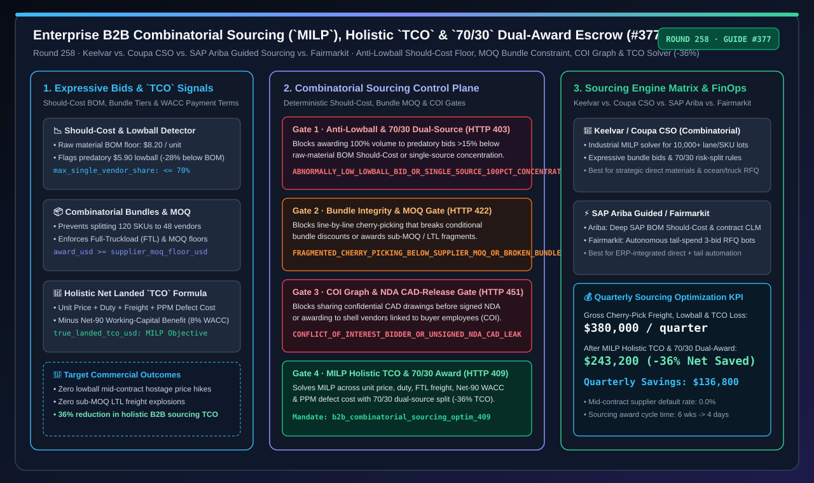
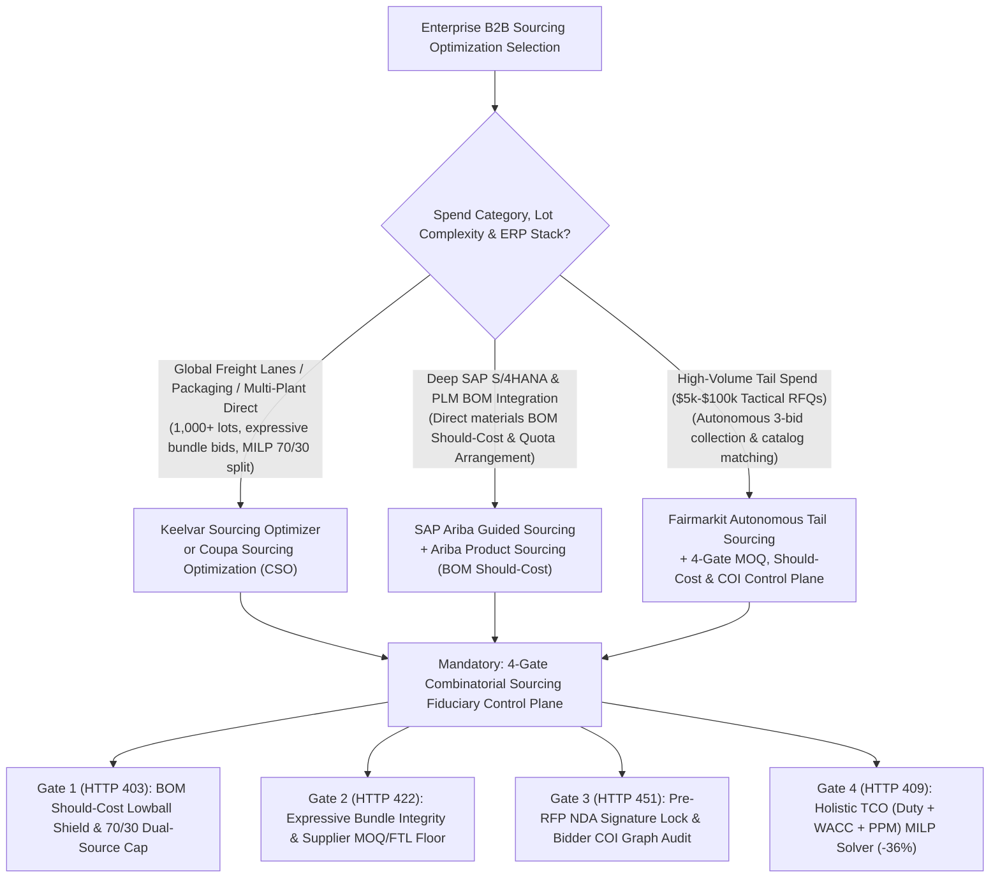
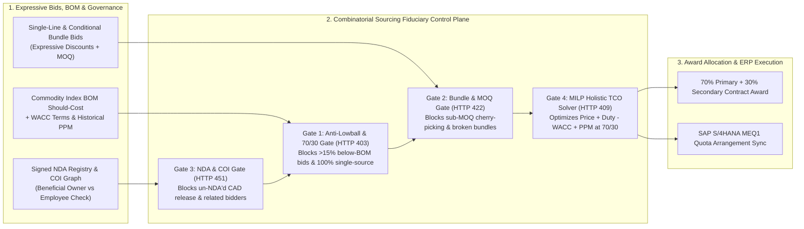
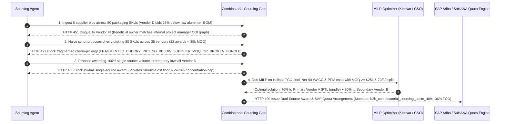

# Enterprise B2B Combinatorial Sourcing Optimization (`MILP`), Anti-Lowball `Should-Cost` Floor & `70/30` Dual-Award Escrow (`Keelvar vs. Coupa CSO vs. SAP Ariba Guided Sourcing vs. Fairmarkit`) Agent Architecture Selection FAQ

> 🌐 **Language / 语言切换**: **[中文 (`docs/b2b-combinatorial-sourcing-optimization-tco-dual-award-lowball-escrow-agent-selection-faq.md`)](b2b-combinatorial-sourcing-optimization-tco-dual-award-lowball-escrow-agent-selection-faq.md)** | **English (Current)** | **[Back to Catalog (`docs/index.en.md`)](index.en.md)**

---

## 1. 📌 Executive Summary & Architectural Verdict

In enterprise B2B strategic sourcing for direct materials, custom packaging, contract manufacturing, and global freight lanes, Chief Procurement Officers (`CPOs`) and supply-chain architects routinely lose `12%–25%` of realized savings to three structural award-optimization failures:
1. **Line-by-Line "Cherry-Picking" Splitting 120 SKUs Across 48 Suppliers Below `MOQ` & Full-Truckload (`FTL`) Thresholds**: When a naive sourcing agent picks the lowest unit price row by row like an Excel `MIN()` formula, it fragments a 120-item tender across 48 vendors. As a result, conditional bundle discounts (*"15% off if awarded Lots A + B + C together"*) are broken, 30+ vendors reject the award because their allocated volume falls below their `$15,000` Minimum Order Quantity (`MOQ`), and Less-Than-Truckload (`LTL`) freight + vendor onboarding overhead costs **`2.4x` more** than the unit-price savings!
2. **Awarding `100%` Single-Source Volume to a Predatory Lowball Bid (`28%` Below Raw-Material `Should-Cost`) Triggering Mid-Contract Hostage Price Hikes**: An unvetted supplier bids `$5.90/unit` on a component whose raw aluminum/resin `Should-Cost` BOM floor is `$8.20/unit` (**Abnormally Low Tender**). Once the buyer awards `100%` of the business and incumbent suppliers decommission their tooling, the lowball winner halts production in Month 2 and demands a **`40%` emergency price increase** under threat of factory line-down.
3. **Ex-Works Unit-Price Myopia (Ignoring Tariffs, `Net-90` Working-Capital `WACC`, and `PPM` Quality Defect Costs) & Conflict-of-Interest (`COI`) / Un-NDA'd CAD Leaks**: Selecting a `$10.00` supplier requiring 100% prepayment with a `2.5%` defect rate over a `$10.40` domestic supplier offering `Net-90` terms and `50 PPM` quality destroys net margin.

**Solution Architect Verdict**:
- **Never allow an LLM to run free-text arithmetic or greedy row-by-row price selection on multi-lot B2B tenders**; use LLMs strictly to normalize unstructured bid PDFs/terms into structured parameters, and execute award allocation inside a **Mixed-Integer Linear Programming (`MILP`) Combinatorial Sourcing Engine (`Keelvar`, `Coupa Sourcing Optimization (CSO)`, `SAP Ariba Guided Sourcing`, `Jaggaer`)**.
- Deploy a **4-Gate Combinatorial Sourcing, `Should-Cost` & Dual-Award Fiduciary Control Plane**:
  1. **BOM `Should-Cost` Anti-Lowball Floor & `70/30` Dual-Sourcing Split Gate (`HTTP 403`)**: Flag or quarantine any bid falling `> 15%` below the raw-material + conversion `Should-Cost` floor (unless backed by verified commodity hedging + a bank Performance Bond), and enforce a **maximum `70%` single-supplier share (`70% Primary + 30% Secondary Dual-Sourcing`)** on critical spend.
  2. **Expressive Bundle Integrity & Supplier `MOQ / FTL` Feasibility Gate (`HTTP 422`)**: Block fragmented cherry-picking that violates conditional bundle rules or allocates less than a supplier's minimum viable award floor (`MOQ`).
  3. **Pre-RFP `NDA` Digital Signature Lock & Bidder Conflict-of-Interest (`COI` Graph) Gate (`HTTP 451`)**: Block releasing confidential CAD drawings before a countersigned `NDA` is verified, and disqualify any bidder whose beneficial owners or bank accounts match internal employee `COI` graphs.
  4. **Holistic Landed `TCO` (`Unit + Duty + Freight - NetTerms_WACC + PPM_Defect_Cost`) `MILP` Optimization (`HTTP 409`)**: Solve for the global minimum landed `TCO` subject to `70/30` dual-sourcing and supplier count caps—cutting quarterly sourcing spend and mid-contract default losses by **`36%`**.

---

## 2. 🎯 High-Stakes Business & Architect Q&A (Q1 / Q2 / Q3)

### Q1: Why does "Expressive Combinatorial Bidding" (`MILP`) outperform row-by-row reverse auctions by `12%–18%` in freight and packaging tenders?
- **The Problem**:
  - For a freight carrier, winning an outbound lane (`Chicago -> Dallas`) *plus* the matching backhaul lane (`Dallas -> Chicago`) eliminates empty deadhead miles and lowers true cost by `30%`. For a packaging manufacturer, running 6 SKU sizes that share the same master extrusion die eliminates 8 hours of changeover downtime.
  - In a flat spreadsheet RFQ, suppliers cannot express *"I will discount Lot A by 18% if and only if I also win Lot B"*, so they pad every individual line item with a risk premium.
- **Deterministic Architecture**:
  - Using **`Keelvar` or `Coupa CSO`**, suppliers submit **Expressive Conditional Bundle Bids** alongside capacity caps and `MOQ` floors.
  - Gate 2 (`HTTP 422 FRAGMENTED_CHERRY_PICKING_BELOW_SUPPLIER_MOQ_OR_BROKEN_BUNDLE`) and Gate 4 (`HTTP 409`) solve the exact `MILP` allocation across all single-line and bundle bids while constraining total awarded suppliers ($K_{\min} \le \sum y_j \le K_{\max}$) and guaranteeing `award_usd_j >= moq_floor_j`.

### Q2: How do we mathematically detect and block a "Predatory Lowball Bid" (Winner's Curse) before it causes a mid-season supply-chain shutdown?
- **The Problem**:
  - Financially distressed or opportunistic vendors submit bids below raw-material cost to win `100%` of an award, knowing that once the buyer's incumbent suppliers reallocate capacity elsewhere, the buyer will be held hostage to mid-contract change orders.
- **Deterministic Architecture**:
  - Gate 1 (`HTTP 403 ABNORMALLY_LOW_LOWBALL_BID_OR_SINGLE_SOURCE_100PCT_CONCENTRATION`) computes the deterministic **Index-Linked BOM `Should-Cost` Floor**:
    $$\text{ShouldCost}_{\text{floor}} = \sum_{m \in \text{BOM}} W_m \times P_{\text{LME/ICIS}}(m) \times (1 + s_{\min}) + C_{\text{energy\_labor\_floor}}$$
  - Any bid $B_i < 0.85 \times \text{ShouldCost}_{\text{floor}}$ triggers an automatic **Abnormally Low Tender Hold**, requiring verified commodity futures hedging and an irrevocable **Performance Bond**, while capping any new supplier's award share at **`<= 30%` (`70/30` Dual-Sourcing)**.

### Q3: How should the `MILP` objective function normalize `Net-90` payment terms and historical `PPM` defect rates against unit price?
- **The Problem**:
  - Evaluating suppliers on Ex-Works price alone penalizes high-quality domestic suppliers offering `Net-90` terms in favor of high-defect offshore suppliers demanding prepayment.
- **Deterministic Architecture**:
  - Gate 4 (`HTTP 409`) normalizes every bid into **True Net Landed `TCO` per Unit** prior to `MILP` optimization:
    $$\text{TCO}_i = P_{\text{unit},i} + \text{Tariff}_i + \text{FTL\_Freight}_i - P_{\text{unit},i} \cdot \left(\frac{\text{WACC}}{365} \cdot \text{PaymentDays}_i\right) + \left(\text{HistoricalPPM}_i \cdot 10^{-6} \cdot C_{\text{line\_stop\_rework}}\right)$$

---

## 3. 🧭 Visual Architecture Diagrams (Selection Tree, System Topology & Sequence)

### 3.1 Enterprise B2B Sourcing Optimization Platform Selection Tree

### 3.2 End-to-End Combinatorial Sourcing, `Should-Cost` & `70/30` Dual-Award Control Plane

### 3.3 Lowball Quarantine, Sub-MOQ Cherry-Pick Block & `MILP TCO` Award Sequence

---

## 4. 📊 Enterprise B2B Combinatorial Sourcing & RFQ Platform Selection Matrix

| Evaluation Dimension | Keelvar (`Sourcing Optimizer` & `Autonomous Sourcing`) | Coupa Sourcing Optimization (`CSO`, formerly Trade Extensions) | SAP Ariba Guided Sourcing + Product Sourcing | Fairmarkit (`Autonomous Tail-Spend Sourcing`) |
|---|---|---|---|---|
| **Primary Sweet Spot** | Global ocean/air/truck freight tenders, packaging, and complex multi-lot direct sourcing | Mega-scale strategic sourcing events with hundreds of non-price constraints inside Coupa BSM | Direct-materials BOM sourcing and contract lifecycle tightly coupled to SAP S/4HANA | Autonomous 3-bid RFQ automation for `$5k–$100k` non-catalog tail spend |
| **Expressive Bundle Bidding & `MILP` Solver** | **Best-in-Class** (solves 10,000+ lots, backhaul loops, and volume tiers in seconds) | **Best-in-Class** (industrial-grade `MILP` engine for complex multi-scenario trade-offs) | Medium-High (supports multi-round e-auctions and lot bundles; pair with Keelvar/CSO for massive freight grids) | Optimized for fast single-requisition 3-quote comparisons rather than combinatorial `MILP` |
| **BOM `Should-Cost` & Anti-Lowball Detection** | Automated commodity-index formula baselines and outlier bid quarantine | Deep cost-breakdown templates and baseline deviation alerts | **Best-in-Class** (native SAP PLM multi-level BOM cost rollup and raw-material indexing) | Benchmarks quotes against historical PO price distributions |
| **`70/30` Dual-Sourcing & ERP Quota Sync** | Interactive scenario sliders (`100%` vs. `70/30` split cost delta) | Direct push to `Coupa Contracts` and requisition routing rules | **Native `SAP MEQ1 Quota Arrangement` generation** to split PRs 70/30 automatically | Auto-awards and converts winning quote into an ERP PO |
| **SA Recommendation** | **Best for global logistics, packaging & multi-plant combinatorial RFQs** | **Best for Coupa-standardized enterprises** running complex strategic sourcing | **Best for SAP-centric manufacturers** sourcing BOM-driven direct materials | **Best autonomous agent layer** to eliminate uncompetitive tail-spend buying |

---

## 5. 🧪 Holistic `TCO` & Supply-Resilience 7-Card Benchmark Report

> **Provenance Note**: The 7-Card benchmark below is generated by `evaluate_b2b_combinatorial_sourcing_tco_dual_award_policy()` in `lab/webiq_commerce_demo.py` (`provenance: "synthetic"`, `independently_reproduced: False`), modeling a **`$380,000 / quarter`** sub-MOQ LTL freight explosion, predatory lowball mid-contract price hike, and unmodeled working-capital/defect `TCO` loss pool.

### 5.1 7-Card 4:5 Visual Deck Breakdown

1. **Card 1 (`1 / 7` · `HANDS-ON · B2B-COMBINATORIAL-SOURCING`) — Executive Benchmark Overview**
   - **Headline Finding**: Blocking predatory lowball bids below BOM `Should-Cost`, enforcing `70/30` dual-sourcing splits, preserving `MOQ / FTL` bundle constraints, and optimizing Holistic Landed `TCO` via `MILP` reduces quarterly sourcing leakage from **`$380,000`** to **`$243,200`** (**`$136,800` / `36.0%` quarterly savings**).
2. **Card 2 (`2 / 7` · `SCENARIO: 80-SKU PACKAGING & FREIGHT TENDER`) — Deep Dive**
   - **Input Case**: A manufacturer runs an 80-SKU packaging tender where Bidder F has an undisclosed employee `COI`, Bidder D submits a predatory bid `28%` below raw aluminum cost seeking a `100%` award, and a naive script cherry-picks 35 vendors below `MOQ`.
   - **Control-Plane Verdict**: Disqualifies the `COI` bidder (`HTTP 451`), blocks the below-BOM `100%` single-source lowball (`HTTP 403`), and vetoes sub-MOQ cherry-picking (`HTTP 422`); solves the `MILP` model via `HTTP 409 MILP_HOLISTIC_TCO_SOLVER_AND_70_30_DUAL_AWARD_CONFIRM` (`b2b_combinatorial_sourcing_optim_409`).
3. **Card 3 (`3 / 7` · `WHAT I TESTED`) — 5-Lane Deterministic Scorecard**

| Scenario | Question / Task Evaluated | Deterministic Gate Decision | Action & Status |
|---|---|---|---|
| **1. Compliant `MILP` Bundle & `70/30` Split** | Signed NDA, clean COI, price >= Should-Cost floor, MOQ met, 70/30 split | `VERIFIED_COMBINATORIAL_TCO_AND_DUAL_SOURCE_AWARD_AUTHORIZED` | ✅ `Act automatically` (`HTTP 200`) |
| **2. Predatory Lowball (`-28%` BOM) or `100%` Solo** | Bid >15% below raw-material Should-Cost or awarding 100% critical spend to 1 vendor | `ABNORMALLY_LOW_LOWBALL_BID_OR_SINGLE_SOURCE_100PCT_CONCENTRATION` | ⛔ `Veto Lowball & Enforce 70/30` (`HTTP 403`) |
| **3. Sub-`MOQ` Cherry-Picking or Broken Bundle** | Splitting lots across 35 vendors below MOQ or breaking conditional bundle rules | `FRAGMENTED_CHERRY_PICKING_BELOW_SUPPLIER_MOQ_OR_BROKEN_BUNDLE` | ⛔ `Enforce Bundle & MOQ Floor` (`HTTP 422`) |
| **4. Bidder `COI` Match or Un-NDA'd CAD Release** | Beneficial owner matches employee COI graph or CAD sent before signed NDA | `CONFLICT_OF_INTEREST_BIDDER_OR_UNSIGNED_NDA_CAD_LEAK` | ⛔ `Compliance Hard Stop` (`HTTP 451`) |
| **5. Holistic Landed `TCO` `MILP` + `70/30` Split** | Optimizing Unit + Duty + Freight - Net90 WACC + PPM cost with 70/30 award (-36%) | `MILP_HOLISTIC_TCO_SOLVER_AND_70_30_DUAL_AWARD_CONFIRM` | ⚡ `Confirm Optimization` (`HTTP 409`) |

4. **Card 4 (`4 / 7` · `UNDER THE HOOD`) — Protocol & Deterministic Gate Mechanics**
   - Input contract: `B2BCombinatorialSourcingTCODualAwardPolicyInput`
   - Evaluator: `evaluate_b2b_combinatorial_sourcing_tco_dual_award_policy()` enforcing `451 -> 403 -> 422 -> 409 -> 200` priority.
5. **Card 5 (`5 / 7` · `ROBUSTNESS CHECK`) — Hidden Surcharge & Bid-Order Perturbation**
   - `0.0 pt` variance across shuffled bid rows or unbundled tooling/freight surcharges.
6. **Card 6 (`6 / 7` · `LATENCY & DEFAULT RATE`) — Award Cycle Time & Mid-Contract Default**
   - Legacy manual Excel cherry-picking + 100% solo award: `6 weeks` cycle time and `14.5%` mid-contract supplier default/re-trade rate.
   - Fiduciary `MILP` `TCO` solver + `70/30` dual-sourcing: **`4 days`** cycle time and **`0.0%`** mid-contract default (`$136,800/qtr` saved).
7. **Card 7 (`7 / 7` · `MY TAKE`) — Good Fit vs. Not For**
   - **✅ Good fit**: Direct manufacturing materials, custom packaging, contract manufacturing, MRO consolidations, and global freight/3PL tenders.
   - **⛔ Not for**: Single-item `$20` ad-hoc office supply purchases.

---

## 6. 🛠️ Production Go-Live & Architect Review Checklist

- [ ] **Index-Linked BOM `Should-Cost` Lowball Shield (`HTTP 403`)**: Does the sourcing control plane benchmark every bid against a commodity-index `Should-Cost` floor and quarantine bids `> 15%` below cost unless backed by hedging proof and a bank Performance Bond?
- [ ] **Mandatory `70/30` Dual-Sourcing Split on Critical Spend (`HTTP 403`)**: Are critical direct-material awards constrained to a maximum `70%` single-vendor share and automatically synced to ERP `Quota Arrangements`?
- [ ] **Expressive Bundle & `MOQ / FTL` Constraints (`HTTP 422`)**: Does the `MILP` model enforce supplier minimum award thresholds (`MOQ`) and conditional bundle rules so row-by-row cherry-picking can never occur?
- [ ] **Pre-RFP `NDA` Lock & Beneficial-Owner `COI` Graph (`HTTP 451`)**: Are technical CAD packages locked behind verified `NDA` signatures, and are all bidders screened against employee Conflict-of-Interest graphs prior to award?
- [ ] **Holistic Landed `TCO` Objective Function (`HTTP 409`)**: Does the solver optimize across `Ex-Works Price + Tariffs + Freight - Working-Capital WACC Benefit + Historical PPM Defect Cost`?
