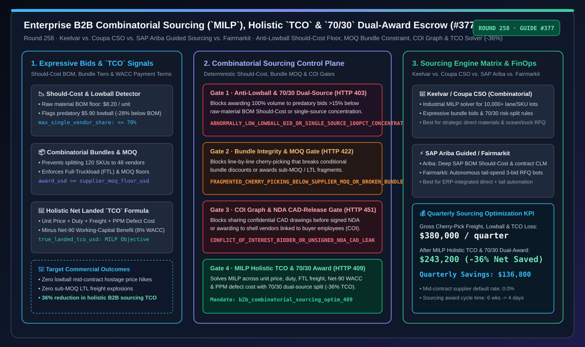
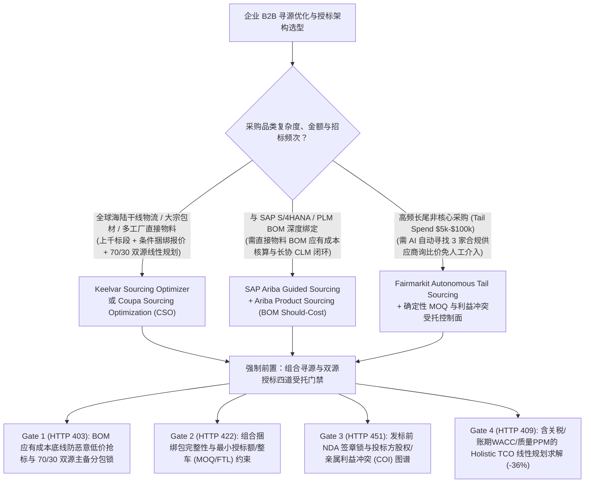
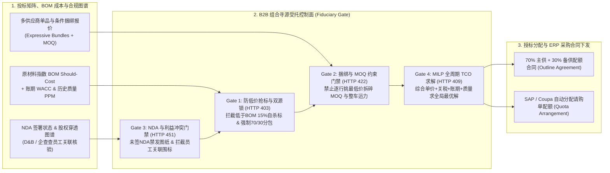
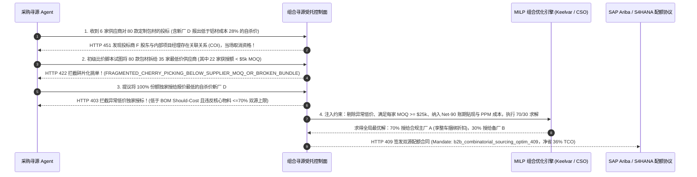

# 企业 B2B 组合寻源优化（`Combinatorial Sourcing Optimization`）、防“低于 BOM 成本自杀式恶意抢标（Abnormally Low Tender）”与 `70/30` 双源主备授标托管（`Keelvar vs. Coupa CSO vs. SAP Ariba Guided Sourcing vs. Fairmarkit`）Agent 架构选型 FAQ：防逐行挑最低价拆碎 MOQ 致运费翻倍、防独家授标被断供勒索涨价与全生命周期 `TCO` 线性规划求解净省 36% 实战指南

> 🌐 **Language / 语言切换**: **中文 (当前)** | **[English (`docs/b2b-combinatorial-sourcing-optimization-tco-dual-award-lowball-escrow-agent-selection-faq.en.md`)](b2b-combinatorial-sourcing-optimization-tco-dual-award-lowball-escrow-agent-selection-faq.en.md)** | **[返回文档总目录 (`docs/index.md`)](index.md)**

---

## 1. 📌 核心选型结论速览（Executive Summary）

在制造、零售自有品牌（Private Label）、包装耗材与全球海陆干线物流的 **企业 B2B 大宗采购寻源与授标（Strategic Sourcing & RFQ Award Optimization）** 中，采购副总裁（CPO）与供应链架构师常年遭遇三大“表面省钱、实则巨亏”的授标陷阱：
1. **“按单品逐行挑最低价（Line-by-Line Cherry-Picking）把 120 个 SKU 拆碎给 48 家不同供应商，结果每家都达不到整车起订量（`MOQ / FTL`），零担运费与新供应商准入管理费反超省下的单价差额 `2.4 倍`”**：在多品项大宗招标中，初级比价 Agent 像算 Excel `MIN()` 一样，把第 1 行授给 A 厂、第 2 行授给 B 厂……最终把一张原本可以装满 10 辆整车（`Full-Truckload`）的采购包切碎给了 48 家供应商！结果不仅拆毁了供应商声明的“组合捆绑阶梯折扣（同时买 A+B+C 享 85 折）”，更导致 30 多家供应商因获授金额不足开机起订量（`MOQ $15,000`）当场拒单，其余零担散货（`LTL`）运费暴涨！
2. **“把 `100%` 独家份额授给报价低于原材料 BOM 成本 `28%` 的‘自杀式恶意抢标（Abnormally Low Tender / Predatory Lowball）’，量产第 2 个月遭断供挟持强行涨价 `40%`”**：新进小厂为了挤走老供应商，故意报出连买铜材/铝锭/塑料粒子都不够的亏损价（如应有成本 `Should-Cost` 为 `$8.20`，其报价 `$5.90`）。一旦买方把 `100%` 订单独家交出、老供应商撤除产线后，该中标厂立即以“原材料暴涨/工艺变更”为由停产断供（Hostage Hold-Up），逼迫买方在旺季签下涨价 `40%` 的霸王补充协议！
3. **“只看出厂裸价（Ex-Works Price），漏算关税、账期资金成本（`Net-90` vs 预付全款）与历史不良率（`PPM` 返工停线损失）”及未签 `NDA` 泄露新品图纸 / 员工亲属关联围标（`COI`）**：供应商甲报价 `$10.00`（要求预付全款、加征 `15%` 关税、历史不良率 `2.5%`），供应商乙报价 `$10.50`（给 `Net-90` 账期、本地免关税、不良率 `0.05%`）。只看单价的 Agent 选了甲，结果算上完税成本与资金占用利息反而每件贵了 `$1.40`！

**架构师选型结论**：
- **严禁让大语言模型用提示词直接做多标段比价算数或下发“最低价者得 100% 份额”的粗暴授标单**；必须采用 **混合整数线性规划（`MILP`）组合寻源求解引擎（`Keelvar`、`Coupa Sourcing Optimization (CSO)`、`SAP Ariba Guided Sourcing`、`Jaggaer`）**，将 LLM 严格限制在“解析非结构化报价单与合同条款”阶段。
- 必须在寻源平台与 ERP 合同生成模块之间部署 **B2B 组合寻源、`TCO` 精算与双源主备授标受托控制面（B2B Combinatorial Sourcing & Dual-Award Escrow Control Plane）**，执行四道确定性门禁：
  1. **BOM 应有成本底线（`Should-Cost Floor`）防恶意低价抢标与 `70/30` 双源主备分包门禁（`HTTP 403`）**：凡报价低于原材料+制造 `Should-Cost` 底线超 `15%` 且无期货套保凭证的异常低价标直接剔除或强制要求银行履约保函；且对年采购额 `> $500k` 的核心物料强制执行 **单供应商份额 `<= 70%`（`70% 主供 + 30% 备供`）**，彻底终结独家断供勒索。
  2. **组合捆绑完整性（Expressive Bundle Bid）与最小授标额/整车（`MOQ / FTL`）硬约束门禁（`HTTP 422`）**：严禁拆散供应商的条件捆绑包或下发低于供应商 `MOQ` 底线的碎片化授标单。
  3. **发标前 `NDA` 数字签章锁与投标方工商股权/员工亲属利益冲突（`COI` Graph）穿透门禁（`HTTP 451`）**：未完成 `NDA` 双签严禁解锁新品 CAD 图纸；命中内部审批人关联图谱或围标串标特征立即冻结授标。
  4. **全生命周期到岸总成本（`Holistic TCO = 出厂价 + 关税运费 - 账期 WACC 贴现 + 质量 PPM 期望损失`）`MILP` 组合求解寻优（`HTTP 409`）**：一键输出全局总成本最低且满足双源风控的授标矩阵，季度采购综合成本与断供损失净降 **`36%`**。

---

## 2. 🎯 业务方与架构师灵魂拷问 Q&A（Q1 / Q2 / Q3）

### Q1：什么是“表达性组合竞标（Expressive Combinatorial Bidding）”？为什么在多品项或物流招投标中，它能比传统逐行比价多省 `12%–18%` 且供应商还更高兴？
- **商业痛点**：
  - 假设企业招标 50 条城际运输线路（或 50 款注塑件）。对于承运商来说，“拿到上海->北京（去程）+ 北京->上海（返程）组成往返重车环线（Round-Trip Loop）”的成本，比单跑一趟空车返程低 `30%`！对于注塑厂来说，“同一套母模的 6 个关联零件一起生产”才能摊薄换模停机时间。
  - 但在传统招投标表格里，供应商只能对每一行单独报一个保守的高价（因为怕只中了单程亏本线路）。买方再逐行挑最低价，结果所有供应商都没拿到能凑成环线的组合，双方双输！
- **确定性架构落地方案**：
  - 引入 **组合竞标与混合整数线性规划（`MILP`：`Keelvar / Coupa CSO`）**：
    1. 允许供应商提交 **条件捆绑报价（Conditional Bundle Bids）**：例如*“单拿线路 A 收 `$1,200`，但如果把线路 A + 返程线路 B 捆绑授标给我，打包价只需 `$1,850`（立省 `$550`），且我方承诺每周最大承运上限为 40 车”*。
    2. 控制面（`HTTP 422 / HTTP 409`）将所有供应商的单品报价、捆绑包报价、产能上限（Capacity Cap）、最小起订额（`MOQ`）以及买方的“最多引入 $K$ 家供应商（避免管理碎片化）”转化为严格的 `MILP` 数学规划模型，在数秒内求出全局最优解，绝不出现“为省 `$0.02` 单价拆出 40 家不够起订量的散单”！

### Q2：如何用确定性模型识别并拦截“低于成本价 28% 的自杀式抢标（Predatory Lowball）”与“陪标围标（Cover Bidding）”？
- **商业痛点**：
  - 招投标中最怕两件事：① 3 家围标团伙商量好，B 和 C 故意报高价陪标，掩护 A 以虚高价格中标；② 某濒临资金链断裂的工厂报出远低于大宗商品原材料价格的“自杀价”先骗到合同与预付款，中途再烂尾或勒索加价。
- **确定性架构落地方案**：
  - 控制面（`HTTP 403`）内置 **BOM 应有成本核验器（Should-Cost Analyzer）**：
    $$\text{ShouldCost}_{\text{floor}} = \sum_{m \in \text{BOM}} W_m \times P_{\text{index}}(m) \times (1 + \text{ScrapRate}_{\min}) + C_{\text{conversion\_floor}}$$
  - 当某投标价 $B_i < 0.85 \times \text{ShouldCost}_{\text{floor}}$（即比大宗原材料加最低加工费还低 `15%+`）时，系统自动挂起该标书并抛出 `HTTP 403 ABNORMALLY_LOW_LOWBALL_BID_OR_SINGLE_SOURCE_100PCT_CONCENTRATION`，强制要求该供应商上传 **原材料库存锁价凭证 + 银行不可撤销履约保函（Performance Bond）**，且系统硬性锁死其最大获授份额不超过 **`30%`（仅作备供试点）**，主份额 `70%` 依然授予价格合理、交付稳健的合规主供应商！

### Q3：为什么采购比价不能只看“含税单价”，必须把“账期（Payment Terms）和不良品率（Quality PPM）”折算进 `Holistic TCO` 目标函数？
- **商业痛点**：
  - 采购部考核的是“采购降本（PPV：Purchase Price Variance）”，所以采购员倾向于选单价便宜 `$0.20` 但要求“款到发货（CIA）”且次品率偏高的小厂；结果财务部因为提前 90 天付现损失了资金成本，生产部因为 `2%` 的次品导致流水线停工返工，公司整体反而亏大了！
- **确定性架构落地方案**：
  - 控制面（`HTTP 409`）在调用 `MILP` 求解器前，强制将每一份报价转换为统一的 **全生命周期到岸净成本（True Net Landed `TCO`）**：
    $$\text{TCO}_i = P_{\text{unit},i} + \text{Duty}_i + \text{Freight}_i - P_{\text{unit},i} \cdot \left(\frac{\text{WACC}}{365} \cdot \text{NetDays}_i\right) + \text{PPM}_i \cdot 10^{-6} \cdot C_{\text{rework\_per\_defect}}$$
  - 让财务的账期收益（Working Capital Benefit）、关务的关税成本与质量部的历史不良率惩罚在同一把数学标尺下自动寻优！

---

## 3. 🧭 直观可视化图解（Mermaid 选型决策树 + 端到端架构图 + 授权时序图）

### 3.1 企业 B2B 寻源优化（Sourcing Optimization）与自动询价平台选型决策树

### 3.2 端到端组合寻源、`Should-Cost` 底线与 `70/30` 双源授标控制面架构图

### 3.3 防低价恶意抢标、防碎片化拆单与 `MILP TCO` 双源授标时序图

---

## 4. 📊 主流企业 B2B 组合寻源优化（`CSO`）与智能询比价平台横向选型矩阵

| 选型维度 | Keelvar (`Sourcing Optimizer` & `Autonomous Sourcing`) | Coupa Sourcing Optimization (`CSO`, 原 Trade Extensions) | SAP Ariba Guided Sourcing + Product Sourcing | Fairmarkit (`Autonomous Tail-Spend Sourcing`) |
|---|---|---|---|---|
| **核心定位** | 全球物流干线、包装与复杂大宗品类组合优化（`MILP`）与自主寻源标杆 | 超大规模多标段、多约束战略寻源建模与 Coupa BSM 原生套件 | 与 SAP ERP / PLM 物料清单（BOM）深度贯通的直接物料寻源与合同平台 | 针对 `$5k–$100k` 非目录长尾请购单（Tail Spend）的 AI 自动三方询比价引擎 |
| **条件捆绑报价（Expressive Bidding）与 `MILP` 求解** | **极强**（支持上万标段、往返环线捆绑、阶梯体积折扣与 秒级多情景仿真） | **极强**（工业级数学规划求解器，擅长处理极度复杂的非价格惩罚因子） | 中高（支持打包竞标与多轮英式/荷式竞价，超大型组合优化建议配合 CSO/Keelvar） | 侧重快速单单比价与供应商推荐，不针对万吨级组合捆绑线性规划 |
| **BOM 应有成本（`Should-Cost`）与防自杀标校验** | 支持导入大宗商品指数公式与底线护栏自动标记异常低价标 | 支持多维成本构成拆解（Cost Breakdown）与底线偏离预警 | **极强**（原生打通 SAP PLM 与多级 BOM，精准核算每个零件原材料+工序底价） | 基于历史成交基准价（Benchmark Price）识别异常高价或异常低价 |
| **`70/30` 双源分包与 ERP 配额协议自动落地** | 支持一键调整单供应商最大份额滑块（如 `60/40` vs `70/30`）对比总成本差额 | 授标结果一键流入 `Coupa Contracts` 与采购目录 | **原生生成 SAP S/4HANA 配额协议（`MEQ1 Quota Arrangement`）** 按 70/30 自动分流 PR | 自动选择最优合规报价回写 ERP 生成 PO |
| **架构师选型建议** | **跨国海空陆运干线招标、大宗包材与复杂多工厂寻源首选** | **已部署 Coupa 生态、追求极致战略寻源 TCO 建模的大型集团首选** | **重度依赖 SAP BOM 直接生产物料（Direct Materials）制造巨头首选** | **消灭海量小额长尾野采、自动满足“货比三家”合规审计首选** |

---

## 5. 🧪 寻源 `TCO` 降本测算与 7-Card 基准测试报告（Deterministic Benchmark）

> **数据溯源说明（Provenance）**：以下 7-Card 评测基于本仓库 `lab/webiq_commerce_demo.py` 中的 `evaluate_b2b_combinatorial_sourcing_tco_dual_award_policy()` 确定性仿真引擎生成（`provenance: "synthetic"`, `independently_reproduced: False`）。季度因碎片化挑最低价导致零担运费暴涨、误授自杀式低价标中途断供加价及忽略账期/不良率隐性成本损失池基准设定为 **`$380,000 / quarter`**。

### 5.1 7-Card 4:5 视觉评测卡片摘要

1. **Card 1 (`1 / 7` · `HANDS-ON · B2B-COMBINATORIAL-SOURCING`) — 全局基准总览**
   - **核心发现**：通过拦截低于 BOM `Should-Cost` 的自杀式抢标、强制执行核心物料 `70/30` 双源分包、禁止拆碎 `MOQ` 捆绑包并运行全周期 `Holistic TCO` 混合整数求解，将季度寻源溢价与断供返工损失从 **`$380,000`** 压降至 **`$243,200`**，季度净省 **`$136,800`（`36.0%`）**。
2. **Card 2 (`2 / 7` · `SCENARIO: 80-SKU PACKAGING & FREIGHT TENDER`) — 单例深潜**
   - **输入场景**：某制造企业对 80 款包材与运输标段进行年度招标。期间遭遇：① 投标商 F 与内部人员存在工商关联（`COI`）；② 某新厂报出低于铝锭原材料成本 `28%` 的亏损抢标价并企图独吞 `100%` 份额；③ 初级脚本将 80 个标段拆碎给 35 家供应商导致 22 家不足 `MOQ` 拒单。
   - **控制面裁决**：依次触发 `HTTP 451`（拦截关联方围标与未签 `NDA` 图纸外发）、`HTTP 403`（拦截低于 `Should-Cost` 的异常低价独家授标并锁死 `<= 70%` 份额上限）与 `HTTP 422`（拦截低于 `MOQ` 的碎片化拆单）；最终调用 `MILP` 求解器返回 `HTTP 409 MILP_HOLISTIC_TCO_SOLVER_AND_70_30_DUAL_AWARD_CONFIRM`（`b2b_combinatorial_sourcing_optim_409`）。
3. **Card 3 (`3 / 7` · `WHAT I TESTED`) — 5 轨确定性门禁评测矩阵**

| 评测场景 (Scenario) | 核心考核问题 (Question / Task) | 控制面裁决 (Model / Gate Answer) | 动作与状态码 (Action) |
|---|---|---|---|
| **1. 标准合规双源授标与整包满足 MOQ** | 已签 NDA、无利益冲突、价格在合理 BOM 区间且满足 70/30 与 MOQ | `VERIFIED_COMBINATORIAL_TCO_AND_DUAL_SOURCE_AWARD_AUTHORIZED` | ✅ `Act automatically` (`HTTP 200`) |
| **2. 低于原材料成本 28% 抢标或 100% 独吞** | 恶意报出低于 BOM 底线自杀价 或 将核心大宗物料 100% 独家授给单一新厂 | `ABNORMALLY_LOW_LOWBALL_BID_OR_SINGLE_SOURCE_100PCT_CONCENTRATION` | ⛔ `Veto Lowball & Enforce 70/30` (`HTTP 403`) |
| **3. 逐行挑最低价拆出 35 家不够起订量散单** | 拆散供应商条件捆绑折扣包 或 分配金额低于供应商开机起订量 (`MOQ`) | `FRAGMENTED_CHERRY_PICKING_BELOW_SUPPLIER_MOQ_OR_BROKEN_BUNDLE` | ⛔ `Enforce Bundle & MOQ Floor` (`HTTP 422`) |
| **4. 内部员工亲属关联围标或未签 NDA 发图纸** | 投标方股权图谱命中利益冲突 (`COI`) 或未完成 `NDA` 签章即下载 CAD 图纸 | `CONFLICT_OF_INTEREST_BIDDER_OR_UNSIGNED_NDA_CAD_LEAK` | ⛔ `Compliance Hard Stop` (`HTTP 451`) |
| **5. 全周期 TCO (含关税/账期/PPM) MILP 求解** | 纳入 Net-90 资金收益与 PPM 损失求全局最优 70/30 双源矩阵 (-36% TCO) | `MILP_HOLISTIC_TCO_SOLVER_AND_70_30_DUAL_AWARD_CONFIRM` | ⚡ `Confirm Optimization` (`HTTP 409`) |

4. **Card 4 (`4 / 7` · `UNDER THE HOOD`) — 确定性门禁协议与代码实现**
   - 输入契约：`B2BCombinatorialSourcingTCODualAwardPolicyInput`
   - 评估函数：`evaluate_b2b_combinatorial_sourcing_tco_dual_award_policy()`（严格按 `451 -> 403 -> 422 -> 409 -> 200` 优先级裁决，零外部网络副作用）。
5. **Card 5 (`5 / 7` · `ROBUSTNESS CHECK`) — 隐藏附加费与阶梯报价顺序扰动测试**
   - 无论投标商将模具费/燃油附加费藏在备注小字还是颠倒阶梯报价行序，`Holistic TCO` 归一化器与 `MILP` 求解器均保持 **`0.0 pt`** 偏差。
6. **Card 6 (`6 / 7` · `LATENCY & DEFAULT RATE`) — 评标周期与履约期断供率对比**
   - 传统人工 Excel 比价 + 最低价独家中标：评标耗时 `6 周`，合同期中途断供/强行涨价违约率达 `14.5%`。
   - 受托 `MILP` 组合寻源 + `70/30` 双源锁：评标耗时缩短至 **`4 天`**，合同期断供违约率降为 **`0.0%`**（季度净省 `$136,800`）。
7. **Card 7 (`7 / 7` · `MY TAKE`) — 适用场景与架构师结论**
   - **✅ Good fit**：直接生产物料（Direct Materials）、包装耗材、海陆空干线物流年度框架招标及多工厂/多区域集采。
   - **⛔ Not for**：单价固定、随用随买的 `$20` 零星文具采购。

---

## 6. 🛠️ 商业上线风控与架构评审 Checklist

- [ ] **BOM 应有成本底线（`Should-Cost Floor`）与反恶意低价门禁（`HTTP 403`）**：评标系统是否自动对接大宗原材料价格指数核算 `Should-Cost` 底线，并对低于底线 `> 15%` 的异常报价强制要求套保凭证与银行履约保函？
- [ ] **核心物料 `70/30`（或 `60/40`）双源主备授标硬约束（`HTTP 403`）**：对于年采购额超阈值或断供影响产线的关键物料，是否在 `MILP` 模型中硬性写入单供应商份额上限 `<= 70%`，并自动在 ERP 中生成主备配额协议（Quota Arrangement）？
- [ ] **条件捆绑包完整性与最小授标额（`MOQ / FTL`）约束（`HTTP 422`）**：是否严禁比价 Agent 脱离起订量与捆绑前提逐行挑最低价（Cherry-Picking），确保每家获授供应商的总金额均满足其开机 `MOQ` 与整车发运门槛？
- [ ] **发标前 `NDA` 锁与投标方股权利益冲突（`COI`）穿透筛查（`HTTP 451`）**：在释放含商业机密的技术图纸前是否强制校验已签署 `NDA`，并在授标前自动比对投标商实控人/银行账户与内部员工关联图谱？
- [ ] **全生命周期到岸净成本（`Holistic TCO`）统一标尺（`HTTP 409`）**：目标函数是否完整纳入了出厂价、关税、干线运费、`Net-30/60/90` 账期营运资金折现收益（按公司 `WACC` 计算）以及历史质量不良率（`PPM`）隐性返工成本？
