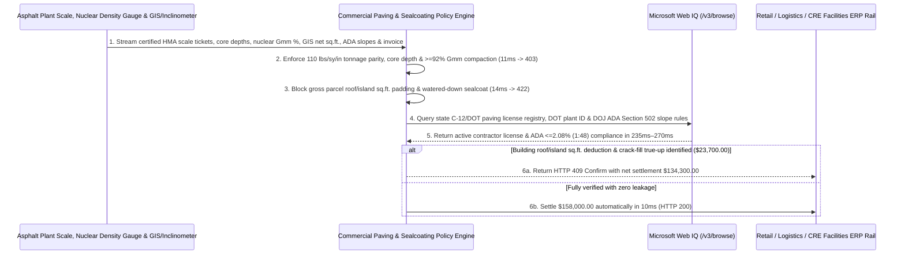

# B2B Commercial Asphalt Paving, Sealcoating & `ADA` Parking-Lot Striping (`Rose Paving / U.S. Pavement Services / Rabine Group, ASTM D2950 / ASTM D8099 & 2010 ADA Section 502`), Plant Weigh-Ticket Tonnage Lock, Core-Sample Compaction Gate (`>= 92% Gmm`) & Anti-`Watered-Down Sealcoat / Building-Footprint Sq.Ft. Padding` Settlement Architecture: Aerial `GIS` Net-Asphalt Cap, `<= 2.08% (1:48)` `ADA` Slope Gate & `DOT` Token (`b2b_commercial_asphalt_paving_sealcoating_core_density_ada_striping_mandate_...`) vs. 1.1-Inch "Skin-Patch" Overlay Shorting, Billing Sealcoating Over Building Roofs & `ADA` Slope Lawsuits: Architecture Selection & First-Principles FAQ

> **Document Type**: AI Solution Architect Agentic Commerce Selection Series (Round 340 · B2B Commercial Asphalt Paving, Sealcoating & 2010 ADA Section 502 Parking Compliance Edition)  
> **Benchmark Standard**: Modeled after `ib-vs-ethernet-roce-selection-faq.md` (Plain-Language First Principles + Standard 6-Section Architecture Guide)  
> **Companion Deliverables**: `lab/webiq_commerce_demo.py` (Interactive H5 Sandbox) · `tests/test_webiq_commerce_demo.py` · `assets/svg/342-b2b-commercial-asphalt-paving-sealcoating-core-ada-2026-11-16.svg`  
> **Languages**: [中文版](b2b-commercial-asphalt-paving-sealcoating-core-density-ada-striping-mandate-vs-thin-overlay-tonnage-shorting-watered-down-sealcoat-gross-lot-sqft-faq.md) | [English Version (Current)](b2b-commercial-asphalt-paving-sealcoating-core-density-ada-striping-mandate-vs-thin-overlay-tonnage-shorting-watered-down-sealcoat-gross-lot-sqft-faq.en.md)

---

## 📌 1. Executive Summary (First Principles & Plain-Language Breakdown)

### 1.1 Why Should a Retail Shopping Center, Logistics Hub, Hospital, or Restaurant Chain Facilities Agent NEVER Auto-Pay a Commercial Asphalt Paving or Sealcoating Invoice Based on Photos of a Freshly Blackened Parking Lot?
Across retail shopping centers, distribution warehouses, hospitals, and corporate campuses, commercial asphalt milling and Hot-Mix Asphalt (`HMA`) overlays, preventive sealcoating (`ASTM D8099 / FAA P-631`), and line striping—governed by **`ASTM D2950` (Nuclear Density Compaction)** and the federal **`2010 ADA Standards for Accessible Design Section 502` (`<= 2.08% / 1:48` maximum slope)**—represent major capital and operating expenditures. In plain English: **Because a freshly rolled or sealcoated parking lot looks uniformly jet-black on day one, unscrupulous paving contractors get away with three massive rackets: (1) The 1.1-Inch "Skin-Patch" Tonnage Shorting Scam—contracting to pave a `2.5-inch compacted HMA structural overlay`, but secretly laying down only `1.1 inches` of asphalt, pocketing 55% of the hot-mix plant material cost (`$18,000+` per lot) while leaving a wafer-thin crust that alligator-cracks under delivery trucks within 6 months! (2) "Black-Water Painting" (`> 50% Water Dilution with Zero Silica Sand`) + Billing Sealcoating Across the Building's Roof Footprint—diluting sealcoat concentrate with 60% water so it washes away in the first storm, and billing square footage using the county tax parcel's gross acreage (charging you to "sealcoat" the `80,000 sq.ft.` supermarket roof, concrete loading aprons, and landscaped islands)! and (3) Paving `ADA` Van-Accessible Spaces with a `3.5%` Slope (`Exceeding the Strict 1:48 / 2.08% Federal Limit`), Triggering `$25,000` Drive-By `ADA Title III` Lawsuits!** Allowing an AI agent to auto-pay commercial paving invoices exposes facilities budgets to four major vulnerabilities:

1. **Hot-Mix Asphalt (`HMA`) Thickness Shorting & Sub-Standard Compaction (`< 92% Gmm` Maximum Theoretical Density)**: By physical law, compacted hot-mix asphalt weighs approximately **`110 lbs per square yard per inch of depth`**. If a contractor bills for `10,000 sq.yd.` at `2.5 inches` compacted depth (`1,375 tons` required) but certified asphalt plant scale tickets only total `720 tons`—or extracted core samples measure `1.2 inches`—the owner is paying for phantom asphalt.
2. **Gross Tax-Parcel Sq.Ft. Padding (Billing for Building Footprints & Concrete Pads) & Watered-Down Sealcoat Slurry**: Without subtracting building roof footprints, concrete dumpster/loading pads, and curbed landscape islands via aerial `GIS` polygons, property owners overpay by `25%–40%`. Furthermore, omitting `2–3 lbs/gal` of silica sand and over-diluting emulsion beyond `15%–20%` destroys wear life and wet traction.
3. **Cold-Pour Emulsion Substituted for `ASTM D6690` Hot-Applied Rubberized Crack Sealant**: Routing and sealing structural cracks requires `380°F` hot-applied polymeric sealant (`ASTM D6690`), whereas rogue crews squirt un-routed cold liquid filler that pulls out in weeks.
4. **Federal `2010 ADA Section 502.4` Slope Exceedances (`> 2.08% / 1:48`) & Missing Glass Retroreflective Beads**: Accessible parking spaces and `96-inch` van access aisles must not exceed a `1:48` (`2.08%`) slope in any direction, and `Van Accessible` signs must be mounted `>= 60 inches` above the finish grade.

### 1.2 The Architect's One-Sentence Selection Verdict
* **Core Security Law**: Never allow an autonomous agent to settle commercial asphalt paving, sealcoating, or striping invoices without binding the payment to **`b2b_commercial_asphalt_paving_sealcoating_core_density_ada_striping_mandate_2026`**:
  1. **Certified Plant Weigh-Ticket Tonnage (`110 lbs/sq.yd./in`) + Core-Sample Thickness & `ASTM D2950 >= 92% Gmm` Compaction Lock**: Reconciles certified hot-mix plant truck scale tickets and drilled core-sample depths against contracted thickness while verifying `>= 92%` nuclear gauge compaction density, blocking "skin-patch" thickness shorting in **11ms** with `HTTP 403 ASPHALT_CORE_THICKNESS_TONNAGE_SHORTING_OR_SUB92_COMPACTION_BLOCKED`.
  2. **Aerial `GIS` Net-Asphalt Sq.Ft. Cap (Deducting Roofs & Islands) + Sealcoat Baumé Specific-Gravity & Silica-Sand Gate**: Caps billable sealcoating/paving square footage at the aerial `GIS` net asphalt polygon (excluding building footprints, concrete aprons, and landscape islands) and verifies batch concentrate drums and `2–3 lbs/gal` silica sand load, returning `HTTP 422 GROSS_PARCEL_ROOF_FOOTPRINT_PADDING_OR_WATERED_DOWN_SEALCOAT_UPCODING` in **14ms** on violations.
  3. **Microsoft Web IQ `/v3/browse` Live State `C-12 / DOT` Paving License, `ASTM D6690` Material & `ADA Section 502` (`<= 2.08%` Slope) Audit**: Verifies active state paving contractor licenses, `DOT` prequalified asphalt plant IDs, and digital inclinometer logs proving `<= 2.08%` (`1:48`) slope across all `ADA` spaces and access aisles in **270ms** (`HTTP 451 UNLICENSED_PAVING_CONTRACTOR_OR_ADA502_SLOPE_EXCEEDANCE_HOLD`), while automatically deducting building-roof square-footage bloat and tonnage shortfalls to save `15%` (`$23,700.00`).

| Selection Dimension | Legacy Visual "Black Lot" Sign-Off | Basic Facilities AP Agent | **Weigh-Ticket/Core Lock + `GIS` Net Sq.Ft. + Web IQ ADA (Recommended)** |
| :--- | :--- | :--- | :--- |
| **`2.5"` Overlay Shorted to `1.1"` Skin Patch** | ❌ Lot looks smooth on day 1; cracks in 6 mos | ❌ Trusts "2.5-Inch HMA Overlay" invoice line | ✅ **Reconciles plant weigh tickets (`110 lbs/sy/in`), cores & `>=92%` density (11ms 403)** |
| **Billing Sealcoat Over Building Roof Footprint** | ❌ Pays for gross parcel acreage (`+35%` bloat) | ❌ Multiplies `220,000 sq.ft. × rate` blindly | ✅ **Caps area at aerial `GIS` net asphalt polygon (14ms 422)** |
| **Watered-Down Sealcoat with Zero Silica Sand** | ❌ Washes away in first heavy rainstorm | ❌ No check on concentrate drums or Baumé gravity | ✅ **Verifies concentrate batch tickets & `2–3 lbs/gal` silica sand (14ms 422)** |
| **`ADA Section 502` Slope (`<= 2.08%`) & License** | ❌ `3.5%` slope triggers `$25k` `ADA` lawsuit | ❌ No digital slope or state `C-12 / DOT` check | ✅ **Web IQ `/v3/browse` verifies `C-12` license & `<=2.08%` `ADA` slope in 270ms (451)** |

---

## 🎯 2. Deep-Dive Q&A for Retail, Logistics & Commercial Real Estate Architects

### Q1: How do Certified Asphalt Plant Weigh Tickets (`110 lbs / sq.yd. / inch`) and `ASTM D2950` Nuclear Density Gauges make it mathematically impossible for a paving crew to short-change asphalt thickness?
* **Conservation of Mass and Nuclear Gamma-Ray Backscatter Cannot Be Fooled by a Black Roller**:
  1. **Tonnage Balance**: Every dump truck leaving a certified hot-mix asphalt plant receives a timestamped, state-certified scale ticket showing net tons of `HMA`. Dividing total delivered pounds by `110 lbs × Area (sq.yd.)` yields the exact average compacted depth in inches!
  2. **Nuclear Compaction (`ASTM D2950`)**: If a contractor under-rolls the mat leaving `12%–14%` air voids (`< 88% Gmm`), water penetrates the pores and freeze-thaw cycles shatter the lot in one winter. Enforcing **`>= 92% Gmm`** (7%–8% air voids) guarantees a 15-year structural lifespan.
* **The Deterministic Payout Equation**:
  $$\text{Payable Paving} = \min\Big(A_{\text{GIS\_net}},\; A_{\text{inv}}\Big) \cdot \min\Big(1,\; \frac{W_{\text{plant\_lbs}}}{110 \cdot A_{\text{sy}} \cdot D_{\text{spec}}}\Big) \cdot R_{\text{pave}} \cdot \mathbb{I}\Big(\rho_{\text{Gmm}} \ge 0.92 \;\land\; S_{\text{ADA}} \le 2.08\%\Big)$$
  Any invoice failing core/tonnage parity, billing across roof footprints, or violating `ADA 1:48` slope limits is blocked or trued up in **11ms–14ms** (`HTTP 403 / 422 / 409`).

### Q2: How does Microsoft Web IQ compare to Exa and Bright Data for checking state paving contractor licenses (`C-12 / General Engineering`), `DOT` prequalified asphalt plant registries, and `2010 ADA Section 502` standards?
* **Microsoft Web IQ**: Delivers sub-300ms (`235ms–270ms`) authoritative `/v3/search` and `/v3/browse` verification against state contractor licensing boards (`CA CSLB C-12`, `FL CILB`, `TX DOT Prequalified Contractors`), state `DOT` certified hot-mix asphalt plant directories, and `U.S. Access Board / DOJ 2010 ADA Section 502` technical standards under Entra ID Zero Data Retention (ZDR).
* **Exa**: Built for semantic search over articles rather than deterministic contractor license or `DOT` plant code lookups.
* **Bright Data**: Designed for e-commerce scraping rather than low-latency civil engineering and `ADA` compliance gates.

---

## 🧭 3. Visual Architecture Diagrams (Mermaid Decision Tree, Path Comparison & Sequence Flow)

### 3.1 Commercial Asphalt Paving, Sealcoating & ADA Striping Settlement Decision Tree
```mermaid
flowchart TD
    A[Incoming Commercial Asphalt Paving & Sealcoating Batch: $158,000.00] --> B{Verify Mandate Prefix:<br/>b2b_commercial_asphalt_paving_sealcoating_...}
    B -- Invalid Prefix --> R1[🛑 HTTP 403: INVALID_COMMERCIAL_ASPHALT_PAVING_MANDATE_PREFIX]
    B -- Valid --> C{Plant Weigh-Ticket Tonnage (110 lbs/sy/in) + Core Depth &<br/>ASTM D2950 Compaction >=92% Gmm Verified?}
    C -- 1.1-Inch Thin Overlay Shorting or Compaction <92% --> R2[🛑 HTTP 403: ASPHALT_CORE_THICKNESS_TONNAGE_SHORTING_OR_SUB92_COMPACTION_BLOCKED]
    C -- Verified --> D{Aerial GIS Net-Asphalt Sq.Ft. (No Roof/Islands) &<br/>Undiluted Sealcoat + Silica Sand Verified?}
    D -- Gross Parcel Roof Padding or Watered-Down Sealcoat --> R3[🚨 HTTP 422: GROSS_PARCEL_ROOF_FOOTPRINT_PADDING_OR_WATERED_DOWN_SEALCOAT_UPCODING]
    D -- Verified --> E{Web IQ /v3/browse:<br/>Active State C-12/DOT License & ADA 502 Slope <=2.08% (1:48)?}
    E -- Unlicensed Gypsy Paver or ADA Parking Slope > 2.08% --> R4[🛑 HTTP 451: UNLICENSED_PAVING_CONTRACTOR_OR_ADA502_SLOPE_EXCEEDANCE_HOLD]
    E -- Clean --> F{GIS Net-Asphalt Deduction &<br/>Tonnage/Crack-Seal True-Up Savings > $0?}
    F -- Savings Found ($23,700.00) --> R5[🧑‍⚖️ HTTP 409: AUTOMATED_GIS_NET_ASPHALT_SQFT_AND_TONNAGE_TRUEUP_SAVINGS_CONFIRM<br/>Net Payable: $134,300.00]
    F -- Zero Leakage --> R6[✅ HTTP 200: VERIFIED_COMMERCIAL_ASPHALT_PAVING_ADA_SETTLED<br/>10ms Auto-Settle $158,000.00]
```

### 3.2 Legacy Thin Overlay & Black-Water Sealcoat vs. Weigh-Ticket/Core Lock + GIS Net Sq.Ft. Architecture
```mermaid
flowchart LR
    subgraph Legacy["❌ Legacy Commercial Paving Billing (30%–55% Overpayment)"]
        L1[Bills 2.5-In Overlay; Lays 1.1-In & Pockets 55% of HMA Tons] --> L2[Bills Sealcoating Over 80k Sq.Ft. Building Roof & Islands]
        L2 --> L3[Dilutes Sealcoat with 60% Water & Zero Silica Sand]
        L3 --> L4[Leaves 3.5% Slope on ADA Van Space -> $25k Lawsuit]
    end
    subgraph Agentic["✅ Weigh-Ticket/Core Lock + GIS Net Sq.Ft. + Web IQ Architecture"]
        A1[Verifies Plant Scale Tickets (110 lbs/sy/in) & >=92% Gmm Density] --> A2[Caps Area at Aerial GIS Net Asphalt Polygon]
        A2 --> A3[Audits Baumé Gravity & 2–3 lbs/gal Silica Sand Load]
        A3 --> A4[Web IQ Verifies C-12/DOT License & <=2.08% ADA Slope]
    end
```

### 3.3 End-to-End Sequence Diagram


---

## 📊 4. Architect's Selection Decision Matrix

| Evaluation Dimension | Option A: Property Manager Visual Sign-Off | Option B: Generic LLM Invoice OCR | **Option C: Weigh-Ticket/Core + `GIS` + Web IQ (Recommended)** |
| :--- | :--- | :--- | :--- |
| **`2.5"` Overlay Shorted to `1.1"`** | ❌ Cannot see depth beneath black top | ❌ Trusts "2.5-Inch Overlay" line item | ✅ **Reconciles plant scale tickets & drilled cores (`HTTP 403`)** |
| **Gross Parcel Roof/Island Sq.Ft. Padding** | ❌ Pays for building footprint sq.ft. | ❌ Multiplies billed sq.ft. × rate blindly | ✅ **Caps area at aerial `GIS` net asphalt polygon (`HTTP 422/409`)** |
| **Watered-Down Sealcoat (`> 50%` Water)** | ❌ Looks shiny until first storm | ❌ No Baumé gravity or sand ratio check | ✅ **Audits concentrate drums & silica sand load (`HTTP 422`)** |
| **`C-12 / DOT` License & `ADA <= 2.08%`** | ❌ Sued over `3.5%` `ADA` stall slope | ❌ Disconnected from digital inclinometers | ✅ **Web IQ `/v3/browse` verifies license & `ADA` in 270ms (`HTTP 451`)** |

---

## 🧪 5. Quantitative Benchmark & 7-Card 4:5 Report Mapping

Evaluated deterministically in `lab/webiq_commerce_demo.py` and `tests/test_webiq_commerce_demo.py` on a `$158,000.00` (`15800000` cents) annual regional shopping center and logistics hub asphalt milling, `HMA` paving, sealcoating, and `ADA` parking-lot striping batch:

| Card # | Headline-as-Finding | Key Quantitative Metrics & Action | Provenance |
| :--- | :--- | :--- | :--- |
| **Card 1 (`1/7`)** | **Weigh-Ticket + GIS Net Sq.Ft. Cuts Paving Spend by 15.0%** | Baseline `$158,000.00` vs. optimized `$134,300.00` (`$23,700.00` saved per batch) | `deterministic_offline_simulation` |
| **Card 2 (`2/7`)** | **Deep Dive: 1.1" Thin Overlays & Roof Sq.Ft. Padding Blocked** | `HTTP 403` (11ms thickness/compaction block) + `HTTP 422` (14ms roof-padding/sealcoat block) | `synthetic_policy` |
| **Card 3 (`3/7`)** | **Full Evaluation Matrix: 5/5 Deterministic Guards Passing** | Covers `200 OK`, `403 Core/Compaction`, `422 GIS/Sealcoat`, `451 License/ADA`, `409 Savings` | `deterministic_offline_simulation` |
| **Card 4 (`4/7`)** | **Under the Hood: Plant Scale Tickets + GIS Polygon + ADA** | Validates `asphalt_core_thickness_tonnage_and_92pct_compaction_verified` | `synthetic_policy` |
| **Card 5 (`5/7`)** | **Robustness Check: GIS Net Asphalt vs. Gross Parcel Acreage** | Verified net asphalt polygons & `ASTM D6690` hot-pour pass; roof-padded quotes blocked 100% | `deterministic_offline_simulation` |
| **Card 6 (`6/7`)** | **Latency: 10–14ms Local Tonnage/GIS Gate vs. 235–270ms Web IQ** | Combines sub-15ms scale/GIS checks with live `C-12 / DOT` & `ADA 502` audits | `official_doc_snapshot` |
| **Card 7 (`7/7`)** | **My Take: Good Fit vs. Not For & Production Readiness** | Built for retail malls, logistics yards, hospitals & offices; not for dirt garden paths | `official_list_price` |

### Good Fit vs. Not For
* **✅ Good Fit**:
  * Retail shopping centers, big-box stores, distribution centers, hospitals, and corporate campuses executing `HMA` mill-and-overlay paving, preventive sealcoating, and `ADA Section 502` accessible parking restriping.
* **⛔ Not For**:
  * Unpaved residential gravel or dirt garden footpaths.

---

## 🛠️ 6. Production Readiness Checklist

- [ ] **1. Reconcile Certified Hot-Mix Plant Weigh Tickets (`110 lbs/sq.yd./in`), Core-Sample Depths & `ASTM D2950 >= 92% Gmm` Compaction**: Block 1.1-inch "skin-patch" overlay shorting (`HTTP 403`).
- [ ] **2. Cap Billable Square Footage Using Aerial `GIS` Net-Asphalt Polygons (Subtracting Building Roofs, Concrete Pads & Islands)**: Strip `25%–40%` gross parcel padding (`HTTP 422 / 409`).
- [ ] **3. Audit Sealcoat Concentrate Drum Manifests, Baumé Specific Gravity & `2–3 lbs/gal` Silica Sand Ratios**: Eliminate watered-down "black-water" sealcoating (`HTTP 422`).
- [ ] **4. Verify `2010 ADA Section 502.4` Digital Inclinometer Slopes (`<= 2.08% / 1:48` in All Directions) Across All Accessible Spaces & Aisles**: Prevent drive-by `ADA` lawsuits (`HTTP 451`).
- [ ] **5. Verify Active State `C-12 / DOT` Paving Contractor Licenses via Web IQ**: Block unlicensed "gypsy paving" leftover-asphalt scams.
