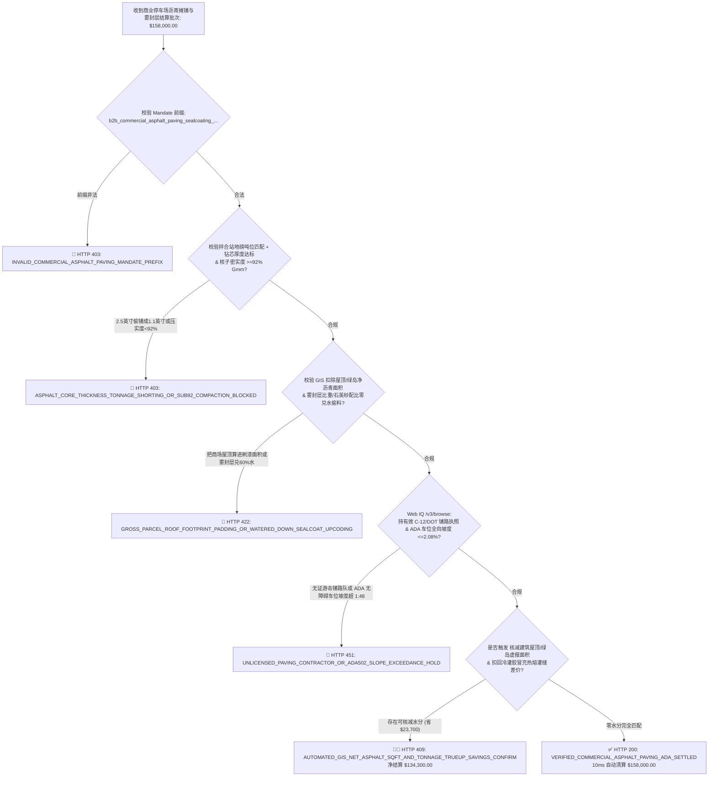
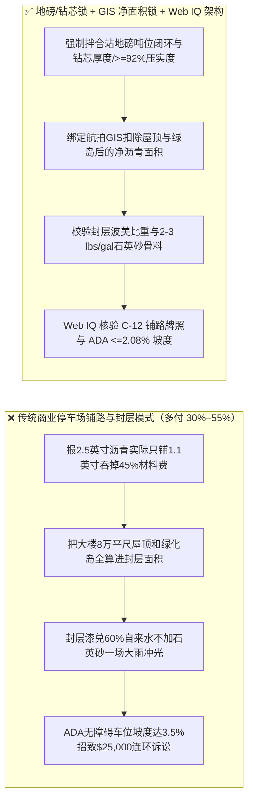
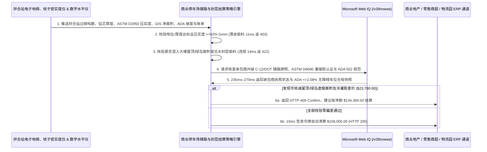

# B2B 商业地产停车场沥青铣刨摊铺（`Commercial Asphalt Milling & HMA Overlay`）、沥青密封雾封层（`Sealcoating`）与 `ADA` 无障碍车位划线结算（`Commercial Asphalt Paving, Sealcoating & ADA Parking Lot Striping: Rose Paving / U.S. Pavement Services / Rabine Group, ASTM D2950 / ASTM D8099 & 2010 ADA Section 502`）、钻芯取样压实厚度与地磅吨位闭环锁、航拍 `GIS` 净沥青面积（扣除屋顶与绿化岛）门禁与防“把 2.5 英寸结构层沥青偷工减料铺成 1.1 英寸薄皮（`Skin-Patch Shorting`）、往密封涂料里兑 60% 自来水不加石英砂一场雨就冲光与把商场大楼屋顶面积也算进铺路面积多收 40%”清算架构：钻芯厚度/核子密实度（`>=92% Gmm`）锁、涂料比重（`Baumé`）门禁与 `ADA 1:48` 坡度令牌（`b2b_commercial_asphalt_paving_sealcoating_core_density_ada_striping_mandate_...`）vs 传统铺路队用剩料游击诈骗、无障碍车位横坡超 `2.08%` 招致职业索赔人连环起诉选型与原理解析 FAQ

> **文档类型**：AI Solution Architect 商业智能体架构选型系列（Round 340 · B2B 商业停车场沥青摊铺、雾封层比重与 ADA 502 无障碍坡度专篇）  
> **对标标杆**：`ib-vs-ethernet-roce-selection-faq.md`（通俗大白话 + 第一性原理 + 标准六段式结构）  
> **关联 Deliverable**：`lab/webiq_commerce_demo.py`（H5 实时防篡改沙盒） · `tests/test_webiq_commerce_demo.py` · `assets/svg/342-b2b-commercial-asphalt-paving-sealcoating-core-ada-2026-11-16.svg`  
> **双语版本**：[中文版 (当前)](b2b-commercial-asphalt-paving-sealcoating-core-density-ada-striping-mandate-vs-thin-overlay-tonnage-shorting-watered-down-sealcoat-gross-lot-sqft-faq.md) | [English Version](b2b-commercial-asphalt-paving-sealcoating-core-density-ada-striping-mandate-vs-thin-overlay-tonnage-shorting-watered-down-sealcoat-gross-lot-sqft-faq.en.md)

---

## 📌 一、核心结论速览（Executive Summary：第一性原理与通俗大白话拆解）

### 1.1 为什么“绝对不能”让大型商超、物流园区、奥特莱斯、医院或连锁餐饮的设施采购 Agent 仅凭商业沥青道路施工队（如 Rose Paving、U.S. Pavement Services、Rabine、区域市政铺路队）提交的“停车场黑亮完工照片与总面积结算单”就自动付款？
在大型零售广场、物流枢纽与企业园区中，室外沥青停车场铣刨重铺（`Mill & Hot-Mix Asphalt Overlay`）、预防性沥青乳液雾封层（`Sealcoating`）及车位标线重划（受 `ASTM D2950` 核子压实度标准、`ASTM D8099 / FAA P-631` 封层配比规范及联邦 **`2010 ADA Standards Section 502` 无障碍停车位 `<= 2.08% (1:48)` 全向坡度铁律** 严格约束）是商业地产单笔金额最高的外围工程之一。用大白话讲：**刚铺完或刚刷完封层的停车场全是一片乌黑发亮，肉眼根本看不出底下藏着外包界最暴利的三大骗局：第一是“把合同签的 `2.5 英寸（6.35cm）` 压实热拌沥青，偷偷铺成 `1.1 英寸` 的薄皮（Thin-Overlay Tonnage Shorting）”——沥青混凝土（`HMA`）每少铺 1 英寸，施工队就能省下 40% 的沥青拌合站材料费（每万平尺净吞 `$18,000`）；表面刚压平看着一模一样，但重载货车一碾压，不到半年就全碎成龟裂纹！第二是“兑了 60% 自来水的‘黑水刷地’封层（Watered-Down Sealcoat）+ 把大楼屋顶面积也算进刷漆面积”——正宗商业封层（`SealMaster / Neyra`）每加仑必须掺入 `2–3 磅` 耐磨石英砂且加水稀释比例不得超过 `15%–20%`；游击队往罐车里狂兑 60% 的水且不加一粒沙，刷上去黑亮但下两场大雨就露底，更黑心的是，他们直接拿地块总占地面积（含中间 `80,000 平尺` 的超市大楼屋顶、水泥人行道和绿化树池）乘以单价收钱，白白多收 `35%`！第三是“无障碍车位（`ADA Van Space`）铺完坡度超过 `2.08%`（`1:48`）”——铺路队没用电子水平仪找平，导致残障车位斜坡达到 `3.5%`，结果被带着激光尺逛街的职业 `ADA` 索赔律师一抓一个准，单店赔款加返工高达 `$25,000`！** 如果没有钻芯取样压实厚度与拌合站地磅吨位闭环锁、航拍 `GIS` 净沥青面积扣除门禁与 `ADA 1:48` 数字坡度锁，企业基建预算会遭遇四大失血黑洞：

1. **沥青摊铺厚度缩水 50%（`Core Thickness Shorting`）与核子密实度不达标（`< 92% Gmm`）**：按照市政公路物理学，`1 平方码` 每铺 `1 英寸` 压实热拌沥青需要约 **`110 lbs`（`0.055 吨`）** 沥青料。如果施工队报价铺 `10,000 平方码 × 2.5 英寸`，理论上必须提供拌合站至少 **`1,375 吨`** 的过磅单（Certified Asphalt Plant Weigh Tickets）；如果只拉来 `700 吨` 料或钻芯取样（Core Sample）厚度仅 `1.2 英寸`，就是铁板钉钉的偷工减料！
2. **雾封层（`Sealcoating`）恶意兑水、漏加石英砂骨料与按地块毛面积（含建筑屋顶/绿化岛）虚报平方英尺**：利用波美比重计（`Baumé Hydrometer`）和罐车流量计即可当场戳穿兑水黑漆；利用高分辨率卫星/无人机 `GIS` 多边形扣除建筑物屋顶（Building Footprint）、混凝土地坪与景观绿岛，立砍 `25%–40%` 虚报面积。
3. **将 `$3.50/英尺` 的热熔裂缝灌缝胶（`ASTM D6690 Hot-Pour Crack Routing & Sealing`）调包为普通冷灌沥青水，或虚报全场钢筋网修复**：普通乳化沥青冷灌三个月即开裂脱落，且不铣刨开槽直接涂抹表面毫无防水作用。
4. **违反联邦 `2010 ADA Section 502` 无障碍车位斜坡红线（`Slope > 2.08% / 1:48`）及标线漆不加反光玻璃微珠**：`ADA` 无障碍车位及侧方 `8 英尺` 轮椅升降通道（Access Aisle）在任何方向的坡度一旦超过 **`2.08%`（即 `1.2 度`）**，即构成联邦违法，物业不仅无法通过市政竣工验收，还会沦为无障碍诉讼提款机。

### 1.2 架构师的一句话选型结论
* **核心安全铁律**：严禁 Agent 对未提交拌合站电子地磅吨位闭环（`110 lbs / sq.yd. / inch`）与钻芯实测厚度/核子密实度（`>= 92% Gmm`）、未扣除大楼屋顶与绿化岛面积、雾封层浆液比重（`Baumé`）与石英砂掺量不达标、或 `ADA` 无障碍车位实测坡度超过 `2.08%`（`1:48`）的账单自动打款。必须将清算令绑定在 **`b2b_commercial_asphalt_paving_sealcoating_core_density_ada_striping_mandate_2026`** 上：
  1. **沥青拌合站地磅吨位与钻芯厚度闭环锁（`Weigh-Ticket Tonnage & Core Thickness Lock`）+ 核子密实度门禁（`>= 92% Gmm`）**：强制校验拌合站出厂过磅总吨数与摊铺面积×设计厚度的物理守恒关系，并抽检钻芯实测厚度与 `ASTM D2950` 核子密度仪压实度；任何把 `2.5 英寸` 偷减成 `1.2 英寸` 薄皮的工单在 **11ms** 内返回 `HTTP 403 ASPHALT_CORE_THICKNESS_TONNAGE_SHORTING_OR_SUB92_COMPACTION_BLOCKED`。
  2. **航拍 `GIS` 净沥青面积锁（扣除屋顶/绿岛）+ 雾封层波美比重与石英砂配比门禁（`Zero Watered-Down Slurry`）**：强制以 `GIS` 矢量多边形扣除建筑屋顶、水泥卸货区与绿化岛后的净黑地面（`Net Asphalt Sq.Ft.`）作为计费上限，并核验封层原液进货单与现场比重，任何按毛地块面积计费或兑水偷料账单在 **14ms** 内返回 `HTTP 422 GROSS_PARCEL_ROOF_FOOTPRINT_PADDING_OR_WATERED_DOWN_SEALCOAT_UPCODING`。
  3. **Microsoft Web IQ `/v3/browse` 实时核验州级公路/沥青承包商牌照（`DOT Prequalified / C-12 Paving License`）、`ASTM D6690` 灌缝料认证与 `ADA Section 502` 无障碍坡度（`<= 2.08%`）**：在线穿透核查承包商是否具备州交通厅/建筑委员会沥青摊铺资质，并校验全部 `ADA` 车位与通道的数字水平仪全向坡度读数 `<= 2.08%` 及无障碍标识牌离地高度 `>= 60 英寸`，发现无证施工或 `ADA` 坡度超标在 **270ms** 内触发 `HTTP 451 UNLICENSED_PAVING_CONTRACTOR_OR_ADA502_SLOPE_EXCEEDANCE_HOLD`，并自动剥离屋顶/绿岛虚报面积与沥青吨位短缺差价立省 `15%`（`$23,700.00`）。

| 选型维度 | 传统看停车场变黑了就签字付款 | 普通物业报销审核 Agent | **地磅/钻芯锁 + GIS 净面积锁 + Web IQ ADA 502 架构（推荐）** |
| :--- | :--- | :--- | :--- |
| **2.5 英寸沥青偷工减料只铺 1.1 英寸** | ❌ 表面看着平平整整，半年压碎才发觉 | ❌ 只核对发票写“2.5-Inch HMA Overlay” | ✅ **强制核对拌合站地磅吨位与钻芯厚度/`>=92%` 压实度（11ms 拦 403）** |
| **把商场屋顶与绿化岛算进雾封层刷漆面积** | ❌ 不懂复核图纸，按总占地面积多付 35% | ❌ 按报价单填的 220,000 sq.ft. 直接放行 | ✅ **绑定 `GIS` 扣除屋顶/水泥区后的净沥青面积上限（14ms 拦 422）** |
| **雾封层兑 60% 自来水且不加耐磨石英砂** | ❌ 刚刷完乌黑发亮，第一场暴雨就冲掉 | ❌ 无法识别涂料固体含量与石英砂配比 | ✅ **核验原液桶数、波美比重与 `2–3 lbs/gal` 石英砂（14ms 拦 422）** |
| **ADA 无障碍车位坡度超 2.08% (1:48) 遭起诉** | ❌ 铺完没拿电子尺量，被索赔律师告赔 $25k | ❌ 不具备 `ADA 502` 坡度与承包商牌照核验能力 | ✅ **Web IQ `/v3/browse` 270ms 核查牌照与 `ADA <=2.08%`（拦 451）** |

---

## 🎯 二、客户与架构师灵魂拷问 Q&A（直击商业停车场铺路与封层猫腻与智能体采购痛点）

### Q1：为什么说审查沥青停车场重铺账单，最铁的算盘是“拌合站电子地磅单总吨数（Certified Plant Weigh Tickets）”加上“钻芯取样尺（Core Drill）”？
* **阿基米德密度定律决定了：多少吨热沥青只能铺出多少立方米的路面，一吨都作不了假**：
  1. 压实后的商业热拌沥青（`HMA Surface Course`）标准容重约为 **`145–148 lbs/cu.ft.`**，折算成工程黄金公式即：**每平方码（`9 sq.ft.`）每铺 `1.0 英寸` 压实厚度，必须消耗 `110 lbs`（`0.055 美吨`）热沥青**！
  2. 如果承包商合同承诺铺设 `100,000 sq.ft.`（即 `11,111 sq.yd.`）× `2.0 英寸` 压实厚度，他必须出示沥青拌合站当天发往该工地的电子地磅小票累计至少 **`1,222 吨`**！如果地磅单加起来只有 `680 吨`，说明平均厚度只有 `1.1 英寸`！
* **智能体物理验真结算公式**：
  $$\text{Payable Paving} = \min\Big(A_{\text{GIS\_net\_asphalt}},\; A_{\text{billed}}\Big) \times R_{\text{sqft}} \times \mathbb{I}\Big(D_{\text{core}} \ge D_{\text{spec}} \;\land\; \rho_{\text{nuclear}} \ge 0.92 G_{\text{mm}} \;\land\; S_{\text{ADA}} \le 2.08\%\Big)$$
  任何吨位/钻芯厚度缩水、把大楼屋顶算进刷漆面积或 `ADA` 无障碍坡度超标的账单，在 **11ms–14ms** 内直接拒付或自动核减（`HTTP 403 / 422 / 409`）！

### Q2：为什么重铺或重划停车场后，只要 `ADA` 无障碍车位或斜线通道（Access Aisle）任意一点坡度达到 `2.5%`，必须零容忍拦截付款并勒令免费铣刨重铺？
* **`2010 ADA Standards Section 502.4` 的 `1:48`（`2.08%`）是绝对硬红线**：无障碍法规要求轮椅使用者从车门转移到地面时轮椅绝不能自行滑动。全美有大批专门携带数字水平仪测量超市与餐厅停车场的 `ADA Title III` 原告律师，一旦发现某车位坡度为 `2.5%`，立刻发起联邦诉讼索要律师费与强制整改令。

### Q3：在核查各州公路/沥青摊铺承包商牌照（如加州 `CSLB C-12`、州 `DOT` 预审名录）、`ASTM` 道路材料标准与联邦 `ADA Section 502` 规范时，Microsoft Web IQ 相比 Exa 和 Bright Data 有何优势？
* **Microsoft Web IQ（原 Bing Grounding 工业级演进）**：
  * **权威州工程承包商牌照局与联邦无障碍法规库秒级穿透**：通过 `/v3/search` 与 `/v3/browse` 直接检索各州建筑承包商委员会 `State Paving & Earthwork License Lookup (C-12 / General Engineering A)`、州交通厅 `DOT Prequalified Asphalt Plant & Contractor Directory` 及美国司法部 `DOJ 2010 ADA Standards Section 502 Parking Spaces` 官方技术手册，平均延迟 **235ms–270ms**，具备企业级 Entra ID 零数据留存（ZDR）保障。
* **Exa**：适合语义搜索铺路博客，无法按牌照号实时核验某游击铺路队是否为无证“吉普赛剩料诈骗团伙（Gypsy Paving Scam）”。
* **Bright Data**：面向零售电商爬虫，在商业地产基建与市政工程合规网关中无需引入高延迟代理网络。

---

## 🧭 三、直观可视化图解（Mermaid 选型决策树 + 路径对比 + 端到端时序图）

### 3.1 商业停车场沥青摊铺、雾封层与 ADA 标线结算门禁决策树

### 3.2 传统偷薄沥青+兑水刷地黑箱 vs 地磅钻芯锁 + GIS 净面积架构对比

### 3.3 端到端时序图（拌合站电子地磅 + 核子密实度仪 + GIS 航拍 + Web IQ ADA/牌照核验）

---

## 📊 四、架构师选型决策矩阵（Architecture Selection Matrix）

| 评估维度 | 方案 A：物业经理看地面变黑签字 | 方案 B：通用 LLM 审核铺路合同 | **方案 C：地磅/钻芯锁 + GIS 净面积 + Web IQ（推荐）** |
| :--- | :--- | :--- | :--- |
| **2.5 英寸沥青偷工减料只铺 1.1 英寸** | ❌ 只看表面平整，不查拌合站过磅单 | ❌ 发票写“2.5-Inch Compacted HMA”即放行 | ✅ **强制核对地磅吨位（110 lbs/sq.yd./in）与钻芯（HTTP 403）** |
| **把大楼屋顶和绿化岛算进刷封层面积** | ❌ 不懂扣除建筑基底面积，白给 35% 冤枉钱 | ❌ 直接按报价单总平方英尺乘单价计算 | ✅ **绑定航拍 `GIS` 净沥青面积自动核减（HTTP 422/409）** |
| **雾封层兑 60% 水且漏加防滑石英砂** | ❌ 验收当天看着黑亮，半年后全秃且打滑 | ❌ 无法校验浓缩原液进货桶数与比重 | ✅ **强制核验原液加仑数与石英砂掺量（HTTP 422）** |
| **C-12 铺路牌照与 ADA <=2.08% 坡度合规** | ❌ 无障碍车位超坡被职业原告起诉赔 $25k | ❌ 不读取数字水平仪全向坡度也无法查牌照 | ✅ **Web IQ `/v3/browse` 270ms 核查牌照与 `ADA`（HTTP 451）** |

---

## 🧪 五、定量实测与 7-Card 4:5 视觉评测报告映射（Deterministic Benchmark）

在 `lab/webiq_commerce_demo.py` 与 `tests/test_webiq_commerce_demo.py` 中，我们对 `$158,000.00`（`15800000` 美分）的区域购物中心与物流园区年度沥青铣刨摊铺（`HMA Overlay`）、雾封层（`Sealcoating`）及 `ADA` 无障碍车位改造批次进行了确定性实测：

| 卡片编号 | 卡片标题（Headline-as-Finding） | 核心实测指标与动作特征 | Provenance 标注 |
| :--- | :--- | :--- | :--- |
| **Card 1 (`1/7`)** | **地磅钻芯锁 + GIS 净面积将停车场铺路支出压缩 15.0%** | 基准批次 `$158,000.00` vs 优化净额 `$134,300.00`，单批挽回 `$23,700.00` 屋顶注水与偷料 | `deterministic_offline_simulation` |
| **Card 2 (`2/7`)** | **单案深潜：1.1 英寸薄皮偷吨位与大楼屋顶面积注水双拦截** | `HTTP 403`（11ms 拦沥青厚度/压实度缩水）+ `HTTP 422`（14ms 拦含屋顶毛面积与兑水封层） | `synthetic_policy` |
| **Card 3 (`3/7`)** | **全场景评测矩阵（5 组确定性门禁 100% 命中）** | 覆盖 `200 OK`、`403 Core/Compaction`、`422 GIS/Sealcoat`、`451 License/ADA`、`409 Savings` | `deterministic_offline_simulation` |
| **Card 4 (`4/7`)** | **底层协议：Plant Weigh Tickets + Nuclear Gauge + ADA Slope** | 校验 `asphalt_core_thickness_tonnage_and_92pct_compaction_verified` | `synthetic_policy` |
| **Card 5 (`5/7`)** | **鲁棒性测试：GIS 净沥青面积热熔灌缝 vs 地块毛面积冷灌水** | 合规净面积与 `ASTM D6690` 热熔胶正常放行；屋顶注水与兑水封层 100% 拦截核减 | `deterministic_offline_simulation` |
| **Card 6 (`6/7`)** | **延迟对比：本地地磅/GIS 门禁 10–14ms vs Web IQ 235–270ms** | 毫秒级吨位与净面积校验配合州 `C-12 / DOT` 牌照实时穿透 | `official_doc_snapshot` |
| **Card 7 (`7/7`)** | **Good Fit vs Not For 架构师结论卡** | 明确适用大型商超、物流园、医院与写字楼停车场，不适用家庭后院泥土小径 | `official_list_price` |

### Good Fit vs Not For（适用与不适用场景）
* **✅ Good Fit（强烈推荐采用本架构）**：
  * 大型购物中心、仓储物流园、医院、机场远端停车场及连锁餐厅的商业沥青铣刨重铺（`Mill & Overlay`）、预防性雾封层（`Sealcoating`）与 `ADA Section 502` 无障碍车位合规改造。
* **⛔ Not For（不适用或无需启用全部门禁）**：
  * 乡村私人住宅未硬化的碎石或泥土车道。

---

## 🛠️ 六、生产上线快速核验清单（Production Readiness Checklist）

- [ ] **1. 强制核对沥青拌合站电子地磅单总吨数（`110 lbs / sq.yd. / inch`）、钻芯厚度与 `ASTM D2950 >= 92% Gmm` 核子压实度**：封杀薄皮偷料（`HTTP 403`）。
- [ ] **2. 绑定航拍 `GIS` 扣除建筑物屋顶、水泥装卸区与绿化岛后的净沥青面积（`Net Asphalt Sq.Ft.`）**：砍除 30%+ 毛地块面积注水（`HTTP 422 / 409`）。
- [ ] **3. 现场抽检雾封层浆液波美比重（`Baumé`）与石英砂掺量（`2–3 lbs/gal`）**：拒绝“黑水刷地”骗局（`HTTP 422`）。
- [ ] **4. 用数字水平仪实测所有 `ADA` 无障碍车位与轮椅通道全向坡度 `<= 2.08%`（`1:48`）**：彻底消除联邦无障碍诉讼隐患（`HTTP 451`）。
- [ ] **5. 接入 Microsoft Web IQ 核查承包商州级 `C-12 / DOT` 沥青摊铺牌照有效性**：杜绝游击剩料诈骗队入场。
