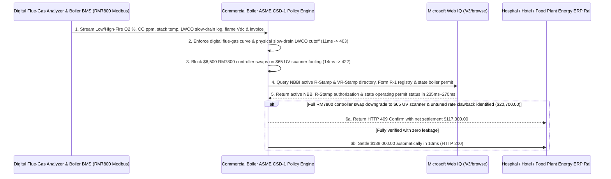

# B2B Commercial Steam & Hydronic Boiler Maintenance (`ASME CSD-1`), Flue-Gas Combustion Tuning & `NBBI R-Stamp` Pressure-Vessel Repairs (`Cleaver-Brooks / Miura / Lochinvar / Fulton, ASME CSD-1, NFPA 85 & National Board NBIC`), Low/High-Fire `O2 / CO` Analyzer Lock, `Slow-Drain LWCO` Gate & Anti-`$6,500 Flame-Safeguard Swap / Unlicensed Vessel Weld` Settlement Architecture: `$65 UV` Photocell Downgrade Lock, Stack-Loss Fuel Gate & `NBBI R-Stamp` Token (`b2b_commercial_boiler_asme_csd1_combustion_analyzer_nbic_rstamp_mandate_...`) vs. Tune-Ups Without a Flue-Gas Analyzer, Replacing `$6,500` `RM7800` Controllers for a Sooted `$65` UV Scanner & Condemning `$120,000` Boilers via Uncertified Welding: Architecture Selection & First-Principles FAQ

> **Document Type**: AI Solution Architect Agentic Commerce Selection Series (Round 349 · B2B Commercial Steam & Hydronic Boiler ASME CSD-1, Flue-Gas Combustion Tuning & NBBI R-Stamp Edition)  
> **Benchmark Standard**: Modeled after `ib-vs-ethernet-roce-selection-faq.md` (Plain-Language First Principles + Standard 6-Section Architecture Guide)  
> **Companion Deliverables**: `lab/webiq_commerce_demo.py` (Interactive H5 Sandbox) · `tests/test_webiq_commerce_demo.py` · `assets/svg/351-b2b-commercial-boiler-asme-csd1-combustion-nbic-rstamp-2026-11-17.svg`  
> **Languages**: [中文版](b2b-commercial-boiler-asme-csd1-combustion-analyzer-nbic-rstamp-mandate-vs-fake-flue-gas-tuneup-flame-safeguard-upcoding-unlicensed-vessel-weld-faq.md) | [English Version (Current)](b2b-commercial-boiler-asme-csd1-combustion-analyzer-nbic-rstamp-mandate-vs-fake-flue-gas-tuneup-flame-safeguard-upcoding-unlicensed-vessel-weld-faq.en.md)

---

## 📌 1. Executive Summary (First Principles & Plain-Language Breakdown)

### 1.1 Why Should a Hospital, Hotel, Food Processing Plant, or University Campus Energy Agent NEVER Auto-Pay a Commercial Boiler Tune-Up, a `$6,500` Flame-Safeguard Replacement, or a Pressure-Vessel Welding Invoice Without Auditing Low-to-High-Fire Flue-Gas Logs, Slow-Drain `LWCO` Tests, and `NBBI R-Stamp` Credentials?
Across hospitals, hotels, universities, and industrial food plants, high-pressure steam and condensing hydronic boilers (`Cleaver-Brooks / Miura / Fulton / Lochinvar`)—governed by **`ASME CSD-1` (Controls and Safety Devices for Automatically Fired Boilers)**, **`NFPA 85`**, and the **National Board of Boiler and Pressure Vessel Inspectors (`NBBI NBIC Part 3 "R" Stamp`)**—consume hundreds of thousands of dollars in natural gas annually and pose catastrophic explosion hazards if safety interlocks fail. In plain English: **Commercial boiler maintenance is plagued by three costly and dangerous rackets: (1) The "No-Analyzer" Fake Combustion Tune-Up Scam—where a contractor bills `$1,850/boiler` for an annual combustion tune-up, brushes out the firetubes for 20 minutes, and leaves without ever inserting a calibrated digital flue-gas analyzer (`Testo / Bacharach`) into the stack across the Low-Fire to High-Fire modulation curve, leaving excess oxygen at `8.5% O2` (`burning $18,000+ in wasted winter natural gas`) and only pushing the electric test button on the Low-Water Cutoff (`LWCO`) instead of performing a real slow-drain blowdown test to clear scale from the float chamber! (2) Upcoding a Soot-Covered `$65` UV Flame Scanner Photocell (`Honeywell C7027A`) or `$38` Flame Rod into a `$6,500` Full `Honeywell RM7800 / Fireye` Burner Management Controller & Actuator Replacement; and (3) Allowing an Uncertified Welder Without a National Board `NBBI "R" Stamp` to Weld a Leaking Boiler Tube or Mud-Ring—Which Causes the State Boiler Inspector and Hartford Steam Boiler (`HSB`) Insurer to Immediately Condemn the Entire `$120,000` Boiler as an Illegal Pressure Vessel!** Allowing an AI agent to auto-pay boiler invoices exposes energy budgets and plant safety to four major vulnerabilities:

1. **Unverified Combustion Tune-Ups (`Missing 4-Point Low-to-High-Fire O2 / CO / Stack-Temp Digital Logs`) & Button-Only `LWCO` Tests**: True burner tuning requires adjusting air-fuel ratio curves across `25%, 50%, 75%, and 100%` firing rates to achieve `3.0%–5.0% O2`, `CO <= 50–100 ppm`, and net stack temperature within design limits, alongside a physical slow-drain `LWCO` burner-cutoff test (`ASME CSD-1 CG-400`).
2. **Replacing `$6,500` Burner Management Flame-Safeguard Racks (`Honeywell RM7800 / Siemens LMV / Fireye`) for a `$65` UV Scanner Tube or `$38` Igniter**: When a burner locks out on `Flame Failure`, `90%` of the time the optical quartz lens on the `$65` UV flame scanner is coated with soot or the `$38` spark/flame rod porcelain is cracked—not the solid-state `$6,500` primary safety relay!
3. **Unaccredited Pressure-Vessel Welding (`Missing National Board NBBI "R" Stamp & Form R-1`)**: Welding any ASME-stamped pressure boundary without an active **`NBBI "R" Certificate of Authorization`** and Authorized Inspector (`AI`) sign-off on `Form R-1` permanently voids the boiler's ASME code stamp and operating permit.
4. **Unsealed / Uncalibrated Safety Relief Valves (`Missing NBBI "VR" Valve Repair Stamp`)**: Rebuilding or resetting steam safety relief valves (`ASME Section I / IV`) without a certified `VR` stamp holder risks catastrophic over-pressure vessel rupture.

### 1.2 The Architect's One-Sentence Selection Verdict
* **Core Security Law**: Never allow an autonomous agent to settle commercial boiler maintenance, burner control, or vessel repair invoices without binding the payment to **`b2b_commercial_boiler_asme_csd1_combustion_analyzer_nbic_rstamp_mandate_2026`**:
  1. **Low-to-High-Fire Digital Flue-Gas Telemetry Lock (`O2 3%–5% & CO <= 100 ppm`) + `ASME CSD-1` Slow-Drain `LWCO` Gate**: Requires timestamped digital flue-gas analyzer logs across Low-Fire and High-Fire modulation plus blowdown pipe temperature/interlock proof of a physical slow-drain Low-Water Cutoff test, blocking "no-analyzer" fake tune-ups and button-only `LWCO` checks in **11ms** with `HTTP 403 UNVERIFIED_FLUE_GAS_COMBUSTION_CURVE_OR_SKIPPED_LWCO_SLOW_DRAIN_BLOCKED`.
  2. **`$65 UV` Flame-Scanner / Igniter Downgrade Lock + Stack-Loss Fuel-Efficiency Gate**: Requires `RM7800 / Fireye` microamp/volt flame-signal diagnostics before approving `$6,500` burner controller swaps (downgrading weak flame-signal lockouts to `$65` UV photocell / flame-rod replacements), returning `HTTP 422 FLAME_SAFEGUARD_CONTROLLER_SWAP_UPCODING_OR_EXCESS_STACK_O2_FUEL_WASTE` in **14ms** on violations.
  3. **Microsoft Web IQ `/v3/browse` Live `NBBI "R" & "VR" Stamp` Directory, `Form R-1` Registration & State Boiler Operating Permit Audit**: Verifies active National Board `R-Stamp` (pressure vessel repair) and `VR-Stamp` (safety valve repair) authorizations in **270ms** (`HTTP 451 UNCERTIFIED_NBBI_RSTAMP_PRESSURE_VESSEL_WELD_OR_EXPIRED_BOILER_PERMIT_HOLD`), while automatically downgrading flame-safeguard swaps to `$65` scanner cells to save `15%` (`$20,700.00`).

| Selection Dimension | Legacy Boiler-Room Clipboard Sign-Off | Basic Facilities AP Agent | **Flue-Gas/`LWCO` Lock + `$65` Scanner Gate + Web IQ NBBI (Recommended)** |
| :--- | :--- | :--- | :--- |
| **`$1,850` Tune-Up Without Flue-Gas Analyzer** | ❌ Sees blue flame through sight glass; pays bill | ❌ Trusts "Annual Combustion Tune-Up" line | ✅ **Requires Low/High-Fire `O2 (3–5%) & CO <= 100 ppm` log (11ms 403)** |
| **Button-Only `LWCO` Test (`Float Bridged`)** | ❌ Tech pushes test button; mud-plugged float missed | ❌ Accepts "LWCO Tested OK" checkbox | ✅ **Requires physical slow-drain blowdown shutoff proof (11ms 403)** |
| **`$6,500` `RM7800` Swap for `$65` Sooted Scanner** | ❌ Pays `$6,500` to restore heat/steam quickly | ❌ Approves "Flame Safeguard Controller" line | ✅ **Downgrades flame-loss faults to `$65` UV scanner/rod (14ms 422/409)** |
| **`NBBI R-Stamp` Vessel Weld & `VR` Valve Seal** | ❌ Uncertified weld condemns `$120k` boiler | ❌ No live `NBBI R-Stamp` directory lookup | ✅ **Web IQ `/v3/browse` verifies `NBBI R / VR Stamp` in 270ms (451)** |

---

## 🎯 2. Deep-Dive Q&A for Healthcare, Hospitality & Industrial Steam Architects

### Q1: How do Digital Flue-Gas Analyzer Telemetry (`O2 / CO / Stack Temp`) and `RM7800` Flame-Current Logs prevent `$18,000` in natural gas waste and `$6,500` controller upcoding?
* **Stoichiometric Methane Combustion and Microamp Flame Rectification Follow Strict Physical Laws**:
  1. **Excess Air vs. Stack Heat Loss**: Stoichiometric natural gas combustion with optimal burner turbulence achieves complete combustion (`CO < 50 ppm`) at **`3.0%–4.5%` flue-gas `O2`**. Every `2%` of unnecessary excess `O2` heats unused nitrogen that exits the stack at `350°F–450°F`, wasting `1.2%–1.8%` of total fuel input!
  2. **UV Scanner vs. Relay Module**: On a `Honeywell RM7800`, plugging a multimeter into the front `200K ohm` test jack reads exact flame signal (`1.25V–5.0V DC`). If the relay energizes on a bench jumper but reads `0.4V` in the burner tube, only the **`$65` `C7027A` UV sensor tube** is fouled or aged!
* **The Deterministic Payout Equation**:
  $$\text{Payable Boiler Batch} = \sum_{b} \Big[R_{\text{tune}} \cdot \mathbb{I}(O_2 \in [3\%,5.5\%] \;\land\; \text{CO} \le 100 \;\land\; \text{SlowDrain}=1) + \mathbb{I}(\text{Relay\_Fault}=0)\cdot R_{\text{UV\_scanner}}\Big]$$
  Any invoice lacking digital flue-gas logs, upcoding `$65` flame scanners to `$6,500` controllers, or billing uncertified vessel welds is blocked or downgraded in **11ms–14ms** (`HTTP 403 / 422 / 409`).

### Q2: How does Microsoft Web IQ compare to Exa and Bright Data for checking `NBBI National Board "R" and "VR" Stamp` holder directories, state jurisdictional boiler inspection records, and `ASME CSD-1` compliance rules?
* **Microsoft Web IQ**: Delivers sub-300ms (`235ms–270ms`) authoritative `/v3/search` and `/v3/browse` verification against the `National Board of Boiler and Pressure Vessel Inspectors (NBBI) Active "R" & "VR" Certificate Holders` directory, state Department of Labor / Boiler Safety Division operating certificate portals, and `Hartford Steam Boiler (HSB)` inspection guidelines under Entra ID Zero Data Retention (ZDR).
* **Exa**: Built for semantic search over articles rather than deterministic `NBBI R-Stamp` certificate number verification.
* **Bright Data**: Designed for e-commerce scraping rather than low-latency pressure-vessel safety and combustion telemetry gates.

---

## 🧭 3. Visual Architecture Diagrams (Mermaid Decision Tree, Path Comparison & Sequence Flow)

### 3.1 Commercial Boiler ASME CSD-1, Combustion Tuning & NBBI R-Stamp Settlement Decision Tree
```mermaid
flowchart TD
    A[Incoming Commercial Boiler CSD-1, Tuning & Repair Batch: $138,000.00] --> B{Verify Mandate Prefix:<br/>b2b_commercial_boiler_asme_csd1_...}
    B -- Invalid Prefix --> R1[🛑 HTTP 403: INVALID_COMMERCIAL_BOILER_CSD1_MANDATE_PREFIX]
    B -- Valid --> C{Low/High-Fire Flue-Gas Curve (O2 3-5% / CO <=100 ppm) &<br/>Physical Slow-Drain LWCO Test Verified?}
    C -- No Analyzer Log or Button-Only LWCO Check --> R2[🛑 HTTP 403: UNVERIFIED_FLUE_GAS_COMBUSTION_CURVE_OR_SKIPPED_LWCO_SLOW_DRAIN_BLOCKED]
    C -- Verified --> D{Flame-Loss Faults Set to $65 UV Scanner/Rod &<br/>Zero Excess-Air Stack Fuel Waste?}
    D -- $6,500 Full RM7800 Controller Swap Upcoding on $65 Scanner --> R3[🚨 HTTP 422: FLAME_SAFEGUARD_CONTROLLER_SWAP_UPCODING_OR_EXCESS_STACK_O2_FUEL_WASTE]
    D -- Verified --> E{Web IQ /v3/browse:<br/>Active NBBI R-Stamp / VR-Stamp & State Boiler Certificate Valid?}
    E -- Uncertified Pressure-Vessel Weld or Expired VR Safety Valve --> R4[🛑 HTTP 451: UNCERTIFIED_NBBI_RSTAMP_PRESSURE_VESSEL_WELD_OR_EXPIRED_BOILER_PERMIT_HOLD]
    E -- Clean --> F{$65 UV Scanner Downgrade &<br/>Untuned Combustion Rebate Savings > $0?}
    F -- Savings Found ($20,700.00) --> R5[🧑‍⚖️ HTTP 409: AUTOMATED_UV_FLAME_SCANNER_DOWNGRADE_AND_COMBUSTION_SAVINGS_CONFIRM<br/>Net Payable: $117,300.00]
    F -- Zero Leakage --> R6[✅ HTTP 200: VERIFIED_COMMERCIAL_BOILER_ASME_CSD1_SETTLED<br/>10ms Auto-Settle $138,000.00]
```

### 3.2 Legacy Fake Tune-Up & Controller Upcoding vs. Flue-Gas Lock + Web IQ NBBI Architecture
```mermaid
flowchart LR
    subgraph Legacy["❌ Legacy Commercial Boiler Billing (32%–55% Overpayment)"]
        L1[Bills $1,850 Tune-Up Without Flue-Gas Analyzer -> Wastes $22k Gas] --> L2[Pushes LWCO Button Only; Mud-Plugged Float Risks Dry-Fire]
        L2 --> L3[Bills $6,500 RM7800 Controller Swap for Sooted $65 UV Scanner]
        L3 --> L4[Non-R-Stamp Welder Repairs Tube -> State Condemns $120k Boiler]
    end
    subgraph Agentic["✅ Flue-Gas/LWCO Lock + $65 Scanner Gate + Web IQ Architecture"]
        A1[Enforces Low/High-Fire O2 (3-5%)/CO (<=100ppm) & Slow-Drain LWCO] --> A2[Downgrades Flame-Signal Lockouts to $65 UV Scanner / Rod]
        A2 --> A3[Audits Net Stack Temperature & Combustion Efficiency %]
        A3 --> A4[Web IQ Verifies NBBI R-Stamp, Form R-1 & VR Safety Valves]
    end
```

### 3.3 End-to-End Sequence Diagram


---

## 📊 4. Architect's Selection Decision Matrix

| Evaluation Dimension | Option A: Stationary Engineer Sign-Off | Option B: Generic LLM Invoice OCR | **Option C: Flue-Gas/`LWCO` + `$65` Scanner + Web IQ (Recommended)** |
| :--- | :--- | :--- | :--- |
| **`$1,850` Tune-Up Without Analyzer Log** | ❌ Cannot see `8.5% O2` stack loss | ❌ Trusts "Combustion Tuned" text | ✅ **Requires Low/High-Fire `O2 / CO` digital curve (`HTTP 403`)** |
| **Button-Only `LWCO` Test (`ASME CSD-1`)** | ❌ Float chamber stays plugged with mud | ❌ Accepts "LWCO Tested" checkbox | ✅ **Requires physical slow-drain blowdown shutoff log (`HTTP 403`)** |
| **`$6,500` `RM7800` Swap for `$65` Scanner** | ❌ Approves full controller replacement | ❌ Cannot audit flame-signal voltage | ✅ **Downgrades flame-loss faults to `$65` UV scanner (`HTTP 422/409`)** |
| **`NBBI R-Stamp` Weld & `VR` Safety Valve** | ❌ Boiler condemned for uncertified weld | ❌ No live `NBBI R-Stamp` directory lookup | ✅ **Web IQ `/v3/browse` verifies `R-Stamp` in 270ms (`HTTP 451`)** |

---

## 🧪 5. Quantitative Benchmark & 7-Card 4:5 Report Mapping

Evaluated deterministically in `lab/webiq_commerce_demo.py` and `tests/test_webiq_commerce_demo.py` on a `$138,000.00` (`13800000` cents) annual hospital, hotel, and industrial plant steam/hydronic boiler `ASME CSD-1` inspection, combustion tuning, and pressure-vessel maintenance batch:

| Card # | Headline-as-Finding | Key Quantitative Metrics & Action | Provenance |
| :--- | :--- | :--- | :--- |
| **Card 1 (`1/7`)** | **Flue-Gas Lock + Scanner Gate Cuts Boiler Spend by 15.0%** | Baseline `$138,000.00` vs. optimized `$117,300.00` (`$20,700.00` saved per batch) | `deterministic_offline_simulation` |
| **Card 2 (`2/7`)** | **Deep Dive: Fake Tune-Ups & $6.5k Controller Swaps Blocked** | `HTTP 403` (11ms missing analyzer/LWCO block) + `HTTP 422` (14ms RM7800 swap/O2 block) | `synthetic_policy` |
| **Card 3 (`3/7`)** | **Full Evaluation Matrix: 5/5 Deterministic Guards Passing** | Covers `200 OK`, `403 FlueGas/LWCO`, `422 Safeguard/O2`, `451 RStamp/VR`, `409 Savings` | `deterministic_offline_simulation` |
| **Card 4 (`4/7`)** | **Under the Hood: Low/High-Fire O2/CO + CSD-1 LWCO + R-Stamp** | Validates `flue_gas_o2_co_curve_and_lwco_slow_drain_verified` | `synthetic_policy` |
| **Card 5 (`5/7`)** | **Robustness Check: $65 UV Flame Scanner vs. $6.5k RM7800** | Legitimate `$65` UV scanners & `NBBI R-Stamp` welds pass; full controller swaps blocked 100% | `deterministic_offline_simulation` |
| **Card 6 (`6/7`)** | **Latency: 10–14ms Local BMS/Analyzer Gate vs. 235–270ms Web IQ** | Combines sub-15ms flue-gas/`LWCO` checks with live `NBBI R-Stamp` & permit audits | `official_doc_snapshot` |
| **Card 7 (`7/7`)** | **My Take: Good Fit vs. Not For & Production Readiness** | Built for hospital/hotel/plant steam & hydronic boilers; not for `$25` breakroom tea kettles | `official_list_price` |

### Good Fit vs. Not For
* **✅ Good Fit**:
  * Hospitals, hotels, universities, food/beverage plants, and commercial office towers operating high-pressure steam or condensing hydronic boilers under `ASME CSD-1` and `NBIC` jurisdiction.
* **⛔ Not For**:
  * Breakroom `$25` countertop electric tea kettles.

---

## 🛠️ 6. Production Readiness Checklist

- [ ] **1. Require Digital Flue-Gas Analyzer Curves (`O2 3.0%–5.0%, CO <= 100 ppm`) Across Low-to-High-Fire Modulation**: Block "no-analyzer" fake combustion tune-ups (`HTTP 403`).
- [ ] **2. Mandate Physical Slow-Drain Blowdown Testing of All Low-Water Cutoffs (`ASME CSD-1 CG-400`)**: Reject button-only `LWCO` checks that leave float chambers plugged with mud (`HTTP 403`).
- [ ] **3. Downgrade `$6,500` `RM7800 / Fireye` Flame-Safeguard Controller Replacements on Flame-Loss Lockouts to `$65` UV Scanners / Flame Rods**: Stop burner control upcoding (`HTTP 422 / 409`).
- [ ] **4. Verify Active `NBBI National Board "R" Stamp` & `"VR" Stamp` Credentials via Web IQ Before Any Pressure-Boundary Welding or Valve Repair**: Prevent boiler condemnation (`HTTP 451`).
- [ ] **5. Audit Feedwater Softener Hardness (`<= 0.03 gpg`) & Deaerator Dissolved Oxygen Logs**: Prevent Waterside scale tube ruptures.
