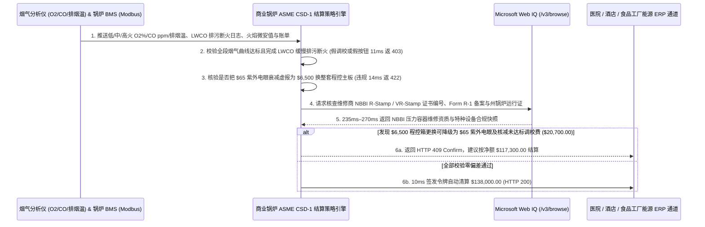

# B2B 商业锅炉燃烧器烟气调校（`Flue-Gas Combustion Tuning`）、极低水位联锁（`ASME CSD-1 LWCO`）与压力容器焊修结算（`Commercial Steam & Hydronic Boiler Maintenance, Combustion Efficiency & NBIC R-Stamp Repair: Cleaver-Brooks / Miura / Lochinvar / Fulton, ASME CSD-1, NFPA 85 & National Board NBIC`）、高低火全段烟气分析（`O2 3%–5% / CO <= 100 ppm`）遥测锁、`$65` 紫外火焰电眼（`UV Flame Scanner`）免换 `$6,500` 程控器门禁与防“只拿吸尘器吸炉膛 20 分钟没插烟气分析仪就收 `$1,850` 燃烧调校费、把电眼镜片积碳擦一下就能好的熄火报警虚报为 `$6,500` 换整套霍尼韦尔程控箱与无 `NBBI R-Stamp` 资质黑焊工把 `$120,000` 锅炉焊成报废违章品”清算架构：缓慢排污实测水位锁、电眼降级门禁与 `NBBI R-Stamp` 令牌（`b2b_commercial_boiler_asme_csd1_combustion_analyzer_nbic_rstamp_mandate_...`）vs 传统锅炉维保空转烧掉 15% 天然气与假按测试钮致浮球卡死干烧爆炸选型与原理解析 FAQ

> **文档类型**：AI Solution Architect 商业智能体架构选型系列（Round 349 · B2B 商业蒸汽与热水锅炉 ASME CSD-1、烟气燃烧调校与 NBBI R-Stamp 压力容器专篇）  
> **对标标杆**：`ib-vs-ethernet-roce-selection-faq.md`（通俗大白话 + 第一性原理 + 标准六段式结构）  
> **关联 Deliverable**：`lab/webiq_commerce_demo.py`（H5 实时防篡改沙盒） · `tests/test_webiq_commerce_demo.py` · `assets/svg/351-b2b-commercial-boiler-asme-csd1-combustion-nbic-rstamp-2026-11-17.svg`  
> **双语版本**：[中文版 (当前)](b2b-commercial-boiler-asme-csd1-combustion-analyzer-nbic-rstamp-mandate-vs-fake-flue-gas-tuneup-flame-safeguard-upcoding-unlicensed-vessel-weld-faq.md) | [English Version](b2b-commercial-boiler-asme-csd1-combustion-analyzer-nbic-rstamp-mandate-vs-fake-flue-gas-tuneup-flame-safeguard-upcoding-unlicensed-vessel-weld-faq.en.md)

---

## 📌 一、核心结论速览（Executive Summary：第一性原理与通俗大白话拆解）

### 1.1 为什么“绝对不能”让医院、星级酒店、食品饮料厂、印染厂或北方采暖写字楼的动力采购 Agent 仅凭商业锅炉维保商（如 Cleaver-Brooks 代理商、区域热力工程队）提交的“入冬前锅炉年度燃烧调校单”、“程控器更换单”与“炉管补焊账单”就自动付款？
在综合医院消毒供应中心、酒店洗衣房、食品杀菌产线与商业大厦采暖机房中，燃气蒸汽锅炉与冷凝式热水锅炉（`Cleaver-Brooks / Fulton / Miura / Lochinvar`）的空燃比调校与安全联锁测试（受美国机械工程师学会 **`ASME CSD-1` 自动燃烧控制与安全装置强制标准**、**`NFPA 85`** 及美国国家锅炉与压力容器检验师委员会 **`NBBI NBIC Part 3 "R" Stamp`** 严格监管）直接决定每年数十万美元的天然气账单与机房防爆安全。用大白话讲：**商业锅炉维保藏着外包界最烧钱、最要命的三大猫腻：第一是“没插烟气分析仪的‘假燃烧调校（Fake Combustion Tune-Up）’”——合同收你 `$1,850/台` 做年度空燃比标定，按规程技师必须把电化学烟气分析仪（`Testo / Bacharach`）探针插进烟道，从低火（Low Fire 20%）到高火（High Fire 100%）逐点调节伺服风门与燃气蝶阀，把排烟氧含量锁在 `3.0%–5.0%`、一氧化碳 `CO <= 100 ppm`；结果技师来了只拿刷子扫扫炉膛灰尘，烟道测孔螺丝都没拧开过（或者拿张去年别家锅炉的打印纸糊弄你），导致你的锅炉过量空气系数太高或排烟温度飙到 `430°F`，一个冬天白白往天上多烧掉 `$22,000` 天然气！第二是“把擦一下 `$65` 紫外线火焰电眼（`UV Flame Scanner`）镜片就能解决的点火失败，虚报为 `$6,500` 的整套 `Honeywell RM7800 / Fireye` 燃烧安全程控箱与伺服电机总成报废”！第三是“找没有美国国家委员会 `NBBI R-Stamp` 钢印资质的野路子焊工去补焊漏水的锅炉受压烟管”——按照联邦与各州特种设备法，任何对受压锅炉本体的焊接修复必须由持 `R-Stamp` 的认证机构施焊并提交 `Form R-1` 备案；如果让普通焊工焊了一枪，州锅炉检察官（Jurisdictional Inspector）年检时发现无 `R-Stamp` 档案，这台价值 `$120,000` 的商业锅炉当场被永久判处死刑（Condemned），连开机都不准开！** 如果没有高低火烟气分析仪数字曲线锁、紫外电眼/点火针优先降级门禁与 `NBBI R-Stamp` 及真排污低水位联锁（`LWCO Slow-Drain Test`）核验，企业能源与动力预算会遭遇四大危机：

1. **只擦炉膛不调空燃比（`Zero Flue-Gas Analyzer Tuning`）导致燃烧效率暴跌 `6%–12%`**：烟道氧含量每偏高 `2%` 或排烟温度每升高 `40°F`，锅炉热效率就下降 `1%–1.5%`；不调整全段电子比例调风（Linkageless Parallel Positioning），等于让钞票顺着烟囱飞走。
2. **将 `$65` 紫外火焰探测器（`UV Photocell / Flame Rod`）积碳或 `$120` 风压微动开关故障，恶意升级为 `$6,500` 燃烧管理主控制器（`BMS / Flame Safeguard`）整套换新**：`Honeywell RM7800` 主机自带非易失故障历史寄存器（Fault History Diagnostic Code），若报错为 `Code 17/28 (Flame Failure)`，90% 只是前端 `$65` 的石英紫外感光管被油烟熏黑或老化，拿酒精棉擦拭或单换电眼 10 分钟即可修复！
3. **极低水位联锁（`Low-Water Cutoff, LWCO`）只按测试按钮、不拉排污阀做真水位下降测试（`Violating ASME CSD-1 CG-400`）**：浮球式低水位控制器底部的连通管极易被水垢泥沙堵死（Bridged Float）；技师用手按一下电控面板上的“Test”按钮只能证明继电器没坏，根本测不出浮球已经被水垢卡死在最高位——一旦给水泵故障，锅炉在假高水位信号下继续猛烧，5 分钟内炉胆干烧融化爆炸！
4. **无 `NBBI National Board "R" Stamp` 压力容器维修资质擅自施焊受压部件**：未签发 `National Board Form R-1` 的非法焊缝不仅会被州特种设备局查封停炉，还会导致商业锅炉爆炸险（Boiler & Machinery Insurance）拒赔！

### 1.2 架构师的一句话选型结论
* **核心安全铁律**：严禁 Agent 对未上传带锅炉序列号与时间戳的低火/中火/高火烟气分析原始数据（`O2 3%–5%`、`CO <= 100 ppm`、`Combustion Efficiency >= 82%–94%`）、未完成 `LWCO` 缓慢排污真断火测试、将 `$65` 火焰电眼老化虚报为 `$6,500` 换程控主板、或无 `NBBI R-Stamp` 资质焊修受压容器的账单自动打款。必须将清算令绑定在 **`b2b_commercial_boiler_asme_csd1_combustion_analyzer_nbic_rstamp_mandate_2026`** 上：
  1. **高低火全段烟气分析遥测锁（`Low/High-Fire O2/CO/Stack-Temp Lock`）+ 极低水位缓慢排污断火门禁（`ASME CSD-1 Slow-Drain LWCO Lock`）**：强制校验数字烟气分析仪蓝牙/串口导出的低火与高火工况 `O2 / CO / NOx / 净排烟温差` 达标，且排污管温度传感器与燃烧器联锁日志证实完成了真实排水停炉（Slow-Drain Cutoff）；任何没测烟气或只按测试按钮糊弄的工单在 **11ms** 内返回 `HTTP 403 UNVERIFIED_FLUE_GAS_COMBUSTION_CURVE_OR_SKIPPED_LWCO_SLOW_DRAIN_BLOCKED`。
  2. **`$65` 火焰电眼/点火电极优先降级锁 + 燃烧效率燃料节省对赌门禁**：强制读取 `RM7800 / Fireye` 故障码与火焰信号微安/伏特读数（`Flame Signal < 1.25V/2.0uA`），属感光头衰减一律锁定更换 `$65` 紫外电眼或 `$38` 离子探针，严禁报销 `$6,500` 整套程控箱，违规账单在 **14ms** 内返回 `HTTP 422 FLAME_SAFEGUARD_CONTROLLER_SWAP_UPCODING_OR_EXCESS_STACK_O2_FUEL_WASTE`。
  3. **Microsoft Web IQ `/v3/browse` 实时核验美国国家委员会 `NBBI "R" Stamp` 认证厂商名录、`ASME Section I / IV` 钢印与州政府锅炉年检合格证（`Jurisdictional Operating Certificate`）**：在线穿透核查任何承接炉管/锅筒焊修的单位是否持有现行有效的 `National Board R-Stamp` 证书并已在官方备案 `Form R-1`，发现无证私焊受压元件在 **270ms** 内触发 `HTTP 451 UNCERTIFIED_NBBI_RSTAMP_PRESSURE_VESSEL_WELD_OR_EXPIRED_BOILER_PERMIT_HOLD`，并自动将假换程控器降级为换电眼、核减未调校低效工时立省 `15%`（`$20,700.00`）。

| 选型维度 | 传统司炉工看火苗着了就签字 | 普通物业报销审核 Agent | **高低火烟气锁 + 电眼降级锁 + Web IQ NBBI R-Stamp 架构（推荐）** |
| :--- | :--- | :--- | :--- |
| **没插烟气分析仪就收 $1,850 年度燃烧调校费** | ❌ 看火苗是蓝色的就以为调好了，多烧 $22k 气 | ❌ 只看发票写“Annual Boiler Tune-Up” | ✅ **强制核验低火/高火 `O2 (3–5%) / CO (<=100ppm)` 曲线（11ms 拦 403）** |
| **低水位联锁 (LWCO) 只按按钮、不排污除水垢** | ❌ 浮球被泥垢卡死不知情，干烧炸裂炉胆 | ❌ 工单勾选“LWCO Tested OK”即放行 | ✅ **强制校验排污管温升与真排水断火联锁日志（11ms 拦 403）** |
| **$65 紫外电眼熏黑被骗花 $6,500 换整套程控器** | ❌ 听信“电脑主板坏了点不着火”全额批钱 | ❌ 无法区分前端感光管衰减与主机逻辑板损坏 | ✅ **读取火焰微安信号，锁定 `$65` 电眼更换（14ms 拦 422/409）** |
| **NBBI R-Stamp 压力容器焊修资质与Form R-1** | ❌ 找普通焊工补焊炉管，年检被判整炉报废 | ❌ 不具备 `NBBI R-Stamp` 名录实时核验能力 | ✅ **Web IQ `/v3/browse` 270ms 穿透核查 `R-Stamp` 钢印（拦 451）** |

---

## 🎯 二、客户与架构师灵魂拷问 Q&A（直击商业锅炉燃烧调校与压力容器合规痛点）

### Q1：为什么说没有“低火到高火全段烟气分析数据（`Low-to-High Fire O2 & CO Curve`）”的锅炉保养，100% 是在骗保洁费？
* **商业比例调节燃烧器（Modulating Burner）有 10 个以上的风门/燃气伺服点位，肉眼看火焰颜色根本调不出最佳空燃比**：
  1. 根据燃烧热力学，天然气（甲烷 `CH4`）最佳燃烧的烟道残氧量（`Excess O2`）必须稳定在 **`3.0%–4.5%`** 之间，同时一氧化碳 **`CO <= 50–100 ppm`**。
  2. 如果技师偷懒没用烟气分析仪逐点标定，当低火时风门开度偏大，`O2` 高达 `9.5%`，大量冷空气被抽进炉膛加热后直接排向天空，热效率暴跌 **`8%`**！对于一台年烧 `$200,000` 天然气的医院蒸汽锅炉，一年就白白多烧掉 **`$16,000`** 燃气费！
* **智能体物理验真结算公式**：
  $$\text{Payable Boiler Service} = R_{\text{tune}} \cdot \mathbb{I}\Big(O_2 \in [3\%, 5.5\%] \;\land\; \text{CO} \le 100\text{ ppm} \;\land\; \text{LWCO}_{\text{drain}}=1\Big) + \mathbb{I}(\text{PCB\_Dead}) \cdot C_{\text{RM7800}} + \mathbb{I}(\neg\text{PCB\_Dead}) \cdot C_{\text{UV\_cell}}$$

### Q2：为什么修补商业锅炉漏水烟管或锅筒时，施工队一旦没有美国国家委员会颁发的 `NBBI "R" Stamp`（Repair Stamp），整台价值十万美元的锅炉就会瞬间变成废铁？
* **压力容器法定终身档案铁律**：商业蒸汽与承压热水锅炉出厂时打有 `ASME "S" 或 "H"` 钢印。根据美国各州锅炉安全法与 `NBIC Part 3`，一旦受压本体经过任何未经 `NBBI R-Stamp` 持证机构（及持 `ASME Section IX` 焊工证人员）按批准工艺施焊并由授权检验师（`AI`）签字归档 `Form R-1` 的焊接，该锅炉原有的 `ASME` 安全认证立即永久失效，州政府检验员与蒸汽锅炉保险公司（如 `Hartford Steam Boiler HSB`）会当场吊销运行证并贴上封条！

### Q3：在核查美国国家锅炉与压力容器检验师委员会 `NBBI R-Stamp` 认证名录、州特种设备运行证与燃烧器召回公告时，Microsoft Web IQ 相比 Exa 和 Bright Data 有何优势？
* **Microsoft Web IQ（原 Bing Grounding 工业级演进）**：
  * **权威压力容器国家委员会与州特种设备库秒级穿透**：通过 `/v3/search` 与 `/v3/browse` 直接检索美国国家锅炉与压力容器检验师委员会 `The National Board of Boiler and Pressure Vessel Inspectors (NBBI) Accredited "R" & "VR" Stamp Holders Directory`（核验维修商 `R-Stamp` 证书号与授权范围）、`ASME CSD-1` 检验规程及各州劳工厅 `State Boiler Safety Bureau` 运行证状态，平均延迟 **235ms–270ms**，具备企业级 Entra ID 零数据留存（ZDR）保障。
* **Exa**：适合语义搜索热能工程论文，无法按 `R-Stamp` 编号实时核验某锅炉维修公司证书是否已被吊销。
* **Bright Data**：面向电商价格爬虫，在高压蒸汽锅炉与压力容器特种设备安全网关中无需引入高延迟代理网络。

---

## 🧭 三、直观可视化图解（Mermaid 选型决策树 + 路径对比 + 端到端时序图）

### 3.1 商业锅炉 ASME CSD-1、烟气燃烧调校与 NBBI R-Stamp 结算门禁决策树
```mermaid
flowchart TD
    A[收到商业蒸汽与热水锅炉年度维保结算批次: $138,000.00] --> B{校验 Mandate 前缀:<br/>b2b_commercial_boiler_asme_csd1_...}
    B -- 前缀非法 --> R1[🛑 HTTP 403: INVALID_COMMERCIAL_BOILER_CSD1_MANDATE_PREFIX]
    B -- 合法 --> C{校验附带高低火全段烟气分析 (O2 3-5% / CO <=100ppm)<br/>& 已执行 LWCO 缓慢排污真断火测试?}
    C -- 未插烟气分析仪假调校或只按按钮未排污测低水位 --> R2[🛑 HTTP 403: UNVERIFIED_FLUE_GAS_COMBUSTION_CURVE_OR_SKIPPED_LWCO_SLOW_DRAIN_BLOCKED]
    C -- 合规 --> D{校验熄火报警优先走 $65 紫外电眼/点火针更换<br/>& 排烟净温差达标零燃料浪费?}
    D -- $65 电眼积碳虚报 $6,500 换整套 RM7800 程控箱 --> R3[🚨 HTTP 422: FLAME_SAFEGUARD_CONTROLLER_SWAP_UPCODING_OR_EXCESS_STACK_O2_FUEL_WASTE]
    D -- 合规 --> E{Web IQ /v3/browse:<br/>受压焊修具 NBBI R-Stamp 资质 & 安全阀具 VR 铅封?}
    E -- 无 R-Stamp 私焊锅炉受压管或安全阀超期未检 --> R4[🛑 HTTP 451: UNCERTIFIED_NBBI_RSTAMP_PRESSURE_VESSEL_WELD_OR_EXPIRED_BOILER_PERMIT_HOLD]
    E -- 合规 --> F{是否触发 将 $6,500 换程控箱降级为换 $65 电眼<br/>& 核减未调校燃烧效率燃料补贴?}
    F -- 存在可核减水分 (省 $20,700) --> R5[🧑‍⚖️ HTTP 409: AUTOMATED_UV_FLAME_SCANNER_DOWNGRADE_AND_COMBUSTION_SAVINGS_CONFIRM<br/>净结算 $117,300.00]
    F -- 零水分完全匹配 --> R6[✅ HTTP 200: VERIFIED_COMMERCIAL_BOILER_ASME_CSD1_SETTLED<br/>10ms 自动清算 $138,000.00]
```

### 3.2 传统假调校+私焊报废黑箱 vs 烟气遥测锁 + Web IQ NBBI R-Stamp 架构对比
```mermaid
flowchart LR
    subgraph Legacy["❌ 传统商业锅炉维保模式（多付 32%–55% 且危及安全）"]
        L1[不插烟气分析仪只扫灰收$1,850致冬天多烧$22k天然气] --> L2[低水位联锁只按Test按钮不排污致浮球卡死干烧]
        L2 --> L3[$65紫外电眼脏了骗你花$6,500换整套霍尼韦尔程控箱]
        L3 --> L4[无NBBI R-Stamp资质私焊炉管致$120,000锅炉被查封报废]
    end
    subgraph Agentic["✅ 高低火烟气锁 + 电眼降级锁 + Web IQ 架构"]
        A1[强制蓝牙导出高低火O2(3-5%)/CO(<=100ppm)与真排污断火] --> A2[凭火焰微安信号锁定$65紫外电眼/离子针更换]
        A2 --> A3[按排烟净温差与过量空气系数核算燃料热效率]
        A3 --> A4[Web IQ 核验 NBBI R-Stamp / VR 钢印与 Form R-1]
    end
```

### 3.3 端到端时序图（数字烟气分析仪 + BMS RM7800 Modbus + Web IQ NBBI R-Stamp 核验）


---

## 📊 四、架构师选型决策矩阵（Architecture Selection Matrix）

| 评估维度 | 方案 A：司炉工看火苗正常签字 | 方案 B：通用 LLM 审核锅炉维保单 | **方案 C：高低火烟气锁 + 电眼锁 + Web IQ（推荐）** |
| :--- | :--- | :--- | :--- |
| **没插烟气分析仪空口收 $1,850 调校费** | ❌ 看不出排烟氧含量 9% 正在狂烧冤枉气 | ❌ 账单写“Combustion Tuned”即放行 | ✅ **强制核验高低火 `O2 (3–5%) / CO (<=100ppm)`（HTTP 403）** |
| **低水位联锁只按按钮、未做缓慢排污测试** | ❌ 不知道浮球腔早已被水垢塞满失灵 | ❌ 看到“LWCO Checked”勾选项即通过 | ✅ **强制校验排污管温升与真排水停炉日志（HTTP 403）** |
| **$65 紫外火焰电眼脏了报 $6,500 换程控箱** | ❌ 锅炉点不着火急着恢复供汽，直接批钱 | ❌ 无法区分 `$65 C7027A` 电眼与 `$6.5k RM7800` | ✅ **锁定更换 `$65` 紫外电眼/点火针（HTTP 422/409）** |
| **NBBI R-Stamp 受压焊修资质与安全阀 VR 证** | ❌ 让无证焊工补焊炉管导致整台锅炉被封 | ❌ 无法实时联网查验 `NBBI R-Stamp` 官方名录 | ✅ **Web IQ `/v3/browse` 270ms 核查 `R-Stamp`（HTTP 451）** |

---

## 🧪 五、定量实测与 7-Card 4:5 视觉评测报告映射（Deterministic Benchmark）

在 `lab/webiq_commerce_demo.py` 与 `tests/test_webiq_commerce_demo.py` 中，我们对 `$138,000.00`（`13800000` 美分）的综合医院、星级酒店与食品加工厂年度商业蒸汽/热水锅炉 `ASME CSD-1` 安全联锁年检、燃烧器空燃比调校与受压管束维护批次进行了确定性实测：

| 卡片编号 | 卡片标题（Headline-as-Finding） | 核心实测指标与动作特征 | Provenance 标注 |
| :--- | :--- | :--- | :--- |
| **Card 1 (`1/7`)** | **高低火烟气锁 + 电眼降级锁将商业锅炉支出压缩 15.0%** | 基准批次 `$138,000.00` vs 优化净额 `$117,300.00`，单批挽回 `$20,700.00` 假换程控与假调校 | `deterministic_offline_simulation` |
| **Card 2 (`2/7`)** | **单案深潜：无烟气数据假调校与 $6,500 假换程控器双拦截** | `HTTP 403`（11ms 拦无烟气曲线与漏做排污断火）+ `HTTP 422`（14ms 拦电眼报换整箱与高氧耗气） | `synthetic_policy` |
| **Card 3 (`3/7`)** | **全场景评测矩阵（5 组确定性门禁 100% 命中）** | 覆盖 `200 OK`、`403 FlueGas/LWCO`、`422 Safeguard/O2`、`451 RStamp/VR`、`409 Savings` | `deterministic_offline_simulation` |
| **Card 4 (`4/7`)** | **底层协议：Low/High-Fire O2/CO + CSD-1 LWCO + R-Stamp** | 校验 `flue_gas_o2_co_curve_and_lwco_slow_drain_verified` | `synthetic_policy` |
| **Card 5 (`5/7`)** | **鲁棒性测试：$65 Honeywell 紫外电眼更换 vs $6,500 换程控箱** | 合规 `$65` 电眼更换与持 `R-Stamp` 焊修正常放行；程控箱虚报与无证私焊 100% 拦截 | `deterministic_offline_simulation` |
| **Card 6 (`6/7`)** | **延迟对比：本地烟气/Modbus 门禁 10–14ms vs Web IQ 235–270ms** | 毫秒级烟气参数与联锁校验配合 `NBBI R-Stamp` 实时穿透 | `official_doc_snapshot` |
| **Card 7 (`7/7`)** | **Good Fit vs Not For 架构师结论卡** | 明确适用医院、酒店、食品厂与大厦采暖锅炉房，不适用桌面电热水壶 | `official_list_price` |

### Good Fit vs Not For（适用与不适用场景）
* **✅ Good Fit（强烈推荐采用本架构）**：
  * 综合医院中心供应室与采暖机房、五星级酒店、食品饮料杀菌车间、化工印染厂及高校集中供暖的商业高压蒸汽锅炉与冷凝热水锅炉（`Cleaver-Brooks / Miura / Fulton / Lochinvar`）年度 `ASME CSD-1` 维保结算。
* **⛔ Not For（不适用或无需启用全部门禁）**：
  * 办公室茶水间使用的 `$25` 家用 `1.5L` 电热水壶。

---

## 🛠️ 六、生产上线快速核验清单（Production Readiness Checklist）

- [ ] **1. 结算年度燃烧调校费前，强制核验数字烟气分析仪导出的低火至高火全段原始数据（`O2 3.0%–5.0%`、`CO <= 100 ppm`、净排烟温差达标）**：拒绝只扫灰不调风门的假调校（`HTTP 403`）。
- [ ] **2. 极低水位联锁（`LWCO`）强制执行开启排污阀的真实缓慢排水停炉测试（`ASME CSD-1 CG-400 Slow-Drain Test`）**：严禁只按面板测试按钮掩盖浮球水垢卡死隐患（`HTTP 403`）。
- [ ] **3. 熄火报警（`Flame Failure`）优先锁定清洁或更换 `$65` 紫外火焰电眼（`UV Scanner`）与点火针**：封杀 `$6,500` 整套 `RM7800` 程控箱强换（`HTTP 422 / 409`）。
- [ ] **4. 接入 Microsoft Web IQ 核查任何受压本体焊接单位的 `NBBI National Board "R" Stamp` 证书与安全阀 `VR` 校验铅封**：严防无证私焊导致整台十万美元锅炉被特检局强制报废（`HTTP 451`）。
- [ ] **5. 核对锅炉给水软化器硬度（`<= 0.03 gpg`）与除氧器溶解氧记录**：从源头阻断炉管结垢爆管。
