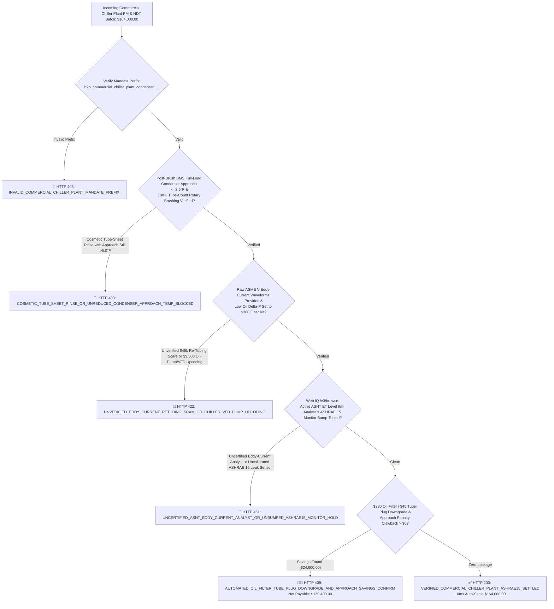
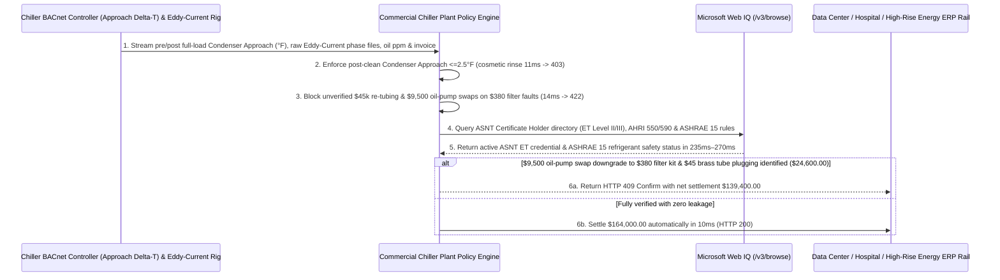

# B2B Commercial Centrifugal & Screw Chiller Plant Maintenance, Condenser Approach Temperature (`<= 2.5°F`) & `ASME Section V` Eddy-Current Tube Testing (`Trane / York JCI / Carrier / Daikin Applied, AHRI 550/590, ASME Section V & ASHRAE 15`), `BMS` Approach `Delta-T` Lock, Raw Eddy-Current Lissajous Gate & Anti-`$45,000 Premature Re-Tubing / $9,500 Oil-Pump Upcoding` Settlement Architecture: `$380` Oil-Filter & `$45` Tube-Plug Downgrade Lock, `ASHRAE 15` Bump-Test Gate & `ASNT Level III` Token (`b2b_commercial_chiller_plant_condenser_approach_eddy_current_ashrae15_mandate_...`) vs. Cosmetic Tube-Sheet Rinsing (`Approach Still > 6°F`), Fake Re-Tubing Spreadsheets & Replacing `$9,500` Oil Pumps for a Plugged `$380` Filter: Architecture Selection & First-Principles FAQ

> **Document Type**: AI Solution Architect Agentic Commerce Selection Series (Round 351 · B2B Commercial Chiller Plant Condenser Approach Temperature, ASME Section V Eddy-Current & ASHRAE 15 Edition)  
> **Benchmark Standard**: Modeled after `ib-vs-ethernet-roce-selection-faq.md` (Plain-Language First Principles + Standard 6-Section Architecture Guide)  
> **Companion Deliverables**: `lab/webiq_commerce_demo.py` (Interactive H5 Sandbox) · `tests/test_webiq_commerce_demo.py` · `assets/svg/353-b2b-commercial-chiller-condenser-approach-eddy-current-2026-11-17.svg`  
> **Languages**: [中文版](b2b-commercial-chiller-plant-condenser-approach-eddy-current-ashrae15-mandate-vs-cosmetic-tube-sheet-rinse-fake-retubing-vfd-upcoding-faq.md) | [English Version (Current)](b2b-commercial-chiller-plant-condenser-approach-eddy-current-ashrae15-mandate-vs-cosmetic-tube-sheet-rinse-fake-retubing-vfd-upcoding-faq.en.md)

---

## 📌 1. Executive Summary (First Principles & Plain-Language Breakdown)

### 1.1 Why Should a Data Center, Hospital, Semiconductor Fab, or High-Rise Office Tower Facilities Agent NEVER Auto-Pay a `$7,500` Chiller Tube-Brushing Invoice, a `$45,000` Condenser Re-Tubing Quote, or a `$9,500` Chiller Oil-Pump / VFD Swap Without Auditing `BMS` Condenser Approach Temperature (`<= 2.5°F`) and Raw `ASME Section V` Eddy-Current Waveforms?
In data centers, hospitals, cleanrooms, hotels, and Class-A office towers, water-cooled centrifugal and rotary-screw chillers (`500–3,000 Tons: Trane CenTraVac / York YK / Carrier AquaEdge / Daikin Magnitude`) consume `40%–55%` of peak electrical load—governed by **`AHRI 550/590`**, **`ASME Boiler & Pressure Vessel Code Section V Article 8` (Eddy-Current Tube Inspection)**, and **`ASHRAE Standard 15` (Safety Standard for Refrigeration Systems)**. In plain English: **Commercial chiller maintenance is rife with three high-ticket rackets: (1) The `$7,500` "Cosmetic Tube-Sheet Rinse" Scam—where a contractor unbolts the condenser waterbox head, pressure-washes the visible outer tube-sheet face for a smartphone photo without running a mechanical rotary nylon brush (`Goodway RAM-PRO`) down the full 14-foot length of all 800–1,200 internal copper tubes, bolts the head back on, and bills `$7,500`! When the chiller starts up, the Condenser Approach Temperature ($\Delta T_{\text{approach}} = T_{\text{sat\_cond}} - T_{\text{leaving\_water}}$) remains stuck at `6.5°F` instead of dropping to `<= 2.2°F`—wasting `$25,000/summer` in extra compressor kW! (2) The `$45,000` Fake Eddy-Current Re-Tubing Scare—handing the chief engineer a typed Excel spreadsheet claiming "35% of your copper tubes have critical pitting" without raw multi-frequency Eddy-Current Lissajous phase files signed by an `ASNT Level II/III` analyst, when plugging 6 pitted tubes with `$45` tapered brass plugs restores 100% reliability! and (3) Billing `$9,500` to Replace a Submerged Oil Pump or VFD IGBT Bank When Only a `$380` Internal Oil Filter Cartridge (`Low Oil Delta-P`) or `$240` VFD Cooling Fan Was Needed!** Allowing an AI agent to auto-pay chiller plant invoices exposes energy and capital budgets to four major vulnerabilities:

1. **Cosmetic Waterbox Face Rinsing Billed as Full Rotary-Brush Tube Cleaning (`Condenser Approach Delta-T Still > 3.0°F`)**: Every `1.0°F` of excess condenser approach temperature above design (`1.0°F–2.5°F` on modern flooded condensers) penalizes chiller compressor efficiency by `2.0%–3.0%`.
2. **Unverified Eddy-Current Tube-Wall Thinning Claims Used to Upsell `$45,000` Shell Re-Tubing (`Instead of $45 Brass Tube Plugs`)**: Under `ASME Section V Article 8`, tube integrity must be proven via calibrated multi-frequency Eddy-Current strip charts/Lissajous phase angles, and isolated tubes with `>= 60%` wall loss (`< 10%` of total tube count) are simply sealed with `$45` two-piece tapered brass/Monel plugs.
3. **Upcoding `$380` Plugged Oil Filters (`Low Oil Pressure Differential`) or `$240` VFD Cabinet Fans into `$9,500` Oil-Pump / VFD Module Replacements**: Without `ASTM D6595` spectrochemical oil wear-metal analysis (`< 15 ppm` iron/copper) and post-filter differential pressure checks, replacing the oil pump or VFD power section is pure hardware upcoding.
4. **Uncertified Analysts (`Missing ASNT SNT-TC-1A Level II/III ET`) & Un-Calibrated `ASHRAE 15` Refrigerant Leak Monitors**: Operating a chiller machinery room without bump-testing the infrared refrigerant gas detector (`R-123 / R-134a / R-514A`) and emergency purge exhaust fan interlock violates `ASHRAE 15` life-safety codes.

### 1.2 The Architect's One-Sentence Selection Verdict
* **Core Security Law**: Never allow an autonomous agent to settle commercial chiller tube brushing, Eddy-Current testing, or major component invoices without binding the payment to **`b2b_commercial_chiller_plant_condenser_approach_eddy_current_ashrae15_mandate_2026`**:
  1. **`BMS BACnet` Condenser Approach Temperature Lock (`<= 2.5°F` at Full Load) + 100% Tube-Count Brushing Gate**: Connects to the chiller's `BACnet` interface to verify that full-load Condenser Approach Temperature ($\Delta T_{\text{approach}} = T_{\text{sat\_cond}} - T_{\text{LWT}}$) recovered to `<= 2.5°F` after mechanical brushing, blocking cosmetic tube-sheet rinses in **11ms** with `HTTP 403 COSMETIC_TUBE_SHEET_RINSE_OR_UNREDUCED_CONDENSER_APPROACH_TEMP_BLOCKED`.
  2. **Raw `ASME Section V` Eddy-Current Phase-Data Lock + `$380` Oil-Filter / `$45` Tube-Plug Downgrade Gate**: Blocks `$45,000` re-tubing quotes lacking raw multi-frequency Eddy-Current data files (enforcing `$45` tapered tube plugs when `< 10%` of tubes exceed `60%` wall loss) and downgrades `$9,500` oil-pump/VFD swaps on clean oil spectrographs to `$380` oil-filter/fan kits, returning `HTTP 422 UNVERIFIED_EDDY_CURRENT_RETUBING_SCAM_OR_CHILLER_VFD_PUMP_UPCODING` in **14ms** on violations.
  3. **Microsoft Web IQ `/v3/browse` Live `ASNT Level II/III (ET)` Credential, `AHRI 550/590` Rating & `ASHRAE 15` Monitor Bump-Test Audit**: Verifies active `American Society for Nondestructive Testing (ASNT)` Electromagnetic/Eddy-Current (`ET`) certification and `ASHRAE 15` refrigerant detector calibration in **270ms** (`HTTP 451 UNCERTIFIED_ASNT_EDDY_CURRENT_ANALYST_OR_UNBUMPED_ASHRAE15_MONITOR_HOLD`), while automatically downgrading premature re-tubing and oil-pump swaps to save `15%` (`$24,600.00`).

| Selection Dimension | Legacy Waterbox Photo Sign-Off | Basic Facilities AP Agent | **`BMS` Approach Lock + Eddy-Current/Filter Gate + Web IQ ASNT (Recommended)** |
| :--- | :--- | :--- | :--- |
| **`$7,500` Tube Clean (`Approach Still 6.5°F`)** | ❌ Sees shiny outer tube sheet; pays `$7,500` | ❌ Trusts "Rotary Tube Brushing" invoice line | ✅ **Requires `BMS` full-load Condenser Approach `<= 2.5°F` (11ms 403)** |
| **`$45,000` Re-Tubing Quote From Excel Table** | ❌ Panics over "pitted tubes" spreadsheet | ❌ Approves "Condenser Tube Replacement" | ✅ **Requires raw `ASME V` Lissajous files & `< 10%` `$45` plugs (14ms 422)** |
| **`$9,500` Oil-Pump Swap for `$380` Filter** | ❌ Replaces oil pump on `Low Oil Delta-P` trip | ❌ Cannot audit oil spectrograph or filter $\Delta P$ | ✅ **Downgrades clean-oil `Delta-P` trips to `$380` filter kit (14ms 422/409)** |
| **`ASNT ET Level II/III` & `ASHRAE 15` Monitor** | ❌ Uncertified tech fakes Eddy-Current chart | ❌ No live `ASNT` directory or `ASHRAE 15` check | ✅ **Web IQ `/v3/browse` verifies `ASNT ET` & `ASHRAE 15` in 270ms (451)** |

---

## 🎯 2. Deep-Dive Q&A for Data Center, Hospital & Central Plant Architects

### Q1: Why is `BMS BACnet` Condenser Approach Temperature ($\Delta T_{\text{approach}} \le 2.5^\circ\text{F}$) the ultimate thermodynamic lie detector for chiller tube cleaning?
* **Fouling Resistance ($R_f$) Directly Inflates the Temperature Gap Between Leaving Condenser Water and Saturated Refrigerant**:
  1. **Thermodynamic Heat Transfer ($Q = U \cdot A \cdot \text{LMTD}$)**: Inside a flooded shell-and-tube condenser, cooling tower water flows inside the copper tubes while hot refrigerant gas condenses on the outer fins. When the inner tube walls are brushed down to bare copper (`fouling factor <= 0.00025 hr·ft²·°F/Btu`), the leaving condenser water temperature ($T_{\text{LWT}}$) approaches within **`1.0°F–2.5°F`** of the refrigerant saturation temperature ($T_{\text{sat}}$)!
  2. If a crew only washes the end-bells and leaves scale inside the 800 tubes, the thermal barrier remains intact—keeping $\Delta T_{\text{approach}}$ at `5.5°F–7.5°F` and costing the owner `$20,000+` in excess compressor lift power!
* **The Deterministic Payout Equation**:
  $$\text{Payable Chiller Batch} = R_{\text{brush}} \cdot \mathbb{I}(\Delta T_{\text{approach}} \le 2.5^\circ\text{F}) + N_{\text{pitted}} \cdot R_{\text{plug}} \cdot \mathbb{I}(N_{\text{pitted}} < 0.10 N_{\text{tubes}}) + \mathbb{I}(\text{WearMetals} < 15\text{ppm}) \cdot R_{\text{oil\_filter}}$$
  Any invoice failing approach-temperature recovery or upcoding `$380` oil filters / `$45` tube plugs into `$45,000` overhauls is blocked or downgraded in **11ms–14ms** (`HTTP 403 / 422 / 409`).

### Q2: How does Microsoft Web IQ compare to Exa and Bright Data for checking `ASNT Level II/III` Eddy-Current analyst certifications, `AHRI 550/590` chiller performance ratings, and `ASHRAE 15` safety rules?
* **Microsoft Web IQ**: Delivers sub-300ms (`235ms–270ms`) authoritative `/v3/search` and `/v3/browse` verification against the `American Society for Nondestructive Testing (ASNT) Certificate Holder Directory (ET Electromagnetic Testing Level II/III)`, the `AHRI 550/590 Certified Water-Cooled Chiller` database, and `EPA Section 608 / ASHRAE 15` compliance tables under Entra ID Zero Data Retention (ZDR).
* **Exa**: Built for semantic search over articles rather than deterministic `ASNT` certificate ID verification.
* **Bright Data**: Designed for e-commerce scraping rather than low-latency central chiller plant telemetry and NDT compliance gates.

---

## 🧭 3. Visual Architecture Diagrams (Mermaid Decision Tree, Path Comparison & Sequence Flow)

### 3.1 Commercial Chiller Plant Approach Delta-T, Eddy-Current & ASHRAE 15 Settlement Decision Tree


### 3.2 Legacy Cosmetic Tube Rinse & Re-Tubing Scare vs. BMS Approach Lock + Eddy-Current Gate Architecture
```mermaid
flowchart LR
    subgraph Legacy["❌ Legacy Chiller Plant Billing (32%–55% Overpayment)"]
        L1[Rinses Outer Tube Sheet Only ($7,500); Approach stays at 6.5°F] --> L2[Uses Fake Excel Pitting Sheet to Upsell $45,000 Re-Tubing]
        L2 --> L3[Bills $9,500 Oil Pump / VFD Swap for Plugged $380 Oil Filter]
        L3 --> L4[Leaves ASHRAE 15 Refrigerant Leak Monitor Uncalibrated]
    end
    subgraph Agentic["✅ BMS Approach <=2.5°F Lock + Eddy-Current Gate + Web IQ Architecture"]
        A1[Enforces Post-Clean BMS Condenser Approach Temp <=2.5°F] --> A2[Requires Raw ASME V Lissajous Files & $45 Tapered Brass Plugs]
        A2 --> A3[Downgrades Clean-Spectrograph Oil Trips to $380 Filter Kits]
        A3 --> A4[Web IQ Verifies ASNT ET Level III & ASHRAE 15 Bump Test]
    end
```

### 3.3 End-to-End Sequence Diagram


---

## 📊 4. Architect's Selection Decision Matrix

| Evaluation Dimension | Option A: Chief Engineer Photo Sign-Off | Option B: Generic LLM Report OCR | **Option C: `BMS` Approach + `ASME V` Gate + Web IQ (Recommended)** |
| :--- | :--- | :--- | :--- |
| **`$7,500` Tube Brushing (`Approach 6.5°F`)** | ❌ Approves photo of shiny tube sheet | ❌ Trusts "800 Tubes Cleaned" text | ✅ **Requires `BMS` full-load Approach `<= 2.5°F` (`HTTP 403`)** |
| **`$45,000` Premature Re-Tubing Quote** | ❌ Fears tube rupture; approves re-tube | ❌ Accepts Excel summary without waveforms | ✅ **Requires raw `ASME V` files & `$45` brass plugs (`HTTP 422/409`)** |
| **`$9,500` Oil Pump Swap for `$380` Filter** | ❌ Approves pump swap on `Low Oil Delta-P` | ❌ Ignores clean `ASTM D6595` oil report | ✅ **Downgrades to `$380` oil filter replacement (`HTTP 422/409`)** |
| **`ASNT ET Level II/III` & `ASHRAE 15`** | ❌ Misses uncertified NDT analyst | ❌ No live `ASNT` directory lookup | ✅ **Web IQ `/v3/browse` verifies `ASNT ET` in 270ms (`HTTP 451`)** |

---

## 🧪 5. Quantitative Benchmark & 7-Card 4:5 Report Mapping

Evaluated deterministically in `lab/webiq_commerce_demo.py` and `tests/test_webiq_commerce_demo.py` on a `$164,000.00` (`16400000` cents) annual data center and hospital central plant 6-unit `1,200-Ton` centrifugal chiller tube brushing, `ASME Section V` Eddy-Current testing, and overhaul batch:

| Card # | Headline-as-Finding | Key Quantitative Metrics & Action | Provenance |
| :--- | :--- | :--- | :--- |
| **Card 1 (`1/7`)** | **Approach Lock + Eddy-Current Gate Cuts Chiller Spend by 15.0%** | Baseline `$164,000.00` vs. optimized `$139,400.00` (`$24,600.00` saved per batch) | `deterministic_offline_simulation` |
| **Card 2 (`2/7`)** | **Deep Dive: Cosmetic Tube Rinses & $9.5k Pump Swaps Blocked** | `HTTP 403` (11ms unreduced approach temp block) + `HTTP 422` (14ms re-tubing/pump swap block) | `synthetic_policy` |
| **Card 3 (`3/7`)** | **Full Evaluation Matrix: 5/5 Deterministic Guards Passing** | Covers `200 OK`, `403 ApproachTemp`, `422 EddyCurrent/OilPump`, `451 ASNT/ASHRAE15`, `409 Savings` | `deterministic_offline_simulation` |
| **Card 4 (`4/7`)** | **Under the Hood: BACnet Approach <=2.5F + ASME V Eddy Current** | Validates `condenser_approach_temp_drop_and_tube_brush_verified` | `synthetic_policy` |
| **Card 5 (`5/7`)** | **Robustness Check: $380 Oil Filter & $45 Tube Plugs vs. $45k Re-Tube** | Legitimate `$380` oil filters & `$45` brass plugs pass; unverified re-tubing blocked 100% | `deterministic_offline_simulation` |
| **Card 6 (`6/7`)** | **Latency: 10–14ms Local BACnet Gate vs. 235–270ms Web IQ ASNT** | Combines sub-15ms approach-temp checks with live `ASNT ET` & `ASHRAE 15` audits | `official_doc_snapshot` |
| **Card 7 (`7/7`)** | **My Take: Good Fit vs. Not For & Production Readiness** | Built for data centers, hospitals, fabs & office towers; not for dorm mini-fridges | `official_list_price` |

### Good Fit vs. Not For
* **✅ Good Fit**:
  * Hyperscale/AI data centers, acute-care hospitals, semiconductor fabs, hotels, and high-rise office towers operating `300–3,000 Ton` water-cooled centrifugal and screw chillers.
* **⛔ Not For**:
  * Breakroom `$120` countertop mini-fridges.

---

## 🛠️ 6. Production Readiness Checklist

- [ ] **1. Verify Full-Load Condenser Approach Temperature (`<= 2.5°F`) via `BMS BACnet` After Mechanical Tube Brushing**: Reject cosmetic tube-sheet rinses that leave internal tube scale untouched (`HTTP 403`).
- [ ] **2. Require Raw Multi-Frequency `ASME Section V` Eddy-Current Lissajous Files & Mandate `$45` Tapered Brass Plugs When `< 10%` of Tubes Are Pitted**: Block `$45,000` premature re-tubing scares (`HTTP 422 / 409`).
- [ ] **3. Downgrade `$9,500` Oil-Pump / VFD Module Replacements on Clean `ASTM D6595` Oil Spectrographs to `$380` Oil Filter & `$240` Fan Kits**: Stop chiller component upcoding (`HTTP 422`).
- [ ] **4. Verify Active `ASNT Level II/III (ET)` Analyst Credentials & `EPA 608 Universal` Licenses via Web IQ**: Ensure certified non-destructive testing (`HTTP 451`).
- [ ] **5. Audit Semi-Annual `ASHRAE 15` Refrigerant Gas Monitor Calibration-Gas Bump Tests & Purge Fan Interlocks**: Protect machinery-room personnel from asphyxiation hazards.
