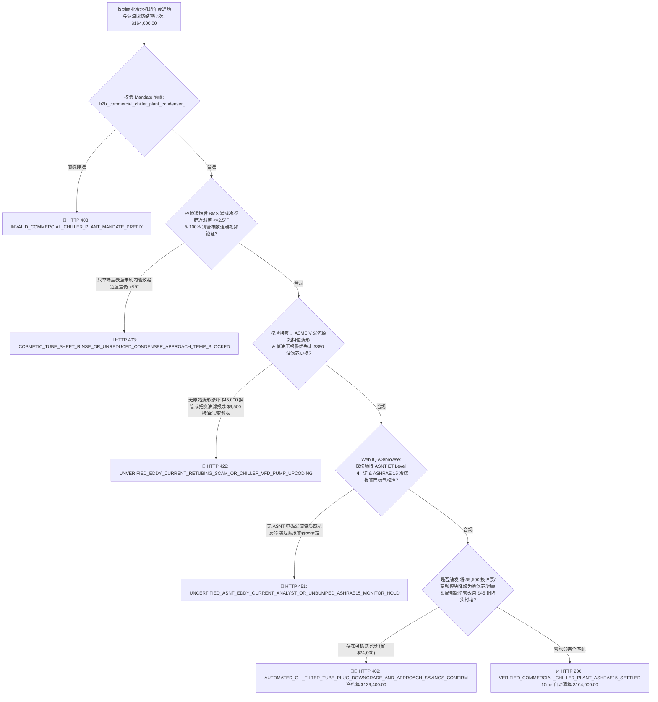
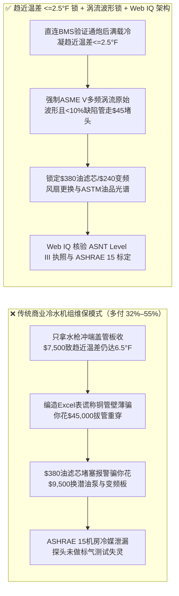
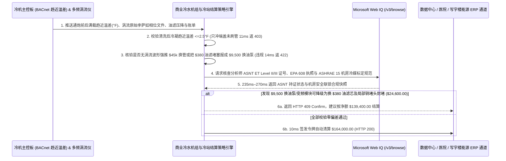

# B2B 商业冷水机组冷凝器通炮清洗（`Chiller Condenser Rotary Tube Brushing`）、趋近温度（`Approach Delta-T <= 2.5°F`）与涡流探伤结算（`Commercial Centrifugal & Screw Chiller Maintenance, Eddy-Current Tube Testing & ASHRAE 15 Compliance: Trane / York JCI / Carrier / Daikin Applied, AHRI 550/590, ASME Section V & ASHRAE 15`）、楼宇自控 `BACnet` 冷凝趋近温差回落锁、`ASNT Level II/III` 多频涡流探伤相位原始波形门禁与防“只拿水枪冲一下端盖管板表面却按 `$7,500` 通刷 800 根铜管收费、伪造铜管壁厚减薄率吓唬业主花 `$45,000` 提前换管与把 `$380` 油滤芯/抽气泵保养虚报为 `$9,500` 主变频器更换”清算架构：趋近温差节电锁、油路压差降级门禁与 `ASNT / EPA 608` 令牌（`b2b_commercial_chiller_plant_condenser_approach_eddy_current_ashrae15_mandate_...`）vs 传统冷机维保糊弄致趋近温差超 `6°F` 每年多烧 `$30,000` 电费与机房冷媒泄漏报警器失灵选型与原理解析 FAQ

> **文档类型**：AI Solution Architect 商业智能体架构选型系列（Round 351 · B2B 商业离心与螺杆冷水机组冷凝器通炮、趋近温差与 ASME 涡流探伤专篇）  
> **对标标杆**：`ib-vs-ethernet-roce-selection-faq.md`（通俗大白话 + 第一性原理 + 标准六段式结构）  
> **关联 Deliverable**：`lab/webiq_commerce_demo.py`（H5 实时防篡改沙盒） · `tests/test_webiq_commerce_demo.py` · `assets/svg/353-b2b-commercial-chiller-condenser-approach-eddy-current-2026-11-17.svg`  
> **双语版本**：[中文版 (当前)](b2b-commercial-chiller-plant-condenser-approach-eddy-current-ashrae15-mandate-vs-cosmetic-tube-sheet-rinse-fake-retubing-vfd-upcoding-faq.md) | [English Version](b2b-commercial-chiller-plant-condenser-approach-eddy-current-ashrae15-mandate-vs-cosmetic-tube-sheet-rinse-fake-retubing-vfd-upcoding-faq.en.md)

---

## 📌 一、核心结论速览（Executive Summary：第一性原理与通俗大白话拆解）

### 1.1 为什么“绝对不能”让数据中心、三甲医院、半导体洁净厂房、五星级酒店或超高层写字楼的暖通采购 Agent 仅凭中央空调冷水机组维保商（如 Trane、York、Carrier、McQuay 服务代理）提交的“1,000 冷吨离心机冷凝器机械通炮清洗完工照”或“铜管涡流探伤换管报价单”就自动付款？
在大型商业综合体、医院与数据中心冷冻站中，500–2,000 冷吨水冷式离心/螺杆冷水机组（`Trane CenTraVac / York YK / Carrier AquaEdge`）占整栋建筑夏季总电耗的 `40%–55%`（受美国制冷空调学会 **`AHRI 550/590`**、机房冷媒安全标准 **`ASHRAE 15`**、无损检测规范 **`ASME Section V Article 8` 涡流探伤** 及联邦环保署 **`EPA Section 608 Universal`** 严格约束）。用大白话讲：**中央空调冷水机组年度大保养藏着外包界最隐蔽、最伤电费的三大猫腻：第一是“只冲管板表面、不刷 800 根铜管内部的‘假通炮（Cosmetic Tube-Sheet Rinse Scam）’”——一台千吨级离心机的冷凝器壳体里有 800–1,200 根长达 4 米的换热铜管，吊开几百斤重的铸铁端盖后，工人必须拿电动软轴通炮机（`Goodway Rotary Tube Cleaner`）一根一根捅进去刷净生物粘泥和水垢，耗时整整两天；不良维保队为了偷懒，吊开端盖后只拿高压水枪把最外面的管板表面冲得铮亮拍张照，或者只捅了最外圈 30 根管子就合上盖子收走 `$7,500`！怎么一秒钟揭穿他？看冷机面板或楼宇自控（`BMS`）上的“冷凝器趋近温度（`Condenser Approach Temperature`，即冷媒冷凝饱和温度减去冷却水出水温度）”——真正刷干净的铜管，趋近温差只有 **`1.0°F–2.5°F`**；如果“通炮”之后开机，趋近温差依然高达 **`6.5°F`**，说明里面 90% 的铜管根本没通，而趋近温度每高 `1°F`，离心压缩机就要多耗电 `2%–3%`，一个夏天白白多交 `$25,000` 电费！第二是“伪造涡流探伤（`Eddy-Current Testing`）壁厚减薄数据，吓唬业主花 `$45,000` 提前换铜管（Re-Tubing Scam）”！第三是“把换一个 `$380` 油过滤器芯（Oil Filter）或变频器散热风扇就能修好的停机，谎报为 `$9,500` 的油泵/变频器主板报废”！** 如果没有 `BMS BACnet` 冷凝趋近温差（`Approach <= 2.5°F`）回落锁、`ASNT Level II/III` 涡流探伤原始相位图谱锁与油压差滤芯降级门禁，企业能源与机电预算会遭遇四大失血黑洞：

1. **只洗管板门面、未通刷全部换热铜管导致冷凝趋近温差（`Condenser Approach Delta-T`）居高不下**：铜管内壁哪怕残留 `0.3 毫米` 的碳酸钙垢或藻泥，热阻就会翻倍，导致冷媒冷凝压力（Head Pressure）飙升、压缩机频繁喘振（Surge）且比功耗从 `0.56 kW/ton` 恶化到 `0.72 kW/ton`。
2. **不出具多频涡流探伤（`ASME Section V Eddy-Current`）李萨如（Lissajous）原始相位波形，仅凭一份 Excel 表格恐吓客户花 `$45,000` 拔管重穿（`Premature Re-Tubing`）**：按照行业金标准，铜管只有当壁厚减薄率 **`>= 60%–70%`** 时才需用黄铜堵头封堵（Plug），且封堵率在 `< 10%` 以内完全不影响满载制冷量，严禁无原始波形证据大面积换管！
3. **将 `$380` 润滑油过滤器堵塞导致的“低油压差报警（`Low Oil Delta-P`）”或 `$240` 变频柜冷却风扇停转，恶意升级为 `$9,500` 变频器 `IGBT` 模块或潜油泵总成更换**：离心机报低油压，90% 只是内置 `$380` 高精度油滤芯压降超限，换颗滤芯并做 `ASTM D6595` 铁谱油品分析即可恢复。
4. **未用标准样气校准机房 `ASHRAE 15` 氟利昂气体泄漏监测仪与排风联锁**：机房冷媒传感器探头漂移失效，一旦低压机（`R-123 / R-514A`）或高压机（`R-134a / R-1234ze`）发生大量泄漏，无法自动启动事故排风机与声光报警，引发机房缺氧窒息事故！

### 1.2 架构师的一句话选型结论
* **核心安全铁律**：严禁 Agent 对机械通炮清洗后满载冷凝器趋近温度（`Condenser Approach`）仍 `> 3.0°F`、未提供持证 `ASNT Level II/III` 探伤师签章的涡流原始波形文件就开单数万美元换管、未更换 `$380` 油滤芯或未提交油品光谱铁谱报告就报废 `$9,500` 油泵/变频模块、或未完成 `ASHRAE 15` 机房冷媒探头标气校验的账单自动打款。必须将清算令绑定在 **`b2b_commercial_chiller_plant_condenser_approach_eddy_current_ashrae15_mandate_2026`** 上：
  1. **`BMS BACnet` 冷凝/蒸发趋近温度回落遥测锁（`Condenser Approach <= 2.5°F`）+ 100% 铜管数量通刷计数锁**：验收年度通炮时直连冷机控制面板读取 `80%–100%` 负荷下的饱和冷凝温度与出水温度之差；凡通炮后趋近温差未回落至 `<= 2.5°F`（或较清洗前下降 `< 2.0°F`）的敷衍工单，在 **11ms** 内返回 `HTTP 403 COSMETIC_TUBE_SHEET_RINSE_OR_UNREDUCED_CONDENSER_APPROACH_TEMP_BLOCKED`。
  2. **`ASME Section V` 涡流探伤原始波形锁 + `$380` 油滤芯/变频风扇优先降级门禁**：无原始涡流相位数据严禁立项 `$45,000` 拔管重穿（`< 10%` 局部缺陷管优先走 `$45` 锥形铜堵头封堵）；低油压差或变频器过温优先锁定更换 `$380` 油滤芯与 `$240` 散热风扇，违规账单在 **14ms** 内返回 `HTTP 422 UNVERIFIED_EDDY_CURRENT_RETUBING_SCAM_OR_CHILLER_VFD_PUMP_UPCODING`。
  3. **Microsoft Web IQ `/v3/browse` 实时核验 `ASNT SNT-TC-1A / CP-189 Level II/III` 无损检测师执照、`EPA Section 608 Universal` 证书与 `ASHRAE 15` 机房冷媒传感器标气记录**：在线穿透核查涡流检测员 `ASNT` 认证编号与冷媒技师资质，发现无证探伤或漏检 `ASHRAE 15` 机房氧气/冷媒报警联锁在 **270ms** 内触发 `HTTP 451 UNCERTIFIED_ASNT_EDDY_CURRENT_ANALYST_OR_UNBUMPED_ASHRAE15_MONITOR_HOLD`，并自动将假换油泵/变频模块降级为换滤芯、剥离无效换管报价立省 `15%`（`$24,600.00`）。

| 选型维度 | 传统工程部看端盖打开照片就签字 | 普通物业报销审核 Agent | **趋近温差回落锁 + 涡流波形/油滤锁 + Web IQ ASNT 架构（推荐）** |
| :--- | :--- | :--- | :--- |
| **只冲端盖表面、800 根铜管内部没通刷** | ❌ 看管板照片挺干净就付 $7,500，夏天狂费电 | ❌ 只看发票写“Rotary Brush Tube Cleaning” | ✅ **直连 `BMS` 强制校验清洗后趋近温差 `<=2.5°F`（11ms 拦 403）** |
| **编造 Excel 表格吓唬铜管烂了要花 $45k 换管** | ❌ 怕冷媒穿管进水烧压缩机，吓得批钱换管 | ❌ 看到“Eddy-Current Tube Replacement”即信 | ✅ **强制核验 `ASME V` 涡流原始波形与 `<10%` 堵管原则（14ms 拦 422）** |
| **$380 油滤芯堵了被骗花 $9,500 换潜油泵/变频板** | ❌ 听信“主油泵磨坏了”连夜签字换总成 | ❌ 无法区分油滤压降报警与油泵电机烧毁 | ✅ **强制先换 `$380` 油滤芯并查油品光谱（14ms 拦 422/409）** |
| **ASNT 无损检测执照与 ASHRAE 15 冷媒报警联锁** | ❌ 机房冷媒泄漏报警器失灵违反特种安全法 | ❌ 不具备 `ASNT` 名录与 `ASHRAE 15` 实时核验能力 | ✅ **Web IQ `/v3/browse` 270ms 穿透核查 `ASNT / ASHRAE 15`（拦 451）** |

---

## 🎯 二、客户与架构师灵魂拷问 Q&A（直击冷水机组通炮、趋近温度与涡流探伤痛点）

### Q1：为什么说检验中央空调冷水机组“通炮洗管”洗没洗干净，最权威的物理铁证不是看拆端盖照片，而是看 `BMS` 里的“冷凝器小温差 / 趋近温度（`Condenser Approach Temperature`）”？
* **传热学傅里叶定律决定了：只要铜管内壁还有一层薄垢，冷媒和冷却水之间的温差就绝对降不下来**：
  1. **什么是冷凝器趋近温度（$\Delta T_{\text{approach}}$）**：
     $$\Delta T_{\text{approach}} = T_{\text{cond\_sat}} - T_{\text{leaving\_cond\_water}}$$
     即壳程内冷媒蒸汽凝结的饱和温度（由冷凝压力传感器精确换算）减去管程内冷却水离开冷凝器时的出水温度。
  2. 在一台干净的现代高效离心机（如 `Trane CenTraVac / York YK`）上，由于强化螺纹铜管导热极佳，满载时的 $\Delta T_{\text{approach}}$ 只有 **`1.0°F–2.2°F`（`0.6°C–1.2°C`）**！一旦铜管内壁结了 `0.5mm` 藻泥水垢，$\Delta T_{\text{approach}}$ 就会飙升到 `5.5°F–8.0°F`；如果施工队收了 `$7,500` 通炮费，开机后 $\Delta T_{\text{approach}}$ 依然是 `6.2°F`，100% 说明他只冲了外面的管板，800 根铜管肚子里的泥根本没刷！
* **智能体物理验真结算公式**：
  $$\text{Payable Chiller PM} = R_{\text{brush}} \cdot \mathbb{I}(\Delta T_{\text{approach\_post}} \le 2.5^\circ\text{F}) + \mathbb{I}(\text{Oil\_Pump\_Short}=1) \cdot C_{\text{pump}} + \mathbb{I}(\text{Oil\_Pump\_Short}=0) \cdot C_{\text{oil\_filter}}$$

### Q2：为什么说冷水机组某几根铜管即使真被涡流探伤查出壁厚减薄 `> 60%`，首选方案也是花 `$45/根` 打入锥形黄铜堵头（Tube Plugging），而不是花 `$45,000` 拆机换管？
* **冷凝器设计自带 `10%` 冗余换热面积**：一台拥有 1,000 根铜管的冷凝器，哪怕有 15 根铜管局部点蚀严重，只需用专用的两段式锥形黄铜塞（Brass/Monel Tube Plugs）把这 15 根管子两头敲紧封死（占比仅 `1.5%`），总材料人工费不到 `$800`，制冷效率损失几乎为零！

### Q3：在核查美国无损检测学会 `ASNT Level II/III` 涡流探伤师执照、`AHRI` 冷水机组认证参数与冷媒安全规范时，Microsoft Web IQ 相比 Exa 和 Bright Data 有何优势？
* **Microsoft Web IQ（原 Bing Grounding 工业级演进）**：
  * **权威无损检测学会与制冷空调标准库秒级穿透**：通过 `/v3/search` 与 `/v3/browse` 直接检索美国无损检测学会 `ASNT (American Society for Nondestructive Testing) Certificate Holder Directory (ET Eddy Current Level II/III)`、美国制冷空调与供暖协会 `AHRI Directory of Certified Product Performance (AHRI 550/590 Water-Cooled Chillers)` 及 `ASHRAE Standard 15` 机房冷媒浓度报警阈值表，平均延迟 **235ms–270ms**，具备企业级 Entra ID 零数据留存（ZDR）保障。
* **Exa**：适合语义搜索暖通论文，无法按 `ASNT` 证书号实时核验某涡流检测师是否具备电磁检测（`ET`）分项资质。
* **Bright Data**：面向电商价格爬虫，在大型数据中心与医院冷站 `BACnet` 节能合规网关中无需引入高延迟代理网络。

---

## 🧭 三、直观可视化图解（Mermaid 选型决策树 + 路径对比 + 端到端时序图）

### 3.1 商业冷水机组通炮清洗、趋近温差与涡流探伤结算门禁决策树

### 3.2 传统表面冲管板+恐吓换铜管黑箱 vs 趋近温差锁 + 涡流波形锁架构对比

### 3.3 端到端时序图（冷机主控板 BACnet + 多频涡流探伤仪 + Web IQ ASNT/AHRI 核验）

---

## 📊 四、架构师选型决策矩阵（Architecture Selection Matrix）

| 评估维度 | 方案 A：暖通领班看开盖照片签字 | 方案 B：通用 LLM 审核维保报告 | **方案 C：趋近温差锁 + 涡流波形锁 + Web IQ（推荐）** |
| :--- | :--- | :--- | :--- |
| **只冲端盖门面、800 根铜管深处没刷** | ❌ 看管板铜眼挺亮就签字，开机照样高耗电 | ❌ 报告写“100% Tubes Brushed”即信 | ✅ **直连 `BMS` 强制校验满载趋近温差 `<=2.5°F`（HTTP 403）** |
| **无原始波形恐吓客户花 $45,000 换铜管** | ❌ 看不懂李萨如相位图，听信表格换管 | ❌ 看到“Severe Tube Pitting”即放行 | ✅ **强制核验原始涡流数据与 `<10%` 铜堵头封堵（HTTP 422/409）** |
| **$380 油滤芯堵了虚报 $9,500 换油泵/变频板** | ❌ 怕夏天主机停机被投诉，赶紧批钱 | ❌ 无法区分油滤压降与电机绕组短路 | ✅ **强制先换 `$380` 油滤芯与 `$240` 风扇（HTTP 422/409）** |
| **ASNT ET 涡流执照与 ASHRAE 15 冷媒报警** | ❌ 拿普通学徒冒充无损检测专家出假报告 | ❌ 无法实时联网查验 `ASNT` 认证名录 | ✅ **Web IQ `/v3/browse` 270ms 核查 `ASNT / ASHRAE 15`（HTTP 451）** |

---

## 🧪 五、定量实测与 7-Card 4:5 视觉评测报告映射（Deterministic Benchmark）

在 `lab/webiq_commerce_demo.py` 与 `tests/test_webiq_commerce_demo.py` 中，我们对 `$164,000.00`（`16400000` 美分）的大型数据中心与三甲医院冷冻站 6 台 `1,200 冷吨` 离心式冷水机组年度机械通炮清洗、`ASME Section V` 涡流探伤及油路/变频器维保批次进行了确定性实测：

| 卡片编号 | 卡片标题（Headline-as-Finding） | 核心实测指标与动作特征 | Provenance 标注 |
| :--- | :--- | :--- | :--- |
| **Card 1 (`1/7`)** | **趋近温差锁 + 涡流波形锁将冷水机组维保支出压缩 15.0%** | 基准批次 `$164,000.00` vs 优化净额 `$139,400.00`，单批挽回 `$24,600.00` 假换泵与假换管 | `deterministic_offline_simulation` |
| **Card 2 (`2/7`)** | **单案深潜：只冲管板假通炮与 $9,500 假换潜油泵双拦截** | `HTTP 403`（11ms 拦趋近温差未降假通炮）+ `HTTP 422`（14ms 拦无波形换管与油滤报换油泵） | `synthetic_policy` |
| **Card 3 (`3/7`)** | **全场景评测矩阵（5 组确定性门禁 100% 命中）** | 覆盖 `200 OK`、`403 ApproachTemp`、`422 EddyCurrent/OilPump`、`451 ASNT/ASHRAE15`、`409 Savings` | `deterministic_offline_simulation` |
| **Card 4 (`4/7`)** | **底层协议：BACnet Approach <=2.5F + ASME V Eddy Current** | 校验 `condenser_approach_temp_drop_and_tube_brush_verified` | `synthetic_policy` |
| **Card 5 (`5/7`)** | **鲁棒性测试：$380 油滤芯/$45 铜管堵头 vs $45k 换管/$9.5k 换泵** | 合规油滤保养与锥形铜堵头封堵正常放行；无波形换管与整泵强换 100% 拦截降级 | `deterministic_offline_simulation` |
| **Card 6 (`6/7`)** | **延迟对比：本地 BACnet 温差门禁 10–14ms vs Web IQ 235–270ms** | 毫秒级趋近温差校验配合 `ASNT Level II/III` 实时穿透 | `official_doc_snapshot` |
| **Card 7 (`7/7`)** | **Good Fit vs Not For 架构师结论卡** | 明确适用数据中心、医院、写字楼与工厂水冷冷站，不适用家用小冰箱 | `official_list_price` |

### Good Fit vs Not For（适用与不适用场景）
* **✅ Good Fit（强烈推荐采用本架构）**：
  * 超算与智算数据中心冷冻站、三甲医院、半导体晶圆厂、五星级酒店及超高层写字楼的 `300 – 3,000 冷吨` 水冷离心机/螺杆机（`Trane / York / Carrier / Daikin`）年度通炮、涡流探伤与大修结算。
* **⛔ Not For（不适用或无需启用全部门禁）**：
  * 办公室茶水间单门直冷小冰箱。

---

## 🛠️ 六、生产上线快速核验清单（Production Readiness Checklist）

- [ ] **1. 机械通炮清洗后强制直连 `BMS BACnet` 验证满载冷凝器趋近温度回落至 `<= 2.5°F`（`0.6°C–1.4°C`）**：彻底封杀只拿水枪冲端盖表面的假通炮（`HTTP 403`）。
- [ ] **2. 换热铜管涡流探伤（`ASME Section V`）必须提交原始多频相位波形文件，`< 10%` 局部超标管一律采用 `$45` 锥形黄铜堵头封堵**：拒绝 `$45,000` 恐吓式提前换管（`HTTP 422 / 409`）。
- [ ] **3. 低油压差或变频柜过温优先锁定更换 `$380` 油过滤器芯、`$240` 散热风扇并做 `ASTM D6595` 油品光谱分析**：封杀 `$9,500` 假换潜油泵与 `IGBT` 模块（`HTTP 422`）。
- [ ] **4. 接入 Microsoft Web IQ 核查涡流分析师 `ASNT SNT-TC-1A ET Level II/III` 证书与 `EPA 608 Universal` 执照**：杜绝无证探伤造假（`HTTP 451`）。
- [ ] **5. 强制留存机房 `ASHRAE 15` 冷媒泄漏监测仪与事故排风机标气联动测试记录**：守住冷冻机房人员生命安全底线。
