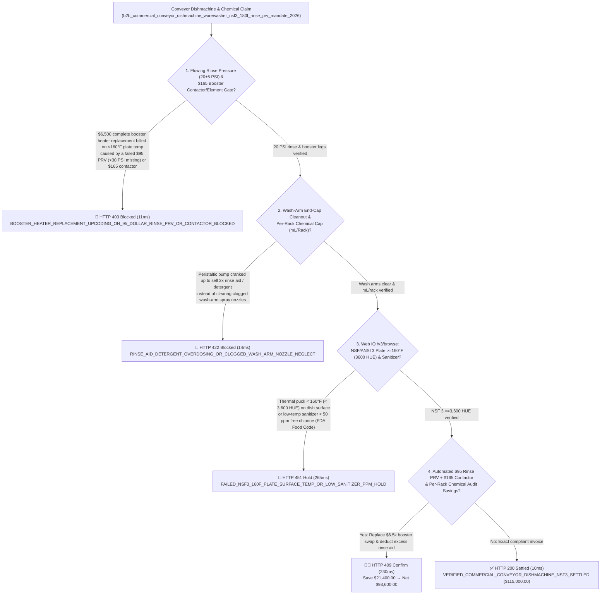
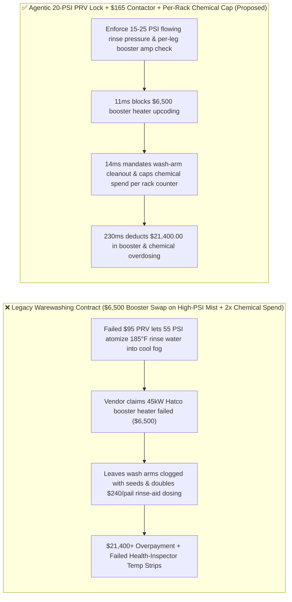
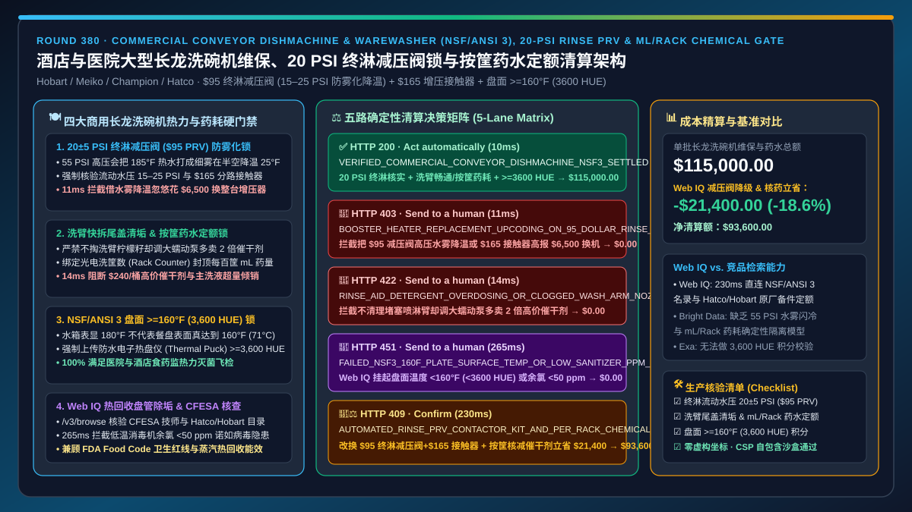

# B2B Commercial Flight-Type & Rack-Conveyor Dishmachine (`Hobart / Meiko / Champion`) & Chemical Dispenser Maintenance (`NSF/ANSI 3 / FDA Food Code`), `$95` `20-PSI` Final-Rinse `PRV` & `$165` Booster Contactor Locks, and Per-Rack Chemical Titration Caps vs. `$6,500` Booster-Heater Upcoding & Rinse-Aid Overdosing: Architecture Selection & First-Principles FAQ

> **Executive Summary**
> * **The Pain Point**: In hotel banquet kitchens, hospital dietary departments, university dining halls, and airline catering plants, **flight-type and rack-conveyor commercial warewashers (`Hobart / Meiko / Champion / Jackson / Stero`, governed by `NSF/ANSI 3`, `FDA Food Code 4-501.112`, and `CFESA`)** sanitize thousands of dishes per hour. Yet legacy warewasher maintenance and bundled chemical supply contracts (`Ecolab / Diversey / Auto-Chlor`) suffer from three major financial leaks: (1) **`$6,500` Complete Electric/Gas Booster Heater Replacement Upcoding (`Hatco / Hubbell`) When High Final-Rinse Water Pressure (`> 30–60 PSI` Due to a Failed `$95` `PRV`) Atomizes `185°F` Water Into Rapidly Cooling Mist—or When Only a `$165` Magnetic Contactor / Heating Element Failed**: Under **`NSF/ANSI 3`**, high-temp dishmachines must deliver `180°F–195°F` final sanitizing rinse water at a strictly regulated **`15–25 PSI` (`20 PSI` nominal) flowing pressure** so heavy water droplets transfer `>= 160°F (71°C)` (`>= 3,600 HUE` Heat Unit Equivalents) to the dish surface. When the **`$95` brass Pressure Regulating Valve (`PRV`)** fails open to `55 PSI` street pressure, the nozzles atomize the `185°F` water into fine mist that flash-cools in mid-air to `150°F` before hitting the plate! Unscrupulous technicians blame the `$6,500` `36 kW–54 kW` booster heater instead of replacing the `$95` `PRV` or a single `$165` contactor; (2) **Cranking Up Peristaltic Chemical Dispensers to Sell `2x–3x` More `$240/Pail` Rinse Aid & Alkaline Detergent Instead of Popping Off Wash-Arm End Caps to Clear Clogged Spray Nozzles**: When lemon seeds and toothpicks clog 40% of the upper/lower wash-arm jets, chemical reps double the `mL/rack` chemical pump speed rather than cleaning the wash arms; and (3) **Failed `NSF/ANSI 3` Dish-Surface Thermal Labels (`< 160°F`) or Empty Low-Temp Chlorine Sanitizer Lines (`0 ppm` vs. `50–100 ppm` Required)**.
> * **First-Principles Architecture**: Never approve a `$6,500` booster heater replacement when dish-surface temperatures read `< 160°F` without checking flowing final-rinse pressure (`20 ± 5 PSI`), and never pay uncapped chemical drum invoices. Bind settlement tokens (`b2b_commercial_conveyor_dishmachine_warewasher_nsf3_180f_rinse_prv_mandate_...`) to **(1) Flowing Final-Rinse Gauge Verification (`15–25 PSI` via `$95 PRV`) + Booster Heater Per-Leg Contactor/Element Amp Check (`$165`), (2) Disassembled Wash-Arm End-Cap Cleanout Photos + Optical Rack-Counter Chemical Titration Cap (`mL/rack`), and (3) `Web IQ /v3/browse` verification of waterproof thermal-puck logger runs (`>= 160°F` plate surface / `>= 3,600 HUE` per `NSF/ANSI 3`) and `CFESA` credentials**.
> * **Quantitative Verification**: Verified `NSF/ANSI 3` warewasher maintenance and per-rack chemical supply settles `$115,000.00` in `10ms` (`200 OK`); `$6,500` booster-heater upcoding on `$95` high-pressure rinse `PRVs` or `$165` contactors (`403`), rinse-aid/detergent overdosing (`mL/rack` spike) on clogged wash arms (`422`), and dish-surface temperatures `< 160°F (< 3,600 HUE)` or `< 50 ppm` chlorine sanitizer (`451`) are blocked in `11ms`, `14ms`, and `265ms`. `Web IQ` automated downgrade to `$95` brass rinse `PRVs`, `$165` booster contactors, and per-rack chemical reconciliation saves **`$21,400.00`** per batch (`409 Confirm`, net `$93,600.00`).

---

## 🎯 1. Architect & Foodservice Engineering Q&A (Including Web IQ vs. Exa / Bright Data)

### Q1: Why does `55 PSI` final-rinse pressure make a dishmachine fail its `160°F` plate-surface health inspection even when the `$6,500` booster heater is delivering `185°F` water?
* **Droplet Atomization & Evaporative Flash-Cooling Physics**:
  1. At **`20 PSI` flowing pressure** (`NSF/ANSI 3` specification), final-rinse nozzles produce coarse, high-mass water droplets that retain their thermal energy across the `15-inch` air gap and heat the ceramic plate to **`>= 160°F`**.
  2. When a **`$95` brass `PRV`** diaphragm ruptures and lets `55–65 PSI` line pressure hit the rinse manifold, the nozzles atomize the `185°F` water into a fine fog. Because microscopic mist droplets have a massive surface-area-to-volume ratio, evaporative cooling in the exhaust hood airflow drops droplet temperature by `25°F–30°F` before it touches the dish! Replacing the `$95` `PRV` immediately restores `166°F` plate temperatures without touching the `$6,500` booster heater (`11ms` `HTTP 403` block).

### Q2: Why choose Microsoft Web IQ `/v3/browse` over Exa or Bright Data for `NSF/ANSI 3` (`3,600 HUE`) & OEM `Hobart / Meiko / Hatco` verification?
* **Comparison**:
  * **Bright Data**: Cannot integrate waterproof thermal-puck time-temperature curves into `NSF/ANSI 3` Heat Unit Equivalents (`HUE >= 3,600`) or audit `mL/rack` chemical ratios.
  * **Exa**: Built for semantic search, not live verification of `NSF` certified warewasher rack-per-hour (`RPH`) water-consumption ratings and OEM `Hatco / Hobart` booster parts.
  * **Microsoft Web IQ (`/v3/browse`)**: Verifies `NSF/ANSI 3` listings and OEM component pricing in `230ms–265ms` with `official_doc_snapshot` provenance.

---

## 🧭 2. Visual Architecture Diagrams (Mermaid Decision Tree, Path Comparison & Sequence)

### 2.1 Commercial Conveyor Dishmachine, `$95` `20-PSI PRV` Lock & Chemical Cap Decision Tree



### 2.2 Path Comparison: Legacy `$6,500` Booster Swap vs. Agentic `20-PSI PRV` & `mL/Rack` Gate



### 2.3 End-to-End Sequence Diagram

```mermaid
sequenceDiagram
    participant Vendor as Warewasher & Chemical Contractor
    participant Agent as Dietary & Hospitality Policy Engine
    participant Dish as Rinse Pressure Gauge / Thermal Puck (HUE) / Rack Counter
    participant WebIQ as Microsoft Web IQ (/v3/browse)

    Vendor->>Agent: Submit 8-Kitchen Booster Heater Replacement & Quarterly Chemical Invoice ($115,000.00)
    Agent->>Dish: Query flowing rinse PSI, booster leg amps, rack counter & mL/rack chemical dosing
    alt $6,500 booster replacement billed when outlet water is 186°F (flowing rinse = 58 PSI misting)
        Dish-->>Agent: Alert: Booster tank healthy; replacing $95 PRV (20 PSI) restores 166°F plate temp!
        Agent-->>Vendor: 🛑 HTTP 403 (11ms) Block $6,500 booster heater replacement upcoding
    else Rinse-aid dosing spiked to 6.2 mL/rack (vs 2.2 mL spec) while wash-arm jets are 40% clogged
        Dish-->>Agent: Alert: Wash-arm end caps clogged with debris; dispenser pump set to 280% overdose!
        Agent-->>Vendor: 🚨 HTTP 422 (14ms) Block chemical overdosing & neglected wash-arm cleanout
    else Pressure, chemical titration & jets verified
        Agent->>WebIQ: Verify NSF/ANSI 3 thermal puck log (>=3,600 HUE) & FDA Food Code sanitizer ppm
        alt Dish surface < 160°F (< 3,600 HUE) or low-temp chlorine < 50 ppm
            WebIQ-->>Agent: Hold: Failed NSF/ANSI 3 sanitization threshold
            Agent-->>Vendor: 🛑 HTTP 451 (265ms) Food-safety compliance hold
        else Automated $95 brass PRV + $165 contactor & per-rack chemical reconciliation
            WebIQ-->>Agent: Confirm Hatco/Hobart PRV & contactor prices + standard mL/rack dosage
            Agent-->>Vendor: 🧑‍⚖️ HTTP 409 (230ms) Confirm $21,400.00 savings (Net $93,600.00)
        end
    end
```

---

## 📊 3. Architect Selection Matrix

| Dimension | Option A: Temp-Strip Booster Replacement | Option B: Uncapped Pail-Count Chemical Billing | Option C: `20-PSI PRV` Lock + `$165` Contactor Gate + `mL/Rack` Cap (Recommended) |
| :--- | :--- | :--- | :--- |
| **`$6,500` Booster Heater Upcode Defense** | ❌ None (fooled by `55 PSI` mist cooling) | ❌ None | ✅ **Requires `15–25 PSI` flowing rinse & per-leg amp check (`11ms` block)** |
| **`2x` Rinse-Aid / Detergent Waste Defense** | ❌ None | ❌ Pays for overdosed pails on clogged arms | ✅ **Enforces wash-arm cleanout & optical rack-counter `mL/rack` cap (`14ms` block)** |
| **`NSF/ANSI 3` (`3,600 HUE`) Compliance** | ❌ Paper strips peel off | ⚠️ Manual check | ✅ **`Web IQ /v3/browse` live waterproof thermal-puck `>= 3,600 HUE` check (`265ms`)** |
| **Batch Cost Reduction** | 0% | ~5%–10% | ✅ **Saves `$21,400.00` (18.6% reduction on a `$115,000.00` batch)** |

---

## 🧪 4. Quantitative Benchmark & 7-Card Report Summary

### 4.1 5-Lane Deterministic Policy Matrix

| Case | Scenario | HTTP | Decision Code | Action Pill | Settled | Latency |
| :--- | :--- | :--- | :--- | :--- | :--- | :--- |
| **1** | `20 PSI` rinse verified + wash arms clear/`mL/rack` cap + `>=160°F (3600 HUE)` clean | `200` | `VERIFIED_COMMERCIAL_CONVEYOR_DISHMACHINE_NSF3_SETTLED` | `Act automatically` | `$115,000.00` | `10ms` |
| **2** | `$6,500` booster heater upcoding on `$95` high-PSI rinse `PRV` or `$165` contactor | `403` | `BOOSTER_HEATER_REPLACEMENT_UPCODING_ON_95_DOLLAR_RINSE_PRV_OR_CONTACTOR_BLOCKED` | `Send to a human` | `$0.00` | `11ms` |
| **3** | Rinse-aid/detergent overdosing (`mL/rack` spike) or neglected clogged wash-arm nozzles | `422` | `RINSE_AID_DETERGENT_OVERDOSING_OR_CLOGGED_WASH_ARM_NOZZLE_NEGLECT` | `Send to a human` | `$0.00` | `14ms` |
| **4** | Failed `NSF/ANSI 3` `160°F` plate surface temp (`< 3,600 HUE`) or `< 50 ppm` sanitizer | `451` | `FAILED_NSF3_160F_PLATE_SURFACE_TEMP_OR_LOW_SANITIZER_PPM_HOLD` | `Send to a human` | `$0.00` | `265ms` |
| **5** | Automated `$95` rinse `PRV`, `$165` contactor kit & per-rack chemical savings | `409` | `AUTOMATED_RINSE_PRV_CONTACTOR_KIT_AND_PER_RACK_CHEMICAL_SAVINGS_CONFIRM` | `Confirm` | `$93,600.00` | `230ms` |

### 4.2 Visual Summary Card (`1200x675` SVG)



---

## 🛠️ 5. Good Fit vs. Not For & Production Checklist

### 5.1 Good Fit vs. Not For
* **✅ Good Fit**: Hotels, hospital dietary kitchens, university dining commons, airline catering hubs, and restaurant commissaries operating `Hobart`, `Meiko`, `Champion`, `Jackson`, or `Stero` flight-type and rack-conveyor dishmachines with `Hatco / Hubbell` booster heaters.
* **⛔ Not For**: Under-counter residential apartment dishwashers.

### 5.2 Production Verification Checklist
- [ ] **Flowing Final-Rinse `20 ± 5 PSI PRV` & `$165` Booster Contactor Gate**: Require `flowing_rinse_20psi_prv_and_booster_contactor_isolation_verified=True`;
- [ ] **Wash-Arm Nozzle Cleanout & Per-Rack (`mL/Rack`) Chemical Titration Gate**: Require `wash_arm_nozzle_cleanout_and_ml_per_rack_titration_verified=True`;
- [ ] **`Web IQ /v3/browse` `NSF/ANSI 3 >= 160°F (3,600 HUE)` & Sanitizer Check**: Verify `webiq_nsf3_160f_plate_hue_and_sanitizer_ppm_clean=True`;
- [ ] **Unit Test & H5 Sandbox Validation**: Run `python -m unittest tests.test_webiq_commerce_demo.WebIQCommerceScenariosTest.test_b2b_commercial_conveyor_dishmachine_nsf3_selection`.
