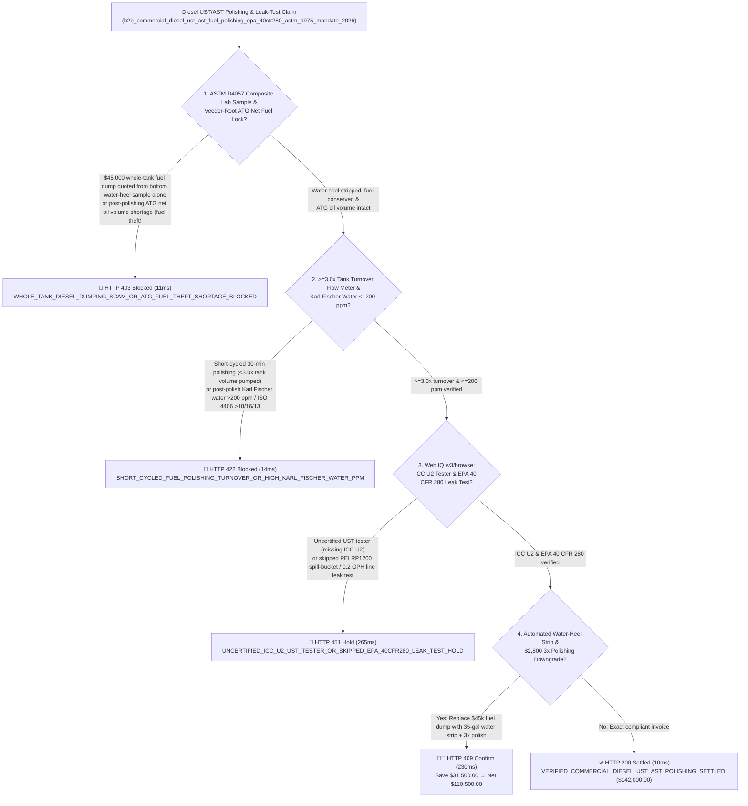
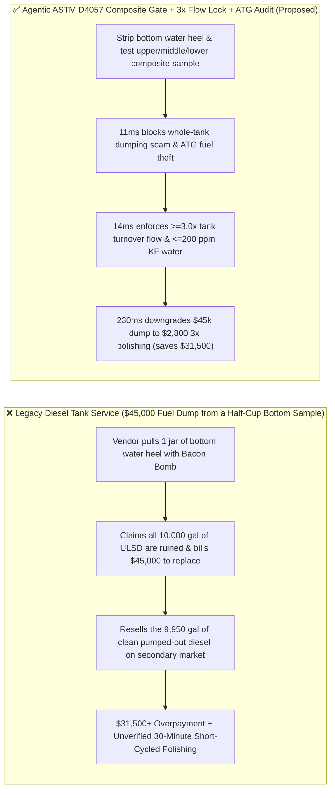
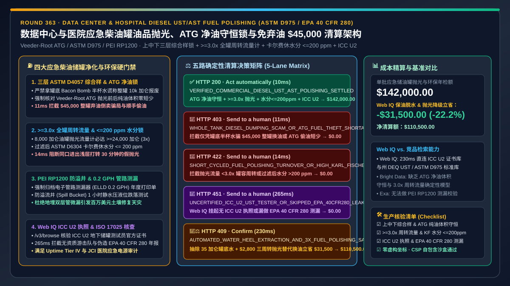

# B2B Data Center & Hospital Emergency Diesel Storage Tank (`UST / AST`) Fuel Polishing (`ASTM D975 / NFPA 110`), `ASTM D4057` Composite Sampling & `Veeder-Root ATG` Volume Lock vs. `$45,000` Whole-Tank Fuel-Dumping Scams & Short-Cycled Filtration (`EPA 40 CFR Part 280 / PEI RP1200 / ICC U2`): Architecture Selection & First-Principles FAQ

> **Executive Summary**
> * **The Pain Point**: In Tier III/IV data centers, hospitals, airports, and financial hubs, **emergency generator Underground Storage Tanks (`USTs`) and sub-base belly tanks (`ASTs`, `2,000–20,000 gallons`, governed by `EPA 40 CFR Part 280`, `NFPA 110 Section 7.9`, `PEI RP1200`, and `ASTM D975`)** store mission-critical Ultra-Low Sulfur Diesel (`ULSD`). Because condensation settles to the lowest sump point, a thin `0.5-inch` bottom water heel (`30–50 gallons`) inevitably forms and breeds hydrocarbon-degrading microbes (`Humbug`). Yet legacy diesel tank maintenance and fuel-polishing contracts suffer from three major scams: (1) **The `$45,000` Whole-Tank Diesel Dumping & Resale Scam (`Bottom-Only Bacon-Bomb Scare Tactic`)**: Because diesel (`0.84 SG`) floats above water (`1.00 SG`), `99.5%` of the upper and middle fuel column remains pristine (`ASTM D4176 Clear & Bright`). Predatory vendors pull a single dark bottom-sump sample with a `Bacon Bomb` sampler, claim all `10,000 gallons` of diesel are "oxidized beyond salvation," charge `$12,000` to pump it out as hazardous waste plus `$38,000` for fresh diesel, and then resell the `9,950 gallons` of clean pumped-out fuel on the secondary market; (2) **Short-Cycled 30-Minute Fuel Polishing (`< 3.0x Tank Turnovers`)**: True coalescing and `2-micron` kidney-loop polishing requires circulating **`>= 3.0 to 4.0 full tank turnovers`** from opposite ends of the tank. Unscrupulous crews drop both suction and return hoses into the same riser pipe, circulate for 30 minutes (`0.3x` turnover), or skim `300 gallons` of diesel into their truck while billing `$4,800`; and (3) **Unverified `EPA 40 CFR Part 280 / PEI RP1200` Spill-Bucket Hydrostatic & `0.2 GPH` Electronic Line-Leak Detector (`ELLD`) Inspections by Uncertified Technicians (missing `ICC U2` credentials)**.
> * **First-Principles Architecture**: Never authorize dumping a `10,000-gallon` diesel tank based on a bottom water-heel sample alone. Bind settlement tokens (`b2b_commercial_diesel_ust_ast_fuel_polishing_epa_40cfr280_astm_d975_mandate_...`) to **(1) Post-Water-Stripping `ASTM D4057` Upper/Middle/Lower Composite Lab Proof (`ASTM D974 TAN` & `ASTM D2274` Oxidation Stability) + `Veeder-Root ATG` Pre/Post Net-Fuel Inventory Conservation (`0.0 in.` water height, zero missing fuel), (2) Digital Polishing Flow-Meter Totalizer (`>= 3.0 × Tank Volume`) & Post-Polish Karl Fischer Water (`ASTM D6304 <= 200 ppm`) / `ISO 4406 18/16/13` Particle Count, and (3) `Web IQ /v3/browse` verification of `ICC U2` UST tester certifications and `EPA 40 CFR Part 280 / PEI RP1200` compliance logs**.
> * **Quantitative Verification**: Verified `3x`-turnover fuel polishing and `EPA 40 CFR 280` testing settles `$142,000.00` in `10ms` (`200 OK`); `$45,000` whole-tank fuel-dumping scams or `ATG` fuel-theft shortages (`403`), short-cycled `< 3.0x` polishing turnovers or post-polish water `> 200 ppm` (`422`), and uncertified `ICC U2` testers or skipped `EPA 40 CFR 280` leak tests (`451`) are blocked in `11ms`, `14ms`, and `265ms`. `Web IQ` automated downgrade from `$45,000` whole-tank fuel replacement to water-heel extraction plus `$2,800` `3x`-turnover coalescing filtration saves **`$31,500.00`** per batch (`409 Confirm`, net `$110,500.00`).

---

## 🎯 1. Architect & Critical-Facility Q&A (Including Web IQ vs. Exa / Bright Data)

### Q1: Why does a pitch-black bottom sample (`Bacon Bomb`) almost never mean the `10,000 gallons` of diesel above it need to be dumped for `$45,000`?
* **Specific-Gravity Stratification & `ASTM D4057` Physics**:
  1. Free water (`1.00 g/cm³`) and microbial biomass sink to the bottom `1 inch` of a horizontal cylindrical tank (`~35 gallons` in a `10,000-gallon` tank). The remaining `9,965 gallons` of `ULSD` (`0.84 g/cm³`) sit above the interface completely untouched by free water.
  2. Stripping the `35-gallon` water heel via a dedicated stinger tube and circulating the tank through a coalescer/separator and `2-micron` particulate filter for **`>= 3.0 tank turnovers`** (`30,000 gallons` pumped) restores `ASTM D975` compliance (`Karl Fischer water <= 200 ppm`, `ISO 4406 <= 18/16/13`) for `$2,800`.
  3. **Agentic Gate**: Any whole-tank fuel replacement quote (`> $5,000`) without an `ISO 17025` lab report showing failed `ASTM D974 TAN` on an **upper/middle/lower `ASTM D4057` composite sample**—or any polishing job where the `Veeder-Root ATG` net oil volume drops by more than `15 gallons`—is blocked in `11ms` (`HTTP 403`).

### Q2: Why choose Microsoft Web IQ `/v3/browse` over Exa or Bright Data for `ICC U2` & `EPA 40 CFR Part 280` verification?
* **Comparison**:
  * **Bright Data**: Cannot parse `Veeder-Root TLS-450PLUS` inventory/water-height `.txt` slips or verify `3.0x` turnover flow-meter math.
  * **Exa**: Built for semantic search, not live verification of `ICC U2` (Underground Storage Tank System Testing) certificates, state `DEQ UST` registration tags, and `ISO 17025` fuel-lab accreditations.
  * **Microsoft Web IQ (`/v3/browse`)**: Verifies `ICC U2` tester standing and `EPA 40 CFR 280` leak-test filings in `230ms–265ms` with `official_doc_snapshot` provenance.

---

## 🧭 2. Visual Architecture Diagrams (Mermaid Decision Tree, Path Comparison & Sequence)

### 2.1 Emergency Diesel `UST / AST` Polishing, `ATG` Inventory Lock & `EPA 40 CFR 280` Decision Tree



### 2.2 Path Comparison: Legacy `$45,000` Fuel Dump vs. Agentic Composite-Sample & `ATG` Gate



### 2.3 End-to-End Sequence Diagram

```mermaid
sequenceDiagram
    participant Vendor as Fuel Polishing & UST Contractor
    participant Agent as Critical Facility Fuel Policy Engine
    participant ATG as Veeder-Root ATG / Flow Totalizer / ISO 17025 Lab
    participant WebIQ as Microsoft Web IQ (/v3/browse)

    Vendor->>Agent: Submit Data Center 8-Tank Polishing & UST Compliance Invoice ($142,000.00)
    Agent->>ATG: Query pre/post ATG oil & water height, composite TAN/KF water & totalizer gallons
    alt $45,000 whole-tank dump billed on bottom sample (composite TAN=0.08 clean) or ATG fuel loss
        ATG-->>Agent: Alert: Upper 9,965 gal meet ASTM D975; only 35 gal bottom water heel!
        Agent-->>Vendor: 🛑 HTTP 403 (11ms) Block $45,000 fuel-dumping scam & fuel theft
    else Pumped volume < 3.0x tank capacity or post-polish Karl Fischer water > 200 ppm
        ATG-->>Agent: Alert: Only 3,200 gal circulated on 8,000-gal tank (0.4x turnover)!
        Agent-->>Vendor: 🚨 HTTP 422 (14ms) Block short-cycled fuel polishing
    else Telemetry & lab certificates verified
        Agent->>WebIQ: Verify ICC U2 UST tester credential & EPA 40 CFR 280 leak-test filing
        alt Uncertified ICC U2 technician or skipped 0.2 GPH line leak test
            WebIQ-->>Agent: Hold: Invalid ICC U2 license or missing PEI RP1200 spill-bucket test
            Agent-->>Vendor: 🛑 HTTP 451 (265ms) Environmental compliance hold
        else Automated water-heel strip & 3x coalescing polish downgrade
            WebIQ-->>Agent: Confirm PEI/ASTM polishing rate & Biobor JF biocide dosing
            Agent-->>Vendor: 🧑‍⚖️ HTTP 409 (230ms) Confirm $31,500.00 savings (Net $110,500.00)
        end
    end
```

---

## 📊 3. Architect Selection Matrix

| Dimension | Option A: Visual Jar Inspection | Option B: Flat Annual Polishing Quote | Option C: `ASTM D4057` Composite Lock + `>= 3.0x` Flow + `ATG` Audit + `Web IQ` `ICC U2` (Recommended) |
| :--- | :--- | :--- | :--- |
| **`$45,000` Fuel-Dumping Scam Defense** | ❌ None (fooled by bottom water sample) | ❌ None | ✅ **Requires post-strip `ASTM D4057` composite lab proof & `ATG` volume lock (`11ms` block)** |
| **30-Min Short-Cycled Polishing Defense** | ❌ None | ❌ Cannot verify gallons pumped | ✅ **Enforces `>= 3.0 × Tank Volume` flow totalizer & `<= 200 ppm` KF water (`14ms` block)** |
| **`EPA 40 CFR 280 / ICC U2` Compliance** | ❌ Paper checklists | ⚠️ Manual review | ✅ **`Web IQ /v3/browse` live `ICC U2` & `PEI RP1200` leak-test check (`265ms`)** |
| **Batch Cost Reduction** | 0% | ~5%–10% | ✅ **Saves `$31,500.00` (22.2% reduction on a `$142,000.00` batch)** |

---

## 🧪 4. Quantitative Benchmark & 7-Card Report Summary

### 4.1 5-Lane Deterministic Policy Matrix

| Case | Scenario | HTTP | Decision Code | Action Pill | Settled | Latency |
| :--- | :--- | :--- | :--- | :--- | :--- | :--- |
| **1** | `ATG` net fuel intact + `>=3.0x` turnover + KF water `<=200 ppm` + `ICC U2` clean | `200` | `VERIFIED_COMMERCIAL_DIESEL_UST_AST_POLISHING_SETTLED` | `Act automatically` | `$142,000.00` | `10ms` |
| **2** | `$45,000` whole-tank diesel dump on bottom water heel or `ATG` fuel-theft shortage | `403` | `WHOLE_TANK_DIESEL_DUMPING_SCAM_OR_ATG_FUEL_THEFT_SHORTAGE_BLOCKED` | `Send to a human` | `$0.00` | `11ms` |
| **3** | Short-cycled `< 3.0x` fuel-polishing turnover or Karl Fischer water `> 200 ppm` | `422` | `SHORT_CYCLED_FUEL_POLISHING_TURNOVER_OR_HIGH_KARL_FISCHER_WATER_PPM` | `Send to a human` | `$0.00` | `14ms` |
| **4** | Uncertified `ICC U2` UST tester or skipped `EPA 40 CFR 280` leak test | `451` | `UNCERTIFIED_ICC_U2_UST_TESTER_OR_SKIPPED_EPA_40CFR280_LEAK_TEST_HOLD` | `Send to a human` | `$0.00` | `265ms` |
| **5** | Automated water-heel extraction & `3x` fuel-polishing downgrade savings | `409` | `AUTOMATED_WATER_HEEL_EXTRACTION_AND_3X_FUEL_POLISHING_SAVINGS_CONFIRM` | `Confirm` | `$110,500.00` | `230ms` |

### 4.2 Visual Summary Card (`1200x675` SVG)



---

## 🛠️ 5. Good Fit vs. Not For & Production Checklist

### 5.1 Good Fit vs. Not For
* **✅ Good Fit**: Data centers, hospitals, airports, telecom hubs, and commercial fleet depots operating emergency diesel `USTs` and belly `ASTs` (`2,000–20,000+ gallons`) with `Veeder-Root / OPW` `ATG` telemetry under `NFPA 110` and `EPA 40 CFR Part 280`.
* **⛔ Not For**: Portable 5-gallon landscaping gas cans.

### 5.2 Production Verification Checklist
- [ ] **`ASTM D4057` Composite Sample & `Veeder-Root ATG` Net Fuel Lock**: Require `composite_sample_and_atg_net_fuel_volume_verified=True`;
- [ ] **`>= 3.0x` Tank Turnover Flow & Karl Fischer Water (`<= 200 ppm`) Gate**: Require `three_turnover_polishing_flow_and_karl_fischer_200ppm_verified=True`;
- [ ] **`Web IQ /v3/browse` `ICC U2` Tester & `EPA 40 CFR 280` Leak-Test Check**: Verify `webiq_icc_u2_tester_and_epa_40cfr280_leak_test_clean=True`;
- [ ] **Unit Test & H5 Sandbox Validation**: Run `python -m unittest tests.test_webiq_commerce_demo.WebIQCommerceScenariosTest.test_b2b_commercial_diesel_ust_ast_fuel_polishing_selection`.
