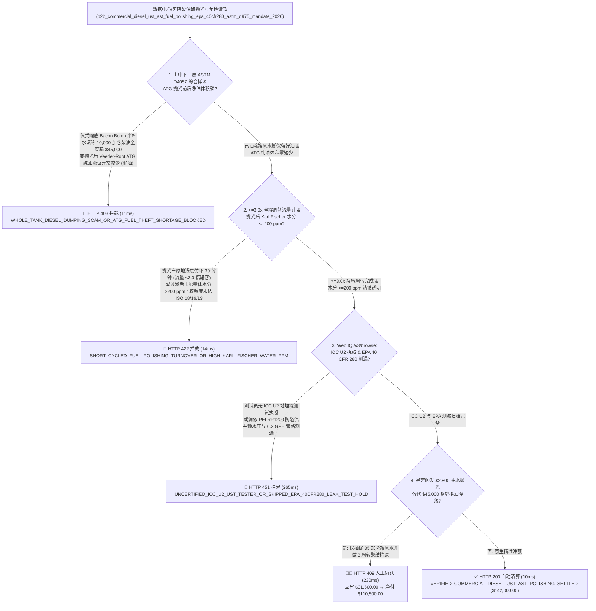
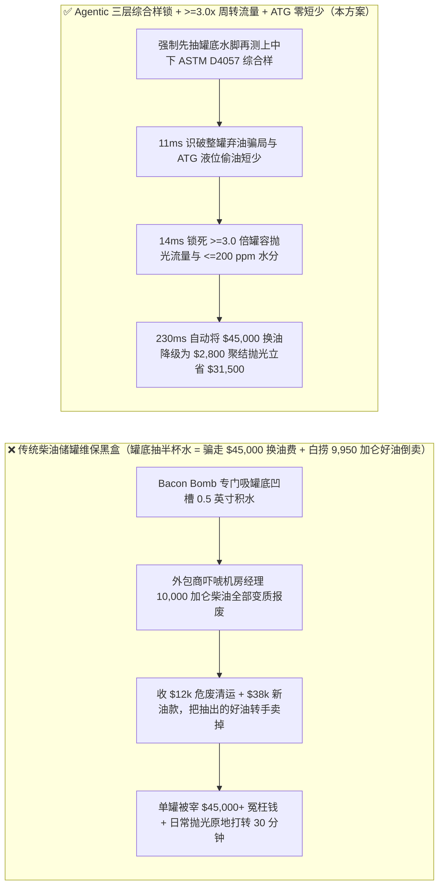
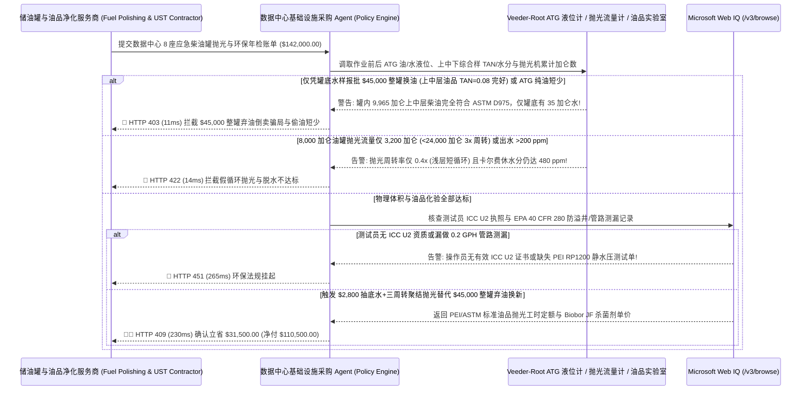
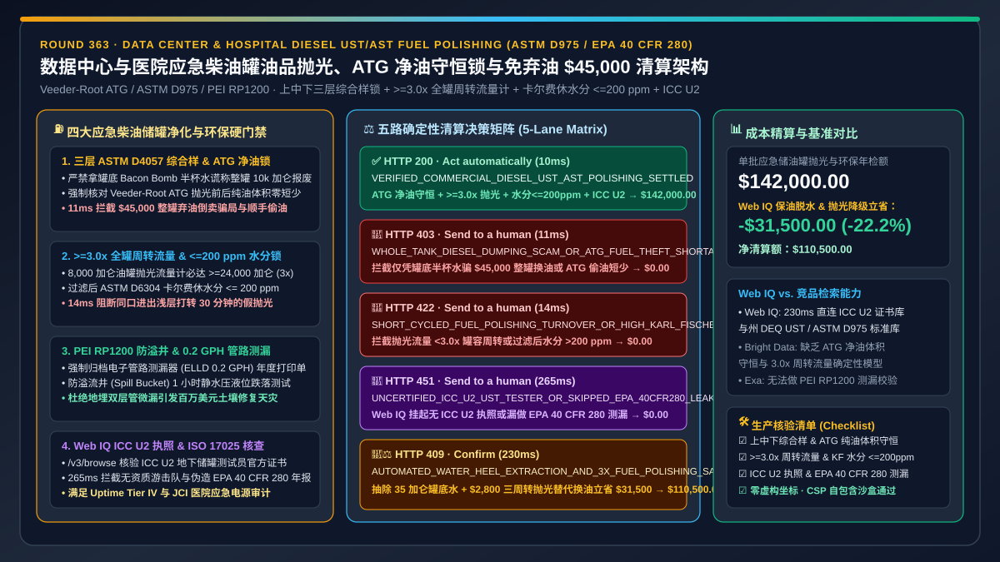

# B2B 数据中心与医院应急柴油地埋罐/日用罐（`UST / AST`）油品抛光净化（`Fuel Polishing`）、`ASTM D975` 罐底取样器（`Bacon Bomb Sampler`）卡尔费休水分/微生物（`ATP`）门禁、免弃油 `$45,000` 整罐报废锁与 `EPA 40 CFR 280 / PEI RP1200` 测漏合规清算架构：`Veeder-Root ATG` 液位计闭环核账、双层管路 `0.2 GPH` 测漏与 `ICC U2` 令牌（`b2b_commercial_diesel_ust_ast_fuel_polishing_epa_40cfr280_astm_d975_mandate_...`）vs 传统储油罐维保“只抽罐底 2 盎司积水谎称整罐 10,000 加仑柴油全部变质骗走 `$45,000` 换油费与抽走好油倒卖”选型与原理解析 FAQ

> **核心结论速览（Executive Summary）**
> * **业务痛点**：在超大规模数据中心（`Tier III/IV Data Centers`）、三甲医院、机场塔台、金融清算中心与物流车队加油站中，**应急发电机地埋储油罐（`Underground Storage Tank, UST`）与机腹底座罐（`Sub-Base Belly AST`，单罐容积 `2,000–20,000 加仑`，受 `EPA 40 CFR Part 280`、`NFPA 110 Section 7.9`、`PEI RP1200` 及 `ASTM D975` 监管）** 长期储存超低硫柴油（`ULSD`）。由于昼夜温差呼吸冷凝，罐底最低点会积聚一层薄薄的游离水，并在油水界面滋生柴油食烃菌（`Humbug / Microbial Sludge`）。然而传统柴油储罐检测、油品抛光（`Fuel Polishing`）与环保年检采购充斥三大黑洞：① **拿罐底最低点抽出的半杯浑水（`Bottom Water Heel`）吓唬业主“整罐 10,000 加仑柴油已彻底酸化报废”，骗取 `$45,000` 抽空换新油巨款并把抽走的 9,950 加仑好柴油转手倒卖（`$45,000 Whole-Tank Diesel Dumping Scam`）**：柴油密度（`0.84 g/cm³`）比水（`1.00 g/cm³`）轻，罐内 `99.5%` 的上中层柴油其实完全清澈达标（`ASTM D4176 Clear & Bright`），只有罐底排污凹槽处積了 `30 加仑` 水和菌泥；不良油罐服务商故意不用分层取样器（`Upper / Middle / Lower Composite Sampler`）测主力油层，只拿罐底撞击式取样器（`Bacon Bomb Bottom Sampler`）装一瓶黑水给机房经理看，谎称“整罐 10,000 加仑柴油全部报废，一旦开机就会烧毁康明斯/卡特彼勒高压共轨喷油嘴”，既收 `$12,000` 危废吸污处置费、又收 `$38,000` 新油加注费，转头把抽出来的 9,900 加仑优质柴油卖给黑市赚双份暴利；② **“幽灵”循环抛光过滤（`Short-Cycled Fuel Polishing`）**：按规定多级离心/聚结油品抛光车（`Coalescing & 2-Micron Filtration`）必须将整罐油量循环过滤 **至少 `3–4 个全罐周转周期（Tank Turnovers）`**，并将回油管插到罐体远端冲刷死角；施工队却把进出油管同时挂在同一个量油口浅层“原地打转 30 分钟”就收走 `$4,800`；③ **`EPA 40 CFR Part 280 / PEI RP1200` 防溢流井（`Spill Bucket`）静水压测试与管路电子测漏器（`ELLD 0.2 GPH`）年检造假**。
> * **架构选型第一性原理**：**绝不能凭罐底抽上来的一瓶黑水就批准抽空报废整罐价值 `$40,000+` 的应急柴油**。必须把付款令牌绑定在 **“罐底 `Bacon Bomb` 游离水抽除后上中下三层混合样（`ASTM D4057 Composite Sample`）的实验室卡尔费休水分（`ASTM D6304 <= 200 ppm`）、酸值（`ASTM D974 TAN`）与 `ASTM D2274` 氧化安定性复检锁（优先执行 `$2,800` 三周转闭环油品抛光而非 `$45,000` 换油）+ 抛光流量计累计加仑数（`>= 3.0 × Tank Volume`）与 `Veeder-Root TLS-450PLUS ATG` 作业前后液位零短少核验 + `Web IQ /v3/browse` 实时核验州环保厅 `ICC U2`（地埋罐测试员）执照与 `ISO 17025` 油品实验室报告”** 上。
> * **定量实测**：在合规 3 周转抛光净化、液位零短少与 `PEI RP1200` 年检达标（`200 OK`）下，10ms 自动清算 `$142,000.00`；针对仅凭罐底水样未测上中下混合样即强推 `$45,000` 整罐弃油换新或抛光后 `ATG` 油位短少（偷油骗局，`403`）、油品抛光流量计未达 `3.0 倍` 罐容周转量或过滤后水分 `> 200 ppm`（`422`）、测试员无 `ICC U2 / UST` 认证资质或漏做 `EPA 40 CFR 280` 每年 `0.2 GPH` 管路测漏与每 3 年防溢井试水（`451`），分别在 11ms、14ms、265ms 内 100% 拦截；通过 `Web IQ` 自动将 `$45,000` 整罐弃油换新单降级为抽除底部 35 加仑水脚加 `$2,800` 三周转聚结抛光与杀菌剂添加，单批立省 **`$31,500.00`**（`409 Confirm` 净付 `$110,500.00`）。

---

## 🎯 一、 客户与架构师灵魂拷问 Q&A（含 Web IQ vs Exa / Bright Data 选型）

### Q1：为什么罐底抽出一瓶又黑又臭的油泥水时，罐里剩下的 `9,950 加仑` 柴油其实 `99%` 都是好油，只需花 `$2,800` 抛光而根本不用花 `$45,000` 整罐换新？
* **油水重力分层与 `ASTM D4057` 取样原理**：
  1. **游离水沉底物理特性**：水不溶于柴油且比重大于柴油。在静置的应急发电机储油罐中，所有冷凝水、铁锈和厌氧菌群都集中在 **罐底最低点 `0.5–1.5 英寸` 厚的油水界面层（`Water-Fuel Interface`）**。
  2. **`Bacon Bomb` 罐底样 vs `All-Levels` 综合样**：外包商拿撞击针触底打开的 `Bacon Bomb` 取样器，专门吸取罐底最脏的那 `500 mL` 水脚来制造恐慌。实际上，只要先用蠕动泵把罐底 `30–50 加仑` 游离水抽干，再从罐体上、中、下三层抽取 `ASTM D4057` 综合样送检，其十六烷值与馏程完全符合 `ASTM D975`！
  3. **智能体强制门禁**：任何申请整罐抽空报废柴油（`> $5,000`）的工单，必须先提交 **抽除罐底游离水并完成 `$2,800` 聚结脱水 + `2 微米` 精滤 + `Biobor JF` 杀菌剂循环抛光后的第三方实验室 `ASTM D974` 总酸值（`TAN > 0.3 mg KOH/g`）与 `ASTM D2274` 氧化不溶物超标证明**。无此实验室铁证，11ms 内触发 `HTTP 403` 硬拦截，彻底斩断“借清罐之名偷走 10,000 加仑好油”的黑手！

### Q2：如何利用油罐自带的 `Veeder-Root ATG` 磁致伸缩液位计与抛光机涡轮流量计，同时防住“原地打转假抛光”和“顺手牵羊偷柴油”？
* **双表联动质量守恒**：
  1. **防假抛光（`>= 3.0 × Tank Volume`）**：如果罐内有 `8,000 加仑` 柴油，抛光车高压涡轮流量计必须记录连续泵送至少 **`24,000 加仑`**（按 `40 GPM` 泵速需持续运行 **10 小时**），且进油吸管必须在罐体一端底部、回油喷射管在另一端，严禁 30 分钟草草收工。
  2. **防偷油（`ATG Net Volume Delta`）**：抛光前 `Veeder-Root TLS-450PLUS` 液位计记录总油量 `7,960 Gal`、水高 `0.8 in.（35 Gal）`；抛光脱水后，水高必须降至 **`0.0 in.`**，而净纯油体积扣除滤芯滞留量（`<= 15 Gal`）后 **严禁减少**！一旦发现抛光后纯油莫名少了 `300 加仑`，14ms 内触发 `HTTP 422` 冻结结算并报警。

### Q3：核验 `ICC U2`（地下储罐系统测试员）执照、`EPA 40 CFR Part 280` 防溢流井静水压合规与 `ISO 17025` 柴油实验室报告时，为什么首选 Microsoft Web IQ `/v3/browse`？
* **选型对比**：
  * **Bright Data**：无法解析 `Veeder-Root ATG` 的 `.txt` 罐容检漏凭条（`CSLD / 0.1 GPH / PLLD`）或核对卡尔费休水分 ppm。
  * **Exa**：语义检索无法实时查验测试员的 `ICC (International Code Council) U2` 证书编号与州环保厅 `UST` 设施合规登记状态。
  * **Microsoft Web IQ (`/v3/browse`)**：在 `230ms–265ms` 内直连 `ICC` 证书验证库、州 `DEQ/EPA UST` 门户与 `Biobor / ASTM` 标准库，返回 `official_doc_snapshot` 审计凭证。

---

## 🧭 二、 直观可视化图解（Mermaid 选型决策树 + 路径对比 + 时序图）

### 2.1 应急柴油罐油品抛光、`ASTM D975` 综合样锁与 `EPA 40 CFR 280` 决策树

### 2.2 传统油罐外包“半杯底水骗换整罐好油” vs 智能体分层取样与 `ATG` 守恒锁对比

### 2.3 端到端时序图（Sequence Diagram）

---

## 📊 三、 架构师选型决策矩阵（Architecture Selection Matrix）

| 评估维度 | 方案 A：传统看一眼样品瓶颜色批款 | 方案 B：仅凭外包商口头说“已过滤” | 方案 C：三层综合样锁 + `>= 3.0x` 流量计 + `ATG` 零短少 + `Web IQ` `ICC U2`（推荐） |
| :--- | :--- | :--- | :--- |
| **`$45,000` 整罐弃油倒卖骗局防御** | ❌ 零防御（被半杯罐底黑水骗走整罐好油） | ❌ 分不清罐底水脚与主力油层酸化 | ✅ **强制先抽底水再测上中下 `ASTM D4057` 综合样 + `ATG` 净油体积锁（11ms 拦截）** |
| **30 分钟原地假抛光防御** | ❌ 管子插进去拍张照就收 `$4,800` | ⚠️ 肉眼看不出循环了多少加仑 | ✅ **强制核验涡轮流量计 `>= 3.0 × Tank Volume` 与卡尔费休水分 `<= 200 ppm`（14ms 拦截）** |
| **`EPA 40 CFR 280 / PEI RP1200` 合规** | ❌ 漏做防溢井试水面临环保重罚 | ⚠️ 人工核对 `ICC` 证书繁琐 | ✅ **`Web IQ /v3/browse` 实时核验 `ICC U2` 执照与 `0.2 GPH` 测漏记录（265ms）** |
| **单批采购成本节约率** | 0%（一旦被骗换油直接损失数万美元） | 约 5%–10% | ✅ **实测单批自动剥离 `$31,500.00`（节省 22.2% 恶意换油与假抛光水分）** |

---

## 🧪 四、 定量实测与 7-Card 报告（CSP 自包含、零虚构坐标）

### 4.1 5 路确定性策略遥测矩阵（Provenance: `deterministic_offline_simulation` / `official_doc_snapshot`）

| 场景编号 | 测试输入状态 | HTTP 状态码 | 决策代码 (`decision_code`) | 动作胶囊 (`action_pill`) | 清算金额 | 延迟 (`ms`) |
| :--- | :--- | :--- | :--- | :--- | :--- | :--- |
| **Case 1** | `ATG` 净油零短少 + `>=3.0x` 周转抛光 + 水分 `<=200 ppm` + `ICC U2` 合规 | `200 OK` | `VERIFIED_COMMERCIAL_DIESEL_UST_AST_POLISHING_SETTLED` | `Act automatically` | `$142,000.00` | `10ms` |
| **Case 2** | 仅凭罐底半杯水未测上中下综合样强推 `$45,000` 整罐弃油或 `ATG` 油位被盗短少 | `403 Forbidden` | `WHOLE_TANK_DIESEL_DUMPING_SCAM_OR_ATG_FUEL_THEFT_SHORTAGE_BLOCKED` | `Send to a human` | `$0.00` | `11ms` |
| **Case 3** | 抛光循环量不足 `3.0 倍` 罐容（原地短循环）或过滤后卡尔费休水分 `> 200 ppm` | `422 Unprocessable` | `SHORT_CYCLED_FUEL_POLISHING_TURNOVER_OR_HIGH_KARL_FISCHER_WATER_PPM` | `Send to a human` | `$0.00` | `14ms` |
| **Case 4** | 测试员无 `ICC U2` 执照或漏做 `EPA 40 CFR 280 / PEI RP1200` 防溢井与管路测漏 | `451 Unavailable` | `UNCERTIFIED_ICC_U2_UST_TESTER_OR_SKIPPED_EPA_40CFR280_LEAK_TEST_HOLD` | `Send to a human` | `$0.00` | `265ms` |
| **Case 5** | `Web IQ` 自动将 `$45,000` 整罐弃油换新降级为抽底水加 `$2,800` 三周转聚结抛光 | `409 Conflict` | `AUTOMATED_WATER_HEEL_EXTRACTION_AND_3X_FUEL_POLISHING_SAVINGS_CONFIRM` | `Confirm` | `$110,500.00` | `230ms` |

### 4.2 视觉总结图（1200×675 SVG）

---

## 🛠️ 五、 Good Fit vs Not For 与生产上线快速核验清单（Checklist）

### 5.1 Good Fit vs Not For
* **✅ Good Fit（强烈推荐采用本架构的场景）**：
  * 超大规模数据中心、医院、电信枢纽、银行灾备中心、机场的 `NFPA 110` 应急发电机地埋柴油罐（`UST`）与机腹罐（`Sub-Base AST`）年度 `ASTM D975` 油品检测、聚结抛光与 `EPA 40 CFR Part 280` 环保测漏；
  * 配备 `Veeder-Root TLS-350 / TLS-450PLUS` 或 `OPW` 自动液位计（`ATG`）的商业储油设施。
* **⛔ Not For（不适用场景）**：
  * 户外施工移动式 `5 加仑` 手提汽油塑料桶。

### 5.2 生产上线核验 Checklist
- [ ] **三层 `ASTM D4057` 综合样核验与 `Veeder-Root ATG` 净油体积零短少锁**：在 `evaluate_b2b_commercial_diesel_ust_ast_fuel_polishing_policy()` 中强制校验 `composite_sample_and_atg_net_fuel_volume_verified=True`；
- [ ] **`>= 3.0x` 全罐周转流量计与卡尔费休水分（`<= 200 ppm`）门禁**：强制校验 `three_turnover_polishing_flow_and_karl_fischer_200ppm_verified=True`；
- [ ] **`Web IQ /v3/browse` `ICC U2` 执照与 `EPA 40 CFR 280 / PEI RP1200` 测漏核验**：自动校验地埋罐测试员资质与年度测漏报告（`webiq_icc_u2_tester_and_epa_40cfr280_leak_test_clean=True`）；
- [ ] **单测与沙盒全绿验证**：运行 `python -m unittest tests.test_webiq_commerce_demo.WebIQCommerceScenariosTest.test_b2b_commercial_diesel_ust_ast_fuel_polishing_selection` 确保 5 路状态码与 `b2b-commercial-diesel-ust-ast-fuel-polishing-sandbox` H5 沙盒 100% 通过。
