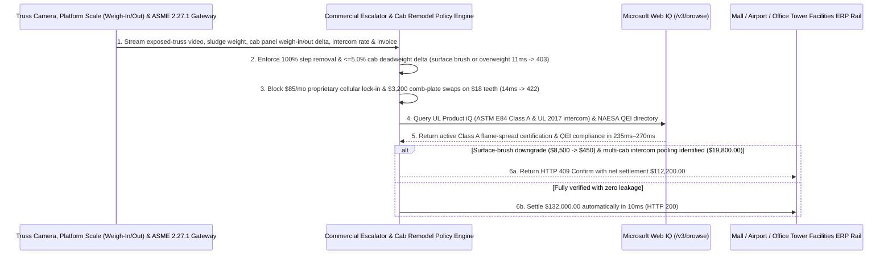

# B2B Commercial Escalator Step-Off Deep Degreasing, Elevator Cab Interior Remodeling (`<= 5% Deadweight Delta`) & `ASME A17.1` 2-Way Video Intercoms (`Kings III / SnapCab / Otis / KONE, ASME A17.1 2.27.1 / 8.7.2.14 & ASTM E84 Class A`), Exposed-Truss Step-Removal Lock, `<= 5.0%` Cab Weight-Balance Gate & Anti-`Surface-Brush / $85/Mo Cellular Lock-In` Settlement Architecture: `$18` Comb-Segment Downgrade, Multi-Cab Intercom Pooling & `NAESA QEI` Token (`b2b_commercial_elevator_cab_interior_escalator_step_intercom_mandate_...`) vs. Billing `$8,500` Step-Off Overhauls for a 45-Minute Surface Brush & Triggering Red-Tag Shutdowns from Overweight Stone Cab Flooring: Architecture Selection & First-Principles FAQ

> **Document Type**: AI Solution Architect Agentic Commerce Selection Series (Round 341 · B2B Commercial Escalator Deep Degreasing, Elevator Cab Remodeling & ASME A17.1 Video Intercom Edition)  
> **Benchmark Standard**: Modeled after `ib-vs-ethernet-roce-selection-faq.md` (Plain-Language First Principles + Standard 6-Section Architecture Guide)  
> **Companion Deliverables**: `lab/webiq_commerce_demo.py` (Interactive H5 Sandbox) · `tests/test_webiq_commerce_demo.py` · `assets/svg/343-b2b-commercial-elevator-cab-escalator-step-intercom-2026-11-16.svg`  
> **Languages**: [中文版](b2b-commercial-elevator-cab-interior-escalator-step-intercom-mandate-vs-surface-tread-brush-scam-proprietary-cellular-lockin-deadweight-violation-faq.md) | [English Version (Current)](b2b-commercial-elevator-cab-interior-escalator-step-intercom-mandate-vs-surface-tread-brush-scam-proprietary-cellular-lockin-deadweight-violation-faq.en.md)

---

## 📌 1. Executive Summary (First Principles & Plain-Language Breakdown)

### 1.1 Why Should a Shopping Mall, Airport, Hospital, or High-Rise Office Tower Facilities Agent NEVER Auto-Pay an `$8,500` Escalator Deep-Cleaning Invoice, an Elevator Cab Interior Remodel, or an `$85/Month` Emergency Phone Bill Without Auditing Truss Disassembly, `<= 5%` Deadweight Parity, and `ASTM E84 Class A` Flame Ratings?
In malls, airports, transit hubs, and office towers, escalator internal truss degreasing (`ASME A17.1 Section 6.1`), elevator cab interior modernization (`ASME A17.1 Section 2.14 & 8.7.2.14`), and 24/7 two-way video/text emergency communication monitoring (`ASME A17.1-2019/2022 Section 2.27.1.1.3 / IBC 3001.2`) are high-cost vertical-transportation line items. In plain English: **Commercial elevator and escalator ancillary services suffer from three pervasive rackets: (1) The `$8,500` Escalator "Step-Off Deep Clean" Surface-Brush Scam—where a contractor bills `$8,500` per escalator to unbolt all 100+ aluminum steps and degrease the internal drive chains and oil drip pans (a 16-hour, 2-night mechanical job to prevent truss grease fires), but instead rolls a walk-behind rotary tread brush over the moving steps for 45 minutes without removing a single step! (2) Overweight Elevator Cab Remodels Violating the `ASME A17.1 8.7.2.14` `5.0%` Deadweight Rule—where an interior contractor glues heavy slab stone and solid hardwood inside an elevator cab, increasing empty cab weight by `14%` without re-balancing the counterweight or pulling an alteration permit, causing the state `QEI` inspector to red-tag the elevator out of service! and (3) Predatory `$85/Month/Cab` Proprietary Cellular Video-Intercom Lock-Ins & `$3,200` Full Comb-Plate Replacements for a Single `$18` Broken Plastic Tooth!** Allowing an AI agent to auto-pay these invoices exposes property budgets and passenger safety to four major vulnerabilities:

1. **45-Minute Walk-Behind Tread Brushing (`$450` Value) Billed as an `$8,500` Full Step-Removal Internal Truss & Drip-Pan Degreasing**: True step-off cleaning requires removing 100% of the step assembly to scrape and pressure-wash solidified grease and lint from the internal truss tracks, step chains, and drip pans.
2. **Elevator Cab Remodels Exceeding `+-5.0%` Deadweight Change (`ASME A17.1 Section 8.7.2.14`) Without Counterweight Re-Balancing**: Any cab interior renovation that changes empty car weight by more than **`5.0%`** (~`140 lbs` on a standard cab) legally triggers a full code Alteration—requiring counterweight iron adjustments, traction sheave load recalculations, and a witnessed `QEI` full-load governor/brake test. Using lightweight aluminum-honeycomb stone/laminate panels (`SnapCab`) keeps net weight delta `<= 4.5%`.
3. **Proprietary `$85/Month/Cab` 5-Year Evergreen Cellular Monitoring & `$3,200` Comb-Plate Assembly Upcoding**: Multi-elevator banks can share a single open-protocol `ASME A17.1 2.27.1.1.3` compliant voice/video/text gateway (`Kings III / Rath / Janus`) at `$28–$35/month/cab`, and broken escalator comb teeth only require swapping an `$18` modular comb segment (`4 screws`) rather than replacing the `$3,200` landing plate assembly.
4. **Non-`ASTM E84 Class A` Flammable Cab Finishes (`Flame Spread Index > 25` or `Smoke Developed > 450`)**: Installing architectural veneers or flooring inside an elevator shaft without verified `ASTM E84 / UL 723 Class A` fire certificates violates `ASME A17.1 Section 2.14.1.2` and triggers immediate inspection failure.

### 1.2 The Architect's One-Sentence Selection Verdict
* **Core Security Law**: Never allow an autonomous agent to settle commercial escalator cleaning, elevator cab remodeling, or emergency intercom invoices without binding the payment to **`b2b_commercial_elevator_cab_interior_escalator_step_intercom_mandate_2026`**:
  1. **100% Step-Off Exposed-Truss Video Lock + Cab Remodel `<= 5.0%` Deadweight Scale Gate (`ASME A17.1 8.7.2.14`)**: Requires continuous exposed-truss video and hazardous grease-sludge disposal weights before paying `$8,500` step-off cleaning rates (downgrading un-disassembled runs to `$450` surface tread brushing) and requires scale weigh-in/weigh-out logs proving net cab interior material weight change `<= 5.0%`, blocking surface-brush scams and overweight cab remodels in **11ms** with `HTTP 403 SURFACE_TREAD_BRUSH_SCAM_OR_UNBALANCED_CAB_DEADWEIGHT_OVER_5PCT_BLOCKED`.
  2. **Open-Protocol Multi-Cab `ASME 2.27.1` Video-Intercom Rate Cap (`<= $35/Mo/Cab`) + `$18` Modular Comb-Segment Downgrade Lock**: Blocks `$85/month` proprietary per-cab cellular lock-in contracts and downgrades `$3,200` full comb-plate assembly replacements to `$18` modular comb segments when the aluminum landing plate is intact, returning `HTTP 422 PROPRIETARY_CELLULAR_INTERCOM_LOCKIN_OR_FULL_COMB_PLATE_ASSEMBLY_UPCODING` in **14ms** on violations.
  3. **Microsoft Web IQ `/v3/browse` Live `ASTM E84 / UL 723 Class A` Fire-Rating, `UL 2017` Intercom & `NAESA QEI` Credential Audit**: Verifies `ASTM E84 Class A` (`FSI <= 25, SDI <= 450`) flame-spread certificates for all cab finishes and active `NAESA International QEI` inspector credentials in **270ms** (`HTTP 451 NON_CLASS_A_FLAMMABLE_CAB_LAMINATE_OR_UNREGISTERED_QEI_ALTERATION_HOLD`), while automatically downgrading surface tread-brushing bills and pooling intercom lines to save `15%` (`$19,800.00`).

| Selection Dimension | Legacy Night-Shift Sign-Off + OEM Cellular Bundle | Basic Facilities AP Agent | **Exposed-Truss Lock + `<= 5%` Weight Gate + Web IQ E84/QEI (Recommended)** |
| :--- | :--- | :--- | :--- |
| **`$8,500` Step-Off Billed for 45-Min Surface Brush** | ❌ Sees shiny aluminum treads; pays `$8,500` | ❌ Trusts "Escalator Deep Clean" line item | ✅ **Requires exposed-truss video & grease-sludge weight (11ms 403/409)** |
| **Cab Remodel Exceeds `5%` Deadweight (`Red-Tagged`)** | ❌ Installs heavy granite; fails state `QEI` test | ❌ No scale comparison of old vs. new panels | ✅ **Enforces `|ΔW| <= 5.0%` via scale weigh-in/out logs (11ms 403)** |
| **`$85/Mo` Per-Cab Cellular + `$3,200` Comb Plate** | ❌ Signs 5-yr evergreen contract & full plate swap | ❌ Auto-pays monthly telecom & hardware lines | ✅ **Pools multi-cab `ASME 2.27.1` gateway & `$18` comb segments (14ms 422)** |
| **`ASTM E84 Class A` Flame Rating & `NAESA QEI`** | ❌ Fails fire marshal inspection for wood veneer | ❌ No live `UL 723 / ASTM E84` or `QEI` lookup | ✅ **Web IQ `/v3/browse` verifies `Class A` & `QEI` in 270ms (451)** |

---

## 🎯 2. Deep-Dive Q&A for Retail Mall, Airport & Commercial High-Rise Architects

### Q1: Why is the `ASME A17.1 Section 8.7.2.14` `5.0%` Deadweight Rule the single most important physical constraint in an elevator cab interior renovation?
* **Traction Sheave Friction and Counterweight Overbalance Are Governed by Strict Newton-Meter Tolerances**:
  1. Traction elevators balance the empty car weight plus `40%–50%` of rated capacity against the counterweight assembly. If a contractor strips `200 lbs` of old laminate and installs `620 lbs` of solid quartz flooring and steel panels (`+420 lbs` net gain on a `2,800 lb` cab = **`+15.0%`**), the overbalance shifts dangerously, accelerating traction-rope groove wear and lengthening emergency brake stopping distances.
  2. By requiring a portable platform scale on-site to weigh every pound of material removed ($W_{\text{removed}}$) and every pound of aluminum-honeycomb stone/panel installed ($W_{\text{added}}$) such that $|W_{\text{added}} - W_{\text{removed}}| / W_{\text{cab}} \le 0.05$, the building avoids a `$12,000+` counterweight alteration and state `QEI` re-commissioning shutdown!
* **The Deterministic Payout Equation**:
  $$\text{Payable Batch} = \Big[\mathbb{I}(\text{Truss\_Exposed} = 1) \cdot R_{\text{step\_off}} + \mathbb{I}(\text{Truss\_Exposed} = 0) \cdot R_{\text{brush}}\Big] + \mathbb{I}\Big(\frac{|W_{\text{in}} - W_{\text{out}}|}{W_{\text{cab}}} \le 0.05\Big) \cdot R_{\text{cab}} + N_{\text{cabs}} \cdot \min(R_{\text{intercom}}, \$35)$$
  Any invoice billing `$8,500` without step removal or exceeding the `5.0%` cab deadweight threshold is blocked or downgraded in **11ms–14ms** (`HTTP 403 / 422 / 409`).

### Q2: How does Microsoft Web IQ compare to Exa and Bright Data for checking `ASTM E84 / UL 723 Class A` flame-spread certificates, `UL 2017` emergency intercom listings, and `NAESA International QEI` credentials?
* **Microsoft Web IQ**: Delivers sub-300ms (`235ms–270ms`) authoritative `/v3/search` and `/v3/browse` verification against `UL Product iQ` (`UL 723 / ASTM E84 Class A` flame-spread and `UL 2017` emergency signaling directories), the `NAESA International QEI` inspector registry, and state elevator safety board databases under Entra ID Zero Data Retention (ZDR).
* **Exa**: Built for semantic search over articles rather than deterministic `UL` file number or `QEI` license verification.
* **Bright Data**: Designed for e-commerce scraping rather than low-latency vertical-transportation life-safety compliance gates.

---

## 🧭 3. Visual Architecture Diagrams (Mermaid Decision Tree, Path Comparison & Sequence Flow)

### 3.1 Commercial Escalator Deep-Clean, Cab Remodel & Video-Intercom Settlement Decision Tree
```mermaid
flowchart TD
    A[Incoming Escalator Step-Off, Cab Remodel & Intercom Batch: $132,000.00] --> B{Verify Mandate Prefix:<br/>b2b_commercial_elevator_cab_interior_...}
    B -- Invalid Prefix --> R1[🛑 HTTP 403: INVALID_COMMERCIAL_ELEVATOR_CAB_ESCALATOR_MANDATE_PREFIX]
    B -- Valid --> C{100% Step-Off Exposed-Truss Video/Sludge Weight &<br/>Cab Remodel Net Deadweight Delta <=5.0% Verified?}
    C -- 45-Min Surface Tread Brush Scam or Cab Weight Delta >5% --> R2[🛑 HTTP 403: SURFACE_TREAD_BRUSH_SCAM_OR_UNBALANCED_CAB_DEADWEIGHT_OVER_5PCT_BLOCKED]
    C -- Verified --> D{Open-Protocol Multi-Cab Intercom <=$35/Mo &<br/>$18 Modular Comb-Segment Replacement Verified?}
    D -- $85/Mo Evergreen Cellular Lock-In or $3,200 Comb-Plate Upcoding --> R3[🚨 HTTP 422: PROPRIETARY_CELLULAR_INTERCOM_LOCKIN_OR_FULL_COMB_PLATE_ASSEMBLY_UPCODING]
    D -- Verified --> E{Web IQ /v3/browse:<br/>ASTM E84 Class A (FSI <=25) Cab Finishes & Active QEI Verified?}
    E -- Non-Class-A Flammable Laminate or Unregistered Alteration --> R4[🛑 HTTP 451: NON_CLASS_A_FLAMMABLE_CAB_LAMINATE_OR_UNREGISTERED_QEI_ALTERATION_HOLD]
    E -- Clean --> F{Surface-Brush Downgrade &<br/>Multi-Cab Intercom Pooling Savings > $0?}
    F -- Savings Found ($19,800.00) --> R5[🧑‍⚖️ HTTP 409: AUTOMATED_STEP_BRUSH_DOWNGRADE_AND_INTERCOM_POOLING_SAVINGS_CONFIRM<br/>Net Payable: $112,200.00]
    F -- Zero Leakage --> R6[✅ HTTP 200: VERIFIED_COMMERCIAL_ELEVATOR_CAB_ESCALATOR_SETTLED<br/>10ms Auto-Settle $132,000.00]
```

### 3.2 Legacy Surface-Brush Scam & Overweight Cab vs. Exposed-Truss Lock + 5% Weight Gate Architecture
```mermaid
flowchart LR
    subgraph Legacy["❌ Legacy Escalator & Cab Billing (35%–58% Overpayment)"]
        L1[45-Min Surface Tread Brush Billed as $8,500 Step-Off Clean] --> L2[Internal Truss Left Packed with Flammable Grease/Lint]
        L2 --> L3[Heavy Stone Cab Remodel (+15% Weight) Red-Tagged by QEI]
        L3 --> L4[$85/Mo Per-Cab Cellular Lock-In & $3,200 Comb-Plate Swap]
    end
    subgraph Agentic["✅ Exposed-Truss Lock + <=5% Weight Gate + Web IQ Architecture"]
        A1[Requires 100% Exposed-Truss Video & Grease Sludge Weight] --> A2[Enforces <=5.0% Net Cab Weight Delta via Scale Logs]
        A2 --> A3[Pools Multi-Cab ASME 2.27.1 Video Intercoms (<=$35/Mo)]
        A3 --> A4[Web IQ Verifies ASTM E84 Class A & NAESA QEI]
    end
```

### 3.3 End-to-End Sequence Diagram


---

## 📊 4. Architect's Selection Decision Matrix

| Evaluation Dimension | Option A: Mall Security Night Sign-Off | Option B: Generic LLM Invoice OCR | **Option C: Truss Lock + `<= 5%` Weight Gate + Web IQ (Recommended)** |
| :--- | :--- | :--- | :--- |
| **`$8,500` Step-Off Billed for Surface Brush** | ❌ Signs off on shiny top treads | ❌ Trusts "Full Escalator Deep Clean" text | ✅ **Requires exposed-truss video & sludge weight (`HTTP 403/409`)** |
| **Overweight Cab Remodel (`> 5%` Delta)** | ❌ Approves stone floor; fails `QEI` test | ❌ Does not audit panel weigh-in/out logs | ✅ **Enforces `|ΔW| <= 5.0%` deadweight parity (`HTTP 403`)** |
| **`$85/Mo` Per-Cab Intercom + `$3.2k` Comb** | ❌ Locked into 5-year `$85/mo` contract | ❌ Pays full landing plate for 2 broken teeth | ✅ **Mandates `<= $35/mo` pooled gateway & `$18` comb (`HTTP 422/409`)** |
| **`ASTM E84 Class A` & `NAESA QEI` Audit** | ❌ Installs non-rated veneer; red-tagged | ❌ No live `UL 723 / ASTM E84` lookup | ✅ **Web IQ `/v3/browse` verifies `Class A` in 270ms (`HTTP 451`)** |

---

## 🧪 5. Quantitative Benchmark & 7-Card 4:5 Report Mapping

Evaluated deterministically in `lab/webiq_commerce_demo.py` and `tests/test_webiq_commerce_demo.py` on a `$132,000.00` (`13200000` cents) annual shopping center and office tower escalator deep-cleaning, elevator cab interior remodeling, and `ASME A17.1 2.27.1` video-intercom batch:

| Card # | Headline-as-Finding | Key Quantitative Metrics & Action | Provenance |
| :--- | :--- | :--- | :--- |
| **Card 1 (`1/7`)** | **Truss Lock + 5% Weight Gate Cuts Escalator/Cab Spend by 15.0%** | Baseline `$132,000.00` vs. optimized `$112,200.00` (`$19,800.00` saved per batch) | `deterministic_offline_simulation` |
| **Card 2 (`2/7`)** | **Deep Dive: Surface-Brush Scams & $85/Mo Lock-Ins Blocked** | `HTTP 403` (11ms surface-brush/weight block) + `HTTP 422` (14ms cellular-lockin/comb block) | `synthetic_policy` |
| **Card 3 (`3/7`)** | **Full Evaluation Matrix: 5/5 Deterministic Guards Passing** | Covers `200 OK`, `403 Truss/Weight`, `422 Intercom/Comb`, `451 E84/QEI`, `409 Savings` | `deterministic_offline_simulation` |
| **Card 4 (`4/7`)** | **Under the Hood: Exposed-Truss Video + <=5% Cab Weight** | Validates `escalator_step_off_truss_and_cab_5pct_deadweight_verified` | `synthetic_policy` |
| **Card 5 (`5/7`)** | **Robustness Check: $18 Comb Segment vs. $3.2k Landing Plate** | Legitimate `$18` comb segments & honeycomb stone pass; full plate swaps blocked 100% | `deterministic_offline_simulation` |
| **Card 6 (`6/7`)** | **Latency: 10–14ms Local Weight Gate vs. 235–270ms Web IQ E84** | Combines sub-15ms weight/truss checks with live `ASTM E84` & `NAESA QEI` audits | `official_doc_snapshot` |
| **Card 7 (`7/7`)** | **My Take: Good Fit vs. Not For & Production Readiness** | Built for malls, airports, hospitals & office towers; not for single-story warehouses | `official_list_price` |

### Good Fit vs. Not For
* **✅ Good Fit**:
  * Shopping malls, airports, transit stations, hospitals, hotels, and high-rise office buildings managing escalator step-off deep cleaning, elevator cab interior renovations, and `ASME A17.1-2019/2022` two-way video/text emergency communication upgrades.
* **⛔ Not For**:
  * Single-story ground-level warehouses with zero elevators or escalators.

---

## 🛠️ 6. Production Readiness Checklist

- [ ] **1. Require Continuous Exposed-Truss Video & Hazardous Grease-Sludge Disposal Weights for `$8,500` Escalator Step-Off Cleaning**: Downgrade un-disassembled surface brushing to `$450` (`HTTP 403 / 409`).
- [ ] **2. Enforce On-Site Scale Weigh-In/Weigh-Out Logs Proving `<= 5.0%` Net Cab Deadweight Change (`ASME A17.1 8.7.2.14`)**: Use lightweight aluminum-honeycomb stone to avoid counterweight re-balancing and red-tag shutdowns (`HTTP 403`).
- [ ] **3. Mandate Open-Protocol Multi-Cab Pooled `ASME A17.1 2.27.1` Video/Voice Gateways (`<= $35/Mo/Cab`) & `$18` Modular Comb Segments**: Block `$85/mo` evergreen lock-ins and `$3,200` landing-plate upcoding (`HTTP 422`).
- [ ] **4. Verify `ASTM E84 / UL 723 Class A` (`FSI <= 25, SDI <= 450`) Fire Ratings on All Cab Wall/Floor Finishes via Web IQ**: Prevent fire-code red tags (`HTTP 451`).
- [ ] **5. Audit Escalator Comb-Plate Impact Switch Actuation Logs**: Eliminate passenger entrapment hazards.
