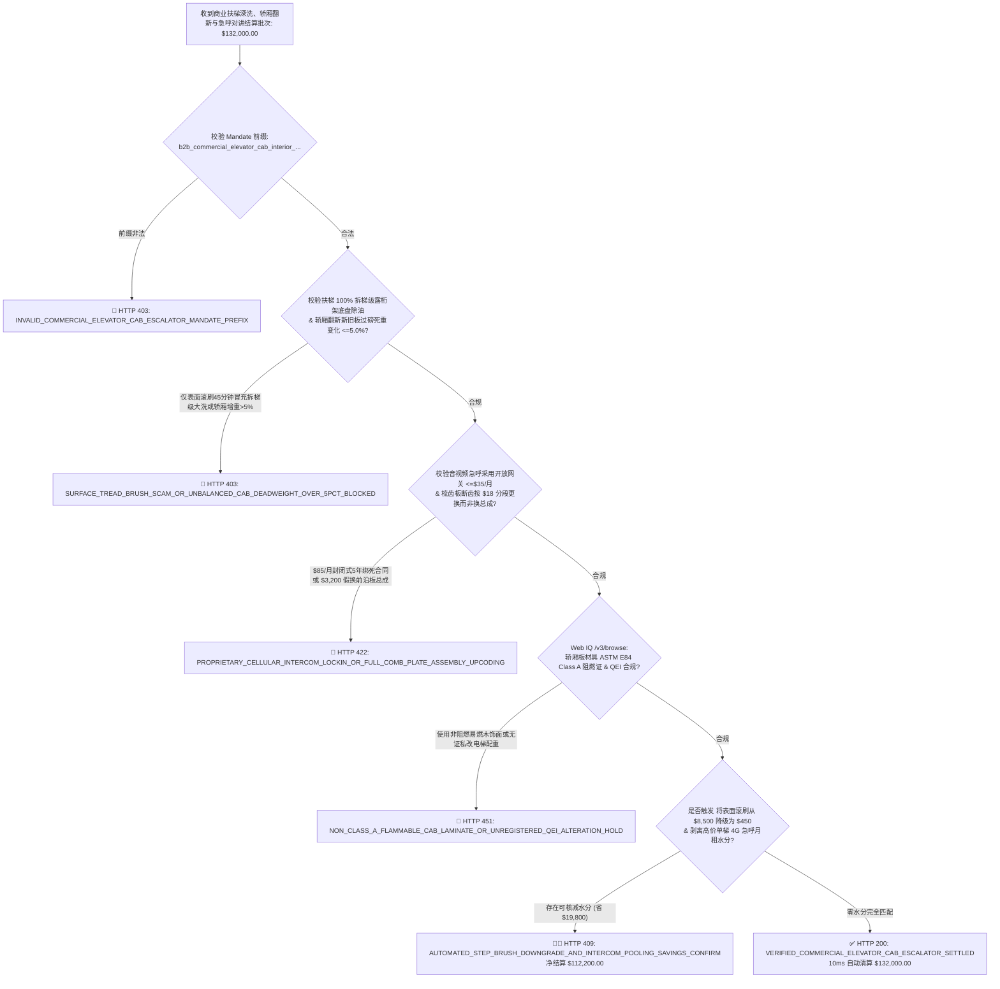
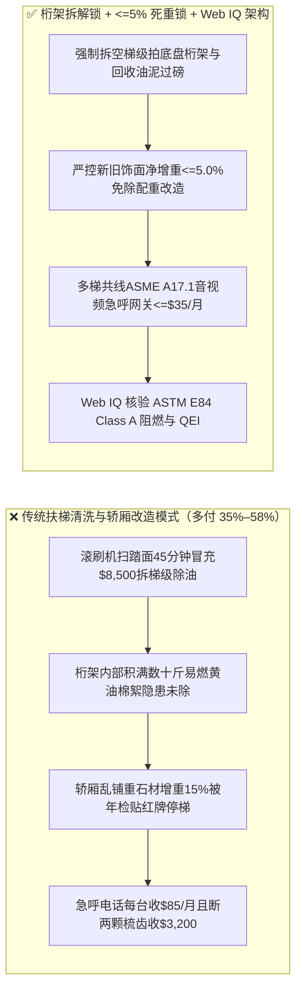
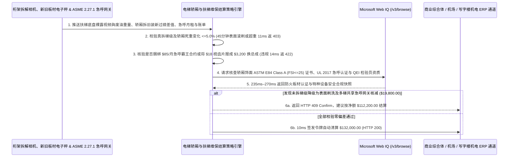

# B2B 商业扶梯拆梯级深层除油（`Escalator Step-Off Degreasing`）、电梯轿厢翻新配重（`Cab Interior Remodel <=5% Deadweight`）与五方应急音视频对讲结算（`Commercial Elevator Cab Refurbishment, Escalator Deep Cleaning & ASME A17.1 2-Way Video Intercom: Kings III / SnapCab / Otis / KONE, ASME A17.1 2.27.1 / 8.7.2.14 & ASTM E84 Class A`）、扶梯桁架内部RFID拆梯级锁、轿厢死重变化率（`<= 5%`）免重调对重块门禁与防“只拿滚刷扫扶梯踏面 45 分钟却按 `$8,500` 拆解 100 块梯级超声波除油收费、用 `$85/月` 原厂捆绑 5 年自动续约急呼对讲宰客”清算架构：桁架底盘除油视频锁、开放协议 `VoIP` 急呼并机门禁与 `ASTM E84` 令牌（`b2b_commercial_elevator_cab_interior_escalator_step_intercom_mandate_...`）vs 传统轿厢贴大理石超重未调对重致溜梯红牌停运与易燃木饰面违反防火规范选型与原理解析 FAQ

> **文档类型**：AI Solution Architect 商业智能体架构选型系列（Round 341 · B2B 商业扶梯拆梯级除油、电梯轿厢装潢配重与 ASME A17.1 音视频急呼专篇）  
> **对标标杆**：`ib-vs-ethernet-roce-selection-faq.md`（通俗大白话 + 第一性原理 + 标准六段式结构）  
> **关联 Deliverable**：`lab/webiq_commerce_demo.py`（H5 实时防篡改沙盒） · `tests/test_webiq_commerce_demo.py` · `assets/svg/343-b2b-commercial-elevator-cab-escalator-step-intercom-2026-11-16.svg`  
> **双语版本**：[中文版 (当前)](b2b-commercial-elevator-cab-interior-escalator-step-intercom-mandate-vs-surface-tread-brush-scam-proprietary-cellular-lockin-deadweight-violation-faq.md) | [English Version](b2b-commercial-elevator-cab-interior-escalator-step-intercom-mandate-vs-surface-tread-brush-scam-proprietary-cellular-lockin-deadweight-violation-faq.en.md)

---

## 📌 一、核心结论速览（Executive Summary：第一性原理与通俗大白话拆解）

### 1.1 为什么“绝对不能”让大型购物中心、机场航站楼、地铁枢纽、医院或甲级写字楼的工程采购 Agent 仅凭电梯维保商或装潢公司提交的“自动扶梯深度除油清洗单”、“轿厢豪华石材翻新单”或“每台每月 $85 的电梯急呼电话监测账单”就自动付款？
在商场、机场与高层写字楼中，自动扶梯桁架油泥火灾隐患清除（`ASME A17.1 Section 6.1`）、电梯轿厢内饰现代化翻新（`ASME A17.1 Section 2.14 & 8.7.2.14`）以及 `24/7` 应急双向音视频/文字报警系统（受最新 **`ASME A17.1-2019/2022 Section 2.27.1.1.3` / `IBC 3001.2`** 强制监管，要求不仅能语音通话，还必须具备视频查看轿厢地板乘客状态及听障人士文字交互功能）是物业机电采购的三大重头戏。用大白话讲：**这三项业务藏着外包界最隐蔽的三大猫腻：第一是“拿机器刷一下扶梯表面踏板 45 分钟，就按 `$8,500/台` 的‘全拆梯级超声波深层除油（Full Step-Off Deep Clean）’收钱”——商场扶梯真正致命的是藏在 100 多块铝合金梯级底下的主驱动链条、导轨和集油盘里厚达几厘米的易燃黄油棉絮混合物（一个烟头掉进去就会引发扶梯大火）；真正的深度清洗必须由技师连续两晚把 100 块梯级一颗颗拧下搬出、钻进底盘桁架刮除油泥；不良外包商半夜拿一台干式滚刷机在转动的扶梯表面刷 45 分钟（成本 `$350`），梯级一颗没拆，底盘油泥一点没动，却开出 `$8,500` 的全拆大洗账单！第二是“电梯应急电话与视频监控的 `$85/月` 霸王捆绑与 5 年自动续约陷阱”——趁着政府强制淘汰传统铜线电话（POTS 退网）并升级 `ASME A17.1` 视频对讲，原厂巨头强推 `$4,200/台` 的封闭式 4G 模块外加 `$85/台/月` 的通讯服务费（10 台电梯一年光电话费就交 `$10,200`！），而采用开放协议的多轿厢共线网关（`Kings III / Rath / Janus`）多梯共享同一张多网工业物联网卡，月费仅需 `$28–$35/台`！第三是“轿厢翻新乱铺厚重天然大理石，导致轿厢死重增加超过 `5%`（`ASME A17.1 8.7.2.14` 红线）”——装潢队不管电梯平衡系数，往轿厢地板铺几百斤石材，导致轿厢与对重块严重失衡、曳引钢丝绳打滑溜梯，年检时被特种设备检验员当场贴红牌停梯，还得再花 `$12,000` 请电梯厂重新配对重块和做满载制动试验！** 如果没有扶梯桁架内部 `RFID` 拆梯级验真锁、轿厢死重净增 `<= 5%` 平衡计算门禁与 `ASTM E84 Class A` 阻燃核验，商业地产会遭遇四大失血黑洞：

1. **用 `$350` 扶梯踏面干刷（`In-Place Surface Tread Brushing`）冒充 `$8,500` 拆梯级桁架底盘除油（`Full Step-Off Truss & Drip-Pan Degreasing`）**：不拆下梯级露出内部主传动链与集油槽（Oil Drip Pan），滚刷机只能刷掉踏板齿槽表面的灰尘，桁架内部积存的数十磅可燃润滑油脂原封未动！
2. **电梯应急通讯（`ASME A17.1 2.27.1`）被锁定在单梯单卡 `$85/月` 暴利套餐与 5 年自动续约（`Evergreen Auto-Renewal`）**：按照 `ASME A17.1` 规范，同一机房群控的多台电梯完全可以通过一台主网关（Master Gateway）汇聚语音与视频流，严禁按每台电梯单独收取高额专线月租。
3. **轿厢装潢忽视 `ASME A17.1 8.7.2.14`“5% 死重变化红线（`<= 5% Deadweight Delta`）”与 `ASTM E84 Class A` 防火等级**：
  * 任何轿厢翻新若使空载轿厢总重（Car Enclosure Deadweight）增加或减少超过 **`5.0%`**，法规强制要求作为重大改造（Alteration）重新调整对重铁块、校核导轨抗震并由持证检验员（`QEI`）重做满载测试！使用蜂窝铝复合超轻石材面板（`SnapCab / Lightweight Honeycomb Stone`）可将增重控制在 `2%` 以内，省去上万美元配重改造费。
  * 轿厢内壁装饰板与地胶必须满足 `ASTM E84 Class A`（火焰蔓延指数 `FSI <= 25`、烟密度指数 `SDI <= 450`）。
4. **把一颗 `$18` 塑料梳齿板（`Comb Plate Segment`）缺齿虚报为更换整套 `$3,200` 扶梯前沿板总成**：扶梯上下端黄色防夹梳齿板采用分段式独立螺丝固定，断两根齿只需花 10 分钟换一块 `$18` 的聚碳酸酯梳齿段。

### 1.2 架构师的一句话选型结论
* **核心安全铁律**：严禁 Agent 对未出示梯级全部拆下后的桁架底盘露出照片与废油回收称重就按 `$8,500` 拆梯级深洗收费、轿厢翻新净增重超过原空载重量 `5.0%` 却未包含对重平衡与 `QEI` 载荷复检、捆绑 `$85/月` 封闭式急呼通信并夹带 5 年自动续约、或装饰材料缺失 `ASTM E84 Class A` 防火证书的账单自动打款。必须将清算令绑定在 **`b2b_commercial_elevator_cab_interior_escalator_step_intercom_mandate_2026`** 上：
  1. **扶梯桁架裸露与梯级轴号扫码锁（`Exposed Truss & Step-Axle Scan Lock`）+ 轿厢翻新 `<= 5.0%` 死重守恒门禁**：验收 `$8,500` 拆梯级深洗时强制校验拆空梯级后的底盘桁架导轨视频与废油泥净重（若仅做表面滚刷则自动降级为 `$450` 表面保洁）；轿厢装潢强制核对拆除旧饰面与新装蜂窝轻质板材的过磅差值 `<= 5%`；任何拿表面刷洗冒充拆梯级大洗或超重违规的工单在 **11ms** 内返回 `HTTP 403 SURFACE_TREAD_BRUSH_SCAM_OR_UNBALANCED_CAB_DEADWEIGHT_OVER_5PCT_BLOCKED`。
  2. **多梯汇聚开放协议 `ASME A17.1 2.27.1` 音视频急呼费率锁（`<= $35/Mo/Cab`）+ `$18` 分段梳齿板免换总成锁**：严禁签批单梯 `$85/月` 捆绑套餐与 5 年自动续约霸王条款，将梳齿板缺齿锁定在分段更换，违规账单在 **14ms** 内返回 `HTTP 422 PROPRIETARY_CELLULAR_INTERCOM_LOCKIN_OR_FULL_COMB_PLATE_ASSEMBLY_UPCODING`。
  3. **Microsoft Web IQ `/v3/browse` 实时核验 `NAESA QEI` 电梯检验员证书、`ASTM E84 / UL 723 Class A` 轿厢饰面阻燃报告与 `UL 2017` 应急通讯网关认证**：在线穿透核查改造方案与饰面材料是否具备 `FSI <= 25 / SDI <= 450` 阻燃报告及州特种设备局（`Elevator Safety Board`）备案，发现易燃饰面或无证改造在 **270ms** 内触发 `HTTP 451 NON_CLASS_A_FLAMMABLE_CAB_LAMINATE_OR_UNREGISTERED_QEI_ALTERATION_HOLD`，并自动将假拆梯级降级、剥离高价通信套餐水分立省 `15%`（`$19,800.00`）。

| 选型维度 | 传统看扶梯踏板变亮签字 + 原厂通信打包 | 普通物业报销审核 Agent | **桁架拆解锁 + 5% 配重锁 + Web IQ QEI/E84 架构（推荐）** |
| :--- | :--- | :--- | :--- |
| **拿滚刷机刷扶梯表面 45 分钟收 $8,500 拆洗费** | ❌ 早上看铝踏板挺亮就签字付 $8,500 | ❌ 只看发票写“Escalator Deep Restoration” | ✅ **强制核验拆空梯级后的底盘桁架视频与废油泥称重（11ms 拦 403）** |
| **轿厢铺重石材增重 >5% 致溜梯被贴红牌停运** | ❌ 装修队不懂电梯力学，装完通不过年检 | ❌ 不核算拆除旧板与新装石材的净重百分比 | ✅ **锁定净增重 `<= 5.0%`（蜂窝轻质板），超限拦截（11ms 拦 403）** |
| **电梯急呼电话收 $85/台/月 + 5 年自动续约** | ❌ 10 台电梯每年白交上万美元电话月租 | ❌ 将通信月费当成固定公用事业费自动放行 | ✅ **切换多梯汇聚开放网关（`<= $35/月`）并封杀霸王续约（14ms 拦 422）** |
| **ASTM E84 Class A 阻燃与 QEI 特种设备合规** | ❌ 贴了普通木皮年检不过被消防勒令全拆 | ❌ 不具备 `ASTM E84` 与 `NAESA QEI` 实时核验能力 | ✅ **Web IQ `/v3/browse` 270ms 穿透核查 `Class A` 阻燃（拦 451）** |

---

## 🎯 二、客户与架构师灵魂拷问 Q&A（直击商业扶梯清洗、轿厢翻新与急呼对讲猫腻）

### Q1：为什么说电梯轿厢装潢翻新（Cab Interior Remodel）时，“`5.0%` 死重变化率（`ASME A17.1 Section 8.7.2.14`）”是一条能直接决定省下还是多花 `$15,000` 的生死线？
* **曳引电梯靠轿厢与对重块（Counterweight）40%–50% 平衡系数安全运行，超重 5% 就会触发全套特种设备大改审批**：
  1. 一台标准 `3,500 lbs` 载重的商业客梯，其空载轿厢框体与装饰面板总死重（Deadweight）约为 `2,800 lbs`——它的 `5%` 红线只有区区 **`140 lbs`（约 `63 公斤`）**！
  2. 如果野鸡装修队不拆旧板或者直接往地上铺一层厚达 2 厘米的实心花岗岩（重达 `480 lbs`），死重变化率立刻突破 **`+17%`**！这不仅会导致曳引轮槽剧烈磨损、满载急停距离超标，而且根据 `ASME A17.1 8.7.2.14`，一旦增重 `> 5%`，必须向州政府重新申报重大改造（Alteration Permit）、购买对重铁块、由电梯厂调整变频器转矩并聘请 `QEI` 检验员做满载跌落制动测试！反之，强制采用航空蜂窝铝复合超薄石材（`Lightweight Aluminum Honeycomb Stone`，每平尺仅 `1.8 lbs`）并在施工前对拆下旧板与新板过磅称重，把净变化锁死在 **`<= 4.5%`**，即可完全免除昂贵的配重改造与停梯审批！
* **智能体物理验真结算公式**：
  $$\text{Payable Escalator & Cab} = \Big[\mathbb{I}(\text{Steps\_Removed} = 100\%) \cdot R_{\text{step\_off}} + \mathbb{I}(\text{Steps\_Removed} = 0) \cdot R_{\text{surface\_brush}}\Big] + \mathbb{I}\Big(\frac{|\Delta W_{\text{cab}}|}{W_{\text{cab\_orig}}} \le 0.05\Big) \cdot R_{\text{remodel}}$$
  任何拿表面滚刷冒充拆梯级除油或引发 `> 5%` 轿厢超重违章的账单，在 **11ms–14ms** 内直接拒付或降级（`HTTP 403 / 422 / 409`）！

### Q2：如何一眼识破自动扶梯“假拆梯级深度清洗（Fake Step-Off Deep Clean）”？
* **看桁架内部主链条导轨照片与拆卸耗时**：拆下并复原一台商业扶梯的 100 块梯级至少需要 2 名专业技师连续作业 **12–16 小时**，且只有拆空梯级才能拍到扶梯下方弯曲段导轨（Turnaround Track）与底盘集油槽的金属本色。如果门禁记录显示保洁队半夜 01:00 进场、02:15 就拉着一台手推式踏面刷洗机出门了，100% 是表面干刷骗局！

### Q3：在核查 `NAESA International QEI` 电梯检验员执照、`ASTM E84 / UL 723 Class A` 建筑材料阻燃认证与 `ASME A17.1` 各州采纳版本时，Microsoft Web IQ 相比 Exa 和 Bright Data 有何优势？
* **Microsoft Web IQ（原 Bing Grounding 工业级演进）**：
  * **权威特种设备检验协会与防火建材认证库秒级穿透**：通过 `/v3/search` 与 `/v3/browse` 直接检索国际电梯安全权威协会 `NAESA International QEI (Qualified Elevator Inspector) Directory`、`UL Product iQ`（核验轿厢板材 `UL 723 / ASTM E84 FSI <= 25` 阻燃证书与 `UL 2017` 应急对讲认证）及各州劳工厅/建筑局 `State Elevator Safety Division` 法规库，平均延迟 **235ms–270ms**，具备企业级 Entra ID 零数据留存（ZDR）保障。
* **Exa**：适合语义搜索电梯行业新闻，无法按检验员编号实时核验某 `QEI` 证书是否在有效期内。
* **Bright Data**：面向电商价格爬虫，在特种设备安全与商业楼宇消防合规网关中无需引入高延迟代理网络。

---

## 🧭 三、直观可视化图解（Mermaid 选型决策树 + 路径对比 + 端到端时序图）

### 3.1 商业扶梯深层除油、轿厢翻新配重与音视频急呼结算门禁决策树

### 3.2 传统表面假刷+超重翻新黑箱 vs 桁架拆解锁 + 5% 配重锁架构对比

### 3.3 端到端时序图（桁架内窥与油泥称重 + 新旧饰面地磅 + Web IQ E84/QEI 核验）

---

## 📊 四、架构师选型决策矩阵（Architecture Selection Matrix）

| 评估维度 | 方案 A：商场保安看扶梯表面干净签字 | 方案 B：通用 LLM 审核维保发票 | **方案 C：桁架拆解锁 + 5% 配重锁 + Web IQ（推荐）** |
| :--- | :--- | :--- | :--- |
| **滚刷扫踏面 45 分钟冒充 $8,500 拆梯级大洗** | ❌ 不懂梯级底下还有桁架油槽，照付 $8.5k | ❌ 发票写“Deep Escalator Cleaning”即放行 | ✅ **强制核验拆空梯级底盘视频与废油泥称重（HTTP 403/409）** |
| **轿厢铺重石材超 5% 死重红线被停梯** | ❌ 只看装修效果图好看，验收被特检所封梯 | ❌ 不计算拆除旧饰面与新装材料的净增重比 | ✅ **强制新旧材料过磅校验 `|ΔW| <= 5.0%`（HTTP 403）** |
| **急呼对讲 $85/台/月 + 梳齿板断齿换总成** | ❌ 乖乖签 5 年不可撤销原厂通信包 | ❌ 看不出 `$18` 分段梳齿片与 `$3,200` 前沿板区别 | ✅ **强制多梯共线网关（`<= $35/月`）与分段换齿（HTTP 422/409）** |
| **ASTM E84 Class A 阻燃与 QEI 检验合规** | ❌ 贴了无阻燃证木饰面遭消防局重罚 | ❌ 无法实时联网查验 `UL 723 / ASTM E84` 目录 | ✅ **Web IQ `/v3/browse` 270ms 核查 `Class A` 阻燃（HTTP 451）** |

---

## 🧪 五、定量实测与 7-Card 4:5 视觉评测报告映射（Deterministic Benchmark）

在 `lab/webiq_commerce_demo.py` 与 `tests/test_webiq_commerce_demo.py` 中，我们对 `$132,000.00`（`13200000` 美分）的大型购物中心与甲级写字楼年度自动扶梯拆梯级深层除油、客梯轿厢轻量化翻新及 `ASME A17.1 2.27.1` 音视频急呼升级批次进行了确定性实测：

| 卡片编号 | 卡片标题（Headline-as-Finding） | 核心实测指标与动作特征 | Provenance 标注 |
| :--- | :--- | :--- | :--- |
| **Card 1 (`1/7`)** | **桁架拆解锁 + 5% 配重锁将扶梯与轿厢支出压缩 15.0%** | 基准批次 `$132,000.00` vs 优化净额 `$112,200.00`，单批挽回 `$19,800.00` 假拆洗与通信溢价 | `deterministic_offline_simulation` |
| **Card 2 (`2/7`)** | **单案深潜：45 分钟表面滚刷假拆洗与 $85/月急呼锁死双拦截** | `HTTP 403`（11ms 拦未拆梯级假深洗与 >5% 超重）+ `HTTP 422`（14ms 拦高价急呼与换前沿板） | `synthetic_policy` |
| **Card 3 (`3/7`)** | **全场景评测矩阵（5 组确定性门禁 100% 命中）** | 覆盖 `200 OK`、`403 StepOff/Weight`、`422 Intercom/Comb`、`451 E84/QEI`、`409 Savings` | `deterministic_offline_simulation` |
| **Card 4 (`4/7`)** | **底层协议：Step-Off Truss Video + Cab <=5% Delta + E84** | 校验 `escalator_step_off_truss_and_cab_5pct_deadweight_verified` | `synthetic_policy` |
| **Card 5 (`5/7`)** | **鲁棒性测试：$18 梳齿板分段更换 vs $3,200 前沿板总成强换** | 合规分段梳齿片与蜂窝轻质板正常放行；整套前沿板虚报与表面干刷 100% 拦截降级 | `deterministic_offline_simulation` |
| **Card 6 (`6/7`)** | **延迟对比：本地配重/拆梯门禁 10–14ms vs Web IQ 235–270ms** | 毫秒级死重变化与工时校验配合 `ASTM E84 / NAESA QEI` 实时穿透 | `official_doc_snapshot` |
| **Card 7 (`7/7`)** | **Good Fit vs Not For 架构师结论卡** | 明确适用商场扶梯、机场枢纽与写字楼客梯，不适用无电梯的平房 | `official_list_price` |

### Good Fit vs Not For（适用与不适用场景）
* **✅ Good Fit（强烈推荐采用本架构）**：
  * 商业综合体与百货商场自动扶梯（`Escalator Step-Off Deep Cleaning`）、甲级写字楼与酒店客梯轿厢内饰翻新（`Cab Interior Remodel`）及 `ASME A17.1-2019/2022` 双向音视频/文字急呼系统改造。
* **⛔ Not For（不适用或无需启用全部门禁）**：
  * 无电梯与扶梯设备的单层独立平房仓库。

---

## 🛠️ 六、生产上线快速核验清单（Production Readiness Checklist）

- [ ] **1. 结算 `$8,500` 扶梯拆梯级深层除油前，强制核验 100% 梯级拆空后的底盘桁架导轨视频与回收油泥称重单**：若仅用滚刷机做表面清洁，自动降级为 `$450` 踏面保洁（`HTTP 403 / 409`）。
- [ ] **2. 电梯轿厢装潢强制对拆下旧材料与新装蜂窝复合板材过磅称重，严控净死重变化率 `<= 5.0%`（`ASME A17.1 8.7.2.14`）**：避免触发对重重配与年检红牌停梯（`HTTP 403`）。
- [ ] **3. 升级 `ASME A17.1 2.27.1` 音视频急呼时强制采用多梯共线开放协议网关（`<= $35/月/台`），将梳齿板断齿锁定在 `$18` 分段更换**：拒绝 5 年霸王合约（`HTTP 422`）。
- [ ] **4. 接入 Microsoft Web IQ 核查所有轿厢壁板与地材的 `ASTM E84 / UL 723 Class A`（`FSI <= 25`）阻燃认证与 `NAESA QEI` 资质**：守住特种设备防火安全红线（`HTTP 451`）。
- [ ] **5. 留存扶梯上下梳齿板安全微动开关动作测试日志**：防范乘客夹脚伤亡风险。
