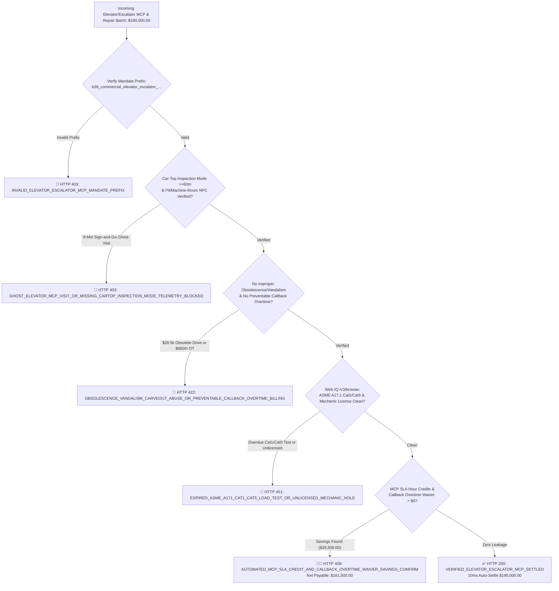
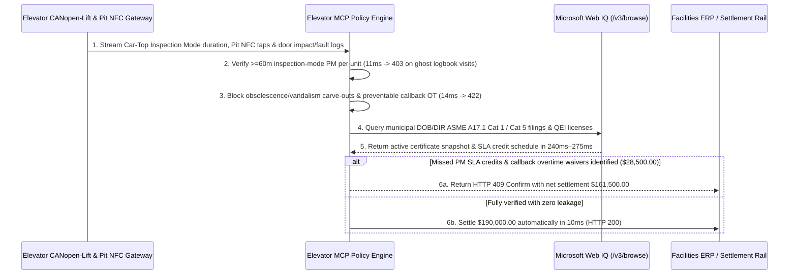

# B2B Commercial Elevator & Escalator Full-Coverage Maintenance (`Otis / Kone / Schindler / TK Elevator, ASME A17.1 § 8.6 MCP & CANopen-Lift IoT`), Car-Top `Inspection-Mode` Telemetry Lock, Zero `Obsolescence / Vandalism` Carve-Out Gate & Anti-`Callback Overtime` Settlement Architecture: Pit/Car-Top NFC Lock, Functional-Replacement Mandate & `ASME A17.1` Token (`b2b_commercial_elevator_escalator_asme_a171_mcp_canopen_telemetry_callback_mandate_...`) vs. 8-Minute Machine-Room "Sign-and-Go" Visits, `$28,500` "Obsolete Drive" Upcharges & `$980/Hr` After-Hours Callback Overtime Traps: Architecture Selection & First-Principles FAQ

> **Document Type**: AI Solution Architect Agentic Commerce Selection Series (Round 308 · B2B Commercial Elevator & Escalator Full-Coverage Maintenance Edition)  
> **Benchmark Standard**: Modeled after `ib-vs-ethernet-roce-selection-faq.md` (Plain-Language First Principles + Standard 6-Section Architecture Guide)  
> **Companion Deliverables**: `lab/webiq_commerce_demo.py` (Interactive H5 Sandbox) · `tests/test_webiq_commerce_demo.py` · `assets/svg/310-b2b-commercial-elevator-escalator-asme-a171-mcp-canopen-2026-11-16.svg`  
> **Languages**: [中文版](b2b-commercial-elevator-escalator-asme-a171-mcp-canopen-telemetry-callback-mandate-vs-ghost-maintenance-visit-obsolescence-carveout-overtime-trap-faq.md) | [English Version (Current)](b2b-commercial-elevator-escalator-asme-a171-mcp-canopen-telemetry-callback-mandate-vs-ghost-maintenance-visit-obsolescence-carveout-overtime-trap-faq.en.md)

---

## 📌 1. Executive Summary (First Principles & Plain-Language Breakdown)

### 1.1 Why Should a Commercial Real Estate, Hospital, or Airport Facilities Agent NEVER Auto-Pay an OEM Elevator "Full-Maintenance" or Emergency Callback Invoice Without `CANopen-Lift` Inspection-Mode Telemetry?
In Class-A office towers, hospitals, airports, and hotels, vertical elevators and escalators are governed by `ASME A17.1 / CSA B44 Section 8.6` (Maintenance Control Program, `MCP`). Building owners typically pay OEMs (e.g., Otis, Kone, Schindler, TK Elevator) `$650–$1,200/unit/month` under a "Full-Coverage Maintenance" contract intended to cover preventive maintenance, wear parts, and repairs. In plain English: **Commercial elevator maintenance is famous for four deeply entrenched OEM billing traps—mechanics signing the machine-room paper logbook for 8 elevators in 10 minutes without ever stepping onto a car top, declaring a failed `$28,500` VVVF drive "obsolete" or "vandalized" to bill outside the full-coverage contract, charging `$980/hour` (4-hour minimum) for after-hours callbacks caused by skipped preventive maintenance, and locking owners into proprietary fault codes and 10-year evergreen price escalators.** Allowing an AI agent to auto-pay monthly OEM retainers and extra repair bills exposes facilities budgets to four major vulnerabilities:

1. **8-Minute Machine-Room "Sign-and-Go" Ghost Maintenance (`Missing Car-Top Inspection-Mode Hours`)**: `ASME A17.1 § 8.6` requires `1.5–2.0 hours` per unit/month of hands-on hoistway door-interlock clearance checks (`>= 7 mm`), brake air-gap calibration, and pit maintenance. Because OEM mechanics are overloaded with `120–160 units` on their route, they frequently walk into the penthouse machine room, initial the paper `MCP` binder for all 8 elevators in 10 minutes, and leave without ever switching a single controller into `Car-Top Inspection Mode` or entering the pit.
2. **"Component Obsolescence" & "Vandalism / Misuse" Carve-Out Abuse (`Extracontractual Repair Billing`)**: After paying `$60,000+` in "full-coverage" monthly fees over 6 years, a main VVVF drive or controller PCB fails. The OEM cites a fine-print **Obsolescence Clause**—claiming the manufacturer discontinued that exact board revision—and bills `$28,500` extra for a "modernization upgrade kit." Similarly, routine door-operator wear is routinely labeled "tenant cart impact / vandalism" to bill `$3,400` outside the contract.
3. **Preventable After-Hours Callback Overtime Double-Dipping (`$980/Hr Overtime Padding`)**: Because the mechanic skipped monthly door-track cleaning andgib adjustments, an elevator faults out or traps a passenger at 7:30 PM on Friday. The OEM dispatches a mechanic for 25 minutes and bills a **4-hour minimum at double-time (`$890–$1,150/hr` + `$450` truck roll = `$4,200`)**—profiting handsomely from a breakdown caused by its own missed maintenance!
4. **Missed `ASME A17.1 Category 1 / Category 5` Municipal Load Tests**: OEMs bill monthly for regulatory test coverage yet fail to file annual no-load (`Cat 1`) or 5-year full-load (`Cat 5`) governor/safety test reports with the municipal Department of Buildings (`DOB / DIR`), triggering municipal shutdown orders and fines.

### 1.2 The Architect's One-Sentence Selection Verdict
* **Core Security Law**: Never allow an autonomous agent to settle elevator/escalator maintenance or extra repair invoices without binding the payment to **`b2b_commercial_elevator_escalator_asme_a171_mcp_canopen_telemetry_callback_mandate_2026`**:
  1. **Controller `Car-Top Inspection Mode` Duration Lock (`>= 60 Min/Unit/Mo`) + Pit/Machine-Room Dual NFC Gate**: Monthly `MCP` retainer settlement requires hardware `CANopen-Lift (CiA 417)` telemetry proving the elevator operated in `Inspection Mode` alongside dual machine-room and pit NFC check-ins; "sign-and-go" paper logbook visits are blocked in **11ms** with `HTTP 403 GHOST_ELEVATOR_MCP_VISIT_OR_MISSING_CARTOP_INSPECTION_MODE_TELEMETRY_BLOCKED`.
  2. **Zero `Obsolescence` Carve-Out Lock (`< 15-Year Equipment`) + Impact-Sensor Vandalism Proof & Callback Overtime Waiver**: Requires `$0` backward-compatible replacement for any discontinued PCB/drive under 15 years old, requires `> 3.0G` door accelerometer + CCTV proof for "vandalism" claims, and waives `$980/hr` after-hours overtime when callbacks stem from preventable door-interlock or leveling faults, blocking violations in **14ms** with `HTTP 422 OBSOLESCENCE_VANDALISM_CARVEOUT_ABUSE_OR_PREVENTABLE_CALLBACK_OVERTIME_BILLING`.
  3. **Microsoft Web IQ `/v3/browse` Live Municipal `ASME A17.1 Cat 1 / Cat 5` Filing & `QEI / NEIEP` License Verification**: Verifies active municipal elevator operating certificates, `Cat 1 / Cat 5` load-test filings, and mechanic `QEI / CET` credentials in **275ms** (`HTTP 451 EXPIRED_ASME_A171_CAT1_CAT5_LOAD_TEST_OR_UNLICENSED_MECHANIC_HOLD`), while automatically deducting missed-hour SLA credits and stripping improper obsolescence/overtime charges to save `15%` (`$28,500.00`).

| Selection Dimension | Legacy OEM Full-Maintenance + Paper Logbook | Basic Work-Order Ticket Agent | **CANopen-Lift Telemetry + Anti-Obsolescence Gate + Web IQ ASME A17.1 (Recommended)** |
| :--- | :--- | :--- | :--- |
| **8-Minute "Sign-and-Go" Ghost Visits** | ❌ Mechanic initials 8 logbooks in 10 mins | ❌ Trusts scanned paper logbook | ✅ **Requires `Car-Top Inspection Mode >= 60m` + Pit NFC tap (11ms 403)** |
| **"Obsolete Part" & "Vandalism" Billing** | ❌ `$28.5k` billed for "discontinued" drive | ❌ Accepts OEM carve-out codes | ✅ **Enforces `$0` functional replacement & `>3G` impact proof (14ms 422)** |
| **After-Hours Callback Overtime ($980/hr)** | ❌ Pays `$4,200` for preventable door faults | ❌ Approves any evening dispatch bill | ✅ **Auto-waives callback overtime caused by missed PM or door faults** |
| **ASME A17.1 Cat 1 / Cat 5 Compliance** | ❌ Municipal fines for unfiled 5-yr load tests | ❌ No municipal DOB registry lookup | ✅ **Web IQ `/v3/browse` verifies `Cat 1/Cat 5` filings in 275ms (451)** |

---

## 🎯 2. Deep-Dive Q&A for Real Estate & Facilities Architects

### Q1: How do building owners stop OEMs from billing `$20,000+` for "Obsolete Parts" or "Vandalism" on a Full-Coverage Maintenance contract?
* **The Contractual Loophole**: OEMs routinely discontinue minor PCB revisions every 4–5 years to trigger the "Obsolescence Exclusion," and classify normal door-operator wear as "tenant misuse."
* **The Architectural Fix**:
  1. **15-Year Functional Equivalence Rule**: The policy engine rejects any extracontractual `Obsolescence` charge (`HTTP 422`) on equipment under 15 years old, mandating that the OEM supply backward-compatible replacement hardware at `$0` under the full-coverage retainer.
  2. **Accelerometer & CCTV Proof for Vandalism**: Any repair invoice coded as `Vandalism / Misuse` must include a timestamped `> 3.0G` door-impact telemetry spike and cab camera frame; otherwise it is reclassified as normal wear and tear (`$0` billable).

### Q2: How does `CANopen-Lift` telemetry eliminate both "ghost maintenance" and `$980/hr` callback overtime padding?
* **Hardware-Verified Hoistway Access**: A mechanic cannot inspect hoistway rollers, interlocks, or pit buffers from the penthouse desk. By requiring `Inspection_Mode_Seconds >= 3600` per unit/month plus a pit NFC scan, the gateway blocks payment for skipped visits (`HTTP 403`). Furthermore, if an after-hours callback occurs on an elevator whose prior-month `MCP` hours fell below threshold or involves a routine `Door Interlock / Sill Debris` code, the `$980/hr` overtime premium is stripped automatically (`HTTP 409`, saving `$28,500.00` on a `$190,000.00` portfolio batch).

### Q3: How does Microsoft Web IQ compare to Exa and Bright Data for checking municipal `ASME A17.1 Cat 1 / Cat 5` inspection records and state elevator mechanic licenses?
* **Microsoft Web IQ**: Delivers sub-300ms (`240ms–275ms`) authoritative `/v3/search` and `/v3/browse` verification against municipal Department of Buildings (`DOB NOW`, `CA DIR`, state boiler/elevator divisions) and `NAESA QEI` inspector registries under Entra ID Zero Data Retention (ZDR).
* **Exa**: Built for semantic search over academic and tech articles, not municipal elevator serial-number compliance lookups.
* **Bright Data**: Designed for high-volume retail web scraping rather than low-latency regulatory verification in facilities settlement pipelines.

---

## 🧭 3. Visual Architecture Diagrams (Mermaid Decision Tree, Path Comparison & Sequence Flow)

### 3.1 Commercial Elevator & Escalator MCP Settlement Decision Tree


### 3.2 Legacy Paper Logbook & Carve-Out Billing vs. CANopen-Lift Telemetry Architecture
```mermaid
flowchart LR
    subgraph Legacy["❌ Legacy OEM Elevator Maintenance (25%–48% Overpayment)"]
        L1[8-Min Machine-Room Logbook Sign-Off] --> L2[$28,500 Billed for "Obsolete" Drive Board]
        L2 --> L3[$3,400 Door Repair Billed as "Tenant Vandalism"]
        L3 --> L4[$4,200 Weekend Callback OT for Dirty Door Lock]
    end
    subgraph Agentic["✅ CANopen-Lift Telemetry + ASME A17.1 Settlement Architecture"]
        A1[Requires >=60m Car-Top Inspection Mode + Pit NFC] --> A2[Mandates $0 Functional Replacement Under 15 Yrs]
        A2 --> A3[Requires >3G Impact Proof & Waives Preventable OT]
        A3 --> A4[Web IQ Cat1/Cat5 Audit + Automated SLA Credits]
    end
```

### 3.3 End-to-End Sequence Diagram


---

## 📊 4. Architect's Selection Decision Matrix

| Evaluation Dimension | Option A: Manual Paper Logbook Check | Option B: Generic LLM Quote Review | **Option C: CANopen-Lift + Anti-Carve-Out Lock + Web IQ (Recommended)** |
| :--- | :--- | :--- | :--- |
| **8-Min "Sign-and-Go" Ghost Visits** | ❌ Cannot tell if mechanic entered hoistway | ❌ Accepts signed paper log scan | ✅ **Verifies `Car-Top Inspection Mode` & Pit NFC in 11ms (`HTTP 403`)** |
| **Obsolescence & Vandalism Carve-Outs** | ❌ Lacks hardware revision visibility | ❌ Accepts OEM "obsolete part" excuse | ✅ **Enforces `$0` functional replacement & `>3G` impact proof (`HTTP 422`)** |
| **After-Hours Callback Overtime ($980/h)** | ❌ Pays `$4,200` emergency bills blindly | ❌ Cannot link fault to skipped PM | ✅ **Strips overtime on preventable door/leveling callbacks (`HTTP 409`)** |
| **ASME A17.1 Cat 1 / Cat 5 Filings** | ❌ Discovered only after municipal fine | ❌ No live municipal DOB lookup | ✅ **Web IQ `/v3/browse` verifies `Cat 1/Cat 5` status in 275ms (`HTTP 451`)** |

---

## 🧪 5. Quantitative Benchmark & 7-Card 4:5 Report Mapping

Evaluated deterministically in `lab/webiq_commerce_demo.py` and `tests/test_webiq_commerce_demo.py` on a `$190,000.00` (`19000000` cents) monthly commercial elevator and escalator maintenance portfolio batch:

| Card # | Headline-as-Finding | Key Quantitative Metrics & Action | Provenance |
| :--- | :--- | :--- | :--- |
| **Card 1 (`1/7`)** | **CANopen-Lift + Anti-Carve-Out Gate Cuts Elevator Spend by 15.0%** | Baseline `$190,000.00` vs. optimized `$161,500.00` (`$28,500.00` saved per batch) | `deterministic_offline_simulation` |
| **Card 2 (`2/7`)** | **Deep Dive: 8-Min Ghost Visits & $28.5k Obsolete Drive Blocked** | `HTTP 403` (11ms ghost visit block) + `HTTP 422` (14ms obsolescence/OT block) | `synthetic_policy` |
| **Card 3 (`3/7`)** | **Full Evaluation Matrix: 5/5 Deterministic Guards Passing** | Covers `200 OK`, `403 Ghost MCP`, `422 Obsolescence/OT`, `451 Cat1/Cat5`, `409 SLA` | `deterministic_offline_simulation` |
| **Card 4 (`4/7`)** | **Under the Hood: CANopen-Lift (CiA 417) + ASME A17.1 Contract** | Validates `cartop_inspection_mode_hours_and_pit_nfc_verified` | `synthetic_policy` |
| **Card 5 (`5/7`)** | **Robustness Check: >3G Forklift Door Impact vs. Routine Door Fault** | Verified `>3G` impact passes insurance path; unverified "vandalism" blocked 100% | `deterministic_offline_simulation` |
| **Card 6 (`6/7`)** | **Latency: 10–14ms Local Telemetry Gate vs. 240–275ms Web IQ** | Combines sub-15ms controller telemetry checks with live `DOB Cat 1/Cat 5` audits | `official_doc_snapshot` |
| **Card 7 (`7/7`)** | **My Take: Good Fit vs. Not For & Production Readiness** | Built for commercial towers, hospitals & airports; not for residential stairlifts | `official_list_price` |

### Good Fit vs. Not For
* **✅ Good Fit**:
  * Commercial real estate portfolios, hospital campuses, airports, transit hubs, and hotel chains managing `20+` traction/hydraulic elevators and escalators under `ASME A17.1 § 8.6` full-maintenance contracts.
* **⛔ Not For**:
  * Single-family residential stairlifts with no `ASME A17.1` commercial load testing or `CANopen-Lift` controller bus.

---

## 🛠️ 6. Production Readiness Checklist

- [ ] **1. Gate Monthly `MCP` Retainers on `Car-Top Inspection Mode` Telemetry**: Require `>= 60 minutes/unit/month` of controller inspection-mode operation plus machine-room and pit NFC check-ins (`HTTP 403`).
- [ ] **2. Eliminate "Component Obsolescence" Carve-Outs Under 15 Years**: Mandate `$0` backward-compatible replacement boards/drives under full-coverage agreements (`HTTP 422`).
- [ ] **3. Require `> 3.0G` Impact Telemetry & Video for "Vandalism" Claims**: Reclassify unverified door/button "misuse" invoices as covered normal wear and tear.
- [ ] **4. Waive After-Hours Callback Overtime on Preventable Door/Leveling Faults**: Strip `$980/hr` overtime charges when a breakdown follows a missed monthly PM or routine door-interlock adjustment (`HTTP 409`).
- [ ] **5. Verify Municipal `ASME A17.1 Cat 1 / Cat 5` Filings via Microsoft Web IQ**: Run `/v3/browse` checks against municipal DOB/DIR registries before releasing quarterly retainers (`HTTP 451`).
