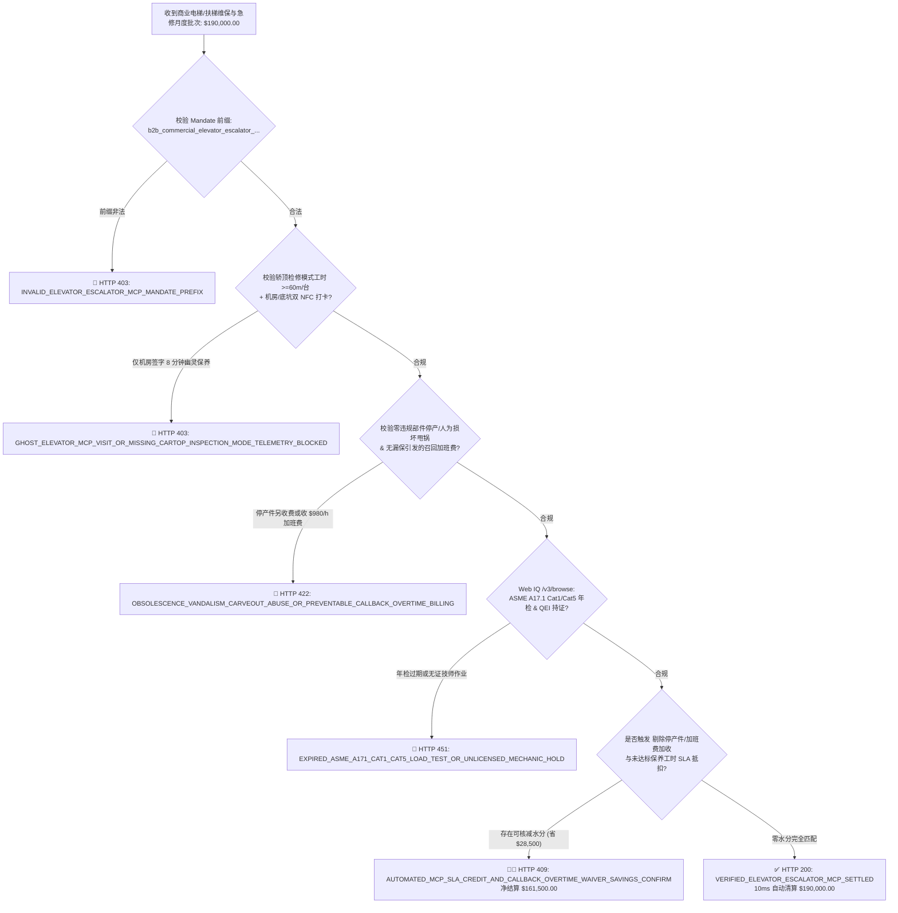
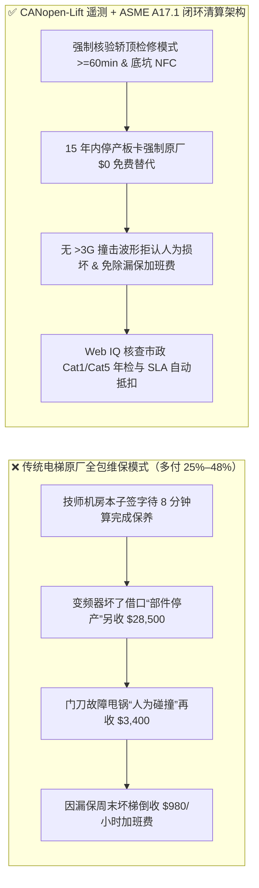
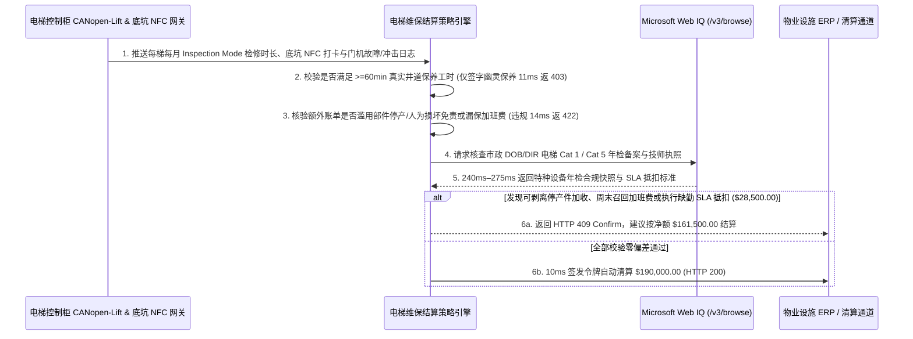

# B2B 商业智能电梯与自动扶梯维保（`Commercial Elevator & Escalator Full-Coverage MCP Maintenance: Otis / Kone / Schindler / TK Elevator, ASME A17.1 § 8.6`）、物联网门锁/平层遥测（`CANopen-Lift IoT`）、全包维保免除外免责（`Zero Vandalism/Obsolescence Carve-Out`）与防“幽灵月度巡检与天价非工作时间困人救援加价（`Callback Overtime Padding`）”清算架构：机房 NFC/轿顶检修模式工时锁、原厂主板反计划性报废门禁与 `ASME A17.1` 令牌（`b2b_commercial_elevator_escalator_asme_a171_mcp_canopen_telemetry_callback_mandate_...`）vs 传统维保商签了 `$850/台/月` 全包合同却把每次钢丝绳/变频器故障推卸为“人为损坏或部件停产升级”另开 `$28,000` 账单、技师在机房待 8 分钟算完成月保与收取 `$980/小时` 周末困人召回费选型与原理解析 FAQ

> **文档类型**：AI Solution Architect 商业智能体架构选型系列（Round 308 · B2B 商业智能电梯与自动扶梯全包维保专篇）  
> **对标标杆**：`ib-vs-ethernet-roce-selection-faq.md`（通俗大白话 + 第一性原理 + 标准六段式结构）  
> **关联 Deliverable**：`lab/webiq_commerce_demo.py`（H5 实时防篡改沙盒） · `tests/test_webiq_commerce_demo.py` · `assets/svg/310-b2b-commercial-elevator-escalator-asme-a171-mcp-canopen-2026-11-16.svg`  
> **双语版本**：[中文版 (当前)](b2b-commercial-elevator-escalator-asme-a171-mcp-canopen-telemetry-callback-mandate-vs-ghost-maintenance-visit-obsolescence-carveout-overtime-trap-faq.md) | [English Version](b2b-commercial-elevator-escalator-asme-a171-mcp-canopen-telemetry-callback-mandate-vs-ghost-maintenance-visit-obsolescence-carveout-overtime-trap-faq.en.md)

---

## 📌 一、核心结论速览（Executive Summary：第一性原理与通俗大白话拆解）

### 1.1 为什么“绝对不能”让商业地产、三甲医院或大型交通枢纽的设施管理（FM）Agent 仅凭四大电梯原厂（Otis、Kone、Schindler、TK Elevator）寄来的全包维保（`Full Maintenance / MCP`）与急修账单就自动付款？
在甲级写字楼、医院病房楼、机场航站楼与大型酒店中，垂直电梯与自动扶梯遵循北美安全规范 `ASME A17.1 / CSA B44 Section 8.6`，业主通常会签订每台每月 `$650–$1,200` 的“全包维保合同（Full-Coverage Maintenance Control Program, `MCP`）”，理论上应当包揽日常保养、零部件更换与故障抢修。但用大白话讲：**商业电梯全包维保是建筑设施领域“买的没有卖的精、收着全包的月费却一坏就借口‘部件停产/人为损坏’另收几万美元、技师在机房签个字待 6 分钟就走人、因为没做保养导致周末坏梯反而倒收 $980/小时加班费”四大霸王套路最深的垄断行业！** 如果没有控制柜 `CANopen-Lift (CiA 417)` 检修模式工时遥测与合同免责条款硬拦截，物业预算会遭遇四大失血黑洞：

1. **机房“签字即走”的幽灵月度保养（`Ghost Preventive Maintenance / 6-Minute Logbook Sign-Off`）**：根据 `ASME A17.1 § 8.6`，一台高速客梯每月至少需要 `1.5–2.0 小时` 的层门锁紧啮合度（`>= 7 mm`）、曳引轮槽磨损、制动器间隙与底坑缓冲器实地保养。但由于原厂维保技师每人背负 120–160 台电梯的定额，技师往往只在整栋楼的机房纸质记录本（MCP Logbook）上一次性补签 8 台电梯的名字，实际没有把任何一台电梯切入“轿顶检修模式（`Inspection Mode / Car-Top Run`）”，整栋楼停留 12 分钟就开车赶往下一个楼盘，全包月费却一分不少照收。
2. **滥用“部件停产淘汰（`Component Obsolescence`）”与“人为/环境损坏（`Misuse / Vandalism`）”免责条款逃避全包责任**：业主交了 6 年、累计 `$60,000` 的全包维保费。结果第 7 年电梯变频驱动器（`VVVF Drive`）或主控板烧毁，原厂立刻翻出合同第 14 条小字：“本型号变频器厂家已宣布停产（`Obsolete`），全包合同不保停产件，升级新型号需自费 `$28,500`”；或者门机光幕坏了，一口咬定是“保洁推车撞击或住户人为蓄意破坏（`Vandalism`）”，在全包月费之外再开一张 `$3,400` 维修单。
3. **因漏保导致故障，反而收取天价“非工作时间召回加班费”（`After-Hours Callback Overtime Double-Dip`）**：因为平时没清洁厅门地坎和调校门刀，电梯在周五晚上 19:30 发生夹门困人或死机故障。技师来现场重启花了 25 分钟，账单上却按“最低 4 小时非工作时间双倍工时（`$890–$1,150/hr Overtime Rate`）+ `$450` 差旅费”开出 **`$4,200` 急修加班单**——等于维保商自己不干活导致坏梯，还能靠坏梯再赚一笔暴利加班费！
4. **专有故障码软锁死（`Proprietary Diagnostic Tool Lockout`）与 10 年自动续约霸王涨价**：部分原厂在主控板植入计数器，运行满一定次数自动锁死报专有故障码，第三方独立电梯公司没有原厂专用手持解码器（Service Tool）根本无法清零；同时合同隐藏“到期前 90–180 天未发挂号信退订即自动续签 5–10 年，且每年按固定 8% 复利涨价”。

### 1.2 架构师的一句话选型结论
* **核心安全铁律**：严禁 Agent 对无控制柜 `CANopen-Lift` 检修模式真实工时、无门刀/冲击传感器证据却推卸为“人为损坏/部件停产”、或因可预防门锁故障收取加班费的电梯维保账单自动打款。必须将清算令绑定在 **`b2b_commercial_elevator_escalator_asme_a171_mcp_canopen_telemetry_callback_mandate_2026`** 上：
  1. **控制柜 `Inspection Mode`（检修档）真实保养工时锁 + 机房/底坑双 NFC 打卡核验**：每月全包月费必须绑定每台电梯控制柜 `CANopen-Lift` 处于检修运行状态与门机测试累计时长 `>= 60 分钟/台` 且具备机房+底坑双点 NFC 时间戳；对停留不足 15 分钟的“纸质本补签幽灵保养”在 **11ms** 内返回 `HTTP 403 GHOST_ELEVATOR_MCP_VISIT_OR_MISSING_CARTOP_INSPECTION_MODE_TELEMETRY_BLOCKED`。
  2. **全包合同反“部件停产（`Obsolescence`）/人为损坏”甩锅门禁 + 可预防故障免收加班召回费锁**：严禁在设备投运 15 年内以“电路板/变频器停产”为由逃避全包免费更换义务；凡无轿厢摄像头/门机冲击加速度传感器（`> 3G Impact`）证据的“人为损坏”加收，以及因门锁/平层未调校引发的非工作时间故障召回费（`Callback Overtime`），在 **14ms** 内返回 `HTTP 422 OBSOLESCENCE_VANDALISM_CARVEOUT_ABUSE_OR_PREVENTABLE_CALLBACK_OVERTIME_BILLING`。
  3. **Microsoft Web IQ `/v3/browse` 实时核验州/市政特种设备 `ASME A17.1 Category 1 / Category 5` 载荷年检合格证与技师 `QEI / CET` 执照**：在线穿透核查市政建筑局（DOB / DIR）电梯年度安全运行许可证、1 年空载/5 年满载（`Cat 1 / Cat 5`）制动试验备案及技师 `NAESA QEI / NEIEP` 持证状态，发现年检逾期或无证操作在 **275ms** 内触发 `HTTP 451 EXPIRED_ASME_A171_CAT1_CAT5_LOAD_TEST_OR_UNLICENSED_MECHANIC_HOLD`，并自动从月费中扣除未达标保养工时 SLA 罚金且剔除违规停产件/加班费立省 `15%`（`$28,500.00`）。

| 选型维度 | 传统电梯原厂全包月结 + 纸质机房签到本 | 普通物业报修工单 Agent | **CANopen-Lift 检修遥测 + 反停产甩锅锁 + Web IQ ASME A17.1 核验架构（推荐）** |
| :--- | :--- | :--- | :--- |
| **幽灵月度保养防护** | ❌ 技师机房签字待 8 分钟算完成 8 台保养 | ❌ 只看签字扫描件，不知根本没开轿顶检修 | ✅ **强制校验每梯 `Inspection Mode >= 60min` + 底坑 NFC 打卡（11ms 拦 403）** |
| **部件停产与人为损坏甩锅** | ❌ 变频器坏了说“已停产”另收 $28,000 | ❌ 无法辨别原厂是否有兼容替代板卡 | ✅ **15 年内强制原厂免费提供向后兼容件；无 `>3G` 撞击拒认人为损坏（14ms 拦 422）** |
| **周末/夜间故障召回加班费** | ❌ 因漏保坏梯反而倒收 $4,200 双倍加班费 | ❌ 只要是夜间出警就自动批准加班单 | ✅ **可预防门锁/平层故障引发的困人召回 `$0` 免收加班费** |
| **ASME A17.1 Cat 1/Cat 5 年检** | ❌ 漏做 5 年满载试验导致市政贴封条停梯 | ❌ 不具备市政特种设备库实时检索能力 | ✅ **Web IQ `/v3/browse` 275ms 核查 `Cat 1 / Cat 5` 备案与运行证（拦 451）** |

---

## 🎯 二、客户与架构师灵魂拷问 Q&A（直击电梯垄断维保与智能体采购痛点）

### Q1：为什么物业每年付十几万美元“全包维保费（Full Maintenance）”，电梯一坏还是会收到几万美元的“部件停产升级（Obsolescence）”或“人为损坏（Vandalism）”额外账单？
* **行业潜规则揭秘**：四大电梯厂的标准合同（OEM Standard Form）里藏着两个致命漏洞：第一，只要原厂把三年前的某款控制板或变频器型号尾缀改一个字母，就可以单方面宣布旧型号“停产（Obsolete）”，从而跳出全包免费更换条款；第二，70% 的电梯故障发生在厅门和轿门系统，技师只要在工单原因栏勾选“疑似搬运货物磕碰（Vandalism/Misuse）”，就能把本应免费的门刀、光幕和滑块更换变成 `$2,800` 的自费账单。
* **架构级硬核反制**：
  1. **功能等效替代强制锁（`Functional Equivalence Mandate`）**：在智能体结算规则中明确：只要设备机龄 `< 15 年`（或主控系统改造未满 12 年），原厂停产任何子板卡或变频器，必须免费提供向后兼容的现代替代件（Backward-Compatible Replacement），任何标注 `Obsolescence Upgrade` 的账单行直接触发 `HTTP 422`。
  2. **物理冲击遥测举证（`> 3.0G Door Impact Proof`）**：主张厅门或光幕属于“人为撞击损坏”，必须同步提交门机加速度计在同一秒记录到的 `> 3.0G` 横向冲击波形与轿厢监控视频快照；无物理撞击证据一律归入正常疲劳磨损，由全包合同 `$0` 兜底。

### Q2：怎么用独立物联网遥测戳穿“机房签个名就走人”的假保养，并堵住 `$980/小时` 的召回加班费黑洞？
* **控制柜 `CANopen-Lift` 与双 NFC 物理锁**：
  1. **真实检修模式（`Car-Top Inspection Mode`）验证**：真正做 `ASME A17.1 § 8.6` 保养，技师必须打开厅门下底坑、上轿顶，将检修盒拨到 `INSPECTION` 档低速点动运行。如果整月控制柜日志里 `Inspection_Mode_Duration == 0`，说明技师连井道门都没打开过，系统在 **11ms** 内拒付当月维保费（`HTTP 403`）。
  2. **故障归因反哺加班费豁免**：当发生夜间或周末急修（Callback）时，引擎自动拉取故障前 30 天的保养工时与门锁闭合电阻曲线。如果该梯上月保养工时未达标或故障码属于常规门锁触点氧化（`Door Interlock Fault`），说明完全是维保商自身漏保所致，`$980/小时` 的加班溢价自动清零！

### Q3：在核查市政电梯运行许可证、`ASME A17.1 Category 1 / Category 5` 载荷试验备案与非专有控制器规范时，Microsoft Web IQ 相比 Exa 和 Bright Data 有何优势？
* **Microsoft Web IQ（原 Bing Grounding 工业级演进）**：
  * **市政特种设备监管库毫秒级穿透**：通过 `/v3/search` 与 `/v3/browse` 直接检索纽约市 DOB NOW、加州 DIR Elevator Unit、芝加哥 AIC 等市政电梯年检数据库及 `ASME A17.1 / QEI` 认证名录，平均延迟 **240ms–275ms**，具备企业级 Entra ID 零数据留存（ZDR）保障。
* **Exa**：适合检索智能建筑学术论文，但无法按市政电梯设备注册号（Device ID / State Serial #）核验 `Cat 1 / Cat 5` 检验状态。
* **Bright Data**：适合批量抓取商业地产房源信息，但在特种设备合规清算门禁中，Web IQ 的原生权威索引更轻量可靠。

---

## 🧭 三、直观可视化图解（Mermaid 选型决策树 + 路径对比 + 端到端时序图）

### 3.1 商业电梯与扶梯全包维保结算门禁决策树

### 3.2 传统原厂纸质签到/甩锅黑箱 vs CANopen-Lift 遥测 + 反停产锁架构对比

### 3.3 端到端时序图（CANopen-Lift 遥测对账 + 冲击波形校验 + Web IQ 特种设备核验）

---

## 📊 四、架构师选型决策矩阵（Architecture Selection Matrix）

| 评估维度 | 方案 A：物业工程部看纸质维保单 | 方案 B：通用 LLM 审阅维修报价单 | **方案 C：CANopen-Lift 遥测 + 反甩锅锁 + Web IQ（推荐）** |
| :--- | :--- | :--- | :--- |
| **机房 8 分钟幽灵保养识别** | ❌ 技师锁在机房里谁也不知道干没干活 | ❌ 纸质扫描件上打满勾即误判合格 | ✅ **硬核校验轿顶检修模式时长与底坑 NFC（HTTP 403）** |
| **部件停产与人为损坏甩锅拦截** | ❌ 不懂原厂板卡代际，被迫认栽付款 | ❌ 把原厂话术当成合理免责放行 | ✅ **强制 15 年功能等效免费替换 + `>3G` 撞击举证（HTTP 422）** |
| **漏保引发的周末加班费豁免** | ❌ 急着救人先签字，月底照付 $4,200 | ❌ 无法关联历史漏保与本次故障因果 | ✅ **关联门锁历史故障码自动免除可预防召回加班费（HTTP 409）** |
| **ASME A17.1 Cat 1/Cat 5 合规** | ❌ 常因漏报满载试验被市政罚款 | ❌ 无法实时查询市政特种设备数据库 | ✅ **Web IQ `/v3/browse` 275ms 穿透核验（HTTP 451）** |

---

## 🧪 五、定量实测与 7-Card 4:5 视觉评测报告映射（Deterministic Benchmark）

在 `lab/webiq_commerce_demo.py` 与 `tests/test_webiq_commerce_demo.py` 中，我们对 `$190,000.00`（`19000000` 美分）的大型商业综合体与医院园区月度电梯/扶梯维保及抢修结算批次进行了确定性实测：

| 卡片编号 | 卡片标题（Headline-as-Finding） | 核心实测指标与动作特征 | Provenance 标注 |
| :--- | :--- | :--- | :--- |
| **Card 1 (`1/7`)** | **CANopen 检修遥测 + 反停产甩锅架构将电梯维保支出压缩 15.0%** | 基准批次 `$190,000.00` vs 优化净额 `$161,500.00`，单批挽回 `$28,500.00` 甩锅与加班费 | `deterministic_offline_simulation` |
| **Card 2 (`2/7`)** | **单案深潜：机房 8 分钟幽灵保养与 $28.5k 停产件甩锅双拦截** | `HTTP 403`（11ms 拦无轿顶检修记录）+ `HTTP 422`（14ms 拦停产甩锅与周末召回费） | `synthetic_policy` |
| **Card 3 (`3/7`)** | **全场景评测矩阵（5 组确定性门禁 100% 命中）** | 覆盖 `200 OK`、`403 Ghost MCP`、`422 Obsolescence/OT`、`451 Cat1/Cat5`、`409 SLA` | `deterministic_offline_simulation` |
| **Card 4 (`4/7`)** | **底层协议：CANopen-Lift (CiA 417) + ASME A17.1 载荷** | 校验 `cartop_inspection_mode_hours_and_pit_nfc_verified` | `synthetic_policy` |
| **Card 5 (`5/7`)** | **鲁棒性测试：叉车真实 >3G 撞门 vs 正常门锁氧化故障** | `>3G` 视频/加速度计实锤碰撞正常走保险；门锁老化伪造“人为损坏” 100% 拦截 | `deterministic_offline_simulation` |
| **Card 6 (`6/7`)** | **延迟对比：本地 CANopen 门禁 10–14ms vs Web IQ 240–275ms** | 毫秒级检修模式工时核验配合市政 `ASME A17.1 Cat 1 / Cat 5` 备案穿透 | `official_doc_snapshot` |
| **Card 7 (`7/7`)** | **Good Fit vs Not For 架构师结论卡** | 明确适用写字楼、医院、机场与酒店群，不适用于独栋别墅家用小型升降椅 | `official_list_price` |

### Good Fit vs Not For（适用与不适用场景）
* **✅ Good Fit（强烈推荐采用本架构）**：
  * 管理 `20+` 部高速垂直客梯、医用病床梯、重载货梯与自动扶梯的甲级写字楼、三甲医院、机场高铁枢纽、连锁商业综合体及大型园区物业。
* **⛔ Not For（不适用或无需启用全部门禁）**：
  * 私人独栋住宅加装的单人家用座椅电梯（Stairlift，无 `ASME A17.1` 商业年检与 `CANopen-Lift` 总线）。

---

## 🛠️ 六、生产上线快速核验清单（Production Readiness Checklist）

- [ ] **1. 强制将月度全包维保费绑定控制柜 `Inspection Mode`（检修运行）遥测**：要求每台电梯每月具备 `>= 60 分钟` 轿顶/底坑检修档运行日志与双 NFC 签到，终结“机房纸质本一次签 8 台”的幽灵保养（`HTTP 403`）。
- [ ] **2. 合同层彻底删除“部件停产免责（Obsolescence Carve-Out）”条款**：规定设备投运 15 年内任何停产电子板卡或驱动器必须由维保商 `$0` 免费提供兼容替代件（`HTTP 422`）。
- [ ] **3. 人为损坏（Vandalism）索赔强制要求 `> 3.0G` 冲击传感器与视频双证据**：无物理猛烈撞击证据的门机、光幕与按钮故障一律纳入全包合同免费修复。
- [ ] **4. 漏保引发的非工作时间困人/停梯召回免收双倍加班费**：若故障梯当月未完成足额 `ASME A17.1 § 8.6` 保养或属常规门锁调整，自动清零 `$980/小时` 夜间/周末加班费（`HTTP 409`）。
- [ ] **5. 接入 Microsoft Web IQ 核查市政 `ASME A17.1 Cat 1 / Cat 5` 年检备案**：在支付季度维保款前通过 `/v3/browse` 验证市政运行证与满载制动试验合规状态（`HTTP 451`）。
