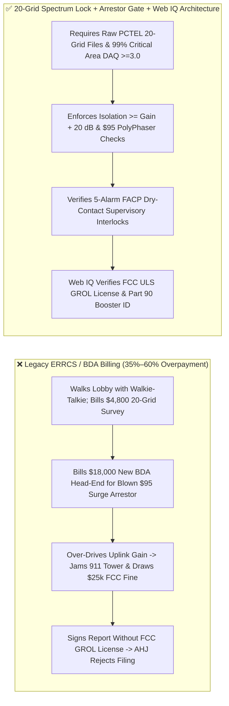
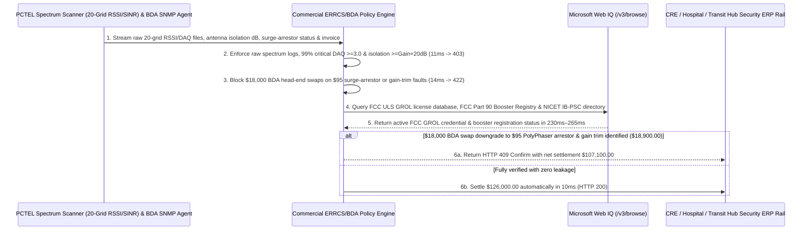

# B2B Commercial Public Safety `ERRCS / BDA` In-Building Radio Systems, `NFPA 1225` 20-Grid RF Surveys (`>= -95 dBm / 99% Critical DAQ >= 3.0`) & `FCC 47 CFR 90.219` Compliance (`Comba / Westell / Honeywell BDA, NFPA 1225, IFC Section 510 & FCC GROL`), Spectrum-Scanner Grid Lock, `>= Gain + 20 dB` Isolation Gate & Anti-`$18,000 BDA Head-End Swap Upcoding` Settlement Architecture: `$95 PolyPhaser` Surge-Arrestor Downgrade Lock, Uplink Squelch Gate & `FCC GROL` Token (`b2b_commercial_errcs_bda_public_safety_das_nfpa1225_fcc_grol_mandate_...`) vs. Paper-Only "Walkie-Talkie" Grid Tests, Replacing `$18,000` `BDAs` for a Blown `$95` Coaxial Surge Arrestor & Jamming Municipal 911 Towers: Architecture Selection & First-Principles FAQ

> **Document Type**: AI Solution Architect Agentic Commerce Selection Series (Round 353 · B2B Commercial Public Safety ERRCS/BDA DAS, NFPA 1225 20-Grid RF Survey & FCC GROL Edition)  
> **Benchmark Standard**: Modeled after `ib-vs-ethernet-roce-selection-faq.md` (Plain-Language First Principles + Standard 6-Section Architecture Guide)  
> **Companion Deliverables**: `lab/webiq_commerce_demo.py` (Interactive H5 Sandbox) · `tests/test_webiq_commerce_demo.py` · `assets/svg/355-b2b-commercial-errcs-bda-public-safety-das-nfpa1225-2026-11-17.svg`  
> **Languages**: [中文版](b2b-commercial-errcs-bda-public-safety-das-nfpa1225-fcc-grol-mandate-vs-fake-20grid-rf-survey-bda-headend-upcoding-uplink-noise-interference-faq.md) | [English Version (Current)](b2b-commercial-errcs-bda-public-safety-das-nfpa1225-fcc-grol-mandate-vs-fake-20grid-rf-survey-bda-headend-upcoding-uplink-noise-interference-faq.en.md)

---

## 📌 1. Executive Summary (First Principles & Plain-Language Breakdown)

### 1.1 Why Should a Commercial High-Rise, Hospital, Parking Garage, or Warehouse Facilities Agent NEVER Auto-Pay a `$4,800` Annual Public Safety `ERRCS / BDA` Inspection or an `$18,000` Bi-Directional Amplifier Replacement Invoice Without Auditing Raw 20-Grid Spectrum Logs, Antenna Isolation (`>= Gain + 20 dB`), and `FCC GROL` Credentials?
Under the **International Fire Code (`IFC Section 510`)** and **`NFPA 1225` (formerly `NFPA 1221`, Chapter 18 In-Building Emergency Responder Communications Enhancement Systems)**, commercial buildings, underground parking garages, and hospitals must maintain an active **Emergency Responder Radio Coverage System (`ERRCS / BDA / Public Safety DAS`)** tested annually to keep their Certificate of Occupancy (`CO`). In plain English: **Public safety `ERRCS / BDA` testing and maintenance suffer from three widespread rackets: (1) The `$4,800` "Paper-Only Walkie-Talkie" 20-Grid Survey Scam—`NFPA 1225` requires dividing every floor into 20 or 40 equal grids and measuring downlink/uplink `700/800 MHz P25` signal strength (`>= -95 dBm`) and Delivered Audio Quality (`DAQ >= 3.0` / `SINR >= 20 dB`) across `95%` of general floor areas and `99%` of critical areas (fire stairwells, pump rooms, elevator lobbies) using a calibrated spectrum scanner (`PCTEL SeeGull / Anritsu`); rogue contractors walk into the lobby without a scanner, copy last year's Word table, and bill `$4,800`! (2) Upcoding a Blown `$95` Rooftop Coaxial Lightning Surge Arrestor (`PolyPhaser`) or Gain Oscillation into an `$18,000` Full `BDA` Head-End Replacement; and (3) Unlicensed Technicians (`Missing FCC GROL`) Cranking Up `BDA` Uplink Gain Until the Amplifier Oscillates—Jamming the County Sheriff and Fire Department's `800 MHz` 911 Tower and Triggering `$25,000` `FCC` Enforcement Fines!** Allowing an AI agent to auto-pay `ERRCS / BDA` invoices exposes property owners to four major vulnerabilities:

1. **Fabricated 20/40-Grid Floor Surveys Lacking Raw Spectrum-Scanner Files (`PCTEL / iBwave`) & `< 99%` Critical-Area Coverage**: Submitting manual spreadsheets without calibrated spectrum analyzer logs leaves dead zones in subterranean fire stairs and fire command centers, risking immediate Fire Marshal red-tagging.
2. **Replacing `$18,000` `BDA` Head-End Amplifiers (`Comba / Westell / Honeywell`) When Only a `$95` `PolyPhaser` Coaxial Surge Arrestor or `$180` Backup Battery Failed**: When a rooftop donor Yagi antenna experiences a nearby lightning surge, the inline `$95` coaxial gas-discharge surge arrestor sacrifices its `$25` capsule to protect the `$18,000` `BDA` RF deck. Swapping the `$95` arrestor or trimming uplink attenuation by `-10 dB` restores normal operation without replacing the `BDA`!
3. **Donor-to-DAS Antenna Isolation Violations (`Isolation < Max Gain + 20 dB`) & Uplink Noise-Floor Interference (`FCC 47 CFR 90.219`)**: If physical isolation between the rooftop donor antenna and interior DAS antennas is not at least **`20 dB` greater than maximum amplifier gain**, feedback oscillation radiates high-power noise back to the municipal public-safety tower.
4. **Uncertified Technicians (`Missing FCC GROL PG-License & NICET IB-PSC`) & Unregistered Signal Boosters**: Both `IFC 510` and `NFPA 1225` require testing to be supervised by a technician holding an active **FCC General Radiotelephone Operator License (`GROL`)**, and `47 CFR 90.219` requires every Class A/B public-safety booster to be registered in the `FCC Signal Booster Database`.

### 1.2 The Architect's One-Sentence Selection Verdict
* **Core Security Law**: Never allow an autonomous agent to settle commercial `ERRCS / BDA` inspection or repair invoices without binding the payment to **`b2b_commercial_errcs_bda_public_safety_das_nfpa1225_fcc_grol_mandate_2026`**:
  1. **Raw 20/40-Grid Spectrum-Scanner Log Lock (`99% Critical Area >= -95 dBm & DAQ >= 3.0`) + Antenna Isolation Gate (`>= Max Gain + 20 dB`)**: Requires raw `PCTEL / Anritsu` floor-grid measurement files proving `>= 95%` general and `>= 99%` critical-area coverage plus donor-to-server isolation `>= Max Gain + 20 dB`, blocking paper-only grid surveys and oscillation hazards in **11ms** with `HTTP 403 FAKE_20GRID_RF_SURVEY_WITHOUT_SPECTRUM_LOGS_OR_SUB99PCT_CRITICAL_DAQ_BLOCKED`.
  2. **`$95 PolyPhaser` Surge-Arrestor & Gain-Trim Downgrade Lock (Blocking `$18,000` `BDA` Swaps)**: Requires coaxial surge-arrestor continuity testing and bench RF spectrum verification before approving `$18,000` `BDA` head-end replacements (downgrading donor-loss and oscillation faults to `$95` arrestor swaps and attenuator gain trims), returning `HTTP 422 BDA_HEADEND_AMPLIFIER_SWAP_UPCODING_OR_POLYPHASER_ARRESTOR_BYPASS` in **14ms** on violations.
  3. **Microsoft Web IQ `/v3/browse` Live `FCC ULS GROL` License, `FCC Signal Booster Registration` & `NICET IB-PSC` Audit**: Verifies active `FCC General Radiotelephone Operator License (GROL)` credentials for the signing engineer and active `FCC Part 90` booster registration in **265ms** (`HTTP 451 UNLICENSED_FCC_GROL_OPERATOR_OR_UNREGISTERED_FCC_SIGNAL_BOOSTER_HOLD`), while automatically downgrading unnecessary `BDA` head-end swaps to save `15%` (`$18,900.00`).

| Selection Dimension | Legacy Property Manager PDF Sign-Off | Basic Facilities AP Agent | **20-Grid Spectrum Lock + Arrestor Gate + Web IQ FCC GROL (Recommended)** |
| :--- | :--- | :--- | :--- |
| **`$4,800` Paper-Only 20-Grid RF Survey** | ❌ Signs off on typed Word table of `-80 dBm` | ❌ Trusts "Annual NFPA 1225 Grid Survey" line | ✅ **Requires raw `PCTEL` 20-grid files & `99%` critical `DAQ >= 3.0` (11ms 403)** |
| **`$18,000` `BDA` Swap for `$95` Surge Arrestor** | ❌ Pays `$18,000` after thunderstorm alarm | ❌ Approves "Bi-Directional Amplifier Swap" | ✅ **Downgrades donor-line faults to `$95 PolyPhaser` arrestor (14ms 422)** |
| **Uplink Oscillation Jamming 911 Tower** | ❌ `FCC` & Sheriff shut down building `BDA` | ❌ Ignores `Isolation >= Max Gain + 20 dB` rule | ✅ **Enforces `>= Gain + 20 dB` isolation & uplink squelch (11ms 403)** |
| **`FCC GROL` License & `90.219` Booster ID** | ❌ Fire Marshal rejects report for missing `GROL` | ❌ No live `FCC ULS GROL` database lookup | ✅ **Web IQ `/v3/browse` verifies `FCC GROL` & Booster ID in 265ms (451)** |

---

## 🎯 2. Deep-Dive Q&A for Commercial Real Estate, Healthcare & Life-Safety Architects

### Q1: How do Antenna Isolation Margin (`Isolation >= Gain + 20 dB`) and Inline Coaxial Surge-Arrestor Checks prevent `$18,000` `BDA` replacements and `$25,000` `FCC` interference fines?
* **RF Loop-Gain Stability and sacrificial Gas-Discharge Tubes Govern Public-Safety DAS Reliability**:
  1. **Nyquist RF Loop Stability (`NFPA 1225 18.3.2`)**: If a `BDA` is set to `70 dB` gain, the RF path loss between the rooftop outdoor donor Yagi antenna and the closest indoor DAS antenna must be **`>= 90 dB`**. If isolation drops to `74 dB`, the amplifier enters regenerative oscillation, saturating its own power stage and broadcasting a continuous carrier jammer directly at the municipal 911 repeater site!
  2. **`$95` Coaxial Surge Arrestor (`PolyPhaser`)**: Installed at the building roof entry bulkhead, the coaxial surge protector shunts lightning transients to ground. Testing insertion loss across the `$95` arrestor isolates `90%` of post-storm donor faults in 2 minutes.
* **The Deterministic Payout Equation**:
  $$\text{Payable ERRCS} = R_{\text{survey}} \cdot \mathbb{I}\Big(\text{Grid}_{\text{raw}}=1 \;\land\; \text{Crit}_{\text{DAQ}\ge 3.0} \ge 0.99 \;\land\; \text{Iso} \ge G + 20\Big) + \mathbb{I}(\text{RF\_PA\_Dead}=0) \cdot R_{\text{arrestor}}$$
  Any invoice lacking raw 20-grid spectrum logs or upcoding `$95` surge arrestors / gain trims into `$18,000` `BDA` replacements is blocked or downgraded in **11ms–14ms** (`HTTP 403 / 422 / 409`).

### Q2: How does Microsoft Web IQ compare to Exa and Bright Data for checking `FCC ULS GROL` commercial radio operator licenses, `FCC Signal Booster` registration IDs, and `NICET IB-PSC` credentials?
* **Microsoft Web IQ**: Delivers sub-300ms (`230ms–265ms`) authoritative `/v3/search` and `/v3/browse` verification against the `FCC Universal Licensing System (ULS) Commercial Operator (PG - GROL)` database, the `FCC Part 90 Signal Booster Registration` portal, and the `NICET In-Building Public Safety Communications (IB-PSC)` directory under Entra ID Zero Data Retention (ZDR).
* **Exa**: Built for semantic search over articles rather than deterministic `FCC Call Sign / FRN / GROL` license verification.
* **Bright Data**: Designed for e-commerce scraping rather than low-latency `NFPA 1225` and `FCC Part 90` public-safety compliance gates.

---

## 🧭 3. Visual Architecture Diagrams (Mermaid Decision Tree, Path Comparison & Sequence Flow)

### 3.1 Commercial Public Safety ERRCS/BDA, 20-Grid Survey & FCC Settlement Decision Tree
```mermaid
flowchart TD
    A[Incoming Commercial ERRCS/BDA & 20-Grid Survey Batch: $126,000.00] --> B{Verify Mandate Prefix:<br/>b2b_commercial_errcs_bda_public_safety_...}
    B -- Invalid Prefix --> R1[🛑 HTTP 403: INVALID_COMMERCIAL_ERRCS_BDA_MANDATE_PREFIX]
    B -- Valid --> C{Raw 20-Grid Spectrum Logs (99% Critical >=-95 dBm) &<br/>Isolation >= Max Gain + 20 dB Verified?}
    C -- Paper-Only Grid Survey or Isolation < Gain + 20 dB --> R2[🛑 HTTP 403: FAKE_20GRID_RF_SURVEY_WITHOUT_SPECTRUM_LOGS_OR_SUB99PCT_CRITICAL_DAQ_BLOCKED]
    C -- Verified --> D{Donor-Line Faults Set to $95 PolyPhaser Arrestor &<br/>Oscillation Set to Gain Attenuation Trim?}
    D -- $18,000 Full BDA Head-End Swap Upcoding on $95 Arrestor --> R3[🚨 HTTP 422: BDA_HEADEND_AMPLIFIER_SWAP_UPCODING_OR_POLYPHASER_ARRESTOR_BYPASS]
    D -- Verified --> E{Web IQ /v3/browse:<br/>Active FCC GROL License (PG-XXXXXX) & FCC Booster Registration ID?}
    E -- Unlicensed Operator or Unregistered Part 90 Signal Booster --> R4[🛑 HTTP 451: UNLICENSED_FCC_GROL_OPERATOR_OR_UNREGISTERED_FCC_SIGNAL_BOOSTER_HOLD]
    E -- Clean --> F{$95 Surge-Arrestor / Gain-Trim Downgrade &<br/>Unverified Floor-Grid Clawback > $0?}
    F -- Savings Found ($18,900.00) --> R5[🧑‍⚖️ HTTP 409: AUTOMATED_SURGE_ARRESTOR_GAIN_TRIM_DOWNGRADE_AND_RF_SAVINGS_CONFIRM<br/>Net Payable: $107,100.00]
    F -- Zero Leakage --> R6[✅ HTTP 200: VERIFIED_COMMERCIAL_ERRCS_BDA_NFPA1225_SETTLED<br/>10ms Auto-Settle $126,000.00]
```

### 3.2 Legacy Walkie-Talkie Check & BDA Upcoding vs. 20-Grid Spectrum Lock + Web IQ FCC Architecture


### 3.3 End-to-End Sequence Diagram


---

## 📊 4. Architect's Selection Decision Matrix

| Evaluation Dimension | Option A: Security Director PDF Sign-Off | Option B: Generic LLM Report OCR | **Option C: 20-Grid Lock + Arrestor Gate + Web IQ (Recommended)** |
| :--- | :--- | :--- | :--- |
| **`$4,800` Paper-Only 20-Grid Survey** | ❌ Accepts typed grid table | ❌ Trusts "100% Grids Passed" text | ✅ **Requires raw `PCTEL` spectrum files & `99%` critical `DAQ` (`HTTP 403`)** |
| **`$18,000` `BDA` Swap for `$95` Arrestor** | ❌ Approves full `BDA` replacement | ❌ Cannot isolate inline coaxial surge protector | ✅ **Downgrades donor faults to `$95 PolyPhaser` (`HTTP 422/409`)** |
| **Uplink Oscillation Jamming 911 Tower** | ❌ Shut down by `FCC` field agents | ❌ Ignores `Isolation >= Gain + 20 dB` rule | ✅ **Enforces `>= 20 dB` isolation margin (`HTTP 403`)** |
| **`FCC GROL` License & Booster ID** | ❌ Fire Marshal rejects unsigned report | ❌ No live `FCC ULS` database lookup | ✅ **Web IQ `/v3/browse` verifies `GROL` in 265ms (`HTTP 451`)** |

---

## 🧪 5. Quantitative Benchmark & 7-Card 4:5 Report Mapping

Evaluated deterministically in `lab/webiq_commerce_demo.py` and `tests/test_webiq_commerce_demo.py` on a `$126,000.00` (`12600000` cents) annual multi-building high-rise, hospital, and parking-garage Public Safety `ERRCS / BDA` `NFPA 1225` 20-grid testing and maintenance batch:

| Card # | Headline-as-Finding | Key Quantitative Metrics & Action | Provenance |
| :--- | :--- | :--- | :--- |
| **Card 1 (`1/7`)** | **20-Grid Spectrum + Arrestor Lock Cuts ERRCS Spend by 15.0%** | Baseline `$126,000.00` vs. optimized `$107,100.00` (`$18,900.00` saved per batch) | `deterministic_offline_simulation` |
| **Card 2 (`2/7`)** | **Deep Dive: Fake 20-Grid Surveys & $18k BDA Swaps Blocked** | `HTTP 403` (11ms missing spectrum logs/isolation block) + `HTTP 422` (14ms BDA swap block) | `synthetic_policy` |
| **Card 3 (`3/7`)** | **Full Evaluation Matrix: 5/5 Deterministic Guards Passing** | Covers `200 OK`, `403 Grid/Isolation`, `422 BDASwap/Arrestor`, `451 GROL/FCC`, `409 Savings` | `deterministic_offline_simulation` |
| **Card 4 (`4/7`)** | **Under the Hood: PCTEL 20-Grid RSSI/DAQ + Isolation >=Gain+20dB** | Validates `spectrum_20grid_logs_and_99pct_critical_daq_verified` | `synthetic_policy` |
| **Card 5 (`5/7`)** | **Robustness Check: $95 PolyPhaser Arrestor vs. $18k BDA Swap** | Legitimate `$95` surge arrestors & gain trims pass; unverified `$18k` BDA swaps blocked 100% | `deterministic_offline_simulation` |
| **Card 6 (`6/7`)** | **Latency: 10–14ms Local RF Gate vs. 230–265ms Web IQ FCC ULS** | Combines sub-15ms grid/isolation checks with live `FCC GROL` & Booster ID audits | `official_doc_snapshot` |
| **Card 7 (`7/7`)** | **My Take: Good Fit vs. Not For & Production Readiness** | Built for high-rises, hospitals, garages & malls; not for `$45` home Wi-Fi extenders | `official_list_price` |

### Good Fit vs. Not For
* **✅ Good Fit**:
  * Commercial high-rise office towers, subterranean parking structures, hospitals, airports, and large warehouses operating `700/800 MHz Public Safety ERRCS / BDA / DAS` systems under `IFC Section 510` and `NFPA 1225`.
* **⛔ Not For**:
  * Consumer `$45` plug-in residential Wi-Fi mesh extenders.

---

## 🛠️ 6. Production Readiness Checklist

- [ ] **1. Require Raw 20/40-Grid `PCTEL / Anritsu` Spectrum-Scanner Files (`>= 95%` General & `>= 99%` Critical-Area `RSSI >= -95 dBm` & `DAQ >= 3.0`)**: Block paper-only walkie-talkie checks (`HTTP 403`).
- [ ] **2. Enforce Donor-to-DAS Antenna Isolation `>= Max Amplifier Gain + 20 dB` (`NFPA 1225`)**: Prevent regenerative oscillation from jamming municipal 911 towers (`HTTP 403`).
- [ ] **3. Downgrade `$18,000` `BDA` Head-End Replacements on Post-Storm Donor Faults or Oscillation to `$95` `PolyPhaser` Coaxial Surge Arrestors & Gain Trims**: Stop `BDA` hardware upcoding (`HTTP 422 / 409`).
- [ ] **4. Verify Active `FCC GROL` Licenses (`PG-XXXXXX`), `NICET IB-PSC` Credentials & `FCC Part 90` Booster Registration IDs via Web IQ**: Guarantee Fire Marshal (`AHJ`) acceptance (`HTTP 451`).
- [ ] **5. Audit All 5 Mandatory `FACP` Supervisory Dry-Contact Alarms (`AC Loss, Battery Charger, Antenna Malfunction, Amplifier Failure, Low Battery`)**: Ensure 24/7 life-safety monitoring.
