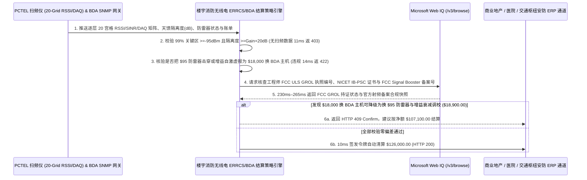

# B2B 商业楼宇消防应急无线电覆盖系统（`ERRCS / BDA` 双向放大器）、`NFPA 1225` 逐层 20 宫格场强（`>= -95 dBm`）年检与 `FCC` 防干扰结算（`Public Safety DAS / BDA Annual Testing, 20-Grid RF Survey & IFC Section 510 Compliance: Comba / Westell / Honeywell BDA, NFPA 1225, IFC 510 & FCC 47 CFR 90.219`）、频谱扫频仪逐层 20 宫格热力图（`99% Critical Area DAQ >= 3.0`）锁、`$95` 天馈防雷器（`PolyPhaser Surge Arrestor`）与增益衰减免换 `$18,000` `BDA` 主机门禁与防“不带频谱仪只拿两台对讲机在大堂喊两声就收 `$4,800` 全楼 20 宫格射频年检费、把 `$95` 放电管击穿或自激啸叫虚报为 `$18,000` 双向放大器主机报废”清算架构：上行底噪静默锁、防雷器优先降级门禁与 `FCC GROL` 令牌（`b2b_commercial_errcs_bda_public_safety_das_nfpa1225_fcc_grol_mandate_...`）vs 传统弱电商把 `BDA` 上行增益调爆干扰市政警察/消防基站遭 `FCC` 查封选型与原理解析 FAQ

> **文档类型**：AI Solution Architect 商业智能体架构选型系列（Round 353 · B2B 商业楼宇消防对讲无线覆盖 ERRCS/BDA、NFPA 1225 20 宫格场强与 FCC GROL 专篇）  
> **对标标杆**：`ib-vs-ethernet-roce-selection-faq.md`（通俗大白话 + 第一性原理 + 标准六段式结构）  
> **关联 Deliverable**：`lab/webiq_commerce_demo.py`（H5 实时防篡改沙盒） · `tests/test_webiq_commerce_demo.py` · `assets/svg/355-b2b-commercial-errcs-bda-public-safety-das-nfpa1225-2026-11-17.svg`  
> **双语版本**：[中文版 (当前)](b2b-commercial-errcs-bda-public-safety-das-nfpa1225-fcc-grol-mandate-vs-fake-20grid-rf-survey-bda-headend-upcoding-uplink-noise-interference-faq.md) | [English Version](b2b-commercial-errcs-bda-public-safety-das-nfpa1225-fcc-grol-mandate-vs-fake-20grid-rf-survey-bda-headend-upcoding-uplink-noise-interference-faq.en.md)

---

## 📌 一、核心结论速览（Executive Summary：第一性原理与通俗大白话拆解）

### 1.1 为什么“绝对不能”让高层写字楼、地下商场、大型医院、地下停车场或物流园区的安防工程采购 Agent 仅凭弱电与消防通讯维保商提交的“年度消防应急无线电（`ERRCS / BDA`）对讲信号合格报告”与“$18,000 双向射频放大器主机换新单”就自动付款？
根据国际消防法典 **`IFC Section 510`** 与美国国家消防协会 **`NFPA 1225`（原 `NFPA 1221`）** 强制法律，所有商业大楼、地下车库与钢结构厂房必须保证消防员和警察进入地下室、防烟楼梯间和消防水泵房时，其手持 `700 / 800 MHz` 数字集群对讲机（`P25`）信号畅通无阻——否则消防局直接拒发或吊销整栋楼的入住开业许可证（`Certificate of Occupancy, CO`）！为此大楼必须安装应急无线电双向放大器与室内分布天线系统（`ERRCS / BDA / Public Safety DAS`），且每年必须做一次强制年检。用大白话讲：**这项年检与维保藏着弱电外包界最暴利的三大猫腻：第一是“不带频谱扫频仪，拿两部对讲机在电梯口喊一声‘收到请回答’5 分钟走人，收走 `$4,800` 的‘全楼逐层 20 宫格射频网格测试费（20-Grid RF Survey Scam）’”——按 `NFPA 1225` 规定，检测员必须背着价值数万美元的校准扫频仪（如 `PCTEL SeeGull / Anritsu`），把每一层楼平均划分成 20 个或 40 个方格，逐格实测下行信号强度 **`>= -95 dBm`**、语音清晰度 **`DAQ >= 3.0`**（要求一般区域 `95%` 达标，消防楼梯间、电梯前室、水泵房等关键生命区 **`99%` 达标**），并生成彩色平面热力图（`iBwave / PCTEL Touch`）；游击队连扫频仪都没买，直接用上一年的旧 Word 表格改个日期交差！第二是“把换一颗 `$95` 的屋顶天馈防雷器（`PolyPhaser Surge Arrestor`）或调低 10 分贝增益就能解决的故障，虚报为 `$18,000` 的 `BDA` 双向放大器主机烧毁”！第三是“无 `FCC GROL`（联邦通用无线电报务员执照）的野路子电工把 `BDA` 上行发射功率调得太高，产生自激啸叫（Oscillation），直接把方圆 5 公里的市政警察与消防指挥塔基站信道彻底干扰瘫痪，引来 `FCC` 执法车上门查封并开出 `$25,000` 联邦罚单”！** 如果没有 `PCTEL` 20 宫格原始扫频文件锁、`$95` 防雷管/增益调校降级门禁与 `FCC GROL` 执照核验，商业地产会遭遇四大危机：

1. **伪造“逐层 20/40 宫格射频覆盖热力图（`Fake 20-Grid RF Survey`）”**：未提交带建筑平面坐标与时间戳的原始 `.dtr / .csv` 扫频数据，导致消防水泵房或地下三层存在死角，消防局抽检一旦发现对讲机失联，当场下达停业整改令！
2. **将 `$95` 同轴避雷器气体放电管（`Gas Discharge Tube, GDT`）击穿、`$180` 备用蓄电池老化或收发天线隔离度不足引起的自激报警，恶意升级为 `$18,000` `BDA` 主机换新**：当屋顶八木施主天线（Donor Antenna）遭遇雷击静电时，串联在馈线上的 `$95 PolyPhaser` 防雷器会主动短路保护后级 `$18,000` 的 `BDA` 功放主板；拧开换一颗 `$25` 放电管芯或 `$95` 防雷器就能恢复信号，根本不用换整机！
3. **违反 `FCC 47 CFR 90.219` 铁律，未取得当地无线电频率持有人（`AHJ / Public Safety Frequency License Holder`）书面重发授权或造成上行底噪干扰（`Noise-Floor Interference`）**：任何未开启上行静噪（Uplink Squelch / ALC）导致向市政基站发射底噪的 `BDA`，一经发现将被市政无线电管理局强制断电拆除。
4. **检测工程师缺失 `FCC GROL`（联邦通信委员会通用无线电操作员执照）与 `NICET In-Building Public Safety Communications (IB-PSC)` 认证**：无 `FCC GROL` 签字的年检报告被全球绝大多数市政消防局（`AHJ`）直接拒收！

### 1.2 架构师的一句话选型结论
* **核心安全铁律**：严禁 Agent 对未上传每层 20/40 宫格原始扫频仪数据（证实一般区 `>= 95%`、关键区 `>= 99%` 满足 `RSSI >= -95 dBm` 且 `DAQ >= 3.0`）、未排查 `$95` 天馈防雷器与隔离度衰减就开单 `$18,000` 换 `BDA` 主机、或无 `FCC GROL` 执照及 `FCC` 信号增强器备案号的账单自动打款。必须将清算令绑定在 **`b2b_commercial_errcs_bda_public_safety_das_nfpa1225_fcc_grol_mandate_2026`** 上：
  1. **逐层 20/40 宫格扫频原始数据锁（`>= -95 dBm & 99% Critical Area DAQ >= 3.0`）+ 天馈隔离度（`Isolation >= Max Gain + 20 dB`）门禁**：强制校验 `PCTEL / Anritsu` 导出的每层网格实测 `RSSI / SINR / BER` 矩阵及屋顶施主天线与室内重发天线隔离度余量 `>= 20 dB`；任何只交一张手填表格无扫频底稿的工单在 **11ms** 内返回 `HTTP 403 FAKE_20GRID_RF_SURVEY_WITHOUT_SPECTRUM_LOGS_OR_SUB99PCT_CRITICAL_DAQ_BLOCKED`。
  2. **`$95` 同轴防雷器/增益衰减优先降级锁 + `12h/24h` 备用电池内阻门禁**：凡 `BDA` 报驻波比（`VSWR`）高、无下行信号或自激振荡，强制先检测 `$95` 馈线防雷器通断并执行软件步进衰减器调校，严禁报销 `$18,000` 换主机，违规账单在 **14ms** 内返回 `HTTP 422 BDA_HEADEND_AMPLIFIER_SWAP_UPCODING_OR_POLYPHASER_ARRESTOR_BYPASS`。
  3. **Microsoft Web IQ `/v3/browse` 实时核验 `FCC ULS (Universal Licensing System) GROL` 无线电执照、`FCC Signal Booster Registration ID` 与 `NICET IB-PSC` 证书**：在线穿透核查签字工程师的 `FCC GROL (PG-XXXXXX)` 执照有效性及该大楼 `BDA` 是否已在 `FCC` 信号增强器数据库完成官方备案，发现无证调测或上行干扰未备案在 **265ms** 内触发 `HTTP 451 UNLICENSED_FCC_GROL_OPERATOR_OR_UNREGISTERED_FCC_SIGNAL_BOOSTER_HOLD`，并自动将 `$18,000` 假换主机降级为换防雷器与增益调校立省 `15%`（`$18,900.00`）。

| 选型维度 | 传统物业看消防对讲机能通话就签字 | 普通弱电采购审核 Agent | **20 宫格扫频锁 + 防雷器降级锁 + Web IQ FCC GROL 架构（推荐）** |
| :--- | :--- | :--- | :--- |
| **拿对讲机在大堂试两下收 $4,800 全楼年检费** | ❌ 不懂 `NFPA 1225` 需每层划 20 格用仪器测 | ❌ 只看发票写“Annual ERRCS/BDA Grid Test” | ✅ **强制核验逐层 20 宫格原始扫频文件与 `99%` 关键区达标（11ms 拦 403）** |
| **防雷器击穿或自激被骗花 $18,000 换 BDA 主机** | ❌ 听信“消防信号放大器主板被雷劈坏了”批钱 | ❌ 无法区分 `$95` 同轴防雷器短路与主机功放损坏 | ✅ **强制先测 `$95 PolyPhaser` 防雷管与隔离度衰减（14ms 拦 422）** |
| **BDA 上行增益调爆干扰全市警察/消防基站** | ❌ 直到 `FCC` 和警局上门拉闸罚款才知闯大祸 | ❌ 不核对 `Isolation >= Gain + 20 dB` 铁律 | ✅ **强制校验天线隔离度余量 `>=20 dB` 与上行静噪（11ms 拦 403）** |
| **FCC GROL 通用无线电执照与信号增强器备案** | ❌ 无 `GROL` 证签字导致消防局拒收年检报告 | ❌ 不具备 `FCC ULS GROL` 数据库实时核验能力 | ✅ **Web IQ `/v3/browse` 265ms 穿透核查 `FCC GROL` 证号（拦 451）** |

---

## 🎯 二、客户与架构师灵魂拷问 Q&A（直击消防无线覆盖 ERRCS/BDA 与 FCC 合规痛点）

### Q1：为什么 `NFPA 1225`（第 18 章）要求楼宇消防应急无线电（`ERRCS`）必须保证“天线隔离度（Antenna Isolation）比放大器最大增益高出至少 `20 dB`”？
* **就像麦克风凑近音箱会发出刺耳啸叫一样，屋顶接收天线和室内发射天线一旦串扰，整台 `BDA` 就会变成强大的“警用频率干扰机”**：
  1. 如果一台 `BDA` 放大器的增益设定为 `+75 dB`，而屋顶八木施主天线与顶楼室内吸顶天线之间的空间路径损耗（Isolation）只有 `82 dB`（余量仅 `7 dB < 20 dB` 安全红线），放大后的信号就会传回输入端形成正反馈自激振荡（Oscillation）。
  2. 一旦发生自激，这台 `BDA` 不但完全丧失对讲转发能力，更会通过屋顶八木天线向数公里外的市政 `700 / 800 MHz P25` 公安消防通信铁塔持续发射满功率白噪声，直接瘫痪整座城市的 911 调度信道！因此每次年检必须用矢量网络分析仪或频谱仪实测 **`Isolation >= Max Gain + 20 dB`**！
* **智能体物理验真结算公式**：
  $$\text{Payable ERRCS} = R_{\text{grid}} \cdot \mathbb{I}\Big(\text{Pass}_{\text{general}} \ge 95\% \;\land\; \text{Pass}_{\text{critical}} \ge 99\% \;\land\; \text{Iso} \ge G + 20\text{dB}\Big) + \mathbb{I}(\text{PA\_Dead}=0) \cdot C_{\text{arrestor}}$$

### Q2：为什么说屋顶雷雨过后 `ERRCS / BDA` 系统报“无下行信号（Donor Signal Lost）”，90% 只需要花 `$95` 换一颗同轴防雷器（Coaxial Surge Arrestor），而不是花 `$18,000` 换主机？
* **防雷器存在的唯一使命就是“牺牲自己（$95）、保住主机（$18,000）”**：安装在屋顶天馈线入室接地铜排处的 `PolyPhaser / Times Microwave` 射频防雷器内部装有一颗 `$25` 的气体放电管（GDT）或四分之一波长短路芯。当雷电感应浪涌袭来时，放电管瞬间击穿将雷电流导入大地并熔断，从而把通往 `BDA` 主机的射频通路断开。此时拧下防雷器换一颗新放电管芯，信号立刻恢复满格！

### Q3：在核查美国联邦通信委员会 `FCC ULS GROL` 执照、`FCC Signal Booster` 注册库与 `NICET IB-PSC` 认证时，Microsoft Web IQ 相比 Exa 和 Bright Data 有何优势？
* **Microsoft Web IQ（原 Bing Grounding 工业级演进）**：
  * **权威联邦无线电监管局与消防通信认证库秒级穿透**：通过 `/v3/search` 与 `/v3/browse` 直接检索美国联邦通信委员会 `FCC Universal Licensing System (ULS) Commercial Radio Operator License Search (PG - General Radiotelephone Operator License GROL)`、`FCC Part 90 Signal Booster Registration Database` 及 `NICET In-Building Public Safety Communications (IB-PSC)` 认证库，平均延迟 **230ms–265ms**，具备企业级 Entra ID 零数据留存（ZDR）保障。
* **Exa**：适合语义搜索通信技术文章，无法按 `FRN` 或 `PG-XXXXXX` 编号实时核验某工程师的 `FCC GROL` 执照真伪。
* **Bright Data**：面向电商价格爬虫，在公共安全无线电 `NFPA 1225` 与 `FCC` 合规网关中无需引入高延迟代理网络。

---

## 🧭 三、直观可视化图解（Mermaid 选型决策树 + 路径对比 + 端到端时序图）

### 3.1 商业楼宇消防无线电 ERRCS/BDA、20 宫格年检与 FCC 结算门禁决策树
```mermaid
flowchart TD
    A[收到商业楼宇消防无线电 ERRCS/BDA 年度维保批次: $126,000.00] --> B{校验 Mandate 前缀:<br/>b2b_commercial_errcs_bda_public_safety_...}
    B -- 前缀非法 --> R1[🛑 HTTP 403: INVALID_COMMERCIAL_ERRCS_BDA_MANDATE_PREFIX]
    B -- 合法 --> C{校验逐层 20 宫格扫频原始文件 (关键区 99% >=-95dBm)<br/>& 天馈隔离度 >= 最大增益 + 20 dB?}
    C -- 无频谱仪原始数据假年检或隔离度不足自激振荡 --> R2[🛑 HTTP 403: FAKE_20GRID_RF_SURVEY_WITHOUT_SPECTRUM_LOGS_OR_SUB99PCT_CRITICAL_DAQ_BLOCKED]
    C -- 合规 --> D{校验雷击无信号优先排查 $95 PolyPhaser 防雷器<br/>& 零把增益自激虚报为 $18,000 换 BDA 主机?}
    D -- 防雷管击穿或自激被虚报为 $18,000 换整台 BDA --> R3[🚨 HTTP 422: BDA_HEADEND_AMPLIFIER_SWAP_UPCODING_OR_POLYPHASER_ARRESTOR_BYPASS]
    D -- 合规 --> E{Web IQ /v3/browse:<br/>签字人持有效 FCC GROL 执照 & 完成 FCC 信号增强器备案?}
    E -- 无 FCC GROL 无线电执照或未做 FCC 90.219 备案 --> R4[🛑 HTTP 451: UNLICENSED_FCC_GROL_OPERATOR_OR_UNREGISTERED_FCC_SIGNAL_BOOSTER_HOLD]
    E -- 合规 --> F{是否触发 将 $18,000 换 BDA 主机降级为换 $95 防雷器<br/>& 扣减未带扫频仪的无效楼层费?}
    F -- 存在可核减水分 (省 $18,900) --> R5[🧑‍⚖️ HTTP 409: AUTOMATED_SURGE_ARRESTOR_GAIN_TRIM_DOWNGRADE_AND_RF_SAVINGS_CONFIRM<br/>净结算 $107,100.00]
    F -- 零水分完全匹配 --> R6[✅ HTTP 200: VERIFIED_COMMERCIAL_ERRCS_BDA_NFPA1225_SETTLED<br/>10ms 自动清算 $126,000.00]
```

### 3.2 传统对讲机喊话假检+骗换主机黑箱 vs 20 宫格扫频锁 + Web IQ FCC 架构对比
```mermaid
flowchart LR
    subgraph Legacy["❌ 传统消防无线覆盖维保模式（多付 35%–60%）"]
        L1[不带扫频仪只在大堂按两下对讲机收$4,800年检费] --> L2[$95天馈防雷管击穿骗你花$18,000换整台BDA主机]
        L2 --> L3[上行增益乱调致自激啸叫瘫痪全市警用基站遭FCC查封]
        L3 --> L4[无FCC GROL执照签字致消防局拒收报告停发入住证]
    end
    subgraph Agentic["✅ 20 宫格扫频锁 + 防雷器降级锁 + Web IQ 架构"]
        A1[强制PCTEL逐层20宫格>=-95dBm原始数据与99%关键区达标] --> A2[锁定天馈隔离度>=Gain+20dB与$95防雷器/衰减器调校]
        A2 --> A3[直连消防FACP校验5项干接点告警(AC/Battery/VSWR)]
        A3 --> A4[Web IQ 核验 FCC GROL 执照与 47 CFR 90.219 备案]
    end
```

### 3.3 端到端时序图（PCTEL 扫频仪 + BDA SNMP 监控 + Web IQ FCC ULS/NICET 核验）


---

## 📊 四、架构师选型决策矩阵（Architecture Selection Matrix）

| 评估维度 | 方案 A：保安队长看信号灯亮签字 | 方案 B：通用 LLM 审核年检报告 | **方案 C：20 宫格扫频锁 + 防雷器锁 + Web IQ（推荐）** |
| :--- | :--- | :--- | :--- |
| **不带扫频仪、靠手填表格骗 $4,800 年检费** | ❌ 看不出楼梯间与地下室仍是信号盲区 | ❌ 报告写“20-Grid Test Passed”即信 | ✅ **强制校验 `PCTEL` 逐格原始 `RSSI / DAQ` 文件（HTTP 403）** |
| **$95 防雷管击穿虚报 $18,000 换 BDA 主机** | ❌ 听信“主机被雷劈坏了”直接批全款 | ❌ 无法区分天馈浪涌保护器熔断与功放烧毁 | ✅ **强制先测 `$95 PolyPhaser` 防雷器与步进衰减（HTTP 422/409）** |
| **上行自激啸叫干扰市政公安/消防铁塔** | ❌ 直到 `FCC` 执法车开到楼下断电才发觉 | ❌ 不校核 `Isolation >= Max Gain + 20 dB` | ✅ **强制核验隔离度余量 `>=20 dB` 与上行静噪（HTTP 403）** |
| **FCC GROL 无线电执照与 90.219 官方备案** | ❌ 报告因无 `GROL` 证号被消防局退回重测 | ❌ 无法实时联网查验 `FCC ULS` 牌照库 | ✅ **Web IQ `/v3/browse` 265ms 核查 `GROL` 与备案（HTTP 451）** |

---

## 🧪 五、定量实测与 7-Card 4:5 视觉评测报告映射（Deterministic Benchmark）

在 `lab/webiq_commerce_demo.py` 与 `tests/test_webiq_commerce_demo.py` 中，我们对 `$126,000.00`（`12600000` 美分）的商业综合体、地下三层停车场与医院大楼年度消防应急无线电覆盖系统（`ERRCS / BDA`）`NFPA 1225` 20 宫格年检及天馈防雷维保批次进行了确定性实测：

| 卡片编号 | 卡片标题（Headline-as-Finding） | 核心实测指标与动作特征 | Provenance 标注 |
| :--- | :--- | :--- | :--- |
| **Card 1 (`1/7`)** | **20 宫格扫频锁 + 防雷器降级将消防无线支出压缩 15.0%** | 基准批次 `$126,000.00` vs 优化净额 `$107,100.00`，单批挽回 `$18,900.00` 假换主机与假年检 | `deterministic_offline_simulation` |
| **Card 2 (`2/7`)** | **单案深潜：无频谱仪假 20 宫格年检与 $18,000 骗换 BDA 双拦截** | `HTTP 403`（11ms 拦无扫频底稿与隔离度不足）+ `HTTP 422`（14ms 拦防雷管报换整台 BDA） | `synthetic_policy` |
| **Card 3 (`3/7`)** | **全场景评测矩阵（5 组确定性门禁 100% 命中）** | 覆盖 `200 OK`、`403 Grid/Isolation`、`422 BDASwap/Arrestor`、`451 GROL/FCC`、`409 Savings` | `deterministic_offline_simulation` |
| **Card 4 (`4/7`)** | **底层协议：NFPA 1225 20-Grid RSSI/DAQ + FCC 90.219** | 校验 `spectrum_20grid_logs_and_99pct_critical_daq_verified` | `synthetic_policy` |
| **Card 5 (`5/7`)** | **鲁棒性测试：$95 PolyPhaser 防雷器更换 vs $18,000 换主机** | 合规防雷器更换与步进增益调校正常放行；主机虚报与无证测试 100% 拦截降级 | `deterministic_offline_simulation` |
| **Card 6 (`6/7`)** | **延迟对比：本地扫频/隔离度门禁 10–14ms vs Web IQ 230–265ms** | 毫秒级场强矩阵校验配合 `FCC ULS GROL` 实时穿透 | `official_doc_snapshot` |
| **Card 7 (`7/7`)** | **Good Fit vs Not For 架构师结论卡** | 明确适用高层建筑、地下车库、医院与商场 ERRCS，不适用家用 Wi-Fi 路由器 | `official_list_price` |

### Good Fit vs Not For（适用与不适用场景）
* **✅ Good Fit（强烈推荐采用本架构）**：
  * 高层写字楼、大型地下停车场、三甲医院、机场航站楼、大型物流仓及商业综合体的 `700 / 800 MHz Public Safety ERRCS / BDA / DAS` 年度 `NFPA 1225 / IFC 510` 强制射频网格检测与维保结算。
* **⛔ Not For（不适用或无需启用全部门禁）**：
  * 小微商铺室内 `$45` 民用家用 Wi-Fi 信号放大器。

---

## 🛠️ 六、生产上线快速核验清单（Production Readiness Checklist）

- [ ] **1. 强制上传每层 20/40 宫格 `PCTEL / Anritsu` 原始扫频数据文件（证明一般区 `>= 95%`、消防楼梯/水泵房等关键区 `>= 99%` 达到 `RSSI >= -95 dBm` 且 `DAQ >= 3.0`）**：封杀无仪器走过场假年检（`HTTP 403`）。
- [ ] **2. 强制核验屋顶施主天线与室内重发天线隔离度 `Isolation >= Max Gain + 20 dB`**：严防 `BDA` 自激啸叫干扰市政公安消防基站招致 `FCC` 巨额罚单（`HTTP 403`）。
- [ ] **3. 雷雨后无信号或驻波告警优先锁定排查 `$95` `PolyPhaser` 同轴防雷器与步进衰减器调校**：拒绝 `$18,000` `BDA` 主机强换（`HTTP 422 / 409`）。
- [ ] **4. 接入 Microsoft Web IQ 核查签字工程师 `FCC GROL`（通用无线电操作员执照）、`NICET IB-PSC` 证书与 `FCC Part 90` 信号增强器备案号**：确保消防局（`AHJ`）年检一次通过（`HTTP 451`）。
- [ ] **5. 核对 `BDA` 与大厦火灾自动报警主机（`FACP`）的 5 项强制干接点监控联动（市电掉电、电池故障、天线故障、放大器故障、充电器故障）**：实现 24 小时闭环值守。
