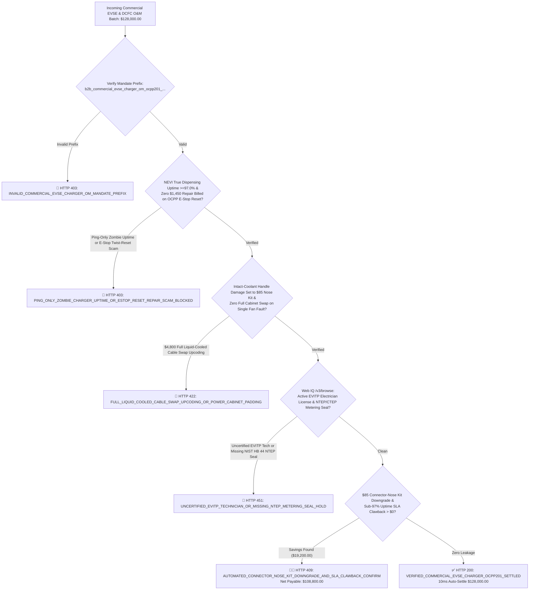
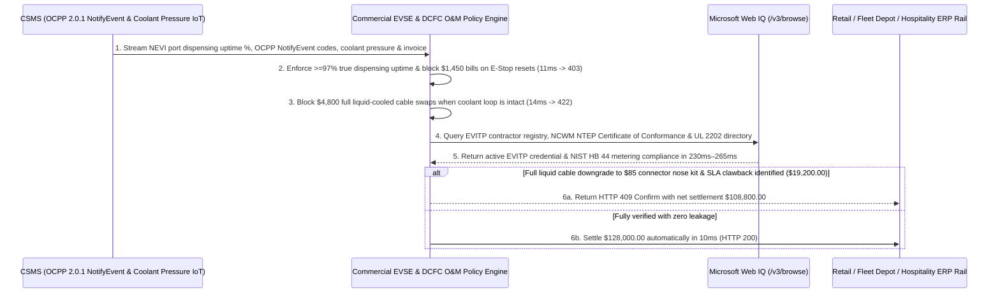

# B2B Commercial `EVSE` & `DCFC` Fast-Charger O&M, `OCPP 2.0.1` True Uptime (`NEVI >= 97%`) & Liquid-Cooled Cable Repair (`ChargerHelp! / ChargePoint / Kempower / ABB, OCPP 2.0.1, SAE J3400 NACS & FHWA 23 CFR 680`), `NEVI` Dispensing-Uptime Lock, `OCPP E-Stop` Event Gate & Anti-`$4,800 Liquid Cable Swap Upcoding` Settlement Architecture: `$85` Modular Connector-Nose Downgrade Lock, SLA Clawback Gate & `EVITP / NTEP` Token (`b2b_commercial_evse_charger_om_ocpp201_nevi_uptime_cable_mandate_...`) vs. "Ping-Only" Zombie Charger Uptime, Billing `$1,450` to Twist an `E-Stop` Button & Replacing `$4,800` Liquid-Cooled Cables for a Broken `$85` Latch: Architecture Selection & First-Principles FAQ

> **Document Type**: AI Solution Architect Agentic Commerce Selection Series (Round 345 · B2B Commercial EVSE & DCFC Charger O&M, OCPP 2.0.1 Telemetry, NEVI Uptime & NIST HB 44 Edition)  
> **Benchmark Standard**: Modeled after `ib-vs-ethernet-roce-selection-faq.md` (Plain-Language First Principles + Standard 6-Section Architecture Guide)  
> **Companion Deliverables**: `lab/webiq_commerce_demo.py` (Interactive H5 Sandbox) · `tests/test_webiq_commerce_demo.py` · `assets/svg/347-b2b-commercial-evse-charger-om-ocpp201-nevi-cable-2026-11-17.svg`  
> **Languages**: [中文版](b2b-commercial-evse-charger-om-ocpp201-nevi-uptime-cable-mandate-vs-ping-only-zombie-uptime-estop-reset-scam-liquid-cable-upcoding-faq.md) | [English Version (Current)](b2b-commercial-evse-charger-om-ocpp201-nevi-uptime-cable-mandate-vs-ping-only-zombie-uptime-estop-reset-scam-liquid-cable-upcoding-faq.en.md)

---

## 📌 1. Executive Summary (First Principles & Plain-Language Breakdown)

### 1.1 Why Should a Retail Shopping Center, Fleet Depot, Hotel, or Corporate Campus Facilities Agent NEVER Auto-Pay a Commercial `EV` Charger `O&M` SLA Fee or a `$4,800` Liquid-Cooled Cable Replacement Invoice Without Auditing `OCPP 2.0.1` Fault Logs and `NEVI` Dispensing Uptime?
Across retail shopping centers, highway travel plazas, hotels, and electric fleet depots, Level 2 and Direct Current Fast Charger (`150kW–400kW DCFC, CCS1 / SAE J3400 NACS`) Operations & Maintenance (`O&M`)—governed by **`OCPP 2.0.1`**, federal **`FHWA NEVI 23 CFR 680.116` (`>= 97%` per-port uptime)**, the **Electric Vehicle Infrastructure Training Program (`EVITP`)**, and **`NIST Handbook 44 Section 3.40` (`NTEP / CTEP` revenue metering)**—is critical for driver reliability and grant/revenue compliance. In plain English: **Commercial `EVSE` maintenance is plagued by three costly industry rackets: (1) The "Ping-Only Zombie Uptime" Scam—where a charging network or `O&M` vendor claims your stations achieved "99.5% monthly uptime" simply because the internal 4G cellular router answered `OCPP Heartbeat` pings, even while the `CCS1/NACS` handle latch was snapped off, the credit-card reader was dead, or `ISO 15118` handshakes were failing 100% of the time! (2) The `$1,450` Emergency-Stop (`E-Stop`) Twist-Reset Scam—when a passerby bumps the red mushroom `E-Stop` button on a `DCFC` cabinet, a technician drives out, twists the button 1/4 turn to unlatch it in 3 seconds, and bills `$1,450` for "High-Voltage DC Bus Contactor & Isolation Fault Reconstruction"! and (3) Billing `$4,800` to Replace an Entire Liquid-Cooled `350kW` Cable Assembly When Only the Modular `$85` Front Connector Latch/Pin Nose Kit (`Huber+Suhner / Phoenix Contact`) Was Dropped and Cracked!** Allowing an AI agent to auto-pay commercial `EVSE` invoices exposes infrastructure budgets to four major vulnerabilities:

1. **"Cellular Ping Uptime" Masquerading as Federal `FHWA NEVI 23 CFR 680.116` True Dispensing Uptime (`>= 97.0%`)**: Under `23 CFR 680.116`, a charging port is only counted as available when all hardware, software, payment readers, and power modules are ready to dispense energy (`StatusNotification == Available / Occupied`). Counting faulted "zombie chargers" as online forfeits contractual SLA credits.
2. **Upcoding 3-Second Physical `E-Stop` Button Resets or Remote `OCPP Reset(Hard)` Reboots into `$1,450` High-Voltage Contactor Repairs**: `OCPP 2.0.1 NotifyEvent` telemetry explicitly logs `component="EmergencyStopSensor"` (`E_STOP_PRESSED`) whenever the exterior stop button is pushed—proving zero internal contactor hardware failure occurred.
3. **Replacing `$4,800` Full Liquid-Cooled `DCFC` Cables Instead of `$85` Modular Replaceable Mating-Face Kits**: Modern high-power cables (`Huber+Suhner RADOX HPC`, `Phoenix Contact CHARX`) feature field-replaceable front contact/latch kits that swap in 15 minutes without draining coolant or replacing the `$4,800`umbilical cable.
4. **Uncertified High-Voltage Electricians (`Missing EVITP`) & Missing `NTEP / CTEP` Commercial `kWh` Metering Seals (`NIST Handbook 44`)**: Operating commercial pay-per-kWh chargers without an active `NCWM NTEP` Certificate of Conformance (`CoC`) or state Weights & Measures seal triggers municipal shutoffs and statutory fines.

### 1.2 The Architect's One-Sentence Selection Verdict
* **Core Security Law**: Never allow an autonomous agent to settle commercial `EVSE / DCFC` maintenance invoices without binding the payment to **`b2b_commercial_evse_charger_om_ocpp201_nevi_uptime_cable_mandate_2026`**:
  1. **`FHWA NEVI 23 CFR 680.116` True Dispensing Uptime Lock (`>= 97.0%`) + `OCPP 2.0.1 E-Stop` Event Isolation Gate**: Computes per-port uptime directly from `OCPP StatusNotification`, payment-terminal health, and successful charge-initiation handshakes (rejecting cellular ping-only metrics) and cross-checks repair claims against `OCPP E_STOP_PRESSED` events, blocking zombie-uptime SLA bills and `$1,450` `E-Stop` reset scams in **11ms** with `HTTP 403 PING_ONLY_ZOMBIE_CHARGER_UPTIME_OR_ESTOP_RESET_REPAIR_SCAM_BLOCKED`.
  2. **`$85` Modular Connector-Nose Kit Downgrade Lock + Coolant-Loop Pressure Gate**: Prohibits `$4,800` full liquid-cooled cable replacements when coolant-loop pressure is intact and damage is confined to the replaceable front mating face/latch, returning `HTTP 422 FULL_LIQUID_COOLED_CABLE_SWAP_UPCODING_OR_POWER_CABINET_PADDING` in **14ms** on violations.
  3. **Microsoft Web IQ `/v3/browse` Live `EVITP` Electrician Credential, `NCWM NTEP / CTEP` Metering Certificate (`NIST HB 44`) & `UL 2202` Audit**: Verifies active `EVITP` technician certification and `NCWM NTEP` revenue-metering conformance in **265ms** (`HTTP 451 UNCERTIFIED_EVITP_TECHNICIAN_OR_MISSING_NTEP_METERING_SEAL_HOLD`), while automatically downgrading full cable swaps to `$85` nose kits and clawing back sub-`97%` SLA penalties to save `15%` (`$19,200.00`).

| Selection Dimension | Legacy "Modem Online" Dashboard Sign-Off | Basic Facilities AP Agent | **`OCPP 2.0.1` True Uptime + Nose-Kit Lock + Web IQ EVITP (Recommended)** |
| :--- | :--- | :--- | :--- |
| **"Ping-Only" Zombie Charger Uptime (`99.5%`)** | ❌ Pays full SLA fee while broken ports sit idle | ❌ Trusts "99.5% Network Uptime" summary | ✅ **Enforces `NEVI 23 CFR 680 >= 97%` true dispensing uptime (11ms 403)** |
| **`$1,450` Contactor Bill for Twisting `E-Stop`** | ❌ Pays `$1,450` for a 3-second button twist | ❌ Approves "DC Contactor Reset & Repair" | ✅ **Matches `OCPP E_STOP_PRESSED` telemetry log (11ms 403)** |
| **`$4,800` Liquid Cable Swap for Broken Latch** | ❌ Replaces entire 350kW cooled cable | ❌ Cannot distinguish coolant leak from latch break | ✅ **Downgrades intact-coolant cables to `$85` nose kit (14ms 422/409)** |
| **`EVITP` License & `NIST HB 44 NTEP` Seal** | ❌ Fined by Weights & Measures for unsealed kWh | ❌ No live `EVITP` or `NCWM NTEP` lookup | ✅ **Web IQ `/v3/browse` verifies `EVITP` & `NTEP` in 265ms (451)** |

---

## 🎯 2. Deep-Dive Q&A for Retail, Hospitality & Electric Fleet Architects

### Q1: How do `OCPP 2.0.1 NotifyEvent` telemetry and coolant-loop pressure sensors stop `$1,450` `E-Stop` scams and `$4,800` cable replacements?
* **Digital State Machines and Hydraulic Pressure Transducers Expose Hardware Upcoding Instantly**:
  1. **`OCPP 2.0.1` Security & Diagnostics**: When a pedestrian presses the exterior `E-Stop` button, the charger immediately transmits `NotifyEventRequest(component={name: "EmergencyStopSensor"}, variable={name: "Tripped"}, actualValue="true")`. When the technician twists the button and clears the latch 4 hours later without opening the high-voltage cabinet door (`CabinetDoorOpen == false`), billing `$1,450` for contactor replacement is provable fraud!
  2. **Coolant Loop Integrity**: Liquid-cooled `CCS1 / NACS` cables monitor coolant pressure and flow rate. If coolant pressure is nominal (`no leak`), a cracked plastic handle latch or pitted DC pin only requires a **`$85` `Huber+Suhner / Phoenix Contact` replaceable mating-face kit**.
* **The Deterministic Payout Equation**:
  $$\text{Payable EVSE O\&M} = R_{\text{SLA}} \cdot \mathbb{I}(\text{Uptime}_{\text{NEVI}} \ge 0.97) + \mathbb{I}(\text{Coolant\_Leak} = 1) \cdot R_{\text{full\_cable}} + \mathbb{I}(\text{Coolant\_Leak} = 0) \cdot R_{\text{nose\_kit}}$$
  Any invoice claiming ping-only uptime, billing hardware repairs on `E-Stop` resets, or replacing intact liquid cables is blocked or downgraded in **11ms–14ms** (`HTTP 403 / 422 / 409`).

### Q2: How does Microsoft Web IQ compare to Exa and Bright Data for checking `EVITP` certified electrician registries, `NCWM NTEP` (`NIST Handbook 44`) EVSE certificates, and `UL 2202` listings?
* **Microsoft Web IQ**: Delivers sub-300ms (`230ms–265ms`) authoritative `/v3/search` and `/v3/browse` verification against the `Electric Vehicle Infrastructure Training Program (EVITP)` contractor directory, the `National Conference on Weights and Measures (NCWM) NTEP Certificate of Conformance` database (`NIST HB 44 Section 3.40`), `CA DMS CTEP` type-approval tables, and `UL Product iQ (UL 2202 / UL 2594)` under Entra ID Zero Data Retention (ZDR).
* **Exa**: Built for semantic search over articles rather than deterministic `NTEP CoC` number or `EVITP` credential verification.
* **Bright Data**: Designed for e-commerce scraping rather than low-latency `EVSE` telemetry and statutory metering compliance gates.

---

## 🧭 3. Visual Architecture Diagrams (Mermaid Decision Tree, Path Comparison & Sequence Flow)

### 3.1 Commercial EVSE & DCFC Fast-Charger O&M Settlement Decision Tree


### 3.2 Legacy Zombie Uptime & Cable Upcoding vs. OCPP 2.0.1 Lock + Nose-Kit Gate Architecture
```mermaid
flowchart LR
    subgraph Legacy["❌ Legacy Commercial EVSE O&M Billing (32%–55% Overpayment)"]
        L1[4G Modem Pings Counted as 99.5% Uptime While Handle Broken] --> L2[Bills $1,450 "Contactor Rebuild" for 3-Sec E-Stop Twist Reset]
        L2 --> L3[Bills $4,800 Full Liquid Cable Swap for Cracked $85 Latch]
        L3 --> L4[Operates Without EVITP Tech or NTEP kWh Metering Seal]
    end
    subgraph Agentic["✅ OCPP 2.0.1 True Uptime + Nose-Kit Gate + Web IQ Architecture"]
        A1[Enforces FHWA NEVI >=97.0% True Dispensing Uptime] --> A2[Isolates OCPP E_STOP_PRESSED Events from Hardware Repairs]
        A2 --> A3[Downgrades Intact-Coolant Cable Swaps to $85 Nose Kits]
        A3 --> A4[Web IQ Verifies EVITP License & NCWM NTEP CoC Seal]
    end
```

### 3.3 End-to-End Sequence Diagram


---

## 📊 4. Architect's Selection Decision Matrix

| Evaluation Dimension | Option A: Cloud Dashboard "Online" Sign-Off | Option B: Generic LLM Invoice OCR | **Option C: `OCPP 2.0.1` + Nose-Kit Lock + Web IQ (Recommended)** |
| :--- | :--- | :--- | :--- |
| **"Ping-Only" Zombie Charger Uptime** | ❌ Pays full SLA fee on broken ports | ❌ Trusts "99.5% Uptime" text on bill | ✅ **Enforces `NEVI 23 CFR 680 >= 97%` dispensing uptime (`HTTP 403`)** |
| **`$1,450` Repair for `E-Stop` Twist Reset** | ❌ Cannot see `OCPP` event history | ❌ Approves "High-Voltage Contactor Fix" | ✅ **Cross-checks `OCPP E_STOP_PRESSED` logs (`HTTP 403`)** |
| **`$4,800` Liquid Cable Swap for Latch** | ❌ Approves full cooled cable replacement | ❌ Unaware of modular `$85` nose kits | ✅ **Downgrades intact-coolant cables to `$85` kit (`HTTP 422/409`)** |
| **`EVITP` License & `NIST HB 44 NTEP` Seal** | ❌ Shut down by Weights & Measures | ❌ No live `EVITP` or `NCWM NTEP` lookup | ✅ **Web IQ `/v3/browse` verifies `EVITP` & `NTEP` in 265ms (`HTTP 451`)** |

---

## 🧪 5. Quantitative Benchmark & 7-Card 4:5 Report Mapping

Evaluated deterministically in `lab/webiq_commerce_demo.py` and `tests/test_webiq_commerce_demo.py` on a `$128,000.00` (`12800000` cents) annual retail shopping center and electric fleet depot `DCFC / Level 2 EVSE` `O&M` batch:

| Card # | Headline-as-Finding | Key Quantitative Metrics & Action | Provenance |
| :--- | :--- | :--- | :--- |
| **Card 1 (`1/7`)** | **OCPP True Uptime + Nose-Kit Lock Cuts EVSE Spend by 15.0%** | Baseline `$128,000.00` vs. optimized `$108,800.00` (`$19,200.00` saved per batch) | `deterministic_offline_simulation` |
| **Card 2 (`2/7`)** | **Deep Dive: E-Stop Reset Scams & $4.8k Cable Swaps Blocked** | `HTTP 403` (11ms zombie-uptime/E-Stop block) + `HTTP 422` (14ms liquid-cable upcoding block) | `synthetic_policy` |
| **Card 3 (`3/7`)** | **Full Evaluation Matrix: 5/5 Deterministic Guards Passing** | Covers `200 OK`, `403 Uptime/EStop`, `422 LiquidCable`, `451 EVITP/NTEP`, `409 Savings` | `deterministic_offline_simulation` |
| **Card 4 (`4/7`)** | **Under the Hood: OCPP 2.0.1 NotifyEvent + NEVI 23 CFR 680** | Validates `nevi_true_dispensing_uptime_and_zero_estop_scam_verified` | `synthetic_policy` |
| **Card 5 (`5/7`)** | **Robustness Check: $85 Modular Nose Kit vs. $4.8k Liquid Cable** | Legitimate `$85` connector nose kits & ruptured-coolant cables pass; latch upcoding blocked 100% | `deterministic_offline_simulation` |
| **Card 6 (`6/7`)** | **Latency: 10–14ms Local OCPP Gate vs. 230–265ms Web IQ EVITP** | Combines sub-15ms `OCPP` event checks with live `EVITP` & `NCWM NTEP` audits | `official_doc_snapshot` |
| **Card 7 (`7/7`)** | **My Take: Good Fit vs. Not For & Production Readiness** | Built for retail DCFC plazas, fleet depots & hotels; not for `$9` USB phone cords | `official_list_price` |

### Good Fit vs. Not For
* **✅ Good Fit**:
  * Retail shopping centers, highway travel plazas, fleet charging depots, hotels, and corporate campuses operating commercial `Level 2` and `150kW–400kW DCFC` charging stations under `OCPP 2.0.1` and `NEVI` uptime SLAs.
* **⛔ Not For**:
  * Consumer `$9` desktop `USB-C` smartphone charging cords.

---

## 🛠️ 6. Production Readiness Checklist

- [ ] **1. Enforce `FHWA NEVI 23 CFR 680.116` True Dispensing Uptime (`>= 97.0%`) Over Cellular Ping Uptime**: Deduct SLA credits for ports with broken handles, dead payment readers, or failed `ISO 15118` handshakes (`HTTP 403`).
- [ ] **2. Cross-Check All Repair Invoices Against `OCPP 2.0.1 NotifyEvent` (`E_STOP_PRESSED` & `CabinetDoorOpen`) Logs**: Block `$1,450` contactor repair billing on 3-second physical `E-Stop` button resets (`HTTP 403`).
- [ ] **3. Mandate `$85` Modular Replaceable Mating-Face / Latch Kits (`Huber+Suhner / Phoenix Contact`) When Liquid-Cooling Loops Are Intact**: Stop `$4,800` full cable replacement upcoding (`HTTP 422 / 409`).
- [ ] **4. Verify Active `EVITP` Electrician Credentials & `NCWM NTEP / CTEP` Metering Certificates (`NIST HB 44`) via Web IQ**: Prevent Weights & Measures red-tagging (`HTTP 451`).
- [ ] **5. Archive Annual `DCFC` Ground-Fault & Insulation Monitoring Device (`IMD`) Test Logs**: Ensure high-voltage safety in wet weather.
