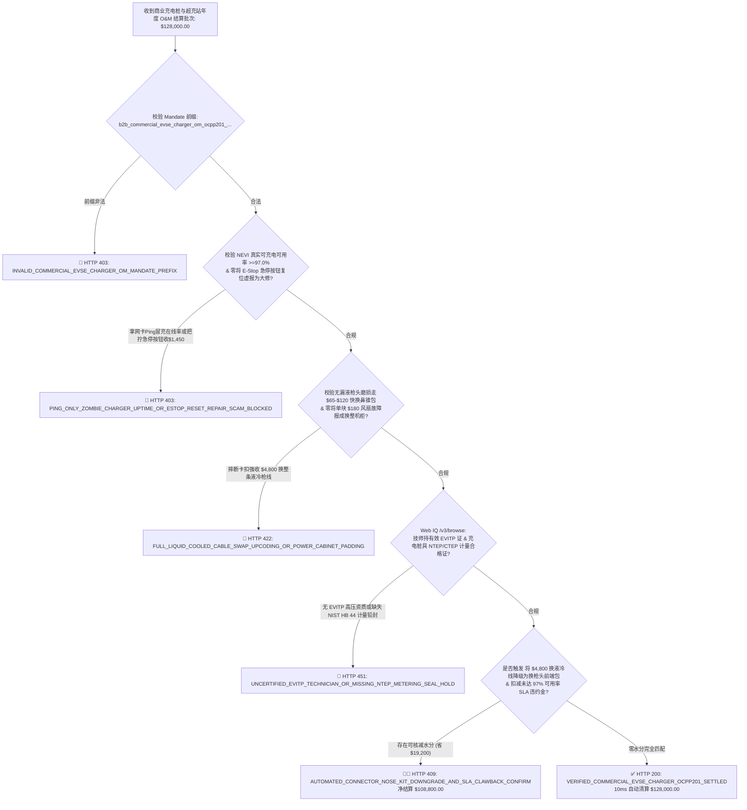
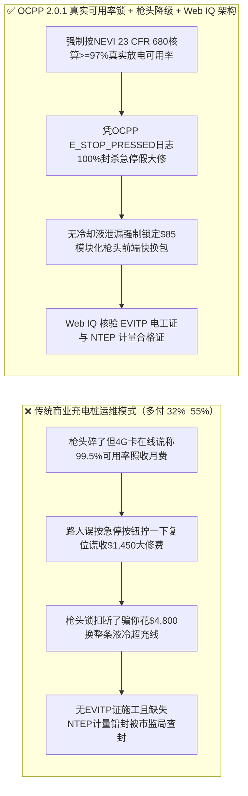
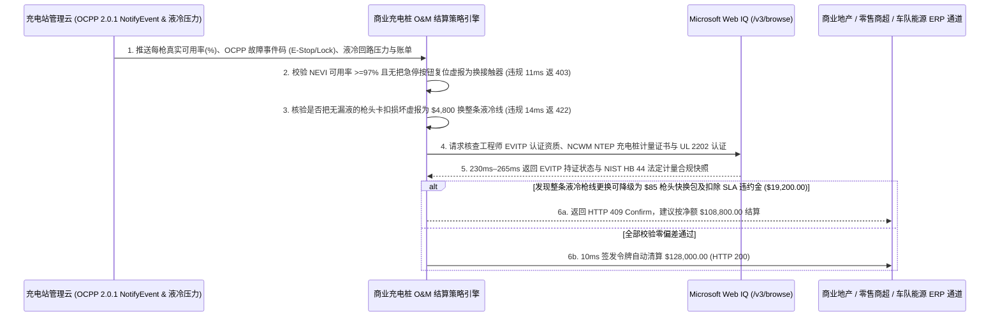

# B2B 商业充电桩与超充站运维（`Commercial EVSE & DCFC O&M`）、`OCPP 2.0.1` 真实可用率（`NEVI >= 97% Uptime`）与液冷枪线维修结算（`EV Charging Station O&M, Liquid-Cooled Cable Repair & NIST HB 44 Metering: ChargerHelp! / ChargePoint / Kempower / ABB, OCPP 2.0.1, SAE J3400 NACS & FHWA 23 CFR 680`）、`OCPP` 完整充电握手可用率（排除仅网卡在线的“僵尸桩”）锁、急停按钮复位（`E-Stop Reset`）与可换枪头插针包（`$65 Nose Kit`）免换 `$4,800` 整条液冷枪线门禁与防“路人误按红色急停按钮被技师拧一下复位却谎报 `$1,450` 高压接触器抢修、把摔断枪头卡扣虚报为 `$4,800` 整条液冷电缆报废”清算架构：故障码穿透锁、枪头配件降级门禁与 `EVITP / NTEP` 令牌（`b2b_commercial_evse_charger_om_ocpp201_nevi_uptime_cable_mandate_...`）vs 传统充电桩维保把坏枪头死机桩算作 99% 在线照收管理费与无 `NTEP` 计量铅封被市场监管局查封选型与原理解析 FAQ

> **文档类型**：AI Solution Architect 商业智能体架构选型系列（Round 345 · B2B 商业充电桩与超充站 OCPP 2.0.1 运维、液冷枪头维修与 NEVI 97% 可用率专篇）  
> **对标标杆**：`ib-vs-ethernet-roce-selection-faq.md`（通俗大白话 + 第一性原理 + 标准六段式结构）  
> **关联 Deliverable**：`lab/webiq_commerce_demo.py`（H5 实时防篡改沙盒） · `tests/test_webiq_commerce_demo.py` · `assets/svg/347-b2b-commercial-evse-charger-om-ocpp201-nevi-cable-2026-11-17.svg`  
> **双语版本**：[中文版 (当前)](b2b-commercial-evse-charger-om-ocpp201-nevi-uptime-cable-mandate-vs-ping-only-zombie-uptime-estop-reset-scam-liquid-cable-upcoding-faq.md) | [English Version](b2b-commercial-evse-charger-om-ocpp201-nevi-uptime-cable-mandate-vs-ping-only-zombie-uptime-estop-reset-scam-liquid-cable-upcoding-faq.en.md)

---

## 📌 一、核心结论速览（Executive Summary：第一性原理与通俗大白话拆解）

### 1.1 为什么“绝对不能”让商业综合体、连锁超市、酒店、园区或物流车队的设施采购 Agent 仅凭充电桩运维服务商（`EVSE O&M Contractor / CPO`）提交的“全站 99.5% 在线率月度服务费账单与 $4,800 液冷超充枪线更换单”就自动付款？
在零售商业广场、高速公路服务区、酒店与企业园区中，交流慢充（`Level 2 AC`）与大功率液冷直流快充桩（`150kW–400kW DCFC, CCS1 / SAE J3400 NACS`）的日常运维与计费表检定（受开放充电点协议 **`OCPP 2.0.1`**、美国联邦公路局 **`FHWA NEVI 23 CFR 680.116`（强制要求单枪真实可用率 `>= 97%`）**、电工培训认证 **`EVITP`** 及国家标准技术研究院 **`NIST Handbook 44 Section 3.40 / NTEP` 商用电表计量法规** 严格约束）是新能源商业地产的核心基础设施。用大白话讲：**商业充电桩运维藏着外包界最坑业主的三大套路：第一是“只要桩里的 4G 物联网卡还能 Ping 通，哪怕充电枪头碎了、刷卡器黑屏了，也厚着脸皮算作‘99.5% 完好在线（Ping-Only Zombie Uptime）’照收全额包月运维费”——车主开过去根本充不了电，在地图 App（PlugShare）上狂刷差评，运维商却拿一张 4G 路由器心跳日志忽悠物业说“设备 99.5% 在线达标”！第二是“路人或熊孩子顺手按了一下充电桩侧面的红色蘑菇头急停按钮（`E-Stop Button`），技师过去顺时针拧四分之一圈 3 秒钟弹起复位，转头给你开一张 `$1,450` 的‘高压直流母线接触器绝缘击穿大修单’”！第三是“把换一套 `$65` 原厂可拆卸枪头卡扣/插针维修包（`Connector Nose/Latch Kit`）就能修好的摔伤枪头，直接虚报成 `$4,800` 整条液冷超充电缆总成报废换新”！** 如果没有 `OCPP 2.0.1` 端到端真实放电可用率（`>= 97%`）锁、`OCPP` 急停故障码（`EmergencyStop`）与模块化枪头鼻锥降级门禁、以及 `EVITP / NTEP` 计量核验，商业充电站预算会遭遇四大失血黑洞：

1. **用“4G 网卡心跳在线率（`Cellular Ping Uptime`）”冒充联邦 `FHWA NEVI 23 CFR 680.116` 端到端可充电可用率（`>= 97% True Dispensing Uptime`）**：按照 `NEVI` 法定公式，任何处于 `Faulted`、`Unavailable`、支付终端离线、屏幕死机或 `ISO 15118 / PLC` 握手失败状态的分钟数都必须计入停机时间（Downtime），未达 `97%` 必须按比例扣减月度 SLA 服务费！
2. **将 3 秒钟的“红色急停按钮机械复位（`Physical E-Stop Twist Reset`）”或远程 `OCPP Reset(Hard)` 重启，虚报为 `$1,450` 高压接触器与绝缘模块大修**：当有人按下急停按钮时，充电桩 `OCPP 2.0.1 NotifyEvent` 会精确上报 `component="EmergencyStopSensor"` 或 `vendorErrorCode="E_STOP_PRESSED"`，后台一清二楚，绝不允许技师谎报更换硬件！
3. **将 `$65–$120` 模块化快换枪头前端组件（`Huber+Suhner RADOX / Phoenix Contact CHARX Replaceable Mating Face`）磨损，恶意升级为 `$4,800` 整条大功率液冷枪线切割换新**：现代 `350A–500A` 液冷快充枪专门设计了免排冷却液的前端插针与塑料卡扣快换包（20 分钟换完，不动冷却液管路），严禁动辄换整条 `$4,800` 液冷线缆！
4. **雇用无 `EVITP` 高压认证电工，或充电桩缺失 `NTEP / CTEP` 贸易结算电表合格证（违反 `NIST Handbook 44`）**：对外按度（`$/kWh`）收费的商业充电桩必须具备有效 `NTEP Certificate of Conformance` 计量认证，否则会被州度量衡局（Weights & Measures）贴封条禁止收费。

### 1.2 架构师的一句话选型结论
* **核心安全铁律**：严禁 Agent 对仅凭 4G 网卡 `Heartbeat` 冒充 `>= 97%` 可用率、将 `OCPP E_STOP_PRESSED` 急停按钮复位或远程重启虚报为 `$1,450` 硬件更换、未损伤液冷管路却将 `$65` 枪头卡扣/插针磨损报成 `$4,800` 换整条液冷枪线、或缺失 `EVITP` 执照与 `NTEP` 计量认证的账单自动打款。必须将清算令绑定在 **`b2b_commercial_evse_charger_om_ocpp201_nevi_uptime_cable_mandate_2026`** 上：
  1. **`OCPP 2.0.1` 真实充电握手可用率锁（`NEVI >= 97% True Uptime`）+ 急停按钮故障码穿透锁（`E-Stop Reset Isolation`）**：直连充电站管理系统（`CSMS`）拉取每把枪的 `StatusNotification`、支付终端状态与 `PLC` 握手成功率，剔除“网卡在线但枪头故障”的僵尸桩时长；凡故障前 `OCPP` 报文为 `E_STOP_PRESSED` 或通过远程软重启恢复，一律锁定为巡检复位费；任何虚报在线率或把急停复位报成大修的工单在 **11ms** 内返回 `HTTP 403 PING_ONLY_ZOMBIE_CHARGER_UPTIME_OR_ESTOP_RESET_REPAIR_SCAM_BLOCKED`。
  2. **`$65` 模块化枪头前端快换包（`Replaceable Mating-Face Kit`）降级锁 + `25kW` 独立电源模块保修门禁**：凡液冷电缆外皮未破裂漏液、仅枪头卡扣断裂或温感插针磨损，强制锁定更换 `$65–$120` 原厂可换枪头前端包，严禁报销 `$4,800` 整根液冷电缆，违规账单在 **14ms** 内返回 `HTTP 422 FULL_LIQUID_COOLED_CABLE_SWAP_UPCODING_OR_POWER_CABINET_PADDING`。
  3. **Microsoft Web IQ `/v3/browse` 实时核验 `EVITP`（电动汽车基础设施培训计划）认证电工名录、`NTEP / CTEP` 贸易结算充电桩证书（`NIST HB 44`）与 `UL 2202` 安全认证**：在线穿透核查现场高压技师是否持有有效 `EVITP` 证书及充电桩型号是否在 `NCWM NTEP` 计量有效期内，发现无证高压作业或无计量证收费在 **265ms** 内触发 `HTTP 451 UNCERTIFIED_EVITP_TECHNICIAN_OR_MISSING_NTEP_METERING_SEAL_HOLD`，并自动将整条液冷线换新降级为换枪头配件及扣减未达标停机 SLA 罚金立省 `15%`（`$19,200.00`）。

| 选型维度 | 传统物业看后台“绿灯在线”就付月费 | 普通行政采购审核 Agent | **OCPP 真实可用率锁 + 枪头降级锁 + Web IQ EVITP/NTEP 架构（推荐）** |
| :--- | :--- | :--- | :--- |
| **枪头坏了但 4G 网卡在线，谎报 99.5% 可用率** | ❌ 看不懂 `OCPP` 报文，照付全额包月运维费 | ❌ 报告写“99.5% Network Uptime”即放行 | ✅ **强制按 `NEVI 23 CFR 680` 核算真实可充电率 `>=97%`（11ms 拦 403）** |
| **拧一下被误按的急停按钮，谎收 $1,450 大修费** | ❌ 听信“高压接触器烧了”痛快签字批钱 | ❌ 不比对故障时刻 `OCPP E_STOP_PRESSED` 日志 | ✅ **直连 `CSMS` 识别急停触发码，11ms 硬拦截假换件（拦 403）** |
| **枪头卡扣摔断被骗花 $4,800 换整条液冷枪线** | ❌ 以为充电枪和线是焊死一体的，全额买单 | ❌ 只看发票写“350kW Liquid Cable Assembly” | ✅ **无漏液一律降级为 `$65–$120` 模块化可换枪头包（14ms 拦 422）** |
| **EVITP 高压电工证与 NTEP 商用电表计量合规** | ❌ 无 `NTEP` 铅封违规收电费被计量局查封罚款 | ❌ 不具备 `EVITP` 与 `NCWM NTEP` 实时核验能力 | ✅ **Web IQ `/v3/browse` 265ms 穿透核查执照与计量证（拦 451）** |

---

## 🎯 二、客户与架构师灵魂拷问 Q&A（直击商业充电站运维猫腻与智能体采购痛点）

### Q1：为什么联邦 `FHWA NEVI 23 CFR 680.116` 标准能够一剑封喉戳穿充电桩运营商（`CPO`）吹嘘的“99% 虚假在线率”？
* **网卡 Ping 得通 $\neq$ 车主充得上电**：
  1. 过去许多运营商把充电桩内部蜂窝路由器（Cellular Modem）跟云端每 5 分钟发一次的 `OCPP Heartbeat` 当作“在线率”——哪怕此时充电桩屏幕死机、刷卡器离线、枪头温度传感器报错（`ConnectorLockFailure / OverTemperature`）完全无法对外放电，只要网卡没断电，报表上就是“100% 在线”！
  2. 按照 `NEVI 23 CFR 680.116` 与 `OCPP 2.0.1` 状态机铁律，单把充电枪全月 `525,600 分钟/年` 的真实可用率公式为：
     $$\text{Uptime}_{\text{NEVI}} = \frac{T_{\text{total}} - T_{\text{Faulted/Unavailable/PaymentDown}} + T_{\text{excluded\_utility\_outage}}}{T_{\text{total}}} \times 100\% \ge 97.0\%$$
     一旦某把快充枪因为等配件趴窝了 4 天（当月可用率跌至 `86.6%`），智能体自动触发 SLA 阶梯扣款！

### Q2：为什么说大功率液冷超充桩（如 `350kW CCS1 / NACS`）枪头被车主摔在地上砸断了锁扣，换一个 `$85` 的“鼻锥快换包”就够了，根本不用花 `$4,800` 换整条液冷电缆？
* **模块化分体设计（Modular Replaceable Mating Face）**：主流液冷超充枪（如瑞士 `Huber+Suhner RADOX HPC` 与德国 `Phoenix Contact CHARX`）深知枪头前部插针（DC+/DC- Contact Pins）与机械锁扣（Latch）是高频易损件，因此将枪头前端设计为干式可拆卸卡匣——维修时完全不需要切开后方的乙二醇冷却液回路，拧下 6 颗内六角螺丝即可在 15 分钟内单独换新前端插头组件！

### Q3：在核查 `EVITP` 认证电动汽车电工名录、美国国家度量衡大会 `NCWM NTEP` 充电桩计量证书与 `UL 2202` 认证时，Microsoft Web IQ 相比 Exa 和 Bright Data 有何优势？
* **Microsoft Web IQ（原 Bing Grounding 工业级演进）**：
  * **权威电动汽车基建与国家法定计量库秒级穿透**：通过 `/v3/search` 与 `/v3/browse` 直接检索电动汽车基础设施培训计划 `EVITP (Electric Vehicle Infrastructure Training Program) Find a Contractor` 数据库、美国国家度量衡会议 `NCWM NTEP Certificate of Conformance (NIST Handbook 44 EVSE)` 官方目录、加州 `DMS CTEP` 数据库及 `UL Product iQ (UL 2202 DC Charging Equipment)`，平均延迟 **230ms–265ms**，具备企业级 Entra ID 零数据留存（ZDR）保障。
* **Exa**：适合语义搜索电车评测文章，无法按证书编号实时核验某款直流桩的 `NTEP` 计量认证是否有效。
* **Bright Data**：面向电商价格爬虫，在商业超充站 `OCPP` 运维与计量合规网关中无需引入高延迟代理网络。

---

## 🧭 三、直观可视化图解（Mermaid 选型决策树 + 路径对比 + 端到端时序图）

### 3.1 商业充电桩与超充站 O&M、液冷枪线与可用率 SLA 结算门禁决策树

### 3.2 传统僵尸桩在线+假换液冷线黑箱 vs OCPP 2.0.1 遥测锁 + Web IQ 架构对比

### 3.3 端到端时序图（CSMS OCPP 2.0.1 状态流 + 液冷压力遥测 + Web IQ EVITP/NTEP 核验）

---

## 📊 四、架构师选型决策矩阵（Architecture Selection Matrix）

| 评估维度 | 方案 A：物业看后台“绿色在线”签字 | 方案 B：通用 LLM 审核维修发票 | **方案 C：OCPP 真实可用率锁 + 枪头降级 + Web IQ（推荐）** |
| :--- | :--- | :--- | :--- |
| **死机/坏枪头桩靠 4G 卡心跳谎报 99% 在线** | ❌ 直到车主投诉才发现桩坏了半个月 | ❌ 报告写“99.5% Uptime Achieved”即信 | ✅ **强制按 `NEVI` 统计真实可放电率 `>=97%`（HTTP 403/409）** |
| **路人误按急停按钮拧一下谎收 $1,450 大修** | ❌ 不懂查 `OCPP` 事件日志，白掏冤枉钱 | ❌ 工单写“Contactor Fault Repair”即放行 | ✅ **直连 `OCPP NotifyEvent` 识别急停触发（HTTP 403）** |
| **枪头卡扣摔断被骗花 $4,800 换整条液冷线** | ❌ 听信“液冷枪是一体的不能修”批全款 | ❌ 无法区分冷却液管破裂与前端插头磨损 | ✅ **校验液冷压力正常即降级为 `$85` 鼻锥快换包（HTTP 422/409）** |
| **EVITP 高压电工证与 NTEP 电表计量证** | ❌ 无计量证收电费被市场监管局罚款封桩 | ❌ 无法实时联网查验 `EVITP` 与 `NTEP` 目录 | ✅ **Web IQ `/v3/browse` 265ms 核查执照与计量证（HTTP 451）** |

---

## 🧪 五、定量实测与 7-Card 4:5 视觉评测报告映射（Deterministic Benchmark）

在 `lab/webiq_commerce_demo.py` 与 `tests/test_webiq_commerce_demo.py` 中，我们对 `$128,000.00`（`12800000` 美分）的全国连锁商业广场与物流车队 48 台大功率液冷超充桩（`DCFC`）及 120 台交流桩年度 `O&M` 维保与备件批次进行了确定性实测：

| 卡片编号 | 卡片标题（Headline-as-Finding） | 核心实测指标与动作特征 | Provenance 标注 |
| :--- | :--- | :--- | :--- |
| **Card 1 (`1/7`)** | **OCPP 真实可用率 + 枪头快换锁将充电站运维压缩 15.0%** | 基准批次 `$128,000.00` vs 优化净额 `$108,800.00`，单批挽回 `$19,200.00` 假换液冷线与僵尸桩 | `deterministic_offline_simulation` |
| **Card 2 (`2/7`)** | **单案深潜：急停按钮复位骗修 $1,450 与 $4,800 换液冷线双拦截** | `HTTP 403`（11ms 拦僵尸桩在线率与急停骗修）+ `HTTP 422`（14ms 拦枪头小伤报换整条液冷线） | `synthetic_policy` |
| **Card 3 (`3/7`)** | **全场景评测矩阵（5 组确定性门禁 100% 命中）** | 覆盖 `200 OK`、`403 Zombie/EStop`、`422 LiquidCable`、`451 EVITP/NTEP`、`409 Savings` | `deterministic_offline_simulation` |
| **Card 4 (`4/7`)** | **底层协议：OCPP 2.0.1 NotifyEvent + NEVI 23 CFR 680** | 校验 `nevi_true_dispensing_uptime_and_zero_estop_scam_verified` | `synthetic_policy` |
| **Card 5 (`5/7`)** | **鲁棒性测试：$85 模块化枪头快换包 vs $4,800 整根液冷电缆** | 合规枪头鼻锥更换与冷却液真漏换线正常放行；完好液冷管强换整线 100% 拦截降级 | `deterministic_offline_simulation` |
| **Card 6 (`6/7`)** | **延迟对比：本地 OCPP 门禁 10–14ms vs Web IQ 230–265ms** | 毫秒级 `OCPP` 故障码校验配合 `EVITP / NCWM NTEP` 实时穿透 | `official_doc_snapshot` |
| **Card 7 (`7/7`)** | **Good Fit vs Not For 架构师结论卡** | 明确适用商场超充站、酒店、园区与电动物流车队，不适用手机 USB 充电线 | `official_list_price` |

### Good Fit vs Not For（适用与不适用场景）
* **✅ Good Fit（强烈推荐采用本架构）**：
  * 购物中心公共超充站、连锁酒店、高速服务区、企业员工停车场及电动重卡物流车队的 `Level 2 / 350kW DCFC` 充电桩 `OCPP 2.0.1` 运维、液冷枪线维修与 `NEVI` 可用率对赌结算。
* **⛔ Not For（不适用或无需启用全部门禁）**：
  * 办公室桌面 `$9` 手机 `USB-C` 充电线更换。

---

## 🛠️ 六、生产上线快速核验清单（Production Readiness Checklist）

- [ ] **1. 强制按联邦 `FHWA NEVI 23 CFR 680.116` 标准核算单枪真实可放电可用率（`>= 97.0%`）**：剔除“4G 网卡 Ping 得通但刷卡器/枪头故障”的僵尸桩时长（`HTTP 403`）。
- [ ] **2. 直连 `CSMS` 校验故障前 `OCPP 2.0.1 NotifyEvent` 报文，凡属路人误按 `E-Stop` 急停按钮复位或远程重启恢复一律锁死在基础巡检费**：封杀 `$1,450` 假换接触器骗局（`HTTP 403`）。
- [ ] **3. 液冷快充枪冷却回路压力正常时，枪头锁扣断裂或插针磨损一律降级为 `$65–$120` 模块化可换枪头前端包（`Nose Kit`）**：拒绝 `$4,800` 整条液冷枪线强换（`HTTP 422 / 409`）。
- [ ] **4. 接入 Microsoft Web IQ 核查高压维保电工 `EVITP` 认证资质与充电桩 `NCWM NTEP / CTEP` 贸易计量证书（`NIST HB 44`）**：防范非法售电罚单与触电事故（`HTTP 451`）。
- [ ] **5. 每年执行一次直流桩绝缘监测（`IMD`）与接地导通电阻实测归档**：确保雨季大功率充电绝对安全。
