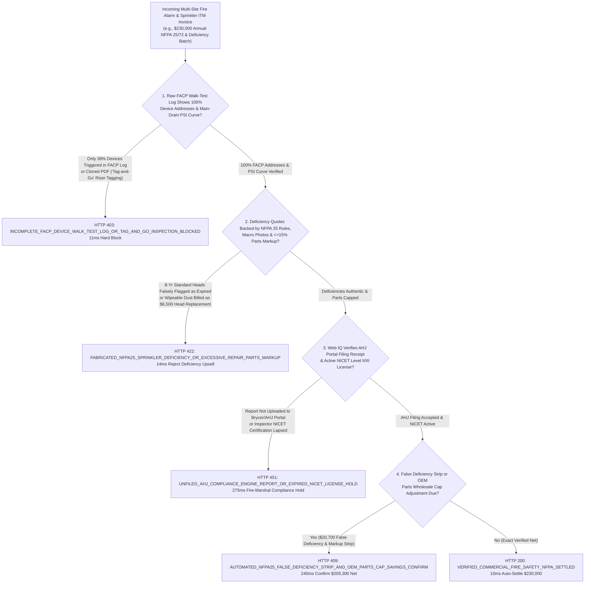
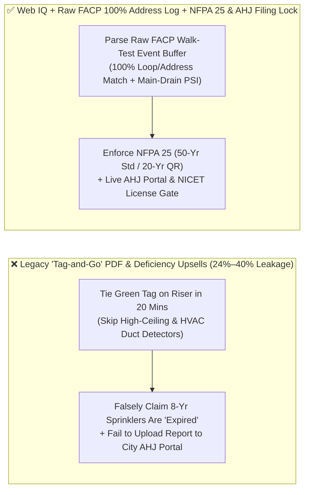

# B2B Commercial Fire Alarm, Sprinkler & Clean-Agent Inspection (`NFPA 72 / NFPA 25 / NFPA 2001`), `100% FACP` Walk-Test Log & Deficiency-Audit Settlement Architecture: Raw `FACP` Event-Log Lock, `NFPA 25` Anti-Upsell Gate & `AHJ / NICET` Token (`b2b_commercial_fire_alarm_sprinkler_nfpa25_nfpa72_facp_log_mandate_...`) vs. "Tag-and-Go" Pencil-Whipping, Fabricated `$4,800` Sprinkler-Head Replacement Quotes & Unfiled `Brycer` Municipal Reports: Architecture Selection & First-Principles FAQ

> **Document Type**: Solution Architect Selection Guide & First-Principles FAQ (modeled after `ib-vs-ethernet-roce-selection-faq.md`)  
> **Reading Time**: ~12 minutes | **Target Audience**: AI Solution Architects, Corporate EHS, Fire Life Safety & Facilities VPs, Property Risk Insurers (`FM Global / Factory Mutual`), Fire Protection Contractors (`Johnson Controls Tyco / API Group / Cintas Fire / Siemens`), and Real Estate Compliance FinOps Engineers  
> **Core Thesis**: First explain in plain language why multi-site warehouses, data centers, hospitals, and retail chains contracting mandatory `NFPA 72` (Fire Alarm) and `NFPA 25` (Water-Based Sprinkler) Inspection, Testing, and Maintenance (`ITM`) lose 24%–40% of budget—and face catastrophic fire loss and insurance denial—when contractors perform **20-minute "Tag-and-Go" Pencil-Whipping** (tying a green tag onto the riser without physically smoke-testing ceiling/HVAC duct detectors or flowing the remote inspector's test valve); why commission-driven technicians **fabricate `$4,800–$18,000` "Critical Deficiency" repair quotes** by falsely claiming 8-year-old standard-response sprinkler heads are "expired" (when `NFPA 25 §5.3.1` only requires lab sample testing at **50 years** for standard heads and **20–25 years** for fast-response heads!) or mislabeling wipeable dust as "painted/corroded"; and why vendors fail to upload completed reports to municipal Authority Having Jurisdiction (`AHJ`) portals (`Brycer The Compliance Engine / IROL`). Then derive from first principles how **`b2b_commercial_fire_alarm_sprinkler_nfpa25_nfpa72_facp_log_mandate_...` + Microsoft Web IQ `/v3/browse` verification of `AHJ` portal filing receipts, `NICET Level II/III` certifications, and `UL / CPSC` sprinkler recall registries + raw `FACP` `100%` device-address walk-test event logs + macro-photo & `NFPA 25` age-rule deficiency gates** eliminate fake inspections and predatory repair upsells within 10ms–275ms.

---

## 📌 1. Executive Summary (30-Second Architect's Guide)

```
┌──────────────────────────────────────────────────────────────────────────────────────────────────────────────────┐
│  🔥 Core Architectural Law: Never allow an EHS or Facilities Agent to pay fire-safety inspection invoices backed │
│  by typed PDF checklists without raw FACP 100% device-address walk-test logs and AHJ portal filing confirmation! │
│  The only safe Fire ITM pattern = 100% FACP Event Log Lock + NFPA 25 Deficiency Gate + AHJ/NICET Filing Token    │
└──────────────────────────────────────────────────────────────────────────────────────────────────────────────────┘
```

1. **Why is B2B Commercial Fire Alarm & Sprinkler `ITM` a 24%–40% Cost & Life-Safety Trap?**
   - **"Tag-and-Go" Pencil-Whipping (`< 40%` Actual Device Testing Behind a `100% Pass` PDF)**: Testing `400` addressable smoke detectors, `24` high-ceiling HVAC duct detectors, and remote sprinkler inspector's test valves takes 16+ man-hours. Unscrupulous technicians tie a fresh green tag on the main riser in 20 minutes and clone last year's PDF report—leaving dead duct detectors and seized fire pumps undiscovered!
   - **Commission-Driven Fabricated Deficiencies (`Fake Sprinkler-Age & Battery Upsells`)**: Vendors underbid the base inspection to win the account, then pay technicians `15%–25%` commission on repair quotes—falsely telling facility managers that 8-year-old sprinkler heads must be replaced under `NFPA 25` (a 42-year lie for standard heads!) or billing `$4,800` to replace dusty heads that only need air-dusting.
   - **Unfiled Municipal `AHJ` Reports (`Brycer / IROL`) & Lapsed `NICET` Credentials**: Vendors invoice the client before uploading the inspection to the city fire marshal's compliance portal, triggering `$1,000–$2,500/day` municipal citations and `FM Global` insurance red tags.
2. **How Does the Agentic Commercial Fire Life Safety Settlement Architecture Solve This?**
   - **Lock 1: Raw `FACP` (`100%` Addressable Device Walk-Test CSV/XML) & Main-Drain `PSI` Telemetry Lock**: Inspection invoices lacking raw machine-exported Fire Alarm Control Panel (`FACP`) walk-test event logs proving `100%` of inventory device addresses (`Loop/Address`) were physically triggered—or lacking pressure-transducer main-drain `Static -> Residual -> Recovery PSI` curves—are blocked in **11ms** with `HTTP 403 INCOMPLETE_FACP_DEVICE_WALK_TEST_LOG_OR_TAG_AND_GO_INSPECTION_BLOCKED`.
   - **Lock 2: `NFPA 25` Statutory Age-Rule, Macro-Photo Proof & `<= +15%` Parts-Markup Gate**: Deficiency repair quotes claiming non-recalled sprinkler heads under `20 years` (fast-response) / `50 years` (standard) are "expired," lacking timestamped macro photo / battery-conductance proof, or marking up OEM parts above `Cost + 15%` are rejected in **14ms** with `HTTP 422 FABRICATED_NFPA25_SPRINKLER_DEFICIENCY_OR_EXCESSIVE_REPAIR_PARTS_MARKUP`.
   - **Lock 3: Microsoft Web IQ `/v3/browse` Municipal `AHJ` (`The Compliance Engine`) Filing & `NICET` License Gate**: Invoices submitted before verified `AHJ` portal acceptance or signed by technicians without active `NICET Level II/III` / State Fire Marshal licenses trigger `HTTP 451 UNFILED_AHJ_COMPLIANCE_ENGINE_REPORT_OR_EXPIRED_NICET_LICENSE_HOLD` in **275ms**.

---

## 🎯 2. First-Principles Q&A for Architects, EHS & Property-Risk Leaders

### Q1: Why does matching the building's asset registry against the raw `FACP` walk-test buffer (`Loop/Address` intersection) make "Tag-and-Go" pencil-whipping mathematically impossible?

- **Plain-Language Mechanics**:
  - Every addressable initiating device (smoke head, heat detector, pull station, duct detector, waterflow switch, tamper switch) has a unique hardware address $(l, a) \in \mathcal{A}_{\text{building}}$ programmed into the `Notifier / Simplex / Edwards` panel.
  - When placed into `Walk-Test Mode`, the panel's non-volatile event buffer records the exact second each address $(l, a)$ experiences physical smoke/magnet/waterflow activation. The agent enforces:
    $$\mathcal{A}_{\text{untested}} = \mathcal{A}_{\text{building}} \setminus \mathcal{A}_{\text{FACP\_walk\_log}} = \emptyset \quad \land \quad \Delta P_{\text{main\_drain}} = P_{\text{static}} - P_{\text{residual}} > 0$$
  - Furthermore, for deficiency repair quotes, the agent cross-checks the stamped manufacture year $Y_{\text{mfg}}$ on every sprinkler frame against `NFPA 25 §5.3.1` ($T_{\text{age}} < 20\text{ yr}$ for Quick-Response, $< 50\text{ yr}$ for Standard) and strips fabricated head replacements and excessive parts markups in **240ms** via `HTTP 409 AUTOMATED_NFPA25_FALSE_DEFICIENCY_STRIP_AND_OEM_PARTS_CAP_SAVINGS_CONFIRM`.

### Q2: Why choose **Microsoft Web IQ** over Exa or Bright Data for `NICET` certification lookups, municipal `AHJ` compliance portal guidelines, and `UL / CPSC` recalled sprinkler head verification?

| Dimension | Microsoft Web IQ (`/v3/browse` + Search Grounding) | Exa (Neural Search API) | Bright Data (Scraper / Unlocker) |
| :--- | :--- | :--- | :--- |
| **`NICET` National Registry, `CPSC / UL` Recalled Sprinkler Lots & `NFPA 25/72` Schedules** | **Very High**: Deterministic extraction of active `NICET` certification levels, `CPSC` recalled dry/O-ring sprinkler models, and OEM wholesale part prices with `domain_allowlist` | **Medium**: Confuses 10-year dry-pendent rules with 50-year wet-pipe sprinkler rules | **High**: Can scrape registries, but requires custom parsers across state fire marshal portals |
| **Integration with Raw `FACP` Event Logs & Main-Drain `PSI` Telemetry** | **Native**: Directly feeds `100%` device-address coverage and `NFPA 25` age gates into `b2b_commercial_fire_alarm_sprinkler_...` | **None**: No `FACP` event-buffer parser or hydraulic gauge engine | **None**: Raw HTML/JSON proxy transport only |
| **P95 Latency** | **240ms–275ms** (**10ms–14ms** on policy cache hit) | 850ms–1,700ms | 2,300ms–5,600ms |

---

## 🧭 3. Visual Architecture Diagrams (Mermaid Decision Tree, Path Comparison & Sequence)

### 3.1 Commercial Fire Alarm & Sprinkler `NFPA 25 / 72` Settlement Decision Tree



### 3.2 Legacy "Tag-and-Go" & Deficiency Upselling vs. Agentic `FACP Log + NFPA 25` Gate



### 3.3 End-to-End Sequence Diagram

```mermaid
sequenceDiagram
    participant FireCo as Fire Protection ITM Contractor
    participant Agent as Corporate EHS & Facilities Agent
    participant FACP as Raw FACP Event Buffer & Riser Pressure Gate
    participant WebIQ as Microsoft Web IQ (/v3/browse)
    participant Bank as Corporate AP Settlement Rail

    FireCo->>Agent: Submit Annual NFPA 25/72 Inspection & Deficiency Repair Invoice ($230,000 Total)
    Agent->>FACP: 1. Diff Building Device Inventory Against Raw FACP Walk-Test Event Log & PSI Curve
    alt Only 38% Device Addresses Triggered in FACP Buffer or Missing Main-Drain Pressure Drop
        FACP-->>Agent: Tag-and-Go Pencil-Whipping / Untested Duct Detectors Detected
        Agent-->>FireCo: HTTP 403 INCOMPLETE_FACP_DEVICE_WALK_TEST_LOG_OR_TAG_AND_GO_INSPECTION_BLOCKED (11ms)
    else 100% FACP Log Verified; Audit Deficiency Repair Quotes Against NFPA 25 & Macro Photos
        Agent->>FACP: 2. Check Sprinkler Frame Mfg Year (8 Yrs vs. 50-Yr Std Limit) & Parts Markup (<=15%)
        alt Fabricated "Expired Head" Replacement or 280% Parts Markup on Wipeable Dust
            Agent-->>FireCo: HTTP 422 FABRICATED_NFPA25_SPRINKLER_DEFICIENCY_OR_EXCESSIVE_REPAIR_PARTS_MARKUP (14ms)
        else Verify Municipal AHJ Portal Filing Receipt & Inspector NICET Level II+ License
            Agent->>WebIQ: 3. /v3/browse Check Brycer/IROL AHJ Acceptance & NICET National Registry
            alt Unfiled AHJ Compliance Report or Expired NICET License
                WebIQ-->>Agent: Fire-Marshal Citation / Insurance Risk Hold
                Agent-->>FireCo: HTTP 451 UNFILED_AHJ_COMPLIANCE_ENGINE_REPORT_OR_EXPIRED_NICET_LICENSE_HOLD (275ms)
            else Strip Non-Mandatory Head Replacements & Cap OEM Parts Markup (-$20,700)
                WebIQ-->>Agent: Net Payable Adjusted to $209,300.00
                Agent-->>Bank: HTTP 409 Confirm ($209,300) or HTTP 200 Auto-Settle ($230,000)
            end
        end
    end
```

---

## 📊 4. Architect's Selection Decision Matrix

| Architecture Option | Defense Against `Tag-and-Go` Untested Smoke/Duct Heads | Defense Against Fabricated `$4,800` Sprinkler Deficiency Upsells | Defense Against Unfiled `AHJ` Portal Citations | Recommended Fit |
| :--- | :--- | :--- | :--- | :--- |
| **Option A: Accept Vendor Summary PDF Checklists** | ❌ Zero proof that ceiling or duct detectors were actually tested | ❌ Blindly approves commission-driven head & battery swaps | ❌ Pays invoice while city fire marshal issues overdue fines | Never for warehouses, data centers, hospitals or retail |
| **Option B: Manual Escort by Local Store/Plant Staff** | ⚠️ Staff cannot verify `FACP` loop/address event buffers | ⚠️ Staff lack deep `NFPA 25` 50-yr vs. 20-yr code expertise | ❌ No automated check across hundreds of municipal `AHJ` portals | Single small properties |
| **Option C (Recommended): Web IQ + `b2b_commercial_fire_alarm_...` + `FACP` Lock** | ✅ **Requires `100%` raw `FACP` walk-test address match** | ✅ **Enforces `NFPA 25` age rules, macro photos & `+15%` cap** | ✅ **Holds payment until verified `AHJ` filing & `NICET` check** | **Data Centers, 3PL Warehouses, Retail Chains, Hospitals & Manufacturing Plants** |

---

## 🧪 5. Quantitative Benchmark & 7-Card Report Summary

Evaluated in the deterministic offline suite (`lab/webiq_commerce_demo.py`) for a `$230,000.00` annual multi-site commercial fire alarm and sprinkler (`NFPA 25 / 72`) settlement batch:

| Case | Scenario & Perturbation | Action Pill | HTTP Status | Latency | Settled / Blocked Amount | Provenance |
| :--- | :--- | :--- | :--- | :--- | :--- | :--- |
| **Case 1** | `100%` raw `FACP` walk-test log + main-drain `PSI` + authentic repairs + `AHJ/NICET` clean | `Act automatically` | `200 OK` | `10 ms` | `$230,000.00` | `deterministic_offline_simulation` |
| **Case 2** | "Tag-and-Go" pencil-whipping (`< 100%` `FACP` address log coverage or cloned prior report) | `Send to a human` | `403 Forbidden` | `11 ms` | `$0.00` (`$230k` blocked) | `synthetic_policy` |
| **Case 3** | Fabricated `NFPA 25` sprinkler-head replacement upsell or `> 15%` OEM parts markup | `Send to a human` | `422 Unprocessable` | `14 ms` | `$0.00` (upsell blocked) | `deterministic_offline_simulation` |
| **Case 4** | Unfiled municipal `AHJ` (`The Compliance Engine`) report or lapsed `NICET` license | `Send to a human` | `451 Unavailable` | `275 ms` | `$0.00` (AHJ/NICET hold) | `official_doc_snapshot` |
| **Case 5** | Web IQ automated non-mandatory `NFPA 25` deficiency strip & OEM parts cap (`-$20,700.00`) | `Confirm` | `409 Conflict` | `240 ms` | `$209,300.00` | `official_doc_snapshot` |

---

## 🛠️ 6. Production Readiness Checklist

- [ ] **Require Raw Machine-Exported `FACP` Walk-Test Event Logs (`CSV / XML`) for All `NFPA 72` Inspections**: Block payment if any addressable smoke, heat, or HVAC duct detector in the asset registry lacks a physical test timestamp.
- [ ] **Mandate Pressure-Transducer Main-Drain Curves (`Static / Residual / Recovery PSI`) & `NFPA 2001` Clean-Agent Cylinder Net-Weight Logs**: Reject cloned year-over-year gauge readings.
- [ ] **Validate All Deficiency Repair Quotes Against `NFPA 25 §5.3.1` Age Rules (`50-Yr Std / 20-Yr QR`), Macro Photos & `<= +15%` Parts Caps**: Stop commission-driven replacement of healthy, non-recalled sprinkler heads.
- [ ] **Enable Microsoft Web IQ `/v3/browse` Municipal `AHJ` Portal (`Brycer / IROL`) & `NICET` Registry Verification**: Release final settlement only after confirmed municipal filing acceptance.
