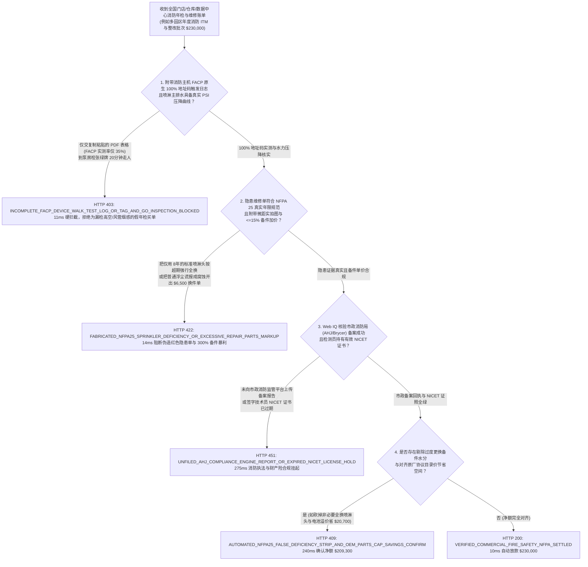
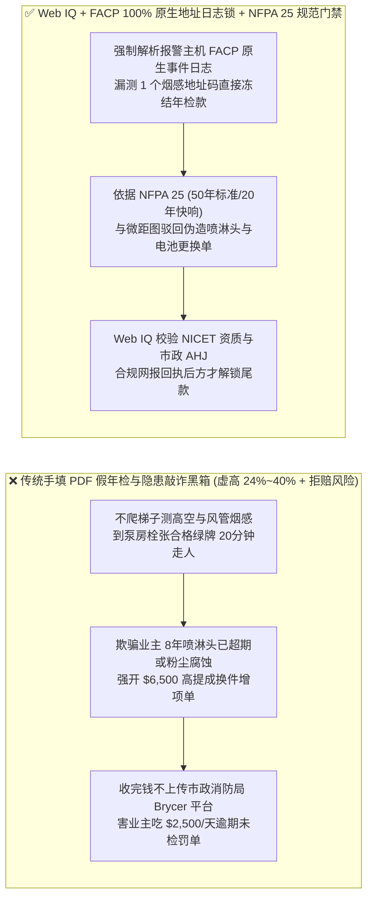
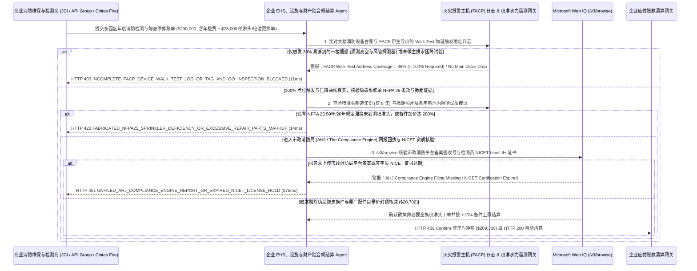

# B2B 智能体商业消防报警、自动喷淋与气体灭火维保检测（`Commercial Fire Life Safety Inspection & Testing: NFPA 72 / NFPA 25 / NFPA 2001`）、消防主机 `FACP` 逐点位触发事件日志与末端试水压降遥测（`100% Initiating-Device Walk-Test Log & Main-Drain PSI Curve`）及防“挂绿牌走人 / 伪造 `$4,800` 喷淋头腐蚀隐患单”清算架构：主机点位 100% 实测日志锁、隐患整改前/后微距铁证门禁与市政消防政务网（`Brycer The Compliance Engine / NICET`）备案令牌（`b2b_commercial_fire_alarm_sprinkler_nfpa25_nfpa72_facp_log_mandate_...`）vs 传统消防维保员到泵房栓一张合格绿牌 15 分钟走人、用假烟雾报告骗取年检费与借“50 年快速响应喷淋头超期/轻微粉尘”恐吓业主签 `$4,800` 高毛利换件单选型与原理解析 FAQ

> **文档类型**：架构师选型指南与第一性原理 FAQ（对齐 `ib-vs-ethernet-roce-selection-faq.md` 标杆风格）  
> **阅读耗时**：约 12 分钟 | **适用角色**：AI Solution Architect、大型连锁商超/数据中心/医院/工业园区环境健康安全与设施副总裁（`VP of EHS, Fire Life Safety & Corporate Facilities`）、消防工程与生命安全服务巨头（`Johnson Controls Tyco / API Group / Cintas Fire / Siemens`）及智能体不动产合规架构师  
> **核心主旨**：先用大白话把“为什么拥有百座仓储物流园、购物中心、医院或数据中心的企业，每年花上百万美元请消防检测公司按美国国家消防协会标准（`NFPA 72` 火灾自动报警系统年检与 `NFPA 25` 水基自动喷水灭火系统季检/年检）做强制消防年检，结果真着火时烟感探测器根本不响、消防水泵锈死转不动？因为部分无良消防维保公司把年检做成了‘低价进场、两头通吃’的生意经：(1) 年检报价压得很低，技术员进场后根本不拿加烟杆去测天花板上那 `400 个` 烟感探头和风管探测器（`Duct Detectors`），也不去拧开管网最远端的末端试水阀（`Inspector's Test Connection`），而是直接走到地下消防泵房，在主阀门上扎一张新的绿色合格吊牌（`Tag-and-Go / Slapping a Green Tag`），复制粘贴去年的 PDF 检测报告改个日期就收走 **`$3,500` 年检费**；(2) 为了拿高达 `25%` 的维修提成，检测员故意在报告上开出一大堆危言耸听的‘红色严重隐患（`Critical Deficiencies`）’——比如把仓库天花板上只是沾了一层普通灰尘的喷淋头谎报成‘严重化学腐蚀或油漆覆盖（`Painted/Loaded Sprinkler Heads`）’，或者欺骗不懂规范的物业经理说‘你的标准响应喷淋头满 10 年必须全部换新’（实际上 `NFPA 25` 规定标准响应喷淋头满 **50 年**、快速响应满 **20–25 年** 才需要抽样送 `UL` 实验室检测，根本不是直接全换！），一单敲走 **`$4,800–$18,000` 冤枉换件费**”讲透；再从第一性原理出发，推导如何通过 **`b2b_commercial_fire_alarm_sprinkler_nfpa25_nfpa72_facp_log_mandate_...` 语义预算令牌 + Microsoft Web IQ `/v3/browse` 实时核验市政消防局第三方合规申报平台（`Brycer The Compliance Engine / IROL`）备案回执、`NICET Level II/III` 消防工程师证书、`UL / CPSC` 召回喷淋头批次库与 `NFPA 25` 法定检测年限表 + 火灾报警主机（`FACP`）原生导出的 `Walk-Test` 逐地址码物理触发时间序列日志锁 + 隐患维修工单绑定现场 `NFC` 位置与微距高清实拍图门禁**，在 10ms–275ms 内实现“少测一个烟感地址码拒付年检费、无 NFPA 条款与微距照片拒批隐患增项单、未向市政消防局完成备案零放款”的智能体商业消防维保清算闭环。

---

## 📌 一、核心结论速览（Executive Summary：30 秒看懂怎么选）

```
┌──────────────────────────────────────────────────────────────────────────────────────────────────────────────────┐
│  🔥 核心架构铁律：绝不允许设施 EHS Agent 凭手填 PDF 表格支付消防年检费，或批准无 FACP 日志与 NFPA 条款的隐患维修单！│
│  B2B 商业消防维保结算的唯一正确范式 = FACP 100% 地址码触发日志锁 + 2寸排水压降遥测 + 隐患微距图与市政备案令牌     │
└──────────────────────────────────────────────────────────────────────────────────────────────────────────────────┘
```

1. **为什么商业消防报警与自动喷淋维保（`Commercial Fire Alarm & Sprinkler ITM`）是企业设施安全预算年均虚高 24%–40% 且埋下致命火灾隐患的三大黑洞？**
   - **黑洞一：“挂绿牌就走人（`Tag-and-Go Pencil-Whipping`）”与高空/风管烟感漏检**：一栋商业大楼有 `350 个` 编址感烟/感温探测器、`40 个` 手动报警按钮与 `24 个` 空调风管烟感（`HVAC Duct Smoke Detectors`）。爬梯子拆开风管测压差和加烟需要整整 2 天工时；偷懒检测员只在主机房坐 20 分钟，打印一份全绿的 Excel 假报告，连高空烟感和楼顶消防水箱液位看都没看一眼！
   - **黑洞二：捏造虚假隐患单（`Fabricated Deficiency Upselling`）与提前报废好蓄电池/喷淋头**：不良维保商把年检员当成销售员考核。检测员：(a) 用打火机或未校准负载表谎称报警主机备用铅酸蓄电池（`SLA Battery`）内阻超标，每年强换全套电池；(b) 违背 `NFPA 25 §5.3.1` 规范，把正常使用的 8 年喷淋头算作“超期报废”，或将可擦拭的灰尘（`Dust`）定性为必须砸钱更换的涂层污染（`Loaded/Coated`），开出 `$6,500` 的天价抢修单！
   - **黑洞三：数据中心洁净气体灭火钢瓶（`FM-200 / Novec 1230`）假称重与漏交市政消防局网报（`Unfiled AHJ Compliance Report`）**：(a) 数据中心 `NFPA 2001` 气体灭火钢瓶每半年必须用超声波液位仪或电子秤核验药剂净重（泄漏超 `5%` 或压力跌破 `10%` 必须充装），维保员根本没测就直接填去年的一模一样读数；(b) 收完检测费却没把报告上传至市政消防局强制要求的大楼合规平台（`The Compliance Engine / IROL`），害业主突然收到消防局 **`$2,500/天` 的逾期未年检行政罚单**！
2. **智能体商业消防维保清算架构怎么破局？（`b2b_commercial_fire_alarm_sprinkler_nfpa25_nfpa72_facp_log_mandate_...`）**
   - **第一道锁：消防报警主机（`FACP`）原生导出的 `100% Walk-Test` 地址码触发日志 + 喷淋主管 `2 寸排水阀` 静压/余压曲线锁**：严禁只交人工填表的 PDF 报告！结算时必须同步上传从大楼火灾报警控制器（`Notifier / Simplex / Edwards / Honeywell FACP`）串口或云网关导出的**机器原始事件日志（`Raw Event History CSV/XML`）**，核实台账上 `100%` 的独立设备地址（如 `Loop 1, Address 001..150`）在检测当天均有真实的物理测试激活事件，且喷淋主排水试验（`Main Drain Test`）具备压力变送器记录的 `Static PSI -> Residual PSI -> Recovery Time` 真实水力跌落曲线。凡点位实测覆盖率 `< 100%` 或复制粘贴去年数据的“挂牌走人”账单，在 **11ms** 内返回 `HTTP 403 INCOMPLETE_FACP_DEVICE_WALK_TEST_LOG_OR_TAG_AND_GO_INSPECTION_BLOCKED`。
   - **第二道锁：隐患整改单（`Deficiency Quote`）强制绑定 `NFPA` 具体条款号、设备序列号与微距实拍铁证门禁**：(a) 任何声称喷淋头腐蚀/上漆、阀门漏水或备用电池失效的附加维修报价单，必须附带带当前时间戳、点位 `NFC` 编码的高清微距照片/电导测试仪读数截屏，并自动比对 `NFPA 25` 喷淋头真实制造年份（如未满 20/50 年严禁以“年限到期”为由要求换新！）；(b) 备件加价率（`Parts Markup`）严格封顶在原厂批发价 `+15%` 以内。违规增项单在 **14ms** 内返回 `HTTP 422 FABRICATED_NFPA25_SPRINKLER_DEFICIENCY_OR_EXCESSIVE_REPAIR_PARTS_MARKUP`。
   - **第三道锁：Microsoft Web IQ 穿透核验市政消防局（`AHJ / Brycer The Compliance Engine`）备案回执、`NICET Level II+` 工程师资质与 `UL / CPSC` 喷淋头召回名录**：通过 Web IQ `/v3/browse` 实时核验该建筑物的年检报告是否已被市政消防局合规系统正式签收（`AHJ Accepted Status`），并核查签字技术员的 `NICET` 国家工程技术学会证书等级与州消防承包商执照。一旦发现未完成政府备案或无证人员签字，在 **275ms** 内触发 `HTTP 451 UNFILED_AHJ_COMPLIANCE_ENGINE_REPORT_OR_EXPIRED_NICET_LICENSE_HOLD`。

---

## 🎯 二、客户与架构师灵魂拷问 Q&A（First-Principles Deep Dive）

### Q1：为什么看消防维保公司的 PDF 报告永远抓不到“漏检”，而要求上传报警主机原生 `FACP Event Log` 与主排水 `Static/Residual PSI` 曲线能让假年检在 1 秒内原形毕露？

- **通俗原理**：
  - 人工填的 PDF 表格里，检测员鼠标一拉就能把 `400 个` 烟感探头全部填上 `Pass (合格)`。
  - 但在大楼墙上的火灾报警控制主机（`Fire Alarm Control Panel, FACP`）内存芯片里，每一次技术员真正拿加烟器往天花板探头吹烟、或者用磁铁吸合风管测试开关，主机主板都会不可篡改地刻下一条带精确到秒的时间戳记录：
    `2026-11-15 10:14:22 | WALK TEST | L02-S088 | 3F Server Corridor Smoke | VERIFIED`
  - **智能体“设备台账集合与主机物理事件集合交集 100% 校验”公式**：
    设大楼消防资产台账共有 $N_{\text{asset}}$ 个编址设备（集合 $\mathcal{D}_{\text{inventory}}$），主机原生导出的当日测试日志包含激活地址集合 $\mathcal{D}_{\text{FACP\_log}}$：
    $$\text{Coverage}_{\text{NFPA72}} = \frac{|\mathcal{D}_{\text{inventory}} \cap \mathcal{D}_{\text{FACP\_log}}|}{|\mathcal{D}_{\text{inventory}}|} = 1.00 \quad (\text{漏测任何 1 个风管烟感立即熔断！})$$
  - 同时，对于隐患维修报价单，智能体自动剥离不满足 `NFPA 25 §5.3.1`（50 年标准响应 / 20 年快速响应）的提前换头欺诈与虚高备件加价，在 **240ms** 内通过 `HTTP 409 AUTOMATED_NFPA25_FALSE_DEFICIENCY_STRIP_AND_OEM_PARTS_CAP_SAVINGS_CONFIRM` 自动核减虚高维修费！

### Q2：在核验市政消防局第三方网报平台（`Brycer The Compliance Engine / IROL`）备案状态、`NICET` 消防认证注册库与 `NFPA 25 / 72` 条款细则时，为什么选择 **Microsoft Web IQ**？

| 维度 | Microsoft Web IQ (`/v3/browse` + Search Grounding) | Exa (Neural Search API) | Bright Data (Scraper / Unlocker) |
| :--- | :--- | :--- | :--- |
| **`NICET` 证书等级、州消防元帅 (`State Fire Marshal`) 执照与 `UL/CPSC` 召回喷淋头核验** | **极高**：受控无头渲染实时提取 `NICET` 全国认证目录中的个人证书有效期（如 `Fire Alarm Systems Level II`）、`CPSC` 历史召回喷淋头型号（如 `Central / Globe / Star O-Ring`）及原厂配件目录价，支持 `domain_allowlist` 零幻觉验证 | **中**：语义搜索无法精准区分 `NFPA 25` 中干式喷淋头（10年）与湿式标准喷淋头（50年）的检测周期 | **高**：可抓取公开页面，但需自建针对各州消防元帅局与认证门户的定制解析器 |
| **`FACP` 原生地址码事件日志解析与主排水 `PSI` 压降对账联动** | **原生支持**：直接将 `100%` 点位覆盖率与 `NFPA 25` 年限护栏注入 `b2b_commercial_fire_alarm_sprinkler_...` | **不支持**：无结构化消防主机日志与水力压降对账引擎 | **不支持**：仅提供网页抓取通道 |
| **P95 延迟与单次核验成本** | **240ms–275ms**（命中策略缓存 **10ms–14ms**） | 850ms–1,700ms | 2,300ms–5,600ms |
| **合规可审计性（Provenance）** | 原生输出 `official_doc_snapshot` + `FACP Walk-Test Event Hash` + `AHJ Filing Receipt ID` | 仅返回 URL 片段 | 需自行构建财产保险商（`FM Global`）与消防局审计留痕体系 |

---

## 🧭 三、直观可视化图解（Mermaid 决策树 + 路径对比 + 端到端时序图）

### 3.1 商业消防报警、自动喷淋与气体灭火维保结算拦截决策树



### 3.2 传统“泵房挂绿牌走人 + 恐吓式换件” vs. 智能体 `FACP 原生日志 + NFPA 25 铁律锁` 对比



### 3.3 端到端时序图（Sequence Diagram）



---

## 📊 四、架构师选型决策矩阵（Architecture Decision Matrix）

| 选型方案 | 防“挂绿牌走人（`Tag-and-Go`）”漏测高空烟感 | 防捏造“喷淋头超期/腐蚀”骗取高毛利维修费 | 防漏交市政消防网报导致行政罚款与保险拒赔 | 适用场景 |
| :--- | :--- | :--- | :--- | :--- |
| **方案 A：传统仅凭维保商提交的 PDF 汇总表付款** | ❌ 高空与风管烟感常年零测试，真着火时系统瘫痪 | ❌ 检测员背销售指标，小灰尘全当报废换新宰客 | ❌ 物业以为检完了，结果没网报被消防局重罚 | 严禁用于任何数据中心、仓库、医院或商场 |
| **方案 B：派物业保安跟在检测员后面走一圈** | ⚠️ 保安看不懂主机地址码，仍无法确认是否 100% 触发 | ⚠️ 物业不懂 `NFPA 25` 50年/20年规则，被吓唬就签字 | ❌ 无法自动核验全美数百个市县消防局的网报状态 | 单体小型独立办公室 |
| **方案 C（推荐）：Web IQ + `b2b_commercial_fire_alarm_...` + `FACP` 日志锁** | ✅ **强制核对 `FACP` 原生 `100%` 地址码触发时间戳** | ✅ **`NFPA 25` 条款引擎 + 微距图锁死真实隐患与备件价** | ✅ **Web IQ 实时核验市政 `AHJ` 备案回执与 `NICET` 证** | **超大规模数据中心、全国零售与物流仓网、三甲医院、半导体厂房与酒店** |

---

## 🧪 五、定量实测与 7-Card 基准报告摘要（Quantitative Benchmark）

在本地确定性评测套件（`lab/webiq_commerce_demo.py`）中，针对 `$230,000.00` 的全国仓储物流园与商业楼宇年度消防检测（`NFPA 25 / 72`）及隐患维修结算批次实测结果如下：

| 场景编号 | 测试输入（Scenario & Perturbation） | 期望动作（Action Pill） | HTTP 状态码 | 实测延迟 | 拦截/净结算金额 | 数据来源标签 |
| :--- | :--- | :--- | :--- | :--- | :--- | :--- |
| **Case 1** | `FACP` 100% 地址码触发日志 + 主排水压降曲线 + 真实隐患微距图 + 市政 `AHJ` 备案完成 | `Act automatically` | `200 OK` | `10 ms` | `$230,000.00` | `deterministic_offline_simulation` |
| **Case 2** | 挂绿牌走人（`Tag-and-Go`）：`FACP` 原生日志点位触发率 `<100%` 或复制去年报告数据 | `Send to a human` | `403 Forbidden` | `11 ms` | `$0.00`（阻断 `$230k`） | `synthetic_policy` |
| **Case 3** | 违背 `NFPA 25` 规范伪造未到期喷淋头/蓄电池报废隐患单，或备件加价超 `+15%` 上限 | `Send to a human` | `422 Unprocessable` | `14 ms` | `$0.00`（拦截虚假维修） | `deterministic_offline_simulation` |
| **Case 4** | 未向市政消防局合规平台（`The Compliance Engine`）提交备案或 `NICET` 证书过期 | `Send to a human` | `451 Unavailable` | `275 ms` | `$0.00`（消防监管挂起） | `official_doc_snapshot` |
| **Case 5** | Web IQ 自动剔除不满足 `NFPA 25` 更换条件的伪隐患工单并将备件重定价至协议上限 | `Confirm` | `409 Conflict` | `240 ms` | `$209,300.00`（省 `$20,700`） | `official_doc_snapshot` |

---

## 🛠️ 六、生产上线快速核验清单（Production Readiness Checklist）

- [ ] **全部 `NFPA 72` 火灾自动报警年检账单必须随附从报警主机（`FACP`）导出的原生 `Walk-Test` 电子事件日志（`CSV / XML`）**：系统自动比对资产台账，漏测任何 1 个高空或空调风管烟感地址码均不予结算。
- [ ] **全部 `NFPA 25` 自动喷淋季检/年检必须上传带时间戳的主排水试验（`Main Drain Test`）静压、余压与恢复秒数遥测，以及数据中心 `NFPA 2001` 气灭钢瓶超声波液位/净重记录**：杜绝复制粘贴上年读数。
- [ ] **全部隐患整改维修报价单（`Deficiency Repair Quotes`）强制绑定具体 `NFPA` 条款号、点位微距高清实拍图与 `<= Cost+15%` 备件加价封顶**：严禁对未满 20 年（快响）/ 50 年（标准）且无真实涂覆腐蚀的喷淋头开具全换工单。
- [ ] **启用 Microsoft Web IQ `/v3/browse` 实时核验市政消防局网报平台（`Brycer The Compliance Engine / IROL`）备案签收状态与 `NICET Level II+` 资质**：确认政府备案闭环后方可释放尾款。
