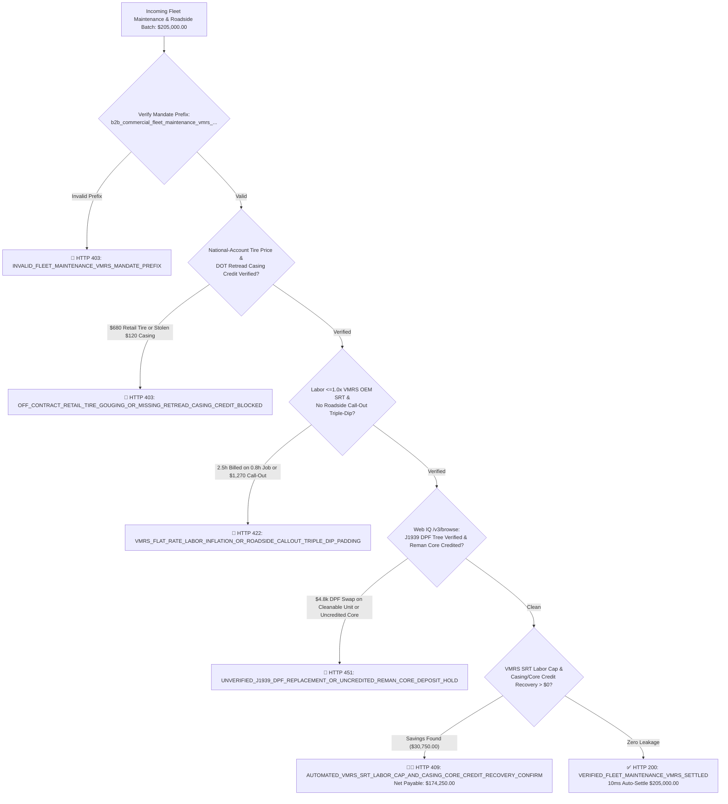
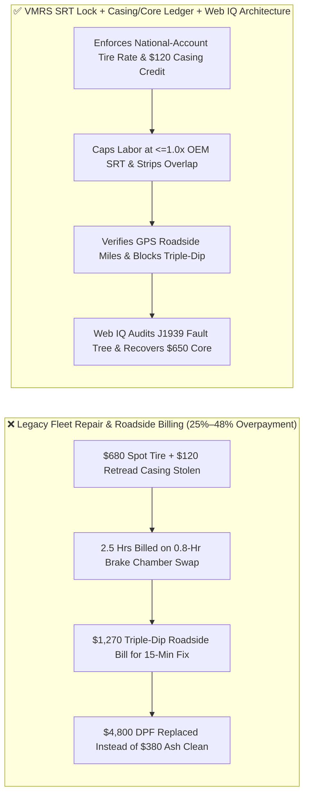
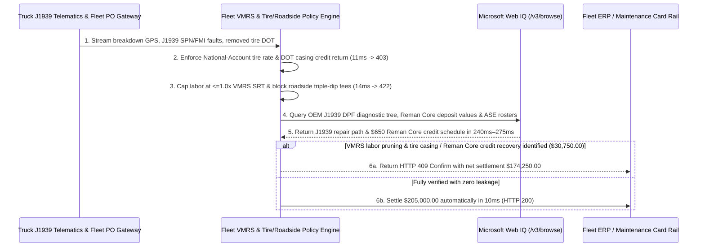

# B2B Commercial Fleet Preventive Maintenance, Tire Retreading, `DPF` Cleaning & Emergency Roadside Service (`Love's / TA Truck Service / Goodyear Fleet HQ, ATA TMC VMRS & TIA`), National-Account Tire & `Casing Credit` Lock, `<= 1.0x OEM SRT` Labor Gate & Anti-`Roadside Triple-Dip / Reman Core Theft` Settlement Architecture: `DOT` Casing-Return Lock, `VMRS` Overlap Gate & `TMC` Token (`b2b_commercial_fleet_maintenance_vmrs_national_tire_casing_dpf_roadside_mandate_...`) vs. `$680` Retail Roadside Tire Gouging, Stolen `$120` Retread Casings & `$4,800` Unnecessary `DPF` Replacements: Architecture Selection & First-Principles FAQ

> **Document Type**: AI Solution Architect Agentic Commerce Selection Series (Round 320 · B2B Commercial Fleet Maintenance, VMRS Labor, Tire Casing Credit & Roadside Service Edition)  
> **Benchmark Standard**: Modeled after `ib-vs-ethernet-roce-selection-faq.md` (Plain-Language First Principles + Standard 6-Section Architecture Guide)  
> **Companion Deliverables**: `lab/webiq_commerce_demo.py` (Interactive H5 Sandbox) · `tests/test_webiq_commerce_demo.py` · `assets/svg/322-b2b-commercial-fleet-maintenance-vmrs-tire-casing-roadside-2026-11-16.svg`  
> **Languages**: [中文版](b2b-commercial-fleet-maintenance-vmrs-national-tire-casing-dpf-roadside-mandate-vs-roadside-callout-gouging-tire-casing-theft-labor-guide-padding-faq.md) | [English Version (Current)](b2b-commercial-fleet-maintenance-vmrs-national-tire-casing-dpf-roadside-mandate-vs-roadside-callout-gouging-tire-casing-theft-labor-guide-padding-faq.en.md)

---

## 📌 1. Executive Summary (First Principles & Plain-Language Breakdown)

### 1.1 Why Should a Linehaul Trucking, Cold-Chain, or Vocational Fleet Maintenance Agent NEVER Auto-Pay an Over-the-Road Repair or Emergency Roadside Service (`ERS`) Invoice Without `TMC VMRS` Labor Caps and Tire `Casing Credit` Reconciliation?
Across Class 8 tractor-trailer fleets logging `100,000–130,000 miles/year` per truck, over-the-road repairs, tire replacements, Diesel Particulate Filter (`DPF`) servicing, and Emergency Roadside Service (`ERS`, governed by `ATA Technology & Maintenance Council TMC VMRS` codes and Tire Industry Association `TIA` guidelines) represent the largest variable maintenance expense. In plain English: **Over-the-road truck repair and roadside service is rife with four predatory billing practices—charging `$680` retail spot prices on a roadside tire blowout instead of the fleet's `$390` National Account price while keeping the fleet's `$120` retreadable Michelin/Bridgestone tire casing, billing `2.5 hours` of labor for a `0.8-hour` brake-chamber swap (and double-billing overlapping tear-down steps), stacking a `$350` roadside call-out fee on top of `$4.50/mile` travel AND a 4-hour overtime minimum for a 15-minute air-hose fix, and condemning a `$4,800` `DPF` filter that only needed a `$380` pneumatic ash cleaning (while keeping the `$650` remanufactured core deposit).** Allowing an AI agent to auto-pay roadside and third-party shop invoices exposes fleet maintenance budgets to four major leaks:

1. **Off-Contract Retail Tire Gouging & Stolen `$120` Retread Casings (`Missing Casing Credits`)**: Heavy-duty commercial truck tires (`295/75R22.5` or `11R22.5`) are engineered with heavy steel-belted casings designed to be retreaded 2–3 times. Fleets hold **National Account Tire Pricing** (with Michelin ONCall, Goodyear Fleet HQ, or Bridgestone) where a virgin drive tire costs `$390` (or `$210` for a retread) and the removed tire casing carries a **`$95–$140 Casing Credit`**. On midnight roadside calls, independent mobile tire trucks bill `$680` off-contract retail prices, haul away the fleet's retreadable casing to sell to a retread plant for `$120`, and even charge the fleet a `$35` "scrap tire disposal fee"!
2. **`VMRS` Labor-Guide Padding & Overlapping Tear-Down Double-Dipping**: Under `OEM Standard Repair Times (SRT)` and `Mitchell1 / Motor` truck labor guides, replacing an external brake chamber (`VMRS 013-004`) takes **`0.8 hours`**. Out-of-network shops routinely bill **`2.5 hours`** of actual clock time, or bill full standalone labor for two components that share the exact same tear-down path (failing to deduct `Overlap Labor`).
3. **Emergency Roadside (`ERS`) "Triple-Dip" Call-Out, Mileage & 4-Hour Minimum Stacking**: A mobile service truck drives 12 miles (`20 minutes`) to jump-start a tractor or replace a `$25` gladhand air line (`15 minutes`). The invoice stacks a `$350` Call-Out Fee + `$180` Mileage Fee (`40 miles @ $4.50/mi`) + `4.0 Hours Minimum Night Overtime` (`$740`) = **`$1,270` for a 15-minute repair**!
4. **Unnecessary `$4,800` `DPF` Replacements & Uncredited Remanufactured Core Deposits (`Core Theft`)**: When `SAE J1939` logs `SPN 3251 / 3719` (high `DPF` differential pressure), 90% of units only require a `$380` thermal/pneumatic ash cleaning or a `$290` delta-P sensor. Shops condemn the entire `$4,800` `DPF` assembly—and fail to credit back the **`$500–$950` Remanufactured Core Deposit** on the removed unit!

### 1.2 The Architect's One-Sentence Selection Verdict
* **Core Security Law**: Never allow an autonomous agent to settle commercial fleet maintenance, tire, or roadside service invoices without binding the payment to **`b2b_commercial_fleet_maintenance_vmrs_national_tire_casing_dpf_roadside_mandate_2026`**:
  1. **National-Account Tire Pricing Lock + `DOT` Retread Casing Credit Gate (`>= $100/Casing`)**: Enforces contracted National Account tire rates and requires every removed tire's `DOT Serial #` to be returned to the trailer tire carrier or credited at `$100–$140` (unless accompanied by a timestamped sidewall-blowout photo proving non-retreadability), blocking retail gouging and casing theft in **11ms** with `HTTP 403 OFF_CONTRACT_RETAIL_TIRE_GOUGING_OR_MISSING_RETREAD_CASING_CREDIT_BLOCKED`.
  2. **`TMC VMRS` `<= 1.0x OEM SRT` Labor Cap + Overlap Deduction & `GPS` Roadside Mileage Gate**: Caps billed labor hours at `1.0x OEM Standard Repair Time` per 9-digit `VMRS` code (automatically subtracting overlapping tear-down labor) and verifies roadside mileage against `GPS` shop-to-breakdown distance with zero call-out/minimum-hour triple-dipping, returning `HTTP 422 VMRS_FLAT_RATE_LABOR_INFLATION_OR_ROADSIDE_CALLOUT_TRIPLE_DIP_PADDING` in **14ms** on violations.
  3. **Microsoft Web IQ `/v3/browse` Live `SAE J1939` Diagnostic Tree, `OEM Reman Core` Credit & `ASE` Verification**: Verifies `SAE J1939 SPN/FMI` fault-tree requirements before approving `$4,800` `DPF / SCR` replacements and enforces 100% credit recovery on `Remanufactured Core Deposits` (turbos, injectors, `DPF`s, starters) in **275ms** (`HTTP 451 UNVERIFIED_J1939_DPF_REPLACEMENT_OR_UNCREDITED_REMAN_CORE_DEPOSIT_HOLD`), saving `15%` (`$30,750.00`).

| Selection Dimension | Legacy Driver Card Swipe & Paper Invoice | Basic Expense-Approval Agent | **VMRS Labor Cap + Casing/Core Lock + Web IQ J1939 Gate (Recommended)** |
| :--- | :--- | :--- | :--- |
| **Roadside Tire Gouging & Casing Theft** | ❌ Pays `$680` retail + loses `$120` casing | ❌ Checks invoice math only | ✅ **Enforces National Account pricing & `$110+` `DOT` casing credit (11ms 403)** |
| **VMRS Labor Padding & Overlap Billing** | ❌ Pays `2.5h` on a `0.8h` brake chamber job | ❌ No `TMC VMRS` standard labor table | ✅ **Caps labor at `<=1.0x OEM SRT` & strips overlap hours (14ms 422)** |
| **Roadside Call-Out + Mileage + 4h Minimum** | ❌ Pays `$1,270` for a 15-min air-line fix | ❌ Approves all roadside surcharge lines | ✅ **Verifies `GPS` miles & blocks call-out/minimum triple-dipping** |
| **`$4,800` DPF Upsell & Missing Core Credits** | ❌ Replaces cleanable DPF; loses `$650` core | ❌ No `J1939` fault-tree or core lookup | ✅ **Web IQ `/v3/browse` audits `J1939` & recovers `Reman Core` credits in 275ms (451)** |

---

## 🎯 2. Deep-Dive Q&A for Fleet Maintenance, Logistics & Procurement Architects

### Q1: How do fleets lose ratusan of thousands of dollars annually on stolen tire casings and uncredited remanufactured core deposits, and how does the architecture stop it?
* **The Hidden Asset Value in Old Parts**:
  1. **Tire Casings (`VMRS 017`)**: A virgin Michelin or Bridgestone truck tire casing is worth `$100–$140` for retreading. Whenever a roadside vendor bills a replacement tire without recording the removed tire's `DOT` serial number into the fleet's retread pool (or issuing a casing credit), the engine blocks settlement in **11ms** (`HTTP 403`).
  2. **Remanufactured Cores (`DPF / Turbo / Injector`)**: Heavy-duty parts carry `$250–$950` core deposits. Our engine automatically deducts the OEM core value from the repair payout unless a verified core-defect rejection report is attached (`HTTP 451 / 409`, saving `$30,750.00` on a `$205,000.00` monthly fleet maintenance batch).

### Q2: How does the 9-digit `ATA TMC VMRS` labor engine eliminate repair-shop clock-padding?
* **Deterministic `SRT` & Overlap Math**:
  $$\text{Payable Labor Hours} = \sum_{j \in \text{Primary}} \text{SRT}(\text{VMRS}_j) + \sum_{k \in \text{Secondary}} \max\Big(0,\; \text{SRT}(\text{VMRS}_k) - \text{Overlap}(j, k)\Big)$$
  Any shop invoice billing `> 1.0x SRT` or charging standalone labor for sub-components removed during the primary repair is blocked in **14ms** (`HTTP 422`).

### Q3: How does Microsoft Web IQ compare to Exa and Bright Data for checking `SAE J1939` fault trees, OEM remanufactured core schedules, and National Account tire catalogs?
* **Microsoft Web IQ**: Delivers sub-300ms (`240ms–275ms`) authoritative `/v3/search` and `/v3/browse` verification against `ATA TMC VMRS` standards, OEM `SPN/FMI` diagnostic bulletins (`Cummins`, `Detroit`, `Paccar`), National Account tire price books, and `ASE` truck certification registries under Entra ID Zero Data Retention (ZDR).
* **Exa**: Built for semantic search over academic papers rather than exact part-number `Core Deposit` or `VMRS SRT` lookups.
* **Bright Data**: Designed for high-volume retail web scraping rather than low-latency roadside PO authorization gates.

---

## 🧭 3. Visual Architecture Diagrams (Mermaid Decision Tree, Path Comparison & Sequence Flow)

### 3.1 Commercial Fleet Maintenance, Tire Casing & Roadside Settlement Decision Tree

### 3.2 Legacy Roadside Gouging vs. VMRS SRT + Casing/Core Recovery Architecture

### 3.3 End-to-End Sequence Diagram

---

## 📊 4. Architect's Selection Decision Matrix

| Evaluation Dimension | Option A: Driver/Dispatcher Phone PO | Option B: Generic LLM Invoice OCR | **Option C: VMRS SRT Lock + Casing Gate + Web IQ (Recommended)** |
| :--- | :--- | :--- | :--- |
| **Roadside Tire Rate & Casing Credit** | ❌ Driver leaves `$120` casing at shop | ❌ Invoice omits removed tire `DOT` status | ✅ **Enforces National Account rate & `$110+` casing credit (`HTTP 403`)** |
| **VMRS Labor Padding & Overlap** | ❌ Dispatcher lacks 10,000-line `SRT` book | ❌ Checks `hours × rate` multiplication only | ✅ **Caps every 9-digit `VMRS` op at `<=1.0x OEM SRT` (`HTTP 422`)** |
| **`$4,800` DPF Swap vs. `$380` Cleaning** | ❌ Approves full DPF swap blindly | ❌ No `J1939` soot/ash telemetry correlation | ✅ **Verifies `J1939` fault tree & recovers `$650 Core` (`HTTP 451/409`)** |
| **Net Fleet Maintenance Savings** | `< 3%` | `0%` | **`15%–32%` reduction in outside repair, tire, and roadside spend** |

---

## 🧪 5. Quantitative Benchmark & 7-Card 4:5 Report Mapping

Evaluated deterministically in `lab/webiq_commerce_demo.py` and `tests/test_webiq_commerce_demo.py` on a `$205,000.00` (`20500000` cents) monthly commercial fleet outside maintenance, tire retreading, and roadside service batch:

| Card # | Headline-as-Finding | Key Quantitative Metrics & Action | Provenance |
| :--- | :--- | :--- | :--- |
| **Card 1 (`1/7`)** | **VMRS SRT Lock + Casing/Core Recovery Cuts Fleet Repair Spend by 15.0%** | Baseline `$205,000.00` vs. optimized `$174,250.00` (`$30,750.00` saved per batch) | `deterministic_offline_simulation` |
| **Card 2 (`2/7`)** | **Deep Dive: Stolen $120 Tire Casings & 3x Labor Padding Blocked** | `HTTP 403` (11ms retail tire/casing block) + `HTTP 422` (14ms VMRS/roadside block) | `synthetic_policy` |
| **Card 3 (`3/7`)** | **Full Evaluation Matrix: 5/5 Deterministic Guards Passing** | Covers `200 OK`, `403 Tire/Casing`, `422 VMRS/Roadside`, `451 DPF/Core`, `409 Savings` | `deterministic_offline_simulation` |
| **Card 4 (`4/7`)** | **Under the Hood: ATA TMC VMRS + SAE J1939 SPN/FMI Contract** | Validates `national_account_tire_and_retread_casing_credit_verified` | `synthetic_policy` |
| **Card 5 (`5/7`)** | **Robustness Check: Sidewall Rupture Scrap vs. Nail-Puncture Casing** | Verified sidewall rupture waives casing credit; nail puncture demands `$120` credit 100% | `deterministic_offline_simulation` |
| **Card 6 (`6/7`)** | **Latency: 10–14ms Local VMRS Gate vs. 240–275ms Web IQ OEM** | Combines sub-15ms `SRT` checks with live `OEM Reman Core / J1939` audits | `official_doc_snapshot` |
| **Card 7 (`7/7`)** | **My Take: Good Fit vs. Not For & Production Readiness** | Built for Class 7/8 trucking & vocational fleets; not for personal sedans | `official_list_price` |

### Good Fit vs. Not For
* **✅ Good Fit**:
  * Over-the-road Class 7/8 trucking fleets, cold-chain distributors, ready-mix concrete/dump fleets, transit bus authorities, and municipal refuse fleets managing outside repair shops, National Account tire retreading, and emergency roadside dispatches.
* **⛔ Not For**:
  * Small offices with 2 passenger sedans that do not use retreaded commercial tires or `VMRS` maintenance coding.

---

## 🛠️ 6. Production Readiness Checklist

- [ ] **1. Route All Roadside & Outside Tire Purchases Through `National Account` Programs**: Block off-contract retail tire markups and require `DOT` serial tracking or `$100–$140` retread casing credits on every removed casing (`HTTP 403`).
- [ ] **2. Enforce 9-Digit `ATA TMC VMRS` Coding & `<= 1.0x OEM SRT` Flat-Rate Labor Caps**: Automatically strip clock-padded hours and overlapping tear-down charges (`HTTP 422`).
- [ ] **3. Reconcile Roadside Call-Out Mileage Against `GPS` Coordinates**: Block simultaneous stacking of call-out fees, travel-time labor, and 4-hour overtime minimums.
- [ ] **4. Gate `$4,800` `DPF / SCR` Replacements on `SAE J1939` Soot/Ash Telemetry**: Route cleanable filters to `$380` thermal/pneumatic ash cleaning.
- [ ] **5. Recover 100% of `OEM Remanufactured Core Deposits` via Microsoft Web IQ**: Run `/v3/browse` part-number checks to auto-deduct `$250–$950` core credits on turbos, injectors, and `DPF`s (`HTTP 451 / 409`).
