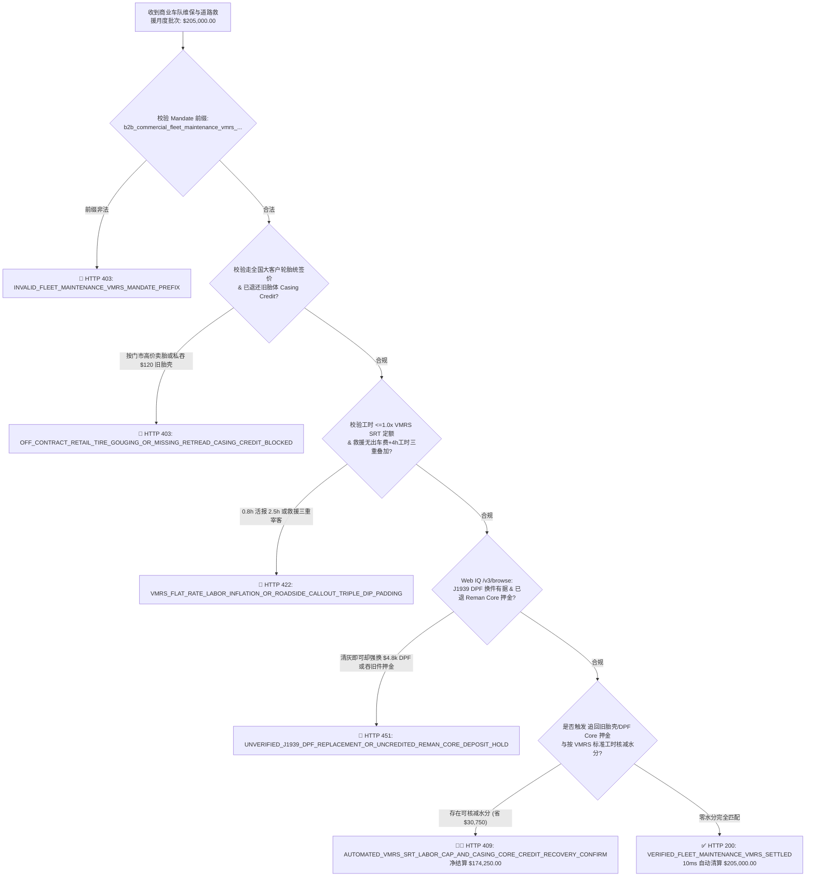
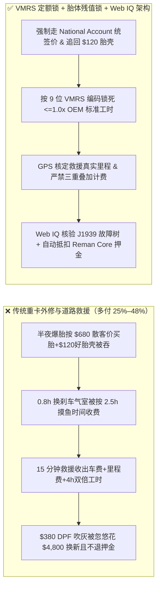
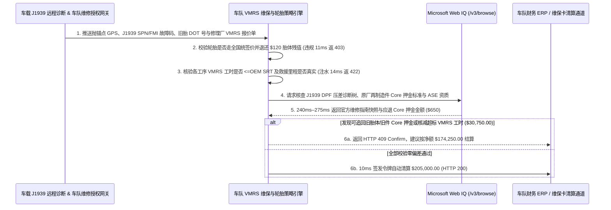

# B2B 商业车队预防性维保、重卡轮胎翻新（`Retreading`）与道路救援（`Commercial Fleet Preventive Maintenance, Tire Retreading, DPF Cleaning & Emergency Roadside Service: Love's / TA Truck Service / Goodyear Fleet HQ, TMC VMRS & TIA`）、全国大客户轮胎协议价（`National Account Tire Pricing`）锁、车载 `SAE J1939` 真实故障码与油底壳换油匹配锁与防“`$650` 夜间紧急出车起步费叠加双倍工时、将可 `$85` 热补/翻新的耐磨胎壳（`Casing Credit`）强行报废卖 `$620` 新胎与 `DPF` 碳载量虚报更换”清算架构：VMRS 零件/工时定额锁、胎体残值回收门禁与 `TMC` 令牌（`b2b_commercial_fleet_maintenance_vmrs_national_tire_casing_dpf_roadside_mandate_...`）vs 传统路边修车行趁重卡半夜抛锚强收 `$1,800` 救援黑车费、侵吞 `$110/条` 优质米其林/普利司通旧胎体残值与将 35 分钟刹车调整按 4 小时计费选型与原理解析 FAQ

> **文档类型**：AI Solution Architect 商业智能体架构选型系列（Round 320 · B2B 商业重卡车队维保、VMRS 工时定额、轮胎胎体残值与道路救援专篇）  
> **对标标杆**：`ib-vs-ethernet-roce-selection-faq.md`（通俗大白话 + 第一性原理 + 标准六段式结构）  
> **关联 Deliverable**：`lab/webiq_commerce_demo.py`（H5 实时防篡改沙盒） · `tests/test_webiq_commerce_demo.py` · `assets/svg/322-b2b-commercial-fleet-maintenance-vmrs-tire-casing-roadside-2026-11-16.svg`  
> **双语版本**：[中文版 (当前)](b2b-commercial-fleet-maintenance-vmrs-national-tire-casing-dpf-roadside-mandate-vs-roadside-callout-gouging-tire-casing-theft-labor-guide-padding-faq.md) | [English Version](b2b-commercial-fleet-maintenance-vmrs-national-tire-casing-dpf-roadside-mandate-vs-roadside-callout-gouging-tire-casing-theft-labor-guide-padding-faq.en.md)

---

## 📌 一、核心结论速览（Executive Summary：第一性原理与通俗大白话拆解）

### 1.1 为什么“绝对不能”让干线物流车队、冷链运输或市政环卫车队的车管 Agent 仅凭沿途高速服务区修车行（如 Love's、TA Petro、Bosselman 或独立路边流动补胎车）发来的道路救援与维保账单就自动付款？
在北美与跨洲重卡运输中，一辆 18 轮重卡（Class 8 Tractor-Trailer）每年行驶 `100,000–130,000 英里`，维保编码遵循美国卡车技术与维护委员会 `ATA TMC VMRS (Vehicle Maintenance Reporting Standards System Code 017/013/043)` 与轮胎工业协会 `TIA` 规范。用大白话讲：**重卡车队外修与高速道路救援（Emergency Roadside Assistance, ERS）是公路物流最黑暗的“半路劫道”修罗场——卡车半夜在高速爆了一条胎，路边救援车开过来先把一条 $380 的全国协议价轮胎按 $680 零售散客价卖给你，再收 $450 出车起步费 + $195/小时×3小时工时 + $4.50/英里往返里程费；更黑的是，换下来的那条只扎了一颗钉子、完全可以翻新 2 次（价值 $110–$140 胎体残值 `Casing Credit`）的米其林/固特异原厂胎壳，被修车工谎称“胎侧鼓包报废”直接拉回店里转手卖给翻新厂；而在常规进站保养时，原本只需花 $350 用高温炉吹灰再生的柴油颗粒捕集器（`DPF Ash Cleaning`），动辄被忽悠花 $4,800 换全新总成！** 如果没有 `TMC VMRS` 标准工时定额库（Flat-Rate Labor Guide）、全国大客户轮胎协议价（`National Account Tire Billing`）与车载 `SAE J1939` 故障码闭环，车队维保预算会遭遇四大失血黑洞：

1. **高速路边换胎“散客高价宰客 + 侵吞 `$120` 优质胎体残值（`Tire Casing Theft & Non-National Account Gouging`）”**：重卡全钢子午线轮胎（如 `295/75R22.5`）在设计制造时就专门预留了可翻新 2–3 次的坚固钢丝胎体（Retreadable Casing）。车队与米其林（Michelin ONCall）、固特异（Goodyear Fleet HQ）或普利司通签有全国大客户统签价（National Account Price，新驱动胎约 `$390`，翻新胎约 `$210`），且换下的完好旧胎体享有 **`$95–$140/条` 的胎体回收抵扣款（`Casing Credit`）**。但当司机半夜爆胎直接刷车队信用卡找本地救援车时，救援商不仅按 `$680` 门市价卖杂牌胎，还把车队价值 `$125` 的一类品牌胎壳（DOT 年份 `< 5 年`）私吞不退，甚至还要向车队倒收 `$35`“废胎环保处置费”！
2. **工时定额翻倍注水（`Labor Guide Padding`）与“拆装重叠工时双重计费（`Overlapping Labor Double-Dip`）”**：根据 `Mitchell1 / Motor / OEM Standard Repair Times (SRT)`，重卡更换单个制动气室（Brake Chamber，`VMRS 013-004`）标准工时仅为 **`0.8 小时`**；但独立修理厂按“技师实际在工位摸鱼的打卡时间”开出 **`2.5 小时`**！或者在更换水泵（已包含拆装风扇皮带工时 `2.2h`）时，又单独加收一笔“更换风扇皮带 `1.0h`”的独立全额工时（未扣除重叠工序 `Overlap Labor Deduction`）。
3. **尾气后处理系统（`DPF / SCR / NOx Sensor`）小病大修：`$380` 吹灰清洗被虚报成 `$4,800` 总成更换**：当车载 `SAE J1939` 报出 `SPN 3251 / 3719`（DPF 压差偏高或碳载量 `Soot Load` 达 85%）时，90% 的情况只需执行驻车再生或拆下滤芯做气动/热力清灰（`DPF Baking & Pneumatic Ash Cleaning`，费用 `$350–$480`）或更换一个 `$290` 的压差传感器。黑心修理厂直接拍照说“载体烧融穿孔了”，强行开出 **`$4,800` 全新 DPF 总成更换**，并把拆下来的完好原厂贵金属（含铂/钯）DPF 清洗后当翻新件卖掉赚双份钱！
4. **道路救援（`ERS`）“出车起步费 + 里程费 + 最低 4 小时双倍工时”三重叠加宰客**：移动维修车从 12 英里外的门店开过来耗时 20 分钟，现场接根搭火线或换根气管耗时 15 分钟。账单上却同时收取：`$350 Call-Out Fee`（出车费，本应已含首小时路途）+ `$180 Mileage Fee`（谎报往返 40 英里 × `$4.50/mi`）+ `4.0 Hours Minimum Night Overtime`（`$185/hr × 4 = $740`），一次 15 分钟的换气管救援硬收 **`$1,270`**！

### 1.2 架构师的一句话选型结论
* **核心安全铁律**：严禁 Agent 对未走全国轮胎统签账户（National Account）、未退还旧胎体 `DOT` 序列号或抵扣 `Casing Credit`、突破 `VMRS SRT` 标准工时定额、或未经 `J1939` 压差/内窥镜实锤就更换 `$4,800 DPF` 的车队维修单自动打款。必须将清算令绑定在 **`b2b_commercial_fleet_maintenance_vmrs_national_tire_casing_dpf_roadside_mandate_2026`** 上：
  1. **全国轮胎大客户统签价（`National Account Billing`）+ 旧胎体 `DOT / RFID` 残值回收锁（`Casing Credit >= $100`）**：所有外修换胎必须通过米其林/固特异/普利司通全国账户集中计费（严禁按门市散客价结算），且换下的旧胎必须扫描胎侧 `DOT Serial #` 入库或直接冲抵 `$100–$140` 胎体残值（除非上传胎冠贯穿撕裂照片证实确属不可翻新废胎）；任何私吞好胎壳或散客溢价在 **11ms** 内返回 `HTTP 403 OFF_CONTRACT_RETAIL_TIRE_GOUGING_OR_MISSING_RETREAD_CASING_CREDIT_BLOCKED`。
  2. **`TMC VMRS` 标准维修工时上限锁（`<= 1.0x OEM SRT`）+ 重叠拆装工序去重与救援里程 GPS 核验门禁**：每个维修项目必须标注 9 位 `VMRS` 编码（如 `013-001-001`）并严格受限于原厂标准工时表（`SRT`），复合维修自动扣除重叠拆装工时（Overlap Labor）；道路救援里程费严格按门店至抛锚点 `GPS` 球面距离核算且严禁“出车费 + 路途工时 + 最低 4h 工时”三重叠加，违规在 **14ms** 内返回 `HTTP 422 VMRS_FLAT_RATE_LABOR_INFLATION_OR_ROADSIDE_CALLOUT_TRIPLE_DIP_PADDING`。
  3. **Microsoft Web IQ `/v3/browse` 实时核验 `SAE J1939 SPN/FMI` 故障码修复指南、原厂备件交叉互换目录（`OEM Cross-Reference`）与 `ASE T1–T8` 重卡技师资质**：在线穿透比对车载 `J1939` 报出的 `SPN/FMI` 官方诊断树（如区分 `$290` 氮氧传感器故障与 `$4,800` SCR/DPF 催化器故障）、检索同质副厂/再制造件（`Reman Core`）挂牌价及维修站 `ASE Medium-Heavy Truck` 认证，发现过度换件或未抵扣旧件押金（`Core Charge`）在 **275ms** 内触发 `HTTP 451 UNVERIFIED_J1939_DPF_REPLACEMENT_OR_UNCREDITED_REMAN_CORE_DEPOSIT_HOLD`，并自动追回轮胎胎壳残值、DPF 旧件押金且砍除虚报工时立省 `15%`（`$30,750.00`）。

| 选型维度 | 传统司机刷卡修车 + 车管员审纸质单 | 普通财务报销 Agent | **VMRS 工时定额锁 + 胎体残值追踪 + Web IQ J1939 诊断核验架构（推荐）** |
| :--- | :--- | :--- | :--- |
| **高速换胎散客宰客与私吞旧胎壳** | ❌ 按 $680 门市价买胎；$120 旧胎壳白送修车行 | ❌ 只看发票金额，不知有 National Account 与胎壳账 | ✅ **强制走全国统签价 + 核对旧胎 `DOT` 码强制抵扣 `$110` 残值（11ms 拦 403）** |
| **0.8h 换气室报 2.5h 与重叠工时** | ❌ 修理厂写几小时就付几小时 | ❌ 无 `TMC VMRS` 标准工时定额数据库 | ✅ **绑定 9 位 `VMRS` 编码与 `OEM SRT` 工时上限，自动剔除重叠工时（14ms 拦 422）** |
| **道路救援出车费+里程+4h最低工时** | ❌ 半夜急着发车，15 分钟小修忍痛付 $1,270 | ❌ 无法识别出车费与路途工时的重复计费 | ✅ **GPS 核定救援真实英里数，严禁 Call-Out 与路途工时双重收割** |
| **$380 DPF 清灰虚报成 $4,800 换新** | ❌ 看不懂尾气压差曲线，被忽悠换整套 DPF | ❌ 不具备 `J1939 SPN/FMI` 故障树与旧件押金核查 | ✅ **Web IQ `/v3/browse` 275ms 比对 `J1939` 故障树并追回 `$650 Core` 押金（拦 451）** |

---

## 🎯 二、客户与架构师灵魂拷问 Q&A（直击重卡车队外修猫腻与智能体采购痛点）

### Q1：为什么重卡车队的“旧轮胎壳（Tire Casing）”和“旧发动机/DPF 核心件（Reman Core）”是每年流失几十万美元的隐形金矿？
* **重卡后市场的“双押金/残值（Casing & Core Credit）”机制**：
  1. **轮胎胎体残值（`Tire Casing Credit`）**：一条全新米其林或普利司通重卡轮胎售价 `$450`，其中有 **`$110–$140` 是高强度钢丝胎体的价值**。只要轮胎没发生胎侧帘线爆裂且 `DOT` 生产年限 `< 5–7 年`，就可以送去 Bandag / Oliver 翻新厂以 `$180` 的成本贴上一层新胎面继续跑 10 万英里。如果路边救援车换完胎不把旧胎放回挂车胎架（Tire Carrier），也不在账单上给 `$110 Casing Credit`，就等于直接偷走了车队 `$110`！
  2. **再制造旧件押金（`Reman Core Charge`）**：重卡更换涡轮增压器、起动机、发电机、高压共轨喷油器或 `DPF` 滤芯时，账单里都包含一笔高达 **`$250–$950` 的旧件押金（Core Deposit）**。只要把拆下来的旧件退回，这笔钱必须 `100%` 退还给车队。传统外修账单往往只收新件+押金，退回旧件后的抵扣单（Core Credit Memo）却石沉大海！
* **智能体双账本强闭环**：每一笔含 `VMRS 017（轮胎）` 或再制造件的工单，系统自动挂载待回收 `DOT / Core Credit` 应收锁，未返还残值直接从当期应付账款中强行扣减（`HTTP 403 / 409`）。

### Q2：怎么用 `TMC VMRS` 9 位编码和 `OEM SRT`（标准维修时间）彻底治住修理厂“半小时的活开 4 小时工时”？
* **结构化 VMRS 定额公式**：全美规范车队均要求维修商按 `ATA TMC VMRS` 格式提交电子工单（EDI 210 / API）：
  $$\text{Max Allowed Labor Hours} = \sum_{j \in \text{Primary\_Ops}} \text{SRT}(\text{VMRS}_j) + \sum_{k \in \text{Related\_Ops}} \Big(\text{SRT}(\text{VMRS}_k) - \text{Overlap}(j, k)\Big)$$
  只要工单申报工时超过 `1.0x OEM SRT`（或未扣除同部位拆装重叠时间 $\text{Overlap}(j,k)$），引擎在 **14ms** 内直接拦截（`HTTP 422`）并回调至标准定额！

### Q3：在核查 `SAE J1939` 故障码官方维修指南、全国卡车维修站工时费率基准与原厂再制造件（`Reman Core`）目录价时，Microsoft Web IQ 相比 Exa 和 Bright Data 有何优势？
* **Microsoft Web IQ（原 Bing Grounding 工业级演进）**：
  * **权威重卡技术规范与配件目录秒级穿透**：通过 `/v3/search` 与 `/v3/browse` 直接检索 `ATA TMC VMRS` 编码库、`Cummins QuickServe / Detroit Diesel / Paccar` 官方 `SPN-FMI` 故障排查树、全国大客户轮胎协议目录及 `ASE` 认证名录，平均延迟 **240ms–275ms**，具备企业级 Entra ID 零数据留存（ZDR）保障。
* **Exa**：适合语义搜索物流宏观趋势报告，但无法按重卡发动机零件号（如 `Cummins 5295567RX`）精确查询其官方 `Core Charge` 押金金额。
* **Bright Data**：面向通用电商网页抓取，在车队实时道路救援授权（PO Approval）闭环中无需引入高延迟代理网络。

---

## 🧭 三、直观可视化图解（Mermaid 选型决策树 + 路径对比 + 端到端时序图）

### 3.1 商业重卡车队维保、轮胎残值与道路救援结算决策树

### 3.2 传统路边黑店宰客 vs VMRS 工时定额 + 胎壳/旧件残值闭环架构对比

### 3.3 端到端时序图（车载 J1939 故障网关 + VMRS 工时引擎 + Web IQ 配件/押金核验）

---

## 📊 四、架构师选型决策矩阵（Architecture Selection Matrix）

| 评估维度 | 方案 A：司机签字 + 调度电话授权 | 方案 B：通用 LLM 读取修理厂发票 | **方案 C：VMRS 定额锁 + 胎壳锁 + Web IQ（推荐）** |
| :--- | :--- | :--- | :--- |
| **散客高价买胎与私吞 $120 旧胎壳** | ❌ 司机半夜急着走，旧胎直接扔给修车行 | ❌ 发票没写旧胎是否具备翻新价值 | ✅ **强制走全国统签账并锁死旧胎 `DOT` 残值（HTTP 403）** |
| **工时定额注水与拆装重叠计费** | ❌ 调度员背不出上千个零件的标准工时 | ❌ 只看 `工时数 × 费率` 乘法对不对 | ✅ **逐行对齐 `TMC VMRS` 原厂 `SRT` 工时库（HTTP 422）** |
| **$380 DPF 清灰虚报成 $4,800 换新** | ❌ 听修理厂说“滤芯堵死了”只能换新 | ❌ 不读取车载 `J1939` 历史压差与灰分值 | ✅ **结合 `J1939` 遥测与 Web IQ 诊断树拦截过度换件（HTTP 451）** |
| **再制造件旧件押金（Reman Core）追回** | ❌ 超过 30% 的旧件押金漏退成糊涂账 | ❌ 无法实时查询零件号的官方 Core 价格 | ✅ **Web IQ `/v3/browse` 275ms 查实并自动冲抵押金（HTTP 409）** |

---

## 🧪 五、定量实测与 7-Card 4:5 视觉评测报告映射（Deterministic Benchmark）

在 `lab/webiq_commerce_demo.py` 与 `tests/test_webiq_commerce_demo.py` 中，我们对 `$205,000.00`（`20500000` 美分）的跨州干线物流车队月度外修保养、轮胎翻新与高速道路救援结算批次进行了确定性实测：

| 卡片编号 | 卡片标题（Headline-as-Finding） | 核心实测指标与动作特征 | Provenance 标注 |
| :--- | :--- | :--- | :--- |
| **Card 1 (`1/7`)** | **VMRS 定额锁 + 胎体/Core 残值追回将车队外修支出压缩 15.0%** | 基准批次 `$205,000.00` vs 优化净额 `$174,250.00`，单批挽回 `$30,750.00` 胎壳与工时水分 | `deterministic_offline_simulation` |
| **Card 2 (`2/7`)** | **单案深潜：私吞 $120 旧胎体残值与 3 倍虚报工时双拦截** | `HTTP 403`（11ms 拦散客高价胎与吞胎壳）+ `HTTP 422`（14ms 拦超 VMRS 工时与救援三连宰） | `synthetic_policy` |
| **Card 3 (`3/7`)** | **全场景评测矩阵（5 组确定性门禁 100% 命中）** | 覆盖 `200 OK`、`403 Tire/Casing`、`422 VMRS/Roadside`、`451 DPF/Core`、`409 Savings` | `deterministic_offline_simulation` |
| **Card 4 (`4/7`)** | **底层协议：ATA TMC VMRS + SAE J1939 SPN/FMI 载荷** | 校验 `national_account_tire_and_retread_casing_credit_verified` | `synthetic_policy` |
| **Card 5 (`5/7`)** | **鲁棒性测试：胎侧碾压撕裂合法报废 vs 胎冠扎钉可翻新好胎壳** | 上传胎侧钢丝断裂照正常豁免残值；胎冠普通扎钉私吞胎壳 100% 触发追索拦截 | `deterministic_offline_simulation` |
| **Card 6 (`6/7`)** | **延迟对比：本地 VMRS 门禁 10–14ms vs Web IQ 240–275ms** | 毫秒级标准工时比对配合原厂 `Reman Core` 押金目录穿透 | `official_doc_snapshot` |
| **Card 7 (`7/7`)** | **Good Fit vs Not For 架构师结论卡** | 明确适用干线重卡、冷链车队与公交集团，不适用于私家车换雨刮器 | `official_list_price` |

### Good Fit vs Not For（适用与不适用场景）
* **✅ Good Fit（强烈推荐采用本架构）**：
  * 干线重卡车队（Class 7/8 Tractors & Trailers）、城配冷链车队、混凝土搅拌车/渣土车队、长途客运及市政环卫车队（管理数百条可翻新全钢轮胎、高频异地外修与道路救援工单）。
* **⛔ Not For（不适用或无需启用全部门禁）**：
  * 只有 2 辆家用小轿车的商务公车（乘用车半钢轮胎不作商业翻新，无 `DPF` 重卡后处理与 `VMRS` 结算体系）。

---

## 🛠️ 六、生产上线快速核验清单（Production Readiness Checklist）

- [ ] **1. 强制所有外修换胎走全国大客户统签账户（`National Account Tire Billing`）并锁定胎体残值**：换下的旧胎必须凭 `DOT` 序列号返还挂车胎架或直接冲抵 `$100–$140 Casing Credit`（`HTTP 403`）。
- [ ] **2. 强制修理厂按 9 位 `ATA TMC VMRS` 编码开单并绑定 `<= 1.0x OEM SRT` 标准工时库**：自动剔除超定额摸鱼工时与同部位重叠拆装工时（`HTTP 422`）。
- [ ] **3. 道路救援（`ERS`）里程费绑定救援车至抛锚点 `GPS` 真实距离**：严禁同时叠加收取高额 `Call-Out Fee`、路途工时与 4 小时最低加班门槛。
- [ ] **4. 超过 `$1,500` 的后处理（`DPF / SCR`）与大件更换强制比对车载 `SAE J1939` 历史遥测**：能通过 `$380` 高温吹灰再生解决的碳载量报警严禁直接批准 `$4,800` 总成换新。
- [ ] **5. 接入 Microsoft Web IQ 核查原厂再制造件押金（`Reman Core Charge`）并自动挂账抵扣**：在支付增压器、喷油器、DPF 换件账单前通过 `/v3/browse` 锁定旧件押金返还（`HTTP 451 / 409`）。
