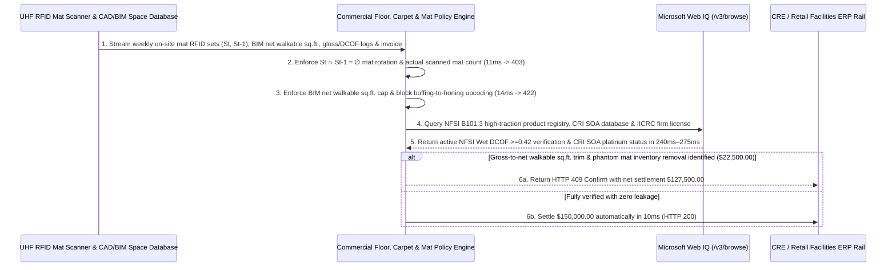

# B2B Commercial Floor Care, Carpet Extraction, Stone Terrazzo Honing & `RFID` Walk-Off Mat Rental (`Cintas / Aramark Vestis / MilliCare, ANSI/IICRC S100 & ANSI/NFSI B101.3`), `UHF RFID` Mat-Rotation Disjointness Lock, `BIM` Net-Walkable Sq.Ft. Gate & Anti-`Stone Honing Upcoding` Settlement Architecture: `St ∩ St-1 = ∅` Swap Gate, `Wet DCOF >= 0.42` Slip-Resistance Lock & `NFSI` Token (`b2b_commercial_floor_carpet_mat_rental_rfid_net_walkable_sqft_mandate_...`) vs. Ghost Mat Exchanges, Billing Carpet Cleaning on Gross `BOMA` Lease Sq.Ft. (`+42%` Furniture Bloat) & Upcoding `$0.18` Spray Buffing to `$4.50` Diamond Honing: Architecture Selection & First-Principles FAQ

> **Document Type**: AI Solution Architect Agentic Commerce Selection Series (Round 334 · B2B Commercial Floor Care, Carpet Extraction, Stone Honing & RFID Mat Rental Edition)  
> **Benchmark Standard**: Modeled after `ib-vs-ethernet-roce-selection-faq.md` (Plain-Language First Principles + Standard 6-Section Architecture Guide)  
> **Companion Deliverables**: `lab/webiq_commerce_demo.py` (Interactive H5 Sandbox) · `tests/test_webiq_commerce_demo.py` · `assets/svg/336-b2b-commercial-floor-carpet-mat-rental-rfid-walkable-sqft-2026-11-16.svg`  
> **Languages**: [中文版](b2b-commercial-floor-carpet-mat-rental-rfid-net-walkable-sqft-mandate-vs-ghost-mat-exchange-boma-gross-sqft-padding-stone-honing-upcoding-faq.md) | [English Version (Current)](b2b-commercial-floor-carpet-mat-rental-rfid-net-walkable-sqft-mandate-vs-ghost-mat-exchange-boma-gross-sqft-padding-stone-honing-upcoding-faq.en.md)

---

## 📌 1. Executive Summary (First Principles & Plain-Language Breakdown)

### 1.1 Why Should a Commercial Real Estate (`CRE`), Hospital, Retail Chain, or Bank-Branch Facilities Agent NEVER Auto-Pay a Walk-Off Mat Rental or Carpet/Stone Floor-Care Invoice Without Auditing `UHF RFID` Mat Rotation and `BIM` Net-Walkable Square Footage?
Across Class-A office towers, hospitals, supermarkets, and retail branches, entrance walk-off mat rental (e.g., Cintas, Aramark / Vestis, UniFirst), commercial carpet extraction (`ANSI/IICRC S100`), and marble/terrazzo/VCT floor polishing (`ANSI/NFSI B101.1 / B101.3`) are essential recurring maintenance services. In plain English: **Floor care and mat rental invoices bleed `30%–50%` through three classic tricks: (1) "Ghost Mat Exchanges & Phantom Rolling Inventory"—a store actually has 6 entrance mats on the floor, yet the route invoice bills for 14 mats every week due to uncredited historical add-ons, and on sunny weeks the route driver doesn't even carry clean mats off the truck—he just gets a receptionist's signature and leaves the same dirty mats on the floor while billing `100%` for weekly laundering! (2) "Billing Gross `BOMA` Lease Square Footage Instead of Net Walkable Carpet Area"—an office floor has `50,000 Gross Rentable Sq.Ft.`, but once you subtract fixed cubicles, filing cabinets, server rooms, restrooms, and core walls, only `28,000 Net Walkable Sq.Ft.` (`56%`) of carpet is actually touched by the extraction wand, yet the contractor bills `$0.28/sq.ft. × 50,000 sq.ft.`, overcharging by `44%` for carpet under desks that was never cleaned! and (3) "Upcoding `$0.18/Sq.Ft.` High-Speed Spray Buffing to `$4.50/Sq.Ft.` 6-Grit Diamond Stone Honing or Full Chemical Strip & Wax"!** Allowing an AI agent to auto-pay mat rental and floor-care invoices exposes facilities budgets and slip-and-fall liability to four major vulnerabilities:

1. **Phantom Walk-Off Mat Exchanges (`No RFID Tag Rotation`) & Rolling Inventory Creep**: Walk-off mat contracts bill weekly for an "In-Use Set (`Set A`)" and a "Laundry Set (`Set B`)". Without verifying via `UHF RFID` chips vulcanized into each mat's rubber backing that **this week's on-site tag set $S_t$ is 100% disjoint from last week's tag set $S_{t-1}$ ($S_t \cap S_{t-1} = \emptyset$)**, enterprises pay weekly laundering fees for mats that were never swapped—plus phantom mats that disappeared months ago.
2. **Gross `BOMA` Rentable Area Inflation (`Paying to Clean Under Fixed Cubicles, Walls & Restrooms`)**: Under `IFMA` and `ISSA` space-planning standards, fixed furniture, modular workstations, and non-carpeted zones occupy **`38%–48%`** of gross office floor area. Billing carpet extraction or VCT waxing on `Gross Rentable Sq.Ft.` instead of `CAD/BIM Net Walkable Cleanable Sq.Ft.` inflates invoices by `40%+`.
3. **Process Upcoding (`$0.18/Sq.Ft.` High-Speed Burnishing Billed as `$4.50/Sq.Ft.` 6-Stage Diamond Stone Honing or Full Strip & 5-Coat Wax)**: Running a 2,000 RPM propane/battery burnisher over a lobby takes 45 minutes (`$0.18/sq.ft.`), whereas true 6-grit diamond honing (`50#` to `3000#` resin pads) or chemical stripping and laying 5 coats of polymer finish takes an entire night crew (`$1.80–$5.50/sq.ft.`).
4. **Slip-and-Fall Liability from Low-Traction Floor Finishes (`ANSI/NFSI B101.3 Wet DCOF < 0.42`) & Non-`CRI` Carpet Detergents**: Applying cheap floor wax that fails the **`ANSI/NFSI B101.3` Wet Dynamic Coefficient of Friction (`Wet DCOF >= 0.42`)** threshold turns wet lobbies into skating rinks (`$45,000+` average slip-and-fall tort claim), while high-residue carpet soaps lacking `CRI Seal of Approval (SOA)` certification attract rapid re-soiling and mold.

### 1.2 The Architect's One-Sentence Selection Verdict
* **Core Security Law**: Never allow an autonomous agent to settle walk-off mat rental, carpet extraction, or stone/VCT floor-care invoices without binding the payment to **`b2b_commercial_floor_carpet_mat_rental_rfid_net_walkable_sqft_mandate_2026`**:
  1. **Walk-Off Mat `UHF RFID` Set-Disjointness Lock ($S_t \cap S_{t-1} = \emptyset$) + Physical On-Site Count Cap**: Requires handheld/portal `UHF RFID` scans proving that `100%` of billed mats were physically rotated with freshly laundered mats from the plant and caps billed quantity at the actual on-site scanned tag count, blocking ghost mat swaps and phantom inventory in **11ms** with `HTTP 403 GHOST_MAT_EXCHANGE_NO_RFID_ROTATION_OR_PHANTOM_INVENTORY_COUNT_BLOCKED`.
  2. **`CAD / BIM` Net-Walkable Sq.Ft. Lock (`<= 62% Gross BOMA`) + Stone-Honing / Strip-and-Wax Telemetry Gate**: Caps carpet extraction and floor-care billing at the `BIM`-verified net walkable area (excluding fixed workstations, walls, and restrooms) and requires machine run-hours plus before/after gloss-meter (`GU`) readings before paying `$1.80–$4.50/sq.ft.` full strip/wax or diamond-honing rates, returning `HTTP 422 GROSS_BOMA_SQFT_AREA_INFLATION_OR_BURNISHING_UPCODED_TO_DIAMOND_HONING` in **14ms** on violations.
  3. **Microsoft Web IQ `/v3/browse` Live `ANSI/NFSI B101.3` High-Traction Floor Finish & `CRI Seal of Approval` Registry Audit**: Verifies that applied floor finishes are listed on the `National Floor Safety Institute (NFSI) Certified High-Traction Products` registry (`Wet DCOF >= 0.42` tribometer log) and that carpet extraction chemicals carry `CRI SOA` certification in **275ms** (`HTTP 451 SUBSTANDARD_NFSI_WET_DCOF_SLIP_HAZARD_OR_UNAPPROVED_CRI_SOA_CHEMICAL_HOLD`), while automatically trimming gross `BOMA` square footage to net walkable area and purging phantom mat inventory to save `15%` (`$22,500.00`).

| Selection Dimension | Legacy Receptionist Delivery Sign-Off + Gross Sq.Ft. | Basic Facilities AP Agent | **`RFID` Mat Rotation + `BIM` Net Area + Web IQ NFSI (Recommended)** |
| :--- | :--- | :--- | :--- |
| **Ghost Mat Exchanges & Phantom Inventory** | ❌ Receptionist signs for 14 mats when 0 were swapped | ❌ Multiplies `14 mats × $6.50` blindly | ✅ **Requires `UHF RFID` set disjointness ($S_t \cap S_{t-1} = \emptyset$, 11ms 403)** |
| **Gross `BOMA` Sq.Ft. vs. Net Walkable Area** | ❌ Pays to clean 50,000 sq.ft. when 28,000 is walkable | ❌ Multiplies gross lease sq.ft. × unit rate | ✅ **Caps billable area at `BIM Net Walkable Sq.Ft.` (14ms 422)** |
| **`$0.18` Spray Buff Billed as `$4.50` Honing** | ❌ Sees shiny floor; approves `$4.50/sq.ft.` bill | ❌ Accepts "6-Stage Stone Restoration" code | ✅ **Requires crew run-hours & gloss-meter `GU` delta (14ms 422)** |
| **`NFSI B101.3 Wet DCOF >= 0.42` Slip Safety** | ❌ Cheap wax causes `$65k` lobby slip-and-fall | ❌ No live `NFSI` or `CRI SOA` lookup | ✅ **Web IQ `/v3/browse` verifies `NFSI` & `CRI SOA` in 275ms (451)** |

---

## 🎯 2. Deep-Dive Q&A for Commercial Real Estate (`CRE`) & Retail Facilities Architects

### Q1: How does the `UHF RFID` Set-Disjointness Rule ($S_t \cap S_{t-1} = \emptyset$) mathematically prove whether the route driver actually swapped every entrance mat?
* **Every Commercial Walk-Off Mat Carries a Vulcanized `EPC Gen2 UHF RFID` Tag**:
  1. During week $t-1$, the building's entrance mats have scanned `RFID` EPC set $S_{t-1} = \{\text{EPC}_1, \dots, \text{EPC}_6\}$.
  2. When the driver completes the week $t$ exchange, a 5-second handheld scan records the new on-site set $S_t$.
* **The Deterministic Payout Equation**:
  $$\text{Payable Floor & Mat Batch} = \sum_{m \in S_t \setminus S_{t-1}} R_{\text{mat}} + A_{\text{BIM\_net\_walkable}} \times R_{\text{verified\_process}}$$
  If 4 of the 6 tags in $S_t$ were already present in $S_{t-1}$ (meaning the driver left 4 dirty mats on the floor without swapping them) or if the invoice bills for 14 mats when $|S_t| = 6$, the policy engine blocks the invoice in **11ms** (`HTTP 403`).

### Q2: How does Microsoft Web IQ compare to Exa and Bright Data for checking `NFSI B101.3` certified high-traction floor finishes, `CRI Seal of Approval` carpet extractors, and `IICRC` firm certifications?
* **Microsoft Web IQ**: Delivers sub-300ms (`240ms–275ms`) authoritative `/v3/search` and `/v3/browse` verification against the `National Floor Safety Institute (NFSI)` Certified Products registry (`ANSI/NFSI B101.3 Wet DCOF >= 0.42`), the `Carpet and Rug Institute (CRI) Seal of Approval` database, and `IICRC` certified firm directories under Entra ID Zero Data Retention (ZDR).
* **Exa**: Built for semantic search over interior design articles rather than deterministic `NFSI` or `CRI SOA` product certification verification.
* **Bright Data**: Designed for consumer e-commerce scraping rather than low-latency `CRE` facilities and slip-and-fall risk compliance gates.

---

## 🧭 3. Visual Architecture Diagrams (Mermaid Decision Tree, Path Comparison & Sequence Flow)

### 3.1 Commercial Floor Care, Carpet Extraction & Mat Rental Settlement Decision Tree
```mermaid
flowchart TD
    A[Incoming Commercial Floor, Carpet & Mat Batch: $150,000.00] --> B{Verify Mandate Prefix:<br/>b2b_commercial_floor_carpet_mat_...}
    B -- Invalid Prefix --> R1[🛑 HTTP 403: INVALID_COMMERCIAL_FLOOR_CARPET_MAT_MANDATE_PREFIX]
    B -- Valid --> C{RFID Mat Set Disjoint (St ∩ St-1 = ∅) &<br/>On-Site Tag Count Verified?}
    C -- Unswapped Mats or Phantom Rolling Inventory --> R2[🛑 HTTP 403: GHOST_MAT_EXCHANGE_NO_RFID_ROTATION_OR_PHANTOM_INVENTORY_COUNT_BLOCKED]
    C -- Verified --> D{BIM Net-Walkable Sq.Ft. Cap &<br/>True Honing/Strip Process Verified?}
    D -- Gross BOMA Sq.Ft. Billed or Buffing Upcoded to Honing --> R3[🚨 HTTP 422: GROSS_BOMA_SQFT_AREA_INFLATION_OR_BURNISHING_UPCODED_TO_DIAMOND_HONING]
    D -- Verified --> E{Web IQ /v3/browse:<br/>NFSI Wet DCOF >=0.42 Certified & CRI SOA Approved?}
    E -- Slippery Wax (DCOF <0.42) or Unapproved Carpet Soap --> R4[🛑 HTTP 451: SUBSTANDARD_NFSI_WET_DCOF_SLIP_HAZARD_OR_UNAPPROVED_CRI_SOA_CHEMICAL_HOLD]
    E -- Clean --> F{BIM Net-Walkable Re-Rating &<br/>RFID Mat Inventory Scrub Savings > $0?}
    F -- Savings Found ($22,500.00) --> R5[🧑‍⚖️ HTTP 409: AUTOMATED_NET_WALKABLE_SQFT_CAP_AND_RFID_MAT_AUDIT_SAVINGS_CONFIRM<br/>Net Payable: $127,500.00]
    F -- Zero Leakage --> R6[✅ HTTP 200: VERIFIED_COMMERCIAL_FLOOR_CARPET_MAT_SETTLED<br/>10ms Auto-Settle $150,000.00]
```

### 3.2 Legacy Ghost Mat Swaps & Gross BOMA Billing vs. RFID Rotation + BIM Net Area Architecture
```mermaid
flowchart LR
    subgraph Legacy["❌ Legacy Floor Care & Mat Rental Billing (30%–50% Overpayment)"]
        L1[Driver Leaves Old Mats on Floor + Bills 35% Ghost Inventory] --> L2[Carpet Billed on 50k Gross BOMA Sq.Ft. vs. 28k Walkable]
        L2 --> L3[$0.18 Spray Buffing Upcoded to $4.50 6-Grit Diamond Honing]
        L3 --> L4[Unlisted Floor Wax (Wet DCOF <0.42) Triggers Slip Lawsuit]
    end
    subgraph Agentic["✅ RFID Set-Disjoint Lock + BIM Net Sq.Ft. + Web IQ Architecture"]
        A1[Verifies 100% UHF RFID Tag Rotation (St ∩ St-1 = ∅)] --> A2[Locks Carpet/Floor Area to CAD/BIM Net Walkable Sq.Ft.]
        A2 --> A3[Audits Crew Run-Hours & Gloss-Meter GU Before/After Delta]
        A3 --> A4[Web IQ Verifies NFSI B101.3 Wet DCOF >=0.42 & CRI SOA]
    end
```

### 3.3 End-to-End Sequence Diagram


---

## 📊 4. Architect's Selection Decision Matrix

| Evaluation Dimension | Option A: Receptionist Paper Ticket Sign-Off | Option B: Generic LLM Invoice OCR | **Option C: `RFID` Rotation + `BIM` Area + Web IQ (Recommended)** |
| :--- | :--- | :--- | :--- |
| **Ghost Mat Swaps & Phantom Inventory** | ❌ Signs ticket without checking 12 entrances | ❌ Multiplies `14 mats × $6.50` blindly | ✅ **Enforces `RFID` set disjointness $S_t \cap S_{t-1} = \emptyset$ (`HTTP 403`)** |
| **Gross `BOMA` vs. Net Walkable Sq.Ft.** | ❌ Pays on full lease square footage | ❌ Unaware that 42% of floor is under desks | ✅ **Caps area at `BIM Net Walkable Sq.Ft.` (`HTTP 422`)** |
| **`$0.18` Spray Buff Billed as `$4.50` Honing** | ❌ Approves shiny lobby without checking method | ❌ Accepts "Diamond Stone Restoration" line | ✅ **Verifies crew hours & gloss-meter `GU` delta (`HTTP 422/409`)** |
| **`NFSI B101.3` Slip Resistance & `CRI SOA`** | ❌ Discovers low DCOF only after a slip-and-fall | ❌ No live `NFSI` or `CRI SOA` lookup | ✅ **Web IQ `/v3/browse` verifies `NFSI` & `CRI` in 275ms (`HTTP 451`)** |

---

## 🧪 5. Quantitative Benchmark & 7-Card 4:5 Report Mapping

Evaluated deterministically in `lab/webiq_commerce_demo.py` and `tests/test_webiq_commerce_demo.py` on a `$150,000.00` (`15000000` cents) quarterly commercial office and retail portfolio floor-care, carpet extraction, stone honing, and walk-off mat rental batch:

| Card # | Headline-as-Finding | Key Quantitative Metrics & Action | Provenance |
| :--- | :--- | :--- | :--- |
| **Card 1 (`1/7`)** | **RFID Mat Rotation + BIM Net Area Cuts Floor Spend by 15.0%** | Baseline `$150,000.00` vs. optimized `$127,500.00` (`$22,500.00` saved per batch) | `deterministic_offline_simulation` |
| **Card 2 (`2/7`)** | **Deep Dive: Ghost Mat Swaps & Gross BOMA Sq.Ft. Padding Blocked** | `HTTP 403` (11ms unswapped-mat/inventory block) + `HTTP 422` (14ms BOMA/honing block) | `synthetic_policy` |
| **Card 3 (`3/7`)** | **Full Evaluation Matrix: 5/5 Deterministic Guards Passing** | Covers `200 OK`, `403 Mat-RFID`, `422 BOMA/Stone`, `451 NFSI/CRI`, `409 Savings` | `deterministic_offline_simulation` |
| **Card 4 (`4/7`)** | **Under the Hood: UHF RFID Mat Set + BIM Walkable Sq.Ft. Contract** | Validates `rfid_mat_rotation_disjoint_and_inventory_count_verified` | `synthetic_policy` |
| **Card 5 (`5/7`)** | **Robustness Check: True 6-Grit Diamond Honing vs. Spray Buffing** | Verified multi-hour honing with `GU` log passes; 45-min spray buffing downgraded 100% | `deterministic_offline_simulation` |
| **Card 6 (`6/7`)** | **Latency: 10–14ms Local RFID/BIM Gate vs. 240–275ms Web IQ NFSI** | Combines sub-15ms set-disjointness checks with live `NFSI / CRI SOA` audits | `official_doc_snapshot` |
| **Card 7 (`7/7`)** | **My Take: Good Fit vs. Not For & Production Readiness** | Built for office towers, hospitals & retail chains; not for unfinished foundry floors | `official_list_price` |

### Good Fit vs. Not For
* **✅ Good Fit**:
  * Class-A office portfolios, hospital networks, retail chains, banks, and hotels managing entrance walk-off mat rentals, commercial carpet extraction, and marble/terrazzo/VCT floor care.
* **⛔ Not For**:
  * Unfinished heavy-industrial concrete foundry floors with zero carpet or entrance mats.

---

## 🛠️ 6. Production Readiness Checklist

- [ ] **1. Enforce `UHF RFID` Set Disjointness ($S_t \cap S_{t-1} = \emptyset$) on All Walk-Off Mat Exchanges**: Pay weekly laundering fees only on mats whose `RFID` tags prove they were freshly rotated from the laundry plant (`HTTP 403`).
- [ ] **2. Lock Carpet Extraction & Floor Waxing Contracts to `CAD / BIM Net Walkable Sq.Ft.`**: Deduct fixed workstations, walls, server rooms, and restrooms (`~38%–44%` reduction vs. `Gross BOMA Sq.Ft.`, see `HTTP 422`).
- [ ] **3. Require Crew Run-Hours & Gloss-Meter (`GU`) Telemetry Before Paying `$4.50/Sq.Ft.` Stone Honing or Full Strip Rates**: Block high-speed spray-buffing upcoding (`HTTP 409`).
- [ ] **4. Switch Dry-Summer Mat Schedules from Weekly to Bi-Weekly Exchanges**: Cut seasonal mat exchange and delivery surcharges by 35%.
- [ ] **5. Verify `ANSI/NFSI B101.3` High-Traction Floor Finishes (`Wet DCOF >= 0.42`) & `CRI Seal of Approval` Chemicals via Web IQ**: Eliminate slip-and-fall tort exposure and carpet mold (`HTTP 451`).
