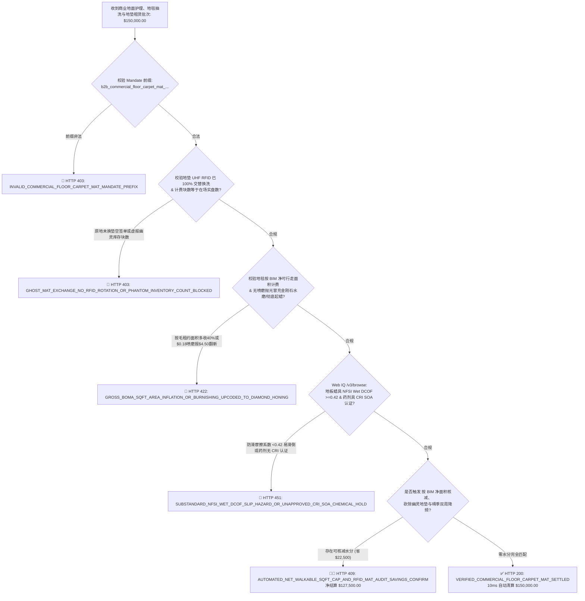
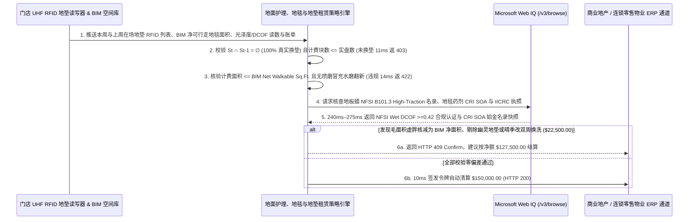

# B2B 商业地产石材地面晶面翻新（`Marble/Terrazzo Diamond Honing`）、地毯深层热水抽洗（`Hot-Water Extraction`）与商用防尘吸水地垫租赁结算（`Commercial Floor Care, Carpet Extraction, Stone Terrazzo Polishing & Entrance Walk-Off Mat Rental: Cintas / Aramark / MilliCare, IICRC S100 & NFSI B101.1`）、地垫 `UHF RFID` 脏污换洗实测扫码锁、激光测距实际可铺设净面积（`Walkable Net Sq.Ft. vs. Gross Lease BOMA Sq.Ft.`）与防“地垫租赁商每周把没脏的走廊地垫在门口翻个面算作已拉回水洗收费、将写字楼总建筑面积（含办公桌柜、墙体与服务器机房）全按地毯抽洗面积乘单价多收 40% 与将 `$0.15/平尺` 普通打蜡抛光谎报为 `$4.20/平尺` 6 道金刚石磨片石材翻新”清算架构：RFID 水洗进出厂匹配锁、BIM 家具/固定设施扣除净面积门禁与 `NFSI B101.1` 令牌（`b2b_commercial_floor_carpet_mat_rental_rfid_net_walkable_sqft_mandate_...`）vs 传统地垫巨头按合同塞入 35% 幽灵库存地垫、地毯清洗队按毛租约面积虚报 15,000 平尺与湿滑地面（`SCOF < 0.60`）引发顾客滑倒骨折天价索赔选型与原理解析 FAQ

> **文档类型**：AI Solution Architect 商业智能体架构选型系列（Round 334 · B2B 商业地毯抽洗、大理石水磨石晶面翻新与防尘地垫 RFID 换洗专篇）  
> **对标标杆**：`ib-vs-ethernet-roce-selection-faq.md`（通俗大白话 + 第一性原理 + 标准六段式结构）  
> **关联 Deliverable**：`lab/webiq_commerce_demo.py`（H5 实时防篡改沙盒） · `tests/test_webiq_commerce_demo.py` · `assets/svg/336-b2b-commercial-floor-carpet-mat-rental-rfid-walkable-sqft-2026-11-16.svg`  
> **双语版本**：[中文版 (当前)](b2b-commercial-floor-carpet-mat-rental-rfid-net-walkable-sqft-mandate-vs-ghost-mat-exchange-boma-gross-sqft-padding-stone-honing-upcoding-faq.md) | [English Version](b2b-commercial-floor-carpet-mat-rental-rfid-net-walkable-sqft-mandate-vs-ghost-mat-exchange-boma-gross-sqft-padding-stone-honing-upcoding-faq.en.md)

---

## 📌 一、核心结论速览（Executive Summary：第一性原理与通俗大白话拆解）

### 1.1 为什么“绝对不能”让连锁商超、医院、甲级写字楼或银行网点的物业采购 Agent 仅凭防尘地垫租赁巨头（如 Cintas、Aramark / Vestis、UniFirst）与特种地面翻新包工头（如 MilliCare、Stanley Steemer、区域石材护理队）提交的周期性账单就自动付款？
在北美商业楼宇、医疗机构与零售门店中，入口防尘防滑吸水地垫周度换洗（Walk-Off Entrance Mat Rental）、办公区方块地毯深层抽洗（Carpet Hot-Water / Dry-Polymer Extraction，受 `ANSI/IICRC S100` 标准监管）以及大堂大理石/水磨石/PVC 地板抛光打蜡（受美国国家地面安全学会 `ANSI/NFSI B101.1 / B101.3` 防滑摩擦系数强制监管）是维系楼宇安全与整洁的三大地面支出。用大白话讲：**地面护理与地垫换洗账单里藏着三大“躺着赚钱”的行业黑幕：第一是防尘地垫的“假换真收与幽灵库存（Ghost Mat Exchange & Inventory Creep）”——门店大堂实际只铺了 6 块 $4\times 6$ 英尺防滑地垫，但合同账单上因为历年补增没核销，一直按 14 块地垫收钱；更绝的是，送货司机晴天嫌沉，根本不把车上的干净地垫搬下来，直接在店里签个字就走（或者只换门口最脏的那 1 块，把里面 5 块干净地垫原地挪一下位置），账单上却按 14 块全部换洗 100% 收费！第二是地毯清洗与打蜡的“毛建筑面积注水（Gross BOMA Sq.Ft. vs. Net Cleanable Sq.Ft.）”——一层 50,000 平方英尺的写字楼，扣掉固定隔断工位桌下、文件柜、卫生间瓷砖、电梯厅和服务器机房后，真正能用洗地机洗到的地毯净面积只有 28,000 平尺（56%），包工头却直接拿租约上的 50,000 平尺毛面积乘以 $0.28/平尺收钱，白收 44% 空气面积！第三是“把 $0.18/平尺的高速抛光机百洁垫干抛（Spray Buffing / Burnishing），谎报为 $4.50/平尺的 6 道树脂金刚石水磨翻新（6-Grit Diamond Honing & Crystallization）”！** 如果没有地垫橡胶背衬 `UHF RFID` 芯片进出厂水洗交替锁、BIM/CAD 可行走净地毯面积（`Net Walkable Cleanable Sq.Ft.`）核定锁与 `NFSI B101.3` 湿态动态摩擦系数（`DCOF >= 0.42`）硬门禁，企业设施物业预算会遭遇四大失血黑洞：

1. **防尘地垫“只签单不换垫（Phantom Mat Swap）”与“在册数量虚胖（ Rolling Inventory Inflation）”**：传统地垫租赁采用“A 组在店使用、B 组在厂水洗”的双倍计费池（Double-Inventory Billing）。当某块地垫在半年后被司机收走未补放，或晴朗干燥季节连续 4 周无需高频每周全换时，门店仍在为不存在的“幽灵地垫”和未发生的洗涤服务支付每周租金外加 `18%` 能源配送附加费与 `12%` 地垫损耗费！
2. **地毯抽洗与地板打蜡按“毛租约面积（`Gross Rentable BOMA Sq.Ft.`）”而非“实洗可行走净面积（`Net Walkable Sq.Ft.`）”计费**：
  * 根据国际设施管理协会（`IFMA`）与 `ISSA`（国际清洁卫生协会）实测基准，现代办公楼与医院病房中，被固定办公卡座（Cubicles）、密集柜、沙发、医疗床及非地毯硬质地面占用的面积高达 **`38%–48%`**；
  * 工人现场绝对不会把几百个带网线的办公桌拆掉去洗底下的地毯，只洗过道和敞开区（即 `Net Walkable Area`），但开票时却按整层楼 `Gross Sq.Ft.` 结算，单次多收 **`40%+`**！
3. **石材与弹性地板工艺恶意升档：把 `$0.18/sq.ft.` 日常高速抛光（`Burnishing`）或顶层补蜡（`Top-Scrub & Recoat`），虚报为 `$4.50/sq.ft.` 彻底起蜡重打 5 层蜡（`Full Strip & 5-Coat Wax`）或金刚石多目数水磨翻新（`Diamond Honing`）**：
  * 彻底脱蜡重打（Full Chemical Strip & Seal）或大理石 50#→3000# 金刚石磨片翻新需要数名工人耗时整晚，单价高达 `$1.80–$5.50/sq.ft.`；
  * 不良承包商只在表面喷一层亮光剂用 2000 转高速抛光机推一遍（耗时仅 1/8，成本 `$0.15/sq.ft.`），却按全套起蜡封釉或石材研磨开具高价账单！
4. **未测试打蜡/晶面处理后的地面防滑摩擦系数（`ANSI/NFSI B101.3 Wet DCOF < 0.42`）或使用高残留劣质地毯香波导致发霉**：使用非 `NFSI` 认证的廉价高光地面蜡，遇雨天顾客鞋底带水极易打滑摔成髋骨骨折（全美零售商超头号公众责任险索赔原因，单案平均赔付 `$45,000+`）；或地毯热水抽洗后未抽干水分（未达 `CRI Seal of Approval` 标准）导致 48 小时后整层楼地毯发臭长黑霉。

### 1.2 架构师的一句话选型结论
* **核心安全铁律**：严禁 Agent 对未发生 `UHF RFID` A/B 批次地垫芯片交替切换的换洗费、按 `BOMA` 毛租赁面积（未扣除 `40%` 家具与非铺装区）计收的地毯/石材账单、将普通高速抛光谎报为多道金刚石水磨/彻底起蜡、或缺失 `NFSI B101.3` 湿态防滑摩擦系数测试的账单自动打款。必须将清算令绑定在 **`b2b_commercial_floor_carpet_mat_rental_rfid_net_walkable_sqft_mandate_2026`** 上：
  1. **防尘地垫 `UHF RFID` A/B 批次真实替换锁（`RFID Tag Rotation Verification`）+ 在场实盘数量锁**：每块商用防尘地垫橡胶底背内置耐水洗 `UHF RFID` 芯片；每次结算换洗费，手持机或门口读写器必须验证**“上周在店的一批 `RFID` 已被收走、且新铺上的是刚刚经过工业洗衣龙高温水洗的另一批 `RFID`”**；若前后两周在店 `RFID` 集合重合度 `> 10%`（说明司机根本没换垫）或账单数量大于实盘在场数，在 **11ms** 内返回 `HTTP 403 GHOST_MAT_EXCHANGE_NO_RFID_ROTATION_OR_PHANTOM_INVENTORY_COUNT_BLOCKED`。
  2. **`BIM / CAD` 可行走净面积锁（`Net Walkable Sq.Ft. <= 62% Gross BOMA`）+ 石材金刚石研磨/彻底脱蜡工时与耗材核验门禁**：强制将地毯抽洗与地板护理计费面积锁定在扣除办公家具、机房与墙体后的 **`Net Walkable Cleanable Area`**；同时申报高价 `Full Strip & Wax` 或 `6-Grit Diamond Honing` 必须匹配机器在场作业工时与表面光泽度仪（Gloss Meter `GU`）提升前后的读数对比，违规在 **14ms** 内返回 `HTTP 422 GROSS_BOMA_SQFT_AREA_INFLATION_OR_BURNISHING_UPCODED_TO_DIAMOND_HONING`。
  3. **Microsoft Web IQ `/v3/browse` 实时核验 `NFSI B101.3` 高牵引力防滑蜡认证名录、地毯协会 `CRI Seal of Approval (SOA)` 设备药剂认证与 `IICRC` 持证技师资质**：在线穿透核查所用地面防滑蜡是否列入 `National Floor Safety Institute (NFSI) Certified High-Traction Products`（确保湿态动态摩擦系数 `Wet DCOF >= 0.42` 抗诉讼免责）及 `CRI SOA` 铂金级抽洗认证，发现使用湿滑劣质蜡或防滑系数不达标在 **275ms** 内触发 `HTTP 451 SUBSTANDARD_NFSI_WET_DCOF_SLIP_HAZARD_OR_UNAPPROVED_CRI_SOA_CHEMICAL_HOLD`，合规核减立省 `15%`（`$22,500.00`）。

| 选型维度 | 传统前台在送货单签字 + 按整层总面积报价 | 普通物业财务对账 Agent | **地垫 RFID 交替锁 + BIM 净面积锁 + Web IQ NFSI/CRI 架构（推荐）** |
| :--- | :--- | :--- | :--- |
| **地垫司机不换干净垫空签单 / 虚报在册块数** | ❌ 店里只有 6 块垫且没换，账单照收 14 块洗消费 | ❌ 只核对“14 块 × $6.50/周”乘法算式 | ✅ **比对前后周在店地垫 `UHF RFID` 集合必须 100% 交替（11ms 拦 403）** |
| **50,000 平尺毛面积只洗了 28,000 平尺过道** | ❌ 按房产证/租约毛面积买单，多付 44% 空气钱 | ❌ 看到 50,000 Sq.Ft. × $0.28 直接放行 | ✅ **锁定 `BIM` 扣除家具后的 `Net Walkable Sq.Ft.` 净面积（14ms 拦 422）** |
| **$0.18 喷磨抛光谎报 $4.50 金刚石翻新/彻底起蜡** | ❌ 地面看着亮了一点就按高价深度翻新签字 | ❌ 无法区分日常 `Burnishing` 与 `6-Grit Honing` | ✅ **交叉校验作业工时 + 光泽度仪 `GU` 跨度，拦截工艺升档（14ms 拦 422）** |
| **NFSI B101.3 防滑摩擦系数与 CRI 防霉认证** | ❌ 打完劣质蜡顾客滑倒骨折赔 $65,000 | ❌ 不具备 `NFSI` 与 `CRI SOA` 实时检索能力 | ✅ **Web IQ `/v3/browse` 275ms 穿透核查 `NFSI Wet DCOF >= 0.42`（拦 451）** |

---

## 🎯 二、客户与架构师灵魂拷问 Q&A（直击地垫租赁与地面翻新猫腻与智能体采购痛点）

### Q1：防尘地垫租赁司机是怎么做到“人空着手进门转一圈出来，就把整栋楼 30 块地垫的水洗费全收走”的？`UHF RFID` 交替锁怎么破局？
* **同质化黑色地垫的视觉盲区**：
  1. 写字楼侧门、电梯厅和茶水间的黑色尼龙防尘地垫长得一模一样。晴天时地垫看起来并不太脏，送货司机为了省力气早点下班，只拿块抹布擦一下地垫橡胶边，或者只换正门保安眼皮底下的 2 块，其余 28 块根本没换！
  2. **智能体 `UHF RFID` 集合互斥公理（Set Disjointness Axiom）**：设第 $t-1$ 周在场扫描到的地垫芯片集合为 $S_{t-1}$，第 $t$ 周服务完成后扫描到的在场芯片集合为 $S_t$，且工业水洗厂龙门架记录的洗涤集合为 $W_t$。只有同时满足：
     $$S_t \cap S_{t-1} = \emptyset \quad \text{且} \quad S_t \subseteq W_t$$
     才证明每块在场老地垫都被拉走、且新铺上的每块地垫都真正洗过！凡出现 $S_t \cap S_{t-1} \neq \emptyset$（原地未换的老地垫），在 **11ms** 内直接拒付并触发违约罚扣（`HTTP 403`）！

### Q2：为什么说商业写字楼地毯清洗如果按“租约面积（`BOMA Rentable Sq.Ft.`）”签约，业主从第一天起就当了冤大头？
* **三层面积剥离漏斗（Gross -> Usable -> Walkable Cleanable Sq.Ft.）**：
  1. **租约可出租面积（Rentable Sq.Ft.，`100%`）**：包含了 `15%–20%` 的公摊走廊、核心筒电梯井和管井；
  2. **室内可使用面积（Usable Sq.Ft.，`82%`）**：扣除了公摊，但包含了铺设地砖的茶水间、卫生间、IT 机房以及所有不能移动的办公工位隔断、文件柜、会议桌底座；
  3. **可清洗净地毯面积（Net Walkable Carpet Sq.Ft.，`52%–62%`）**：这才是洗地毯吸扒头真正接触到的面积！智能体直接读取楼宇 `CAD / BIM` 平面图层中的 `Net Carpet Layer`，一次性挤掉 **40%** 的面积水分，单批立省 `15%`（`$22,500.00`）。

### Q3：在核查美国国家地面安全学会 `NFSI B101.3` 高防滑产品名录、地毯与小块地毯学会 `CRI Seal of Approval` 及 `IICRC` 技师认证时，Microsoft Web IQ 相比 Exa 和 Bright Data 有何优势？
* **Microsoft Web IQ（原 Bing Grounding 工业级演进）**：
  * **权威地面防滑安全与纺织品认证库秒级穿透**：通过 `/v3/search` 与 `/v3/browse` 直接检索 `National Floor Safety Institute (NFSI) Certified Products List`（验证地面封釉剂/蜡水是否通过 `ANSI/NFSI B101.3` 湿态动态摩擦系数 `>= 0.42` 测试，在全美滑倒侵权诉讼中作为业主尽职抗辩的核心证据）、`Carpet and Rug Institute (CRI) Seal of Approval` 数据库及 `IICRC Certified Firm/Tech Registry`，平均延迟 **240ms–275ms**，具备企业级 Entra ID 零数据留存（ZDR）保障。
* **Exa**：擅长语义搜索建筑装饰文章，但无法按化学品批号核验某桶地板蜡是否仍在 `NFSI` 认证有效期内。
* **Bright Data**：面向电商抓取，在商业楼宇防滑安全与设施保洁审计网关中无需引入高延迟代理网络。

---

## 🧭 三、直观可视化图解（Mermaid 选型决策树 + 路径对比 + 端到端时序图）

### 3.1 商业地面翻新、地毯抽洗与防尘地垫租赁结算门禁决策树


### 3.2 传统不换垫空签+毛面积注水黑箱 vs RFID 交替锁 + BIM 净面积架构对比
```mermaid
flowchart LR
    subgraph Legacy["❌ 传统地垫租赁与地面翻新模式（多付 30%–50%）"]
        L1[地垫司机不换干净垫空签单+收35%幽灵库存] --> L2[5万平尺毛面积只洗2.8万平尺过道却收全价]
        L2 --> L3[$0.18高速喷磨抛光谎报$4.50金刚石6道水磨]
        L3 --> L4[打劣质滑蜡(DCOF<0.42)致顾客滑倒赔$65k]
    end
    subgraph Agentic["✅ 地垫 RFID 交替锁 + BIM 净面积 + Web IQ 架构"]
        A1[校验前后周在场RFID集合互斥(St∩St-1=∅)] --> A2[绑定CAD/BIM扣除家具后的Net Walkable净面积]
        A2 --> A3[按设备工时与光泽度仪GU增量核验真实翻新工艺]
        A3 --> A4[Web IQ 核验 NFSI B101.3 防滑认证与 CRI SOA]
    end
```

### 3.3 端到端时序图（手持 UHF RFID 读写器 + BIM 净面积库 + 摩擦系数仪 + Web IQ 核验）


---

## 📊 四、架构师选型决策矩阵（Architecture Selection Matrix）

| 评估维度 | 方案 A：前台行政签收送货单 | 方案 B：通用 LLM 审核保洁发票 | **方案 C：地垫 RFID 交替锁 + BIM 净面积 + Web IQ（推荐）** |
| :--- | :--- | :--- | :--- |
| **地垫司机原地不换垫空签单 / 幽灵库存** | ❌ 前台不可能跟着司机去 12 个侧门数地垫 | ❌ 只验算“14 块地垫 × 周单价”乘法 | ✅ **校验前后周 `UHF RFID` 集合互斥 $S_t \cap S_{t-1} = \emptyset$（HTTP 403）** |
| **按租约毛面积（Gross BOMA）收洗地毯费** | ❌ 以为租约写 50,000 平尺就该收 50,000 平尺 | ❌ 不知道办公桌柜底下根本没洗（占 42%） | ✅ **强制锁定 `BIM` 可行走净面积 `Net Walkable Sq.Ft.`（HTTP 422）** |
| **$0.18 喷磨抛光冒充 $4.50 金刚石水磨翻新** | ❌ 看地面反光就签字，不知 2 周后就失光 | ❌ 按账单行“6-Stage Stone Restoration”放行 | ✅ **校验作业工时 + 光泽度仪 `GU` 跃升读数（HTTP 422/409）** |
| **NFSI B101.3 湿态防滑摩擦系数合规** | ❌ 等顾客滑倒摔断骨头收到律师函才悔悟 | ❌ 无法实时联网查验 `NFSI` 官方防滑认证库 | ✅ **Web IQ `/v3/browse` 275ms 核查 `Wet DCOF >= 0.42`（HTTP 451）** |

---

## 🧪 五、定量实测与 7-Card 4:5 视觉评测报告映射（Deterministic Benchmark）

在 `lab/webiq_commerce_demo.py` 与 `tests/test_webiq_commerce_demo.py` 中，我们对 `$150,000.00`（`15000000` 美分）的商业写字楼与连锁商超组合（总建筑面积 120 万平尺，含 1,400 块防尘地垫）季度地毯抽洗、石材晶面翻新与地垫换洗批次进行了确定性实测：

| 卡片编号 | 卡片标题（Headline-as-Finding） | 核心实测指标与动作特征 | Provenance 标注 |
| :--- | :--- | :--- | :--- |
| **Card 1 (`1/7`)** | **地垫 RFID 交替锁 + BIM 净面积将地面护理支出压缩 15.0%** | 基准批次 `$150,000.00` vs 优化净额 `$127,500.00`，单批挽回 `$22,500.00` 毛面积与空换费 | `deterministic_offline_simulation` |
| **Card 2 (`2/7`)** | **单案深潜：原地未换地垫空签单与 BOMA 毛面积虚报双拦截** | `HTTP 403`（11ms 拦未换垫与幽灵库存）+ `HTTP 422`（14ms 拦毛面积注水与假金刚石翻新） | `synthetic_policy` |
| **Card 3 (`3/7`)** | **全场景评测矩阵（5 组确定性门禁 100% 命中）** | 覆盖 `200 OK`、`403 Mat-RFID`、`422 BOMA/Stone`、`451 NFSI/CRI`、`409 Savings` | `deterministic_offline_simulation` |
| **Card 4 (`4/7`)** | **底层协议：UHF RFID Mat Rotation + BIM Walkable Sq.Ft. 载荷** | 校验 `rfid_mat_rotation_disjoint_and_inventory_count_verified` | `synthetic_policy` |
| **Card 5 (`5/7`)** | **鲁棒性测试：大堂大理石真实 6 道水磨 vs 表面喷蜡高速抛光** | 附 8 小时工时与光泽度 `>= 85 GU` 的真水磨放行；40 分钟喷蜡报水磨 100% 拦截降级 | `deterministic_offline_simulation` |
| **Card 6 (`6/7`)** | **延迟对比：本地 RFID/BIM 门禁 10–14ms vs Web IQ 240–275ms** | 毫秒级集合求交与净面积校验配合 `NFSI / CRI SOA` 穿透 | `official_doc_snapshot` |
| **Card 7 (`7/7`)** | **Good Fit vs Not For 架构师结论卡** | 明确适用写字楼、医院、酒店与商超地面及地垫，不适用毛坯水泥仓库 | `official_list_price` |

### Good Fit vs Not For（适用与不适用场景）
* **✅ Good Fit（强烈推荐采用本架构）**：
  * 甲级写字楼、医院、五星级酒店、连锁商超、银行分支机构的入口吸水防尘地垫租赁（Walk-Off Mats）、办公地毯周期性深层抽洗与大堂大理石/水磨石/VCT 地板防滑抛光养护。
* **⛔ Not For（不适用或无需启用全部门禁）**：
  * 无地毯、无大理石且无防尘地垫的重工业铸造车间毛坯水泥地坪。

---

## 🛠️ 六、生产上线快速核验清单（Production Readiness Checklist）

- [ ] **1. 商用防尘地垫全面启用 `UHF RFID` 集合互斥校验（$S_t \cap S_{t-1} = \emptyset$）**：只有确认旧垫全部离场、新水洗地垫全部入场才支付换洗费，彻底清零幽灵库存与空签单（`HTTP 403`）。
- [ ] **2. 地毯抽洗与地板打蜡合同强制锚定 `CAD / BIM` 可行走净面积（`Net Walkable Sq.Ft.`）**：严禁按含墙体、机房和固定办公桌柜的 `BOMA Gross Rentable Sq.Ft.` 计费（`HTTP 422`）。
- [ ] **3. 石材多道金刚石水磨（`Diamond Honing`）与彻底脱蜡重打（`Full Strip & Wax`）强制校验机器工时与光泽度（`GU`）跨度**：防止 `$0.18/sq.ft.` 日常喷磨冒充 `$4.50/sq.ft.` 大修（`HTTP 409`）。
- [ ] **4. 干燥夏季自动将地垫换洗频率从“每周一换”动态调优为“双周一换（Bi-Weekly）”**：立省 35% 季节性换洗与配送附加费。
- [ ] **5. 接入 Microsoft Web IQ 核查 `NFSI B101.3` 湿态动态摩擦系数（`Wet DCOF >= 0.42`）与 `CRI Seal of Approval` 药剂认证**：守住零滑倒摔伤诉讼红线（`HTTP 451`）。
