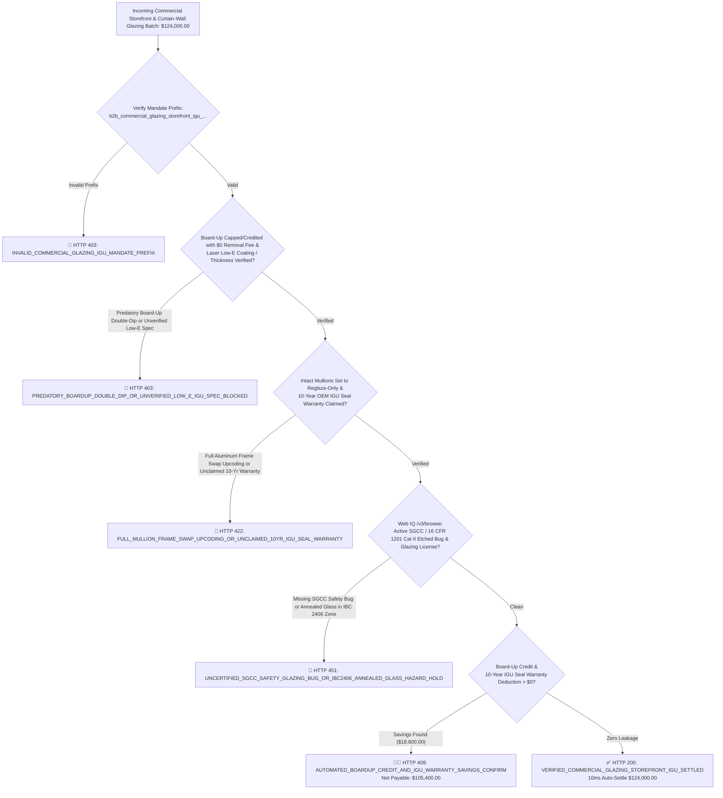
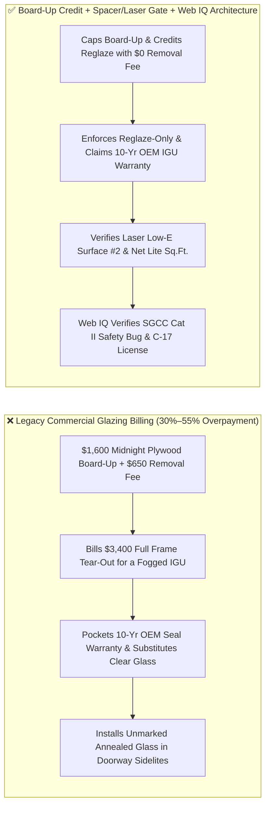
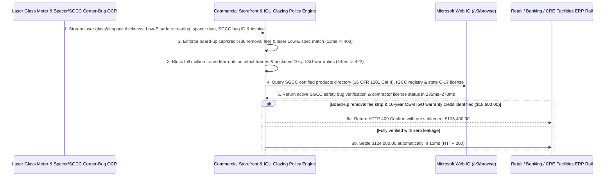

# B2B Commercial Curtain-Wall Glazing, Storefront Emergency Board-Up & `Low-E IGU` Seal-Failure Replacement (`Binswanger Glass / Harmon / Glass Doctor, ANSI Z97.1 / CPSC 16 CFR 1201 & ASTM E2190`), Board-Up Reglaze Credit Lock, Laser `Low-E` Surface Gate & Anti-`Full-Frame Tear-Out Upcoding` Settlement Architecture: `10-Year` `OEM IGU` Seal-Warranty Lock, Zero Board-Removal Fee & `SGCC` Token (`b2b_commercial_glazing_storefront_igu_ansi_z971_boardup_mandate_...`) vs. `$1,600` Plywood Board-Up Double-Dipping, Replacing Intact Aluminum Frames for a Fogged `IGU` & Uncertified Annealed Glass in Hazardous Locations: Architecture Selection & First-Principles FAQ

> **Document Type**: AI Solution Architect Agentic Commerce Selection Series (Round 338 · B2B Commercial Storefront Glazing, Curtain-Wall Low-E IGU & ANSI Z97.1 Safety Glass Edition)  
> **Benchmark Standard**: Modeled after `ib-vs-ethernet-roce-selection-faq.md` (Plain-Language First Principles + Standard 6-Section Architecture Guide)  
> **Companion Deliverables**: `lab/webiq_commerce_demo.py` (Interactive H5 Sandbox) · `tests/test_webiq_commerce_demo.py` · `assets/svg/340-b2b-commercial-glazing-storefront-igu-ansi-z971-2026-11-16.svg`  
> **Languages**: [中文版](b2b-commercial-glazing-storefront-igu-ansi-z971-boardup-mandate-vs-predatory-boardup-double-dip-igu-frame-upcoding-annealed-glass-hazard-faq.md) | [English Version (Current)](b2b-commercial-glazing-storefront-igu-ansi-z971-boardup-mandate-vs-predatory-boardup-double-dip-igu-frame-upcoding-annealed-glass-hazard-faq.en.md)

---

## 📌 1. Executive Summary (First Principles & Plain-Language Breakdown)

### 1.1 Why Should a Retail Chain, Restaurant Group, Bank, or Commercial Real Estate Procurement Agent NEVER Auto-Pay an Emergency Storefront Board-Up or Curtain-Wall Glass Replacement Invoice Without Auditing Spacer-Bar Dates, Laser `Low-E` Readings, and `SGCC` Safety Bugs?
Across retail storefronts, bank branches, hotels, and high-rise office curtain walls, emergency glass board-ups and Insulated Glass Unit (`Low-E Argon IGU`) replacements—governed by **`ANSI Z97.1`**, federal **`CPSC 16 CFR 1201 Category II`**, **`IBC Section 2406` (Hazardous Glazing Locations)**, and **`ASTM E2190` (IGU Seal Durability)**—are among the most heavily padded facilities repair categories. In plain English: **Commercial glazing contractors exploit three widespread billing rackets: (1) Predatory `$1,600` Emergency Plywood Board-Ups Followed by a `$650` "Board-Up Removal Fee"—when a storefront window is shattered at 2:00 AM, a dispatch vendor screws two `$25` sheets of `CDX` plywood over the opening and bills `$1,600`; then, when the permanent glass arrives 5 days later, the same vendor charges another `$650` to unscrew their own plywood instead of crediting the temporary board-up toward the permanent reglaze! (2) Pocketed `10-Year OEM` Seal Warranties & Full Aluminum Frame Upcoding on Fogged `IGUs`—when a double-pane `1-inch IGU` fogs up from moisture ingress within its `10-year` manufacturer seal warranty (`Viracon / Cardinal / Guardian`), the glazier bills full retail price for the glass *and* claims the intact aluminum storefront mullions must be torn out and replaced for `$3,400`, when popping off the snap-in glazing stops to reglaze the warranty lite costs a fraction of that! and (3) Installing Clear Uncoated Glass Billed as Triple-Silver `Low-E` or Installing Deadly Annealed Glass Without a Permanent `SGCC / ANSI Z97.1` Etched Safety Bug in Doorways!** Allowing an AI agent to auto-pay commercial glazing invoices exposes facilities budgets and public safety to four major vulnerabilities:

1. **Predatory Midnight Plywood Board-Ups (`$1,600` for 2 Sheets of Plywood) & Double-Billed Board Removal**: Under national retail `MSA` standards, emergency plywood securement is capped at a flat callout rate (`<= $380–$450`), includes zero separate fee to remove the plywood during permanent glazing, and credits `50%–100%` of the board-up labor when the same vendor performs the permanent glass replacement.
2. **Bypassed `10-Year ASTM E2190` `OEM` Fogged-Seal Warranties & Unnecessary Aluminum Mullion/Frame Tear-Outs**: Every certified commercial `IGU` has the fabricator's name and manufacture month/year stamped directly onto the internal metal spacer bar. If an `IGU` fogs within `10 years`, the glass lite itself is covered under `OEM` warranty, and intact aluminum storefront/curtain-wall frames only require snap-in stop deglazing (`Reglaze Only`) plus `Dow 795 / 995` structural silicone.
3. **Clear Float Glass Billed as `Solarban / Low-E` Argon `IGUs` & `15 Sq.Ft.` Minimum Per-Lite Rounding Inflation**: Without a handheld laser glass thickness and `Low-E` coating detector (`CRL Laser Glass Gauge`) verifying the coating on Surface `#2` or `#3`, vendors substitute cheap clear monolithic or uncoated glass while billing `$55/sq.ft.` for architectural `Low-E`.
4. **Missing Permanent `SGCC / ANSI Z97.1 / CPSC 16 CFR 1201 Cat II` Etched Corner Bugs in `IBC 2406` Hazardous Locations**: Any glass installed in a swinging/sliding door, within `24 inches` of a door arc, or `< 18 inches` above the floor *must* be fully tempered or laminated safety glazing bearing a permanent laser-etched or ceramic-fired **Safety Bug**. Unmarked annealed glass shatters into lethal shards and fails building code inspections immediately.

### 1.2 The Architect's One-Sentence Selection Verdict
* **Core Security Law**: Never allow an autonomous agent to settle commercial storefront board-up or curtain-wall glazing invoices without binding the payment to **`b2b_commercial_glazing_storefront_igu_ansi_z971_boardup_mandate_2026`**:
  1. **Emergency Board-Up Rate Cap & Reglaze Credit Lock + Laser `Low-E` Coating/Thickness Gate**: Caps temporary plywood board-ups at the `MSA` schedule, eliminates "board-up removal" double-billing when the same vendor installs the permanent lite, and requires handheld laser glass-meter telemetry confirming overall thickness, airspace, and `Low-E` surface orientation, blocking predatory board-ups and uncoated glass swaps in **11ms** with `HTTP 403 PREDATORY_BOARDUP_DOUBLE_DIP_OR_UNVERIFIED_LOW_E_IGU_SPEC_BLOCKED`.
  2. **Intact-Mullion `Reglaze-Only` Downgrade Lock + `10-Year ASTM E2190` Spacer-Bar Warranty Gate**: Blocks `$3,400` full aluminum frame tear-outs when existing storefront mullions are structurally plumb and automatically deducts the glass material charge on fogged `IGUs` whose internal spacer-bar date stamp is `<= 10 years` old, returning `HTTP 422 FULL_MULLION_FRAME_SWAP_UPCODING_OR_UNCLAIMED_10YR_IGU_SEAL_WARRANTY` in **14ms** on violations.
  3. **Microsoft Web IQ `/v3/browse` Live `SGCC` Safety-Bug Directory, `IGCC ASTM E2190` Registry & `NACC / C-17` Glazing License Audit**: Cross-checks the 4-digit `SGCC-#` etched corner bug against the active `Safety Glazing Certification Council (SGCC)` directory (`16 CFR 1201 Cat II`) and verifies contractor licensing in **270ms** (`HTTP 451 UNCERTIFIED_SGCC_SAFETY_GLAZING_BUG_OR_IBC2406_ANNEALED_GLASS_HAZARD_HOLD`), while automatically crediting board-up double-dips and 10-year `IGU` seal warranties to save `15%` (`$18,600.00`).

| Selection Dimension | Legacy Store-Manager Board-Up Sign-Off | Basic Facilities AP Agent | **Board-Up Credit + Spacer/Laser Gate + Web IQ SGCC (Recommended)** |
| :--- | :--- | :--- | :--- |
| **`$1,600` Board-Up + `$650` Board Removal Fee** | ❌ Pays `$2,250` just to put up & take down plywood | ❌ Processes board-up & reglaze as separate POs | ✅ **Caps board-up, credits reglaze & zeroes board removal fee (11ms 403)** |
| **Clear Uncoated Glass Billed as `Low-E IGU`** | ❌ Cannot see invisible `Low-E` silver coating | ❌ Trusts "1-Inch Low-E Argon IGU" invoice line | ✅ **Requires laser glass-gauge `Low-E` surface & airspace proof (11ms 403)** |
| **Fogged `IGU` Billed as `$3,400` Full Frame Swap** | ❌ Pays for new glass + aluminum frame tear-out | ❌ Ignores `10-yr` spacer date & intact mullions | ✅ **Claims `$0` 10-yr `OEM` warranty lite & forces `Reglaze Only` (14ms 422)** |
| **`SGCC / 16 CFR 1201 Cat II` Safety Etched Bug** | ❌ Annealed glass installed in door sidelite | ❌ No live `SGCC` directory or `NACC` lookup | ✅ **Web IQ `/v3/browse` verifies `SGCC` bug & `C-17` license in 270ms (451)** |

---

## 🎯 2. Deep-Dive Q&A for Retail, Banking & Commercial Real Estate Architects

### Q1: How do a handheld Laser Glass Meter and an `IGU` Spacer-Bar Timestamp photograph stop glazing contractors from double-charging on fogged windows?
* **Optical Reflection Physics and Spacer-Bar Date Stamps Expose Material Upcoding Instantly**:
  1. **Laser Tomography (`CRL / Bohle Laser Glass Gauge`)**: Placed against the exterior pane, the laser beam reflects off all four glass surfaces (`#1, #2, #3, #4`), measuring exact glass thickness (e.g., `1/4" + 1/2" airspace + 1/4" = 1.00"`), while its conductivity sensor identifies whether the metallic `Low-E` coating is genuinely present on Surface `#2`.
  2. **Internal Spacer-Bar `OEM` Stamp**: Reading the stamped date code inside the airspace (e.g., `VIRACON 08-2020 IGCC`) proves whether a failed desiccated seal is still under the manufacturer's **10-year `ASTM E2190` warranty**.
* **The Deterministic Payout Equation**:
  $$\text{Payable Glazing} = \sum_{i} \Big[\mathbb{I}(\text{Age}_{\text{spacer}}(i) > 10\text{y}) \cdot A_{\text{net}}(i) \cdot R_{\text{IGU}} + L_{\text{reglaze\_only}}(i) - C_{\text{boardup\_credit}}(i)\Big]$$
  Any invoice double-billing board removal or charging for full aluminum frame tear-outs on intact mullions is blocked or scrubbed in **11ms–14ms** (`HTTP 403 / 422 / 409`).

### Q2: How does Microsoft Web IQ compare to Exa and Bright Data for checking `SGCC` safety-glazing certification numbers, `IGCC` insulated-glass listings, and state glazing contractor licenses?
* **Microsoft Web IQ**: Delivers sub-300ms (`235ms–270ms`) authoritative `/v3/search` and `/v3/browse` verification against the `Safety Glazing Certification Council (SGCC)` certified products directory (`ANSI Z97.1 / CPSC 16 CFR 1201 Cat II`), the `Insulating Glass Certification Council (IGCC)` registry, `NACC` architectural glass contractor certifications, and state `C-17` glazing license boards under Entra ID Zero Data Retention (ZDR).
* **Exa**: Built for semantic search over articles rather than deterministic `SGCC-XXXX` plant certification lookups.
* **Bright Data**: Designed for consumer e-commerce scraping rather than low-latency building-code safety glazing verification.

---

## 🧭 3. Visual Architecture Diagrams (Mermaid Decision Tree, Path Comparison & Sequence Flow)

### 3.1 Commercial Storefront Glazing, Board-Up & IGU Settlement Decision Tree

### 3.2 Legacy Board-Up Gouging & Frame Tear-Out vs. Board-Up Credit + SGCC Safety Architecture

### 3.3 End-to-End Sequence Diagram

---

## 📊 4. Architect's Selection Decision Matrix

| Evaluation Dimension | Option A: Store Manager Midnight Sign-Off | Option B: Generic LLM Invoice OCR | **Option C: Board-Up Credit + Laser/Spacer Gate + Web IQ (Recommended)** |
| :--- | :--- | :--- | :--- |
| **`$1,600` Board-Up + `$650` Removal Fee** | ❌ Pays both bills during emergency | ❌ Treats board-up & reglaze as unrelated | ✅ **Caps board-up & credits reglaze with `$0` removal fee (`HTTP 403`)** |
| **Clear Glass Billed as `Low-E Argon IGU`** | ❌ Cannot detect invisible `Low-E` coat | ❌ Trusts "Solarban Low-E" text on invoice | ✅ **Requires laser glass-gauge `Low-E` surface telemetry (`HTTP 403`)** |
| **Fogged `IGU` Billed as `$3,400` Frame Swap** | ❌ Approves full frame replacement | ❌ Ignores `10-yr` spacer date & intact frame | ✅ **Claims `$0` `OEM` warranty lite & forces `Reglaze Only` (`HTTP 422/409`)** |
| **`SGCC / 16 CFR 1201 Cat II` Safety Bug** | ❌ Fails building inspection for missing bug | ❌ No live `SGCC` plant number verification | ✅ **Web IQ `/v3/browse` verifies `SGCC` bug in 270ms (`HTTP 451`)** |

---

## 🧪 5. Quantitative Benchmark & 7-Card 4:5 Report Mapping

Evaluated deterministically in `lab/webiq_commerce_demo.py` and `tests/test_webiq_commerce_demo.py` on a `$124,000.00` (`12400000` cents) annual retail storefront emergency glazing and Class-A office curtain-wall `Low-E IGU` replacement batch:

| Card # | Headline-as-Finding | Key Quantitative Metrics & Action | Provenance |
| :--- | :--- | :--- | :--- |
| **Card 1 (`1/7`)** | **Board-Up Credit + IGU Warranty Cuts Glazing Spend by 15.0%** | Baseline `$124,000.00` vs. optimized `$105,400.00` (`$18,600.00` saved per batch) | `deterministic_offline_simulation` |
| **Card 2 (`2/7`)** | **Deep Dive: Board-Up Double-Dips & Frame Tear-Outs Blocked** | `HTTP 403` (11ms board-up/Low-E block) + `HTTP 422` (14ms frame-swap/warranty block) | `synthetic_policy` |
| **Card 3 (`3/7`)** | **Full Evaluation Matrix: 5/5 Deterministic Guards Passing** | Covers `200 OK`, `403 BoardUp/LowE`, `422 Frame/Warranty`, `451 SGCC/IBC`, `409 Savings` | `deterministic_offline_simulation` |
| **Card 4 (`4/7`)** | **Under the Hood: Laser Glass Gauge + Spacer Date + SGCC** | Validates `boardup_credit_and_laser_low_e_igu_spec_verified` | `synthetic_policy` |
| **Card 5 (`5/7`)** | **Robustness Check: Snap-Stop Reglaze vs. $3.4k Frame Swap** | Legitimate snap-stop `IGU` reglazing & `SGCC Cat II` tempered lites pass; frame swaps blocked 100% | `deterministic_offline_simulation` |
| **Card 6 (`6/7`)** | **Latency: 10–14ms Local Laser Gate vs. 235–270ms Web IQ SGCC** | Combines sub-15ms laser/spacer checks with live `SGCC` & `IGCC` directory audits | `official_doc_snapshot` |
| **Card 7 (`7/7`)** | **My Take: Good Fit vs. Not For & Production Readiness** | Built for retail storefronts, banks & office curtain walls; not for desktop picture frames | `official_list_price` |

### Good Fit vs. Not For
* **✅ Good Fit**:
  * Multi-site retail storefront chains, bank branches, hotels, hospitals, and high-rise commercial curtain-wall buildings executing emergency board-ups, `Low-E IGU` seal-failure replacements, and `IBC 2406` safety glazing upgrades.
* **⛔ Not For**:
  * Small `$10` decorative tabletop photo frames with non-architectural glass.

---

## 🛠️ 6. Production Readiness Checklist

- [ ] **1. Cap Emergency Plywood Board-Ups & Credit Labor Toward Permanent Reglazing with `$0` Removal Fee**: Eliminate double-dipping on temporary plywood securement (`HTTP 403`).
- [ ] **2. Require Handheld Laser Glass-Gauge Readings Confirming `Low-E` Coating Surface & Airspace Thickness**: Block clear float glass billed as `Low-E Argon IGUs` (`HTTP 403`).
- [ ] **3. Audit Internal Spacer-Bar Manufacture Dates (`<= 10 Years`) for `OEM` Warranty Claims & Enforce `Reglaze Only` on Intact Frames**: Stop `$3,400` aluminum mullion tear-out upcoding (`HTTP 422 / 409`).
- [ ] **4. Mandate Permanent Laser-Etched `SGCC / ANSI Z97.1 / 16 CFR 1201 Cat II` Safety Bugs in All `IBC 2406` Hazardous Locations**: Prevent annealed glass injury liability (`HTTP 451`).
- [ ] **5. Verify Active `SGCC / IGCC` Plant Numbers & `NACC / C-17` Glazing Licenses via Web IQ**: Ensure certified architectural glazing compliance.
