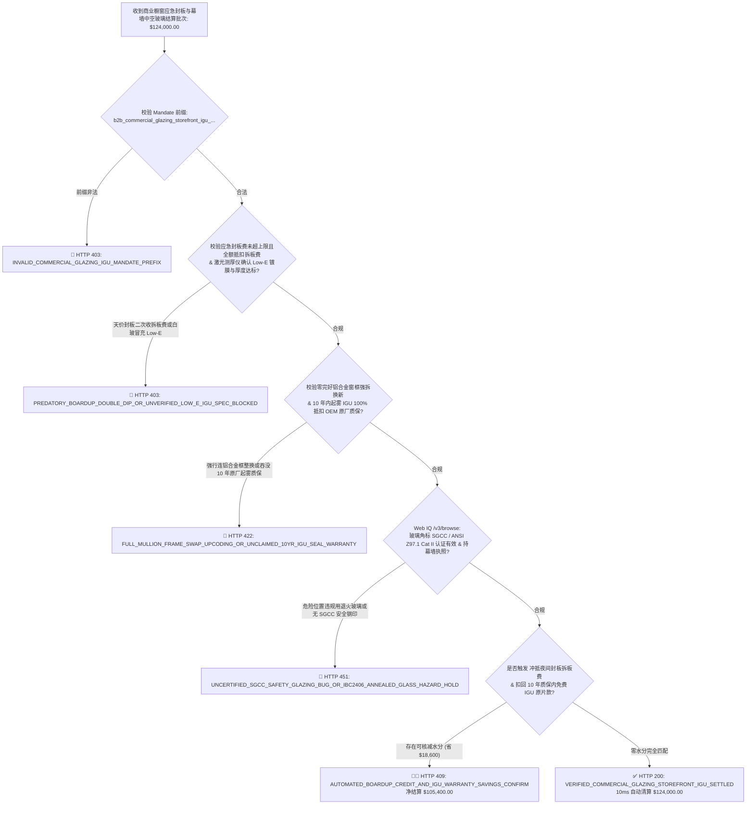
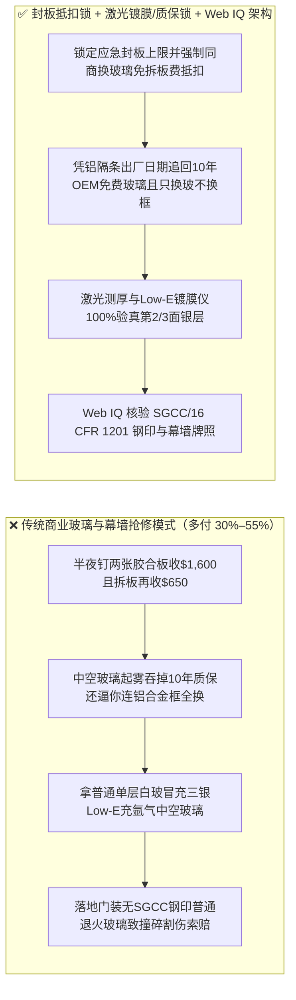
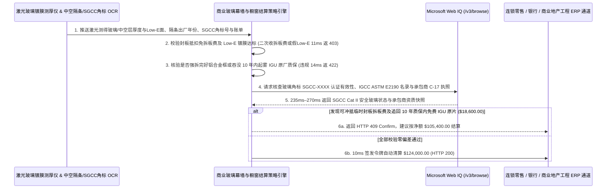

# B2B 商业建筑玻璃幕墙维修、商铺橱窗应急封板（`Emergency Board-Up`）与中空玻璃（`Low-E IGU`）起雾更换结算（`Commercial Storefront Glazing, Curtain-Wall Mullion & Safety Glass Replacement: Binswanger Glass / Harmon / Glass Doctor, ANSI Z97.1 / CPSC 16 CFR 1201 & ASTM E2190`）、应急木板封堵费抵扣正式换玻璃锁、中空玻璃 10 年原厂密封质保（`OEM IGU Seal Warranty`）核销门禁与防“商铺橱窗被砸后钉两张 `$25` 胶合板收 `$1,600` 天价抢险费且换玻璃时再收一次 `$650` 拆木板费、把仅需换密封胶条或 `$0` 质保内起雾的中空玻璃虚报为 `$3,400` 整扇铝合金幕墙窗框换新”清算架构：封板工时抵扣锁、激光测厚/Low-E 镀膜光谱验真门禁与 `SGCC / NACC` 令牌（`b2b_commercial_glazing_storefront_igu_ansi_z971_boardup_mandate_...`）vs 传统玻璃商把普通单层退火玻璃（一撞变断头台）冒充 `ANSI Z97.1` 钢化夹胶安全玻璃与按 `15 平尺` 起步面积凑整虚报选型与原理解析 FAQ

> **文档类型**：AI Solution Architect 商业智能体架构选型系列（Round 338 · B2B 商铺橱窗应急封板、商业玻璃幕墙 IGU 与 ANSI Z97.1 安全玻璃专篇）  
> **对标标杆**：`ib-vs-ethernet-roce-selection-faq.md`（通俗大白话 + 第一性原理 + 标准六段式结构）  
> **关联 Deliverable**：`lab/webiq_commerce_demo.py`（H5 实时防篡改沙盒） · `tests/test_webiq_commerce_demo.py` · `assets/svg/340-b2b-commercial-glazing-storefront-igu-ansi-z971-2026-11-16.svg`  
> **双语版本**：[中文版 (当前)](b2b-commercial-glazing-storefront-igu-ansi-z971-boardup-mandate-vs-predatory-boardup-double-dip-igu-frame-upcoding-annealed-glass-hazard-faq.md) | [English Version](b2b-commercial-glazing-storefront-igu-ansi-z971-boardup-mandate-vs-predatory-boardup-double-dip-igu-frame-upcoding-annealed-glass-hazard-faq.en.md)

---

## 📌 一、核心结论速览（Executive Summary：第一性原理与通俗大白话拆解）

### 1.1 为什么“绝对不能”让全国连锁商超、餐饮门店、银行网点、酒店或甲级写字楼的工程采购 Agent 仅凭商业玻璃幕墙维修商（如 Binswanger Glass、Harmon、Glass Doctor Commercial、区域幕墙公司）提交的“夜间橱窗应急封板与中空安全玻璃更换结算单”就自动付款？
在连锁零售门店、商场与高层写字楼中，临街商铺落地橱窗（`Storefront Framing`）应急抢修与高层建筑双银/三银低辐射中空玻璃（`Low-E Argon Insulated Glass Unit, IGU`）吊装更换（受美国国家安全玻璃标准 `ANSI Z97.1`、联邦消费品安全委员会 `CPSC 16 CFR 1201 Category II` 抗冲击法规、`IBC Section 2406` 危险区域安全玻璃条款及 `ASTM E2190` 中空玻璃密封耐久性标准监管）是极高频的商业设施支出。用大白话讲：**商业玻璃与橱窗抢修藏着外包界最狠的三大宰客套路：第一是“半夜钉两块木板收 $1,600，几天后拆自己钉的木板再收 $650（Predatory Emergency Board-Up Double-Dipping）”——门店玻璃半夜被石子砸裂，叫来应急玻璃公司；工人拿电钻把两张成本 `$25` 的 `CDX` 建筑胶合板钉在窗框上，开出 `$1,600` 的“午夜紧急排险封堵账单”；等 5 天后定制钢化玻璃到了，同一拨工人来装玻璃，居然在正式账单里又加收一笔 `$650` 的“旧木板拆除与垃圾清运费（Board-Up Removal & Disposal Fee）”，一鱼两吃！第二是“中空玻璃夹层起雾（Seal Failure），吞掉原厂 10 年免费质保，还骗你连铝合金窗框一起换掉收 $3,400”——写字楼或门店的 `1 英寸（25mm）` 双层中空玻璃内部起水雾，说明丁基胶密封失效；其实原片大厂（如 `Viracon / Cardinal / Guardian`）对 `ASTM E2190` 认证中空玻璃普遍提供 **10 年原厂密封质保（免费赔付新玻璃原片）**，而且更换时只需撬开铝合金压线（Glass Stop）单换玻璃芯即可；不良玻璃商不仅把原厂免费赔的玻璃按 `$55/平尺` 全价卖给你，还骗你说“铝合金龙骨变形了必须连窗框整套砸掉重装”狂收 `$3,400`！第三是“用易碎割喉的普通退火浮法玻璃（Annealed Float Glass）冒充高价钢化/夹胶安全玻璃，或没有 `Low-E` 镀膜却按三银充氩气顶配收费”！** 如果没有应急封板费抵扣正式换装锁、中空玻璃 10 年原厂质保与激光膜系测厚仪（`Laser Glass Gauge`）验真锁，以及 `SGCC / ANSI Z97.1` 永久蚀刻安全角标核验，企业门店与物业预算会遭遇四大失血黑洞：

1. **天价应急木板封堵费（`Predatory Board-Up`）与拆板二次收费（`Board-Up Removal Double-Dip`）**：按照全美连锁商业设施框架协议（`MSA`）行规，夜间应急木板封堵设有明确封顶价（如 `<= $380–$450/处`），且若由同一家玻璃商承接后续正式玻璃换装，前期封板费的 `50%–100%` 必须抵扣（Credit）正式安装费，且绝对禁止对拆除自家临时胶合板重复收拆板费！
2. **吞没中空玻璃 `10 年 OEM` 密封起雾免费质保，或把“单换玻璃原片（`Reglaze Only`）”恶意升级为“连铝合金幕墙框整拆整换（`Full Sash/Frame Tear-Out Upcoding`）”**：商业铝合金门窗与幕墙全部采用可拆卸卡扣压线（Snap-In Glazing Bead）或结构胶设计，99% 的玻璃破裂或起雾只需更换玻璃单元（`IGU Lite`）加道康宁 `Dow 795 / 995` 结构耐候硅酮胶，根本无需拆换铝合金型材框！
3. **以普通单片玻璃冒充 `Low-E` 充氩气中空/夹胶玻璃，且滥用“单块最低 15 平尺起算”凑整霸王条款**：用激光玻璃测厚与 `Low-E` 镀膜探测仪（如 `CRL Laser Glass Meter`）一照就能看穿玻璃厚度、中空腔厚度及第 2/3 面是否有 `Low-E` 银层；不良商贩用无镀膜白玻冒充 `$48/平尺` 的 `Solarban 70XL Low-E` 节能玻璃。
4. **在门扇、落地窗等危险位置（`Hazardous Locations, IBC 2406.4`）违规安装无 `ANSI Z97.1 / CPSC 16 CFR 1201` 永久钢印的普通退火玻璃**：距离地面不足 18 英寸或门扇周边 24 英寸内的玻璃一旦未使用全钢化（Fully Tempered）或 `PVB/SGP` 夹层安全玻璃，被顾客撞碎会形成数十厘米长的锋利玻璃尖刀，引发千万美元人身伤亡赔偿！

### 1.2 架构师的一句话选型结论
* **核心安全铁律**：严禁 Agent 对应急封板费超出 `MSA` 上限且未抵扣正式安装费、对拆自己钉的临时木板重复收费、未核查中空玻璃 `10 年 OEM` 起雾质保或违规将单换玻璃升级为连铝合金窗框整换、激光镀膜测厚仪未检出 `Low-E` 涂层、或玻璃边角缺失永久激光蚀刻 `SGCC / ANSI Z97.1 / CPSC 16 CFR 1201 Cat II` 安全认证钢印的账单自动打款。必须将清算令绑定在 **`b2b_commercial_glazing_storefront_igu_ansi_z971_boardup_mandate_2026`** 上：
  1. **应急封板费封顶与抵扣锁（`Board-Up Cap & Reglaze Credit Lock`）+ 激光测厚/镀膜表面（`Surface #2/#3 Low-E`）验真门禁**：强制将夜间胶合板临时封堵费锁定在合同定额内，同商换装自动冲抵封板工时并 100% 剔除“拆木板费”；新装中空玻璃必须附带光学激光玻璃仪对玻璃厚度、中空层及 `Low-E` 导电镀膜面的实测读数；任何天价封板二次收费或白玻冒充 `Low-E` 的工单在 **11ms** 内返回 `HTTP 403 PREDATORY_BOARDUP_DOUBLE_DIP_OR_UNVERIFIED_LOW_E_IGU_SPEC_BLOCKED`。
  2. **铝合金框免拆降级锁（`Reglaze-Only vs. Full-Frame Upcoding Lock`）+ `10 年 ASTM E2190` 原厂起雾质保抵扣门禁**：凡窗框铝合金龙骨未发生结构性撞击弯曲，一律锁定为压线开槽单换玻璃原片（`Reglaze Only`）；对竣工 10 年内起雾失效的 `IGU` 强制匹配窗框槽口金属隔条（Spacer Bar）上的出厂钢印日期申请 `$0 OEM` 原片索赔，违规账单在 **14ms** 内返回 `HTTP 422 FULL_MULLION_FRAME_SWAP_UPCODING_OR_UNCLAIMED_10YR_IGU_SEAL_WARRANTY`。
  3. **Microsoft Web IQ `/v3/browse` 实时核验 `SGCC`（安全玻璃认证委员会）工厂认证编号、`NACC`（北美建筑玻璃承包商认证）资质与 `IBC 2406 / ANSI Z97.1` 永久钢印**：在线穿透核查玻璃四角永久蚀刻的 `SGCC-#` 编号是否真实对应钢化/夹胶 `CPSC 16 CFR 1201 Cat II` 等级及承包商是否持有有效州级建筑幕墙执照（如 `C-17 Glazing License`），发现危险区域违规使用普通退火玻璃或假钢印在 **270ms** 内触发 `HTTP 451 UNCERTIFIED_SGCC_SAFETY_GLAZING_BUG_OR_IBC2406_ANNEALED_GLASS_HAZARD_HOLD`，并自动冲抵临时封板费与原厂质保玻璃款立省 `15%`（`$18,600.00`）。

| 选型维度 | 传统店长半夜签字封板 + 换框打包报价 | 普通物业报销审核 Agent | **封板抵扣锁 + 激光镀膜/质保锁 + Web IQ SGCC 架构（推荐）** |
| :--- | :--- | :--- | :--- |
| **钉两块胶合板收 $1,600，拆板再收 $650** | ❌ 半夜被砸玻璃慌不择路，签字当冤大头 | ❌ 把临时抢险单与正式换装单当两笔独立交易放行 | ✅ **锁定封板定额上限并强制同商换玻璃冲抵、零拆板费（11ms 拦 403）** |
| **白玻冒充 Low-E 中空玻璃** | ❌ 肉眼看不出有没有纳米银镀膜，照付高价 | ❌ 只看发票写“1-Inch Solarban Low-E IGU” | ✅ **强制校验激光镀膜测厚仪读数与槽口隔条编码（11ms 拦 403）** |
| **中空玻璃起雾不走 10 年质保且强换铝合金框** | ❌ 听信“窗框漏气要全砸”白花 $3,400 | ❌ 不核对中空铝隔条出厂刻印年份与框体完好度 | ✅ **强制追回 10 年内 `OEM` 免费玻璃并锁定单换玻璃芯（14ms 拦 422）** |
| **SGCC / ANSI Z97.1 安全钢印与防割伤合规** | ❌ 落地门装了无钢印普通玻璃埋下致命隐患 | ❌ 不具备 `SGCC` 证书号与 `C-17` 幕墙牌照实时核验 | ✅ **Web IQ `/v3/browse` 270ms 穿透核查 `SGCC` 安全钢印（拦 451）** |

---

## 🎯 二、客户与架构师灵魂拷问 Q&A（直击商业玻璃与幕墙维修猫腻与智能体采购痛点）

### Q1：为什么中空玻璃（`IGU`）夹层起雾进水时，看一眼两层玻璃中间“金属隔条（Spacer Bar）”上的激光喷码，就能帮业主省下 60% 的材料费？
* **每一块正规商业中空玻璃的铝隔条/暖边隔条上，都刻着它的“出生证”和 10 年免费换新支票**：
  1. 按照 `ASTM E2190` 与北美玻璃大厂（`Viracon`、`Cardinal IG`、`Guardian`、`Vitro`）质保规范，在两片玻璃夹层四周的金属间隔条内侧，清晰印有制造商代号、生产年月（如 `06-2021`）与 `IGCC / SGCC` 认证号。
  2. 只要起雾时间距离隔条生产日期不满 **10 年**，原片玻璃厂免费提供替换中空玻璃单元（`Free Replacement Lite`），业主只需支付安装工时与结构密封胶费用！而且更换中空玻璃只需用吸盘从室外或室内拆下铝合金扣条（Glazing Stop），绝不需要动墙体里的铝合金主框（Mullion/Frame）！
* **智能体物理验真结算公式**：
  $$\text{Payable Glazing} = \max\Big(0,\; A_{\text{net\_sqft}} \cdot P_{\text{IGU}} \cdot \mathbb{I}(\text{Age}_{\text{spacer}} > 10\text{ yr}) + L_{\text{reglaze}} - \text{Credit}_{\text{boardup}}\Big)$$
  任何重复收取拆木板费、吞没 10 年原厂密封质保或无故强拆铝合金窗框的账单，在 **11ms–14ms** 内直接拒付或自动核减（`HTTP 403 / 422 / 409`）！

### Q2：为什么说商业门扇和距地 18 英寸以内的落地橱窗，一旦四角没有永久蚀刻的 `SGCC / ANSI Z97.1 / 16 CFR 1201 Cat II` 安全钢印（Safety Bug），必须立即触发 `HTTP 451` 零容忍拒付？
* **联邦法律严禁贴纸伪造，无永久钢印 = 违章建筑 + 致命断头台**：根据联邦法规 `16 CFR 1201` 与国际建筑规范 `IBC Section 2406`，所有安装在门扇、门边侧窗（Sidelites）及落地低位的玻璃必须承受 `400 ft-lbs` 冲击测试（Category II），且每一片玻璃角落必须有高温烧结或喷砂蚀刻的永久安全标识（Bug）。市政验房官或商场保险核保员一旦发现某块落地玻璃没有钢印，业主必须自费砸掉重装！

### Q3：在核查 `SGCC`（安全玻璃认证委员会）工厂认证目录、`IGCC` 中空玻璃认证库与州级 `C-17` 建筑幕墙承包商牌照时，Microsoft Web IQ 相比 Exa 和 Bright Data 有何优势？
* **Microsoft Web IQ（原 Bing Grounding 工业级演进）**：
  * **权威安全玻璃认证委员会与建筑工程牌照库秒级穿透**：通过 `/v3/search` 与 `/v3/browse` 直接检索安全玻璃认证委员会 `SGCC (Safety Glazing Certification Council) Certified Products Directory`（按玻璃角标上的 `SGCC-XXXX` 编号核验其是否为真钢化/夹胶 `Cat II`）、中空玻璃认证委员会 `IGCC / IGMA ASTM E2190` 名录、北美建筑玻璃承包商认证 `NACC` 及各州建筑幕墙牌照库，平均延迟 **235ms–270ms**，具备企业级 Entra ID 零数据留存（ZDR）保障。
* **Exa**：适合语义搜索建筑设计文章，无法按四位 `SGCC` 钢印号实时核验某钢化厂证书是否因抽检碎裂不合格被吊销。
* **Bright Data**：面向电商抓取，在商业地产幕墙安全与保险理赔合规网关中无需引入高延迟代理网络。

---

## 🧭 三、直观可视化图解（Mermaid 选型决策树 + 路径对比 + 端到端时序图）

### 3.1 商业玻璃幕墙、橱窗应急封板与中空玻璃 IGU 结算门禁决策树

### 3.2 传统天价封板+强换铝框黑箱 vs 封板抵扣锁 + SGCC 安全玻璃架构对比

### 3.3 端到端时序图（激光玻璃镀膜测厚仪 + 隔条钢印 OCR + Web IQ SGCC/IGCC 核验）

---

## 📊 四、架构师选型决策矩阵（Architecture Selection Matrix）

| 评估维度 | 方案 A：店长半夜签急修单 + 财务按票付款 | 方案 B：通用 LLM 识别玻璃报价单 | **方案 C：封板抵扣锁 + 激光/质保锁 + Web IQ（推荐）** |
| :--- | :--- | :--- | :--- |
| **钉木板收 $1,600 + 装玻璃再收 $650 拆木板费** | ❌ 急着挡风防盗，前后两笔账单全额照付 | ❌ 看不出两张单子钉/拆的是同一块胶合板 | ✅ **强制封板限价并同商换装冲抵、100% 砍除拆板费（HTTP 403）** |
| **白玻冒充三银 Low-E 充氩气中空玻璃** | ❌ 凭肉眼根本分不清有无纳米镀膜 | ❌ 发票写“Low-E Argon IGU”即深信不疑 | ✅ **强制激光玻璃镀膜测厚仪读数验真（HTTP 403）** |
| **中空玻璃起雾不走 10 年质保且连铝合金框全换** | ❌ 听信“整扇窗坏了”多花 $2,200 换铝框 | ❌ 不查验中空槽口铝隔条上的出厂年份喷码 | ✅ **追回 10 年内 `OEM` 免费原片并锁定单换玻璃（HTTP 422/409）** |
| **SGCC / ANSI Z97.1 安全钢印与防割伤合规** | ❌ 装了无钢印退火玻璃直到验房不过才发现 | ❌ 无法实时联网核验 `SGCC` 四位工厂认证号 | ✅ **Web IQ `/v3/browse` 270ms 核查 `SGCC` 钢印（HTTP 451）** |

---

## 🧪 五、定量实测与 7-Card 4:5 视觉评测报告映射（Deterministic Benchmark）

在 `lab/webiq_commerce_demo.py` 与 `tests/test_webiq_commerce_demo.py` 中，我们对 `$124,000.00`（`12400000` 美分）的全国连锁旗舰店橱窗应急抢修与甲级写字楼幕墙中空玻璃（`Low-E IGU`）更换批次进行了确定性实测：

| 卡片编号 | 卡片标题（Headline-as-Finding） | 核心实测指标与动作特征 | Provenance 标注 |
| :--- | :--- | :--- | :--- |
| **Card 1 (`1/7`)** | **封板抵扣锁 + 10 年质保锁将商业玻璃幕墙支出压缩 15.0%** | 基准批次 `$124,000.00` vs 优化净额 `$105,400.00`，单批挽回 `$18,600.00` 拆板重收与假换框 | `deterministic_offline_simulation` |
| **Card 2 (`2/7`)** | **单案深潜：天价封板二次收拆板费与强换铝合金窗框双拦截** | `HTTP 403`（11ms 拦拆板重收与假 Low-E）+ `HTTP 422`（14ms 拦强拆铝框与吞 10 年起雾质保） | `synthetic_policy` |
| **Card 3 (`3/7`)** | **全场景评测矩阵（5 组确定性门禁 100% 命中）** | 覆盖 `200 OK`、`403 BoardUp/LowE`、`422 Frame/Warranty`、`451 SGCC/IBC`、`409 Savings` | `deterministic_offline_simulation` |
| **Card 4 (`4/7`)** | **底层协议：Laser Glass Gauge + Spacer Date + SGCC Bug** | 校验 `boardup_credit_and_laser_low_e_igu_spec_verified` | `synthetic_policy` |
| **Card 5 (`5/7`)** | **鲁棒性测试：压线单换中空玻璃原片 vs $3,400 连框强拆** | 合规压线单换玻璃与 `SGCC Cat II` 钢化夹胶玻璃正常放行；整框强拆 100% 拦截降级 | `deterministic_offline_simulation` |
| **Card 6 (`6/7`)** | **延迟对比：本地激光/隔条门禁 10–14ms vs Web IQ 235–270ms** | 毫秒级镀膜与质保期校验配合 `SGCC / IGCC` 目录实时穿透 | `official_doc_snapshot` |
| **Card 7 (`7/7`)** | **Good Fit vs Not For 架构师结论卡** | 明确适用连锁商铺、写字楼幕墙、酒店与银行，不适用桌面小相框玻璃 | `official_list_price` |

### Good Fit vs Not For（适用与不适用场景）
* **✅ Good Fit（强烈推荐采用本架构）**：
  * 全国连锁零售门店临街橱窗（`Storefront Glazing`）、商业综合体天幕、甲级写字楼单元式/构件式玻璃幕墙（`Curtain Wall Low-E IGU`）及银行网点防砸夹胶安全玻璃维保。
* **⛔ Not For（不适用或无需启用全部门禁）**：
  * 办公室内部桌面 `$10` 装饰小相框薄玻璃片更换。

---

## 🛠️ 六、生产上线快速核验清单（Production Readiness Checklist）

- [ ] **1. 锁定夜间应急木板封堵（`Emergency Board-Up`）定额上限，并强制同商换玻璃免收“拆木板费”且冲抵前期工时**：杜绝一鱼两吃（`HTTP 403`）。
- [ ] **2. 验收时强制使用激光玻璃测厚与镀膜探测仪核验 `Low-E` 导电银层位置与中空层厚度**：严防普通白玻冒充高价节能中空玻璃（`HTTP 403`）。
- [ ] **3. 中空玻璃（`IGU`）起雾前强制拍照读取铝隔条出厂年月，10 年内一律走 `OEM` 免费原片索赔且严禁无故拆换铝合金窗框**：守住单换玻璃芯底线（`HTTP 422 / 409`）。
- [ ] **4. 危险位置（`IBC 2406` 门扇、侧窗与低位落地窗）100% 强制核验玻璃四角永久蚀刻 `SGCC / ANSI Z97.1 / 16 CFR 1201 Cat II` 安全钢印**：清零退火玻璃割伤致命风险（`HTTP 451`）。
- [ ] **5. 接入 Microsoft Web IQ 核查 `SGCC` 认证编号有效性与承包商 `NACC / C-17` 幕墙资质**：确保高空与临街吊装安全合规。
