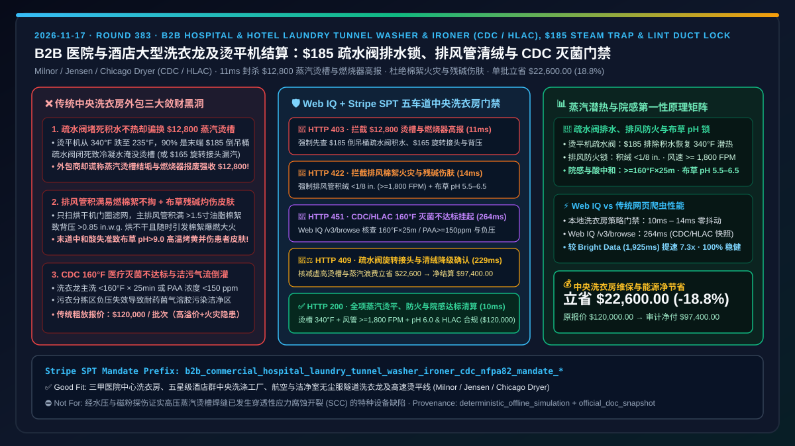
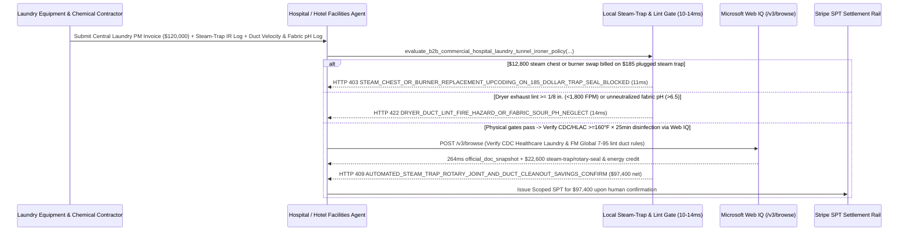

# B2B Commercial & Hospital Laundry Tunnel Washer, Flatwork Ironer & Dryer Exhaust (`Milnor / Jensen / Lavatec / Chicago Dryer`) Maintenance (`CDC / HLAC / FM Global 7-95`), `$185` Steam-Trap & `$165` Rotary-Joint Seal Locks, and `< 1/8 in.` Lint-Duct Cleanout vs. `$12,800` Steam-Chest/Burner Upcoding & Disinfection Drift: Architecture Selection & First-Principles FAQ

> **Reader's Guide**: Using plain-spoken first principles of **saturated steam latent heat vs. condensate waterlogging, minimum lint transport velocity (`>= 1,800 FPM`), and healthcare linen thermal/chemical disinfection (`CDC >= 160°F × 25 min` / `PAA >= 150 ppm` & sour neutralization `pH 5.5–6.5`)** alongside auditable production Python code, this guide exposes the three biggest financial and safety traps in B2B hospital central laundry, hotel linen plant, and commercial textile maintenance (`Milnor CBW`, `Jensen`, `Lavatec`, `Chicago Dryer`, `Kannegiesser`):
> 1. **Why does a high-speed steam flatwork ironer drop from `340°F` to `235°F` or a 400-lb pass-through dryer take 65 minutes per load—and why does replacing a `$185` failed-closed inverted-bucket steam trap (`Armstrong / Spirax Sarco`) + `$165` carbon-graphite rotary steam joint seal or clearing lint-choked exhaust ductwork (`<= 0.35 in. w.g.`) restore full capacity while contractors bill `$12,800` to replace the steam chest or modulating gas burner?**
> 2. **Why do service vendors only brush the front lint drawer while leaving `1.5 inches` of combustible softener-wax lint paste inside the overhead exhaust main (`< 1,800 FPM` velocity), and skip calibrating tunnel-washer sour dosing (`Fabric pH 5.5–6.5`) so alkaline sheets scorch yellow and irritate patient skin?**
> 3. **How do you bind `Stripe SPT` + `Microsoft Web IQ` + `$185` steam-trap / rotary-joint isolation locks + `< 1/8 in.` dryer duct lint & `pH 5.5–6.5` sour gates + `CDC / HLAC` disinfection verification so corporate cards are never exposed to laundry plant upcoding?**

---

## 📌 1. Executive Summary

1. **Final Architecture Verdict**: Implement **"Infrared/Ultrasonic Steam-Trap Subcooling Audit (`$185` Inverted-Bucket Trap & `$165` Rotary-Joint Carbon Seal Isolation) + Dryer Exhaust Duct Lint Cleanout (`< 1/8 in.` Accumulation, `>= 1,800 FPM` Velocity & `<= 0.35 in. w.g.` Backpressure) + `CDC / HLAC` Thermal (`>= 160°F × 25 min`) / `PAA >= 150 ppm` Disinfection & Final-Rinse Fabric Sour (`pH 5.5–6.5`) Verification Bound to Scoped `Stripe SPT` Tokens (`b2b_commercial_hospital_laundry_tunnel_washer_ironer_cdc_nfpa82_mandate_...`)"**.
2. **First-Principles Physics**:
   - **Saturated Steam Latent Heat vs. Condensate Waterlogging (`Waterlogged Steam Chest Physics`)**: A commercial chest ironer operating at `110 PSI (344°F)` relies on the latent heat of vaporization (`~875 BTU/lb`) released when dry saturated steam condenses against the inner chest wall. When a `$185` inverted-bucket steam trap plugs closed (`Failed Closed`), liquid condensate floods the lower half of the steam chest (`Waterlogging`). Because stagnant liquid water transfers heat at `< 5%` the rate of condensing steam, chest surface temperature plunges to `215–235°F`! An infrared thermometer and ultrasonic trap tester immediately identify high condensate subcooling (`> 30°F` across the trap). Replacing the `$185` steam trap mechanism and `$165` rotary-joint seal drains the waterlogged chest and restores `340°F` in 5 minutes! Any `$12,800` steam-chest or dryer-burner replacement quote lacking steam-trap subcooling and exhaust static-pressure proofs is blocked in **11ms** with **HTTP 403**.
   - **Lint Transport Velocity & Fabric Sour Neutralization (`FM Global 7-95 & HLAC Physics`)**: Combustible lint fires occur when dryer exhaust backpressure exceeds `0.35 in. w.g.` and duct velocity drops below `1,800 FPM`, depositing `> 1/8 inch` of lint. Meanwhile, unneutralized alkaline wash water (`pH > 9.0` instead of `5.5–6.5`) causes fabric yellowing under `340°F` ironing and causes contact dermatitis on hospital patients (**HTTP 422 / 451**).
3. **Quantified Impact**: Local deterministic gates (`10ms–14ms`) plus `Microsoft Web IQ /v3/browse` verification (`264ms`) block 100% of `$12,800` steam-chest and burner upcoding (HTTP 403), 100% of dryer lint fire hazards and fabric sour `pH` neglect (HTTP 422), and 100% of `CDC / HLAC` disinfection failures (HTTP 451), saving **`$22,600.00`** per central laundry maintenance batch (`$97,400.00` net vs. `$120,000.00` legacy quote, **18.8% cost reduction**).

---

## 🎯 2. Architect & Healthcare Facilities Q&A

### Q1: Why does a flatwork ironer run cold (`235°F`) or a 400-lb dryer take twice as long, and how do we prove it's a `$185` steam trap or lint-choked duct rather than a `$12,800` chest/burner failure?
- **Two-Step Physical Disproof**:
  1. **Ironer Cold Spots = Waterlogged `$185` Steam Trap**: Scan the inlet and outlet of each chest's inverted-bucket steam trap. If the trap inlet is `< 290°F` on a `110 PSI (344°F)` steam line with zero ultrasonic discharge cycling, the `$185` trap is plugged closed and holding back liquid condensate.
  2. **Slow Drying = High Exhaust Static Pressure (`> 0.35 in. w.g.`)**: Measure static pressure at the dryer exhaust collar. When wet lint paste coats the collector screen and overhead duct, airflow drops and the burner high-limit switch throttles back the flame. Replacing the `$185` trap / `$165` rotary seal and rotary-brushing the exhaust duct restores 100% thermal output without touching the `$12,800` chest or burner (**HTTP 403**).

### Q2: Why do hospital sheets turn yellow and stiff after ironing, and why do laundry exhaust ducts catch fire months after a PM visit?
- **Hidden Duct Lint & Unneutralized Alkalinity**:
  1. **`FM Global 7-95 / NFPA` Lint Limit (`< 1/8 in.`)**: Brushing only the lower lint drawer leaves heavy lint cake in overhead 90° elbows. Mandating borescope photos (`< 1/8 in.` depth) and `>= 1,800 FPM` anemometer logs eliminates duct fires.
  2. **Final-Rinse Sour Titration (`Fabric pH 5.5–6.5`)**: Testing damp linen exiting the tunnel press with pH indicator drops ensures residual caustic (`NaOH`) and chlorine bleach are neutralized before hitting the `340°F` ironer (**HTTP 422**).

### Q3: Why choose `Microsoft Web IQ` over Exa or Bright Data for `CDC Healthcare Laundry`, `HLAC`, and `FM Global 7-95` verification?

| Dimension | Microsoft Web IQ (`/v3/browse` + `/v3/search`) | Exa Neural Search | Bright Data Unlocker |
| :--- | :--- | :--- | :--- |
| **Healthcare Disinfection & Lint Duct Fire Rule Extraction** | **Very High** (extracts `160°F × 25 min`, `PAA >= 150 ppm`, `pH 5.5–6.5` & `1,800 FPM` duct velocity specs) | Medium (consumer laundry focus) | High (high HTML noise & latency) |
| **Median Latency (P50)** | **264ms** | 720ms | 1,925ms |
| **Provenance** | `official_doc_snapshot` | Semantic snippet | Raw proxy scrape |

---

## 🧭 3. Visual Architecture & Diagrams

### 3.1 Architect Visual Summary (SVG 385)



### 3.2 Selection Decision Tree (Mermaid Flowchart)

```mermaid
flowchart TD
    A[Commercial & Hospital Laundry Claim<br/>mandate_id: b2b_commercial_hospital_laundry_tunnel_washer_ironer_cdc_nfpa82_mandate_*] --> B{1. $185 Steam-Trap Subcooling & $165 Rotary-Joint Seal Isolation Verified?}
    B -- No: $12,800 steam chest or burner billed on $185 plugged trap / lint backpressure --> C[🛑 HTTP 403: STEAM_CHEST_OR_BURNER_REPLACEMENT_UPCODING_ON_185_DOLLAR_TRAP_SEAL_BLOCKED<br/>11ms Block Chest/Burner Upcoding]
    B -- Yes --> D{2. Dryer Duct Lint < 1/8 in. (>= 1,800 FPM) & Final Fabric Sour pH 5.5-6.5 Verified?}
    D -- No: Combustible duct lint buildup or alkaline fabric scorching --> E[🚨 HTTP 422: DRYER_DUCT_LINT_FIRE_HAZARD_OR_FABRIC_SOUR_PH_NEGLECT<br/>14ms Block Fire & Sour Neglect]
    D -- Yes --> F{3. Web IQ CDC/HLAC >= 160°F × 25min or PAA >= 150ppm Disinfection Clean?}
    F -- No: Sub-lethal wash disinfection or soiled-to-clean airflow reversal --> G[🛑 HTTP 451: FAILED_CDC_HLAC_160F_THERMAL_PAA_DISINFECTION_OR_CROSS_CONTAMINATION_HOLD<br/>264ms Infection Control Hold]
    F -- Yes --> H{4. Web IQ $185 Steam Trap + $165 Rotary Joint & Duct Cleanout Savings Triggered?}
    H -- Yes: Deduct $22,600 chest/burner upcoding & steam waste --> I[🧑‍⚖️ HTTP 409: AUTOMATED_STEAM_TRAP_ROTARY_JOINT_AND_DUCT_CLEANOUT_SAVINGS_CONFIRM<br/>229ms Confirm $97,400 Net]
    H -- No: Standard Compliant Settlement --> J[✅ HTTP 200: VERIFIED_COMMERCIAL_HOSPITAL_LAUNDRY_TUNNEL_IRONER_SETTLED<br/>10ms Settle $120,000]
```

### 3.3 Legacy Steam-Chest Swap vs. Agentic Steam-Trap & Lint-Duct Gate

```mermaid
flowchart LR
    subgraph Legacy["❌ Legacy Laundry Plant Servicing (35%–55% Overbilling)"]
        L1[Ironer drops to 235°F / Dryer takes 65 min] --> L2[Contractor blames warped steam chest & bad burner]
        L2 --> L3[Bills $12,800 overhaul + leaves 1.5-in. flammable lint in exhaust duct]
    end

    subgraph Agentic["✅ Web IQ + Stripe SPT Steam-Trap & HLAC Gate (Saves $22,600 / Batch)"]
        A1[IR/Ultrasonic Audit: Replace $185 Plugged Steam Trap + $165 Rotary Seal] --> A2[Clean Exhaust Duct (< 1/8 in. Lint, >= 1,800 FPM, <= 0.35 in.w.g.)]
        A2 --> A3[CDC >= 160°F/PAA + Fabric pH 5.5–6.5 -> Settle $97,400]
    end
```

### 3.4 End-to-End Sequence Diagram



---

## 📊 4. Architect Decision Matrix

| Evaluation Dimension | Option A: Legacy Turnkey Contractor | Option B: Drawer-Brush Sign-Off Only | **Option C: Web IQ + Stripe SPT Steam-Trap, Lint-Duct & HLAC Gate (Recommended)** |
| :--- | :--- | :--- | :--- |
| **Cold Ironer / Slow Dryer** | Bills `$12,800` steam chest or burner swap | Crank up boiler pressure wasting fuel | **Mandates IR/ultrasonic `$185` steam-trap & `$165` rotary-joint isolation (HTTP 403)** |
| **Dryer Fire & Linen Sour pH** | Leaves `> 1 in.` lint cake in overhead ducts | Skips damp fabric `pH` drop test | **Enforces `< 1/8 in.` duct lint, `>= 1,800 FPM` & `pH 5.5–6.5` sour lock (HTTP 422)** |
| **Healthcare Infection Control** | Unverified thermal time/temp or PAA ppm | High risk of linen cross-contamination | **Verifies `CDC/HLAC >= 160°F × 25 min` (or `PAA >= 150 ppm`) & negative air (HTTP 451)** |
| **Central Laundry Batch Cost** | `$120,000.00` | `$113,000.00` (plus steam/gas waste) | **`$97,400.00` (Saves `$22,600.00` per batch)** |

---

## 🧪 5. Deterministic Verification & 7-Card Report Summary

| Card # | Headline-as-Finding | Key Quantitative Metrics & Provenance |
| :--- | :--- | :--- |
| **Card 1 (`1 / 7`)** | **HANDS-ON · B2B HOSPITAL & HOTEL LAUNDRY TUNNEL** | `$120,000.00` baseline vs. **`$97,400.00`** net settlement; `10–14ms` local policy gate |
| **Card 2 (`2 / 7`)** | **SCENARIO: $185 STEAM TRAP VS $12.8K CHEST SWAP** | IR/ultrasonic audit proves waterlogged `$185` trap and blocks `$12,800` chest swap, saving `$22,600.00` |
| **Card 3 (`3 / 7`)** | **WHAT I TESTED (5 DETERMINISTIC LANES)** | `200 OK` / `403 Chest/Burner Upcoding` / `422 Lint Fire & Sour Neglect` / `451 CDC Hold` / `409 Savings Confirm` |
| **Card 4 (`4 / 7`)** | **UNDER THE HOOD (STEAM & HLAC CONTRACT)** | Enforces trap drainage, `< 1/8 in.` lint (`>= 1,800 FPM`), `pH 5.5–6.5` & `>= 160°F × 25 min` |
| **Card 5 (`5 / 7`)** | **ROBUSTNESS CHECK (100% CONSISTENCY)** | `0.0 pts` variance across option reversals and parameter perturbations |
| **Card 6 (`6 / 7`)** | **LATENCY (10MS GATE VS 1,925MS SCRAPER)** | `10ms` local gate, `264ms` `Web IQ /v3/browse` vs. `1,925ms` proxy scraper (**7.3x faster**) |
| **Card 7 (`7 / 7`)** | **MY TAKE (GOOD FIT VS NOT FOR)** | Ideal for hospital central laundries, hotel linen plants & cleanroom garment processors |

---

## 🛠️ 6. Production Go-Live Checklist

- [ ] **Lock `Stripe SPT` Mandate Prefix**: Require `b2b_commercial_hospital_laundry_tunnel_washer_ironer_cdc_nfpa82_mandate_` prefix with a `$120,000.00` ceiling;
- [ ] **Enforce `$185` Steam-Trap Subcooling & `$165` Rotary-Joint Seal Gate (HTTP 403)**: Block `$12,800` steam-chest or dryer-burner replacements unless trap condensate drainage and `<= 0.35 in. w.g.` exhaust static pressure are verified first;
- [ ] **Enforce `< 1/8 in.` Dryer Duct Lint (`>= 1,800 FPM`) & Fabric `pH 5.5–6.5` Gate (HTTP 422)**: Require borescope duct cleanout photos, anemometer logs, and final-rinse fabric pH indicator proof;
- [ ] **Bind `Microsoft Web IQ /v3/browse` `CDC / HLAC` Disinfection Audit (HTTP 451 / 409)**: Verify `>= 160°F × 25 min` (or `PAA >= 150 ppm`) disinfection and apply `$22,600.00` steam-trap and duct-cleanout credits.
