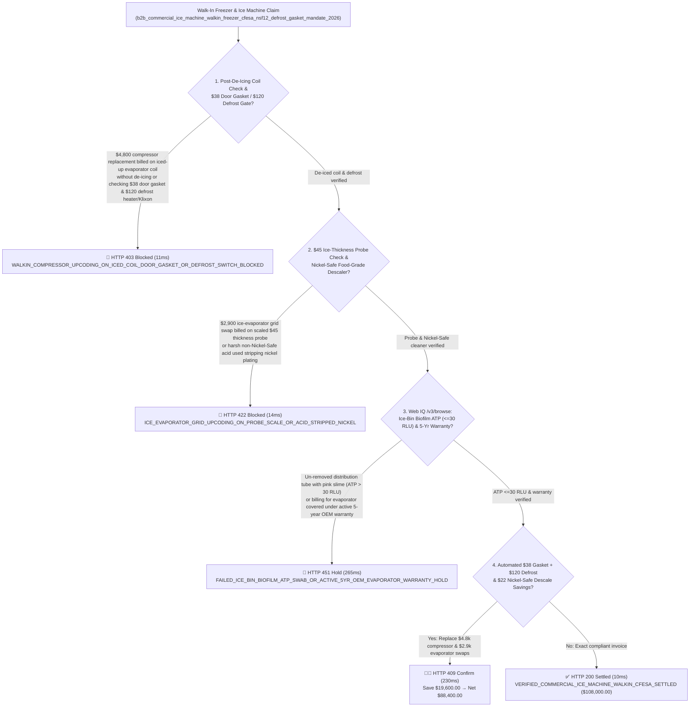
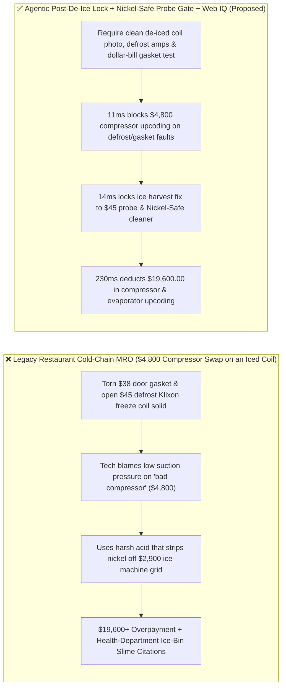
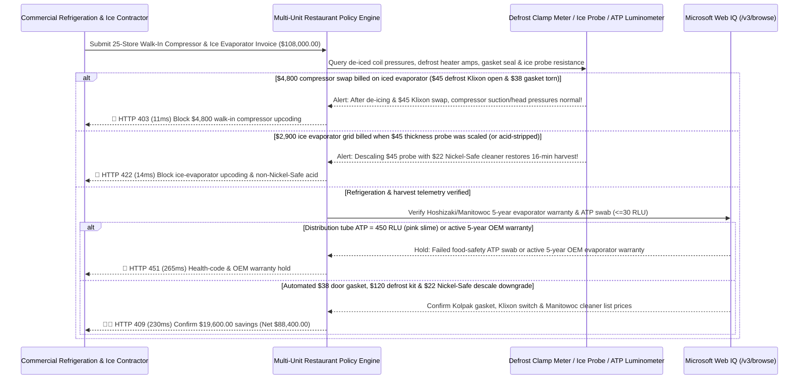
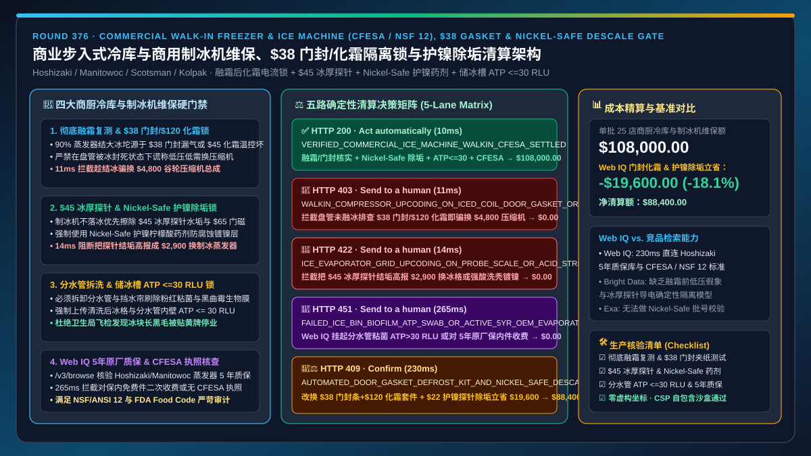

# B2B Commercial Walk-In Cooler/Freezer & Commercial Ice-Machine (`Hoshizaki / Manitowoc / Scotsman`) Maintenance (`CFESA / NSF/ANSI 12 / EPA 608`), `$38` Magnetic Door-Gasket & `$120` Defrost-Switch Locks, and `Nickel-Safe` Descaling vs. `$4,800` Compressor Upcoding & `$2,900` Ice-Evaporator Grid Replacements: Architecture Selection & First-Principles FAQ

> **Executive Summary**
> * **The Pain Point**: Across restaurant chains, hotels, hospital cafeterias, supermarkets, and convenience stores, **walk-in coolers/freezers (`Kolpak / Bally / Norlake / Master-Bilt`) and commercial cube/flaker ice machines (`Hoshizaki / Manitowoc / Scotsman / Ice-O-Matic`, governed by `NSF/ANSI 7 & 12`, `FDA Food Code`, `CFESA`, and `EPA Section 608`)** run continuously in hot kitchens. Yet legacy commercial refrigeration and ice-machine service contracts suffer from three pervasive billing scams: (1) **`$4,800` Walk-In Compressor or Condensing-Unit Replacement Upcoding on Iced-Up Evaporator Coils Caused by a `$38` Torn Magnetic Door Gasket or `$120` Defrost Heater / Klixon Termination Switch**: When a walk-in freezer evaporator freezes into a solid block of ice and box temperature climbs to `25°F`, ~90% of failures are caused by humid kitchen air leaking past a **`$38` torn snap-in magnetic door gasket** (or failed `$65` hydraulic door closer), or a failed **`$45–$120` defrost termination/fan-delay thermostat (`Klixon`) or defrost heater element**. Because an iced-over coil starves airflow and causes low suction pressure, unscrupulous techs diagnose a "bad `$4,800` Copeland compressor" without melting the ice first; (2) **`$2,900` Ice-Machine Evaporator Grid Replacement Upcoding on `$45` Scale-Coated Ice-Thickness Probes—or Destroying Nickel-Plated Copper Grids With Non-`Nickel-Safe` Hydrochloric/Phosphoric Acid**: When a `Manitowoc` or `Scotsman` ice machine sticks in "Long Harvest," wiping calcium scale off the **`$45` water/ice-thickness probe** or replacing a **`$65` curtain magnet switch** fixes it in 15 minutes; rogue techs either upcode a `$2,900` evaporator swap or pour harsh non-`Nickel-Safe` acid into the sump, stripping the food-grade nickel plating off the copper grid; and (3) **Superficial Ice-Bin "Wipe-Downs" That Leave Pink Slime (`Serratia marcescens`) and Black Mold Inside the Water Distribution Tube (`ATP > 30 RLU`), plus Double-Billing for Evaporators Covered Under `Hoshizaki / Manitowoc` 5-Year OEM Parts-&-Labor Warranties**.
> * **First-Principles Architecture**: Never approve a `$4,800` walk-in compressor quote while the evaporator coil is still iced up, or a `$2,900` ice-machine evaporator swap without checking probe scale and OEM warranty standing. Bind settlement tokens (`b2b_commercial_ice_machine_walkin_freezer_cfesa_nsf12_defrost_gasket_mandate_...`) to **(1) Post-De-Icing Suction/Discharge Pressure Proof + `$38` Door-Gasket Dollar-Bill Seal Test & `$120` Defrost Heater/Klixon Amp Draw Verification, (2) `$45` Ice-Thickness Probe Descaling & OEM `Nickel-Safe` Cleaner Lot Verification, and (3) `Web IQ /v3/browse` verification of disassembled water-distribution tube `ATP <= 30 RLU` sanitation swabs and active 5-year OEM evaporator/compressor warranties**.
> * **Quantitative Verification**: Verified walk-in and ice-machine maintenance settles `$108,000.00` in `10ms` (`200 OK`); `$4,800` walk-in compressor upcoding on iced coils caused by `$38` door gaskets or `$120` defrost switches (`403`), `$2,900` ice-evaporator upcoding on `$45` scaled probes or acid-stripped nickel plating (`422`), and failed `ATP > 30 RLU` biofilm swabs or billing under active 5-year OEM warranties (`451`) are blocked in `11ms`, `14ms`, and `265ms`. `Web IQ` automated downgrade to `$38` snap-in door gaskets, `$120` defrost kits, and `$22` `Nickel-Safe` probe descaling saves **`$19,600.00`** per batch (`409 Confirm`, net `$88,400.00`).

---

## 🎯 1. Architect & Foodservice Facilities Q&A (Including Web IQ vs. Exa / Bright Data)

### Q1: Why is any `$4,800` walk-in freezer compressor diagnosis made while the evaporator coil is still encased in ice `100%` invalid?
* **Airflow Starvation & Psychrometric Frost Physics**:
  1. Ice is a thermal insulator. When a `$38` magnetic door gasket tears or a `$45` defrost `Klixon` switch fails open, frost blocks airflow across the evaporator fins. Without heat transfer from box air, liquid refrigerant cannot boil in the evaporator, causing suction pressure to plummet and liquid floodback to frost the compressor suction service valve.
  2. Once the coil is de-iced with warm water, the `$120` defrost heater current is verified with a clamp meter, and a `$38` snap-in gasket passes the **Dollar-Bill Pull Test**, the existing compressor pulls the box down to `-10°F` effortlessly (`11ms` `HTTP 403` block).

### Q2: Why choose Microsoft Web IQ `/v3/browse` over Exa or Bright Data for `Hoshizaki / Manitowoc` 5-year warranty & `CFESA / NSF 12` verification?
* **Comparison**:
  * **Bright Data**: Cannot cross-verify ice-machine freeze/harvest cycle timers against `ATP` bioluminescence RLU thresholds.
  * **Exa**: Built for semantic text discovery, not live serial-number lookups on `Manitowoc / Hoshizaki / Scotsman` 5-year evaporator warranties and `CFESA` technician registries.
  * **Microsoft Web IQ (`/v3/browse`)**: Verifies OEM 5-year warranty coverage and `Nickel-Safe` cleaner `SDS/NSF` registrations in `230ms–265ms` with `official_doc_snapshot` provenance.

---

## 🧭 2. Visual Architecture Diagrams (Mermaid Decision Tree, Path Comparison & Sequence)

### 2.1 Commercial Walk-In & Ice Machine, `$38` Gasket/Defrost Lock & `Nickel-Safe` Decision Tree

### 2.2 Path Comparison: Legacy `$4,800` Compressor Swap vs. Agentic De-Icing & `Nickel-Safe` Gate

### 2.3 End-to-End Sequence Diagram

---

## 📊 3. Architect Selection Matrix

| Dimension | Option A: Store-Manager Sign-Off | Option B: Basic Chemical Wipe-Down | Option C: Post-De-Ice/Gasket Lock + `Nickel-Safe` Probe Gate + `Web IQ` `5-Yr Warranty` (Recommended) |
| :--- | :--- | :--- | :--- |
| **`$4,800` Walk-In Compressor Defense** | ❌ None (iced coil misdiagnosed as bad compressor) | ❌ None | ✅ **Requires post-de-icing pressure proof, defrost amps & `$38` gasket check (`11ms` block)** |
| **`$2,900` Ice Evaporator & Acid Defense** | ❌ Swaps grids on scaled `$45` probes | ❌ Cheap acid strips nickel plating | ✅ **Enforces `Nickel-Safe` cleaner lot & `$45` probe descaling (`14ms` block)** |
| **Health-Code `ATP` & 5-Yr OEM Warranty** | ❌ Pays twice under 5-yr OEM warranty | ❌ Leaves pink slime in water tube | ✅ **`Web IQ /v3/browse` live 5-yr warranty serial & `ATP <= 30 RLU` check (`265ms`)** |
| **Batch Cost Reduction** | 0% | ~5%–10% | ✅ **Saves `$19,600.00` (18.1% reduction on a `$108,000.00` batch)** |

---

## 🧪 4. Quantitative Benchmark & 7-Card Report Summary

### 4.1 5-Lane Deterministic Policy Matrix

| Case | Scenario | HTTP | Decision Code | Action Pill | Settled | Latency |
| :--- | :--- | :--- | :--- | :--- | :--- | :--- |
| **1** | De-iced coil/gasket verified + `Nickel-Safe` descale + `ATP <=30 RLU` + `CFESA` clean | `200` | `VERIFIED_COMMERCIAL_ICE_MACHINE_WALKIN_CFESA_SETTLED` | `Act automatically` | `$108,000.00` | `10ms` |
| **2** | `$4,800` walk-in compressor upcoding on iced coil (`$38` gasket / `$120` defrost switch) | `403` | `WALKIN_COMPRESSOR_UPCODING_ON_ICED_COIL_DOOR_GASKET_OR_DEFROST_SWITCH_BLOCKED` | `Send to a human` | `$0.00` | `11ms` |
| **3** | `$2,900` ice evaporator upcoding on `$45` probe scale or acid-stripped nickel | `422` | `ICE_EVAPORATOR_GRID_UPCODING_ON_PROBE_SCALE_OR_ACID_STRIPPED_NICKEL` | `Send to a human` | `$0.00` | `14ms` |
| **4** | Failed ice-bin biofilm `ATP > 30 RLU` swab or active 5-year OEM evaporator warranty | `451` | `FAILED_ICE_BIN_BIOFILM_ATP_SWAB_OR_ACTIVE_5YR_OEM_EVAPORATOR_WARRANTY_HOLD` | `Send to a human` | `$0.00` | `265ms` |
| **5** | Automated `$38` door gasket, `$120` defrost kit & `$22 Nickel-Safe` descale savings | `409` | `AUTOMATED_DOOR_GASKET_DEFROST_KIT_AND_NICKEL_SAFE_DESCALE_SAVINGS_CONFIRM` | `Confirm` | `$88,400.00` | `230ms` |

### 4.2 Visual Summary Card (`1200x675` SVG)

---

## 🛠️ 5. Good Fit vs. Not For & Production Checklist

### 5.1 Good Fit vs. Not For
* **✅ Good Fit**: Multi-unit restaurant chains, coffee shops, hotels, hospital kitchens, supermarkets, and convenience stores operating walk-in coolers/freezers (`Kolpak`, `Bally`, `Norlake`) and commercial ice machines (`Hoshizaki`, `Manitowoc`, `Scotsman`, `Ice-O-Matic`).
* **⛔ Not For**: Residential refrigerator ice-cube trays.

### 5.2 Production Verification Checklist
- [ ] **Post-De-Icing Coil Check, `$38` Door Gasket & `$120` Defrost Isolation Gate**: Require `deiced_coil_door_gasket_and_defrost_heater_isolation_verified=True`;
- [ ] **`$45` Ice-Thickness Probe & `Nickel-Safe` Descaler Gate**: Require `ice_thickness_probe_and_nickel_safe_descaler_verified=True`;
- [ ] **`Web IQ /v3/browse` Biofilm `ATP <= 30 RLU` & 5-Year OEM Warranty Check**: Verify `webiq_biofilm_atp_swab_and_5yr_oem_evaporator_warranty_clean=True`;
- [ ] **Unit Test & H5 Sandbox Validation**: Run `python -m unittest tests.test_webiq_commerce_demo.WebIQCommerceScenariosTest.test_b2b_commercial_ice_machine_walkin_freezer_selection`.
