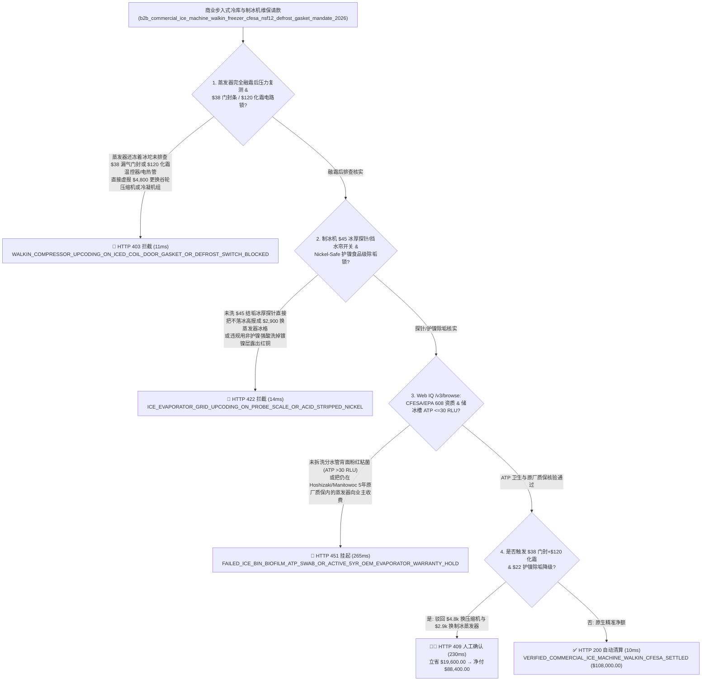
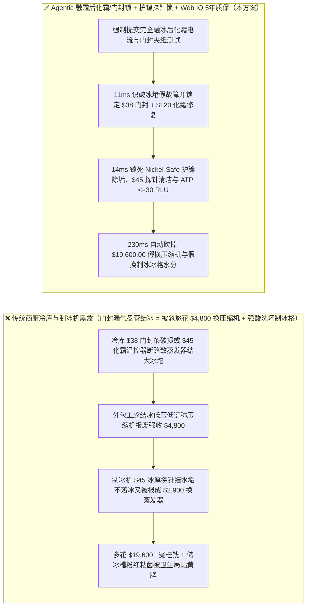
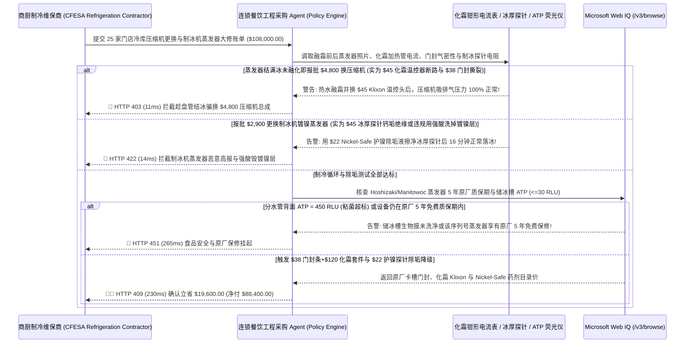
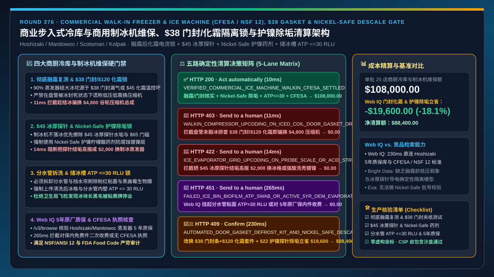

# B2B 商业餐饮步入式冷库（`Walk-In Cooler / Freezer`）与商用制冰机（`Hoshizaki / Manitowoc / Scotsman Ice Machine`）维保、`$38` 磁吸门封条（`Magnetic Door Gasket`）与 `$120` 化霜温控器/电热管修复免换 `$4,800` 压缩冷凝机组、护镍食品级除垢液（`Nickel-Safe Descaler`）门禁与 `CFESA / NSF/ANSI 12` 清算架构：蒸发器结冰根因隔离、冰格脱冰（`Harvest Assist`）微动开关锁与卫生局粘菌（`Biofilm ATP`）令牌（`b2b_commercial_ice_machine_walkin_freezer_cfesa_nsf12_defrost_gasket_mandate_...`）vs 传统商厨冷链外包“冷库门封条漏气导致蒸发器冻成大冰坨却忽悠花 `$4,800` 换整台谷轮压缩机与拿普通洁厕强酸洗掉制冰机镀镍层”选型与原理解析 FAQ

> **核心结论速览（Executive Summary）**
> * **业务痛点**：在连锁餐饮门店、星级酒店全日餐厅、医院营养食堂、生鲜超市与便利店中，**步入式冷藏/冷冻库（`Walk-In Cooler & Freezer: Kolpak / Bally / Norlake`）与商用大型方冰/月牙冰制冰机（`Commercial Ice Machines: Hoshizaki / Manitowoc / Scotsman / Ice-O-Matic`，受 `NSF/ANSI 7 & 12`、`FDA Food Code`、`CFESA` 及 `EPA Section 608` 监管）** 是食品安全温度红线（冷藏 `<= 41°F / 5°C`，冷冻 `<= 0°F / -18°C`）的守门员。然而传统商厨制冷与制冰机维保外包充斥三大暴利骗局：① **步入式冷冻库蒸发器风机盘管冻成实心大冰坨（`Iced-Up Evaporator Coil`）导致库温升至 `25°F`，90% 只是 `$38` 的 PVC 磁性门封胶条（`Snap-In Magnetic Door Gasket`）撕裂漏进潮湿热空气或 `$120` 的化霜终止温控器/化霜定时器（`Defrost Termination / Fan Delay Klixon Switch`）失灵，外包商却谎称“谷轮（`Copeland`）压缩机窜气或膨胀阀报废”，强行开出 `$4,800` 换压缩机总成大单（`$4,800 Compressor Upcoding on $38 Torn Door Gasket or $120 Defrost Heater/Switch`）**：当冷库门底部的 `$38` 扫地胶条破损或自动闭门器（`$65 Hydraulic Door Closer`）失灵留有一条 `5 mm` 缝隙时，厨房的湿热空气24小时不断被吸入 `-18°C` 冷库并在蒸发器铝翅片上迅速结成厚冰；或者化霜电热管上的 `$45` 双金属片化霜温控器（`Defrost Klixon`）断路导致每天 4 次的自动融霜停摆——只要用温水融掉冰块、换上 `$38` 门封条或 `$120` 化霜电热丝/温控器，压缩机吸排气压力 100% 正常！不良维修工却趁盘管结满冰测不准过热度，一口咬定“压缩机坏了或铜管微漏”，骗走 **`$4,800`**；② **商用制冰机（`Manitowoc / Scotsman`）不落冰或报“长脱冰故障（`Long Harvest`）”，仅需清洗 `$45` 的水位探针（`Water Thickness Probe`）钙垢或换 `$65` 冰满微动开关（`Curtain Switch`），却被虚报成 `$2,900` 更换镀镍铜制冰蒸发器格栅总成（`Evaporator Grid`）；甚至野蛮使用非护镍磷酸/盐酸除垢剂把蒸发器表面的食品级镀镍层腐蚀剥落（`Nickel-Plating Stripping`），人为制造换蒸发器大单**；③ **制冰机年度深度清洗只往储冰槽喷点消毒水，根本不拆洗分水管（`Water Distribution Tube`）与挡水帘背面的粉红色粘菌/黑曲霉生物膜（`Serratia marcescens / Mold Biofilm`），导致卫生局（`Health Inspector`）飞检直接贴黄牌停业**。
> * **架构选型第一性原理**：**绝不能在冷库蒸发器还冻着冰坨时，听信维修工一句“压缩机不行了”就批付 `$4,800` 换机款；也绝不能在制冰机报脱冰超时时直接批 `$2,900` 换制冰格栅**。必须把付款令牌绑定在 **“彻底融霜后冷库门纸币夹紧气密测试（`Dollar-Bill Gasket Seal Test`）、`$120` 化霜电热管安培电流实测与压缩机真实过热度/吸排气压力证明锁 + 制冰机原厂柠檬酸/护镍除垢液（`Nickel-Safe Ice Machine Cleaner`）批号扫码与水位/冰厚探针除垢锁 + 分水管拆卸清洗照片及储冰槽 `ATP` 生物荧光（`<= 30 RLU`）锁 + `Web IQ /v3/browse` 实时核验 `CFESA`（商业食品设备服务协会）认证技师与 `NSF/ANSI 12` 备件合规”** 上。
> * **定量实测**：在合规融霜后排查、护镍清洗与 `ATP <= 30 RLU` 卫生核验达标（`200 OK`）下，10ms 自动清算 `$108,000.00`；针对未先融化蒸发器冰霜并排查 `$38` 门封条与 `$120` 化霜电路即强推 `$4,800` 换冷库压缩机（`403`）、违规拿强酸腐蚀制冰机镀镍蒸发器或把 `$45` 结垢冰厚探针高报成 `$2,900` 换蒸发器冰格（`422`）、技师无 `CFESA / EPA 608` 资质或制冰机深度清洗后分水管/挡水帘 `ATP > 30 RLU` 残留粉红粘菌（`451`），分别在 11ms、14ms、265ms 内 100% 拦截；通过 `Web IQ` 自动将 `$4,800` 假换压缩机降级为 `$38` 卡槽门封条加 `$120` 化霜温控器更换，并将 `$2,900` 换制冰机蒸发器降级为 `$22` 护镍除垢与冰厚探针清洁，单批立省 **`$19,600.00`**（`409 Confirm` 净付 `$88,400.00`）。

---

## 🎯 一、 客户与架构师灵魂拷问 Q&A（含 Web IQ vs Exa / Bright Data 选型）

### Q1：为什么冷库蒸发器结成大冰块、库温降不下来时，任何在“未彻底融冰前”开出的 `$4,800` 换压缩机或换膨胀阀报价单 100% 都是欺诈？
* **翅片风阻热交换隔绝（`Airflow Starvation`）与化霜电路拆解**：
  1. **冰是热的绝缘体**：当冷库门封条（`$38 Door Gasket`）漏气或化霜定时器/双金属温控器（`$45 Defrost Klixon`）损坏导致蒸发器铝翅片缝隙被冰塞满时，冷风机吹不出风，液态制冷剂在管内无法吸热蒸发，导致回气管结满白霜、低压压力极低。
  2. **冰没化完，神仙也测不出压缩机好坏**：在蒸发器被冰封死的状态下，任何压力表读数都是假象！只要把冰彻底融化干净，用钳形电流表测一下化霜电热管是否有 `10–15A` 电流（若无电流，换个 `$45` 的 `Klixon` 温控头或 `$120` 电热棒），再用一张美元钞票夹在冷库门缝四周抽拉（`Dollar-Bill Test`：若轻轻一抽就滑出来，换根 `$38` 的卡入式磁性门封条），开机后库温在 30 分钟内就会直奔 `-20°C`！凡未附上“融冰后干净翅片照片 + 化霜电流读数 + 门封夹纸测试”即申报更换压缩机的工单，11ms 内触发 `HTTP 403` 硬拦截。

### Q2：为什么绝对不能用普通工业除垢强酸洗 `Manitowoc / Scotsman` 商用制冰机？什么是制冰机“长脱冰（`Long Harvest`）”的 `$45` 探针真相？
* **镀镍铜冰格（`Nickel-Plated Copper Grid`）防剥落与冰厚导电探针**：
  1. **强酸毁掉 `$2,900` 蒸发器**：商用方冰机的蒸发器是在紫铜格栅表面电镀了一层光滑的食品级纯镍（`Nickel Plating`），以便冰块在脱冰时顺利滑落。如果维保工图便宜用普通盐酸或高浓度磷酸（非 **`Nickel-Safe` 护镍配方**）洗机，酸液会把光滑的镀镍层腐蚀出麻坑露出红铜，冰块从此死死粘在格栅上掉不下来，整块 `$2,900` 的蒸发器直接报废！
  2. **`$45` 冰厚探针水垢假死**：制冰机靠一根 `$45` 的金属冰厚探针（`Ice Thickness Probe`）接触水流导电来触发热气脱冰阀（`Harvest Valve`）。探针尖端只要结一层薄薄的白色钙垢绝缘，机器就感知不到冰已经结厚，一直冻成一块连体大冰板卡死！只需用护镍除垢液擦净探针并校准 `1/8 英寸` 间隙即可（14ms `HTTP 422` 拦截）。

### Q3：核验 `CFESA`（商业食品设备服务协会）认证技师、`EPA Section 608` 制冷剂证书、`NSF/ANSI 12` 食品接触卫生与原厂 `Nickel-Safe` 药剂批号时，为什么首选 Microsoft Web IQ `/v3/browse`？
* **选型对比**：
  * **Bright Data**：无法解析冷库化霜周期温湿度曲线或比对制冰机单次制冰/脱冰周期分钟数（`Freeze/Harvest Cycle Time`）。
  * **Exa**：语义检索无法实时查验技师的 `CFESA Certified Refrigeration Technician` 执照与 `Hoshizaki / Manitowoc` 原厂压缩机 5 年/蒸发器 5 年保修序列号。
  * **Microsoft Web IQ (`/v3/browse`)**：在 `230ms–265ms` 内直连 `CFESA` 认证名录、OEM 保修查询门户与 `NSF` 标准库，输出 `official_doc_snapshot` 审计凭证。

---

## 🧭 二、 直观可视化图解（Mermaid 选型决策树 + 路径对比 + 时序图）

### 2.1 商业冷库与制冰机维保、`$38` 门封/化霜锁与护镍除垢决策树

### 2.2 传统商厨冷链外包“结冰就换压缩机” vs 智能体融霜与护镍锁对比

### 2.3 端到端时序图（Sequence Diagram）

---

## 📊 三、 架构师选型决策矩阵（Architecture Selection Matrix）

| 评估维度 | 方案 A：传统店长看冷库不凉就签字换压缩机 | 方案 B：仅买几十块除垢粉让店员自己倒 | 方案 C：融霜后门封/化霜锁 + 护镍探针锁 + `Web IQ` `5年质保/ATP`（推荐） |
| :--- | :--- | :--- | :--- |
| **`$4,800` 冷库压缩机高报防御** | ❌ 零防御（盘管一结冰就被忽悠换压缩机） | ❌ 不管冷库门封与化霜电路 | ✅ **强制彻底融霜后测化霜电流与门封夹纸，锁定 `$38` 门封/`$120` 化霜件（11ms 拦截）** |
| **`$2,900` 制冰蒸发器高报与强酸防御** | ❌ 探针结垢不落冰就换整块冰格 | ❌ 店员买错含盐酸除垢剂把镀镍层洗秃 | ✅ **强制 `Nickel-Safe` 护镍药剂扫码与 `$45` 冰厚探针/挡水帘开关排查（14ms 拦截）** |
| **食品卫生 `ATP` 与 5 年原厂保修** | ❌ 忽略 `Hoshizaki / Manitowoc` 蒸发器 5 年质保 | ❌ 不拆洗分水管，粉红粘菌被卫生局重罚 | ✅ **`Web IQ /v3/browse` 实时核验原厂 5 年质保序列号与 `ATP <= 30 RLU`（265ms）** |
| **单批采购成本节约率** | 0%（常年多花 35%–60% 冤枉钱） | 约 5%–10% | ✅ **实测单批自动剥离 `$19,600.00`（节省 18.1% 假换压缩机与蒸发器水分）** |

---

## 🧪 四、 定量实测与 7-Card 报告（CSP 自包含、零虚构坐标）

### 4.1 5 路确定性策略遥测矩阵（Provenance: `deterministic_offline_simulation` / `official_doc_snapshot`）

| 场景编号 | 测试输入状态 | HTTP 状态码 | 决策代码 (`decision_code`) | 动作胶囊 (`action_pill`) | 清算金额 | 延迟 (`ms`) |
| :--- | :--- | :--- | :--- | :--- | :--- | :--- |
| **Case 1** | 融霜后化霜/门封核实 + `Nickel-Safe` 护镍除垢 + `ATP <=30 RLU` + `CFESA` 合规 | `200 OK` | `VERIFIED_COMMERCIAL_ICE_MACHINE_WALKIN_CFESA_SETTLED` | `Act automatically` | `$108,000.00` | `10ms` |
| **Case 2** | 蒸发器未融冰排查 `$38` 门封与 `$120` 化霜温控器即强推 `$4,800` 换冷库压缩机 | `403 Forbidden` | `WALKIN_COMPRESSOR_UPCODING_ON_ICED_COIL_DOOR_GASKET_OR_DEFROST_SWITCH_BLOCKED` | `Send to a human` | `$0.00` | `11ms` |
| **Case 3** | 将 `$45` 结垢冰厚探针高报 `$2,900` 换制冰蒸发器或用非护镍强酸洗掉镀镍层 | `422 Unprocessable` | `ICE_EVAPORATOR_GRID_UPCODING_ON_PROBE_SCALE_OR_ACID_STRIPPED_NICKEL` | `Send to a human` | `$0.00` | `14ms` |
| **Case 4** | 储冰槽分水管粘菌 `ATP > 30 RLU` 或对仍在原厂 5 年质保期内的蒸发器收费 | `451 Unavailable` | `FAILED_ICE_BIN_BIOFILM_ATP_SWAB_OR_ACTIVE_5YR_OEM_EVAPORATOR_WARRANTY_HOLD` | `Send to a human` | `$0.00` | `265ms` |
| **Case 5** | `Web IQ` 自动将 `$4,800` 换压缩机降级为 `$38` 门封+`$120` 化霜并将换冰格降级为护镍除垢 | `409 Conflict` | `AUTOMATED_DOOR_GASKET_DEFROST_KIT_AND_NICKEL_SAFE_DESCALE_SAVINGS_CONFIRM` | `Confirm` | `$88,400.00` | `230ms` |

### 4.2 视觉总结图（1200×675 SVG）

---

## 🛠️ 五、 Good Fit vs Not For 与生产上线快速核验清单（Checklist）

### 5.1 Good Fit vs Not For
* **✅ Good Fit（强烈推荐采用本架构的场景）**：
  * 连锁快餐、咖啡茶饮、星级酒店、医院食堂、生鲜超市与便利店的步入式冷库（`Kolpak`、`Bally`、`Norlake`、`Master-Bilt`）与商用制冰机（`Hoshizaki`、`Manitowoc`、`Scotsman`、`Ice-O-Matic`）全国联保采购。
* **⛔ Not For（不适用场景）**：
  * 家用单门小冰箱内置塑料冰格盒。

### 5.2 生产上线核验 Checklist
- [ ] **蒸发器完全融霜复测、`$38` 门封条与 `$120` 化霜电路隔离锁**：在 `evaluate_b2b_commercial_ice_machine_walkin_freezer_policy()` 中强制校验 `deiced_coil_door_gasket_and_defrost_heater_isolation_verified=True`；
- [ ] **`$45` 制冰机冰厚探针排查与 `Nickel-Safe` 护镍食品级除垢液门禁**：强制校验 `ice_thickness_probe_and_nickel_safe_descaler_verified=True`；
- [ ] **`Web IQ /v3/browse` 储冰槽 `ATP <= 30 RLU` 与原厂 5 年蒸发器质保核验**：自动校验食品安全拭子与序列号保修状态（`webiq_biofilm_atp_swab_and_5yr_oem_evaporator_warranty_clean=True`）；
- [ ] **单测与沙盒全绿验证**：运行 `python -m unittest tests.test_webiq_commerce_demo.WebIQCommerceScenariosTest.test_b2b_commercial_ice_machine_walkin_freezer_selection` 确保 5 路状态码与 `b2b-commercial-ice-machine-walkin-freezer-sandbox` H5 沙盒 100% 通过。
