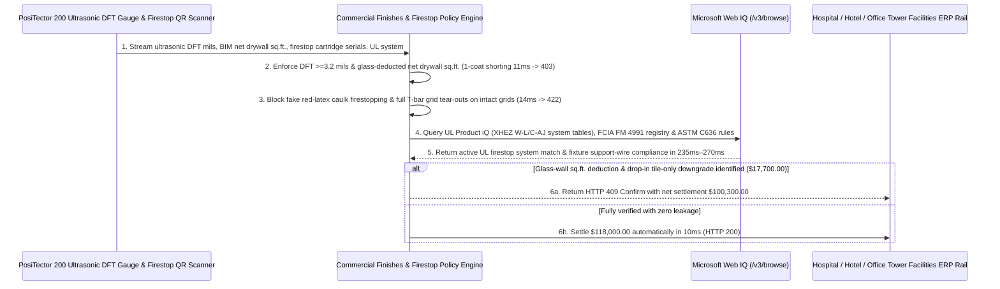

# B2B Commercial Interior Painting (`MPI / PCA`), Acoustical Ceiling Tile (`ACT`) Replacement & `UL 1479 / ASTM E814` Fire-Stopping (`CertaPro Commercial / Painters USA / PCI, PCA Standard P1, ASTM C636 & UL 1479`), Ultrasonic Dry-Film Thickness (`DFT >= 3.2 Mils`) Lock, Intumescent Firestop Batch Gate & Anti-`Fake Red-Caulk Firestop / Ceiling Grid Upcoding` Settlement Architecture: Net-Drywall Sq.Ft. Cap, Drop-In Tile-Only Lock & `FCIA / FM 4991` Token (`b2b_commercial_interior_painting_acoustical_ceiling_ul1479_firestop_mandate_...`) vs. 1-Coat Watered-Down Paint Shorting, `$2.50` Red Latex Caulk Billed as `$65` `UL` Firestopping & Full Grid Tear-Outs for 8 Stained Tiles: Architecture Selection & First-Principles FAQ

> **Document Type**: AI Solution Architect Agentic Commerce Selection Series (Round 343 · B2B Commercial Interior Painting DFT, ASTM C636 Acoustical Ceilings & UL 1479 Firestopping Edition)  
> **Benchmark Standard**: Modeled after `ib-vs-ethernet-roce-selection-faq.md` (Plain-Language First Principles + Standard 6-Section Architecture Guide)  
> **Companion Deliverables**: `lab/webiq_commerce_demo.py` (Interactive H5 Sandbox) · `tests/test_webiq_commerce_demo.py` · `assets/svg/345-b2b-commercial-painting-acoustical-ceiling-ul1479-firestop-2026-11-17.svg`  
> **Languages**: [中文版](b2b-commercial-interior-painting-acoustical-ceiling-ul1479-firestop-mandate-vs-one-coat-flat-paint-shorting-fake-red-caulk-firestop-grid-upcoding-faq.md) | [English Version (Current)](b2b-commercial-interior-painting-acoustical-ceiling-ul1479-firestop-mandate-vs-one-coat-flat-paint-shorting-fake-red-caulk-firestop-grid-upcoding-faq.en.md)

---

## 📌 1. Executive Summary (First Principles & Plain-Language Breakdown)

### 1.1 Why Should a Hospital, Hotel, University, or Class-A Office Tower Facilities Agent NEVER Auto-Pay a Commercial Interior Painting, Acoustical Ceiling, or Fire-Stopping Invoice Without Auditing Ultrasonic Paint `DFT`, `UL 1479` Intumescent Cartridges, and Net Drywall Square Footage?
In hospitals, hotels, schools, and office buildings, interior repainting (`Master Painters Institute MPI / PCA Standards`), suspended acoustical ceiling tile (`ACT`, `ASTM C636`) maintenance, and above-ceiling smoke/fire-barrier penetration sealing—governed by **`ASTM E814 / UL 1479`**, **`IBC Section 714`**, and **The Joint Commission (`TJC`) Life Safety Code (`NFPA 101`)** surveys—are staple facilities contracts. In plain English: **Commercial interior finishes and above-ceiling firestopping are plagued by three high-margin contractor rackets: (1) The 1-Coat Watered-Down Paint & Glass-Wall Sq.Ft. Scam—contracting to apply 2 coats of `$58/gal` scrubbable commercial eggshell/epoxy (`>= 3.2 mils` total Dry-Film Thickness `DFT`), but actually rolling 1 thin coat of watered-down `$14/gal` contractor flat paint (`1.2 mils DFT` that scrubs off in a week) while billing wall square footage across floor-to-ceiling glass conference walls and doorways! (2) The `$2.50` Fake Red-Latex Caulk Firestop Scam—above the drop ceiling, every cable bundle or pipe piercing a fire-rated drywall partition requires an engineered `$65` `UL 1479` intumescent firestop system (`Hilti FS-One MAX / STI SpecSeal / 3M IC 15WB+`) that expands 8x under heat to choke off fire and toxic smoke; unscrupulous crews squirt `$2.50` red-dyed hardware-store latex painter's caulk into 300 penetrations and bill `$19,500`, leaving the hospital to fail its Joint Commission accreditation audit! and (3) Tearing Out `$9,500` of Intact Aluminum Ceiling Grid When Only 8 Water-Stained `$1.80` Mineral-Fiber Tiles Needed Dropping In!** Allowing an AI agent to auto-pay commercial interior invoices exposes facilities budgets and life safety to four major vulnerabilities:

1. **1-Coat Thin-Film Shorting (`DFT < 3.2 Mils`) & Unsubtracted Glass-Partition / Doorway Wall Sq.Ft. Padding**: Under `PCA / PDCA` and `MPI` standards, a 2-coat commercial repaint adds `>= 3.2–4.0 mils` of dry-film thickness (`DFT`) measured by an ultrasonic coating gauge (`DeFelsko PosiTector 200`), and continuous glass store-fronts/curtain walls must be deducted from billable drywall square footage.
2. **Substituting `$2.50` Red-Tinted Acrylic Caulk for Tested `UL 1479 / ASTM E814` Intumescent Firestop Systems**: Non-intumescent red caulk shrinks, cracks, and burns away in minutes during a fire, violating `IBC Section 714` and triggering immediate hospital `TJC / CMS` Conditions of Participation citations.
3. **Upcoding Drop-In Acoustical Ceiling Tile (`ACT`) Swaps (`$1.80/Tile`) into `$7.50/Sq.Ft.` Full Suspension-Grid Tear-Outs**: Unless the galvanized `15/16"` T-bar grid is structurally bent or corroded, stained `2x2` or `2x4` mineral-fiber tiles (`Armstrong Ultima / USG Radar`) are replaced individually without disturbing the grid.
4. **Unwired Lay-In `2x4 LED` Troffer Fixtures Violating `ASTM C636` & `NEC 410.36(B)`**: Resting heavy light fixtures or air diffusers on the T-bar grid without independent 12-gauge slack safety wires anchored to the structural slab above creates a severe overhead collapse hazard during fires or earthquakes.

### 1.2 The Architect's One-Sentence Selection Verdict
* **Core Security Law**: Never allow an autonomous agent to settle commercial painting, acoustical ceiling, or firestopping invoices without binding the payment to **`b2b_commercial_interior_painting_acoustical_ceiling_ul1479_firestop_mandate_2026`**:
  1. **Ultrasonic Dry-Film Thickness Lock (`DFT >= 3.2 Mils`) + `BIM` Net-Drywall Sq.Ft. Gate (Subtracting Glass Walls & Doors)**: Requires ultrasonic `PosiTector 200` `DFT >= 3.2 mils` readings reconciled against `MPI`-approved paint pails and caps billable wall square footage at the `BIM` net gypsum-board surface area (excluding glass partitions and door openings), blocking 1-coat paint shorting and glass-wall padding in **11ms** with `HTTP 403 ONE_COAT_FLAT_PAINT_DFT_SHORTING_OR_UNSUBTRACTED_GLAZING_WALL_SQFT_BLOCKED`.
  2. **`UL 1479 / ASTM E814` Intumescent Cartridge & Char-Test Lock + Drop-In `ACT` Tile-Only Downgrade Gate**: Requires every billed firestop penetration to carry a QR wall tag with a matching `UL System #` (`W-L / C-AJ`), `Hilti / 3M / STI` lot serials, and intumescent char verification while downgrading intact-grid ceiling quotes to drop-in tile replacements, returning `HTTP 422 FAKE_RED_LATEX_CAULK_FIRESTOP_SCAM_OR_FULL_CEILING_GRID_TEAROUT_UPCODING` in **14ms** on violations.
  3. **Microsoft Web IQ `/v3/browse` Live `UL Product iQ (XHEZ)` Firestop System, `FCIA / FM 4991` Contractor & `ASTM C636` Independent Fixture-Wire Audit**: Verifies active `FCIA / FM 4991 / UL Qualified Firestop Contractor` credentials, cross-checks the cited `UL System #` against pipe/cable annular space limits, and verifies 12-gauge independent fixture support wires in **270ms** (`HTTP 451 UNCERTIFIED_FCIA_UL1479_FIRESTOP_SYSTEM_OR_UNWIRED_CEILING_FIXTURE_HOLD`), while automatically deducting glass-wall square-footage bloat and grid tear-out upcoding to save `15%` (`$17,700.00`).

| Selection Dimension | Legacy Visual "White Wall" Sign-Off | Basic Facilities AP Agent | **Ultrasonic `DFT` + `UL 1479` Lock + Web IQ FCIA (Recommended)** |
| :--- | :--- | :--- | :--- |
| **1-Coat Thin Paint Billed as 2-Coat `MPI` System** | ❌ Looks white on day 1; rubs off next week | ❌ Trusts "2 Coats Scrubbable Paint" line | ✅ **Requires ultrasonic `DFT >= 3.2 mils` & pail count (11ms 403)** |
| **Billing Wall Paint Over Glass Curtain Walls** | ❌ Multiplies gross floor perimeter × height | ❌ Pays `45,000 sq.ft. × rate` blindly | ✅ **Caps area at `BIM` net drywall sq.ft. excluding glass (11ms 403)** |
| **`$2.50` Fake Red Caulk Billed as `$65` `UL` Firestop** | ❌ Hidden above ceiling until `TJC` fails hospital | ❌ Approves "Firestop Penetration" line item | ✅ **Audits `Hilti/3M` lot serials, QR tags & char test (14ms 422)** |
| **`$9,500` Grid Tear-Out for 8 Stained Tiles** | ❌ Replaces intact aluminum T-bar suspension grid | ❌ No check on grid integrity or `ASTM C636` wires | ✅ **Forces drop-in tile swap & Web IQ `UL / FCIA` check (14ms/270ms)** |

---

## 🎯 2. Deep-Dive Q&A for Healthcare, Hospitality & Commercial Real Estate Architects

### Q1: How do Ultrasonic Coating Thickness Gauges (`PosiTector 200`) and Flame Char Tests expose 1-coat paint shorting and fake red-caulk firestopping?
* **Ultrasonic Acoustic Echoes and Intumescent Expansion Physics Cannot Be Faked**:
  1. **Ultrasonic `DFT` on Drywall (`ASTM D6132`)**: A handheld `DeFelsko PosiTector 200 B` sends an ultrasonic pulse through the new paint layer and measures the echo off the underlying primer/gypsum substrate. One coat of watered-down flat paint measures **`1.1–1.4 mils`**, whereas two full coats of `MPI` institutional eggshell/epoxy measure **`3.2–4.2 mils`**!
  2. **Intumescent Expansion Ratio**: Genuine `UL 1479` elastomeric firestop sealants (`Hilti FS-One MAX / STI SpecSeal SSS`) contain expandable graphite or sodium silicates that swell `5x–10x` into a rigid char plug at `350°F`, whereas tinted acrylic painter's caulk melts and burns.
* **The Deterministic Payout Equation**:
  $$\text{Payable Finishes} = A_{\text{BIM\_net\_drywall}} \cdot R_{\text{paint}} \cdot \mathbb{I}(\text{DFT} \ge 3.2\text{ mils}) + N_{\text{stained\_tiles}} \cdot R_{\text{tile}} + \sum_{p} \mathbb{I}(\text{UL\_1479\_Intumescent}(p) = 1) \cdot R_{\text{firestop}}$$
  Any invoice failing the `3.2 mil DFT` threshold, billing paint over glass walls, or substituting non-intumescent red caulk is blocked or scrubbed in **11ms–14ms** (`HTTP 403 / 422 / 409`).

### Q2: How does Microsoft Web IQ compare to Exa and Bright Data for checking `UL Product iQ` firestop system numbers (`XHEZ`), `FCIA / FM 4991` firestop contractor accreditations, and `MPI` paint listings?
* **Microsoft Web IQ**: Delivers sub-300ms (`235ms–270ms`) authoritative `/v3/search` and `/v3/browse` verification against `UL Product iQ` Through-Penetration Firestop Systems (`W-L-XXXX` / `C-AJ-XXXX` annular space and F/T rating tables), the `Firestop Contractors International Association (FCIA) FM 4991 / UL Qualified Contractor` registry, and the `Master Painters Institute (MPI) Approved Products List` under Entra ID Zero Data Retention (ZDR).
* **Exa**: Built for semantic search over articles rather than deterministic `UL` firestop system drawing verification.
* **Bright Data**: Designed for e-commerce scraping rather than low-latency hospital `TJC` life-safety compliance gates.

---

## 🧭 3. Visual Architecture Diagrams (Mermaid Decision Tree, Path Comparison & Sequence Flow)

### 3.1 Commercial Interior Painting, ACT Ceiling & UL 1479 Firestop Settlement Decision Tree
```mermaid
flowchart TD
    A[Incoming Commercial Painting, ACT Ceiling & Firestop Batch: $118,000.00] --> B{Verify Mandate Prefix:<br/>b2b_commercial_interior_painting_acoustical_ceiling_...}
    B -- Invalid Prefix --> R1[🛑 HTTP 403: INVALID_COMMERCIAL_PAINTING_CEILING_FIRESTOP_MANDATE_PREFIX]
    B -- Valid --> C{Ultrasonic Paint DFT >=3.2 Mils &<br/>BIM Net-Drywall Sq.Ft. (Glass Deducted) Verified?}
    C -- 1-Coat Flat Paint Shorting or Glass-Wall Sq.Ft. Padding --> R2[🛑 HTTP 403: ONE_COAT_FLAT_PAINT_DFT_SHORTING_OR_UNSUBTRACTED_GLAZING_WALL_SQFT_BLOCKED]
    C -- Verified --> D{UL 1479 Intumescent Batch/Char Verified &<br/>Intact Ceiling Grid Set to Tile-Only Swap?}
    D -- Fake $2.50 Red Caulk Firestop Scam or Full Grid Tear-Out Upcoding --> R3[🚨 HTTP 422: FAKE_RED_LATEX_CAULK_FIRESTOP_SCAM_OR_FULL_CEILING_GRID_TEAROUT_UPCODING]
    D -- Verified --> E{Web IQ /v3/browse:<br/>UL System # Matches Penetrant & ASTM C636 12-Ga Fixture Wires Installed?}
    E -- Invalid UL Firestop System or Unwired Lay-In Troffer Hazard --> R4[🛑 HTTP 451: UNCERTIFIED_FCIA_UL1479_FIRESTOP_SYSTEM_OR_UNWIRED_CEILING_FIXTURE_HOLD]
    E -- Clean --> F{Glass-Wall Sq.Ft. Deduction &<br/>Tile-Only Swap Downgrade Savings > $0?}
    F -- Savings Found ($17,700.00) --> R5[🧑‍⚖️ HTTP 409: AUTOMATED_NET_DRYWALL_SQFT_AND_TILE_ONLY_SWAP_SAVINGS_CONFIRM<br/>Net Payable: $100,300.00]
    F -- Zero Leakage --> R6[✅ HTTP 200: VERIFIED_COMMERCIAL_PAINTING_CEILING_UL1479_SETTLED<br/>10ms Auto-Settle $118,000.00]
```

### 3.2 Legacy 1-Coat Paint & Fake Red Caulk vs. Ultrasonic DFT + UL 1479 Lock Architecture
```mermaid
flowchart LR
    subgraph Legacy["❌ Legacy Commercial Interior Billing (30%–55% Overpayment)"]
        L1[Rolls 1 Thin Coat of $14 Flat Paint; Bills 2-Coat MPI System] --> L2[Bills Wall Paint Over Floor-to-Ceiling Glass Partitions]
        L2 --> L3[Squirts $2.50 Red Latex Caulk as $65 UL 1479 Firestop]
        L3 --> L4[Tears Out $9,500 Intact Ceiling Grid for 8 Stained Tiles]
    end
    subgraph Agentic["✅ Ultrasonic DFT + UL 1479 Lock + Web IQ Architecture"]
        A1[Enforces Ultrasonic DFT >=3.2 Mils & MPI Pail Serials] --> A2[Caps Wall Area at BIM Net Drywall Sq.Ft. (No Glass)]
        A2 --> A3[Verifies Hilti/3M Intumescent Cartridges & QR Wall Tags]
        A3 --> A4[Web IQ Verifies UL System # & ASTM C636 Fixture Wires]
    end
```

### 3.3 End-to-End Sequence Diagram


---

## 📊 4. Architect's Selection Decision Matrix

| Evaluation Dimension | Option A: Visual Walk-Through Sign-Off | Option B: Generic LLM Invoice OCR | **Option C: Ultrasonic `DFT` + `UL 1479` + Web IQ (Recommended)** |
| :--- | :--- | :--- | :--- |
| **1-Coat Thin Paint Billed as 2-Coat System** | ❌ Cannot see film thickness with naked eye | ❌ Trusts "2 Coats Applied" invoice text | ✅ **Requires ultrasonic `DFT >= 3.2 mils` (`HTTP 403`)** |
| **Wall Paint Billed Over Glass Partitions** | ❌ Pays gross perimeter × ceiling height | ❌ Multiplies billed sq.ft. × rate blindly | ✅ **Caps area at `BIM` net drywall sq.ft. (`HTTP 403/409`)** |
| **`$2.50` Red Latex Caulk as `UL` Firestop** | ❌ Fails hospital `TJC` life-safety survey | ❌ Accepts "UL Firestop Sealant" text | ✅ **Audits `Hilti/3M` lot serials & char test (`HTTP 422`)** |
| **`UL System #` Match & `ASTM C636` Wires** | ❌ Unwired `LED` troffers risk falling | ❌ No live `UL Product iQ` lookup | ✅ **Web IQ `/v3/browse` verifies `UL` system in 270ms (`HTTP 451`)** |

---

## 🧪 5. Quantitative Benchmark & 7-Card 4:5 Report Mapping

Evaluated deterministically in `lab/webiq_commerce_demo.py` and `tests/test_webiq_commerce_demo.py` on a `$118,000.00` (`11800000` cents) annual hospital and commercial office interior repainting, acoustical ceiling tile (`ACT`) maintenance, and `UL 1479` above-ceiling firestopping batch:

| Card # | Headline-as-Finding | Key Quantitative Metrics & Action | Provenance |
| :--- | :--- | :--- | :--- |
| **Card 1 (`1/7`)** | **Ultrasonic DFT + UL 1479 Lock Cuts Finishes Spend by 15.0%** | Baseline `$118,000.00` vs. optimized `$100,300.00` (`$17,700.00` saved per batch) | `deterministic_offline_simulation` |
| **Card 2 (`2/7`)** | **Deep Dive: 1-Coat Paint Shorting & Fake Red Caulk Blocked** | `HTTP 403` (11ms DFT/glass-wall block) + `HTTP 422` (14ms fake-caulk/grid-tearout block) | `synthetic_policy` |
| **Card 3 (`3/7`)** | **Full Evaluation Matrix: 5/5 Deterministic Guards Passing** | Covers `200 OK`, `403 DFT/WallSqft`, `422 Firestop/Grid`, `451 UL/FixtureWire`, `409 Savings` | `deterministic_offline_simulation` |
| **Card 4 (`4/7`)** | **Under the Hood: PosiTector DFT + UL System Tag + C636** | Validates `ultrasonic_paint_dft_and_net_drywall_sqft_verified` | `synthetic_policy` |
| **Card 5 (`5/7`)** | **Robustness Check: Drop-In ACT Tile Swap vs. $9.5k Grid Tear-Out** | Legitimate drop-in tiles & `Hilti` intumescent firestop pass; grid tear-outs blocked 100% | `deterministic_offline_simulation` |
| **Card 6 (`6/7`)** | **Latency: 10–14ms Local DFT/Batch Gate vs. 235–270ms Web IQ UL** | Combines sub-15ms `DFT`/cartridge checks with live `UL Product iQ` & `FCIA` audits | `official_doc_snapshot` |
| **Card 7 (`7/7`)** | **My Take: Good Fit vs. Not For & Production Readiness** | Built for hospitals, hotels, schools & office towers; not for hobbyists painting miniatures | `official_list_price` |

### Good Fit vs. Not For
* **✅ Good Fit**:
  * Hospital inpatient corridors (`TJC / CMS` life-safety barrier compliance), hotel room/corridor refreshes, Class-A office tenant improvements (`TI`), and university facilities managing repainting, `ACT` drop ceilings, and `UL 1479` firestopping.
* **⛔ Not For**:
  * Hobbyist tabletop miniature painting with small craft acrylic bottles.

---

## 🛠️ 6. Production Readiness Checklist

- [ ] **1. Require Ultrasonic Dry-Film Thickness Readings (`DFT >= 3.2 Mils`) & `BIM` Net-Drywall Sq.Ft. (Deducting Glass Partitions & Doors)**: Block 1-coat watered-down paint shorting and glass-wall billing bloat (`HTTP 403`).
- [ ] **2. Require QR Wall Tags (`UL System #`), `Hilti / 3M / STI` Cartridge Serials & Intumescent Char Verification on All Firestop Penetrations**: Eliminate `$2.50` fake red-latex caulk fraud (`HTTP 422`).
- [ ] **3. Enforce Drop-In Tile-Only Replacements (`$1.80/Tile`) on Structurally Intact `T-Bar` Ceiling Grids**: Stop `$9,500` full grid tear-out upcoding (`HTTP 422 / 409`).
- [ ] **4. Verify Independent 12-Gauge Slack Support Wires on All Lay-In `2x4 LED` Troffers (`ASTM C636 / NEC 410.36(B)`)**: Prevent overhead fixture collapse hazards (`HTTP 451`).
- [ ] **5. Verify Active `UL Product iQ (XHEZ)` System Numbers & `FCIA / FM 4991` Contractor Accreditations via Web IQ**: Ensure 100% Joint Commission and Fire Marshal inspection pass rates.
