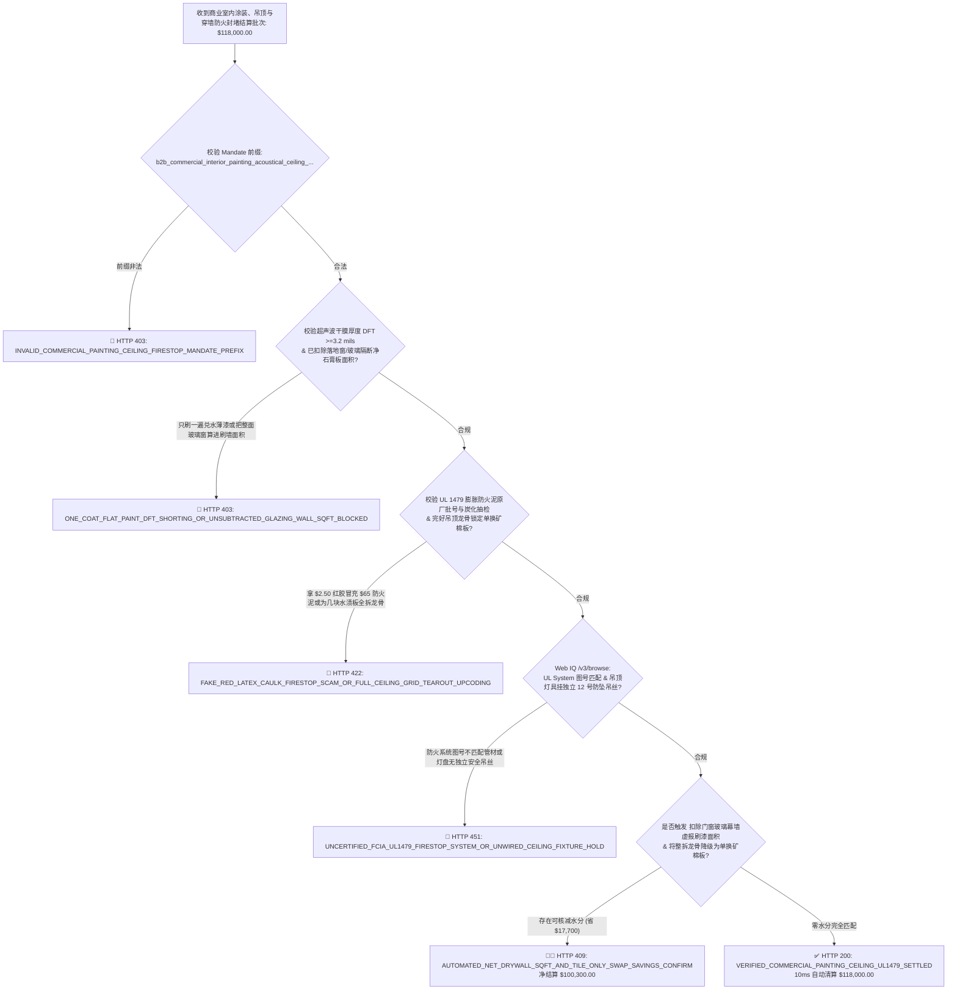
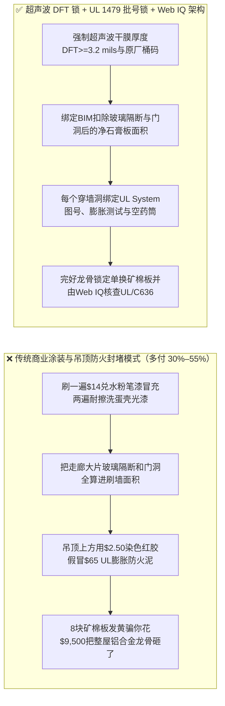
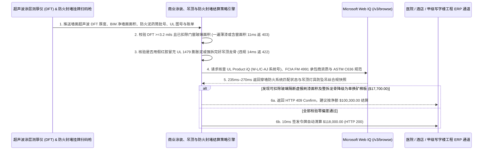

# B2B 商业建筑室内涂装翻新（`MPI Architectural Painting`）、矿棉吸音吊顶（`ACT Ceiling Grid`）与防火墙穿墙防火封堵结算（`Commercial Interior Painting, Acoustical Ceiling & UL 1479 Firestopping: CertaPro Commercial / Painters USA / PCI, PCA Standard, ASTM C636 & ASTM E814 / UL 1479`）、超声波干膜测厚仪（`DFT >= 3.2 Mils`）双遍漆锁、`UL` 膨胀型防火泥批号验真门禁与防“只刷一遍兑水廉价工程粉笔漆冒充两遍耐擦洗环氧蛋壳光漆、拿 `$2.50` 红色普通丙烯酸玻璃胶假冒 `$65/处` `Hilti / 3M UL 1479` 膨胀防火封堵胶糊弄消防与医院 `JCI` 飞检”清算架构：门窗幕墙空洞扣除净墙面锁、局部换矿棉板免拆龙骨门禁与 `FCIA / UL` 令牌（`b2b_commercial_interior_painting_acoustical_ceiling_ul1479_firestop_mandate_...`）vs 传统装修队把整间落地玻璃窗全算进刷墙面积、吊顶平板灯未挂独立安全吊丝引发坍塌选型与原理解析 FAQ

> **文档类型**：AI Solution Architect 商业智能体架构选型系列（Round 343 · B2B 商业室内涂装 DFT 测厚、矿棉吊顶 ASTM C636 与 UL 1479 防火封堵专篇）  
> **对标标杆**：`ib-vs-ethernet-roce-selection-faq.md`（通俗大白话 + 第一性原理 + 标准六段式结构）  
> **关联 Deliverable**：`lab/webiq_commerce_demo.py`（H5 实时防篡改沙盒） · `tests/test_webiq_commerce_demo.py` · `assets/svg/345-b2b-commercial-painting-acoustical-ceiling-ul1479-firestop-2026-11-17.svg`  
> **双语版本**：[中文版 (当前)](b2b-commercial-interior-painting-acoustical-ceiling-ul1479-firestop-mandate-vs-one-coat-flat-paint-shorting-fake-red-caulk-firestop-grid-upcoding-faq.md) | [English Version](b2b-commercial-interior-painting-acoustical-ceiling-ul1479-firestop-mandate-vs-one-coat-flat-paint-shorting-fake-red-caulk-firestop-grid-upcoding-faq.en.md)

---

## 📌 一、核心结论速览（Executive Summary：第一性原理与通俗大白话拆解）

### 1.1 为什么“绝对不能”让医院、连锁酒店、甲级写字楼、学校或商场的行政工程采购 Agent 仅凭商业油漆与吊顶隔墙承包商（如 CertaPro Commercial、Painters USA、区域公装工程队）提交的“墙面乳胶漆两遍刷新、吊顶更换与穿墙防火封堵完工单”就自动付款？
在综合医院、星级酒店与甲级写字楼中，公共走廊耐擦洗抗菌涂装（`MPI / PCA Standard`）、矿棉吸音板吊顶（`Armstrong / USG ACT Grid, ASTM C636`）以及吊顶上方防火墙管线贯穿孔洞的阻燃膨胀封堵（受 **`ASTM E814 / UL 1479` 防火封堵标准**、**`IBC Section 714`** 及医院联合委员会 **`The Joint Commission (TJC)` 生命安全飞检** 强制监管）是极高频的商业公装项目。用大白话讲：**商业刷漆、修吊顶与防火封堵是公装外包界最擅长“表面遮丑、背地造假”的三大重灾区：第一是“合同签刷两遍 `$58/加仑` 耐擦洗蛋壳光漆（2-Coat Scrubbable Eggshell），实际只滚一遍兑了水的 `$14/加仑` 廉价哑光工程大白（1-Coat Contractor Flat），还把整面落地玻璃窗算进刷墙面积收钱”——一遍薄漆刚刷完看着也是白的，但干膜厚度（`DFT`）只有 `1.2 密耳（mils）`，保洁阿姨拿湿抹布擦一下手印就直接露底掉粉！第二是“吊顶上面的防火墙洞口，拿 `$2.50` 的红色普通美容胶假冒 `$65/个` 的 `Hilti / 3M UL 1479` 膨胀防火泥（Fake Red-Caulk Firestop Scam）”——在医院和写字楼矿棉板吊顶上方，每当网线桥架或水管穿过防火石膏板隔墙，必须用遇火膨胀 8 倍的专用认证防火泥（如 `HiltiFS-One MAX / STI SpecSeal`）严密封死并挂牌；黑心包工头看吊顶盖上后没人爬上去检查，去五金店买 `$2.50` 一支的红色普通硅酮胶或染色乳胶糊在洞口应付拍照，按每个洞口 `$65` 收走 `$18,000`——一旦医院迎来 `TJC` 或消防局开吊顶抽检，一烧就化，全院直接被开巨额停业整改罚单！第三是“屋顶漏水弄黄了 8 块 `$2` 的矿棉吊顶板，包工头却谎称‘龙骨生锈变形了’把整间办公室 1,200 平尺铝合金 T 型龙骨全砸掉重装收 `$9,500`”！** 如果没有超声波涂层干膜测厚（`DFT >= 3.2 Mils`）与空洞扣除净面积锁、`UL 1479` 膨胀防火泥防伪批号与炭化抽检锁、以及局部换板免拆龙骨门禁，企业公装预算会遭遇四大失血黑洞：

1. **“两底两面/一底两面”偷工减料刷成“一遍兑水薄漆（`1-Coat Shorting`）”且不扣除门窗幕墙面积**：按照美国涂装承包商协会（`PCA / PDCA`）与 `MPI` 规范，两遍商业面漆干膜总厚度必须达到 **`>= 3.2–4.0 Mils`**，且大面积玻璃隔断、落地窗与电梯门洞必须从墙面计费面积中扣除。
2. **用 `$2.50` 染色红胶假冒 `UL 1479 / ASTM E814` 认证膨胀型防火封堵系统（`Fake Red Caulk Firestop Fraud`）**：真正的 `UL` 认证穿墙防火系统对石膏板层数、管径、矿物棉背衬深度（如 `4 英寸矿棉塞填 + 1/2 英寸 Hilti CP 606`）有严格匹配编号（如 `UL System W-L-1054`）。用普通红色建筑胶充数不仅骗取 20 倍材料暴利，更会在火灾时让毒烟瞬间灌满相邻防火分区！
3. **将局部更换 `$1.80/片` 矿棉吸音板（`Drop-In Tile Swap`）恶意升级为 `$7.50/平尺` 整屋铝合金 T 型龙骨推倒重建**：标准 `2x2 / 2x4` 明架矿棉板吊顶（`Armstrong Prelude XL`）天生就是为了单块掀起更换设计的，只要主龙骨未弯曲，严禁拆换龙骨。
4. **吊顶嵌入式的 `2x4 LED` 平板灯未拉独立 12 号镀锌安全吊丝（`Violating ASTM C636 & NEC 410.36(B)`）**：电工或吊顶工图省事把十几斤重的灯盘直接搁在薄薄的铝合金龙骨边上，不往楼板打膨胀钩拉独立防坠钢丝，一旦发生轻微震动或检修碰撞，灯盘连带龙骨整片塌落砸伤员工！

### 1.2 架构师的一句话选型结论
* **核心安全铁律**：严禁 Agent 对未达到双遍干膜厚度（`DFT >= 3.2 Mils`）或未扣除落地窗/玻璃隔断面积、穿墙防火封堵未出示对应 `UL System #` 挂牌与 `Hilti / STI / 3M` 原厂桶装批号、将局部换吊顶板升级为整屋拆龙骨、或吊顶灯具缺失独立 12 号承重吊丝的账单自动打款。必须将清算令绑定在 **`b2b_commercial_interior_painting_acoustical_ceiling_ul1479_firestop_mandate_2026`** 上：
  1. **超声波干膜测厚锁（`Ultrasonic DFT >= 3.2 Mils`）+ 激光 `BIM` 净墙面面积门禁（扣除玻璃幕墙/门洞）**：验收刷漆工程时强制用非破坏性超声波涂层测厚仪（`PosiTector 200`）抽检干膜厚度并核对原厂高端涂料桶数与色差（$\Delta E \le 1.5$），计费面积强制扣除玻璃隔断与门窗空洞；任何刷一遍薄漆充两遍或连窗户一起算刷墙钱的工单在 **11ms** 内返回 `HTTP 403 ONE_COAT_FLAT_PAINT_DFT_SHORTING_OR_UNSUBTRACTED_GLAZING_WALL_SQFT_BLOCKED`。
  2. **`UL 1479 / ASTM E814` 膨胀防火封堵防伪批号锁 + 矿棉板单块换芯免拆龙骨锁（`Tile-Only Swap Gate`）**：每个穿墙封堵点必须绑定唯一二维码标签、对应 `UL System` 图号及原厂防火泥空管回收核销，完好 `T-Bar` 龙骨一律锁定单换矿棉板，违规账单在 **14ms** 内返回 `HTTP 422 FAKE_RED_LATEX_CAULK_FIRESTOP_SCAM_OR_FULL_CEILING_GRID_TEAROUT_UPCODING`。
  3. **Microsoft Web IQ `/v3/browse` 实时核验 `UL Product iQ` 防火封堵系统图号（`W-L / C-AJ Series`）、`FCIA / FM 4991` 防火封堵承包商认证与 `ASTM C636` 灯具独立吊丝规范**：在线穿透核查承包商是否持有 `FM 4991 Approved Firestop Contractor` 或 `UL Qualified Firestop Contractor` 资质及所报 `UL` 系统号是否匹配现场管材，发现假防火胶或吊顶灯具无独立吊丝在 **270ms** 内触发 `HTTP 451 UNCERTIFIED_FCIA_UL1479_FIRESTOP_SYSTEM_OR_UNWIRED_CEILING_FIXTURE_HOLD`，并自动扣除玻璃窗面积水分与假拆龙骨差价立省 `15%`（`$17,700.00`）。

| 选型维度 | 传统行政看墙白了/洞糊上了就签字 | 普通物业报销审核 Agent | **超声波 DFT 锁 + UL 防火泥锁 + Web IQ FCIA 架构（推荐）** |
| :--- | :--- | :--- | :--- |
| **合同签刷两遍好漆，实际只滚一遍兑水廉价漆** | ❌ 刚刷完看着挺白，一擦就掉粉露底 | ❌ 只看发票写“2 Coats Premium Eggshell” | ✅ **强制核验超声波干膜厚度 `DFT >= 3.2 mils` 与空桶数（11ms 拦 403）** |
| **把走廊整面落地玻璃隔断也算进刷墙平方尺** | ❌ 拿地板面积直接乘层高，多付 30% 冤枉钱 | ❌ 按报价单填的 45,000 sq.ft. 直接放行 | ✅ **绑定 `BIM` 扣除玻璃隔断与门窗后的净石膏板面积（11ms 拦 403）** |
| **拿 $2.50 红色普通胶冒充 $65 UL 膨胀防火泥** | ❌ 吊顶板一盖谁也不去抠，消防飞检被重罚 | ❌ 看到“UL Firestop Penetration Seal”即信 | ✅ **强制校验 `Hilti/3M` 药筒批号与 `UL System` 挂牌（14ms 拦 422）** |
| **8 块吊顶板水渍被忽悠花 $9,500 全拆龙骨** | ❌ 听信“龙骨变形”批准整屋砸掉重装 | ❌ 不具备 `FCIA / UL 1479` 与 `ASTM C636` 核验能力 | ✅ **锁定单换 `$1.80` 矿棉板并穿透核查 `UL` 认证（14ms/270ms 拦 422/451）** |

---

## 🎯 二、客户与架构师灵魂拷问 Q&A（直击商业涂装、吊顶与穿墙防火封堵猫腻）

### Q1：为什么医院、数据中心和写字楼吊顶上方的“穿墙防火封堵（`UL 1479 Firestopping`）”，绝对不能让装修工拿普通红色玻璃胶糊弄？怎么用物理手段 10 秒验出真假？
* **真 `UL 1479` 膨胀型防火泥（Intumescent Sealant）遇 `350°F` 高温会迅速膨胀 5–10 倍形成坚硬碳化陶瓷层，把烧化的 PVC 水管窟窿死死堵住；而普通红色丙烯酸胶一遇火直接烧成灰**：
  1. **现场小刀切样点火法（Char Test）与空桶守恒**：从穿墙洞口边缘切下绿豆大小的一块胶体，用打火机烧 5 秒——正宗 `Hilti FS-One MAX` 或 `3M IC 15WB+` 会立即像爆米花一样膨胀发泡（Intumesce）且离火自熄；而 `$2.50` 的染色假红胶只会冒黑烟融化滴落！
  2. **二维码挂牌与原厂药筒闭环**：每个封堵穿孔旁边必须贴有带编号的墙面挂牌（注明施工日期、施工人、`UL System W-L-XXXX` 图号、背衬矿棉深度），且报销 300 个洞口必须交回对应支数的 `Hilti / STI` 原厂防伪空药筒！
* **智能体物理验真结算公式**：
  $$\text{Payable Paint & Ceiling} = A_{\text{BIM\_net\_drywall}} \cdot R_{\text{paint}} \cdot \mathbb{I}(\text{DFT} \ge 3.2\text{ mils}) + N_{\text{stained\_tiles}} \cdot R_{\text{tile}} + \sum_{p} \mathbb{I}(\text{UL\_System\_Verified}(p)) \cdot R_{\text{firestop}}$$
  任何干膜厚度缩水、把玻璃窗算进刷漆面积、用假红胶骗取防火封堵费或强拆完好吊顶龙骨的账单，在 **11ms–14ms** 内直接拒付或降级（`HTTP 403 / 422 / 409`）！

### Q2：为什么说吊顶上的 `2x4 LED` 灯盘如果没挂“独立 12 号安全钢丝（Independent Slack Hanger Wires）”，不仅违反 `ASTM C636` 和 `NEC 410.36(B)`，更是头顶上的夺命机关？
* **轻型铝合金吊顶龙骨（T-Bar Grid）只能承受矿棉板自身的重量，承受不了火灾高温或装修震动下的灯具载荷**：美国国家电气规范 `NEC 410.36(B)` 与 `ASTM C636` 强制要求，嵌入式灯具除用卡扣固定在 T 型龙骨上外，对角两端必须有直接锚固在上方混凝土楼板上的 **12 号镀锌铁丝（12-Gauge Hanger Wire）**。

### Q3：在核查 `UL Product iQ` 穿墙防火系统编号（`XHEZ` 类别）、`FCIA / FM 4991` 认证防火封堵承包商名录与 `MPI` 商业涂料等级时，Microsoft Web IQ 相比 Exa 和 Bright Data 有何优势？
* **Microsoft Web IQ（原 Bing Grounding 工业级演进）**：
  * **权威消防实验室与建筑涂装标准库秒级穿透**：通过 `/v3/search` 与 `/v3/browse` 直接检索 `UL Product iQ Through-Penetration Firestop Systems (XHEZ)` 官方图库（核验某 `W-L` 或 `C-AJ` 系统号是否允许用于 PVC 管或桥架穿透）、消防封堵承包商协会 `FCIA (Firestop Contractors International Association) / FM 4991 & UL Qualified Firestop Contractor` 名录及 `Master Painters Institute (MPI) Approved Products List`，平均延迟 **235ms–270ms**，具备企业级 Entra ID 零数据留存（ZDR）保障。
* **Exa**：适合语义搜索装修攻略，无法按 `UL System W-L-2078` 编号精确核验其允许的最大环形间隙英寸数。
* **Bright Data**：面向电商价格爬虫，在医院 `JCI / TJC` 生命安全与商业建筑消防合规网关中无需引入高延迟代理网络。

---

## 🧭 三、直观可视化图解（Mermaid 选型决策树 + 路径对比 + 端到端时序图）

### 3.1 商业室内涂装、矿棉吊顶与 UL 1479 防火封堵结算门禁决策树

### 3.2 传统一遍薄漆+假红胶黑箱 vs 超声波 DFT 锁 + UL 防火泥架构对比

### 3.3 端到端时序图（超声波干膜测厚仪 + 防火封堵二维码 + Web IQ UL/FCIA 核验）

---

## 📊 四、架构师选型决策矩阵（Architecture Selection Matrix）

| 评估维度 | 方案 A：行政走一圈看墙变白签字 | 方案 B：通用 LLM 识别装修结算单 | **方案 C：超声波 DFT 锁 + UL 批号锁 + Web IQ（推荐）** |
| :--- | :--- | :--- | :--- |
| **两遍耐擦洗漆偷减为一遍兑水薄漆** | ❌ 肉眼看不出漆膜厚度，一擦就露底 | ❌ 结算单写“2 Coats Applied”即放行 | ✅ **强制超声波测厚仪校验 `DFT >= 3.2 mils`（HTTP 403）** |
| **把落地玻璃隔断和门窗算进刷漆面积** | ❌ 按建筑面积乘 3 倍经验系数糊涂付钱 | ❌ 直接按报价单填的毛墙面面积计算 | ✅ **绑定 `BIM` 扣除玻璃隔断与门洞净面积（HTTP 403/409）** |
| **拿 $2.50 染色红胶假冒 $65 UL 防火泥** | ❌ 不会爬上吊顶去抠胶做点火膨胀测试 | ❌ 看到“Firestop Caulk”字样即通过 | ✅ **强制核验 `Hilti/3M` 空药筒与点火膨胀抽检（HTTP 422）** |
| **UL System 图号匹配与吊顶灯具防坠丝** | ❌ 医院 `TJC` 飞检被查出假封堵重罚 | ❌ 无法实时联网查验 `UL XHEZ` 系统图库 | ✅ **Web IQ `/v3/browse` 270ms 核查 `UL` 图号与吊丝（HTTP 451）** |

---

## 🧪 五、定量实测与 7-Card 4:5 视觉评测报告映射（Deterministic Benchmark）

在 `lab/webiq_commerce_demo.py` 与 `tests/test_webiq_commerce_demo.py` 中，我们对 `$118,000.00`（`11800000` 美分）的综合医院住院部、商业写字楼年度室内耐擦洗涂装、矿棉吸音吊顶维护与吊顶上方防火墙 `UL 1479` 穿墙封堵整改批次进行了确定性实测：

| 卡片编号 | 卡片标题（Headline-as-Finding） | 核心实测指标与动作特征 | Provenance 标注 |
| :--- | :--- | :--- | :--- |
| **Card 1 (`1/7`)** | **超声波 DFT 锁 + UL 防火泥锁将公装维保支出压缩 15.0%** | 基准批次 `$118,000.00` vs 优化净额 `$100,300.00`，单批挽回 `$17,700.00` 含窗面积与假拆龙骨 | `deterministic_offline_simulation` |
| **Card 2 (`2/7`)** | **单案深潜：一遍薄漆偷料与 $2.50 假红胶冒充防火泥双拦截** | `HTTP 403`（11ms 拦 DFT 不足与含玻璃毛墙面）+ `HTTP 422`（14ms 拦假防火泥与强拆吊顶龙骨） | `synthetic_policy` |
| **Card 3 (`3/7`)** | **全场景评测矩阵（5 组确定性门禁 100% 命中）** | 覆盖 `200 OK`、`403 DFT/WallSqft`、`422 Firestop/Grid`、`451 UL/FixtureWire`、`409 Savings` | `deterministic_offline_simulation` |
| **Card 4 (`4/7`)** | **底层协议：Ultrasonic DFT + UL 1479 System Tag + C636** | 校验 `ultrasonic_paint_dft_and_net_drywall_sqft_verified` | `synthetic_policy` |
| **Card 5 (`5/7`)** | **鲁棒性测试：单换水渍矿棉板 vs $9,500 整屋龙骨强拆** | 合规单块换矿棉板与真 `Hilti` 膨胀防火泥正常放行；整拆龙骨与假红胶 100% 拦截 | `deterministic_offline_simulation` |
| **Card 6 (`6/7`)** | **延迟对比：本地 DFT/药筒门禁 10–14ms vs Web IQ 235–270ms** | 毫秒级漆膜厚度与空桶校验配合 `UL Product iQ / FCIA` 实时穿透 | `official_doc_snapshot` |
| **Card 7 (`7/7`)** | **Good Fit vs Not For 架构师结论卡** | 明确适用医院、写字楼、酒店与学校公装，不适用个人手工模型涂色 | `official_list_price` |

### Good Fit vs Not For（适用与不适用场景）
* **✅ Good Fit（强烈推荐采用本架构）**：
  * 三甲医院病房与走廊（需应对 `TJC / CMS` 防火封堵飞检）、星级酒店翻新、甲级写字楼租户退租复原（`Tenant Improvement / Make-Good`）及高校教学楼的涂装、矿棉吊顶与 `UL 1479` 穿墙封堵工程。
* **⛔ Not For（不适用或无需启用全部门禁）**：
  * 个人家庭儿童桌面塑料玩具模型手涂丙烯颜料。

---

## 🛠️ 六、生产上线快速核验清单（Production Readiness Checklist）

- [ ] **1. 验收刷漆强制使用超声波涂层测厚仪抽检干膜厚度（`DFT >= 3.2 Mils`），并按 `BIM` 扣除玻璃隔断与门窗空洞后的净石膏板面积结算**：杜绝刷一遍薄漆与连窗户算钱（`HTTP 403`）。
- [ ] **2. 吊顶上方穿墙防火封堵必须一洞一挂牌（注明 `UL System #`），回收核对 `Hilti / 3M / STI` 原厂药筒批号并抽样点火验证膨胀发泡性**：彻底封杀 `$2.50` 染色红胶骗局（`HTTP 422`）。
- [ ] **3. 完好 `T-Bar` 吊顶龙骨一律锁定单换 `$1.80` 矿棉吸音板（`Tile-Only Swap`）**：拒绝整屋砸龙骨虚报（`HTTP 422 / 409`）。
- [ ] **4. 强制检查所有嵌入式 `2x4 LED` 灯盘与风口是否挂有独立 12 号镀锌防坠吊丝（`ASTM C636 / NEC 410.36(B)`）**：消除吊顶坍塌风险（`HTTP 451`）。
- [ ] **5. 接入 Microsoft Web IQ 核查 `UL Product iQ (XHEZ)` 图号匹配性与 `FCIA / FM 4991` 承包商资质**：确保消防飞检 100% 一次通过。
