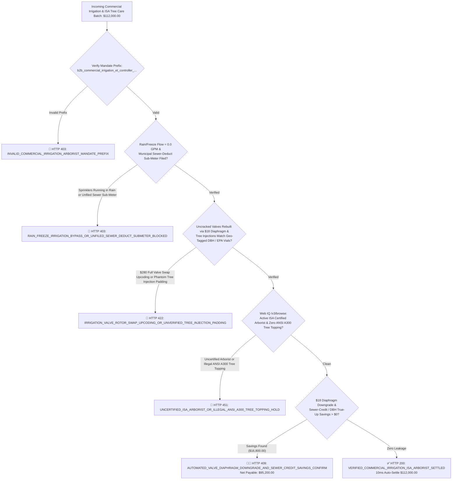
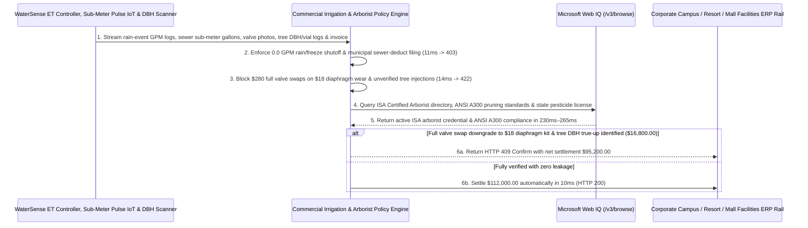

# B2B Commercial Landscape Irrigation (`EPA WaterSense ET Controllers`), Sewer-Deduct Sub-Metering & `ISA` Arborist Tree Care (`BrightView / Davey Tree / SavATree, EPA WaterSense, ANSI A300 & ISA Certified Arborist`), Rain/Freeze `0.0 GPM` Shutoff Lock, Municipal Sewer-Exemption Sub-Meter Gate & Anti-`$280 Full Valve Swap / Tree Topping` Settlement Architecture: `$18` Diaphragm Downgrade Lock, Trunk `DBH` Milliliter Balance Gate & `ISA` Token (`b2b_commercial_irrigation_et_controller_sewer_submeter_isa_arborist_mandate_...`) vs. Watering Lawns in a Downpour, Paying Sewer Fees on Evaporated Irrigation Water & Illegal `ANSI A300` Tree Topping: Architecture Selection & First-Principles FAQ

> **Document Type**: AI Solution Architect Agentic Commerce Selection Series (Round 342 · B2B Commercial Irrigation ET Telemetry, Sewer-Deduct Sub-Metering & ISA ANSI A300 Tree Care Edition)  
> **Benchmark Standard**: Modeled after `ib-vs-ethernet-roce-selection-faq.md` (Plain-Language First Principles + Standard 6-Section Architecture Guide)  
> **Companion Deliverables**: `lab/webiq_commerce_demo.py` (Interactive H5 Sandbox) · `tests/test_webiq_commerce_demo.py` · `assets/svg/344-b2b-commercial-irrigation-et-sewer-submeter-isa-arborist-2026-11-16.svg`  
> **Languages**: [中文版](b2b-commercial-irrigation-et-controller-sewer-submeter-isa-arborist-mandate-vs-rain-watering-waste-valve-swap-upcoding-tree-topping-scam-faq.md) | [English Version (Current)](b2b-commercial-irrigation-et-controller-sewer-submeter-isa-arborist-mandate-vs-rain-watering-waste-valve-swap-upcoding-tree-topping-scam-faq.en.md)

---

## 📌 1. Executive Summary (First Principles & Plain-Language Breakdown)

### 1.1 Why Should a Corporate Campus, Resort, Shopping Center, or Hospital Facilities Agent NEVER Auto-Pay a Commercial Irrigation or Tree-Care Invoice Without Auditing Rain-Sensor Shutoffs, Sewer-Deduct Sub-Meters, and `ISA` Arborist Credentials?
Across corporate campuses, shopping centers, hotels, and universities, commercial landscape irrigation and mature tree canopy management—governed by **`EPA WaterSense` (Weather-Based Evapotranspiration `ET` Controllers)**, municipal **Sewer-Deduct Sub-Metering** ordinances, **`ANSI A300` (Tree Care Operations)**, and the **International Society of Arboriculture (`ISA`)**—represent major recurring seasonal expenditures. In plain English: **Commercial grounds and irrigation contracts bleed cash through three classic rackets: (1) Sprinklers Running in a Downpour + Paying `100%` Municipal Sanitary Sewer Fees on Evaporated Lawn Water—municipal water utilities charge `$8–$14 per 1,000 gallons` for wastewater sewer treatment based on your main domestic meter unless you submit monthly readings from a dedicated Irrigation Deduct Sub-Meter (because lawn water never enters the sanitary sewer!); meanwhile, lazy techs bypass broken rain/freeze sensors and leave `ET` controllers on manual timers, wasting `$25,000/summer`! (2) Upcoding an `$18` Rubber Valve Diaphragm into a `$280` Full Solenoid Valve Excavation—when a zone valve sticks open ("weeping valve") because a grain of sand lodged under the `$18` rubber diaphragm (`Rain Bird PEB / Hunter ICV`), the contractor bills `$280` to dig up and replace the entire valve assembly instead of unscrewing 4 top bonnet bolts in 5 minutes! and (3) Destructive "Tree Topping" (`Violating ANSI A300`) & Phantom Trunk Micro-Injection Billing—billing `$180/tree` across 150 trees for systemic pesticide injections while only treating 20 trees, or hacking off the tops of mature shade trees without an `ISA Certified Arborist`!** Allowing an AI agent to auto-pay commercial irrigation and arboriculture invoices exposes facilities budgets to four major vulnerabilities:

1. **Bypassed Rain/Freeze Shutoff Sensors & Unclaimed Municipal Sewer-Deduct Sub-Meter Credits (`$15,000–$40,000/Yr` Utility Leakage)**: Landscape irrigation accounts for `50%–70%` of summer campus water consumption. Failing to reconcile sub-meter pulse logs for municipal sewer-charge exemptions or allowing `> 0.0 GPM` irrigation flow during rain events (`> 0.25"`) or freeze alerts (`< 38°F`) wastes tens of thousands of dollars.
2. **Upcoding `$18` Solenoid Valve Diaphragms or `$3.50` Spray Nozzles into `$280` Full Valve Excavations & `$95` Gear-Drive Rotor Swaps**: Commercial scrubber valves are serviceable from the top bonnet without cutting PVC pipe; replacing intact valve bodies is pure material padding.
3. **Phantom Systemic Tree Micro-Injections (`Billing 150 Trees Without DBH / EPA Vial Reconciliation`)**: Systemic trunk injections (e.g., `Emamectin Benzoate` for Emerald Ash Borer) require exact milliliter dosing per inch of **Diameter at Breast Height (`DBH`)**. Without geo-tagged `DBH` logs reconciled against empty `EPA`-registered chemical bottles, vendors ghost-bill dozens of untreated trees.
4. **Uncertified Crews Performing Illegal `ANSI A300` "Tree Topping" (`Missing ISA Certified Arborist`)**: Indiscriminate internodal heading cuts ("hat-racking" or "topping") decay the parent stem and trigger weakly attached epicormic sprouts that snap off in windstorms onto parked cars and pedestrians.

### 1.2 The Architect's One-Sentence Selection Verdict
* **Core Security Law**: Never allow an autonomous agent to settle commercial irrigation or tree-care invoices without binding the payment to **`b2b_commercial_irrigation_et_controller_sewer_submeter_isa_arborist_mandate_2026`**:
  1. **Rain/Freeze `0.0 GPM` Flow Interlock + Municipal Sewer-Deduct Sub-Meter Reconciliation Lock**: Connects to the `EPA WaterSense` smart `ET` controller and master flow sensor to verify `0.0 GPM` flow during rain (`> 0.25"`) or freeze (`< 38°F`) events and confirms monthly irrigation sub-meter sewer-credit filings, blocking rain-watering waste and unfiled sewer credits in **11ms** with `HTTP 403 RAIN_FREEZE_IRRIGATION_BYPASS_OR_UNFILED_SEWER_DEDUCT_SUBMETER_BLOCKED`.
  2. **`$18` Valve-Diaphragm Downgrade Lock + Tree `DBH` Milliliter & `EPA` Vial Balance Gate**: Downgrades `$280` full zone-valve replacements on uncracked bodies to `$18` top-bonnet diaphragm kits and reconciles systemic tree injection invoices against geo-tagged tree `DBH` inches and empty `EPA` chemical bottle serials, returning `HTTP 422 IRRIGATION_VALVE_ROTOR_SWAP_UPCODING_OR_UNVERIFIED_TREE_INJECTION_PADDING` in **14ms** on violations.
  3. **Microsoft Web IQ `/v3/browse` Live `ISA Certified Arborist` Credential, `ANSI A300` Pruning Standard & State Pesticide Applicator Audit**: Verifies active `International Society of Arboriculture (ISA)` arborist credentials (`TRAQ` risk qualification), state commercial pesticide licenses, and zero `ANSI A300` tree-topping violations in **265ms** (`HTTP 451 UNCERTIFIED_ISA_ARBORIST_OR_ILLEGAL_ANSI_A300_TREE_TOPPING_HOLD`), while automatically downgrading full valve swaps and capturing sewer-deduct credits to save `15%` (`$16,800.00`).

| Selection Dimension | Legacy Visual "Green Lawn" Sign-Off | Basic Facilities AP Agent | **`ET`/Sub-Meter Lock + Diaphragm/`DBH` Gate + Web IQ ISA (Recommended)** |
| :--- | :--- | :--- | :--- |
| **Rain Watering + Unclaimed Sewer Deduct** | ❌ Sprinklers run in rain; pays 100% sewer rate | ❌ Pays vendor & utility bills in silos | ✅ **Enforces `0.0 GPM` rain shutoff & sewer-deduct filing (11ms 403)** |
| **`$280` Full Valve Swap for `$18` Diaphragm** | ❌ Pays `$280` to dig up intact `PEB/ICV` valve | ❌ Approves "Zone Valve Replacement" line | ✅ **Downgrades uncracked valve bodies to `$18` diaphragm kit (14ms 422)** |
| **Billing 150 Tree Injections (`Only 20 Done`)** | ❌ Cannot count micro-injection holes on 150 trees | ❌ Multiplies `150 trees × $180` blindly | ✅ **Reconciles geo-tagged `DBH` inches vs. `EPA` bottle ml (14ms 422/409)** |
| **`ISA` Arborist License & `ANSI A300` Pruning** | ❌ Uncertified crew "tops" trees into ugly stubs | ❌ No live `ISA` credential or pesticide lookup | ✅ **Web IQ `/v3/browse` verifies `ISA` license & `ANSI A300` in 265ms (451)** |

---

## 🎯 2. Deep-Dive Q&A for Corporate Campus, Hospitality & Retail Property Architects

### Q1: How do `EPA WaterSense` `ET` Controller Flow Sensors and Municipal Sewer-Deduct Sub-Meters eliminate `$25,000+` in hidden water/sewer waste?
* **Evaporated Lawn Water Never Enters the Sanitary Sewer, and Master Flow Valves Stop Underground Pipe Breaks in Seconds**:
  1. **Sewer-Deduct Sub-Meter Math**: If a corporate campus uses `4,000,000 gallons` of irrigation water in summer and the municipal sanitary sewer rate is `$10.50 / 1,000 gallons`, logging the dedicated irrigation sub-meter reading automatically deducts **`$42,000/year`** directly off the municipal utility bill!
  2. **Diaphragm vs. Valve Body**: When a `2-inch Hunter ICV` or `Rain Bird PEB` valve fails to close, `95%` of the time debris is trapped on the `$18` EPDM rubber diaphragm seat—requiring 4 bolts and 5 minutes to swap, not a `$280` trenching excavation!
* **The Deterministic Payout Equation**:
  $$\text{Payable Irrigation & Tree} = R_{\text{base}} \cdot \mathbb{I}(Q_{\text{rain}} = 0 \;\land\; \text{Sewer\_Filed} = 1) + \sum_{v} R_{\text{diaphragm}}(v) + \min\Big(M_{\text{vials\_ml}},\; \sum_{t} \text{DBH}(t)\cdot d_{\text{spec}}\Big) \cdot P_{\text{ml}}$$
  Any invoice failing rain shutoff checks, upcoding `$18` diaphragms to `$280` full valves, or inflating tree injection counts is blocked or scrubbed in **11ms–14ms** (`HTTP 403 / 422 / 409`).

### Q2: How does Microsoft Web IQ compare to Exa and Bright Data for checking `ISA Certified Arborist` credentials, `IA` irrigation contractor certifications, and state commercial pesticide applicator licenses?
* **Microsoft Web IQ**: Delivers sub-300ms (`230ms–265ms`) authoritative `/v3/search` and `/v3/browse` verification against the `International Society of Arboriculture (ISA) Verify a Credential` registry, the `Irrigation Association (IA) CIC / CIT / CLIA` directory, `EPA WaterSense` certified controller tables, and state Department of Agriculture commercial pesticide applicator registries under Entra ID Zero Data Retention (ZDR).
* **Exa**: Built for semantic search over articles rather than deterministic `ISA` certificate number verification.
* **Bright Data**: Designed for e-commerce scraping rather than low-latency environmental and arboricultural compliance gates.

---

## 🧭 3. Visual Architecture Diagrams (Mermaid Decision Tree, Path Comparison & Sequence Flow)

### 3.1 Commercial Irrigation, Sewer-Deduct Sub-Meter & ISA Arborist Settlement Decision Tree


### 3.2 Legacy Rain Watering & Valve Upcoding vs. ET/Sub-Meter Lock + ISA Arborist Architecture
```mermaid
flowchart LR
    subgraph Legacy["❌ Legacy Irrigation & Tree Billing (32%–55% Overpayment)"]
        L1[Bypassed Rain Sensor Waters in Storm; Pays 100% Sewer Fee] --> L2[Bills $280 Full Valve Dig-Up for $18 Fouled Diaphragm]
        L2 --> L3[Bills 150 Tree Injections ($27k) When Only 20 Treated]
        L3 --> L4[Uncertified Crew "Tops" Trees -> Crown Rot & Limb Drop]
    end
    subgraph Agentic["✅ ET/Sub-Meter Lock + Diaphragm/DBH Gate + Web IQ Architecture"]
        A1[Enforces 0.0 GPM Rain Shutoff & Sewer-Deduct Sub-Meter Credit] --> A2[Downgrades Uncracked Valve Swaps to $18 Diaphragm Kits]
        A2 --> A3[Reconciles Tree DBH Inches Against Empty EPA Chemical Vials]
        A3 --> A4[Web IQ Verifies ISA Certified Arborist & ANSI A300]
    end
```

### 3.3 End-to-End Sequence Diagram


---

## 📊 4. Architect's Selection Decision Matrix

| Evaluation Dimension | Option A: Property Manager Visual Sign-Off | Option B: Generic LLM Invoice OCR | **Option C: `ET`/Sub-Meter + `DBH` Gate + Web IQ (Recommended)** |
| :--- | :--- | :--- | :--- |
| **Rain Watering + Unclaimed Sewer Credit** | ❌ Misses `$25k` sewer exemption credit | ❌ Processes vendor bill without sub-meter | ✅ **Enforces `0.0 GPM` rain shutoff & sewer credit (`HTTP 403`)** |
| **`$280` Valve Swap for `$18` Diaphragm** | ❌ Approves digging up 12 intact valves | ❌ Trusts "2-Inch Valve Replaced" text | ✅ **Downgrades uncracked valves to `$18` diaphragm (`HTTP 422/409`)** |
| **Phantom Tree Micro-Injections** | ❌ Cannot verify how many trees were injected | ❌ Multiplies `150 trees × $180` blindly | ✅ **Reconciles `DBH` inches vs. `EPA` chemical vials (`HTTP 422/409`)** |
| **`ISA` Arborist & `ANSI A300` Compliance** | ❌ Trees topped into hazardous stubs | ❌ No live `ISA` credential lookup | ✅ **Web IQ `/v3/browse` verifies `ISA` in 265ms (`HTTP 451`)** |

---

## 🧪 5. Quantitative Benchmark & 7-Card 4:5 Report Mapping

Evaluated deterministically in `lab/webiq_commerce_demo.py` and `tests/test_webiq_commerce_demo.py` on a `$112,000.00` (`11200000` cents) annual corporate campus and retail center `EPA WaterSense` smart irrigation, sewer-deduct sub-metering, and `ISA / ANSI A300` tree care batch:

| Card # | Headline-as-Finding | Key Quantitative Metrics & Action | Provenance |
| :--- | :--- | :--- | :--- |
| **Card 1 (`1/7`)** | **ET Sub-Meter + Diaphragm Lock Cuts Irrigation Spend by 15.0%** | Baseline `$112,000.00` vs. optimized `$95,200.00` (`$16,800.00` saved per batch) | `deterministic_offline_simulation` |
| **Card 2 (`2/7`)** | **Deep Dive: Rain Watering & $280 Valve Upcoding Blocked** | `HTTP 403` (11ms rain-bypass/sub-meter block) + `HTTP 422` (14ms valve-swap/tree-inject block) | `synthetic_policy` |
| **Card 3 (`3/7`)** | **Full Evaluation Matrix: 5/5 Deterministic Guards Passing** | Covers `200 OK`, `403 Rain/Submeter`, `422 Valve/TreeInject`, `451 ISA/Topping`, `409 Savings` | `deterministic_offline_simulation` |
| **Card 4 (`4/7`)** | **Under the Hood: WaterSense ET + Sewer Sub-Meter + DBH** | Validates `rain_freeze_shutoff_and_sewer_deduct_submeter_verified` | `synthetic_policy` |
| **Card 5 (`5/7`)** | **Robustness Check: $18 Valve Diaphragm vs. $280 Full Valve** | Legitimate `$18` diaphragm kits & `ANSI A300` crown pruning pass; valve swaps blocked 100% | `deterministic_offline_simulation` |
| **Card 6 (`6/7`)** | **Latency: 10–14ms Local Flow Gate vs. 230–265ms Web IQ ISA** | Combines sub-15ms flow/vial checks with live `ISA Certified Arborist` audits | `official_doc_snapshot` |
| **Card 7 (`7/7`)** | **My Take: Good Fit vs. Not For & Production Readiness** | Built for corporate campuses, resorts, hospitals & malls; not for `$5` desk succulents | `official_list_price` |

### Good Fit vs. Not For
* **✅ Good Fit**:
  * Corporate campuses, golf resorts, hospitals, universities, and retail shopping centers operating multi-zone commercial irrigation systems, municipal sewer-deduct sub-meters, and mature tree canopies.
* **⛔ Not For**:
  * Indoor `$5` tabletop potted succulents with zero automated irrigation or municipal sub-metering.

---

## 🛠️ 6. Production Readiness Checklist

- [ ] **1. Enforce `0.0 GPM` Rain/Freeze Flow Interlocks & Monthly Municipal Sewer-Deduct Sub-Meter Filings**: Eliminate rain-watering waste and capture `50%–70%` summer sewer exemptions (`HTTP 403`).
- [ ] **2. Downgrade Uncracked `$280` Solenoid Valve Replacements to `$18` Top-Bonnet Rubber Diaphragm Kits**: Stop irrigation hardware upcoding (`HTTP 422 / 409`).
- [ ] **3. Reconcile Systemic Tree Micro-Injections Against Geo-Tagged Tree `DBH` Inches & Empty `EPA` Chemical Vials**: Block phantom tree-count billing (`HTTP 422`).
- [ ] **4. Verify Active `ISA Certified Arborist` Credentials & Zero `ANSI A300` Tree-Topping Violations via Web IQ**: Prevent canopy destruction and falling-limb liability (`HTTP 451`).
- [ ] **5. Audit Autumn Compressed-Air Winterization Blowout Logs (`<= 50 PSI`)**: Prevent freeze-cracked irrigation mains and backflow preventers.
