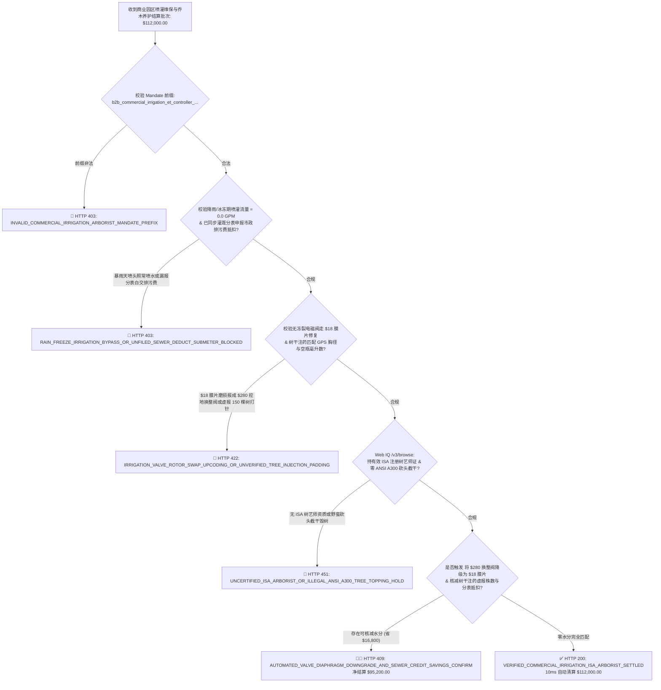
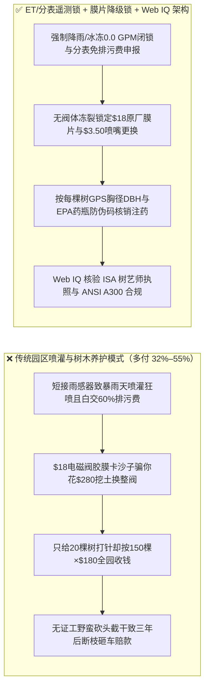
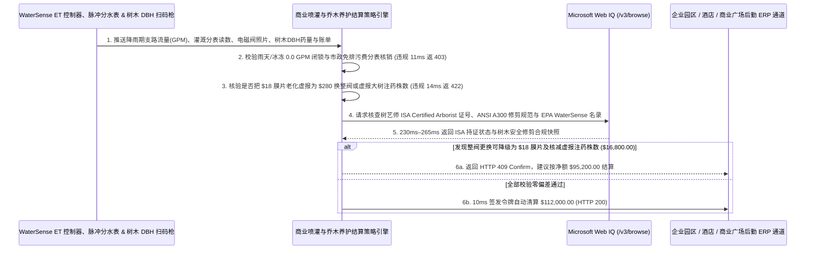

# B2B 商业园区智能喷灌（`EPA WaterSense ET Controller`）、绿化用水免排污费分表抵扣（`Irrigation Sewer-Deduct Sub-Metering`）与乔木修剪结算（`Commercial Landscape Irrigation, Sewer-Exemption Sub-Metering & ISA Tree Care: BrightView / Davey Tree / SavATree, EPA WaterSense, ANSI A300 & ISA Certified Arborist`）、降雨/冰冻传感器联动断水锁、市政免排污费分表（`Deduct Meter`）核销门禁与防“暴雨天喷灌头照常喷水浪费 `$25,000` 水费、把换一颗 `$18` 电磁阀膜片就能修好的常流水虚报为 `$280` 挖地换整阀与对 150 棵大树虚报 `$180/棵` 树干打孔注药”清算架构：支路脉冲水表流量锁、膜片优先降级门禁与 `ISA / ANSI A300` 令牌（`b2b_commercial_irrigation_et_controller_sewer_submeter_isa_arborist_mandate_...`）vs 传统绿化外包不办排污费核减白交 60% 污水处理费、野蛮“砍头式截干（Tree Topping）”毁树选型与原理解析 FAQ

> **文档类型**：AI Solution Architect 商业智能体架构选型系列（Round 342 · B2B 商业园区智能喷灌 ET 控制、免排污费分表与 ISA 树木修剪专篇）  
> **对标标杆**：`ib-vs-ethernet-roce-selection-faq.md`（通俗大白话 + 第一性原理 + 标准六段式结构）  
> **关联 Deliverable**：`lab/webiq_commerce_demo.py`（H5 实时防篡改沙盒） · `tests/test_webiq_commerce_demo.py` · `assets/svg/344-b2b-commercial-irrigation-et-sewer-submeter-isa-arborist-2026-11-16.svg`  
> **双语版本**：[中文版 (当前)](b2b-commercial-irrigation-et-controller-sewer-submeter-isa-arborist-mandate-vs-rain-watering-waste-valve-swap-upcoding-tree-topping-scam-faq.md) | [English Version](b2b-commercial-irrigation-et-controller-sewer-submeter-isa-arborist-mandate-vs-rain-watering-waste-valve-swap-upcoding-tree-topping-scam-faq.en.md)

---

## 📌 一、核心结论速览（Executive Summary：第一性原理与通俗大白话拆解）

### 1.1 为什么“绝对不能”让企业总部园区、商业广场、高尔夫度假酒店、医院或高校的后勤采购 Agent 仅凭园林喷灌与乔木养护承包商（如 BrightView、Davey Tree、SavATree、区域园林公司）提交的“月度喷灌巡检换件单与大树病虫害打针账单”就自动付款？
在拥有大面积草坪与景观乔木的商业园区、购物中心与酒店中，自动喷灌系统（`Commercial Irrigation`）水耗控制与高大乔木安全修剪（受美国环保署 `EPA WaterSense` 气象蒸发蒸腾量 `ET` 控制器标准、国家树木养护标准 **`ANSI A300`** 及国际树木学会 **`ISA Certified Arborist`** 规范监管）直接关系到每年数万美元的市政水费与行人被断枝砸伤的法律责任。用大白话讲：**商业园区绿化喷灌与树木养护存在三大隐秘黑洞：第一是“暴雨天喷头还在狂喷 + 白交 60% 的市政污水处理费（Sewer Surcharge）”——市政水务局默认把你总水表流进去的每一滴水，都收一份高昂的“市政排污处理费（Sewer Charge，通常比自来水本身还贵 1.5 倍）”；但其实园区夏天浇草坪的几百万加仑水全都渗进泥土和蒸发了，根本没进市政下水道！只要装一块市政备案的“灌溉扣减分水表（Sewer-Deduct Sub-Meter）”就能免掉全部绿化用水的排污费；更离谱的是，养护工为了省事把智能气象控制器（`ET Controller`）掰成死板的“定时模式”并短接雨量传感器，外面倾盆大雨草坪喷头还在狂喷，甚至冬天结冰还在喷水把马路冻成溜冰场！第二是“把换一片 `$18` 橡胶膜片或 `$3.50` 喷嘴滤网就能修好的故障，谎报成 `$280` 挖地换整套电磁阀和旋转喷头”——电磁阀关不严漏水，95% 只是里面那片 `$18` 的橡胶膜片（Diaphragm）卡了泥沙，拧开 4 颗螺丝换片胶皮 5 分钟搞定，外包商却每次开单收 `$280` 挖土换新阀！第三是“无证绿化工野蛮‘砍头截干（Tree Topping）’把大树毁成电线杆，或虚报 150 棵树每棵 `$180` 的树干微孔注药”！** 如果没有气象 `ET` 与雨量断水遥测锁、市政免排污费分表（`Sewer-Deduct Submeter`）核销门禁与 `ISA` 注册树艺师核验，园区预算会遭遇四大失血黑洞：

1. **未启用 `EPA WaterSense` 气象 `ET` 自动控水与市政“绿化免排污费分表（`Sewer-Deduct Credit`）”导致每年白扔 `$15,000–$40,000` 排污费**：商业园区灌溉用水占夏季总用水量的 `50%–70%`。若未按月读取灌溉分表向水务局申报 `Sewer Exemption Credit`，且在降雨量 `> 0.25 英寸` 时喷灌电磁阀未自动闭锁，物业形同往地沟里冲钞票。
2. **将 `$18` 电磁阀橡胶膜片（`Valve Diaphragm`）或 `$3.50` 喷嘴更换，批量升级为 `$280` 整阀开挖换新与 `$95` 齿轮喷头总成更换**：商用电磁阀（如 `Rain Bird PEB / Hunter ICV`）专为免挖土顶盖拆修设计，严禁无阀体冻裂证据就报销整阀开挖更换。
3. **违反 `ANSI A300` 树木修剪国标的野蛮“截顶砍头（`Tree Topping / Hat-Racking`）”**：无证工人为了省事直接用油锯把大树主干树冠拦腰截断，不仅导致伤口腐烂死树，长出的脆弱水芽（Watersprouts）一旦遇大风极易折断砸毁停放车辆与行人。
4. **虚报高价“树干高压微孔注射（`Systemic Trunk Micro-Injection`）”株数与药剂剂量**：声称给园区 150 棵白蜡树或橡树注射了 `$180/棵` 的甲维盐（`Emamectin Benzoate`），实际只打了门口 20 棵，或未提供空药瓶 `EPA` 批号核销与每棵树 `GPS` 胸径（`DBH`）照片。

### 1.2 架构师的一句话选型结论
* **核心安全铁律**：严禁 Agent 对降雨/冰冻期间未自动关停喷灌、未扣除市政灌溉分表免排污费额度、无阀体破裂证据将 `$18` 电磁阀膜片磨损报成 `$280` 挖地换整阀、违反 `ANSI A300` 实施砍头修剪、或现场无 `ISA` 持证树艺师与药瓶核销的树干注药账单自动打款。必须将清算令绑定在 **`b2b_commercial_irrigation_et_controller_sewer_submeter_isa_arborist_mandate_2026`** 上：
  1. **智能气象 `ET` 降雨/冰冻闭锁遥测锁（`Zero Rain/Freeze Watering`）+ 市政绿化分表排污费抵扣锁（`Sewer-Deduct Submeter Lock`）**：直连中央智能喷灌主控箱（`Hunter Centralus / Rain Bird IQ4`）与脉冲流量计，验证降雨 `> 0.25"` 或气温 `< 38°F` 时支路 `0.0 GPM` 零流量，并强制同步灌溉分表读数抵扣市政排污费；任何雨天狂喷或漏报分表抵扣的工单在 **11ms** 内返回 `HTTP 403 RAIN_FREEZE_IRRIGATION_BYPASS_OR_UNFILED_SEWER_DEDUCT_SUBMETER_BLOCKED`。
  2. **`$18` 电磁阀膜片/喷嘴优先降级锁 + 乔木胸径（`DBH`）与药剂原液批号守恒门禁**：无阀体破裂照片一律将 `$280` 换整阀降级为 `$18` 膜片更换；树干微孔注药强制按实测胸径英寸数（`DBH Inches × ml/in`）与药厂空瓶防伪码闭环核销，违规账单在 **14ms** 内返回 `HTTP 422 IRRIGATION_VALVE_ROTOR_SWAP_UPCODING_OR_UNVERIFIED_TREE_INJECTION_PADDING`。
  3. **Microsoft Web IQ `/v3/browse` 实时核验 `ISA Certified Arborist`（国际注册树艺师）执照、`ANSI A300` 树冠修剪合规、`EPA WaterSense` 认证与州农药施用许可证**：在线穿透核查树木修剪负责人是否持有有效 `ISA` 树艺师证与州级景观农药执照，严禁“砍头截干（Topping）”，发现无证毁树或违规施药在 **265ms** 内触发 `HTTP 451 UNCERTIFIED_ISA_ARBORIST_OR_ILLEGAL_ANSI_A300_TREE_TOPPING_HOLD`，并自动将整阀换新降级为换膜片及追回分表免排污费红利立省 `15%`（`$16,800.00`）。

| 选型维度 | 传统园区保安看草坪绿不绿签字 | 普通物业报销审核 Agent | **ET/分表遥测锁 + 膜片/树径锁 + Web IQ ISA 架构（推荐）** |
| :--- | :--- | :--- | :--- |
| **大雨天喷头照常喷水 + 未扣减市政排污费** | ❌ 没人管雨量传感器坏没坏，每年多交 $25k 水费 | ❌ 水务局账单和园林维保单分开付，从不对账 | ✅ **强制校验雨天 `0.0 GPM` 闭锁与分表排污费抵扣（11ms 拦 403）** |
| **电磁阀关不严被虚报 $280 挖土换整套新阀** | ❌ 听信“阀门坏了”签字批换 12 个电磁阀 | ❌ 只看发票写“Zone Control Valve Replacement” | ✅ **无壳体冻裂一律锁定 `$18` 原厂膜片维修包（14ms 拦 422）** |
| **150 棵树虚报 $180/棵树干注药或只打 20 棵** | ❌ 树干上扎个眼看不出注了多少毫升真药 | ❌ 按报价单“150 Trees × $180”直接放行 | ✅ **强制校验每棵树 `GPS + DBH 胸径` 与空药瓶毫升守恒（拦 422/409）** |
| **ISA 树艺师执照与严禁 ANSI A300 砍头截干** | ❌ 游击队把百年樟树/橡树砍成秃头电线杆 | ❌ 不具备 `ISA` 树艺师名录实时核验能力 | ✅ **Web IQ `/v3/browse` 265ms 穿透核查 `ISA` 与 `ANSI A300`（拦 451）** |

---

## 🎯 二、客户与架构师灵魂拷问 Q&A（直击商业园区喷灌、排污费分表与树木养护猫腻）

### Q1：为什么商业园区、医院和酒店在总水表后面加装一块“灌溉与冷却塔扣减分水表（`Sewer-Deduct Sub-Meter`）”，每年能直接省下 `$15,000–$45,000` 现金？
* **市政排污费（Sanitary Sewer Rate）通常按自来水进水量的 100% 捆绑征收，而且单价往往是自来水费的 1.5–2 倍**：
  1. 市政水务局假设你买进来的每一吨自来水最后都冲进了马桶和下水道。但在夏季，商业园区 `60%` 的自来水都通过喷灌系统浇进了草坪（以及通过中央空调冷却塔蒸发到了空气里），**一滴水都没进市政排污管网**！
  2. 只要通过智能喷灌主脉冲水表（Sub-Meter）自动按月采集净灌溉加仑数并向市政水务局提交 `Sewer Exemption / Deduct Credit`，这 `60%` 的水量即可 **100% 免交每千加仑 `$8–$14` 的污水处理费**！
* **智能体物理验真结算公式**：
  $$\text{Payable Irrigation & Tree} = R_{\text{maint}} \cdot \mathbb{I}(Q_{\text{rain\_GPM}} = 0) + \sum_{v} C_{\text{diaphragm}}(v) + \sum_{t} \mathbb{I}(\text{ISA\_Cert} \;\land\; \text{Topping}=0) \cdot \text{DBH}(t) \cdot R_{\text{inject}}$$
  任何雨天未停喷、把 `$18` 膜片虚报为 `$280` 换整阀或虚报大树注药的账单，在 **11ms–14ms** 内直接拒付或自动核减（`HTTP 403 / 422 / 409`）！

### Q2：为什么美国国家标准 `ANSI A300` 严厉禁止对园区乔木进行“砍头截干（Tree Topping / Heading Cuts）”？
* **砍头不仅毁容，更会把健康大树变成随时砸人的“定时炸弹”**：把成熟乔木的主枝干粗暴锯断后，切口无法愈合会迅速被真菌侵蚀空心腐烂，同时切口四周会疯长出数十根仅靠树皮浅层连接的丛生枝（Epicormic Sprouts）。两三年后一旦刮台风或下暴雪，这些长粗的假枝条会整根劈裂坠落砸向下方停车场与行人！合规做法必须是由持证 **`ISA Certified Arborist`** 执行结构性疏枝（Crown Thinning / Reduction to Lateral Branches）。

### Q3：在核查国际树木学会 `ISA Certified Arborist` 证书、`EPA WaterSense` 认证智能控制器名录与市政水务分表抵扣政策时，Microsoft Web IQ 相比 Exa 和 Bright Data 有何优势？
* **Microsoft Web IQ（原 Bing Grounding 工业级演进）**：
  * **权威国际树艺学会与环保节水名录秒级穿透**：通过 `/v3/search` 与 `/v3/browse` 直接检索国际树木学会 `ISA (International Society of Arboriculture) Verify a Credential` 数据库（核验树艺师 `WE-XXXXA` 证号与 `TRAQ` 树木风险评估资质）、美国灌溉协会 `IA Certified Irrigation Contractor (CIC)` 名录及 `EPA WaterSense Product Search` 智能气象控制器表，平均延迟 **230ms–265ms**，具备企业级 Entra ID 零数据留存（ZDR）保障。
* **Exa**：擅长语义搜索园艺科普文章，无法按 `ISA` 证书编号实时核验某承包商树艺师执照是否有效。
* **Bright Data**：面向电商价格爬虫，在商业园区水务节水与林木安全合规网关中无需引入高延迟代理网络。

---

## 🧭 三、直观可视化图解（Mermaid 选型决策树 + 路径对比 + 端到端时序图）

### 3.1 商业园区智能喷灌、免排污费分表与乔木养护结算门禁决策树

### 3.2 传统雨天狂喷+挖地换阀黑箱 vs ET/分表遥测锁 + ISA 树艺架构对比

### 3.3 端到端时序图（EPA WaterSense ET 主控箱 + 分表脉冲计 + Web IQ ISA/A300 核验）

---

## 📊 四、架构师选型决策矩阵（Architecture Selection Matrix）

| 评估维度 | 方案 A：物业看草坪没死就签字付款 | 方案 B：通用 LLM 审核绿化账单 | **方案 C：ET/分表锁 + 膜片/胸径锁 + Web IQ（推荐）** |
| :--- | :--- | :--- | :--- |
| **暴雨天喷头还在喷水 + 漏报免排污费分表** | ❌ 没人查分表，每年白交数万美元污水处理费 | ❌ 只审核维保月费，不关联水务局排污抵扣 | ✅ **强制校验雨天 `0.0 GPM` 闭锁与分表抵扣申报（HTTP 403）** |
| **$18 电磁阀膜片卡沙子被报 $280 挖地换整阀** | ❌ 听信“地下阀门坏了”批换几十个阀 | ❌ 账单写“2-Inch Valve Replacement”即放行 | ✅ **无壳体破裂一律降级为 `$18` 膜片维修包（HTTP 422/409）** |
| **虚报 150 棵树打针注药或拿自来水冒充** | ❌ 无法逐棵数针眼、也看不懂药剂用没用够 | ❌ 按发票填的 150 Trees × $180 直接放行 | ✅ **绑定单树 `GPS + DBH 胸径` 与药瓶毫升守恒（HTTP 422/409）** |
| **ISA 树艺师执照与严禁 ANSI A300 砍头截干** | ❌ 大树被锯成秃头桩子，几年后空心倒伏砸车 | ❌ 无法实时联网查验 `ISA` 国际树艺师注册库 | ✅ **Web IQ `/v3/browse` 265ms 核查 `ISA` 执照（HTTP 451）** |

---

## 🧪 五、定量实测与 7-Card 4:5 视觉评测报告映射（Deterministic Benchmark）

在 `lab/webiq_commerce_demo.py` 与 `tests/test_webiq_commerce_demo.py` 中，我们对 `$112,000.00`（`11200000` 美分）的企业研发园区与商业广场年度智能喷灌运维、市政免排污费分表核销及校园乔木 `ANSI A300` 修剪植保批次进行了确定性实测：

| 卡片编号 | 卡片标题（Headline-as-Finding） | 核心实测指标与动作特征 | Provenance 标注 |
| :--- | :--- | :--- | :--- |
| **Card 1 (`1/7`)** | **ET 分表锁 + 膜片降级锁将园区喷灌与植保支出压缩 15.0%** | 基准批次 `$112,000.00` vs 优化净额 `$95,200.00`，单批挽回 `$16,800.00` 换阀与注药水分 | `deterministic_offline_simulation` |
| **Card 2 (`2/7`)** | **单案深潜：雨天违章喷灌与 $280 假换整套电磁阀双拦截** | `HTTP 403`（11ms 拦雨天未闭锁与漏报分表）+ `HTTP 422`（14ms 拦膜片报换整阀与虚报打针） | `synthetic_policy` |
| **Card 3 (`3/7`)** | **全场景评测矩阵（5 组确定性门禁 100% 命中）** | 覆盖 `200 OK`、`403 Rain/Submeter`、`422 Valve/TreeInject`、`451 ISA/Topping`、`409 Savings` | `deterministic_offline_simulation` |
| **Card 4 (`4/7`)** | **底层协议：WaterSense ET Telemetry + Sewer Deduct + DBH** | 校验 `rain_freeze_shutoff_and_sewer_deduct_submeter_verified` | `synthetic_policy` |
| **Card 5 (`5/7`)** | **鲁棒性测试：$18 电磁阀橡胶膜片更换 vs $280 整阀开挖** | 合规 `$18` 膜片更换与 `ANSI A300` 疏枝正常放行；整阀强换与砍头截干 100% 拦截 | `deterministic_offline_simulation` |
| **Card 6 (`6/7`)** | **延迟对比：本地流量/膜片门禁 10–14ms vs Web IQ 230–265ms** | 毫秒级脉冲水表与药量校验配合 `ISA Certified Arborist` 实时穿透 | `official_doc_snapshot` |
| **Card 7 (`7/7`)** | **Good Fit vs Not For 架构师结论卡** | 明确适用企业园区、酒店、医院与商场外围绿化，不适用桌面多肉小盆栽 | `official_list_price` |

### Good Fit vs Not For（适用与不适用场景）
* **✅ Good Fit（强烈推荐采用本架构）**：
  * 科技企业总部园区、高尔夫度假酒店、综合医院、高校校园及大型商业广场的 `EPA WaterSense` 智能喷灌运维、市政免排污费分表（`Sewer-Deduct Sub-Meter`）申报与 `ISA / ANSI A300` 乔木安全修剪。
* **⛔ Not For（不适用或无需启用全部门禁）**：
  * 员工办公桌上无需喷灌管网的 `$5` 仙人掌小盆栽。

---

## 🛠️ 六、生产上线快速核验清单（Production Readiness Checklist）

- [ ] **1. 强制联网校验降雨（`> 0.25"`）与冰冻（`< 38°F`）期间喷灌主表流量为 `0.0 GPM`，并按月同步灌溉分表申报市政排污费抵扣（`Sewer-Deduct Credit`）**：杜绝水费黑洞（`HTTP 403`）。
- [ ] **2. 无阀体冻裂证据一律将 `$280` 电磁阀整阀更换降级为 `$18` 原厂橡胶膜片（`Diaphragm`）更换**：挤干喷灌备件虚报水分（`HTTP 422 / 409`）。
- [ ] **3. 树木微孔注药强制绑定每棵树 `GPS` 坐标、实测胸径（`DBH Inches`）与 `EPA` 药剂空瓶毫升数守恒**：封杀只打 20 棵报 150 棵的骗局（`HTTP 422`）。
- [ ] **4. 接入 Microsoft Web IQ 核查现场领队 `ISA Certified Arborist` 树艺师执照，100% 严禁违反 `ANSI A300` 的“砍头截干（Tree Topping）”**：防范大风断枝砸车伤人诉讼（`HTTP 451`）。
- [ ] **5. 入冬前强制留存压缩空气吹扫排空（`Winterization Blowout <= 50 PSI`）压力记录**：防止冬季冻裂主管道。
