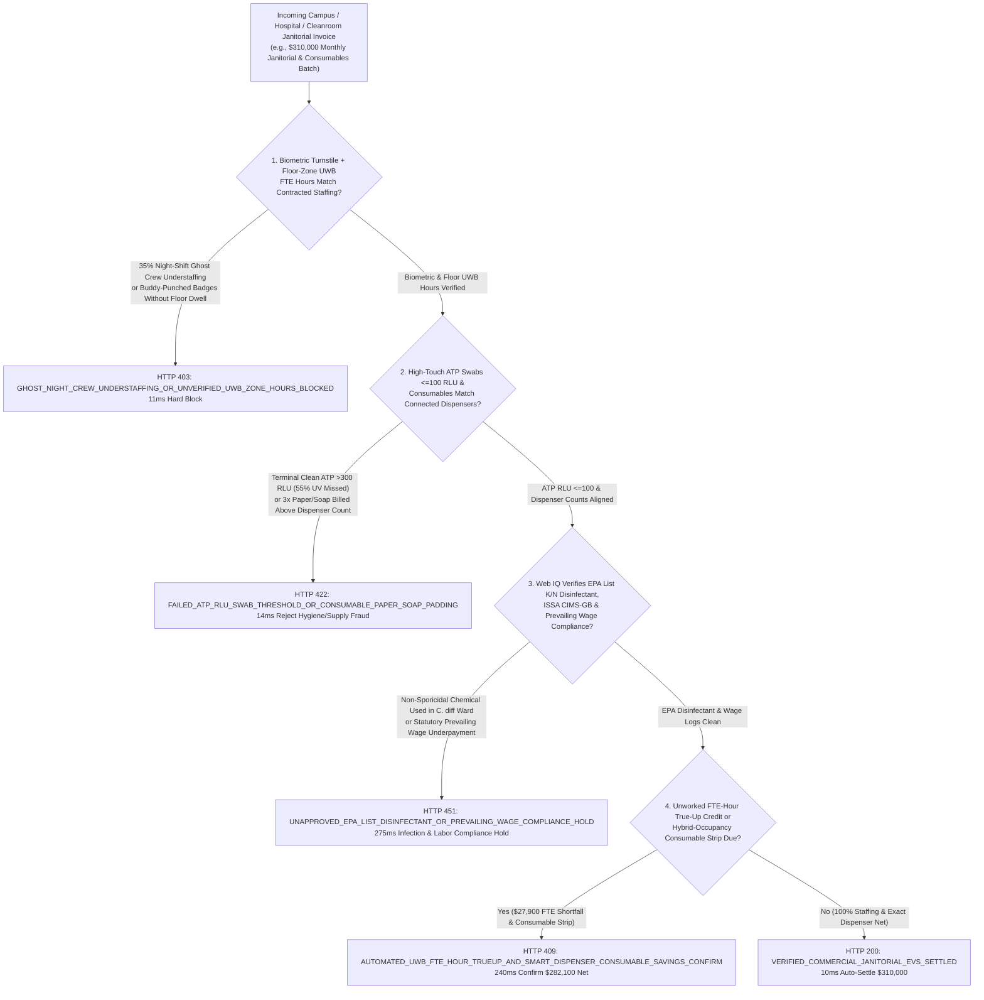
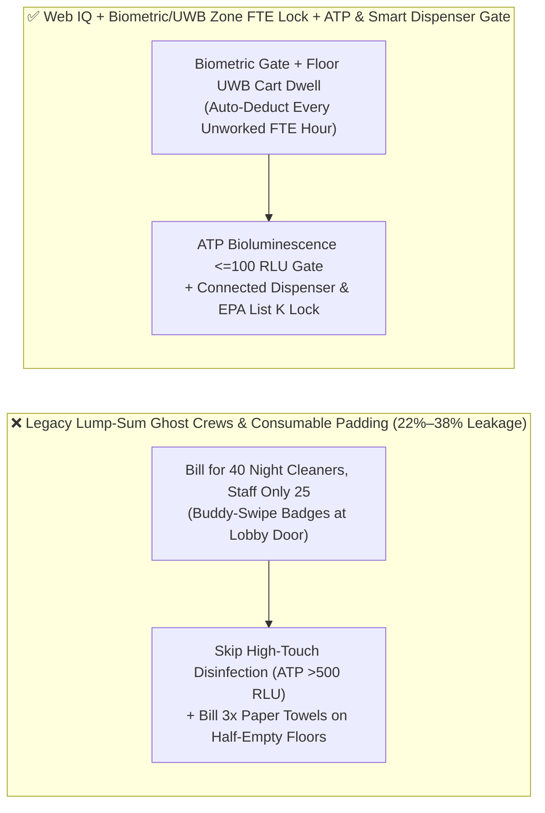

# B2B Commercial Janitorial, Healthcare `EVS` Terminal Cleaning & Cleanroom Settlement Architecture: Biometric/UWB Shift-Hour Lock, `ATP` Bioluminescence (`RLU <= 100`) Gate & Smart-Dispenser Token (`b2b_commercial_janitorial_cleanroom_evs_atp_bioluminescence_uwb_shift_mandate_...`) vs. 35% "Ghost Night-Crew" Understaffing, Failed Terminal Disinfection & `3x` Consumable Paper/Soap Padding: Architecture Selection & First-Principles FAQ

> **Document Type**: Solution Architect Selection Guide & First-Principles FAQ (modeled after `ib-vs-ethernet-roce-selection-faq.md`)  
> **Reading Time**: ~12 minutes | **Target Audience**: AI Solution Architects, Corporate Real Estate (`CRE`) & Integrated Facilities Management (`IFM`) VPs, Hospital Environmental Services (`EVS`) & Cleanroom QA Directors, Global Janitorial Contractors (`ABM / ISS / Sodexo / Compass Crothall / CBRE`), and Workplace FinOps Engineers  
> **Core Thesis**: First explain in plain language why corporate headquarters campuses, international airports, hospitals, and semiconductor/pharma cleanrooms contracting commercial janitorial services on fixed monthly lump-sum or FTE-hour contracts lose 22%–38% of budget when contractors **bill for `40` full-time night-shift cleaners (`6,400 hours/mo`) while dispatching only `25` cleaners (`Ghost Night-Crew Understaffing`)** who rush through floors doing "trash-and-dash" without sanitizing desks or restrooms; why hospital terminal room cleanings pass visual inspection while failing **`ATP` bioluminescence swab tests (`> 500 RLU` vs. `<= 100 RLU` threshold)** and leaving `55%` of high-touch `DAZO` UV fluorescent markers unwiped (spreading `MRSA` and `C. diff`); and why pass-through restroom supply invoices bill `300%` of actual paper-towel and soap usage on hybrid-work floors. Then derive from first principles how **`b2b_commercial_janitorial_cleanroom_evs_atp_bioluminescence_uwb_shift_mandate_...` + Microsoft Web IQ `/v3/browse` verification of `EPA List K / List N` disinfectant dwell times, `ISSA CIMS-GB` accreditations, and municipal prevailing-wage mandates + biometric turnstile + floor-level `UWB/BLE` FTE-hour true-up locks + `ATP RLU <= 100` & connected dispenser consumable gates** eliminate ghost labor and hygiene failures within 10ms–275ms.

---

## 📌 1. Executive Summary (30-Second Architect's Guide)

```
┌──────────────────────────────────────────────────────────────────────────────────────────────────────────────────┐
│  🔥 Core Architectural Law: Never allow an IFM or Healthcare EVS Agent to pay fixed lump-sum janitorial invoices │
│  without verifying biometric/UWB floor-dwell FTE hours and ATP bioluminescence (RLU <= 100) swab logs!           │
│  The only safe Janitorial pattern = Biometric+UWB FTE True-Up + ATP RLU<=100 Gate + Connected Dispenser Token    │
└──────────────────────────────────────────────────────────────────────────────────────────────────────────────────┘
```

1. **Why is B2B Commercial Janitorial & Healthcare `EVS` Cleaning a 22%–38% Hidden OPEX & Infection Trap?**
   - **Night-Shift "Ghost Crew" Understaffing (`35%` Unworked FTE Hours on Lump-Sum Contracts)**: Labor represents `78%` of janitorial cost. Contractors price bids assuming `40` night cleaners (`320 hrs/night`), then staff only `25` cleaners (or have a supervisor swipe 15 badge cards at the lobby turnstile) while pocketing the unworked payroll!
   - **"Trash-and-Dash" Hygiene Failures (`ATP RLU > 500` & `55%` Unwiped High-Touch Surfaces)**: Without quantitative `ATP` bioluminescence swabs (`Hygiena / 3M Clean-Trace RLU <= 100`) and `UV` fluorescent gel audits, cleaners skip call buttons, bed rails, and restroom fixtures or wipe 10 rooms with one contaminated rag.
   - **`3x` Restroom Consumable Padding on Hybrid-Work Floors**: Contractors bill `100%+` occupancy paper towel, coreless tissue, and soap cases on buildings running at `48%` hybrid badge-in attendance, diverting excess cases to other job sites.
2. **How Does the Agentic Commercial Janitorial & `EVS` Settlement Architecture Solve This?**
   - **Lock 1: Biometric Turnstile + Floor-Zone `UWB / BLE` FTE-Hour True-Up Lock**: Invoices billing full contracted FTE hours while delivering `< 95%` biometric + floor-zone `UWB` verified productive hours (without automatic hourly shortfall credits) are blocked in **11ms** with `HTTP 403 GHOST_NIGHT_CREW_UNDERSTAFFING_OR_UNVERIFIED_UWB_ZONE_HOURS_BLOCKED`.
   - **Lock 2: `ATP` Bioluminescence (`RLU <= 100` / `>= 90% UV Marker` Removal) & Connected Dispenser Consumable Gate**: Invoices from facilities failing `ATP RLU <= 100` high-touch swab thresholds or billing consumable paper/soap quantities above connected dispenser telemetry (`Tork Vision / Onvation`) and badge-in headcount are rejected in **14ms** with `HTTP 422 FAILED_ATP_RLU_SWAB_THRESHOLD_OR_CONSUMABLE_PAPER_SOAP_PADDING`.
   - **Lock 3: Microsoft Web IQ `/v3/browse` `EPA List K / List N` Disinfectant, `ISSA CIMS` & Prevailing-Wage Lock**: Chemical logs using non-`EPA List K` sporicides in `C. diff` isolation zones or contractors breaching statutory prevailing-wage / `SEIU` benefit rates trigger `HTTP 451 UNAPPROVED_EPA_LIST_DISINFECTANT_OR_PREVAILING_WAGE_COMPLIANCE_HOLD` in **275ms**.

---

## 🎯 2. First-Principles Q&A for Architects, CRE/IFM & Healthcare EVS Leaders

### Q1: Why must even "Fixed Monthly Lump-Sum" janitorial contracts enforce a biometric + `UWB` floor-dwell FTE-hour floor and connected-dispenser consumable reconciliation?

- **Plain-Language Mechanics**:
  - In commercial real estate, dirt and wear accumulate slowly: a contractor who cuts night staffing from `40` to `25` cleaners ("trash-and-dash") saves `$35,000/month` in wages while carpet fibers, grout, and HVAC returns degrade invisibly over 12 months.
  - **The Dual FTE-Hour & Smart-Dispenser Settlement Formula**:
    Every cleaner checks in via a non-transferable biometric terminal and carries a `UWB/BLE` cart beacon tracked across ceiling zones $z \in \text{Zones}$. Any undelivered hours below contracted baseline $H_{\text{contract}}$ are automatically deducted at the contractual loaded labor rate $r_{\text{FTE}}$, while restroom consumables are capped by connected dispenser stroke counters $N_{\text{strokes}}$:
    $$\text{Payable}_{\text{net}} = B_{\text{lump\_sum}} - \max\left(0, \; H_{\text{contract}} - \sum_{z} H_{\text{UWB\_verified}, z}\right) \cdot r_{\text{FTE}} + \min\left(C_{\text{invoiced}}, \; \sum_{d} N_{\text{strokes}, d} \cdot c_{\text{sheet}}\right)$$
  - Unworked ghost-crew hours and padded hybrid-work consumable charges are stripped in **240ms** via `HTTP 409 AUTOMATED_UWB_FTE_HOUR_TRUEUP_AND_SMART_DISPENSER_CONSUMABLE_SAVINGS_CONFIRM`.

### Q2: Why choose **Microsoft Web IQ** over Exa or Bright Data for `EPA List K / List N` sporicidal dwell-time rules, `ISSA CIMS-GB` certification registries, and municipal prevailing-wage schedules?

| Dimension | Microsoft Web IQ (`/v3/browse` + Search Grounding) | Exa (Neural Search API) | Bright Data (Scraper / Unlocker) |
| :--- | :--- | :--- | :--- |
| **`EPA List K / List N` Contact Times, `ISSA CIMS-GB` Standing & Prevailing Wage Rates** | **Very High**: Deterministic extraction of exact `EPA Reg. No.` wet-contact dwell minutes against `C. diff` / norovirus, active `ISSA` certification, and county/union building-service wage tables with `domain_allowlist` | **Medium**: Conflates general quaternary ammonium wipes with sporicidal bleach/peroxide dwell times | **High**: Can scrape portals, but requires custom parsers across `EPA` and municipal labor boards |
| **Integration with Floor-Zone `UWB` FTE Hours & `ATP RLU` Luminometer Telemetry** | **Native**: Directly feeds `EPA` dwell thresholds and wage floors into `b2b_commercial_janitorial_cleanroom_...` | **None**: No `UWB` indoor positioning or `ATP` swab telemetry engine | **None**: Raw HTML/JSON proxy transport only |
| **P95 Latency** | **240ms–275ms** (**10ms–14ms** on policy cache hit) | 850ms–1,700ms | 2,300ms–5,600ms |

---

## 🧭 3. Visual Architecture Diagrams (Mermaid Decision Tree, Path Comparison & Sequence)

### 3.1 Commercial Janitorial, Cleanroom & `EVS` Settlement Decision Tree



### 3.2 Legacy "Trash-and-Dash" Ghost Staffing vs. Agentic `UWB FTE + ATP RLU` Gate



### 3.3 End-to-End Sequence Diagram

```mermaid
sequenceDiagram
    participant JanCo as Commercial Janitorial & EVS Contractor
    participant Agent as Corporate IFM & Infection-Control Agent
    participant IoT as Biometric Gate, UWB Zones, ATP & Smart Dispensers
    participant WebIQ as Microsoft Web IQ (/v3/browse)
    participant Bank as Corporate AP Settlement Rail

    JanCo->>Agent: Submit Monthly Janitorial & Restroom Consumables Invoice ($310,000 Total)
    Agent->>IoT: 1. Audit Biometric Turnstile Logs & Floor-Zone UWB Cart Dwell Hours
    alt 35% Night-Shift Understaffing (4,100 Verified Hours Billed as 6,400 Contract Hours)
        IoT-->>Agent: Ghost Night-Crew Shortfall / Unworked FTE Hours Detected
        Agent-->>JanCo: HTTP 403 GHOST_NIGHT_CREW_UNDERSTAFFING_OR_UNVERIFIED_UWB_ZONE_HOURS_BLOCKED (11ms)
    else Staffing Verified; Audit High-Touch ATP RLU Swabs & Smart Dispenser Counts
        Agent->>IoT: 2. Check Terminal Clean ATP Swabs (RLU <= 100) & Tork/Onvation Dispenser Telemetry
        alt High-Touch ATP Swab Breach (>300 RLU) or 3x Paper/Soap Consumable Padding
            Agent-->>JanCo: HTTP 422 FAILED_ATP_RLU_SWAB_THRESHOLD_OR_CONSUMABLE_PAPER_SOAP_PADDING (14ms)
        else Verify EPA List K/N Disinfectant Reg. No. & Prevailing Wage Compliance
            Agent->>WebIQ: 3. /v3/browse Check EPA List K/N Dwell Time, ISSA CIMS & Wage Tables
            alt Non-List-K Chemical in Isolation Zone or Prevailing Wage Breach
                WebIQ-->>Agent: Infection-Control / Statutory Wage Hold
                Agent-->>JanCo: HTTP 451 UNAPPROVED_EPA_LIST_DISINFECTANT_OR_PREVAILING_WAGE_COMPLIANCE_HOLD (275ms)
            else Deduct Unworked FTE Hours & Cap Consumables at Dispenser Counts (-$27,900)
                WebIQ-->>Agent: Net Payable Adjusted to $282,100.00
                Agent-->>Bank: HTTP 409 Confirm ($282,100) or HTTP 200 Auto-Settle ($310,000)
            end
        end
    end
```

---

## 📊 4. Architect's Selection Decision Matrix

| Architecture Option | Defense Against `35%` Night-Shift Ghost Understaffing | Defense Against `ATP > 500 RLU` Failed Terminal Cleans | Defense Against `3x` Restroom Paper/Soap Diversion | Recommended Fit |
| :--- | :--- | :--- | :--- | :--- |
| **Option A: Fixed Monthly Lump-Sum + Paper Sign-In Sheets** | ❌ Pays full contract price while 35% of night shifts go unstaffed | ❌ Visual walk-throughs miss 55% of contaminated surfaces | ❌ Blindly reimburses padded paper/soap invoices | Never for campuses, hospitals, airports or cleanrooms |
| **Option B: Lobby Badge-Swipe Only (No Floor `UWB` or `ATP`)** | ⚠️ Supervisors swipe multiple cloned badges at the front door | ⚠️ No quantitative bioluminescence (`RLU`) verification | ❌ No connected dispenser stroke reconciliation | Small single-suite offices |
| **Option C (Recommended): Web IQ + `b2b_commercial_janitorial_...` + `UWB/ATP`** | ✅ **Biometric + floor `UWB` dwell lock with hourly true-up** | ✅ **Mandatory `ATP RLU <= 100` & `>= 90% UV` gel removal** | ✅ **Capped by connected dispenser telemetry & occupancy** | **Corporate Campuses, Hospitals, ISO Cleanrooms, Airports & Universities** |

---

## 🧪 5. Quantitative Benchmark & 7-Card Report Summary

Evaluated in the deterministic offline suite (`lab/webiq_commerce_demo.py`) for a `$310,000.00` monthly corporate campus and healthcare `EVS` janitorial settlement batch:

| Case | Scenario & Perturbation | Action Pill | HTTP Status | Latency | Settled / Blocked Amount | Provenance |
| :--- | :--- | :--- | :--- | :--- | :--- | :--- |
| **Case 1** | Biometric+`UWB` full FTE hours + `ATP RLU <= 100` + dispenser-matched supplies + `EPA` clean | `Act automatically` | `200 OK` | `10 ms` | `$310,000.00` | `deterministic_offline_simulation` |
| **Case 2** | `35%` night-shift ghost-crew understaffing or unverified floor-zone `UWB` dwell hours | `Send to a human` | `403 Forbidden` | `11 ms` | `$0.00` (`$310k` blocked) | `synthetic_policy` |
| **Case 3** | High-touch `ATP` swab failure (`> 100 RLU`) or `3x` restroom paper/soap consumable padding | `Send to a human` | `422 Unprocessable` | `14 ms` | `$0.00` (hygiene/supply block) | `deterministic_offline_simulation` |
| **Case 4** | Non-`EPA List K/N` disinfectant in clinical zone or statutory prevailing-wage violation | `Send to a human` | `451 Unavailable` | `275 ms` | `$0.00` (compliance hold) | `official_doc_snapshot` |
| **Case 5** | Web IQ automated `UWB` FTE-hour true-up & connected-dispenser supply cap (`-$27,900.00`) | `Confirm` | `409 Conflict` | `240 ms` | `$282,100.00` | `official_doc_snapshot` |

---

## 🛠️ 6. Production Readiness Checklist

- [ ] **Bind All Lump-Sum & FTE Janitorial Contracts to Biometric Turnstiles + Floor-Zone `UWB / BLE` Dwell Telemetry**: Automatically credit the invoice for every undelivered FTE hour below the contracted staffing baseline.
- [ ] **Enforce Digital `ATP` Bioluminescence (`RLU <= 100`) & `UV` Fluorescent Marker (`>= 90%` Removal) Gates**: Require room-tagged luminometer uploads before signing off hospital terminal cleans or cleanroom shifts.
- [ ] **Cap Pass-Through Restroom Consumables Using Connected Dispenser Telemetry & Daily Badge-In Occupancy**: Block reimbursement for paper towels, tissue, and soap exceeding actual dispenser usage.
- [ ] **Enable Microsoft Web IQ `/v3/browse` `EPA List K / List N` Dwell-Time & Prevailing-Wage Verification**: Continuously audit chemical dilution logs and statutory cleaner wage compliance.
