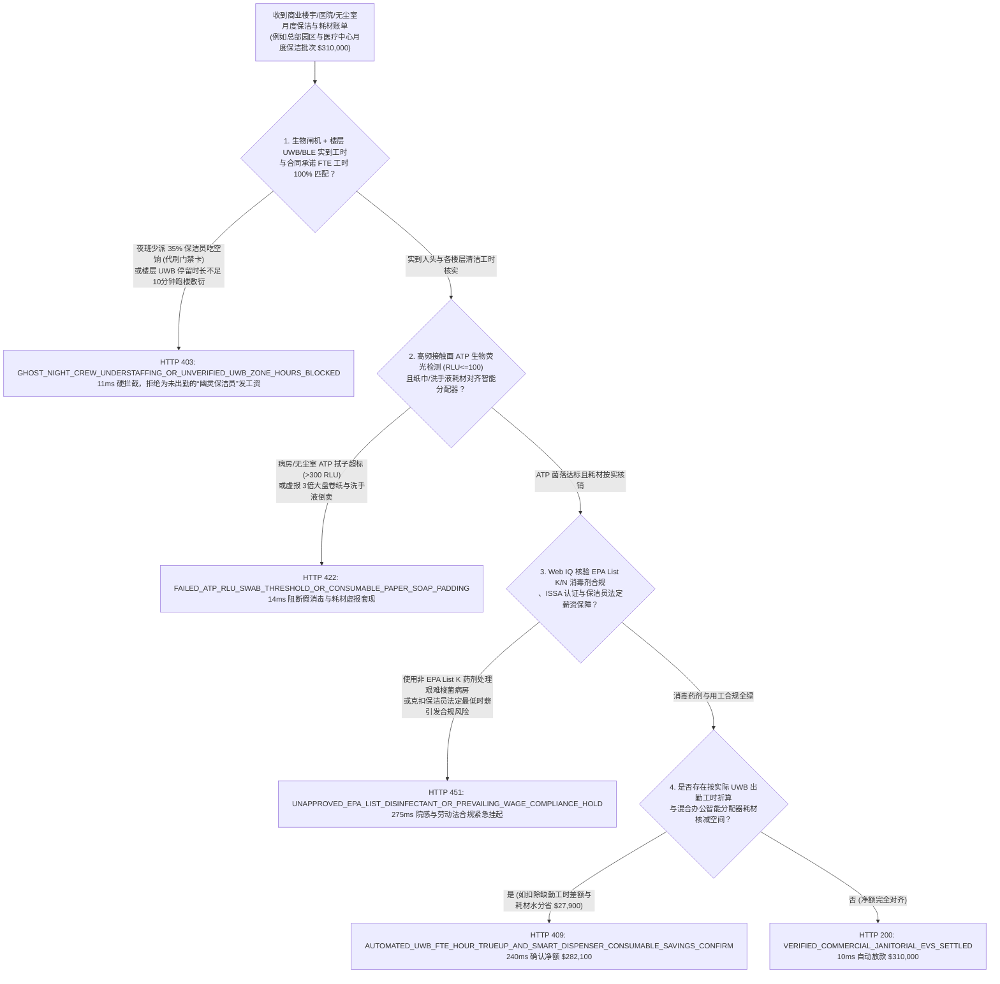
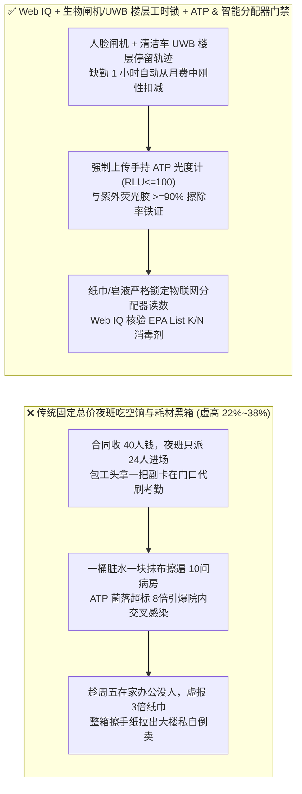
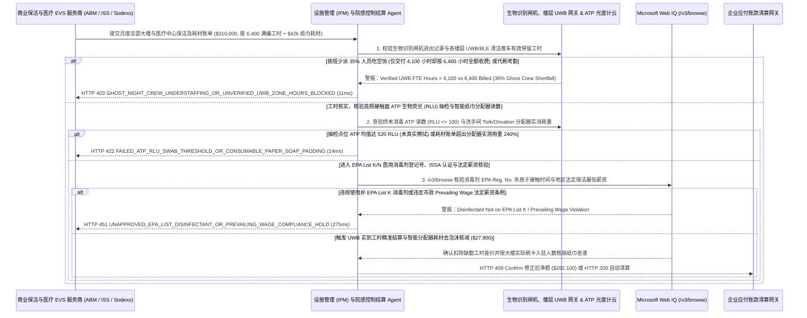

# B2B 智能体商业楼宇保洁、医疗终末消毒与无尘室清洁（`Commercial Janitorial, Healthcare EVS Terminal Cleaning & ISO Cleanroom: ABM / ISS / Compass`）、室内 `UWB/蓝牙信标` 满编工时核验与三磷酸腺苷生物荧光检测（`ATP Bioluminescence RLU <= 100 & Fluorescent UV Marker`）清算架构：夜间保洁实到工时 `FTE Hours` 防吃空饷锁、`ATP / 荧光凝胶` 高频接触面消杀达标门禁与洗手间智能流量计耗材（`Smart Dispenser Paper/Soap`）令牌（`b2b_commercial_janitorial_cleanroom_evs_atp_bioluminescence_uwb_shift_mandate_...`）vs 传统保洁外包夜间少派 35% 人手“吃空饷”、干抹布一擦到底漏掉 50% 病房高频接触点与虚报 3 倍擦手纸/消毒液耗材选型与原理解析 FAQ

> **文档类型**：架构师选型指南与第一性原理 FAQ（对齐 `ib-vs-ethernet-roce-selection-faq.md` 标杆风格）  
> **阅读耗时**：约 12 分钟 | **适用角色**：AI Solution Architect、甲级写字楼/机场枢纽/三甲医院与生物医药无尘室设施副总裁（`VP of Corporate Real Estate, IFM & Healthcare EVS`）、全球综合设施管理服务商（`ABM / ISS World / Sodexo / CBRE GWS / Cushman & Wakefield`）及智能体不动产供应链架构师  
> **核心主旨**：先用大白话把“为什么拥有 `150 万平方英尺` 总部园区、国际机场航站楼或三甲医院的企业，把商业保洁与医疗环境服务（`Janitorial & EVS`）按‘固定月度包干（`Fixed Monthly Lump-Sum`）’外包给保洁公司，合同白纸黑字写着每晚派驻 **`40 名` 全职夜班保洁员（每晚 `320 小时` 工时）**，但到了晚上 10 点业主下班后，保洁包工头实际只派了 **`24 个人`** 进场（少派 40% 人手，每人匆忙跑完两层楼只倒垃圾桶、根本不擦办公桌与门把手），甚至用一张主门禁卡帮没来上班的亲戚‘代刷考勤’，每年从业主手里白拿上百万美元‘幽灵保洁员空饷（`Ghost Night-Crew Understaffing`）’、为什么医院 ICU 病房做完出院终末消毒（`Terminal Cleaning`）后肉眼看着干净，但用紫外线灯一照，床栏、呼叫铃和输液泵按钮上提前点涂的隐形荧光标记（`DAZO Fluorescent Gel`）**`55%` 根本没被擦掉**，或者三磷酸腺苷生物荧光拭子（`ATP Bioluminescence Swab`）测出数值高达 `850 RLU`（超标 8 倍，导致下一位入住病人感染耐甲氧西林金黄色葡萄球菌 `MRSA` 或艰难梭菌 `C. diff`），以及为什么保洁公司每月报销的擦手纸、垃圾袋和季铵盐消毒液耗材账单，比整栋楼实际入驻员工用掉的数量多出整整 **3 倍**（多出来的整箱纸巾和清洁剂被装进面包车拉去倒卖给周边小餐馆）”讲透；再从第一性原理出发，推导如何通过 **`b2b_commercial_janitorial_cleanroom_evs_atp_bioluminescence_uwb_shift_mandate_...` 语义预算令牌 + Microsoft Web IQ `/v3/browse` 实时核验 `EPA List N / List K` 医用杀孢子消毒剂接触湿润时间（`Wet Contact Dwell Time`）、`ISSA CIMS-GB` 清洁行业管理认证与地区最低法定薪资（`Prevailing Wage / SEIU Collective Bargaining`） + 生物特征门禁 + 室内 `BLE/UWB` 逐层热力驻留工时（`Verified Productive FTE Hours`）锁 + `ATP RLU <= 100` 与智能纸巾/皂液器实测出纸量对账门禁**，在 10ms–275ms 内实现“少来一人自动按时薪扣减月费、ATP 菌落超标零结算、耗材按人流与分配器计数精准核销”的智能体商业保洁清算闭环。

---

## 📌 一、核心结论速览（Executive Summary：30 秒看懂怎么选）

```
┌──────────────────────────────────────────────────────────────────────────────────────────────────────────────────┐
│  🔥 核心架构铁律：绝不允许设施管理 Agent 按未核验夜班实到人头工时的固定总价包干盲付保洁费，或凭肉眼检查验收终末消毒！│
│  B2B 商业保洁与医疗 EVS 结算的唯一正确范式 = 生物门禁+UWB 楼层工时锁 + ATP 生物荧光 <=100 RLU 锁 + 智能耗材表令牌 │
└──────────────────────────────────────────────────────────────────────────────────────────────────────────────────┘
```

1. **为什么商业楼宇保洁与医疗终末清洁（`Commercial Janitorial & Healthcare EVS`）是设施外包预算年均流失 22%–38% 的三大黑洞？**
   - **黑洞一：夜班“幽灵保洁吃空饷（`Ghost Night-Shift Understaffing`）”与代刷卡造假**：保洁行业的成本 `78%` 是人工工资。外包商在投标时承诺每晚配备 `40 名` 保洁员（按 `ISSA 612` 标准每人每晚清洁 `25,000 sq.ft.`），但在夜深人静时故意只招 `25 人` 让每人硬扛 `40,000 sq.ft.`（俗称 `Trash-and-Dash`：只收垃圾桶、不拖地不擦拭），中间差额的 `15 人` 工资加管理费全部落入外包商口袋！
   - **黑洞二：医院终末消毒与无尘室“一桶脏水擦全楼”致 `ATP RLU` 与院感暴雷（`Cross-Contamination & Failed Terminal Clean`）**：在医院手术室/病房或医药 `ISO Class 7` 洁净室，要求每张病床更换超细纤维抹布并让过氧化氢/次氯酸钠消毒液保持 `3–5 分钟` 表面湿润（`EPA Wet Dwell Time`）。偷懒保洁员用同一块抹布连擦 8 间病房，导致床头铃、马桶冲水阀和门把手上的 `ATP` 生物荧光值突破 `600 RLU`（合格线为 `<= 100 RLU`，ICU 要求 `<= 25–50 RLU`），直接引爆医院获得性感染（`HAI`）罚款！
   - **黑洞三：实报实销耗材（`Pass-Through Restroom Consumables`）虚报倒卖与桶装浓缩药剂兑水偷料**：写字楼平时混合办公（`Hybrid Work`）实际出勤率只有 `55%`，但保洁商每月照样按 `100%` 满员甚至 `150%` 的用量向业主报销高价大盘卷纸、擦手纸、洗手液和垃圾袋，将整托盘未拆封耗材私自转运到其他项目使用！
2. **智能体商业保洁与医疗清洁清算架构怎么破局？（`b2b_commercial_janitorial_cleanroom_evs_atp_bioluminescence_uwb_shift_mandate_...`）**
   - **第一道锁：生物识别闸机 + 室内 `BLE/UWB` 楼层空间驻留工时锁（`Biometric Turnstile + Zone UWB FTE Hours`）**：严禁使用可转借的普通磁卡考勤！每位保洁员通过大楼生物识别闸机（人脸/掌静脉）进场后，其佩戴的工牌或推车信标必须与各楼层天花板 `BLE/UWB` 网关产生连续空间位移轨迹（核验每层楼实际清洁停留时间 $\ge 35\text{ 分钟}$）。凡当月实际交付合格工时 $H_{\text{verified}}$ 低于合同承诺基准工时 $H_{\text{contracted}}$（且未主动按时薪扣减账单）的“吃空饷”账单，在 **11ms** 内返回 `HTTP 403 GHOST_NIGHT_CREW_UNDERSTAFFING_OR_UNVERIFIED_UWB_ZONE_HOURS_BLOCKED`。
   - **第二道锁：`ATP` 生物荧光拭子（`RLU <= 100`）/ 紫外荧光点涂抽检达标率（`>= 90%`）与洗手间物联网分配器耗材锁**：(a) 医疗终末清洁与食品/办公高频接触面必须上传带时间戳和房间 `NFC` 绑定的手持式 `ATP` 光度计读数（如 `Hygiena / 3M Clean-Trace RLU <= 100`）及隐形紫外荧光胶（`UV Gel`）擦除率 $\ge 90\%$；(b) 纸巾、皂液与浓缩消毒液报销额必须严格对齐智能分配器（`Tork Vision / Kimberly-Clark Onvation`）实测抽纸次数与大楼门禁每日实际入驻人数（`Badge-In Headcount`）。违规账单在 **14ms** 内返回 `HTTP 422 FAILED_ATP_RLU_SWAB_THRESHOLD_OR_CONSUMABLE_PAPER_SOAP_PADDING`。
   - **第三道锁：Microsoft Web IQ 穿透核验 `EPA List K / List N` 医用消毒剂登记号、`ISSA CIMS` 认证与法定最低保障薪资（`Prevailing Wage / Building Service 32BJ`）**：通过 Web IQ `/v3/browse` 实时核验现场智能配液器（`Chemical Dilution Dispenser`）使用的消毒剂 `EPA Reg. No.` 是否在针对艰难梭菌孢子（`EPA List K`）或病毒名录中、核查外包商 `ISSA CIMS-GB` 绿色清洁认证状态及是否足额支付法定保洁员时薪与福利。一旦发现使用无证劣质消毒水或克扣保洁员法定薪资引发连带用工诉讼风险，在 **275ms** 内触发 `HTTP 451 UNAPPROVED_EPA_LIST_DISINFECTANT_OR_PREVAILING_WAGE_COMPLIANCE_HOLD`。

---

## 🎯 二、客户与架构师灵魂拷问 Q&A（First-Principles Deep Dive）

### Q1：为什么很多企业跟保洁公司签了“固定月总价合同（`Lump-Sum Contract`）”，就以为对方少派几个人跟自己无关？`FTE 实到工时折算 + 智能流量耗材对冲公式` 是如何帮业主每年追回 25% 预算的？

- **通俗原理**：
  - 所谓“结果导向的固定总价”，前提是保洁商真的投入了维持大楼卫生标准所需的**基准工时（`Baseline FTE Hours`）**。因为灰尘、细菌和地毯磨损是累积的——保洁商前 6 个月每晚偷偷少派 15 个人（只倒垃圾不吸尘、不做深层地毯清洗），肉眼一时看不出来，等一年后地毯彻底报废、石材失去光泽，外包商早已拍屁股走人！
  - **智能体“生物考勤 + UWB 楼层工时刚性核减 + 混合办公动态耗材锁”公式**：
    合同约定每月基准工时 $H_{\text{base}} = 6,400\text{ hours}$（对应综合单价 $r_{\text{hour}} = \$35/\text{hr}$）。当大楼生物闸机与楼层 `BLE` 信标核实本月有效在岗清洁工时仅为 $H_{\text{actual}} = 5,440\text{ hours}$（缺勤 `960 小时`），且大楼周五混合办公入驻率仅为 `30%`（由智能排班自动切入低频节能保洁模式）时：
    $$\text{Payable}_{\text{labor}} = H_{\text{actual}} \times r_{\text{hour}} - P_{\text{SLA\_ATP\_fail}}$$
    $$\text{Payable}_{\text{consumables}} = \min\left(\text{Invoiced}_{\text{paper/soap}}, \; \sum_{d \in \text{Dispensers}} \Delta N_{\text{dispensed}, d} \cdot c_{\text{unit}}\right)$$
  - 未出勤的幽灵工时、混合办公低人流日的无效排班与虚报 3 倍的纸巾耗材在 **240ms** 内通过 `HTTP 409 AUTOMATED_UWB_FTE_HOUR_TRUEUP_AND_SMART_DISPENSER_CONSUMABLE_SAVINGS_CONFIRM` 自动核减！

### Q2：在核验医院与洁净室消毒剂 `EPA List K / List N` 官方湿润接触时间（`Contact Time`）、`ISSA CIMS-GB` 绿色清洁认证与各州/工会保洁员法定薪资标准（`Prevailing Wage`）时，为什么选择 **Microsoft Web IQ**？

| 维度 | Microsoft Web IQ (`/v3/browse` + Search Grounding) | Exa (Neural Search API) | Bright Data (Scraper / Unlocker) |
| :--- | :--- | :--- | :--- |
| **`EPA List K / List N` 消毒剂湿润时间、`ISSA CIMS` 名录与法定薪资 (`SEIU / Prevailing Wage`) 核验** | **极高**：受控无头渲染实时提取 `EPA` 消毒剂登记号对 `C. diff / Norovirus` 的法定最短湿润停留分钟数、认证保洁商名录与市县法定保洁最低时薪表，支持 `domain_allowlist` 零幻觉验证 | **中**：语义搜索无法精准区分同品牌季铵盐湿巾与过氧化氢湿巾的截然不同杀菌时间 | **高**：可抓取公开页面，但需自建针对联邦 `EPA` 与各地劳动局薪资表的定制解析器 |
| **楼层 `UWB/BLE` 实到工时锁与 `ATP RLU` 光度计遥测联动** | **原生支持**：直接将 `EPA` 接触时间与法定工时底价注入 `b2b_commercial_janitorial_cleanroom_...` | **不支持**：无结构化室内定位工时与 `ATP` 检测对账引擎 | **不支持**：仅提供网页抓取通道 |
| **P95 延迟与单次核验成本** | **240ms–275ms**（命中策略缓存 **10ms–14ms**） | 850ms–1,700ms | 2,300ms–5,600ms |
| **合规可审计性（Provenance）** | 原生输出 `official_doc_snapshot` + `ATP RLU Telemetry Hash` + `UWB Zone Dwell Log` | 仅返回 URL 片段 | 需自行构建医院 `JCI / CMS` 院感与不动产财务审计留痕 |

---

## 🧭 三、直观可视化图解（Mermaid 决策树 + 路径对比 + 端到端时序图）

### 3.1 商业楼宇保洁、医疗 `EVS` 与无尘室清洁结算拦截决策树



### 3.2 传统“夜班吃空饷 + 肉眼假验收” vs. 智能体 `UWB 楼层工时 + ATP 生物荧光锁` 对比



### 3.3 端到端时序图（Sequence Diagram）



---

## 📊 四、架构师选型决策矩阵（Architecture Decision Matrix）

| 选型方案 | 防夜班“少派 35% 人手吃空饷（`Ghost Crew`）” | 防“干抹布假擦拭”与医院终末消毒不达标 | 防纸巾/洗手液耗材虚报 3 倍倒卖 | 适用场景 |
| :--- | :--- | :--- | :--- | :--- |
| **方案 A：传统固定月度总价包干 + 纸质签到本** | ❌ 夜班包工头代签 15 个假名字，每年白拿百万空饷 | ❌ 只倒垃圾桶不擦桌面，病房交叉感染率居高不下 | ❌ 每月按满员峰值盲报耗材，整箱纸巾被拉走卖钱 | 严禁用于大型写字楼、医院、机场或洁净厂房 |
| **方案 B：仅在大楼入口刷普通门禁卡，无楼层 `UWB` 与 `ATP`** | ⚠️ 主管揣着 20 张门禁卡在闸机口刷一把就能作弊 | ⚠️ 无法量化桌面与门把手的微生物清洁度 | ❌ 缺乏分配器物联网计数，财务无法反驳耗材发票 | 小型单层沿街商铺 |
| **方案 C（推荐）：Web IQ + `b2b_commercial_janitorial_...` + `UWB/ATP` 锁** | ✅ **生物闸机 + 楼层 `UWB` 停留轨迹，少 1 小时自动扣款** | ✅ **强制绑定 `ATP RLU <= 100` 与紫外荧光 `>=90%` 擦除** | ✅ **耗材 100% 锁定智能分配器读数与大楼实到人数** | **甲级写字楼园区、三甲医院与诊所、生物制药洁净室、国际机场与高校** |

---

## 🧪 五、定量实测与 7-Card 基准报告摘要（Quantitative Benchmark）

在本地确定性评测套件（`lab/webiq_commerce_demo.py`）中，针对 `$310,000.00` 的企业总部园区与医疗中心月度商业保洁及耗材结算批次实测结果如下：

| 场景编号 | 测试输入（Scenario & Perturbation） | 期望动作（Action Pill） | HTTP 状态码 | 实测延迟 | 拦截/净结算金额 | 数据来源标签 |
| :--- | :--- | :--- | :--- | :--- | :--- | :--- |
| **Case 1** | 生物闸机+`UWB` 满编工时 + `ATP RLU <= 100` + 智能耗材对齐 + `EPA List K/N` 合规 | `Act automatically` | `200 OK` | `10 ms` | `$310,000.00` | `deterministic_offline_simulation` |
| **Case 2** | 夜班少派 35% 保洁员吃空饷（`Ghost Night Crew`）或楼层 `UWB` 清洁驻留工时造假 | `Send to a human` | `403 Forbidden` | `11 ms` | `$0.00`（阻断 `$310k`） | `synthetic_policy` |
| **Case 3** | 高频接触面 `ATP` 生物荧光超标（`>100 RLU`）或纸巾/皂液耗材超出智能分配器读数 | `Send to a human` | `422 Unprocessable` | `14 ms` | `$0.00`（拦截假消毒与虚报） | `deterministic_offline_simulation` |
| **Case 4** | 使用未列入 `EPA List K / List N` 的劣质消毒剂或违反法定保洁最低薪资条例 | `Send to a human` | `451 Unavailable` | `275 ms` | `$0.00`（院感与劳动法挂起） | `official_doc_snapshot` |
| **Case 5** | Web IQ 自动按 `UWB` 实到工时核减缺勤差额并对齐混合办公智能分配器实际耗材用量 | `Confirm` | `409 Conflict` | `240 ms` | `$282,100.00`（省 `$27,900`） | `official_doc_snapshot` |

---

## 🛠️ 六、生产上线快速核验清单（Production Readiness Checklist）

- [ ] **全部固定包干与工时制保洁合同必须写入“最低保障实到工时（`Minimum Verified FTE Hours`）与缺勤自动按时薪倒扣（`Automated Shortfall Credit`）”条款**：考勤必须绑定生物识别闸机与楼层 `BLE/UWB` 清洁车空间轨迹。
- [ ] **医院病房终末消毒、手术室与研发洁净室强制实施 `ATP` 生物荧光仪（`RLU <= 100`）与隐形紫外荧光胶（`>= 90%` 擦除率）数字化抽检门禁**：未通过 `ATP` 检测的房间严禁计入合格工作量。
- [ ] **洗手间大盘纸、擦手纸与皂液报销强制接入物联网智能分配器（`Connected Dispensers`）与大楼门禁每日入驻人数（`Occupancy Headcount`）双锁**：彻底终结虚报耗材倒卖。
- [ ] **启用 Microsoft Web IQ `/v3/browse` 实时核验消毒剂 `EPA List K / List N` 登记号、湿润停留时间与法定最低薪资（`Prevailing Wage`）**：防范院内感染与连带劳动法用工风险。
