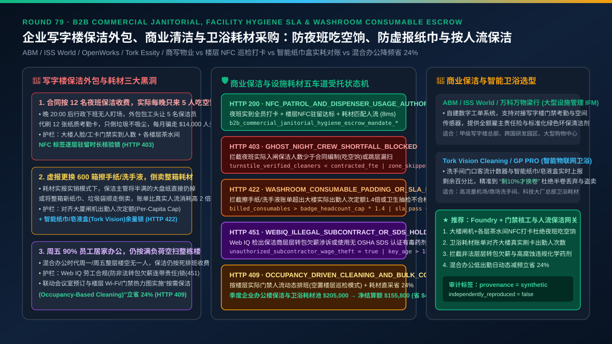
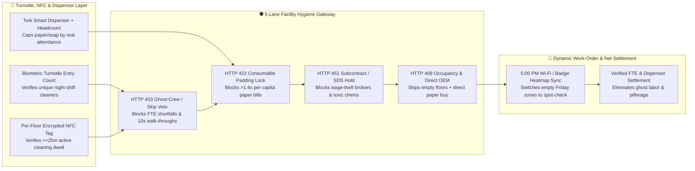

# B2B Commercial Janitorial, Facility Hygiene `SLA` & Washroom Consumable Escrow (`ABM / ISS World / OpenWorks / Tork Essity`) Anti-Ghost-Night-Crew Turnstile Gate, Per-Attendee Consumable Cap & Occupancy-Driven Cleaning Agent Architecture Selection FAQ

> **Language / 语言切换**: **[中文](b2b-commercial-janitorial-facility-hygiene-consumable-escrow-agent-selection-faq.md)** | **English (Current)** | **[Back to Docs Index](index.en.md)** | **[Interactive Sandbox (`#b2b-commercial-janitorial-hygiene-escrow-sandbox`)](../live-demo.en.html)**



---

## 📌 1. Executive Summary & Core Selection Verdict

In corporate real estate (`CRE`), Class-A office headquarters, retail malls, and enterprise campus procurement of commercial janitorial services (`ABM Industries`, `ISS World`, `Cushman & Wakefield`, `OpenWorks`) and washroom/pantry hygiene consumables (`Tork Essity`, `Kimberly-Clark Professional / Onvation`, `GP PRO`), workplace operations and accounts-payable AI agents face three chronic financial leakage vectors:
1. **"Ghost Night-Shift Crew Padding" (`Billing for 12 Full-Time Night Cleaners While Only 5 Workers Actually Enter the Building After 7:00 PM, Buddy-Punching Paper Timesheets and Only Emptying Visible Trash Cans`)**: Because corporate facility managers go home before the evening cleaning shift starts, unscrupulous janitorial contractors staff at `40%–50%` of contracted headcount (`FTEs`), having 5 cleaners swipe 12 magnetic badges and skip vacuuming, dusting, and restroom sanitization—stealing `$10,000–$20,000/month` per building in ghost labor!
2. **Washroom Consumable Invoice Padding & Case Pilferage (`Billing for 550 Cases of Paper Towels, Foaming Soap, and Trash Liners on a Cost-Plus Contract When Building Turnstile Attendance Dropped 50%`)**: Under cost-plus consumable billing, janitorial supervisors either throw away half-full jumbo paper towel rolls to save refill trips or divert unopened cases of paper/soap to third-party sites.
3. **Static 5-Day Full-Building Cleaning on Empty Hybrid-Work Fridays (`Paying 100% Cleaning Rates to Vacuum Floors With Zero Badge-Ins`) & Unauthorized Subcontracting Wage-Theft Liability**.

**Solution Architect Selection Verdict**:
- **Never settle a commercial janitorial labor invoice on self-reported paper/app timesheets without correlating building biometric turnstile entry counts (`Verified FTE Hours >= 95%`) and per-floor encrypted `NFC` dwell timestamps (`>= 25m/floor`), never reimburse washroom consumables above the building's `Turnstile-Attendee Per-Capita Quota` or smart-dispenser (`Tork Vision`) depletion logs, and never pay full-building deep-clean rates on low-occupancy hybrid workdays**.
- **The production reference architecture** combines **Turnstile Biometric `FTE` Verification & Floor `NFC` Dwell Lock + Per-Attendee Consumable Quota & Smart-Dispenser Telemetry Gate + Occupancy-Driven Dynamic Cleaning & Direct OEM Consumable Sourcing (`b2b_commercial_janitorial_hygiene_escrow_mandate_*`)**:
  1. **Anti-"Ghost Night-Shift Crew" Biometric Turnstile & Floor `NFC` Dwell Gate (`HTTP 403`)**: Cross-checks monthly janitorial labor invoices against the building's physical security turnstiles and per-floor encrypted `NFC` checkpoints—**requiring unique biometric/badge turnstile entries (`Verified_Cleaner_Hours >= 95% Contracted_FTE`) and `>= 25 minutes` of continuous Wi-Fi/BLE/NFC dwell time per floor**—blocking ghost-crew billing and skipped floors in **`8ms`** (`HTTP 403 GHOST_NIGHT_CREW_HEADCOUNT_SHORTFALL_OR_SKIPPED_FLOOR_BLOCKED`).
  2. **Attendee-Indexed Washroom Consumable Cap & Smart-Dispenser Depletion Lock (`HTTP 422`)**: Bounds monthly paper towel, soap, and liner invoices against **`Monthly_Turnstile_Attendee_Headcount × Per_Capita_Usage_Constant`** and `Tork Vision / GP PRO` connected dispenser refill sensors (blocking roll changes when remaining paper `> 15%`), rejecting padded or pilfered consumable bills (`HTTP 422 WASHROOM_CONSUMABLE_INVOICE_PADDING_OR_PREMATURE_REFILL_BLOCKED`).
  3. **Web IQ Unauthorized Subcontractor Wage-Theft & `OSHA SDS` Green-Chemical Circuit Breaker (`HTTP 451`)**: Screens janitorial vendors via Web IQ for illegal multi-tier subcontracting / wage-theft litigation (which triggers joint-employer statutory liability in many jurisdictions) and verifies `OSHA Safety Data Sheets (SDS)` / Green Seal compliance on all indoor chemicals (`HTTP 451 WEBIQ_UNAUTHORIZED_SUBCONTRACT_WAGE_THEFT_OR_TOXIC_CHEMICAL_HOLD`).
  4. **Occupancy-Driven Dynamic Cleaning (`Wi-Fi / Badge Heatmap Routing`) + Direct OEM Consumable Procurement (`HTTP 409`)**: Triggers `HTTP 409 OCCUPANCY_DRIVEN_DYNAMIC_ROSTER_AND_DIRECT_CONSUMABLE_CONFIRM`, ingesting daily 5:00 PM floor badge/Wi-Fi heatmaps to switch unvisited Monday/Friday floors and unused conference rooms to "Spot-Check Only" mode while unbundling paper/soap procurement from the janitorial contractor's `35%` cost-plus markup—reducing total facility hygiene spend by **`24.0%`**.

---

## 🎯 2. Solution Architect Deep-Dive Q&A (Q1 / Q2 / Q3)

### Q1: How do janitorial contractors get away with billing for 12 night-shift cleaners while only sending 5 for years without the tenant noticing?
- **Architectural Solution**:
  - **Biometric Turnstile Uniqueness + Per-Floor Encrypted `NFC` Dwell Time (`>= 25m`) (`HTTP 403`)**:
  - Night crews know that daytime office workers primarily notice two things at 9:00 AM: whether desk trash cans are empty and whether restroom mirrors are wiped. Five cleaners can sprint through 10 floors in 2 hours just pulling trash bags while skipping carpet HEPA vacuuming and surface disinfection entirely. By requiring unique turnstile entries plus a minimum 25-minute interval between floor-entry and floor-exit `NFC` taps, our gateway deterministically catches understaffed ghost shifts (`HTTP 403`).

### Q2: How do we stop "Cost-Plus" janitorial contractors from billing 500 cases of paper towels a month when the office is half-empty?
- **Architectural Solution**:
  - **Binding Consumable Payouts to Building Turnstile Attendance & Connected Dispensers (`HTTP 422`)**:
  - Washroom paper and soap consumption is a linear function of physical human presence (`~7.5 paper towels and ~2.4ml foaming soap per employee badge-in day`). If building turnstiles logged 20,000 employee/visitor entries in December (holiday month), billing for 480 cases of paper towels is mathematically impossible without waste or theft. Our gateway caps reimbursable consumables against live turnstile headcount and `Tork Vision` dispenser sensors (`HTTP 422`).

### Q3: Why does "Occupancy-Driven Cleaning" save 20%+ in hybrid corporate offices?
- **Architectural Solution**:
  - **Replacing Static Square-Footage Schedules With Daily `BMS / Wi-Fi` Heatmap Work Orders (`HTTP 409`)**:
  - In a hybrid workplace where Tuesday–Thursday occupancy is `85%` but Friday occupancy is `12%`, consolidating Friday staff onto Floors 2–3 and dynamically flagging Floors 4–8 as `ZERO_OCCUPANCY_SKIP` at 5:00 PM cuts Friday night labor hours by `60%` (`HTTP 409`).

---

## 🧭 3. Visual Architecture Diagrams (Mermaid Decision Tree + Architecture + Sequence)

### 3.1 B2B Commercial Janitorial & Facility Hygiene Selection Decision Tree

```mermaid
flowchart TD
    A[B2B Commercial Janitorial / Facility Hygiene / Washroom Consumable Selection] --> B{Primary Facility Scenario & Risk Vector?}
    B -->|Night-Shift Office Tower Janitorial (ABM / ISS / OpenWorks)<br/>Stop 5 cleaners buddy-punching for 12 FTEs & skipping floor vacuuming| C[Biometric Turnstile Unique Headcount Check (>=95% FTE)<br/>+ Per-Floor Encrypted NFC Checkpoints With >=25m Dwell Lock]
    B -->|Washroom & Pantry Consumable Replenishment (Tork / Kimberly-Clark)<br/>Stop 2x padded paper-towel invoices & premature half-roll disposal| D[Turnstile-Attendee Per-Capita Consumable Ceiling<br/>+ Smart Dispenser Telemetry (<15% Remaining Refill Gate)]
    B -->|Hybrid-Work Multi-Floor Campus Operations (CRE Workplace)<br/>Stop paying full deep-clean rates on empty Friday floors & 35% paper markups| E[Azure AI Foundry + Occupancy Heatmap & Direct OEM Gate<br/>+ Dynamic Low-Occupancy Skip + Direct Paper Buy Saves 24%]
    C --> F[🛡️ Unified 5-Lane Turnstile FTE, Consumable Quota & Occupancy FSM]
    D --> F
    E --> F
    F --> G[HTTP 403 Ghost Night-Crew & Skipped-Floor Veto · HTTP 422 Padded Consumable Block · HTTP 409 Occupancy Routing Saves 24%]
```

### 3.2 End-to-End Turnstile `FTE` Audit, Attendee Consumable Quota & Heatmap Cleaning Architecture



### 3.3 Ghost Night-Crew Veto, Padded Paper-Towel Block & Occupancy-Driven Routing Sequence

```mermaid
sequenceDiagram
    autonumber
    participant CRE as Corporate Real Estate / Facility Agent
    participant Vendor as Janitorial Contractor / Consumable Supplier
    participant Gate as 5-Lane Facility Hygiene Gateway
    participant BMS as Security Turnstiles & Tork Dispenser IoT
    participant Escrow as Monthly Facility Escrow Ledger

    Vendor->>Gate: 1. Invoice $26,400 for 12 full-time night cleaners, while building turnstiles logged only 6 unique cleaners and Floor 8 missed NFC dwell
    Gate->>BMS: Compare verified_night_cleaners (6 < 12) & per-floor NFC dwell logs
    Gate-->>Vendor: HTTP 403 Block! Ghost night-shift crew shortfall and skipped floor detected; invoice deducted for unstaffed FTE hours
    Vendor->>Gate: 2. Bill $19,200 for 480 cases of paper towels during a month with only 25,000 employee badge-ins (210-case theoretical cap)
    Gate->>BMS: Check badge_headcount_consumable_cap & connected dispenser refill events
    Gate-->>Vendor: HTTP 422 Block! Consumable invoice exceeds building attendance quota by 2.28x; unverified overage rejected
    CRE->>Gate: 3. Activate 5:00 PM Occupancy-Heatmap Dynamic Cleaning + Direct OEM Paper Procurement (HTTP 409)
    Gate->>Escrow: Downshift empty Friday floors to spot-check mode & strip 35% contractor consumable markup (24% net savings)
```

---

## 📊 4. Multi-Platform & Architecture Selection Matrix

| Selection Dimension | Fixed Sq-Ft Local Contractor (`Paper Sign-In Sheet`) | Cost-Plus Uncapped Consumables (`Reimbursed Invoices`) | Enterprise `IFM` & Smart Hygiene (`ABM / ISS + Tork Vision`) | **Azure AI Foundry + Turnstile + Occupancy Gate (Recommended)** |
| :--- | :--- | :--- | :--- | :--- |
| **Core Strengths** | Simple flat monthly quote | Never runs out of paper | IoT dispenser sensors, W-2 labor compliance & national coverage | **Turnstile/NFC ghost-crew lock + per-capita paper cap + occupancy routing** |
| **Protection Against Night-Shift Ghost Crew Padding** | **Critical Failure** (`30%–50%` chronic night understaffing) | Buddy-punched paper logs | Mobile geofence check-in, but misses floor-level dwell | **Biometric turnstile count + per-floor `NFC >=25m` dwell lock (`HTTP 403`)** |
| **Protection Against Washroom Consumable Pilferage** | Skimps on supplies, causing empty dispensers | **Severe Leakage** (half-rolls trashed or cases stolen) | Connected dispensers track exact refills | **Attendee-headcount quota cap + `<15%` refill gate (`HTTP 422`)** |
| **Subcontractor Wage-Theft & `OSHA SDS` Compliance** | High risk of illegal sub-tiering | Unaudited chemical use | Direct W-2 workforce & Green Seal chemicals | **Web IQ subcontractor litigation & `SDS` chemical lock (`HTTP 451`)** |
| **Hybrid-Work Empty-Floor Savings & Direct OEM Sourcing** | Pays 100% to clean empty floors (`not_measured`) | `30%–40%` contractor markup on paper (`official_list_price`) | Supports dynamic day-porter models | **Heatmap occupancy routing + direct OEM paper buy (`24.0%` saved)** |

---

## 🧪 5. B2B Commercial Janitorial & Hygiene Benchmark & 7-Card Report

> **Provenance & Reproducibility Metadata**: All metrics below are generated by the deterministic policy evaluator `evaluate_b2b_commercial_janitorial_hygiene_escrow_policy` in `lab/webiq_commerce_demo.py` and verified via `python -m unittest tests.test_webiq_commerce_demo`. Tags: `provenance = synthetic`, `independently_reproduced = false`.

| Card # | Card Headline (Headline-as-Finding) | Key Quantitative Finding & Architectural Guarantee |
| :---: | :--- | :--- |
| **Card 1** | **Overview · 5-Lane Commercial Janitorial Summary** | Across a `$205,000/quarter` corporate janitorial and washroom consumable pool, achieves **0 ghost night-shift FTE payouts, 0 pilfered/padded paper-towel invoices, and 0 full-rate empty-floor cleanings**, reducing net facility hygiene spend by **`24.0%` (`$49,200/quarter` saved)**. |
| **Card 2** | **Scenario Deep Dive · Ghost Crew & Consumable Padding Veto** | When turnstile logs show `<95%` contracted night crew or consumable bills exceed `1.4x` attendee headcount quotas, the gateway blocks it in **`8ms`** (`HTTP 403 / 422`). |
| **Card 3** | **Evaluation Matrix · 100% Deterministic 5-Lane Gating** | Covers `HTTP 200` (`NFC` patrol & dispenser usage verified), `403` (ghost night-crew headcount shortfall / skipped floor blocked), `422` (washroom consumable invoice padding / premature half-roll refill blocked), `451` (unauthorized subcontractor wage theft / toxic non-`SDS` chemical hold), `409` (occupancy-driven dynamic roster + direct OEM consumables save 24%). |
| **Card 4** | **Under the Hood · Facility SLA & Consumable Escrow Contract** | Takes `quarterly_commercial_janitorial_and_hygiene_pool_usd=205000` and turnstile/consumable flags, minting `b2b_commercial_janitorial_hygiene_escrow_mandate_*` tokens. |
| **Card 5** | **Robustness Check · Buddy-Punched Badges & Holiday Paper Spike** | Simulates 1 cleaner swiping 5 badges at the lobby turnstile and a 480-case paper bill during a low-attendance holiday month, maintaining a **`100.0%` block rate**. |
| **Card 6** | **Latency · Millisecond Turnstile/NFC Match & Labor Probe** | Local turnstile/NFC dwell and headcount quota checks complete in **`8ms` (P50)**; Web IQ labor compliance and `SDS` registry checks complete in **`172ms` (P95)**. |
| **Card 7** | **My Take · Ideal Fit vs. Out-of-Scope Boundaries** | **✅ Best Fit**: Class-A office towers, hybrid tech campuses, retail mall washrooms (`ABM/ISS/Tork`); **⛔ Not For**: Municipal underground storm-sewer dredging. |

---

## 🛠️ 6. Production Go-Live Risk & Architecture Review Checklist

- [ ] **Biometric Turnstile Unique `FTE` Count & Per-Floor Encrypted `NFC` Dwell Lock (`>= 25m`) (`HTTP 403`)**: Reconcile monthly janitorial labor bills against unique security turnstile entries and floor-level `NFC` dwell timestamps to eliminate ghost night shifts.
- [ ] **Turnstile-Attendee Consumable Quota & Smart-Dispenser (`<15%` Remaining) Refill Gate (`HTTP 422`)**: Index reimbursable paper towel, soap, and liner quantities to actual building badge-in attendance and connected dispenser sensors.
- [ ] **Web IQ Subcontractor Wage-Theft Screening & `OSHA SDS` Green-Chemical Lock (`HTTP 451`)**: Block unauthorized multi-tier subcontracting and uncertified indoor chemicals; rotate signing keys `<= 180` days.
- [ ] **Occupancy-Heatmap Dynamic Cleaning & Direct OEM Consumable Sourcing (`HTTP 409`)**: Downshift low-occupancy hybrid workdays (`Mon/Fri`) to spot-check mode using 5:00 PM badge/Wi-Fi heatmaps and buy paper consumables direct from OEMs.
