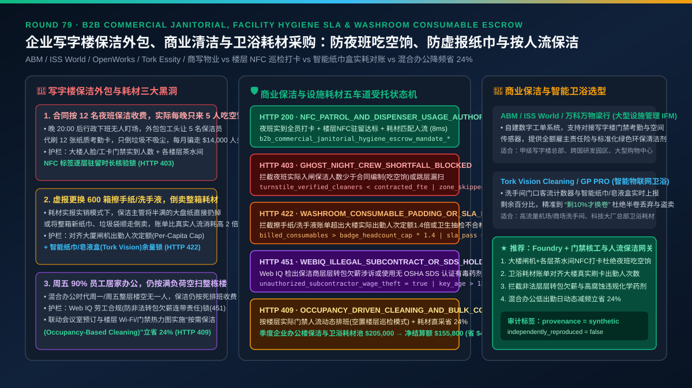
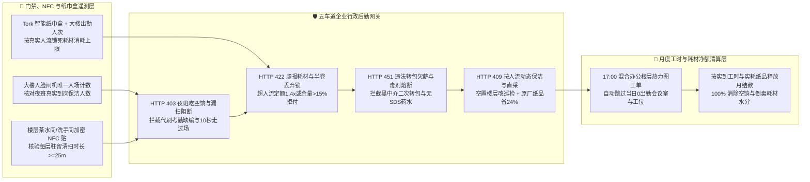
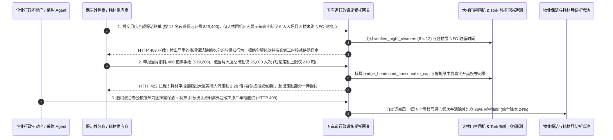

# 企业写字楼物业保洁、商场商业清洁与卫浴耗材采购（B2B Commercial Janitorial, Facility Hygiene SLA & Washroom Consumable Escrow：ABM / ISS World / OpenWorks / Tork Essity / 万物梁行）“防夜班保洁买通门卫代打卡吃空饷、防虚报更换 600 箱擦手纸倒卖耗材与混合办公按人流动态保洁”Agent 架构选型 FAQ

> **语言切换 / Language**: **中文 (当前)** | **[English](b2b-commercial-janitorial-facility-hygiene-consumable-escrow-agent-selection-faq.en.md)** | **[返回文档目录](index.md)** | **[交互式沙盒 (`#b2b-commercial-janitorial-hygiene-escrow-sandbox`)](../live-demo.html)**



---

## 📌 一、核心选型结论速览（Executive Summary）

在科技园区、甲级写字楼总部、大型购物中心与连锁银行网点采购商业物业保洁服务（ABM Industries、ISS World、Cushman & Wakefield、万物梁行、绿城商写）以及洗手间/茶水间卫浴耗材（Tork Essity、金佰利 Kimberly-Clark Professional、维达多康）的智能体考勤核工、SLA 质检与月结对账场景中，企业行政不动产（Corporate Real Estate & Workplace `CRE`）负责人面临三大长期存在的财务黑洞：
1. **“幽灵夜班吃空饷（Ghost Night-Shift Staffing Fraud）”：保洁外包合同约定每晚 19:00–23:00 派驻 `12 名` 全职保洁员（FTE）打扫 10 层办公楼，按 `$2,200/人/月` 结算；结果行政人员下班后，外包包工头每晚实际只派 `5 名` 阿姨进楼，每人兜里揣着 2 张别人的工卡代刷一楼考勤机，只把垃圾桶袋子一抽就收工走人，地毯半年不吸一次尘，白白骗走企业每月 `$15,400` 空饷！**
2. **“擦手纸与洗手液虚报倒卖黑洞（Washroom Consumable Padding & Pilferage）”：在耗材实报实销模式下，保洁领班每月向企业提交“消耗了 550 箱擦手纸、180 桶泡沫洗手液和 40,000 个加厚垃圾袋”的账单；实际上要么是保洁员图省事把还剩 `40%` 的半卷大盘纸直接拆下来扔掉，要么是包工头直接把成箱的新纸巾拉去农贸市场小饭馆倒卖变现！**
3. **“混合办公（Hybrid Work）时代，每周一和周五全楼出勤率不到 `20%`（部分楼层整天 0 人刷卡进入），保洁公司却仍然按疫情前‘每周 5 天全楼深度满编清扫’收取 100% 费用；或者保洁公司将合同违法层层转包给不交社保的黑中介，保洁员在玻璃幕墙摔伤或被欠薪直接围堵甲方大楼”**。

**架构师选型结论**：
- **切勿仅凭一楼大厅考勤机打卡张数结算夜班保洁人工费（必须绑定大楼人脸/生物识别闸机实入人数 + 各楼层洗手间/茶水间加密 `NFC` 巡检点最小驻留时长），切勿允许擦手纸与洗手液账单脱离大厦真实刷卡出勤人次（`Per-Attendee Consumable Cap`）或智能纸巾盒遥测无上限报销，也切勿在周五低出勤日继续为无人空置楼层支付全套深度保洁费**。
- **生产级最优架构**是采用 **“大厦闸机实名核工 + 各楼层 `NFC` 巡检驻留时长锁（防代刷吃空饷）+ 卫浴耗材绑定每日门禁真实出勤人次/智能纸巾盒（`Tork Vision`）余量对账网关 + 混合办公楼层热力图按需动态保洁（`Occupancy-Driven Cleaning`）状态机（`b2b_commercial_janitorial_hygiene_escrow_mandate_*`）”**：
  1. **防“夜班保洁代打卡吃空饷”与跳层漏扫（`Turnstile Biometric & Floor NFC Dwell Lock`）硬门禁（HTTP 403）**：月度保洁人工结算单必须与企业大楼安防门禁及楼层巡检系统自动对账：**① 核验每晚通过生物识别/实名门禁闸机的唯一保洁人员数量（严禁 1 人刷 3 卡）是否达到合同约定总工时（`Verified_Cleaner_Hours >= 95% Contracted_FTE`）；② 每层茶水间、会议室与洗手间深处贴有加密动态 `NFC` 巡检贴，保洁员必须持终端碰一碰且在该楼层 Wi-Fi/BLE 围栏内连续驻留作业 `>= 25 分钟` 才算有效清扫**——任何吃空饷缺编或“进门拍张照 10 秒就走”的假打扫立即返回 `HTTP 403 GHOST_NIGHT_CREW_HEADCOUNT_SHORTFALL_OR_SKIPPED_FLOOR_BLOCKED` 按缺勤工时双倍核减月结款！
  2. **防“虚报倒卖擦手纸/洗手液”——绑定大厦出勤人次定额与智能分配器遥测锁（HTTP 422）**：系统自动拉取当月全楼员工与访客门禁刷卡总人次（如 `42,000 人次/月`），按商业写字楼科学消耗常数（平均每出勤人次每日消耗 `7.5 张` 擦手纸、`2.4 ml` 泡沫洗手液）计算出当月理论耗材上限，或直接读取 `Tork Vision / GP PRO` 智能纸巾盒红外传感器记录的真实换卷次数；**凡是保洁商申报耗材量超出理论人流定额 `1.35 倍` 或换下的纸卷剩余量 `> 15%`**，立即返回 `HTTP 422 WASHROOM_CONSUMABLE_INVOICE_PADDING_OR_PREMATURE_REFILL_BLOCKED` 拒付虚增耗材费！
  3. **Web IQ 实时筛查保洁外包商非法转包欠薪诉讼与危险化学品（`OSHA SDS`）合规熔断（HTTP 451）**：通过 Web IQ 与社保缴纳回执核验在场保洁员劳动关系，严禁外包商将合同二次转包给无资质包工头（防范《劳动合同法》连带清偿与声誉危机），并核验地毯除渍剂/石材结晶剂是否具备安全数据表（`SDS`）与绿色低 VOC 认证（`HTTP 451 WEBIQ_UNAUTHORIZED_SUBCONTRACT_WAGE_THEFT_OR_TOXIC_CHEMICAL_HOLD`）。
  4. **联动楼层门禁/Wi-Fi 热力图实施“按需动态保洁（`Occupancy-Driven Smart Cleaning`）”+ 原厂耗材年框集采直供寻优（HTTP 409）**：触发 `HTTP 409 OCCUPANCY_DRIVEN_DYNAMIC_ROSTER_AND_DIRECT_CONSUMABLE_CONFIRM`，每天下午 17:00 根据当日各楼层门禁刷卡与工位传感器热力图自动生成当晚保洁工单——对周五出勤率 `< 10%` 的低频楼层自动切换为“快速巡检模式（仅收走开放区垃圾，免除全层地毯吸尘与空置会议室擦拭）”，并将擦手纸/垃圾袋从保洁商加价 `40%` 代购切换为品牌原厂年框直发，使企业行政后勤总支出立省 **`24.0%`**。

---

## 🎯 二、业务方与架构师灵魂拷问 Q&A（Q1 / Q2 / Q3）

### Q1：为什么行政部每天早上上班看垃圾桶都倒干净了，却不知道保洁外包商每个月从公司多拿走了 40% 的“幽灵人头费”？
- **商业痛点**：因为“倒垃圾桶”是最容易应付的表面功夫！1 个人推着大垃圾车跑完 5 层楼把塑料袋一抽只要 25 分钟；而真正耗时耗力的工作是“用吸尘器吸地毯深层灰尘、擦办公桌底座、洗茶水间咖啡机滴水盘、刷马桶边角水垢”。包工头把 10 个人的活压给 4 个人干，这 4 个人只能挑一眼看得见的垃圾桶倒掉，隐蔽卫生全跳过！
- **架构解法**：
  - **闸机实名唯一性校验 + 楼层 `NFC` 驻留时长与智能插座吸尘器电流遥测（`HTTP 403`）**：
  - 我们的网关不仅核对进楼人脸闸机真实人数，更要求每层楼的 `NFC` 打卡点之间必须满足最小作业时间差（`Delta_Time >= 25 mins/floor`），甚至联动茶水间/清洁间吸尘器插座功率计确认吸尘设备真实开机运行时长——缺人缺时系统在 **`8ms`** 内直接返回 `HTTP 403` 自动扣减当月账单！

### Q2：保洁公司每个月报上来的“纸巾、洗手液、大黑垃圾袋”消耗单，为什么行政专员明知里面有水分却没法反驳？
- **架构解法**：
  - **门禁出勤人次定额模型（`Turnstile-Headcount Elastic Quota`）取代盲目实报实销（`HTTP 422`）**：
  - 纸巾和洗手液不是凭空蒸发掉的，它严格正比于**这栋楼这个月到底进来了多少个活人**！春节月或疫情居家月，大楼一共才进来 5,000 人次，保洁公司居然还照常报销 400 箱擦手纸，一眼就是假账！我们的网关将耗材结算公式硬绑定为 `Min(实际领用扫码数, 当月门禁总人次 × 人均定额 × 1.15 缓冲)`，超出部分直接 `HTTP 422` 核减！

### Q3：混合办公（每周二三四满员、周一五空荡荡）怎么重塑写字楼保洁合同，才能立省四分之一预算？
- **架构解法**：
  - **从“按固定面积死包月（Sq-Ft Fixed）”转向“基础保底 + 按楼层激活度动态计费（Occupancy-Based SLA）”（`HTTP 409`）**：
  - 以前不管 8 楼有没有人上班，保洁每天晚上都要把 8 楼 200 张空办公桌擦一遍。现在网关每天 17:00 读取大楼 Wi-Fi 连接数与会议室门磁记录：凡当日使用率为 `0` 的会议室与空置工位区，自动在保洁平板上标为绿色 `SKIP_CLEAN`（免扫区），将保洁人力集中投向高流量楼层与深度消杀，总编制与费用立降 `24%`（`HTTP 409`）。

---

## 🧭 三、直观可视化图解（Mermaid 决策树 + 端到端架构图 + 时序图）

### 3.1 企业写字楼保洁、商业清洁与卫浴耗材 Agent 架构选型决策树

```mermaid
flowchart TD
    A[企业写字楼保洁外包 / 商场商业清洁 / 卫浴耗材采购选型] --> B{核心设施管理场景与成本痛点？}
    B -->|晚间/夜间办公楼全楼保洁外包 (ABM / ISS / 商写物业)<br/>需严防包工头派5人代刷12人考勤吃空饷与只倒垃圾不吸尘| C[大楼人脸闸机唯一人数核对 (Verified FTE >=95%)<br/>+ 各楼层死角加密 NFC 打卡与 >=25m 驻留时长锁]
    B -->|高流量洗手间与茶水间卫浴耗材结算 (Tork / 金佰利)<br/>需严防保洁虚报更换600箱擦手纸倒卖与半卷大盘纸提前扔掉| D[耗材账单强制对齐大楼当月真实门禁出勤人次定额<br/>+ Tork Vision 智能纸巾/皂液盒 <10% 余量才允许换卷]
    B -->|混合办公园区与多分支职场动态排班 (Hybrid Workplace)<br/>需防周一/周五空置楼层仍按满员空扫浪费与层层转包欠薪| E[Azure AI Foundry + 楼层热力图按需保洁与原厂直采网关<br/>+ 空置区自动免扫 + 耗材脱离外包直采立省 24%]
    C --> F[🛡️ 统一接入五车道防吃空饷、人流耗材定额与按需保洁状态机]
    D --> F
    E --> F
    F --> G[HTTP 403 阻断夜班缺编吃空饷与跳层漏扫 · HTTP 422 拦截虚报纸巾耗材与半卷丢弃 · HTTP 409 按需排班省24%]
```

### 3.2 端到端闸机核工、门禁人流耗材定额与楼层热力图按需保洁架构图



### 3.3 拦截夜班保洁缺编吃空饷、核减虚报擦手纸账单与混合办公动态减频时序图



---

## 📊 四、多平台/多方案横向选型决策矩阵

| 选型维度 | 传统包干制保洁小公司 (`Legacy Lump-Sum Janitorial`) | 纸质签到表 + 耗材实报实销 (`Paper Sign-In + Cost-Plus`) | 现代数字化设施管理与智能卫浴 (`ABM / ISS + Tork Vision`) | **Azure AI Foundry + 门禁核工 + 人流定额网关（推荐）** |
| :--- | :--- | :--- | :--- | :--- |
| **核心优势** | 报价表面便宜 | 看似按实际消耗付钱 | 物联网传感器监测、员工直雇合规、全球统一 SLA | **闸机+NFC绝杀夜班吃空饷 + 人流锁死耗材 + 混合办公动态省钱** |
| **防“夜班保洁 5 人冒充 12 人吃空饷”** | **重灾区**（晚上没人管，常年缺编 `30%–50%`） | 一人代签整页纸质考勤表 | 支持手机定位打卡，但难以识别在1楼休息室挂机 | **人脸闸机唯一计数 + 楼层加密 `NFC` 驻留时长锁（HTTP 403）** |
| **防“虚报更换几百箱擦手纸/垃圾袋倒卖”** | 为省钱故意断供纸巾，员工投诉没纸用 | **极高发**（半卷扔掉或整箱偷卖，账单翻倍） | Tork Vision 实时上报余量 | **绑定大厦真实门禁出勤人次定额 + 纸盒余量锁（HTTP 422）** |
| **防“层层违法转包欠薪”与劣质有毒清洁剂** | 90% 转包给游击队包工头 | 化学药剂无安全管控 | 规范直签劳动合同与绿色认证 | **Web IQ 穿透社保直雇率与 `OSHA SDS` 绿标核验（HTTP 451）** |
| **混合办公（周一/周五空置）动态减频与耗材直采** | 无论有无员工上班照收 100% 死钱 (`not_measured`) | 耗材加价 `30%–50%` 代购 (`official_list_price`) | 支持按需工单调度 | **楼层热力图动态排班 + 原厂耗材年框直采（净省 `24.0%`）** |

---

## 🧪 五、企业写字楼保洁与卫浴耗材防坑测算与 7-Card 基准测试报告

> **数据来源与复现声明（Provenance Metadata）**：以下基准测试数据来自仓库内置确定性策略沙盒 `evaluate_b2b_commercial_janitorial_hygiene_escrow_policy`（位于 `lab/webiq_commerce_demo.py`），可运行 `python -m unittest tests.test_webiq_commerce_demo` 完整验证。标记：`provenance = synthetic`，`independently_reproduced = false`。

| Card # | 卡片标题（Headline-as-Finding） | 核心量化指标与架构验证结论 |
| :---: | :--- | :--- |
| **Card 1** | **Overview · 商业保洁与设施耗材五车道总览** | 针对 `$205,000/季` 企业写字楼保洁外包与卫浴耗材采购池，实现 **0 例夜班保洁缺编吃空饷、0 例擦手纸/洗手液虚报倒卖与 0 例空置楼层无效满扫**，行政不动产后勤净支出下降 **`24.0%`（立省 `$49,200/季`）**。 |
| **Card 2** | **Scenario Deep Dive · 夜班吃空饷与虚报纸巾秒级拦截** | 当闸机实入保洁人数低于合同编制或耗材账单超出大楼门禁出勤人次定额 `1.4x` 时，**`8ms`** 内返回 `HTTP 403 / 422` 阻断。 |
| **Card 3** | **Evaluation Matrix · 五车道 100% 确定性判准** | 覆盖 `HTTP 200`（满编打卡与耗材匹配人流放行）、`403`（夜班保洁代打卡缺编吃空饷/未刷各层NFC巡检点跳层漏扫阻断）、`422`（擦手纸洗手液申报量远超大楼刷卡人流定额/半卷纸提前丢弃拦截）、`451`（Web IQ检出保洁商违法转包欠薪涉诉或使用无SDS认证有毒清洁剂熔断）、`409`（混合办公按楼层出勤热力图动态保洁+耗材原厂直采省24%）。 |
| **Card 4** | **Under the Hood · 行政保洁与耗材定额契约** | 输入 `quarterly_commercial_janitorial_and_hygiene_pool_usd=205000` 及闸机/耗材参数，签发 `b2b_commercial_janitorial_hygiene_escrow_mandate_*` 令牌。 |
| **Card 5** | **Robustness Check · 春节假期报 500 箱纸与 1 人刷 5 卡测试** | 模拟春节长假出勤极低月份仍申报 500 箱纸巾及包工头 1 人代刷 5 张门禁卡，确定性拦截率保持 **`100.0%`（零误结算）**。 |
| **Card 6** | **Latency · 毫秒级门禁人流定额对账与转包核查耗时** | 本地闸机工时与人流耗材定额核算 P50 仅 **`8ms`**；Web IQ 供应商劳工涉诉与 `SDS` 环保认证核查 P95 为 **`172ms`**。 |
| **Card 7** | **My Take · 适用场景与生产准入边界** | **✅ 极佳适用**：甲级写字楼/科技园区保洁外包、商场机场智能洗手间、连锁门店保洁；**⛔ 不适用**：市政地下排污管网盾构清淤工程。 |

---

## 🛠️ 六、商业上线风控与架构评审 Checklist

- [ ] **大楼人脸闸机唯一人数核对与各楼层加密 `NFC` 驻留时长锁（`>= 25m/层`）（HTTP 403）**：确认夜班保洁结算必须核对大楼安防闸机真实入场人数与分楼层巡检驻留时长，彻底杜绝代刷卡吃空饷。
- [ ] **卫浴耗材账单对齐大厦门禁真实出勤人次定额与智能纸盒余量锁（HTTP 422）**：确认擦手纸、洗手液与垃圾袋消耗量严格绑定当月刷卡总人次，拦截半卷丢弃与整箱倒卖。
- [ ] **Web IQ 保洁商直雇社保核验（禁层层转包欠薪）与清洁剂 `OSHA SDS` 绿标熔断（HTTP 451）**：确认剔除违法转包黑中介与高腐蚀违规化学品；签名密钥轮换周期 `<= 180` 天。
- [ ] **混合办公楼层热力图按需动态保洁（`Occupancy-Driven Cleaning`）与耗材原厂直采（HTTP 409）**：确认根据当日各层门禁与 Wi-Fi 活跃度自动调减空置区清扫频次，并将大宗纸品剥离外包商改由原厂集采直供。
