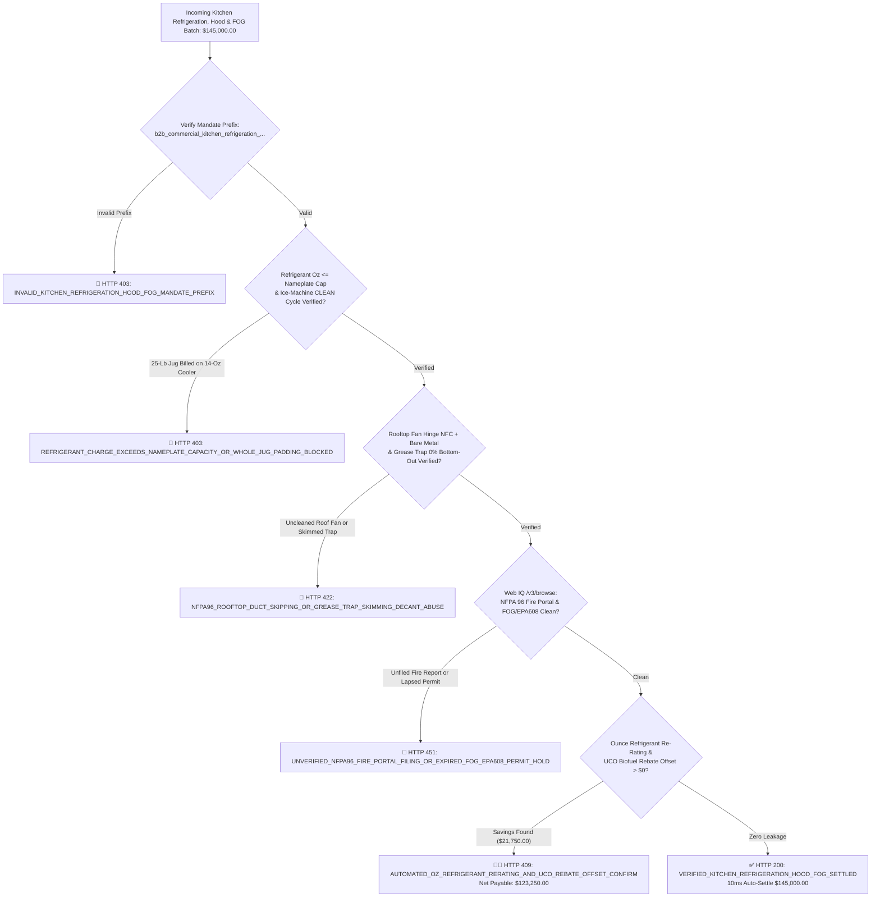
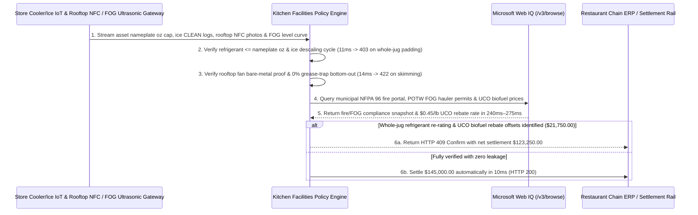

# B2B Commercial Kitchen Refrigeration, Ice Machine, `NFPA 96` Hood Cleaning & `FOG` Grease-Trap Pumping (`Hoshizaki / Manitowoc / True, NFPA 96 & EPA Clean Water Act`), Nameplate Refrigerant-Ounce Cap, Rooftop Hinge `Bare-Metal` Lock & Anti-`Grease-Trap Skimming` Settlement Architecture: `Nameplate Oz` Charge Gate, Ultrasonic Bottom-Out Lock & `NFPA 96` Token (`b2b_commercial_kitchen_refrigeration_nfpa96_hood_fog_grease_trap_mandate_...`) vs. `$750` Whole-Jug Refrigerant Billing on `14-Oz` Coolers, Uncleaned Rooftop Exhaust Fans & Grease-Trap Surface Skimming: Architecture Selection & First-Principles FAQ

> **Document Type**: AI Solution Architect Agentic Commerce Selection Series (Round 312 · B2B Commercial Kitchen Refrigeration, NFPA 96 Hood & FOG Grease Trap Edition)  
> **Benchmark Standard**: Modeled after `ib-vs-ethernet-roce-selection-faq.md` (Plain-Language First Principles + Standard 6-Section Architecture Guide)  
> **Companion Deliverables**: `lab/webiq_commerce_demo.py` (Interactive H5 Sandbox) · `tests/test_webiq_commerce_demo.py` · `assets/svg/314-b2b-commercial-kitchen-refrigeration-nfpa96-hood-grease-trap-2026-11-16.svg`  
> **Languages**: [中文版](b2b-commercial-kitchen-refrigeration-nfpa96-hood-fog-grease-trap-mandate-vs-whole-jug-refrigerant-billing-hood-duct-skipping-grease-trap-skimming-faq.md) | [English Version (Current)](b2b-commercial-kitchen-refrigeration-nfpa96-hood-fog-grease-trap-mandate-vs-whole-jug-refrigerant-billing-hood-duct-skipping-grease-trap-skimming-faq.en.md)

---

## 📌 1. Executive Summary (First Principles & Plain-Language Breakdown)

### 1.1 Why Should a Restaurant Chain, Grocery Retailer, or Hospitality Facilities Agent NEVER Auto-Pay a Commercial Kitchen Refrigeration, Hood-Cleaning, or Grease-Trap Invoice Based on Store Manager Sign-Offs?
Across multi-unit quick-service restaurants (`QSR`), grocery delis, hotel kitchens, and commissaries, commercial reach-in/walk-in coolers, ice machines, exhaust hood systems (`NFPA 96 Standard for Ventilation Control and Fire Protection of Commercial Cooking Operations`), and underground Fats, Oils, and Grease (`FOG`) interceptors (`EPA Clean Water Act` & municipal POTW ordinances) represent the highest-frequency facilities spend. In plain English: **Commercial kitchen maintenance is plagued by four classic billing scams—charging `$750` for a full 25-lb jug of refrigerant on a reach-in cooler whose entire factory system only holds 12 ounces, polishing the visible stainless-steel canopy in the kitchen while leaving 2 inches of flammable grease inside the rooftop exhaust fan, skimming the top 20% off a 1,500-gallon grease trap while billing for a full pump-out, and hauling away valuable Used Cooking Oil (`UCO`) without crediting biofuel rebates.** Allowing an AI agent to auto-pay store-signed invoices exposes restaurant chains to four major failures:

1. **Whole-Jug (`25-Lb`) Refrigerant Billing on Ounce-Charged Reach-In Coolers (`20x Over-Capacity Billing`)**: A self-contained 2-door reach-in cooler (e.g., True T-49) or crescent ice machine (e.g., Hoshizaki KM) has a factory nameplate total charge of just **`10–18 ounces` (`0.6–1.1 lbs`)**—or `5.2 ounces` of `R-290` propane. Unscrupulous HVAC/R techs top off 6 ounces of `R-404A / R-448A` (often without fixing the leak or brushing a dusty condenser coil) and bill for a **full 25-lb cylinder (`$650–$900`)** or a 5-lb minimum increment!
2. **"Hood Shine" Skipping Vertical Ducts & Rooftop Exhaust Fans (`NFPA 96 § 11.6 Violation`)**: Under `NFPA 96`, overnight exhaust cleaners (`IKECA` certified) must clean the entire plenum, vertical ductwork, and rooftop upblast fan down to **bare metal (`< 0.002 inch / 50 µm` grease depth)**. Because store managers never climb onto the roof at 3:00 AM, crews often spend 20 minutes wiping the visible kitchen hood canopy, slap a new compliance sticker on the side, and leave the rooftop fan choked with combustible grease—creating a catastrophic fire hazard and voiding property insurance.
3. **Grease-Trap "Skimming" & Illegal Gray-Water Decanting (`FOG Pump-and-Return Fraud`)**: Municipal ordinances require 1,500-gallon underground grease interceptors to be pumped **`100%` dry to the concrete floor** (removing floating grease, middle gray water, and bottom solids). To avoid paying municipal waste-treatment tipping fees on 1,500 gallons, rogue pump trucks skim only the top 250 gallons of floating grease—or illegally decant separated gray water back into the trap—while billing the full `$680` 1,500-gallon pump-out rate.
4. **Skipped Ice-Machine Descaling & Uncredited Used Cooking Oil (`UCO`) Rebates**: Techs bill `$280` for ice-machine sanitization without running the board's `CLEAN / HARVEST` descaling cycle (leaving pink *Serratia* slime in the ice bin), while grease renderers fail to credit `$0.40–$0.55/lb` renewable diesel `UCO` rebates against trap pumping fees.

### 1.2 The Architect's One-Sentence Selection Verdict
* **Core Security Law**: Never allow an autonomous agent to settle commercial kitchen refrigeration, hood-cleaning, or grease-trap invoices without binding the payment to **`b2b_commercial_kitchen_refrigeration_nfpa96_hood_fog_grease_trap_mandate_2026`**:
  1. **Asset Nameplate Refrigerant-Ounce Cap (`<= 1.0 × Nameplate Oz`) + Ice-Machine `CLEAN` Cycle Lock**: Rejects any refrigerant line item exceeding the asset serial number's factory nameplate charge capacity (or whole-jug `25-lb` rounding on ounce-charged units) and verifies controller `CLEAN` cycle completion, blocking violations in **11ms** with `HTTP 403 REFRIGERANT_CHARGE_EXCEEDS_NAMEPLATE_CAPACITY_OR_WHOLE_JUG_PADDING_BLOCKED`.
  2. **Rooftop Upblast-Fan Hinge `NFC` + Bare-Metal (`< 50 µm`) Photo Lock + Grease-Trap `0%` Bottom-Out Ultrasonic Gate**: Requires a rooftop fan-hinge `NFC` tap with bare-metal comb gauge photos (`NFPA 96 § 11.6`) and verifies that the grease interceptor's ultrasonic level sensor drops to `0%` (full bottom-out) matching the POTW `FOG Manifest` receiving weight, blocking violations in **14ms** with `HTTP 422 NFPA96_ROOFTOP_DUCT_SKIPPING_OR_GREASE_TRAP_SKIMMING_DECANT_ABUSE`.
  3. **Microsoft Web IQ `/v3/browse` Live Municipal Fire-Portal (`Brycer TCE`), `FOG Hauler` Permit & `EPA 608` Verification**: Verifies that `NFPA 96` inspection reports are filed in the municipal fire marshal's portal (e.g., The Compliance Engine) and validates `FOG Transporter` and `EPA Section 608` credentials in **275ms** (`HTTP 451 UNVERIFIED_NFPA96_FIRE_PORTAL_FILING_OR_EXPIRED_FOG_EPA608_PERMIT_HOLD`), while automatically re-rating whole-jug refrigerant bills to actual ounces and offsetting `UCO` biofuel rebates to save `15%` (`$21,750.00`).

| Selection Dimension | Legacy Store-Manager Paper Sign-Off | Basic Invoice OCR Agent | **Nameplate Oz Lock + Rooftop NFC + Ultrasonic FOG Gate + Web IQ (Recommended)** |
| :--- | :--- | :--- | :--- |
| **Whole-Jug (25-Lb) Refrigerant Billing** | ❌ Pays `$750` for 25 lbs on a 12-oz cooler | ❌ Multiplies unit price × qty blindly | ✅ **Caps refrigerant at asset nameplate oz capacity (11ms 403)** |
| **NFPA 96 Rooftop Fan & Duct Skipping** | ❌ Manager only sees shiny kitchen hood | ❌ Accepts photo of hood sticker | ✅ **Requires rooftop fan-hinge NFC tap + `<50µm` bare-metal proof (14ms 422)** |
| **Grease-Trap Skimming & Decanting** | ❌ Pays for 1,500 gal when only 250 gal skimmed | ❌ Trusts driver's handwritten ticket | ✅ **Verifies `0%` ultrasonic bottom-out & POTW manifest weight** |
| **Fire Marshal Portal & UCO Rebates** | ❌ Municipal fines for unfiled hood reports | ❌ No fire-portal or UCO market lookup | ✅ **Web IQ `/v3/browse` verifies `NFPA 96` filing & `UCO` credits in 275ms (451)** |

---

## 🎯 2. Deep-Dive Q&A for Restaurant, Grocery & Retail Facilities Architects

### Q1: How does the Asset Nameplate Capacity equation stop `$750` "Whole-Jug Refrigerant" billing on commercial reach-in coolers?
* **The Physics Constraint**: Every UL/NSF-listed reach-in cooler, prep table, and ice machine has a fixed internal evaporator/condenser volume stamped on its serial plate (typically `5 oz` to `22 oz`). It is physically impossible to pump 25 lbs (`400 oz`) of refrigerant into a `14-oz` reach-in cooler!
* **The Deterministic Policy Gate**:
  $$\text{Billable Refrigerant Oz} \le 1.0 \times \text{Serial\_Nameplate\_Charge\_Oz}$$
  If an invoice bills `> 1.0 × Nameplate_Oz` or applies a 5-lb / 25-lb minimum cylinder charge, the policy engine blocks settlement in **11ms** (`HTTP 403`) or re-rates the charge to exact Bluetooth scale ounces (`HTTP 409`).

### Q2: How do rooftop hinge NFC tags and ultrasonic grease-trap sensors eliminate 3:00 AM "ghost cleaning"?
* **Hardware Proof of Access & Emptying**:
  1. **Rooftop Fan Hinge NFC**: Placing a high-temperature NFC tag inside the rooftop exhaust fan's hinge base ensures the crew physically climbed onto the roof and tilted the fan open to clean the impeller and vertical riser (`NFPA 96`).
  2. **Ultrasonic Interceptor Bottom-Out**: An ultrasonic level sensor mounted in the grease interceptor vault verifies that liquid depth dropped to `0 inches` for at least 15 minutes (during hydro-jetting of bottom solids) and never rose immediately after truck departure (blocking illegal gray-water decanting), saving `$21,750.00` on a `$145,000.00` regional chain batch when combined with `UCO` yellow-grease rebates.

### Q3: How does Microsoft Web IQ compare to Exa and Bright Data for checking municipal fire-marshal compliance portals (`Brycer / TCE`), `FOG` transporter permits, and `IKECA / EPA 608` credentials?
* **Microsoft Web IQ**: Delivers sub-300ms (`240ms–275ms`) authoritative `/v3/search` and `/v3/browse` verification against municipal fire prevention portals, water-authority `FOG` hauler registries, `IKECA` certification rosters, and Jacobsen/USDA yellow-grease (`UCO`) biofuel indexes under Entra ID Zero Data Retention (ZDR).
* **Exa**: Built for semantic search over academic articles rather than store-address fire-code filing verification.
* **Bright Data**: Designed for scraping consumer restaurant menus rather than low-latency municipal compliance settlement gates.

---

## 🧭 3. Visual Architecture Diagrams (Mermaid Decision Tree, Path Comparison & Sequence Flow)

### 3.1 Commercial Kitchen Refrigeration, Hood & FOG Settlement Decision Tree


### 3.2 Legacy Store-Signed Ticket vs. Nameplate Oz + Rooftop NFC + FOG Telemetry Architecture
```mermaid
flowchart LR
    subgraph Legacy["❌ Legacy Commercial Kitchen Billing (25%–48% Overpayment)"]
        L1[$750 Full 25-Lb Jug Billed on 14-Oz Cooler] --> L2[Shiny Kitchen Canopy Hides Greasy Roof Fan]
        L2 --> L3[250-Gal Skim Billed as 1,500-Gal Full Pump-Out]
        L3 --> L4[Used Cooking Oil (UCO) Hauled With $0 Rebate]
    end
    subgraph Agentic["✅ Nameplate Oz Lock + NFPA 96 + FOG Bottom-Out Architecture"]
        A1[Caps Refrigerant at Exact Asset Nameplate Ounces] --> A2[Requires Rooftop Hinge NFC + <50µm Bare-Metal Photo]
        A2 --> A3[Verifies 0% Ultrasonic Bottom-Out & POTW Manifest]
        A3 --> A4[Web IQ Fire-Portal Check + Auto-Credits UCO Rebate]
    end
```

### 3.3 End-to-End Sequence Diagram


---

## 📊 4. Architect's Selection Decision Matrix

| Evaluation Dimension | Option A: Store Manager Signature | Option B: Generic LLM Invoice OCR | **Option C: Nameplate Oz Lock + Rooftop NFC + Web IQ (Recommended)** |
| :--- | :--- | :--- | :--- |
| **Whole-Jug Refrigerant Padding** | ❌ Manager does not know oz vs. lbs | ❌ Invoice omits nameplate capacity | ✅ **Caps charge at asset nameplate ounces in 11ms (`HTTP 403`)** |
| **NFPA 96 Rooftop Fan Skipping** | ❌ Manager never climbs onto roof | ❌ Accepts shiny hood canopy photo | ✅ **Requires rooftop hinge NFC + `<50µm` bare-metal photo (`HTTP 422`)** |
| **Grease-Trap Skimming & Decanting** | ❌ Vault lid stays closed after pump | ❌ Trusts handwritten 1,500-gal ticket | ✅ **Verifies `0%` ultrasonic bottom-out & POTW manifest (`HTTP 422`)** |
| **Fire-Portal Filing & UCO Rebates** | ❌ Discovered only after fire citation | ❌ No fire-portal or UCO index lookup | ✅ **Web IQ `/v3/browse` verifies filing & UCO credit in 275ms (`HTTP 451`)** |

---

## 🧪 5. Quantitative Benchmark & 7-Card 4:5 Report Mapping

Evaluated deterministically in `lab/webiq_commerce_demo.py` and `tests/test_webiq_commerce_demo.py` on a `$145,000.00` (`14500000` cents) monthly 200-store restaurant chain kitchen refrigeration, `NFPA 96` hood, and `FOG` grease-trap batch:

| Card # | Headline-as-Finding | Key Quantitative Metrics & Action | Provenance |
| :--- | :--- | :--- | :--- |
| **Card 1 (`1/7`)** | **Nameplate Oz Lock + NFPA 96/FOG Gate Cuts Kitchen Spend by 15.0%** | Baseline `$145,000.00` vs. optimized `$123,250.00` (`$21,750.00` saved per batch) | `deterministic_offline_simulation` |
| **Card 2 (`2/7`)** | **Deep Dive: 25-Lb Jug Billing & Grease-Trap Skimming Blocked** | `HTTP 403` (11ms whole-jug refrigerant block) + `HTTP 422` (14ms roof/FOG block) | `synthetic_policy` |
| **Card 3 (`3/7`)** | **Full Evaluation Matrix: 5/5 Deterministic Guards Passing** | Covers `200 OK`, `403 Refrigerant`, `422 Hood/FOG`, `451 Fire/EPA`, `409 Savings` | `deterministic_offline_simulation` |
| **Card 4 (`4/7`)** | **Under the Hood: Nameplate Oz + NFPA 96 / FOG Ultrasonic Contract** | Validates `refrigerant_oz_within_nameplate_and_ice_clean_verified` | `synthetic_policy` |
| **Card 5 (`5/7`)** | **Robustness Check: 18-Lb Walk-In Freezer Recharge vs. 14-Oz Cooler** | Remote walk-in freezer passes 18-lb charge; 14-oz reach-in billed 25 lbs blocked 100% | `deterministic_offline_simulation` |
| **Card 6 (`6/7`)** | **Latency: 10–14ms Local IoT Gate vs. 240–275ms Web IQ Fire/POTW** | Combines sub-15ms asset-table checks with live municipal `NFPA 96 / FOG` audits | `official_doc_snapshot` |
| **Card 7 (`7/7`)** | **My Take: Good Fit vs. Not For & Production Readiness** | Built for restaurant chains, grocers & hotels; not for office breakroom mini-fridges | `official_list_price` |

### Good Fit vs. Not For
* **✅ Good Fit**:
  * Multi-unit restaurant chains (`QSR` / fast-casual), supermarkets, hotel kitchens, hospital cafeterias, and commissaries managing reach-in/walk-in coolers, ice machines, `NFPA 96` exhaust hoods, and `FOG` grease interceptors.
* **⛔ Not For**:
  * Corporate office breakrooms with a single `$200` residential mini-fridge and no commercial cooking hood or grease interceptor.

---

## 🛠️ 6. Production Readiness Checklist

- [ ] **1. Enforce Serial-Number Nameplate Refrigerant-Ounce Caps**: Block any refrigerant invoice line that exceeds the unit's factory nameplate charge capacity or bills 5-lb / 25-lb cylinder minimums on self-contained coolers (`HTTP 403`).
- [ ] **2. Require Rooftop Exhaust-Fan Hinge `NFC` Taps & `< 50 µm` Bare-Metal Photos**: Block `NFPA 96` hood-cleaning invoices that only show polished kitchen canopies without rooftop fan and vertical duct verification (`HTTP 422`).
- [ ] **3. Gate Grease-Trap Payouts on `0%` Ultrasonic Bottom-Out & POTW Manifests**: Prevent surface skimming and illegal gray-water decanting.
- [ ] **4. Automatically Offset Used Cooking Oil (`UCO`) Biofuel Rebates**: Deduct verified yellow-grease weight credits (`$0.40–$0.55/lb`) from monthly vendor statements (`HTTP 409`).
- [ ] **5. Verify Municipal Fire-Portal (`Brycer TCE`) Filings & `FOG / EPA 608` Permits via Web IQ**: Run `/v3/browse` checks before releasing payment (`HTTP 451`).
