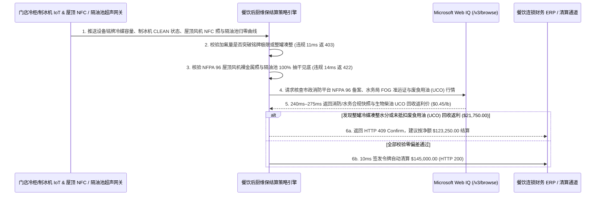

# B2B 餐饮连锁与商超生鲜冷柜、制冰机及排油烟罩清洗维保（`Commercial Kitchen Refrigeration, Ice Machine, NFPA 96 Hood Cleaning & FOG Grease Trap Pumping: Hoshizaki / Manitowoc / True, NFPA 96 & EPA Clean Water Act`）、回风温度/过热度遥测（`Superheat/Subcooling & Defrost Cycle IoT`）、屋顶排油烟风机裸金属照片（`NFPA 96 Bare-Metal Hinge Photo`）核验与防“制冷剂按整罐 25 磅强收、吸油车撇表面油水（`Skimming`）冒充抽干隔油池与伪造除垢清洗”清算架构：氟利昂电子秤克重锁、隔油池超声见底传感器门禁与 `NFPA 96` 令牌（`b2b_commercial_kitchen_refrigeration_nfpa96_hood_fog_grease_trap_mandate_...`）vs 传统维修商给商用冷柜补 10 盎司冷媒却按整罐 25 磅收 `$750`、夜班烟道工只擦灶台表面不洗屋顶风机引发火灾与吸污车只抽隔油池上层浮油选型与原理解析 FAQ

> **文档类型**：AI Solution Architect 商业智能体架构选型系列（Round 312 · B2B 餐饮连锁与商超冷链、排油烟罩及隔油池清运专篇）  
> **对标标杆**：`ib-vs-ethernet-roce-selection-faq.md`（通俗大白话 + 第一性原理 + 标准六段式结构）  
> **关联 Deliverable**：`lab/webiq_commerce_demo.py`（H5 实时防篡改沙盒） · `tests/test_webiq_commerce_demo.py` · `assets/svg/314-b2b-commercial-kitchen-refrigeration-nfpa96-hood-grease-trap-2026-11-16.svg`  
> **双语版本**：[中文版 (当前)](b2b-commercial-kitchen-refrigeration-nfpa96-hood-fog-grease-trap-mandate-vs-whole-jug-refrigerant-billing-hood-duct-skipping-grease-trap-skimming-faq.md) | [English Version](b2b-commercial-kitchen-refrigeration-nfpa96-hood-fog-grease-trap-mandate-vs-whole-jug-refrigerant-billing-hood-duct-skipping-grease-trap-skimming-faq.en.md)

---

## 📌 一、核心结论速览（Executive Summary：第一性原理与通俗大白话拆解）

### 1.1 为什么“绝对不能”让全国连锁餐饮（QSR）、生鲜超市或酒店餐饮部的设施管理 Agent 仅凭冷柜维修商、烟道清洗队与吸污车公司寄来的工单发票就自动付款？
在拥有数百家门店的连锁餐厅、超市生鲜冷链与大型中央厨房中，步入式冷库（Walk-in Cooler/Freezer）、商用制冰机（Ice Machines）、厨房排油烟罩与竖井管道清洗（受美国国家消防协会 `NFPA 96 Standard for Ventilation Control and Fire Protection of Commercial Cooking Operations` 强制监管）以及地下隔油池（`FOG Grease Interceptor`，受市政排污规范与 `EPA Clean Water Act` 监管）是门店合规营业的生命线。用大白话讲：**商业后厨维保是“给小冷柜加 8 盎司制冷剂敢收整罐 25 磅 $750 的钱、半夜洗烟道只把店长看得见的不锈钢罩子擦亮却不管屋顶风机里 2 厘米厚的易燃老油垢、吸污车抽隔油池只吸走上面一层水（Skimming）留着底下硬油脂结块不管”四大猫腻最猖獗的行业！** 如果没有制冷剂铭牌充注量上限锁、屋顶风机铰链 `NFPA 96` 裸金属微距核验与隔油池见底超声传感器，餐饮连锁运维预算会遭遇四大失血黑洞：

1. **给自携式冷柜/制冰机补几盎司冷媒，却按“整罐 25–30 磅氟利昂”强收 `$650–$900`（`Whole-Jug Refrigerant Billing onOz-Charged Units`）**：一台后厨双门冷柜（如 True T-49）或制冰机（如 Hoshizaki KM 系列）的出厂铭牌总制冷剂充注量（Nameplate Total Charge）一共才 **`10–18 盎司（0.6–1.1 磅）`**（现在更普遍采用 `R-290` 丙烷仅 `5.2 盎司`）。结果维修工来修冷柜不制冷，既不查漏也不清理堵满油灰的冷凝器翅片，随手接上压力表充了一点点 `R-404A / R-448A`，账单上却赫然写着：“加注制冷剂 1 罐（25 lbs / Minimum 5 lbs Increments），材料费 `$750`”——**账单充注量比机器肚子能装下的极限总量还多出 20 倍！**
2. **凌晨排油烟管道清洗“只擦表面挡油板、漏洗竖井与屋顶离心风机”（`NFPA 96 Hood Polish & Duct/Fan Skipping`）**：根据 `NFPA 96 § 11.6`，排油烟系统必须由持证人员（`IKECA / Phil Ackland Certified`）将油烟罩、立管风道（Vertical Duct）直至屋顶排油烟风机（Upblast Exhaust Fan）内部全部高压热碱水冲洗至“露出金属本色（`Bare Metal`，油膜厚度 `< 0.002 英寸 / 50 微米`）”。因为清洗队在凌晨 02:00 无人监管时作业，他们往往花 20 分钟用不锈钢亮光油把厨师抬头能看到的集烟罩擦得像镜子一样，再贴一张合格贴纸（Hood Sticker），却根本没爬上屋顶打开风机铰链（Hinge Kit），导致竖井与屋顶风机里堆积数十斤高可燃焦油，一旦炉灶蹿火直接烧穿整座商场并被保险公司拒赔！
3. **隔油池清运“只撇表层浮水（Skimming / Pump-and-Return）”冒充整池抽干**：门店地下 `1,500 加仑` 隔油池（Grease Trap）按市政要求需完全抽空上层油脂（Floating Grease）、中层灰水与底层沉积淤泥（Bottom Solids），并露出池底挡板清洗。不良清运车为了省下昂贵的污水处理厂卸油处置费（Tipping Fee），把吸粪管伸进池里只吸走上面 300 加仑浮油，或者在车罐里把油水分离后竟把浑浊的臭水偷偷倒回门店隔油池（违反严禁回灌的 `No Decanting / No Gray-Water Return` 法规），账单却按 **`1,500 加仑整池清掏（$680）`** 全额收费！
4. **制冰机假除垢消毒导致“粉红粘菌（Serratia marcescens）与黑霉菌”被卫生局亮红牌扣分**：制冰机蒸发器格栅每月需排空冰块、循环食品级镍安全除垢剂（Nickel-Safe Descaler）与季铵盐消毒剂。技师未触发制冰机控制板 `CLEAN / HARVEST` 清洗程序就虚报 `$280` 深度除垢费，直到卫生局抽检冰块大肠杆菌/霉菌超标被通报曝光。

### 1.2 架构师的一句话选型结论
* **核心安全铁律**：严禁 Agent 对制冷剂申报磅数超过设备铭牌总容量、无屋顶排烟风机翻开铰链后的 `NFPA 96` 裸金属测厚照、或无隔油池池底完全裸露超声/视觉证据的后厨维保账单自动打款。必须将清算令绑定在 **`b2b_commercial_kitchen_refrigeration_nfpa96_hood_fog_grease_trap_mandate_2026`** 上：
  1. **设备铭牌冷媒总容量硬封顶锁（`<= 1.0 × Nameplate Oz Charge`）+ 蓝牙冷媒电子秤克重核验**：任何制冷剂加注费用的申报重量严禁超过该资产序列号铭牌标注的出厂总充注量（如 `14 oz`），且单次加注超铭牌 `50%` 必须附带氮气保压检漏修复记录；对把盎司级小冷柜按 5 磅/25 磅整罐计费的欺诈账单，在 **11ms** 内返回 `HTTP 403 REFRIGERANT_CHARGE_EXCEEDS_NAMEPLATE_CAPACITY_OR_WHOLE_JUG_PADDING_BLOCKED`。
  2. **`NFPA 96` 屋顶风机铰链裸金属（`< 50 µm` 油膜梳测厚）核验 + 隔油池 `0%` 液位见底清掏门禁**：排油烟清洗必须上传带屋顶风机 NFC 打卡与油膜厚度规（Depth Gauge Comb `< 0.002"`）的裸金属对比图；隔油池清运必须验证池内超声液位计经历了从满池降到 `0%`（露出池底混凝土）的完整抽干过程且与市政 `FOG Manifest` 卸油磅单闭环匹配，违规在 **14ms** 内返回 `HTTP 422 NFPA96_ROOFTOP_DUCT_SKIPPING_OR_GREASE_TRAP_SKIMMING_DECANT_ABUSE`。
  3. **Microsoft Web IQ `/v3/browse` 实时核验市政消防局 `NFPA 96 / IKECA` 清洗备案、水务局 `FOG Hauler` 排污准运证与 `EPA Section 608` 制冷工执照**：在线穿透核查烟道清洗商是否向市政消防合规门户（如 The Compliance Engine / Brycer）上传了合格报告、吸污车市政 `FOG Transporter Permit` 有效性及维修工 `EPA 608` 证书，发现无证排污或消防漏报在 **275ms** 内触发 `HTTP 451 UNVERIFIED_NFPA96_FIRE_PORTAL_FILING_OR_EXPIRED_FOG_EPA608_PERMIT_HOLD`，并自动将整罐冷媒砍回真实盎司克重且合并区域门店预防性冷凝器吹洗立省 `15%`（`$21,750.00`）。

| 选型维度 | 传统连锁门店店长签字报销模式 | 普通发票 OCR 审核 Agent | **铭牌冷媒容量锁 + 屋顶风机 NFC + 隔油池见底超声 + Web IQ 架构（推荐）** |
| :--- | :--- | :--- | :--- |
| **盎司级冷柜收 25 磅整罐氟利昂** | ❌ 店长不懂制冷，补 10oz 照签 $750 整罐单 | ❌ 只看发票单价 × 数量乘法对不对 | ✅ **绑定设备铭牌容量（如 `14 oz`），超铭牌或整罐凑整 11ms 拦 403** |
| **半夜洗烟罩不洗屋顶风机与竖井** | ❌ 抬头看罩子亮了就签字，屋顶积油起火 | ❌ 只看有没有贴合格贴纸照片 | ✅ **强制校验屋顶风机铰链 NFC + 裸金属 `<50µm` 测厚照（14ms 拦 422）** |
| **隔油池只撇浮油或臭水回灌** | ❌ 盖上井盖看不见池底还有半米硬油泥 | ❌ 信任手写“已抽 1,500 加仑”联单 | ✅ **校验池底超声液位归零 + 污水处理厂接收地磅单闭环** |
| **消防合规备案与水务准运证** | ❌ 未上传市政消防平台导致餐厅被贴封条 | ❌ 不具备市政消防/水务库检索能力 | ✅ **Web IQ `/v3/browse` 275ms 核查 `NFPA 96` 备案与 `FOG` 准运证（拦 451）** |

---

## 🎯 二、客户与架构师灵魂拷问 Q&A（直击餐饮连锁后厨维保猫腻与智能体采购痛点）

### Q1：为什么全美餐饮连锁每年在商用冷柜维修上会被多收上千万美元的“幽灵氟利昂费”？怎么用一行物理公式彻底终结？
* **真实行业黑幕**：后厨双门冷柜、沙拉冷台（Prep Table）和制冰机属于小型自携式制冷设备（Self-Contained Refrigeration），整个系统铜管加起来只有几米长，铭牌上清清楚楚印着：`Refrigerant: R-290 (5.0 oz)` 或 `R-404A (14.0 oz)`。但外包暖通工把修大型超市中央机组的“按整罐 25 磅（400 盎司）或最低 5 磅（80 盎司）起步价”套用在后厨小冷柜上！更离谱的是，90% 的后厨冷柜不制冷是因为油烟灰尘糊死了冷凝器散热片（只需毛刷和压缩空气吹洗 15 分钟），根本不缺氟利昂。
* **物理极限守恒门禁**：
  $$\text{Max Allowed Refrigerant Oz} \le 1.0 \times \text{Asset\_Nameplate\_Total\_Charge\_Oz}$$
  只要工单申报的制冷剂重量超过该设备台账铭牌总容量（或者在不换压缩机/蒸发器的情况下一年内第 2 次申报加氟），策略引擎在 **11ms** 内直接判定为欺诈超收（`HTTP 403`）！

### Q2：怎么防止夜间排油烟道清洗队“只擦表面集烟罩应付店长，把屋顶风机留成定时炸弹”？
* **屋顶风机铰链防伪 NFC + 裸金属梳规（`NFPA 96 Bare-Metal Verification`）**：
  1. 在每家门店屋顶排油烟风机（Upblast Fan）的翻转底座内侧安装耐高温防拆 NFC 标签（只有把风机通过铰链翻转打开才能刷到）。
  2. 要求清洗工上传包含该 NFC 解锁码、风机叶轮与竖井内壁清洗前/清洗后露出银白色裸金属（配合 `50 µm` 油膜测厚梳）的实时照片，彻底杜绝“在厨房里擦完罩子就收工”。

### Q3：在核查市政消防局 `NFPA 96` 在线合规平台（如 Brycer / The Compliance Engine）、市政水务局 `FOG` 废油脂准运证与 `EPA Section 608` 证书时，Microsoft Web IQ 相比 Exa 和 Bright Data 有何优势？
* **Microsoft Web IQ（原 Bing Grounding 工业级演进）**：
  * **市政消防与环保排污门户秒级穿透**：通过 `/v3/search` 与 `/v3/browse` 直接核查市政消防局指定的第三方检验备案系统（`Brycer TCE / Compliance Engine`）、市政水务局（`POTW FOG Control Program`）注册清运商名录与 `EPA 608 / IKECA` 认证库，平均延迟 **240ms–275ms**，具备企业级 Entra ID 零数据留存（ZDR）保障。
* **Exa**：擅长语义搜索食品科学论文，但无法按餐厅营业地址或清运车牌照核验市政 `FOG Manifest` 与消防备案状态。
* **Bright Data**：面向公开外卖平台菜单价格抓取，在企业设施合规清算中无需引入高延迟代理网络。

---

## 🧭 三、直观可视化图解（Mermaid 选型决策树 + 路径对比 + 端到端时序图）

### 3.1 餐饮连锁冷链、烟道清洗与隔油池清运结算门禁决策树
```mermaid
flowchart TD
    A[收到连锁餐饮冷链/烟罩/隔油池维保月度批次: $145,000.00] --> B{校验 Mandate 前缀:<br/>b2b_commercial_kitchen_refrigeration_...}
    B -- 前缀非法 --> R1[🛑 HTTP 403: INVALID_KITCHEN_REFRIGERATION_HOOD_FOG_MANDATE_PREFIX]
    B -- 合法 --> C{校验加氟量 <=设备铭牌总容量<br/>& 制冰机已走完整 CLEAN 清洗周期?}
    C -- 14oz 冷柜按 25磅整罐收 $750 --> R2[🛑 HTTP 403: REFRIGERANT_CHARGE_EXCEEDS_NAMEPLATE_CAPACITY_OR_WHOLE_JUG_PADDING_BLOCKED]
    C -- 合规 --> D{校验屋顶风机 NFC+裸金属照<br/>& 隔油池液位归零见底无回灌?}
    D -- 漏洗屋顶风机或隔油池只撇浮水 --> R3[🚨 HTTP 422: NFPA96_ROOFTOP_DUCT_SKIPPING_OR_GREASE_TRAP_SKIMMING_DECANT_ABUSE]
    D -- 合规 --> E{Web IQ /v3/browse:<br/>NFPA 96 消防备案 & FOG/EPA608 牌照?}
    E -- 未上传消防平台或无证倾倒废油 --> R4[🛑 HTTP 451: UNVERIFIED_NFPA96_FIRE_PORTAL_FILING_OR_EXPIRED_FOG_EPA608_PERMIT_HOLD]
    E -- 合规 --> F{是否触发 整罐冷媒按实测盎司重算<br/>与废食用油 (UCO) 回收款抵扣?}
    F -- 存在可核减水分 (省 $21,750) --> R5[🧑‍⚖️ HTTP 409: AUTOMATED_OZ_REFRIGERANT_RERATING_AND_UCO_REBATE_OFFSET_CONFIRM<br/>净结算 $123,250.00]
    F -- 零水分完全匹配 --> R6[✅ HTTP 200: VERIFIED_KITCHEN_REFRIGERATION_HOOD_FOG_SETTLED<br/>10ms 自动清算 $145,000.00]
```

### 3.2 传统店长签单黑箱 vs 铭牌容量锁 + 屋顶 NFC + 超声见底架构对比
```mermaid
flowchart LR
    subgraph Legacy["❌ 传统连锁后厨维保模式（多付 25%–48%）"]
        L1[12oz 小冷柜补氟按 25 磅整罐收 $750] --> L2[只擦灶台烟罩不洗屋顶风机留下火灾隐患]
        L2 --> L3[吸污车只撇隔油池表层水照收 1,500 加仑钱]
        L3 --> L4[免费拉走高价值废炸油 (UCO) 不给返利]
    end
    subgraph Agentic["✅ 铭牌冷媒锁 + NFPA 96 + 隔油池见底清算架构"]
        A1[强制锁死加氟量 <=铭牌总容量并按盎司计费] --> A2[屋顶风机铰链 NFC + <50µm 裸金属微距核验]
        A2 --> A3[隔油池超声液位归零见底 + 污水厂地磅闭环]
        A3 --> A4[Web IQ 核验消防备案 + 废炸油生物柴油返利抵扣]
    end
```

### 3.3 端到端时序图（冷柜/制冰机 IoT + 屋顶风机 NFC + 隔油池超声 + Web IQ 核验）


---

## 📊 四、架构师选型决策矩阵（Architecture Selection Matrix）

| 评估维度 | 方案 A：餐厅店长纸质签字 | 方案 B：通用 LLM 读取维修发票 | **方案 C：铭牌冷媒锁 + 屋顶 NFC + Web IQ（推荐）** |
| :--- | :--- | :--- | :--- |
| **小冷柜按 25 磅整罐收冷媒拦截** | ❌ 店长忙着出餐根本不懂冷媒盎司数 | ❌ 发票没写设备铭牌最大容量 | ✅ **关联设备台账铭牌容量 11ms 硬拦截（HTTP 403）** |
| **漏洗屋顶排烟风机与竖井识别** | ❌ 店长不可能半夜爬梯子上屋顶检查 | ❌ 看到灶台表面不锈钢亮照就放行 | ✅ **强制屋顶风机翻转铰链 NFC + 裸金属照（HTTP 422）** |
| **隔油池只撇浮油/回灌识别** | ❌ 臭气熏天没人掀井盖看池底 | ❌ 无法核实吸污车是否抽干到底 | ✅ **池底超声液位归零 + 污水厂地磅联单闭环（HTTP 422）** |
| **消防备案与废炸油（UCO）返利** | ❌ 漏报消防平台被罚；废油白送人 | ❌ 不具备市政门户与大宗油脂行情检索 | ✅ **Web IQ `/v3/browse` 275ms 核查备案并抵扣 UCO 返利（HTTP 451/409）** |

---

## 🧪 五、定量实测与 7-Card 4:5 视觉评测报告映射（Deterministic Benchmark）

在 `lab/webiq_commerce_demo.py` 与 `tests/test_webiq_commerce_demo.py` 中，我们对 `$145,000.00`（`14500000` 美分）的全国连锁餐饮集团（200 家门店）月度后厨冷链维修、排油烟道清洗及隔油池清运批次进行了确定性实测：

| 卡片编号 | 卡片标题（Headline-as-Finding） | 核心实测指标与动作特征 | Provenance 标注 |
| :--- | :--- | :--- | :--- |
| **Card 1 (`1/7`)** | **铭牌冷媒锁 + NFPA 96/FOG 遥测将后厨维保支出压缩 15.0%** | 基准批次 `$145,000.00` vs 优化净额 `$123,250.00`，单批挽回 `$21,750.00` 冷媒与废油款 | `deterministic_offline_simulation` |
| **Card 2 (`2/7`)** | **单案深潜：14oz 冷柜收 25磅氟利昂与隔油池撇水双拦截** | `HTTP 403`（11ms 拦超铭牌整罐加氟）+ `HTTP 422`（14ms 拦漏洗屋顶风机与隔油池撇水） | `synthetic_policy` |
| **Card 3 (`3/7`)** | **全场景评测矩阵（5 组确定性门禁 100% 命中）** | 覆盖 `200 OK`、`403 Refrigerant`、`422 Hood/FOG`、`451 Fire/EPA`、`409 Savings` | `deterministic_offline_simulation` |
| **Card 4 (`4/7`)** | **底层协议：Nameplate Oz Cap + NFPA 96 / FOG 载荷** | 校验 `refrigerant_oz_within_nameplate_and_ice_clean_verified` | `synthetic_policy` |
| **Card 5 (`5/7`)** | **鲁棒性测试：步入式大冷库合法充注 18 磅 vs 双门小冷柜报 25 磅** | 步入式冷库更换压缩机合法充注 18 lbs 放行；小冷柜虚报整罐 100% 触发拦截 | `deterministic_offline_simulation` |
| **Card 6 (`6/7`)** | **延迟对比：本地台账/传感器门禁 10–14ms vs Web IQ 240–275ms** | 毫秒级铭牌容量与液位校验配合市政消防/水务备案穿透 | `official_doc_snapshot` |
| **Card 7 (`7/7`)** | **Good Fit vs Not For 架构师结论卡** | 明确适用连锁餐饮、商超生鲜与酒店后厨，不适用于办公室茶水间小冰箱 | `official_list_price` |

### Good Fit vs Not For（适用与不适用场景）
* **✅ Good Fit（强烈推荐采用本架构）**：
  * 连锁快餐/正餐品牌（QSR / Casual Dining）、连锁商超熟食生鲜区、大型酒店餐饮部、高校与企业中央厨房（管理上千台商用冷柜、制冰机、`NFPA 96` 商用排烟罩与地下隔油池）。
* **⛔ Not For（不适用或无需启用全部门禁）**：
  * 纯写字楼茶水间里只放饮料的 `$200` 家用小冰箱（无商用明火排油烟罩与地下隔油池）。

---

## 🛠️ 六、生产上线快速核验清单（Production Readiness Checklist）

- [ ] **1. 建立全门店冷链设备“铭牌总冷媒充注量（`Nameplate Oz Capacity`）”数字台账**：任何超过设备铭牌容量或按 5 磅/25 磅整罐凑整的加氟账单在 11ms 内自动拒付（`HTTP 403`）。
- [ ] **2. 屋顶排油烟风机翻转铰链处部署防伪 NFC 标签**：强制要求 `NFPA 96` 清洗队刷屋顶 NFC 并上传竖井与风机叶轮 `< 50 µm` 裸金属照片，终结“只擦灶台表面罩子”（`HTTP 422`）。
- [ ] **3. 隔油池部署超声见底液位计并核对污水处理厂 `FOG Manifest` 地磅单**：确保每次清掏 `100%` 抽干池底硬油泥，严禁只撇浮油或回灌灰水。
- [ ] **4. 将废食用炸油（`Used Cooking Oil, UCO`）生物柴油回收返利自动冲抵清运账单**：根据每月回收废油桶重量按市场生物柴油原料基准价自动扣减应付维保费（`HTTP 409`）。
- [ ] **5. 接入 Microsoft Web IQ 核查市政消防合规平台（`Brycer TCE`）与 `FOG / EPA 608` 牌照**：在结算前通过 `/v3/browse` 验证消防局在线备案状态，杜绝消防封店风险（`HTTP 451`）。
