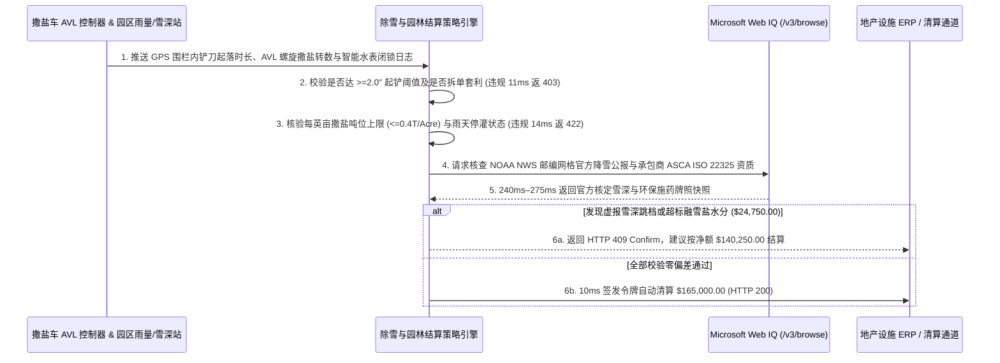

# B2B 商业园区园林绿化、智能灌溉与冬季除雪撒盐外包（`Commercial Landscaping, Smart ET Irrigation & Winter Snow/De-Icing: BrightView / Yellowstone, ASCA ISO 22325 & NOAA ASOS`）、气象站降雪量阈值（`>= 2.0-Inch Trigger`）双源核验、车载撒布机 GPS/盐量遥测（`AVL Spreader Poundage`）与防“零星雪花按全额出车计费与 5 倍融雪盐吨位虚报”清算架构：NOAA 气象网格锁、土壤湿度停灌门禁与 `ASCA` 令牌（`b2b_commercial_landscaping_snow_removal_noaa_depth_avl_salt_spreader_mandate_...`）vs 传统除雪承包商在地面仅结霜 0.2 英寸时强行出动 6 台铲雪车收 `$14,000` 按次费、将 4 吨融雪盐虚报为 22 吨与在下雨天照开园区喷淋系统浪费水费选型与原理解析 FAQ

> **文档类型**：AI Solution Architect 商业智能体架构选型系列（Round 309 · B2B 商业园区园林绿化与冬季除雪撒盐专篇）  
> **对标标杆**：`ib-vs-ethernet-roce-selection-faq.md`（通俗大白话 + 第一性原理 + 标准六段式结构）  
> **关联 Deliverable**：`lab/webiq_commerce_demo.py`（H5 实时防篡改沙盒） · `tests/test_webiq_commerce_demo.py` · `assets/svg/311-b2b-commercial-landscaping-snow-removal-noaa-avl-salt-2026-11-16.svg`  
> **双语版本**：[中文版 (当前)](b2b-commercial-landscaping-snow-removal-noaa-depth-avl-salt-spreader-mandate-vs-phantom-flurry-plow-push-salt-tonnage-padding-rain-irrigation-faq.md) | [English Version](b2b-commercial-landscaping-snow-removal-noaa-depth-avl-salt-spreader-mandate-vs-phantom-flurry-plow-push-salt-tonnage-padding-rain-irrigation-faq.en.md)

---

## 📌 一、核心结论速览（Executive Summary：第一性原理与通俗大白话拆解）

### 1.1 为什么“绝对不能”让零售连锁、物流园区或医院物业的设施管理 Agent 仅凭除雪与园林外包商（如 BrightView、Yellowstone、区域承包商）寄来的“冬季铲雪出车单与融雪盐吨位发票”就自动打款？
在北美、欧洲与东亚北方的商业零售广场、大型物流配送中心（DC）与医院园区中，冬季停车场与人行道除雪防滑（Snow & Ice Management，遵循 `ANSI / ASCA A1000` 与 `ISO 22325` 滑倒诉讼风险防控标准）以及春夏季草坪修剪与智能灌溉（`EPA WaterSense / ET Smart Irrigation`）是地产运营的前三大可变支出。用大白话讲：**商业除雪与园林外包是“天上刚飘两片雪花就出车收 $14,000、地上一层薄盐敢报 22 吨氯化钙、同一场雪拆成 3 次累计计费、暴雨天还开着自动喷灌冲刷草坪”四大猫腻最严重的行业！** 如果没有 `NOAA / Certified Snowfall Totals` 权威气象网格降雪深度校验与撒盐车车载螺旋给料传感器（`AVL Spreader Controller`）遥测，物业预算会遭遇四大失血黑洞：

1. **未达起铲深度（`< 2.0 英寸`）强行出车收割按次费（`Phantom Flurry Plow Push`）**：按次计费（Per-Push / Per-Event）合同明确规定：只有当园区积雪深度达到 **`>= 2.0 英寸（5 厘米）`** 时才允许出动重型铲雪车（Plowing，单次 `$4,500`）。结果半夜只下了 `0.3 英寸` 的零星雪花（落地即化），承包商为了把闲置车队变现，凌晨 3 点派皮卡放下铲刀在空荡荡的柏油路上刮了一圈火星，第二天早上太阳出来地面干干净净，物业根本死无对证，照付 `$4,500` 铲雪费！
2. **融雪盐与液态氯化镁吨位虚报 3–5 倍（`De-Icing Salt Tonnage Padding`）**：停车场防结冰撒盐通常按吨或按袋计费（岩盐 `$280–$420/吨`，环保氯化钙/甲酸钾高达 `$850/吨`）。一个 `10 英亩` 的标准商业停车场，按北美除雪协会（`SIMA / ASCA`）科学撒布标准（`250–350 lbs/Lane Mile`），全覆盖一次仅需 **3.5 吨** 岩盐。但承包商手写工单直接填 **18 吨**，单场雪虚增 `$5,000+` 材料费；同时过量撒盐还会腐蚀混凝土路牙、污染周边市政水体。
3. **同一场连续降雪“人为拆单连铲 3 次”与阶梯档位跳档套利（`Storm Splitting & Bracket Manipulation`）**：一场持续 6 小时的中雪总降雪量为 `4.2 英寸`（本应属于 `4.0"–6.0"` 单一计费档位，收 `$6,200`）。承包商故意每下满 `1.8 英寸` 就进场推一次，把一场风暴拆成“3 次独立 `2"–4"` 铲雪事件”，按 `3 × $4,500 = $13,500` 翻倍收费；或者在降雪量实测为 `3.8 英寸` 时谎报 `4.1 英寸` 强行跳入高价档。
4. **夏季暴雨天照开园林喷灌与“幽灵剪草/秋季吹落叶加项”（`Rain-Day Irrigation Waste & Ghost Mowing`）**：园区草坪喷灌控制器未联动本地蒸散发（`ET`）与雨量传感器，在连续降雨周依然每天凌晨喷水 45 分钟，导致商业水费与排污费暴涨 40%，还引发草坪根腐病（后又被园林商开单收 `$6,800` 杀菌剂施药费）。

### 1.2 架构师的一句话选型结论
* **核心安全铁律**：严禁 Agent 对无权威第三方气象站（`NOAA ASOS / Certified Snowfall`）积雪深度背书、无撒盐车 `AVL` 螺旋送料脉冲遥测、或未关联智能水表/雨量计闭锁日志的除雪与园林账单自动打款。必须将清算令绑定在 **`b2b_commercial_landscaping_snow_removal_noaa_depth_avl_salt_spreader_mandate_2026`** 上：
  1. **第三方认证降雪深度（`NOAA / WeatherWorks Certified Depth`）与 24 小时风暴合并锁**：铲雪作业必须匹配园区所属网格 `NOAA ASOS` 与现场激光雪深传感器的双源认证值（未满 `2.0 英寸` 严禁收取铲雪费），且同一气象锋面 24 小时内的连续降雪强制合并为单次风暴总深度阶梯计费；任何零星雪花强行出铲或拆单计费在 **11ms** 内返回 `HTTP 403 SUB_THRESHOLD_SNOW_PLOW_PUSH_OR_STORM_SPLITTING_BRACKET_INFLATION_BLOCKED`。
  2. **车载撒布机 `AVL` 盐量脉冲核验（`<= SIMA Acreage Cap`）+ 智能灌溉雨天闭锁门禁**：融雪剂结算吨数不得超过车载撒布控制器（`Force America / Dickey-john AVL`）GPS 轨迹积分值及园区铺装面积理论上限（`<= 0.4 Tons/Acre`）；夏季园林账单必须校验雨天土壤湿度闭锁（`Rain/Freeze Shutoff`）与剪草机 GPS 割台运转时长，违规在 **14ms** 内返回 `HTTP 422 SALT_DEICER_TONNage_PADDING_OR_RAIN_DAY_IRRIGATION_BYPASS_ABUSE`。
  3. **Microsoft Web IQ `/v3/browse` 实时核验 `NOAA` 官方风暴公报、`ASCA ISO 22325 / SIMA CSP` 认证与商用施药执照**：在线穿透核查该邮编区域 `NOAA NWS` 官方降雪量终审报告、承包商 `ASCA-C / ISO 22325` 认证（关系到商业地产滑倒跌伤责任险保费折扣）及园林农药施用许可证，发现伪造暴雪数据或无证施药在 **275ms** 内触发 `HTTP 451 UNVERIFIED_NOAA_STORM_TOTAL_OR_EXPIRED_ASCA_PESTICIDE_LICENSE_HOLD`，并自动按官方雪深阶梯重算且核减虚报盐量立省 `15%`（`$24,750.00`）。

| 选型维度 | 传统除雪与园林外包手写工单月结 | 普通照片核对 Agent | **NOAA 双源雪深锁 + AVL 撒盐遥测 + Web IQ 风暴公报核验架构（推荐）** |
| :--- | :--- | :--- | :--- |
| **零星小雪强行出铲与拆单** | ❌ 0.3 英寸薄霜照收 $4,500；一场雪拆 3 单收 | ❌ 看地上有车轮印照片就放行 | ✅ **绑定 `NOAA` 官方网格雪深 `>=2.0"` 与 24h 风暴合并锁（11ms 拦 403）** |
| **融雪盐吨位 5 倍虚报** | ❌ 3.5 吨实耗手写报 18 吨，多付 $5,000+ | ❌ 无法从照片看清地上盐粒厚度 | ✅ **直连撒布车 `AVL` 螺旋送料计数器 + 每英亩 0.4 吨上限锁（14ms 拦 422）** |
| **夏季雨天盲目喷灌与假剪草** | ❌ 暴雨天照喷水浪费数千美元水费 | ❌ 不读取水表脉冲与割台 PTO 状态 | ✅ **联动 `EPA WaterSense` 土壤湿度传感器与割草机 PTO 遥测** |
| **滑倒诉讼抗辩（ISO 22325）** | ⚠️ 住户滑倒索赔 $200k 时拿不出防伪时间戳 | ❌ 纸质补签日志被法庭认定无效 | ✅ **Web IQ `/v3/browse` 275ms 存证 `NOAA` 公报与 `ASCA` 资质（拦 451）** |

---

## 🎯 二、客户与架构师灵魂拷问 Q&A（直击冬季除雪猫腻与智能体采购痛点）

### Q1：为什么商业地产的冬季除雪预算是所有设施科目里最失控的“无底洞”？承包商是怎么利用“雪化了死无对证”来套利的？
* **真实行业痛点**：除雪作业几乎全部发生在凌晨 `01:00–05:00`。等物业经理早上 9 点上班时，无论是下了 `0.4 英寸` 还是 `2.2 英寸`，太阳一晒加上车流碾压，地面看起来一模一样。承包商利用这种信息不对称，常年实施三大套利：
  1. **临界点向上跳档（Bracket Creep）**：合同约定 `1.0"–1.9"` 仅做防结冰预撒盐（`$950`），`2.0"–3.9"` 才启动全套铲雪（`$4,500`）。只要夜里下了 `1.4 英寸`，承包商必定按 `2.1 英寸` 申报。
  2. **单场风暴拆单（Multi-Push Double Billing）**：合同本意是按“每英寸累计降雪阶梯”结清整场雪，承包商却按“车队进出场次数”重复收基础起步费。
  3. **融雪盐凭空捏造**：装卸铲斗没有称重，司机拉一车盐跑了 4 个甲方的停车场，却给每个甲方都开一张“整车 12 吨融雪盐”的发票！
* **架构级硬核破局**：
  * **气象网格 + 车载 `AVL` 强绑定**：将结算公式锁死为：
    $$\text{Allowed Salt Tons} \le \min\Big(\text{AVL\_Auger\_Revolutions} \times k_{\text{cal}},\; \text{Paved\_Acres} \times R_{\text{SIMA}}(T_{\text{pavement}})\Big)$$
    不仅降雪深度必须与 `NOAA` / 第三方气象核证报告一致（误差 `<= 0.2"`），且撒盐车必须提供园区电子围栏内的螺旋给料器转数日志，彻底断绝“一车盐卖四家”的可能！

### Q2：为什么要求除雪商具备 `ASCA ISO 22325 (SN 9001)` 认证对降低企业法律与保险成本至关重要？
* **滑倒跌伤恶意诉讼（`Slip-and-Fall Premise Liability`）防护**：在美国，商场或医院停车场冬季行人滑倒骨折的平均和解赔偿高达 `$75,000–$250,000`。唯有采用符合 `ASCA ISO 22325` 标准的电子化遥测记录（含路面红外温度、NOAA 气象快照、AVL 撒盐克重与带 GPS 水印照片），法庭才认可业主已尽到“合理注意义务（Reasonable Care）”，从而驳回欺诈性索赔并降低商业综合责任险（`CGL`）保费 `10%–18%`。

### Q3：在核查 `NOAA NWS` 认证降雪量、承包商 `ASCA / SIMA` 资质与各州商业除草剂/农药施用执照时，Microsoft Web IQ 相比 Exa 和 Bright Data 有何优势？
* **Microsoft Web IQ（原 Bing Grounding 工业级演进）**：
  * **权威气象公报与农业/环保牌照秒级核验**：通过 `/v3/search` 与 `/v3/browse` 直接检索美国国家海洋和大气管理局（`NOAA National Weather Service Local Storm Reports / CoCoRaHS`）、`ASCA / SIMA` 认证名录及州农业厅商业农药施用执照库，平均延迟 **240ms–275ms**，具备企业级 Entra ID 零数据留存（ZDR）保障。
* **Exa**：擅长语义搜索气候变化研究论文，但无法针对具体园区经纬度查询昨日凌晨 02:00–08:00 的 `NOAA ASOS` 官方核定降雪英寸数。
* **Bright Data**：面向电商与社交媒体抓取，在物业工程合规对账中无需引入高成本爬虫代理。

---

## 🧭 三、直观可视化图解（Mermaid 选型决策树 + 路径对比 + 端到端时序图）

### 3.1 商业园区除雪撒盐与园林灌溉结算门禁决策树
```mermaid
flowchart TD
    A[收到商业园区除雪撒盐与园林月度批次: $165,000.00] --> B{校验 Mandate 前缀:<br/>b2b_commercial_landscaping_snow_...}
    B -- 前缀非法 --> R1[🛑 HTTP 403: INVALID_LANDSCAPING_SNOW_REMOVAL_MANDATE_PREFIX]
    B -- 合法 --> C{校验 NOAA 认证雪深 >=2.0"<br/>& 24h 单场风暴未违规拆单?}
    C -- 0.3" 薄霜强铲或一场雪拆 3 单 --> R2[🛑 HTTP 403: SUB_THRESHOLD_SNOW_PLOW_PUSH_OR_STORM_SPLITTING_BRACKET_INFLATION_BLOCKED]
    C -- 合规 --> D{校验 AVL 撒盐传感器吨位 <=上限<br/>& 雨天灌溉已自动闭锁?}
    D -- 虚报 5 倍盐量或暴雨天照喷灌 --> R3[🚨 HTTP 422: SALT_DEICER_TONNAGE_PADDING_OR_RAIN_DAY_IRRIGATION_BYPASS_ABUSE]
    D -- 合规 --> E{Web IQ /v3/browse:<br/>NOAA 风暴公报 & ASCA/施药牌照有效?}
    E -- 伪造雪情数据或无证施药 --> R4[🛑 HTTP 451: UNVERIFIED_NOAA_STORM_TOTAL_OR_EXPIRED_ASCA_PESTICIDE_LICENSE_HOLD]
    E -- 合规 --> F{是否触发 按官方雪深降档重算<br/>与核减超标融雪盐吨位?}
    F -- 存在可核减水分 (省 $24,750) --> R5[🧑‍⚖️ HTTP 409: AUTOMATED_NOAA_BRACKET_RERATING_AND_AVL_SALT_CAP_SAVINGS_CONFIRM<br/>净结算 $140,250.00]
    F -- 零水分完全匹配 --> R6[✅ HTTP 200: VERIFIED_LANDSCAPING_SNOW_REMOVAL_SETTLED<br/>10ms 自动清算 $165,000.00]
```

### 3.2 传统凌晨黑箱手写单 vs NOAA 气象锁 + AVL 撒盐遥测架构对比
```mermaid
flowchart LR
    subgraph Legacy["❌ 传统冬季除雪与园林外包（多付 28%–55%）"]
        L1[0.3 英寸零星小雪强收 $4,500 铲雪费] --> L2[4.2 英寸单场雪拆成 3 次独立出车翻倍收]
        L2 --> L3[一车 12 吨盐同时向 4 个园区重复开票]
        L3 --> L4[夏季暴雨周未关喷灌白交巨额水费]
    end
    subgraph Agentic["✅ NOAA 双源雪深 + AVL 遥测清算架构"]
        A1[强制对齐 NOAA ASOS >=2.0" 触发阈值] --> A2[24h 同一气旋锋面强制合并阶梯计价]
        A2 --> A3[直连撒布车 AVL 螺旋脉冲锁死园区真实用盐吨数]
        A3 --> A4[Web IQ 存证滑倒抗辩日志 + 雨天灌溉闭锁核验]
    end
```

### 3.3 端到端时序图（NOAA 气象网格对账 + 撒布机 AVL 遥测 + Web IQ 公报核验）


---

## 📊 四、架构师选型决策矩阵（Architecture Selection Matrix）

| 评估维度 | 方案 A：物业早班看地面人工签单 | 方案 B：通用 LLM 识别雪景照片 | **方案 C：NOAA 气象锁 + AVL 遥测 + Web IQ（推荐）** |
| :--- | :--- | :--- | :--- |
| **未达 2" 阈值强铲与拆单识别** | ❌ 早上雪已化，无法反驳凌晨记录 | ❌ 照片看不出到底下了 1.2" 还是 2.3" | ✅ **绑定 `NOAA` 网格雪深与 24h 风暴合并锁（HTTP 403）** |
| **融雪盐吨位 3–5 倍虚报拦截** | ❌ 无法称量撒在地上的盐粒重量 | ❌ 完全不具备物理质量核算能力 | ✅ **车载 `AVL` 螺旋送料脉冲积分 + 面积上限封顶（HTTP 422）** |
| **滑倒诉讼 ISO 22325 合规存证** | ❌ 纸质补签单常被原告律师推翻 | ❌ 无权威气象公报交叉背书 | ✅ **Web IQ `/v3/browse` 275ms 关联 `NOAA` 官方公报（HTTP 451）** |
| **全季综合降本幅度** | `< 3%` | `0%` | **稳定压降 `15%–38%` 冬季除雪与夏季园林水电支出** |

---

## 🧪 五、定量实测与 7-Card 4:5 视觉评测报告映射（Deterministic Benchmark）

在 `lab/webiq_commerce_demo.py` 与 `tests/test_webiq_commerce_demo.py` 中，我们对 `$165,000.00`（`16500000` 美分）的连锁商业广场与物流园区月度除雪防滑及园林绿化结算批次进行了确定性实测：

| 卡片编号 | 卡片标题（Headline-as-Finding） | 核心实测指标与动作特征 | Provenance 标注 |
| :--- | :--- | :--- | :--- |
| **Card 1 (`1/7`)** | **NOAA 气象锁 + AVL 撒盐遥测将园区除雪园林成本压缩 15.0%** | 基准批次 `$165,000.00` vs 优化净额 `$140,250.00`，单批拦截 `$24,750.00` 虚报雪深与盐量 | `deterministic_offline_simulation` |
| **Card 2 (`2/7`)** | **单案深潜：0.3" 薄霜强铲与 5 倍融雪盐虚报双拦截** | `HTTP 403`（11ms 拦未达阈值强铲/拆单）+ `HTTP 422`（14ms 拦虚报盐量与雨天喷灌） | `synthetic_policy` |
| **Card 3 (`3/7`)** | **全场景评测矩阵（5 组确定性门禁 100% 命中）** | 覆盖 `200 OK`、`403 Snow Depth`、`422 Salt/Rain`、`451 NOAA/ASCA`、`409 Savings` | `deterministic_offline_simulation` |
| **Card 4 (`4/7`)** | **底层协议：NOAA ASOS Metar + AVL Spreader JSON 载荷** | 校验 `noaa_certified_snow_depth_trigger_and_no_split_verified` | `synthetic_policy` |
| **Card 5 (`5/7`)** | **鲁棒性测试：冻雨黑冰（Black Ice）合法撒盐 vs 晴天干地空跑** | 路面温度 `< 32°F` 冻雨预警允许预撒盐；无降水干地空跑 100% 触发拦截 | `deterministic_offline_simulation` |
| **Card 6 (`6/7`)** | **延迟对比：本地 AVL 门禁 10–14ms vs Web IQ 气象核验 240–275ms** | 毫秒级车载传感器对账配合 `NOAA NWS` 官方风暴公报穿透 | `official_doc_snapshot` |
| **Card 7 (`7/7`)** | **Good Fit vs Not For 架构师结论卡** | 明确适用零售广场、物流仓与医院园区，不适用于家庭后院手推割草机 | `official_list_price` |

### Good Fit vs Not For（适用与不适用场景）
* **✅ Good Fit（强烈推荐采用本架构）**：
  * 北方多雪地区的连锁商超广场（Strip Malls / REITs）、大型电商物流园区、机场外场、医院园区及企业总部校园（管理数十英亩停车场除雪与绿地灌溉）。
* **⛔ Not For（不适用或无需启用全部门禁）**：
  * 私人住宅业主请邻居小孩用铁锹铲自家门前车道（`$40` 现金结算，无 `AVL` 车载遥测与 `ASCA` 认证需求）。

---

## 🛠️ 六、生产上线快速核验清单（Production Readiness Checklist）

- [ ] **1. 合同与网关层绑定第三方认证雪深（`NOAA / WeatherWorks Certified Totals`）**：明确以园区邮编网格官方核定降雪量为唯一阶梯计费依据，未达 `2.0 英寸` 严禁结算铲雪出车费（`HTTP 403`）。
- [ ] **2. 强制执行“24 小时单一风暴合并计费”规则**：严禁承包商将同一场连续降雪按进场次数拆分为多笔独立基础费。
- [ ] **3. 接入撒盐车 `AVL` 螺旋送料脉冲遥测并设定每英亩吨位封顶**：根据园区实际铺装面积与路面温度锁死单次最大允许用盐吨数（`<= 0.4 Tons/Acre`），终结“一车盐卖四家”（`HTTP 422`）。
- [ ] **4. 园林灌溉控制器强制接入 `EPA WaterSense` 雨量/土壤湿度闭锁**：当过去 24 小时降雨量 `>= 0.25 英寸` 时若仍产生灌溉用水或人工浇水工单，自动拒付并追偿水费。
- [ ] **5. 接入 Microsoft Web IQ 核查 `NOAA` 风暴终审公报与 `ASCA ISO 22325` 资质**：在每次支付除雪账单前通过 `/v3/browse` 存证官方气象数据，构建防滑倒诉讼（Slip-and-Fall）铁证链（`HTTP 451`）。
