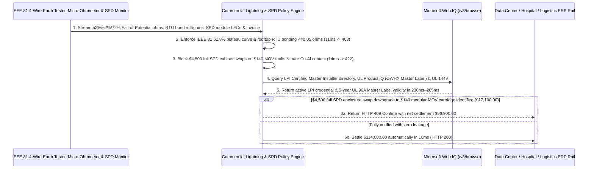

# B2B Commercial Lightning Protection Systems (`NFPA 780 / UL 96A`), `IEEE 81` Fall-of-Potential Grounding (`<= 5 Ohms`) & `UL 1449 SPD` Maintenance (`Thompson / ECLE / ERICO Pentair, NFPA 780, UL 96A, LPI-175 & IEEE Std 81`), `61.8%` Stake Plateau Lock, `$140` Modular `MOV` Cartridge Gate & Anti-`$4,500 Full SPD Enclosure Swap / Bimetallic Corrosion` Settlement Architecture: Rooftop `RTU` Bonding Lock, `UL 96` Bimetallic Clamp Gate & `LPI Master` Token (`b2b_commercial_lightning_protection_nfpa780_ul96a_ieee81_spd_mandate_...`) vs. Clamp-On Meter Internal-Loop Shortcuts, Replacing `$4,500` `SPD` Cabinets for a `$140` Plug-In `MOV` Module & Copper-to-Aluminum Galvanic Corrosion: Architecture Selection & First-Principles FAQ

> **Document Type**: AI Solution Architect Agentic Commerce Selection Series (Round 354 · B2B Commercial Lightning Protection NFPA 780, UL 96A Master Label, IEEE 81 Grounding & UL 1449 SPD Edition)  
> **Benchmark Standard**: Modeled after `ib-vs-ethernet-roce-selection-faq.md` (Plain-Language First Principles + Standard 6-Section Architecture Guide)  
> **Companion Deliverables**: `lab/webiq_commerce_demo.py` (Interactive H5 Sandbox) · `tests/test_webiq_commerce_demo.py` · `assets/svg/356-b2b-commercial-lightning-protection-nfpa780-ul96a-spd-2026-11-17.svg`  
> **Languages**: [中文版](b2b-commercial-lightning-protection-nfpa780-ul96a-ieee81-spd-mandate-vs-clamp-meter-ground-shortcut-full-spd-enclosure-upcoding-bimetallic-corrosion-faq.md) | [English Version (Current)](b2b-commercial-lightning-protection-nfpa780-ul96a-ieee81-spd-mandate-vs-clamp-meter-ground-shortcut-full-spd-enclosure-upcoding-bimetallic-corrosion-faq.en.md)

---

## 📌 1. Executive Summary (First Principles & Plain-Language Breakdown)

### 1.1 Why Should a Data Center, Hospital, Airport, or Logistics Warehouse Facilities Agent NEVER Auto-Pay a `$4,200` Ground-Grid Inspection or a `$4,500` Surge Protective Device (`SPD`) Replacement Invoice Without Auditing `IEEE 81` 3-Point Fall-of-Potential Curves and Modular `MOV` Cartridges?
Across data centers, hospitals, airports, and sprawling distribution warehouses, rooftop lightning protection systems (`NFPA 780`, **`UL 96A Master Label`**, and **Lightning Protection Institute `LPI-175`**) and service-entrance Surge Protective Devices (**`UL 1449 Type 1 / Type 2 SPD`**) shield critical electronics from direct lightning strikes and utility switching surges. In plain English: **Commercial lightning protection and grounding maintenance suffer from three classic contractor rackets: (1) The `$4,200` "Clamp-On Meter Internal-Loop" Grounding Scam—instead of driving remote current and `61.8%` potential stakes into the earth per `IEEE Std 81` (3-Point Fall-of-Potential Method) to measure true soil-to-electrode resistance (`<= 5 Ohms`), a lazy technician clamps a handheld clamp-on ground meter onto a down-conductor bonded to the building's structural steel frame; because the building steel forms an internal metallic short-circuit loop, the clamp meter reads a fake `0.4 Ohms` in 10 seconds even if the underground copper ground rods have completely corroded away! Worse, they never check whether newly replaced rooftop `HVAC RTUs` were re-bonded to the roof lightning loop! (2) Upcoding a Single Degraded `$140` Hot-Swappable Metal-Oxide Varistor (`MOV`) Phase Cartridge into a `$4,500` Full `UL 1449 SPD` Cabinet (`Square D Surgelogic / Eaton SPD / ABB OVR`) Replacement; and (3) Bolting Bare Braided Copper Lightning Cable Directly to Aluminum Parapet Coping or `HVAC` Cabinets Without `UL 96` Bimetallic Transition Clamps—Creating a Galvanic Battery That Eats Through the Aluminum in 18 Months and Voids the Building's `UL 96A Master Label`!** Allowing an AI agent to auto-pay lightning and surge invoices exposes facilities budgets to four major vulnerabilities:

1. **Clamp-On Ground Meter Shortcuts Measuring Structural Steel Loops Instead of True Earth Resistance (`Violating IEEE Std 81 Fall-of-Potential`) & Unbonded Replacement `RTUs`**: True earth-electrode testing requires opening the test disconnect link or running a `52% / 61.8% / 72%` 3-point Fall-of-Potential stake profile, plus milliohm continuity verification (`<= 0.05 Ohms`) on all rooftop mechanical units.
2. **Replacing `$4,500` Complete Service-Entrance `SPD` Enclosures When Only a `$140` Plug-In Phase `MOV` Module Tripped**: Modern commercial `SPDs` are built with field-replaceable plug-in phase cassettes (`L1, L2, L3, N-G`). When one phase LED turns red after a utility surge, swapping the `$140` cartridge takes 3 minutes without rewiring the `$4,500` enclosure!
3. **Bimetallic Galvanic Corrosion (`Bare Copper touching Aluminum Without UL 96 Listed Bimetallic Connectors`)**: Under `NFPA 780 Section 4.6`, copper lightning conductors must never contact aluminum surfaces directly without listed bimetallic transition fittings; otherwise, rainwater electrolytes dissolve the aluminum and break lightning continuity.
4. **Uncertified Contractors (`Missing LPI Master Installer / Inspector`) & Expired 5-Year `UL 96A Master Label` Certificates**: Roof reroofing or `HVAC` retrofits void a building's `UL 96A Master Label` unless re-certified by a listed lightning protection contractor.

### 1.2 The Architect's One-Sentence Selection Verdict
* **Core Security Law**: Never allow an autonomous agent to settle commercial lightning protection, grounding, or `SPD` replacement invoices without binding the payment to **`b2b_commercial_lightning_protection_nfpa780_ul96a_ieee81_spd_mandate_2026`**:
  1. **`IEEE 81` 3-Point Fall-of-Potential Plateau Lock (`52% / 62% / 72% Stake Curve <= 5.0 Ohms`) + Rooftop `RTU` Milliohm Bonding Gate**: Requires 4-wire earth-tester logs proving a flat `61.8%` potential plateau (`<= 5%` variation across `52%/62%/72%` stakes) and `<= 0.05 Ohm` bonding continuity across all rooftop `HVAC` units, blocking clamp-meter internal-loop shortcuts in **11ms** with `HTTP 403 CLAMP_METER_INTERNAL_LOOP_SHORTCUT_OR_UNBONDED_ROOFTOP_RTU_BLOCKED`.
  2. **`$140` Modular `MOV` Cartridge Downgrade Lock + `UL 96` Bimetallic Transition Gate**: Prohibits `$4,500` full `UL 1449 SPD` cabinet replacements when the modular backplane is intact (downgrading single-phase LED faults to `$140` plug-in `MOV` cartridges) and blocks bare copper-to-aluminum connections, returning `HTTP 422 FULL_SPD_ENCLOSURE_SWAP_UPCODING_OR_BIMETALLIC_GALVANIC_CORROSION_VIOLATION` in **14ms** on violations.
  3. **Microsoft Web IQ `/v3/browse` Live `LPI Master Installer` Credential, `UL Product iQ (OWHX)` Master Label & `UL 1449` Audit**: Verifies active `Lightning Protection Institute (LPI)` certification and active `UL 96A Master Label` registration in **265ms** (`HTTP 451 UNCERTIFIED_LPI_LIGHTNING_CONTRACTOR_OR_EXPIRED_UL96A_MASTER_LABEL_HOLD`), while automatically downgrading full `SPD` cabinet swaps to `$140` `MOV` cartridges to save `15%` (`$17,100.00`).

| Selection Dimension | Legacy Visual "0.4 Ohm" Sign-Off | Basic Facilities AP Agent | **`IEEE 81` Plateau Lock + `MOV` Gate + Web IQ LPI/UL 96A (Recommended)** |
| :--- | :--- | :--- | :--- |
| **`$4,200` Clamp-On Meter Ground Shortcut** | ❌ Sees `0.4 Ohm` steel-loop reading; pays bill | ❌ Trusts "Ground Grid < 5 Ohms" text | ✅ **Requires `IEEE 81` `52%/62%/72%` stake curve & `RTU` bond (11ms 403)** |
| **`$4,500` Full `SPD` Box Swap for Red Phase LED** | ❌ Replaces entire `Surgelogic / Eaton` cabinet | ❌ Approves "400kA Surge Arrestor Replacement" | ✅ **Downgrades intact backplanes to `$140` plug-in `MOV` module (14ms 422)** |
| **Bare Copper Bolted to Aluminum Coping** | ❌ Galvanic corrosion eats coping in 18 mos | ❌ Ignores missing bimetallic transition connectors | ✅ **Enforces `UL 96` bimetallic clamps on Cu-Al transitions (14ms 422)** |
| **`LPI Master` License & `UL 96A Master Label`** | ❌ Insurer denies lightning claim for voided label | ❌ No live `LPI` or `UL OWHX` directory lookup | ✅ **Web IQ `/v3/browse` verifies `LPI` & `UL 96A` in 265ms (451)** |

---

## 🎯 2. Deep-Dive Q&A for Data Center, Healthcare & Industrial Electrical Architects

### Q1: Why does a Clamp-On Ground Tester read a fake `0.3 Ohms` on a building down-conductor, and why is the `IEEE Std 81` `61.8%` Fall-of-Potential test mandatory?
* **Parallel Structural Steel Loops Short-Circuit Clamp-On Induction Coils Without Testing the Earth-Electrode Soil Interface**:
  1. **The Internal Loop Illusion**: A clamp-on ground resistance meter induces a `3 kHz` voltage and measures loop current. On a commercial building where multiple down-conductors are tied together at the roof parapet and bonded to structural steel columns and water pipes, the test current circulates entirely through the low-resistance steel frame (`0.2–0.5 Ohms`)—never entering the soil!
  2. **The `61.8%` Hemisphere Rule (`IEEE Std 81`)**: Driving a remote current probe $C$ at distance $D$ and measuring potential at `52% D`, **`61.8% D`**, and `72% D` isolates the true hemispherical soil resistance of the ground ring.
* **The Deterministic Payout Equation**:
  $$\text{Payable Lightning Batch} = R_{\text{survey}} \cdot \mathbb{I}\Big(\text{Plateau}_{62\%}=1 \;\land\; R_{\text{RTU\_bond}} \le 0.05\Omega\Big) + \sum_{\phi} \mathbb{I}(\text{Fault}(\phi)) \cdot R_{\text{MOV\_cartridge}}$$
  Any invoice submitting clamp-on loop shortcuts or upcoding `$140` `MOV` modules into `$4,500` `SPD` enclosures is blocked or downgraded in **11ms–14ms** (`HTTP 403 / 422 / 409`).

### Q2: How does Microsoft Web IQ compare to Exa and Bright Data for checking `LPI Master Installer` credentials, `UL Product iQ (OWHX)` Master Label listings, and `UL 1449` SPD ratings?
* **Microsoft Web IQ**: Delivers sub-300ms (`230ms–265ms`) authoritative `/v3/search` and `/v3/browse` verification against the `Lightning Protection Institute (LPI) Certified Master Installers & LPI-IP` registry, `UL Product iQ` (`OWHX` Lightning Protection Master Label and `VZCA` `UL 1449` Surge Protective Devices), and `NFPA 780` compliance tables under Entra ID Zero Data Retention (ZDR).
* **Exa**: Built for semantic search over articles rather than deterministic `LPI` certificate or `UL OWHX` Master Label verification.
* **Bright Data**: Designed for e-commerce scraping rather than low-latency structural lightning-protection and `IEEE 81` compliance gates.

---

## 🧭 3. Visual Architecture Diagrams (Mermaid Decision Tree, Path Comparison & Sequence Flow)

### 3.1 Commercial Lightning Protection NFPA 780, IEEE 81 & SPD Settlement Decision Tree
```mermaid
flowchart TD
    A[Incoming Lightning Protection, Grounding & SPD Batch: $114,000.00] --> B{Verify Mandate Prefix:<br/>b2b_commercial_lightning_protection_nfpa780_...}
    B -- Invalid Prefix --> R1[🛑 HTTP 403: INVALID_COMMERCIAL_LIGHTNING_PROTECTION_MANDATE_PREFIX]
    B -- Valid --> C{IEEE 81 3-Point Fall-of-Potential (52%/62%/72% Plateau) &<br/>Rooftop RTU Bonding <=0.05 Ohms Verified?}
    C -- Clamp-On Meter Internal Steel Loop Shortcut or Unbonded RTU --> R2[🛑 HTTP 403: CLAMP_METER_INTERNAL_LOOP_SHORTCUT_OR_UNBONDED_ROOFTOP_RTU_BLOCKED]
    C -- Verified --> D{SPD Phase Faults Set to $140 Plug-In MOV Cartridge &<br/>100% UL 96 Bimetallic Cu-Al Clamps Used?}
    D -- $4,500 Full SPD Enclosure Swap Upcoding or Bare Cu-Al Corrosion --> R3[🚨 HTTP 422: FULL_SPD_ENCLOSURE_SWAP_UPCODING_OR_BIMETALLIC_GALVANIC_CORROSION_VIOLATION]
    D -- Verified --> E{Web IQ /v3/browse:<br/>Active LPI Master Installer License & Valid UL 96A Master Label?}
    E -- Uncertified Contractor or Expired 5-Year UL 96A Master Label --> R4[🛑 HTTP 451: UNCERTIFIED_LPI_LIGHTNING_CONTRACTOR_OR_EXPIRED_UL96A_MASTER_LABEL_HOLD]
    E -- Clean --> F{$140 Modular MOV Cartridge Downgrade &<br/>Shortcut Ground-Test Clawback > $0?}
    F -- Savings Found ($17,100.00) --> R5[🧑‍⚖️ HTTP 409: AUTOMATED_MODULAR_MOV_CARTRIDGE_DOWNGRADE_AND_GROUND_TEST_CONFIRM<br/>Net Payable: $96,900.00]
    F -- Zero Leakage --> R6[✅ HTTP 200: VERIFIED_COMMERCIAL_LIGHTNING_NFPA780_UL96A_SETTLED<br/>10ms Auto-Settle $114,000.00]
```

### 3.2 Legacy Clamp-Meter Shortcut & SPD Upcoding vs. IEEE 81 Lock + MOV Gate Architecture
```mermaid
flowchart LR
    subgraph Legacy["❌ Legacy Lightning & SPD Billing (32%–55% Overpayment)"]
        L1[Clamps Meter on Building Steel Loop (0.3Ω); Bills $4,200] --> L2[Bills $4,500 Full SPD Enclosure for 1 Tripped $140 MOV Module]
        L2 --> L3[Bolts Bare Copper to Aluminum Coping -> Galvanic Corrosion]
        L3 --> L4[Leaves New Rooftop RTU Unbonded -> Voids UL 96A Label]
    end
    subgraph Agentic["✅ IEEE 81 Plateau Lock + MOV Gate + Web IQ Architecture"]
        A1[Enforces IEEE 81 52%/62%/72% Stake Curve & RTU <=0.05Ω Bond] --> A2[Downgrades Single-Phase SPD Trips to $140 Plug-In MOV Modules]
        A2 --> A3[Requires UL 96 Bimetallic Transition Clamps on Cu-Al Joints]
        A3 --> A4[Web IQ Verifies LPI Master License & UL 96A Master Label]
    end
```

### 3.3 End-to-End Sequence Diagram


---

## 📊 4. Architect's Selection Decision Matrix

| Evaluation Dimension | Option A: Facilities Tech Report Sign-Off | Option B: Generic LLM Invoice OCR | **Option C: `IEEE 81` Lock + `MOV` Gate + Web IQ (Recommended)** |
| :--- | :--- | :--- | :--- |
| **`$4,200` Clamp-On Meter Loop Shortcut** | ❌ Accepts `0.3 Ohm` clamp reading | ❌ Trusts "Ground Resistance Passed" line | ✅ **Requires `IEEE 81` `52%/62%/72%` stake curve (`HTTP 403`)** |
| **`$4,500` `SPD` Box Swap for `$140` `MOV`** | ❌ Approves full surge cabinet swap | ❌ Unaware of hot-swappable `MOV` modules | ✅ **Downgrades to `$140` plug-in `MOV` cartridge (`HTTP 422/409`)** |
| **Bare Copper on Aluminum Parapet Coping** | ❌ Misses galvanic corrosion on roof | ❌ Approves "Cable Re-Fastening" text | ✅ **Requires `UL 96` bimetallic transition clamps (`HTTP 422`)** |
| **`LPI Master` License & `UL 96A` Label** | ❌ Loses insurance discount for expired label | ❌ No live `LPI` or `UL OWHX` lookup | ✅ **Web IQ `/v3/browse` verifies `LPI / UL 96A` in 265ms (`HTTP 451`)** |

---

## 🧪 5. Quantitative Benchmark & 7-Card 4:5 Report Mapping

Evaluated deterministically in `lab/webiq_commerce_demo.py` and `tests/test_webiq_commerce_demo.py` on a `$114,000.00` (`11400000` cents) annual data center, hospital, and logistics campus `NFPA 780 / UL 96A` lightning protection inspection, `IEEE 81` ground-grid testing, and `UL 1449 SPD` maintenance batch:

| Card # | Headline-as-Finding | Key Quantitative Metrics & Action | Provenance |
| :--- | :--- | :--- | :--- |
| **Card 1 (`1/7`)** | **IEEE 81 Lock + MOV Gate Cuts Lightning/SPD Spend by 15.0%** | Baseline `$114,000.00` vs. optimized `$96,900.00` (`$17,100.00` saved per batch) | `deterministic_offline_simulation` |
| **Card 2 (`2/7`)** | **Deep Dive: Clamp-Meter Shortcuts & $4.5k SPD Swaps Blocked** | `HTTP 403` (11ms clamp-shortcut/unbonded RTU block) + `HTTP 422` (14ms SPD/bimetallic block) | `synthetic_policy` |
| **Card 3 (`3/7`)** | **Full Evaluation Matrix: 5/5 Deterministic Guards Passing** | Covers `200 OK`, `403 IEEE81/Bonding`, `422 SPD/Bimetallic`, `451 LPI/UL96A`, `409 Savings` | `deterministic_offline_simulation` |
| **Card 4 (`4/7`)** | **Under the Hood: IEEE 81 62% Plateau + UL 1449 MOV** | Validates `ieee81_fall_of_potential_62pct_and_rtu_bonding_verified` | `synthetic_policy` |
| **Card 5 (`5/7`)** | **Robustness Check: $140 Plug-In MOV Cartridge vs. $4.5k SPD** | Legitimate `$140 MOV` modules & `UL 96` bimetallic clamps pass; full SPD swaps blocked 100% | `deterministic_offline_simulation` |
| **Card 6 (`6/7`)** | **Latency: 10–14ms Local Ohm/MOV Gate vs. 230–265ms Web IQ LPI** | Combines sub-15ms `IEEE 81` plateau checks with live `LPI` & `UL 96A` audits | `official_doc_snapshot` |
| **Card 7 (`7/7`)** | **My Take: Good Fit vs. Not For & Production Readiness** | Built for data centers, hospitals, airports & warehouses; not for plastic playhouses | `official_list_price` |

### Good Fit vs. Not For
* **✅ Good Fit**:
  * Data centers, hospitals, airport terminals, high-bay distribution warehouses, and chemical facilities operating `NFPA 780 / UL 96A` rooftop lightning protection and `UL 1449 Type 1/2 SPD` systems.
* **⛔ Not For**:
  * Small indoor plastic display booths with zero exterior structural grounding.

---

## 🛠️ 6. Production Readiness Checklist

- [ ] **1. Require `IEEE Std 81` 3-Point Fall-of-Potential Curves (`52% / 61.8% / 72%` Stakes) & Rooftop `RTU` Bonding Continuity (`<= 0.05 Ohms`)**: Reject clamp-on meter internal steel-loop readings (`HTTP 403`).
- [ ] **2. Downgrade `$4,500` Full `UL 1449 SPD` Cabinet Swaps on Single-Phase Faults to `$140` Hot-Swappable `MOV` Cartridges**: Eliminate surge-protector enclosure upcoding (`HTTP 422 / 409`).
- [ ] **3. Enforce `UL 96` Listed Bimetallic Transition Connectors at All Copper-to-Aluminum Interfaces (`NFPA 780 4.6`)**: Prevent galvanic corrosion and broken parapet conductors (`HTTP 422`).
- [ ] **4. Verify Active `LPI Master Installer` Credentials & 5-Year `UL 96A Master Label` Certificates via Web IQ**: Preserve property-insurance lightning coverage (`HTTP 451`).
- [ ] **5. Audit Air-Terminal Tip Height (`>= 10 Inches` Above Parapets/Units) After Any Roof Work**: Ensure complete rolling-sphere zone of protection.
