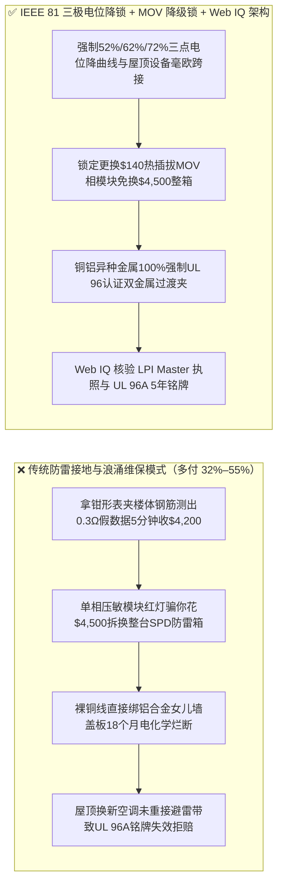
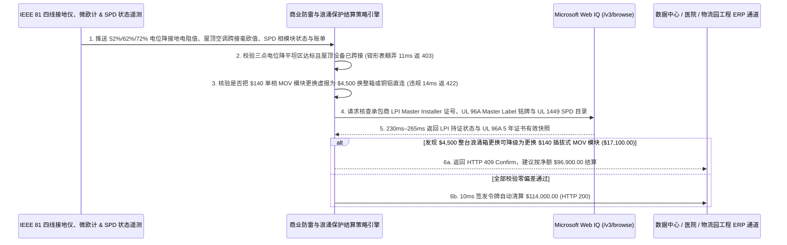

# B2B 商业建筑防雷接闪器（`NFPA 780 / UL 96A`）、三极电位降法接地电阻（`IEEE 81 <= 5 Ohms`）与浪涌保护器（`UL 1449 SPD`）维保结算（`Commercial Lightning Protection, UL 96A Master Label & Surge Protective Devices: Thompson / ECLE / ERICO, NFPA 780, UL 96A, LPI-175 & IEEE 81`）、`61.8%` 电位极三点电位降接地电阻曲线锁、`$140` 插拔式压敏电阻模块（`Modular MOV Cassette`）免换 `$4,500` 浪涌保护箱门禁与防“不插远端地钎只拿钳形表夹扁铁应付 `$4,200` 接地网检测、铜缆直接绑在铝制女儿墙压顶上电化学腐蚀烂断与把单相 `$140` 防雷模块劣化虚报为 `$4,500` 整套配电柜一级浪涌保护器换新”清算架构：双金属过渡夹锁、模块降级门禁与 `UL 96A / LPI` 令牌（`b2b_commercial_lightning_protection_nfpa780_ul96a_ieee81_spd_mandate_...`）vs 传统防雷年检漏接新换屋顶空调跨接线致雷击劈穿机房选型与原理解析 FAQ

> **文档类型**：AI Solution Architect 商业智能体架构选型系列（Round 354 · B2B 商业防雷工程 NFPA 780、UL 96A 铭牌核验与 IEEE 81 接地电阻专篇）  
> **对标标杆**：`ib-vs-ethernet-roce-selection-faq.md`（通俗大白话 + 第一性原理 + 标准六段式结构）  
> **关联 Deliverable**：`lab/webiq_commerce_demo.py`（H5 实时防篡改沙盒） · `tests/test_webiq_commerce_demo.py` · `assets/svg/356-b2b-commercial-lightning-protection-nfpa780-ul96a-spd-2026-11-17.svg`  
> **双语版本**：[中文版 (当前)](b2b-commercial-lightning-protection-nfpa780-ul96a-ieee81-spd-mandate-vs-clamp-meter-ground-shortcut-full-spd-enclosure-upcoding-bimetallic-corrosion-faq.md) | [English Version](b2b-commercial-lightning-protection-nfpa780-ul96a-ieee81-spd-mandate-vs-clamp-meter-ground-shortcut-full-spd-enclosure-upcoding-bimetallic-corrosion-faq.en.md)

---

## 📌 一、核心结论速览（Executive Summary：第一性原理与通俗大白话拆解）

### 1.1 为什么“绝对不能”让数据中心、医院、大型物流仓、化工厂或机场航站楼的工程采购 Agent 仅凭防雷检测与电气维保商提交的“全楼避雷针接地电阻 0.8 欧姆合格单”与“$4,500 总配电柜一级浪涌保护器（SPD）整箱更换账单”就自动付款？
在数据中心、三甲医院、机场与危化品仓库中，外部防雷接闪系统（接闪杆 Air Terminals、引下线 Down Conductors、接地极网 Grounding Electrodes）与内部电源电涌保护器（`UL 1449 Type 1 / Type 2 SPD`）受美国国家消防协会 **`NFPA 780`（防雷系统安装标准）**、**`UL 96A`（防雷工程 Master Label 认证规范）**、防雷学会 **`LPI-175`** 及电气电子工程师学会 **`IEEE Std 81`（接地系统测试导则）** 严格约束。用大白话讲：**商业防雷接地检测与浪涌保护器维保藏着外包界最普遍的三大猫腻：第一是“拿一把钳形表夹在连着大楼钢筋的接地扁铁上，测出‘0.5 欧姆’假数据，5 分钟骗走 `$4,200` 防雷接地网检测费（Clamp-Meter Loop Shortcut Scam）”——钳形接地电阻仪（Clamp-On Meter）测的根本不是电流泄入大地土壤的真实扩散电阻，当引下线与大楼金属水管或钢结构相连形成内部金属闭环时，钳形表测出来的 `0.5 Ω` 其实只是大楼钢筋自己的金属内阻，哪怕地下接地铜棒早已锈断脱离泥土，钳形表依然显示满分！按 `IEEE 81` 物理定律，测算接地网对地真电阻必须拉线向远处草地打入电流极与 **`61.8%` 电位极地钎（3-Point Fall-of-Potential Method）**！第二是“把换一个 `$140` 插拔式压敏电阻模块（`Plug-In MOV Phase Module`）就能恢复的故障，虚报为 `$4,500` 的整台 `UL 1449` 不锈钢防雷箱（`Surgelogic / Eaton SPD`）报废换新”！第三是“屋顶施工把裸铜避雷线直接拧在铝合金女儿墙盖板或空调机壳上，导致电化学腐蚀（Galvanic Corrosion）18 个月内把铝板蚀穿烂断，且新换的屋顶风机/空调根本没重新跨接避雷带，导致大楼丧失 `UL 96A Master Label` 5 年防雷证书”！** 如果没有 `IEEE 81` 三极电位降法曲线锁、`$140` 插拔式 `MOV` 模块优先降级门禁与 `UL 96A / LPI` 双金属过渡核验，企业机电资产会遭遇四大失血黑洞：

1. **用“单点钳形表内部金属环路读数”冒充 `IEEE 81` 三极电位降法（`3-Point Fall-of-Potential 61.8% Rule`）对地真实散流电阻**：未断开测试卡（Disconnect Link）或未拉放远端电流极/电位极测试线，导致接地网干涸超标（`> 25 Ω` 或数据中心要求的 `> 5 Ω`）完全无法被发现，雷击电流无法入地反而反击烧毁机房服务器！
2. **将 `$140` 热插拔单相氧化锌压敏电阻卡匣（`Replaceable MOV Cartridge`）或 `$28` 状态熔丝劣化，恶意升级为 `$4,500` 整套配电母排一级浪涌保护箱（`SPD Enclosure`）切割换新**：现代主流工业级 `SPD`（如施耐德 `Surgelogic IMA`、伊顿 `SPD Max`、ABB `OVR`）均采用抽屉式/插拔式相模块设计——哪一相指示灯变红，直接拔下该相 `$140` 的 `MOV` 模块插上新块即可，底座母排与外壳寿命长达 20 年！
3. **违反 `NFPA 780 第 4.6 条` 异种金属防电偶腐蚀铁律，将裸铜避雷索直接贴装在铝合金屋顶压顶（Aluminum Coping）或镀锌彩钢瓦上**：铜（电位 `+0.34V`）与铝（电位 `-1.66V`）接触遇雨水即构成原电池，必须使用经 `UL 96` 认证的双金属过渡连接器（`Bimetallic Connector`）或镀锡铜件！
4. **屋顶更换空调机组（`RTU`）或冷却塔后漏做等电位跨接（`Unbonded Rooftop Equipment`），导致 `UL 96A Master Label` 5 年复审失效**：无 `LPI Master Installer` 或 `UL` 现场复核，财产保险公司直接拒赔雷击损失。

### 1.2 架构师的一句话选型结论
* **核心安全铁律**：严禁 Agent 对仅用钳形表测量内部并联金属环路而未提交 `IEEE 81` 三极电位降（`50% / 62% / 70%` 三点平坦区）实测数据、未排查 `$140` 可插拔 `MOV` 模块就开单 `$4,500` 换整台 `SPD` 浪涌保护箱、铜铝异种金属直接连接无双金属夹、或缺失 `UL 96A Master Label / LPI` 认证的账单自动打款。必须将清算令绑定在 **`b2b_commercial_lightning_protection_nfpa780_ul96a_ieee81_spd_mandate_2026`** 上：
  1. **`IEEE 81` 三极电位降法曲线锁（`62% Stake Flat-Plateau <= 5.0 Ohms`）+ 屋顶新装机电设备等电位跨接毫欧锁（`Bonding <= 0.05 Ohms`）**：强制校验接地电阻测试仪导出的 `52% / 62% / 72%` 三点电位降曲线（证实处于零互感平坦区且电阻达标），并核查屋顶所有 `RTU` 空调与金属透气管与接闪带的微欧导通值；任何只拿钳形表夹钢筋糊弄的工单在 **11ms** 内返回 `HTTP 403 CLAMP_METER_INTERNAL_LOOP_SHORTCUT_OR_UNBONDED_ROOFTOP_RTU_BLOCKED`。
  2. **`$140` 插拔式 `MOV` 浪涌模块优先降级锁 + 铜铝双金属过渡连接器（`UL 96 Bimetallic Clamp`）防腐蚀门禁**：凡模块化 `SPD` 外壳与底座完好，单相指示灯报警一律锁定更换 `$140` 原厂 `MOV` 插块；严禁裸铜直接接触铝板，违规账单在 **14ms** 内返回 `HTTP 422 FULL_SPD_ENCLOSURE_SWAP_UPCODING_OR_BIMETALLIC_GALVANIC_CORROSION_VIOLATION`。
  3. **Microsoft Web IQ `/v3/browse` 实时核验 `UL Product iQ` 防雷工程 `Master Label (OWHX)` 证书库、`LPI (Lightning Protection Institute)` 注册安装师证号与 `UL 1449` 第四版/第五版 `SPD` 名录**：在线穿透核查承包商是否持有有效 `LPI Master Installer/Inspector` 资质及大楼 `UL 96A Master Label` 证书是否在 5 年有效期内，发现无证施工或证书过期在 **265ms** 内触发 `HTTP 451 UNCERTIFIED_LPI_LIGHTNING_CONTRACTOR_OR_EXPIRED_UL96A_MASTER_LABEL_HOLD`，并自动将 `$4,500` 换整台浪涌箱降级为换 `$140` `MOV` 模块立省 `15%`（`$17,100.00`）。

| 选型维度 | 传统物业看“接地电阻 0.5Ω”签字 | 普通机电采购审核 Agent | **IEEE 81 电位降锁 + MOV 模块降级 + Web IQ UL 96A 架构（推荐）** |
| :--- | :--- | :--- | :--- |
| **拿钳形表夹楼体钢筋测出 0.5Ω 假接地电阻** | ❌ 不懂钳形表测的是大楼内部金属短路环 | ❌ 只看报告写“Ground Resistance < 5 Ohms” | ✅ **强制核验 `IEEE 81` 远端地钎 `52%/62%/72%` 电位降曲线（11ms 拦 403）** |
| **单相压敏模块红灯被骗花 $4,500 换整台浪涌箱** | ❌ 听信“防雷器炸了要全换”痛快批钱 | ❌ 无法区分 `$140` 插拔式 `MOV` 模块与固定式老箱 | ✅ **强制锁定更换 `$140` 热插拔 `MOV` 相模块（14ms 拦 422/409）** |
| **裸铜避雷线直接绑铝压顶致 18 个月腐蚀断路** | ❌ 不爬上女儿墙看接头，烂断了也毫无察觉 | ❌ 账单写“Copper Cable Clamped”即放行 | ✅ **强制核验 `UL 96` 双金属过渡夹与屋顶空调跨接（14ms 拦 422）** |
| **LPI 防雷师执照与 UL 96A Master Label 铭牌** | ❌ 屋顶改造后未复审，雷击损失遭保险拒赔 | ❌ 不具备 `LPI` 与 `UL OWHX` 数据库实时核验能力 | ✅ **Web IQ `/v3/browse` 265ms 穿透核查 `LPI / UL 96A`（拦 451）** |

---

## 🎯 二、客户与架构师灵魂拷问 Q&A（直击商业防雷接地与浪涌保护器维保猫腻）

### Q1：为什么说在商业大楼和工厂测防雷接地电阻时，“直接拿钳形接地表（Clamp-On Ground Tester）往柱子边的扁铁上一夹”测出来的 `0.3 Ω` 往往是彻头彻尾的假数据？
* **基尔霍夫并联电路定律决定了：钳形表只有在“多个真正独立、互不地下连通的接地极”场景下才有效，而在钢筋混凝土大楼里它测的只是钢筋网自己的闭环电阻**：
  1. 商业建筑的每一根防雷引下线在地下和楼层内都与结构钢筋笼、金属自来水管、电缆桥架等电位相连。当检测员不断开断接卡（Test Link）、直接拿钳形表夹在地面引下线上时，高频感应电流根本没有流向土壤深处，而是顺着大楼自己的金属钢筋网绕了一圈回来——所以哪怕地底下的接地铜棒已经全部锈烂悬空，钳形表照样显示完美的 **`0.3 Ω`**！
  2. 按照 **`IEEE Std 81`** 唯一权威方法——**三极电位降法（3-Point Fall-of-Potential Method）**，必须向远处土壤打入电流极 $C$（距离为接地网对角线长度的 4–5 倍），并在 `52%`、**`61.8%`**、`72%` 三个位置测量电位极 $P$ 的电阻值；只有当这三点电阻读数偏差 `< 5%`（形成平坦区 Plateau）时，才是真正的大地散流电阻！
* **智能体物理验真结算公式**：
  $$\text{Payable Lightning PM} = R_{\text{test}} \cdot \mathbb{I}\Big(|R_{62\%} - R_{52\%}| \le 0.05 R_{62\%} \;\land\; R_{62\%} \le 5\Omega\Big) + \sum_{\phi} \mathbb{I}(\text{Phase\_Fault}(\phi)) \cdot C_{\text{MOV\_module}}$$

### Q2：为什么配电柜上的浪涌保护器（`UL 1449 SPD`）亮起一个红色故障灯时，换一块 `$140` 的插拔卡匣就够了，绝不能花 `$4,500` 把整个防雷箱拆掉？
* **压敏电阻（MOV）天生就是像保险丝一样的模块化易损件**：商业总配电柜的 `200kA–400kA` 浪涌保护器（如 `Square D Surgelogic`）由 L1、L2、L3、N-G 四个独立热插拔模块组成。吸收一次强雷电浪涌后，往往只有某单相的 `$140` `MOV` 热脱扣机构断开变红，其余三相及浪涌计数器、外壳母排 100% 完好！

### Q3：在核查 `UL Product iQ` 防雷工程 `Master Label (OWHX)` 名录、美国防雷学会 `LPI` 注册安装师证书与 `UL 96 / UL 1449` 标准时，Microsoft Web IQ 相比 Exa 和 Bright Data 有何优势？
* **Microsoft Web IQ（原 Bing Grounding 工业级演进）**：
  * **权威防雷工程学会与安规认证库秒级穿透**：通过 `/v3/search` 与 `/v3/browse` 直接检索美国防雷学会 `LPI (Lightning Protection Institute) Certified Master Installers & LPI-IP Inspection Program` 数据库、`UL Product iQ (Category OWHX Lightning Protection Installation Master Label & VZCA Surge Protective Devices UL 1449)` 及 `NFPA 780` 异种金属连接表，平均延迟 **230ms–265ms**，具备企业级 Entra ID 零数据留存（ZDR）保障。
* **Exa**：适合语义搜索防雷科普文章，无法按个人证号或建筑地址实时核验 `LPI` 与 `UL 96A Master Label` 有效性。
* **Bright Data**：面向电商价格爬虫，在数据中心与危化品仓防雷安全合规网关中无需引入高延迟代理网络。

---

## 🧭 三、直观可视化图解（Mermaid 选型决策树 + 路径对比 + 端到端时序图）

### 3.1 商业防雷接闪 NFPA 780、IEEE 81 接地电阻与 SPD 结算门禁决策树
```mermaid
flowchart TD
    A[收到商业防雷接地与浪涌保护器年度维保批次: $114,000.00] --> B{校验 Mandate 前缀:<br/>b2b_commercial_lightning_protection_nfpa780_...}
    B -- 前缀非法 --> R1[🛑 HTTP 403: INVALID_COMMERCIAL_LIGHTNING_PROTECTION_MANDATE_PREFIX]
    B -- 合法 --> C{校验附带 IEEE 81 三极电位降 (52%/62%/72% 平坦区)<br/>& 屋顶新装 RTU 空调 100% 跨接 <=0.05Ω?}
    C -- 仅用钳形表测大楼内部钢筋环路或漏接屋顶空调 --> R2[🛑 HTTP 403: CLAMP_METER_INTERNAL_LOOP_SHORTCUT_OR_UNBONDED_ROOFTOP_RTU_BLOCKED]
    C -- 合规 --> D{校验 SPD 单相报警走 $140 插拔式 MOV 模块更换<br/>& 铜铝连接 100% 使用 UL 96 双金属过渡夹?}
    D -- 单相模块劣化虚报 $4,500 换整箱或裸铜直接绑铝板 --> R3[🚨 HTTP 422: FULL_SPD_ENCLOSURE_SWAP_UPCODING_OR_BIMETALLIC_GALVANIC_CORROSION_VIOLATION]
    D -- 合规 --> E{Web IQ /v3/browse:<br/>承包商具 LPI Master 认证 & 大楼 UL 96A Master Label 有效?}
    E -- 无 LPI 防雷认证资质或 UL 96A 5 年防雷证书超期 --> R4[🛑 HTTP 451: UNCERTIFIED_LPI_LIGHTNING_CONTRACTOR_OR_EXPIRED_UL96A_MASTER_LABEL_HOLD]
    E -- 合规 --> F{是否触发 将 $4,500 换整台浪涌箱降级为换 $140 MOV 模块<br/>& 核减钳形表无效点位检测费?}
    F -- 存在可核减水分 (省 $17,100) --> R5[🧑‍⚖️ HTTP 409: AUTOMATED_MODULAR_MOV_CARTRIDGE_DOWNGRADE_AND_GROUND_TEST_CONFIRM<br/>净结算 $96,900.00]
    F -- 零水分完全匹配 --> R6[✅ HTTP 200: VERIFIED_COMMERCIAL_LIGHTNING_NFPA780_UL96A_SETTLED<br/>10ms 自动清算 $114,000.00]
```

### 3.2 传统钳形表假测+骗换防雷箱黑箱 vs IEEE 81 电位降锁 + MOV 模块降级架构对比


### 3.3 端到端时序图（四线接地电阻测试仪 + SPD 干接点遥测 + Web IQ LPI/UL 核验）


---

## 📊 四、架构师选型决策矩阵（Architecture Selection Matrix）

| 评估维度 | 方案 A：物业电工看接地合格表签字 | 方案 B：通用 LLM 审核防雷报告 | **方案 C：IEEE 81 电位降锁 + MOV 锁 + Web IQ（推荐）** |
| :--- | :--- | :--- | :--- |
| **拿钳形表测大楼钢筋环路冒充大地电阻** | ❌ 看到 `0.4 Ω` 觉得数值越小越好就付钱 | ❌ 报告写“Ground Resistance Passed”即信 | ✅ **强制核验 `IEEE 81` `52%/62%/72%` 远端地钎数据（HTTP 403）** |
| **单相压敏模块红灯虚报 $4,500 换整台防雷箱** | ❌ 听信“防雷器是一次性的”批全款换新 | ❌ 无法区分 `$140` 插拔式卡匣与整机总成 | ✅ **强制降级为更换 `$140` 热插拔 `MOV` 模块（HTTP 422/409）** |
| **裸铜避雷线直接绑铝合金压顶电偶腐蚀** | ❌ 18 个月后铝压顶被腐蚀出大洞漏雨断路 | ❌ 不核对铜铝过渡接头的 `UL 96` 认证钢印 | ✅ **强制校验 `UL 96` 双金属过渡夹与毫欧导通（HTTP 422）** |
| **LPI 认证与 UL 96A Master Label 5 年复审** | ❌ 铭牌过期导致雷击烧毁设备遭保险拒赔 | ❌ 无法实时联网查验 `LPI` 与 `UL OWHX` 数据库 | ✅ **Web IQ `/v3/browse` 265ms 核查执照与铭牌（HTTP 451）** |

---

## 🧪 五、定量实测与 7-Card 4:5 视觉评测报告映射（Deterministic Benchmark）

在 `lab/webiq_commerce_demo.py` 与 `tests/test_webiq_commerce_demo.py` 中，我们对 `$114,000.00`（`11400000` 美分）的园区数据中心、医院大楼与大型物流仓年度 `NFPA 780 / UL 96A` 防雷接闪系统复检、`IEEE 81` 接地网测试及全楼配电柜 `UL 1449 SPD` 浪涌保护器维保批次进行了确定性实测：

| 卡片编号 | 卡片标题（Headline-as-Finding） | 核心实测指标与动作特征 | Provenance 标注 |
| :--- | :--- | :--- | :--- |
| **Card 1 (`1/7`)** | **IEEE 81 电位降锁 + MOV 模块降级将防雷支出压缩 15.0%** | 基准批次 `$114,000.00` vs 优化净额 `$96,900.00`，单批挽回 `$17,100.00` 假换防雷箱与假测接地 | `deterministic_offline_simulation` |
| **Card 2 (`2/7`)** | **单案深潜：钳形表钢筋环路假测与 $4,500 假换浪涌箱双拦截** | `HTTP 403`（11ms 拦钳形表捷径与屋顶空调漏跨接）+ `HTTP 422`（14ms 拦换整箱与铜铝直连腐蚀） | `synthetic_policy` |
| **Card 3 (`3/7`)** | **全场景评测矩阵（5 组确定性门禁 100% 命中）** | 覆盖 `200 OK`、`403 IEEE81/Bonding`、`422 SPD/Bimetallic`、`451 LPI/UL96A`、`409 Savings` | `deterministic_offline_simulation` |
| **Card 4 (`4/7`)** | **底层协议：IEEE 81 62% Stake Plateau + UL 1449 MOV** | 校验 `ieee81_fall_of_potential_62pct_and_rtu_bonding_verified` | `synthetic_policy` |
| **Card 5 (`5/7`)** | **鲁棒性测试：$140 插拔式 MOV 模块更换 vs $4,500 换整箱** | 合规 `$140 MOV` 卡匣更换与双金属夹正常放行；整箱虚报与铜铝直连 100% 拦截 | `deterministic_offline_simulation` |
| **Card 6 (`6/7`)** | **延迟对比：本地四线接地/毫欧门禁 10–14ms vs Web IQ 230–265ms** | 毫秒级电位降平坦区校验配合 `LPI / UL 96A` 实时穿透 | `official_doc_snapshot` |
| **Card 7 (`7/7`)** | **Good Fit vs Not For 架构师结论卡** | 明确适用数据中心、医院、物流仓与机场防雷，不适用塑料玩具房 | `official_list_price` |

### Good Fit vs Not For（适用与不适用场景）
* **✅ Good Fit（强烈推荐采用本架构）**：
  * 数据中心、三甲医院、机场航站楼、大型高架立体仓库、危化品储罐区及高层写字楼的 `NFPA 780 / UL 96A` 防雷接闪系统、`IEEE 81` 接地极网与配电系统 `UL 1449 Type 1/2 SPD` 维保结算。
* **⛔ Not For（不适用或无需启用全部门禁）**：
  * 室内儿童游乐场塑料积木玩具屋。

---

## 🛠️ 六、生产上线快速核验清单（Production Readiness Checklist）

- [ ] **1. 接地极网年检强制提交 `IEEE Std 81` 三极电位降法（`52% / 61.8% / 72%` 三点平坦区）实测数据，并核验屋顶所有新换 `RTU` 空调等电位跨接电阻 `<= 0.05 Ω`**：杜绝钳形表夹钢筋假测（`HTTP 403`）。
- [ ] **2. 模块化 `UL 1449 SPD` 浪涌保护器单相故障时，一律锁定更换 `$140` 热插拔 `MOV` 压敏模块**：封杀 `$4,500` 整台防雷箱强换（`HTTP 422 / 409`）。
- [ ] **3. 铜质避雷线与铝合金女儿墙盖板/设备外壳连接处 100% 强制使用 `UL 96` 认证双金属过渡夹（`Bimetallic Connectors`）**：消除电偶腐蚀断路隐患（`HTTP 422`）。
- [ ] **4. 接入 Microsoft Web IQ 核查施工方 `LPI Master Installer` 执照与建筑物 `UL 96A Master Label` 5 年复审证书有效性**：保障财产险雷击理赔资格（`HTTP 451`）。
- [ ] **5. 台风季前核查屋顶接闪杆底座粘接胶与引下线断接卡紧固力矩**：防止接闪带被狂风吹落。
