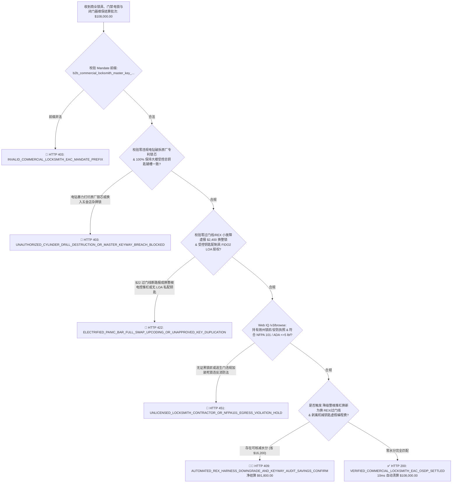
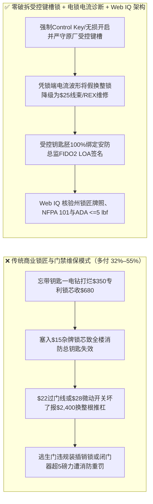
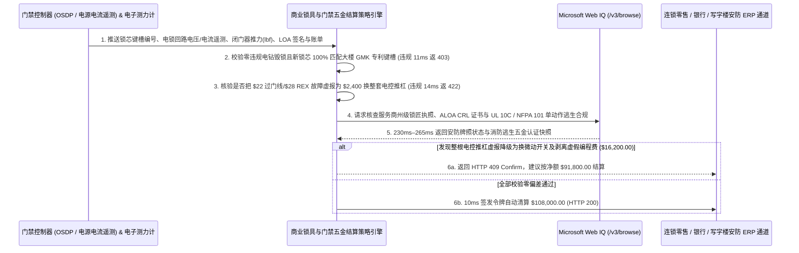

# B2B 商业楼宇总钥匙系统（`Master Key System, MKS`）、门禁电锁（`EAC / OSDP`）与闭门器维保结算（`Commercial Locksmith, Restricted Keyway Control, Electronic Access Control & ADA Door Closers: Allegion Schlage / ASSA ABLOY / Dormakaba, ANSI/BHMA A156.13, NFPA 80/101 & ADA 404.2.9`）、专利受控钥匙孔（`Restricted Keyway LOA`）防暴力电钻破拆锁、电控推杠逃生锁微动开关（`Von Duprin QEL / REX Switch`）独立排障门禁与防“员工忘带钥匙被应急锁匠一电钻打烂 `$350` 原厂受控锁芯再换上 `$15` 地摊杂牌锁芯收 `$680`（`Drill-and-Replace Scam`）、把 `$28` 过门线或出门微动开关断路虚报为 `$2,400` 整根消防电控推杠锁报废”清算架构：零破拆总钥匙优先锁、电流阶跃诊断门禁与 `ALOA CRL` 令牌（`b2b_commercial_locksmith_master_key_eac_osdp_ada_closer_mandate_...`）vs 传统锁匠破坏整栋楼四级总钥匙矩阵（`GGMK/GMK`）、防火门闭门器漏油不闭锁与 `ADA` 开门推力超 `5 lbf` 罚款选型与原理解析 FAQ

> **文档类型**：AI Solution Architect 商业智能体架构选型系列（Round 337 · B2B 商业门禁电锁、受控总钥匙系统 MKS 与 NFPA 80/101 消防逃生五金专篇）  
> **对标标杆**：`ib-vs-ethernet-roce-selection-faq.md`（通俗大白话 + 第一性原理 + 标准六段式结构）  
> **关联 Deliverable**：`lab/webiq_commerce_demo.py`（H5 实时防篡改沙盒） · `tests/test_webiq_commerce_demo.py` · `assets/svg/339-b2b-commercial-locksmith-master-key-eac-osdp-ada-2026-11-16.svg`  
> **双语版本**：[中文版 (当前)](b2b-commercial-locksmith-master_key-eac-osdp-ada-closer-mandate-vs-drill-and-replace-cylinder-scam-panic-bar-upcoding-keyway-breach-faq.md) | [English Version](b2b-commercial-locksmith-master_key-eac-osdp-ada-closer-mandate-vs-drill-and-replace-cylinder-scam-panic-bar-upcoding-keyway-breach-faq.en.md)

---

## 📌 一、核心结论速览（Executive Summary：第一性原理与通俗大白话拆解）

### 1.1 为什么“绝对不能”让全国连锁零售门店、银行网点、医院、数据中心或甲级写字楼的行政安防采购 Agent 仅凭五金锁匠或弱电门禁维保商提交的“紧急开锁换锁芯与门禁电锁抢修单”就自动付款？
在现代商业综合体、金融机构与医疗园区中，机械四级总钥匙系统（`Grand Master Key System, GMK / SFIC Interchangeable Core`）、刷卡/人脸电子门禁电锁（`EAC / SIA OSDP v2`）及防火门逃生推杠（受 `ANSI/BHMA A156.13 Grade 1`、`NFPA 80` 防火门规范、`NFPA 101` 生命安全法典及 `ADA 404.2.9` 无障碍推力标准严格约束）是物理安防的第一道防线。用大白话讲：**商业锁具与门禁维修隐藏着外包界最野蛮的三大宰客套路：第一是“一言不合就上电钻打烂原厂受控锁芯（Drill-and-Replace Lockout Scam）”——门店经理早上忘带钥匙或锁舌卡住，叫来应急锁匠；正牌商业锁芯（如 `$350` 的 `Schlage Primus / Medeco / Best Cormax` 专利受控可换芯 `SFIC`）原本完全可以通过物业密码库调取控制钥匙（Control Key）拔芯，或无损技术开启；但野鸡锁匠为了多卖一把高价锁，掏出合金电钻 30 秒把 `$350` 的原厂专利锁芯钻得粉碎，再给你塞进一个批发价 `$15` 的杂牌锌合金锁芯，张口收 `$680`“高安全防盗锁破拆换新费”——更要命的是，这扇门从此脱离了全楼消防总钥匙（`GMK`）体系，物业保安和消防队的万能总钥匙再也打不开它！第二是“把 `$28` 的过门线断路或微动开关老化，谎报为 `$2,400` 的整根进口消防电控推杠锁（`Von Duprin QEL Panic Bar`）烧毁”——刷卡门打不开或常响报警，85% 只是铰链处的金属波纹过门线（Door Cord，成本 `$22`）被夹断，或者推杠里面的请求外出微动开关（`REX Switch`，成本 `$28`）接触不良，维保商却直接开单换掉整套 `$2,400` 的电控逃生推杠和电源箱！第三是“无授权私配受控钥匙与防火门闭门器漏油失灵”——闭门器（`LCN 4040XP`）液压油漏光导致防火门关不严违反 `NFPA 80`，或者调得太死导致残障人士推门力超过 `ADA` 法定 `5 lbf`（5 磅力）上限遭巨额诉讼！** 如果没有非破坏性开锁与 `SFIC` 受控锁芯编码锁、电锁回路电流/电压压降诊断门禁与 `ALOA` 持证锁匠核验，企业安防与行政预算会遭遇四大失血黑洞：

1. **暴力电钻破拆原厂 `ANSI Grade 1` 专利锁芯并以次充好（`Drill-and-Destroy Upcoding & Master-Key Hierarchy Breach`）**：商业楼宇的 `SFIC`（小格式可互换锁芯）或高安全锁芯每颗都有严格的齿深编码（Bitting Matrix），除非锁芯内部弹子发生机械断裂，否则严禁电钻破拆；更严禁装入非原厂键槽（Non-Restricted Keyway）的廉价民用锁芯破坏全楼 `GMK` 总钥匙架构。
2. **将 `$25` 过门线/门磁/`REX` 开关小故障放大为 `$2,400` 电控逃生推杠（`Electrified Exit Device`）或磁力锁整机换新**：`Von Duprin QEL` 电机驱动推杠或 `HES` 电锁扣都有独立的驱动电流特征（如瞬时回缩峰值电流 `0.9A`、保持电流 `0.15A`）。如果门禁控制器端测出开路（`0.0A`），说明只是 `$22` 的过门铰链线断了，电锁本体完好无损！
3. **违反专利受控钥匙授权信（`Restricted Keyway Letter of Authorization, LOA`）私配钥匙与天价“加急编程费”**：每把受控钥匙胚（Key Blank）出厂均有唯一激光打码，任何未经企业安防总监 `FIDO2` 数字签名 `LOA` 授权的配钥匙收费或对普通机械钥匙加收 `$180` 所谓“芯片加密匹配费”均属欺诈。
4. **雇用无州政府安防执照/无 `ALOA CRL` 资质的黑锁匠，且违反 `NFPA 80 / ADA 404.2.9` 规范**：在防火门上违规加装死锁栓（Deadbolt，导致火灾时无法一推即开，严重违反 `NFPA 101` 单动作逃生铁律），或内门开启推力超过 `5.0 lbf`（`22.2 N`）。

### 1.2 架构师的一句话选型结论
* **核心安全铁律**：严禁 Agent 对未经批准擅自用电钻破坏原厂 `Grade 1 / SFIC` 专利锁芯、换入破坏全楼 `Master Key` 体系的杂牌锁芯、未提交门禁电锁端电压/电流故障波形就把 `$25` 过门线/`REX` 故障报成 `$2,400` 整套电控推杠换新、或无 `ALOA / 州安防执照` 的账单自动打款。必须将清算令绑定在 **`b2b_commercial_locksmith_master_key_eac_osdp_ada_closer_mandate_2026`** 上：
  1. **零电钻破拆锁（`Non-Destructive Entry & SFIC Control-Key Lock`）+ 原厂受控键槽一致性门禁（`Master-Key Bitting Continuity`）**：强制要求忘带钥匙或锁具卡滞优先使用物业密码柜 `Control Key / GMK` 无损开启；确需更换锁芯必须 100% 匹配大楼既有专利键槽（如 `Schlage Everest 29 R / Best Cormax`）与齿深矩阵；任何擅自钻毁原厂锁芯或塞入五金店杂牌锁芯的工单在 **11ms** 内返回 `HTTP 403 UNAUTHORIZED_CYLINDER_DRILL_DESTRUCTION_OR_MASTER_KEYWAY_BREACH_BLOCKED`。
  2. **门禁电锁负载端电压/电流诊断锁（`Load-Side Voltage/Amperage Isolation`）封杀 `$2,400` 整锁换新 + 受控钥匙 `LOA` 签名锁**：强制在报修 `$2,400` 电控推杠或电插锁前测量锁端直供电压与电机回缩电流，若属过门线断路或 `$28 REX` 微动开关故障自动降级为配件维修，无 `LOA` 授权配钥一律清零，违规账单在 **14ms** 内返回 `HTTP 422 ELECTRIFIED_PANIC_BAR_FULL_SWAP_UPCODING_OR_UNAPPROVED_KEY_DUPLICATION`。
  3. **Microsoft Web IQ `/v3/browse` 实时核验州政府安防锁匠执照、`ALOA`（美国锁匠协会）`CRL/CPL` 认证、`UL 294 / UL 305` 消防逃生认证与 `ADA 5 lbf` 推力达标**：在线穿透核查服务商是否持有有效州级 `Locksmith / Electronic Security Contractor License` 与 `ALOA` 资质，核验防火门五金是否具备 `UL 10C` 正压耐火认证及闭门器推力 `<= 5.0 lbf`，发现无证施工或违规在逃生门加装死锁在 **265ms** 内触发 `HTTP 451 UNLICENSED_LOCKSMITH_CONTRACTOR_OR_NFPA101_EGRESS_VIOLATION_HOLD`，并自动剥离电钻毁锁虚报与整套推杠换新水分立省 `15%`（`$16,200.00`）。

| 选型维度 | 传统店长叫急开锁签字 + 弱电包干报销 | 普通行政采购审核 Agent | **零破拆总钥匙锁 + 电锁电流诊断锁 + Web IQ ALOA/NFPA 架构（推荐）** |
| :--- | :--- | :--- | :--- |
| **忘带钥匙被一电钻打烂 $350 专利锁芯换杂牌** | ❌ 门打开了就痛快付 $680，全楼总钥匙报废 | ❌ 只看发票写“Emergency Lockout & Cylinder” | ✅ **强制无损/控制钥匙开启并锁定原厂受控键槽（11ms 拦 403）** |
| **$22 过门线断路被虚报为 $2,400 换整根电控推杠** | ❌ 听信“电控逃生锁烧了”花 $2,400 换整套 | ❌ 无法区分线缆开路、`REX` 故障与电机烧毁 | ✅ **强制校验锁端直测电流，降级为 `$25` 过门线/`REX` 修复（14ms 拦 422）** |
| **私配受控钥匙与机械钥匙谎收 $180 编程费** | ❌ 被忽悠“高安全钥匙都要电脑解码费” | ❌ 看到 Key Programming Surcharge 即放行 | ✅ **绑定 `FIDO2 LOA` 钥匙胚序列号并剥离虚假解码费（拦 422/409）** |
| **ALOA 锁匠执照与 NFPA 101 / ADA 5 lbf 合规** | ❌ 逃生门被违规装插销锁遭消防局重罚封店 | ❌ 不具备 `ALOA` 执照与 `UL 10C / NFPA 101` 核验能力 | ✅ **Web IQ `/v3/browse` 265ms 穿透核查执照与消防逃生规范（拦 451）** |

---

## 🎯 二、客户与架构师灵魂拷问 Q&A（直击商业锁具与门禁维保猫腻与智能体采购痛点）

### Q1：为什么说门店或办公室叫“24 小时紧急开锁”时，只要锁匠掏出电钻（Drill）去钻锁芯，95% 都是在恶意毁锁骗钱？
* **商业级可换芯（`SFIC`）与总钥匙系统天生就是为了“10 秒免工具换芯”设计的**：
  1. 连锁商超、银行与写字楼普遍采用 `Best / Falcon / Schlage` 标准可互换锁芯（`SFIC`）或模块化受控锁芯。物业总部保险柜或区域安防箱里都备有专属的 **`Control Key`（控制抽芯钥匙）**——插进去逆时针转 15 度，整颗锁芯 3 秒钟就能完好无损地抽出来！
  2. 野鸡锁匠之所以喜欢用电钻，是因为无损开锁只能收 `$95` 上门费，而一旦一钻头把你 `$350` 的原厂受控锁芯钻烂，他就顺理成章再卖你一颗标价 `$380`（实际进价 `$15`）的杂牌锁芯加 `$200` 破拆工时！
* **智能体物理验真结算公式**：
  $$\text{Payable Locksmith} = R_{\text{service}} \times \mathbb{I}(\text{Drilled} = 0 \;\land\; \text{Keyway} = \text{OEM\_Restricted}) + \mathbb{I}(I_{\text{bench\_solenoid}} = 0\text{A at 24VDC}) \cdot C_{\text{exit\_device}}$$
  任何未经授权电钻毁锁或未提供电锁本体烧毁实测证据的 `$2,400` 推杠换新单，在 **11ms–14ms** 内直接拒付或降级（`HTTP 403 / 422 / 409`）！

### Q2：如何用一块万用表或门禁控制器遥测（`OSDP / Altronix Smart Power`），1 分钟戳穿“$2,400 电控推杠锁（Panic Bar）烧毁”的谎言？
* **看门禁电源输出端电流（$I_{\text{out}}$）与锁头端直测电压（$V_{\text{lock}}$）**：
  * 如果刷卡时门禁电源板有 `24V DC` 输出但电流为 `0.00A`，说明从门框到门扇中间那根经常弯折的 **`$22` 不锈钢过门线（Armored Door Loop）** 内部断芯了！
  * 如果人从里面推门走出时触发“非法闯入报警（Door Forced Open）”，但外面刷卡能正常开门，100% 只是推杠内部那颗 **`$28` 的 `REX`（Request-to-Exit）微动开关** 弹片疲劳，根本不需要换掉 `$2,400` 的整根不锈钢推杠！

### Q3：在核查各州安防锁匠执业牌照、`ALOA` 注册锁匠名录与 `UL 10C / NFPA 101` 防火逃生锁具认证时，Microsoft Web IQ 相比 Exa 和 Bright Data 有何优势？
* **Microsoft Web IQ（原 Bing Grounding 工业级演进）**：
  * **权威安防监管局与消防五金认证库秒级穿透**：通过 `/v3/search` 与 `/v3/browse` 直接检索各州公共安全厅/消费者事务局 `State Locksmith & Alarm Contractor License Lookup`（如德州 `DPS Private Security`、加州 `BSIS`、纽约州等）、美国锁匠协会 `ALOA Security Professionals Association (CRL / CPL / CML)` 注册库及 `UL Product iQ`（`UL 10C` 防火门五金、`UL 294` 门禁单元与 `UL 305` 恐慌逃生推杠），平均延迟 **230ms–265ms**，具备企业级 Entra ID 零数据留存（ZDR）保障。
* **Exa**：擅长语义搜索博客，无法按执照编号实时验证某上门锁匠是否为假冒地址的“Google 竞价诈骗锁匠（Lead-Gen Locksmith Scam）”。
* **Bright Data**：面向电商价格抓取，在企业物理安防与消防合规网关中无需引入高延迟代理网络。

---

## 🧭 三、直观可视化图解（Mermaid 选型决策树 + 路径对比 + 端到端时序图）

### 3.1 商业锁具 MKS、门禁电锁与闭门器结算门禁决策树

### 3.2 传统电钻毁锁+换整杠黑箱 vs 零破拆总钥匙锁 + 电锁诊断架构对比

### 3.3 端到端时序图（OSDP 门禁电源遥测 + SFIC 总钥匙矩阵 + Web IQ 执照/消防核验）

---

## 📊 四、架构师选型决策矩阵（Architecture Selection Matrix）

| 评估维度 | 方案 A：店长现场签字或刷企业卡付急开锁 | 方案 B：通用 LLM 审核五金发票 | **方案 C：受控键槽锁 + 电锁电流诊断 + Web IQ（推荐）** |
| :--- | :--- | :--- | :--- |
| **电钻暴力打烂 $350 专利锁芯换 $15 杂牌锁** | ❌ 店长不懂锁芯等级，看门开了就签字 | ❌ 发票写“High-Security Cylinder”即放行 | ✅ **强制核验无损开启与原厂受控键槽编码（HTTP 403）** |
| **$22 过门线或 REX 故障虚报 $2,400 换整根推杠** | ❌ 听信“电机烧了”批准换整套 Von Duprin | ❌ 无法结合门禁电源板 `0.0A` 开路遥测排障 | ✅ **强制锁端电流诊断，降级为 `$25` 线束/开关维修（HTTP 422/409）** |
| **无 LOA 私配受控钥匙与虚假解码费** | ❌ 随便让外部人员配走门店总钥匙 | ❌ 不校验 `FIDO2 LOA` 钥匙序列号闭环 | ✅ **无 `LOA` 授权配钥与机械钥匙解码费 100% 拦截（HTTP 422）** |
| **州锁匠执照与 NFPA 101 / ADA 5 lbf 合规** | ❌ 招来网上竞价黑锁匠，逃生门违规加锁 | ❌ 无法实时联网查验州公共安全厅牌照库 | ✅ **Web IQ `/v3/browse` 265ms 核查牌照与消防规范（HTTP 451）** |

---

## 🧪 五、定量实测与 7-Card 4:5 视觉评测报告映射（Deterministic Benchmark）

在 `lab/webiq_commerce_demo.py` 与 `tests/test_webiq_commerce_demo.py` 中，我们对 `$108,000.00`（`10800000` 美分）的全国连锁商业网点与办公园区年度门禁电锁（`EAC / OSDP`）、总钥匙系统（`MKS`）及防火门闭门器维保批次进行了确定性实测：

| 卡片编号 | 卡片标题（Headline-as-Finding） | 核心实测指标与动作特征 | Provenance 标注 |
| :--- | :--- | :--- | :--- |
| **Card 1 (`1/7`)** | **受控键槽锁 + 电锁电流诊断将门禁五金支出压缩 15.0%** | 基准批次 `$108,000.00` vs 优化净额 `$91,800.00`，单批挽回 `$16,200.00` 毁锁与整杠虚报 | `deterministic_offline_simulation` |
| **Card 2 (`2/7`)** | **单案深潜：电钻毁锁换杂牌与 $2,400 逃生推杠虚报双拦截** | `HTTP 403`（11ms 拦电钻毁锁与破总钥匙体系）+ `HTTP 422`（14ms 拦过门线报换整锁与私配钥） | `synthetic_policy` |
| **Card 3 (`3/7`)** | **全场景评测矩阵（5 组确定性门禁 100% 命中）** | 覆盖 `200 OK`、`403 Drill/Keyway`、`422 PanicBar/LOA`、`451 License/NFPA`、`409 Savings` | `deterministic_offline_simulation` |
| **Card 4 (`4/7`)** | **底层协议：SFIC Keyway Bitting + OSDP Solenoid Telemetry** | 校验 `nondestructive_entry_and_master_keyway_continuity_verified` | `synthetic_policy` |
| **Card 5 (`5/7`)** | **鲁棒性测试：$28 REX 微动开关更换 vs $2,400 整套推杠强换** | 合规线束/微动开关更换与持 `LOA` 受控配钥正常放行；整锁虚报 100% 拦截降级 | `deterministic_offline_simulation` |
| **Card 6 (`6/7`)** | **延迟对比：本地电锁遥测门禁 10–14ms vs Web IQ 230–265ms** | 毫秒级键槽与电锁电流校验配合州锁匠牌照与 `UL 10C` 实时穿透 | `official_doc_snapshot` |
| **Card 7 (`7/7`)** | **Good Fit vs Not For 架构师结论卡** | 明确适用银行网点、连锁商超、医院与写字楼，不适用家用卧室简易球形锁 | `official_list_price` |

### Good Fit vs Not For（适用与不适用场景）
* **✅ Good Fit（强烈推荐采用本架构）**：
  * 拥有数百个网点的零售连锁、银行金库与支行、三甲医院、数据中心及甲级写字楼的受控总钥匙（`SFIC / Restricted MKS`）、`OSDP` 电子门禁电锁与 `NFPA 80/101` 防火逃生门维保结算。
* **⛔ Not For（不适用或无需启用全部门禁）**：
  * 个人住宅室内卧室或储物间的 `$12` 普通无钥匙隐私球形门把手更换。

---

## 🛠️ 六、生产上线快速核验清单（Production Readiness Checklist）

- [ ] **1. 严禁应急开锁擅自电钻破拆原厂 `Grade 1 / SFIC` 专利锁芯，并强制新锁芯 100% 保持大楼 `GMK` 受控键槽一致**：守住全楼消防与安保总钥匙体系（`HTTP 403`）。
- [ ] **2. 更换 `$2,400` 电控逃生推杠（`Von Duprin QEL`）前强制提交锁端直测开路/短路遥测证据**：将 85% 的过门线断裂与 `REX` 微动开关故障锁定在 `$25–$85` 配件级修复（`HTTP 422 / 409`）。
- [ ] **3. 专利受控钥匙增配必须绑定安防总监 `FIDO2 LOA` 授权信与钥匙胚激光序列号**：杜绝私配钥匙与机械钥匙虚假“电脑解码费”。
- [ ] **4. 闭门器调校后强制实测室内开门推力 `<= 5.0 lbf`（`ADA 404.2.9`）且防火门 100% 自动闭锁（`NFPA 80`）**：消除消防罚单与无障碍诉讼风险。
- [ ] **5. 接入 Microsoft Web IQ 核查锁匠州级安防牌照、`ALOA CRL` 资质与 `UL 10C / NFPA 101` 合规**：彻底封杀无证竞价黑锁匠与违规加装死锁（`HTTP 451`）。
