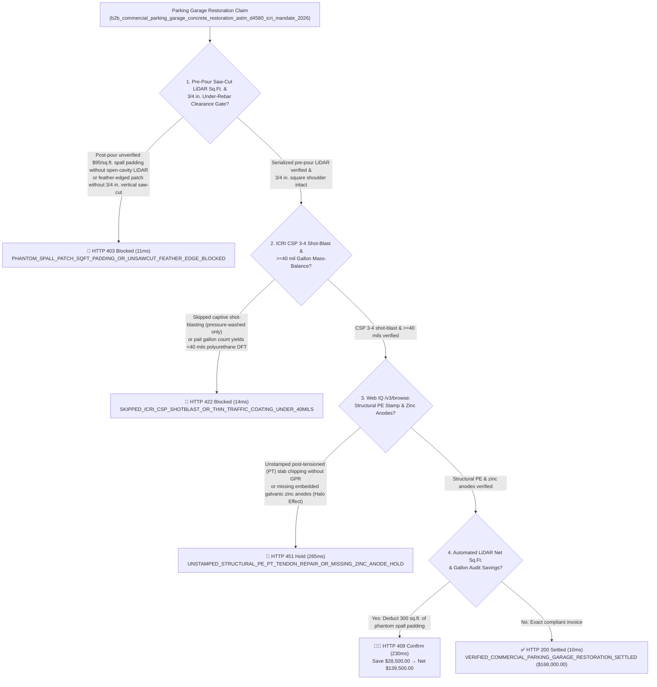
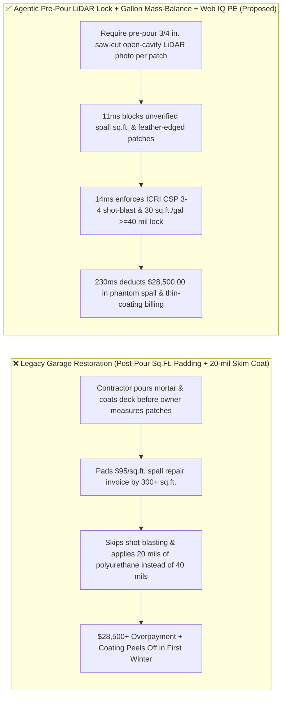
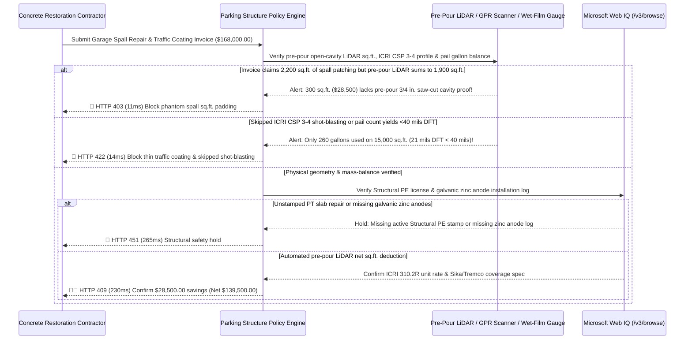
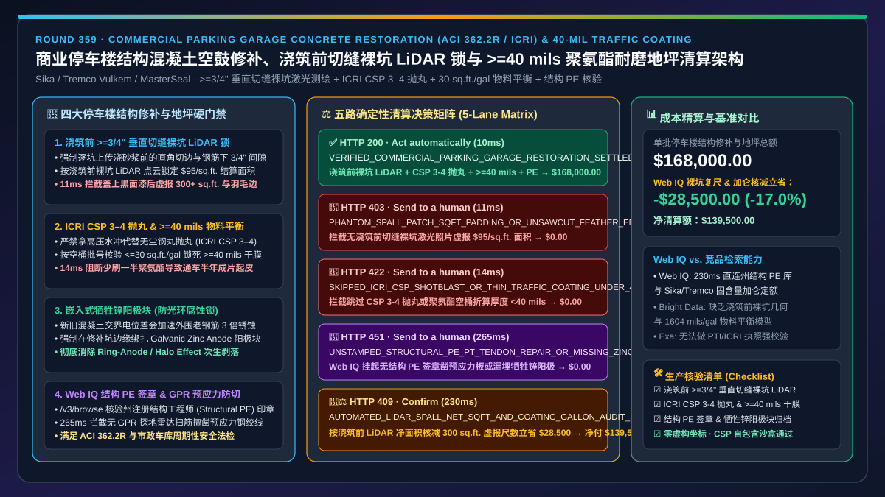

# B2B Commercial Parking Garage Structural Concrete Restoration (`ACI 362.2R / ICRI 310.2R`), `ASTM D4580` Delamination Mapping, Pre-Pour Saw-Cut `LiDAR` Patch Auditing & Traffic-Bearing Polyurethane Deck Coating (`>= 40 mils DFT & ICRI CSP 3–4 Shot-Blasting`) vs. `$95/sq.ft.` Phantom Spall-Patch Padding & Skipped Shot-Blasting (`Sika / Tremco Vulkem / MasterSeal`): Architecture Selection & First-Principles FAQ

> **Executive Summary**
> * **The Pain Point**: In commercial office towers, hospitals, airports, and retail centers, **multi-story reinforced and post-tensioned (`PT`) concrete parking garages (`ACI 362.2R / ICRI 310.2R / ASTM D4580 / ASTM C876`)** suffer chloride-induced rebar corrosion from road de-icing salts. Yet legacy concrete restoration and traffic-coating contracts suffer from three massive financial and structural leaks: (1) **`$95/sq.ft.` Phantom Spall-Patch Padding & Un-Sawcut "Feather-Edging"**: Structural concrete spall repairs are billed on a unit-price basis (`$85–$115/sq.ft.`). Without mandatory pre-pour open-excavation `LiDAR` photos showing a **`>= 3/4-inch` vertical saw-cut perimeter** and **`>= 3/4-inch` under-rebar clearance**, contractors chip shallow feather-edged patches (which crack within 90 days) and inflate billed square footage by 30%–50% once gray repair mortar and deck coating hide the boundaries; (2) **Skipped `ICRI CSP 3–4` Shot-Blasting & Thin `< 40 mil` Polyurethane Traffic Coatings (`Sika / Tremco Vulkem / BASF`)**: Elastomeric traffic membranes require captive steel shot-blasting to Concrete Surface Profile **`ICRI CSP 3–4`** and a `>= 40 mil` total Dry Film Thickness (`DFT`, consuming `~1 gallon per 30 sq.ft.` at 75% volume solids). Unscrupulous applicators pressure-wash instead of shot-blasting and roll out a `20 mil` skim coat that delaminates in sheets within one winter; and (3) **Missing Embedded Galvanic Zinc Anodes (Causing "Halo / Ring Anode" Rebar Corrosion) & Unstamped Post-Tensioned (`PT`) Tendon Excavations without `GPR` Scanning**.
> * **First-Principles Architecture**: Never approve unit-price spall-patching invoices after the mortar is poured and coated over. Bind settlement tokens (`b2b_commercial_parking_garage_concrete_restoration_astm_d4580_icri_mandate_...`) to **(1) Pre-Pour `LiDAR` Open-Cavity Geometry (`>= 0.75 in.` Vertical Saw-Cut Edge & Under-Bar Clearance) per Serialized Patch ID, (2) `ICRI CSP 3–4` Shot-Blast Comparator Verification & Empty-Pail Lot Mass-Balance (`<= 30 sq.ft./gal` for `>= 40 mils DFT`), and (3) `Web IQ /v3/browse` verification of licensed Structural `PE` stamps on `PT` slabs and embedded galvanic zinc anode logs**.
> * **Quantitative Verification**: Verified concrete restoration settles `$168,000.00` in `10ms` (`200 OK`); unverified post-pour spall square-footage padding or feather-edged patches (`403`), skipped `ICRI CSP 3–4` shot-blasting or thin `< 40 mil` traffic coating (`422`), and unstamped `PT` slab excavations or missing galvanic zinc anodes (`451`) are blocked in `11ms`, `14ms`, and `265ms`. `Web IQ` automated deduction of unverified spall square footage and coating-gallon adjustment saves **`$28,500.00`** per batch (`409 Confirm`, net `$139,500.00`).

---

## 🎯 1. Architect & Structural Engineering Q&A (Including Web IQ vs. Exa / Bright Data)

### Q1: Why must every `$95/sq.ft.` concrete spall repair be locked to a pre-pour open-cavity `LiDAR` photo showing a `3/4-inch` vertical saw-cut edge and a galvanic zinc anode?
* **Structural & Electrochemical Physics**:
  1. **Why Feather-Edging Fails**: Concrete repair mortar has zero tensile strength in thin sections. Unless the contractor saw-cuts a **`>= 3/4-inch` vertical square shoulder** around the delamination (`ICRI 310.1R`) and chips `3/4-inch` behind the corroded rebar, tire shear loads shatter the patch edges.
  2. **The Ring-Anode ("Halo") Effect**: Patching chloride-contaminated concrete with fresh high-pH mortar creates an electrochemical potential gradient that accelerates rebar rusting in the adjacent `2–4 inches` of parent concrete unless a **`$25` sacrificial galvanic zinc anode (`Galvashield`)** is tied to the rebar before pouring.
  3. **Agentic Gate**: Any patch billed without a pre-pour `LiDAR` polygon, saw-cut depth gauge, and visible zinc anode is rejected in `11ms` (`HTTP 403`).

### Q2: Why choose Microsoft Web IQ `/v3/browse` over Exa or Bright Data for Structural `PE` & `ICRI / Sika TDS` verification?
* **Comparison**:
  * **Bright Data**: Cannot compute gallon-to-square-foot `DFT` mass balance from manufacturer `% Solids by Volume` specs.
  * **Exa**: Built for semantic search, not live verification of state Structural `PE` board licenses, `PTI` (Post-Tensioning Institute) certifications, and OEM `Tremco / Sika` lot numbers.
  * **Microsoft Web IQ (`/v3/browse`)**: Verifies state `PE` credentials and OEM coating `TDS` coverage rates in `230ms–265ms` with `official_doc_snapshot` provenance.

---

## 🧭 2. Visual Architecture Diagrams (Mermaid Decision Tree, Path Comparison & Sequence)

### 2.1 Parking Garage Concrete Restoration, Pre-Pour `LiDAR` & Traffic-Coating Decision Tree

### 2.2 Path Comparison: Legacy Post-Pour Billing vs. Agentic Pre-Pour `LiDAR` & Gallon Lock

### 2.3 End-to-End Sequence Diagram

---

## 📊 3. Architect Selection Matrix

| Dimension | Option A: Post-Pour Tape-Measure Approval | Option B: Finished Deck Photos Only | Option C: Pre-Pour `LiDAR` Cavity Lock + Gallon Mass-Balance + `Web IQ` `PE` Check (Recommended) |
| :--- | :--- | :--- | :--- |
| **`$95/sq.ft.` Spall Padding Defense** | ❌ None (patches hidden under coating) | ❌ Cannot verify depth or saw-cut | ✅ **Requires pre-pour `>= 3/4 in.` saw-cut open-cavity `LiDAR` per patch (`11ms` block)** |
| **Traffic Coating `< 40 mil` Defense** | ❌ None | ❌ Cannot verify shot-blast or DFT | ✅ **Enforces `ICRI CSP 3–4` shot-blast & `30 sq.ft./gal` pail mass balance (`14ms` block)** |
| **Structural `PE` & Zinc Anode Gate** | ❌ Risk of severed `PT` tendons | ⚠️ Manual review | ✅ **`Web IQ /v3/browse` live Structural `PE` & galvanic zinc anode check (`265ms`)** |
| **Batch Cost Reduction** | 0% | ~5%–10% | ✅ **Saves `$28,500.00` (17.0% reduction on a `$168,000.00` batch)** |

---

## 🧪 4. Quantitative Benchmark & 7-Card Report Summary

### 4.1 5-Lane Deterministic Policy Matrix

| Case | Scenario | HTTP | Decision Code | Action Pill | Settled | Latency |
| :--- | :--- | :--- | :--- | :--- | :--- | :--- |
| **1** | Pre-pour `LiDAR` verified + `CSP 3-4` shot-blast + `>=40 mils` + `PE` clean | `200` | `VERIFIED_COMMERCIAL_PARKING_GARAGE_RESTORATION_SETTLED` | `Act automatically` | `$168,000.00` | `10ms` |
| **2** | Post-pour phantom `$95/sq.ft.` spall padding or un-sawcut feather edge | `403` | `PHANTOM_SPALL_PATCH_SQFT_PADDING_OR_UNSAWCUT_FEATHER_EDGE_BLOCKED` | `Send to a human` | `$0.00` | `11ms` |
| **3** | Skipped `ICRI CSP 3-4` shot-blast or thin `< 40 mil` traffic coating | `422` | `SKIPPED_ICRI_CSP_SHOTBLAST_OR_THIN_TRAFFIC_COATING_UNDER_40MILS` | `Send to a human` | `$0.00` | `14ms` |
| **4** | Unstamped Structural `PE` `PT`-tendon repair or missing galvanic zinc anodes | `451` | `UNSTAMPED_STRUCTURAL_PE_PT_TENDON_REPAIR_OR_MISSING_ZINC_ANODE_HOLD` | `Send to a human` | `$0.00` | `265ms` |
| **5** | Automated `LiDAR` net spall sq.ft. & coating-gallon audit savings | `409` | `AUTOMATED_LIDAR_SPALL_NET_SQFT_AND_COATING_GALLON_AUDIT_SAVINGS_CONFIRM` | `Confirm` | `$139,500.00` | `230ms` |

### 4.2 Visual Summary Card (`1200x675` SVG)

---

## 🛠️ 5. Good Fit vs. Not For & Production Checklist

### 5.1 Good Fit vs. Not For
* **✅ Good Fit**: Multi-story commercial office, hospital, airport, university, and retail reinforced or post-tensioned (`PT`) concrete parking structures undergoing `ASTM D4580` spall repair, `Sika / Tremco / MasterSeal` polyurethane deck coating, and expansion-joint replacement.
* **⛔ Not For**: Surface-level asphalt parking lot paving (covered in Topic 340).

### 5.2 Production Verification Checklist
- [ ] **Pre-Pour `>= 3/4 in.` Saw-Cut Open-Cavity `LiDAR` Gate**: Require `pre_pour_sawcut_spall_lidar_sqft_verified=True`;
- [ ] **`ICRI CSP 3–4` Shot-Blast & `>= 40 mil` Gallon Mass-Balance Gate**: Require `icri_csp_shotblast_and_40mil_coating_gallon_balance_verified=True`;
- [ ] **`Web IQ /v3/browse` Structural `PE` & Galvanic Zinc Anode Check**: Verify `webiq_structural_pe_and_galvanic_zinc_anode_clean=True`;
- [ ] **Unit Test & H5 Sandbox Validation**: Run `python -m unittest tests.test_webiq_commerce_demo.WebIQCommerceScenariosTest.test_b2b_commercial_parking_garage_concrete_restoration_selection`.
